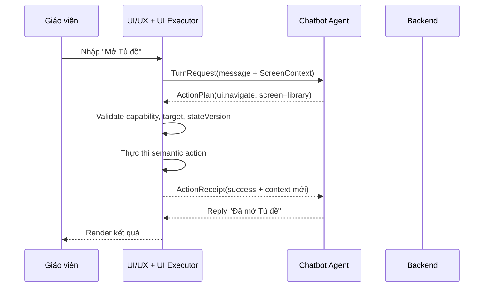

# Báo cáo phối hợp Chatbot Agent và UI/UX

**Ngày:** 2026-11-16

**Đối tượng:** Team Agent và team UI/UX

**Branch đánh giá:** `feat/longlth2297/agent-ui-integration`

## 1. Kết luận cần thống nhất trước

Chatbot Agent là bộ phận **hiểu ý định và điều phối ứng dụng**. UI/UX không tự quyết định ý
nghĩa câu nói; UI chỉ cung cấp kênh nhập/xuất, ngữ cảnh đáng tin cậy và executor thực thi hành
động giao diện.

Cụm “UI gọi Agent” chỉ nói về transport kỹ thuật: UI gửi tin nhắn của người dùng đến service
Agent. Sau khi xử lý, **Agent trả instruction/action plan có cấu trúc để UI biểu diễn hoặc thực
thi**. Agent không trả JavaScript, DOM selector hay trực tiếp sửa React state.



Vì vậy hai chiều đều cần thiết:

1. **UI → Agent:** tin nhắn, conversation/workspace ID và ngữ cảnh ứng dụng hiện tại.
2. **Agent → UI:** câu trả lời, clarification/confirmation hoặc semantic instruction.
3. **UI → Agent:** receipt xác nhận instruction đã thực thi, thất bại hoặc bị từ chối.

Không có receipt thì Agent chỉ được nói “Mình sẽ mở…”, chưa được nói “Đã mở…”.

## 2. Phân chia trách nhiệm

| Team | Sở hữu | Không nên làm |
|---|---|---|
| Agent | Hiểu câu tự nhiên; giữ hội thoại/draft; chọn capability; tạo typed action plan; xử lý receipt; giải thích trạng thái | Không thao tác DOM/React; không tự bịa capability; không coi text của model là quyền phê duyệt |
| UI/UX | Chat input/rendering; xuất `ScreenContext`; registry capability đang hoạt động; executor; confirmation UI; accessibility; trả receipt | Không tự suy diễn intent hoặc backend-required fields; không thực thi action chưa đăng ký |
| Backend | Requirements/validation; draft→`ExamMatrix`; generation/job/edit API; auth/idempotency | Không sở hữu trải nghiệm hội thoại hoặc UI navigation |

## 3. Luồng instruction đúng cho UI

Ví dụ người dùng nhập “Mở Tủ đề”. UI gửi request tương đương:

```json
{
  "schema_version": "agent-turn/0.1",
  "request_id": "req-01",
  "conversation_id": "conv-01",
  "workspace_session_id": "ws-01",
  "message": "Mở Tủ đề",
  "screen_context": {
    "screen_id": "workspace",
    "state_version": 12,
    "workspace_session_id": "ws-01",
    "available_actions": ["ui.navigate"]
  }
}
```

Agent không mở trang trực tiếp. Agent trả:

```json
{
  "kind": "action_plan",
  "reply": "Mình sẽ mở Tủ đề cho thầy cô.",
  "data": {
    "plan": {
      "plan_id": "plan-01",
      "expected_state_version": 12,
      "actions": [{
        "action_id": "action-01",
        "capability_id": "ui.navigate",
        "target": "application",
        "params": {"screen_id": "library"}
      }]
    }
  }
}
```

UI kiểm tra schema, capability có enabled không, `state_version` còn đúng không, rồi mới thực
thi. UI trả `ActionReceipt`. Agent dựa vào receipt để trả lời thành công hoặc thất bại.

Đối với “Tạo đề”, Agent trước tiên thu thập yêu cầu và xin backend validation. Sau trusted
confirmation, Agent mới đề xuất instruction `exam.generate`. UI generation adapter là caller duy
nhất gọi backend và trả `jobId`. Agent không được tự gọi thêm một lần nữa.

## 4. Những gì đã có

### Agent

- `TurnRequest`, `TurnResponse`, `ScreenContext`, `ActionPlan`, `ActionReceipt` bằng Pydantic.
- Deterministic Vietnamese understanding, conversation draft và clarification.
- Capability planner/validator, stale-state guard và mock receipt executor.
- Một action mẫu `ui.navigate`, mặc định disabled nếu UI chưa quảng bá.
- Unit tests cho navigation, stale context, extra params, partial failure và idempotency.

### UI/UX

- Chat composer, message history, workspace/session store.
- Navigation và nhiều hành vi UI thực tế đã có trong React.
- `IExamService`, mock generation/progress và store tests.
- Handoff đề xuất `ScreenContext`, capability registry và action receipts.

### Branch tích hợp

- UI, backend và Agent cùng tồn tại trên một branch.
- Backend: 318 tests pass; Ruff pass.
- UI: build pass; 6 tests pass; lint exit 0.

Các kết quả trên chỉ chứng minh hai codebase cùng build/test được, chưa chứng minh UI đang được
Agent điều phối end-to-end.

## 5. Điều kiện và vấn đề còn thiếu

### 5.1. Thiếu transport UI ↔ Agent

**Hiện trạng UI:** `ExamSessions.sendMessage` tự thêm một câu assistant cố định. `App.tsx` chỉ
chuyển text vào store, không gọi Agent.

**Hiện trạng Agent:** `ConversationOrchestrator` chỉ là Python in-process; chưa có HTTP/service
adapter và chưa có endpoint nhận execution receipt.

**Giải pháp:**

- Agent team thêm transport mỏng, ví dụ `POST /agent/turns` và
  `POST /agent/execution-results`; endpoint chỉ validate/forward vào core, không chứa business
  logic mới.
- UI team thêm `agentService.ts`, pending/error turn state và append assistant response theo đúng
  conversation/workspace gốc.
- Dùng `request_id` ổn định để retry không tạo hai lượt hội thoại.

### 5.2. Contract Python và TypeScript chưa là một nguồn chuẩn

Agent hiện dùng `snake_case`; handoff UI đề xuất nhiều field `camelCase`. `TurnResponse.data` của
Agent còn là map tổng quát, trong khi UI cần discriminated union và runtime validation.

**Giải pháp:** hai team chốt `agent-ui/0.1` bằng JSON Schema/OpenAPI làm nguồn chuẩn. Sinh hoặc
kiểm tra cả Pydantic và TypeScript từ cùng snapshot. Không copy hai bộ type rồi sửa độc lập.

### 5.3. UI chưa xuất `ScreenContext` đáng tin cậy

UI chưa có `stateVersion`, selected question semantic ID, mobile pane, focused component hoặc
runtime `availableActions`. Agent không thể an toàn xử lý “cái này”, “câu này” hoặc action đến
workspace cụ thể.

**Giải pháp UI:** tạo một controller/exporter duy nhất lấy state từ App + session store; tăng
`stateVersion` khi navigation/selection/capability availability thay đổi. Không gửi DOM, CSS,
hidden answer hoặc toàn bộ đề mặc định.

### 5.4. UI chưa có capability executor

Các nút React tồn tại không đồng nghĩa Agent được phép gọi. Registry trong handoff vẫn
`advertiseToAgent=false`.

**Giải pháp UI:** triển khai executor semantic theo allowlist. MVP chỉ bật `ui.navigate` sau khi
có handler, schema validator, stale-state check và receipt test. Sau đó mới lần lượt bật
`ui.session.create`, `ui.exam.open_setup`, `ui.sidebar.set_collapsed` và `exam.generate`.

### 5.5. Agent chưa nhận execution feedback

Core có mock executor nhưng chưa có public flow nhận `ActionReceipt` từ UI và tạo final reply.

**Giải pháp Agent:** thêm method/port `handle_execution_feedback`; deduplicate theo
`feedback_id/plan_id/action_id`, pin về conversation/workspace ban đầu và không giả rollback khi
một action trước đó đã thành công.

### 5.6. Confirmation và generation chưa đủ điều kiện

Agent đang dùng `MockDraftEvaluationPort`. Backend chưa có teacher-facing schema/converter;
UI chưa có confirmation card ràng buộc request hash. Backend `/v2` là synchronous, còn UI kỳ
vọng `jobId` + SSE.

**Giải pháp chung:** chưa bật `exam.generate`. Backend cần cung cấp descriptor/evaluator, trusted
approval, idempotent job start/lookup và snapshot. UI hiển thị normalized summary và phát trusted
approval event. Agent chỉ phát instruction bằng reference đã approve.

### 5.7. Chat đang bị khóa trong lúc generation

UI truyền `disabled={isGenerating}` cho composer, trái với yêu cầu Agent tiếp tục trả lời help và
status trong lúc tạo đề.

**Giải pháp UI:** tách `agentTurnPending` khỏi `generationActive`; chỉ khóa hành động xung đột,
không khóa chat. Status phải lấy compact job snapshot, không gọi model theo mỗi progress event.

### 5.8. Identity và persistence chưa hoàn chỉnh

Conversation ID, workspace ID, job ID, exam ID và question ID chưa được map thống nhất. UI dùng
question ID dạng number; Agent dùng stable string. Cả hai bên chủ yếu in-memory.

**Giải pháp chung:** chốt canonical IDs và revision guards; định nghĩa reload/expiry. Trước khi có
durable store, UI phải nói rõ session mất khi reload và không được tuyên bố exactly-once lâu dài.

## 6. Kế hoạch phối hợp đề xuất

### Milestone 1 — Message → UI instruction, chưa generation

Mục tiêu nhỏ nhất để chứng minh Agent thật sự điều phối UI:

1. Hai team khóa schema `agent-ui/0.1`.
2. Agent mở transport cho `TurnRequest` và execution feedback.
3. UI thay placeholder assistant bằng `agentService.sendTurn`.
4. UI xuất context tối thiểu: screen, workspace, state version, enabled actions.
5. UI cài duy nhất `ui.navigate` executor.
6. Test end-to-end: nhập “Mở Tủ đề” → Agent trả instruction → UI thực thi → receipt → Agent nói
   “Đã mở Tủ đề”.

Đây là vertical slice nên làm trước. Nó kiểm tra đúng vai trò điều phối mà chưa phụ thuộc backend
generation.

### Milestone 2 — Thu thập yêu cầu và confirmation

1. Backend cung cấp requirements descriptor/evaluator đầu tiên.
2. UI render clarification và confirmation card.
3. Sửa draft làm invalid approval cũ.
4. Contract test cho hash/revision/workspace mismatch.

### Milestone 3 — Generation và chat song song

1. Chốt một generation start owner và job contract thật.
2. UI giữ chat hoạt động trong lúc job chạy.
3. Agent trả status từ snapshot và ghi pending edits.
4. Chỉ bật deferred edit khi backend có API + receipt thật.

## 7. Phân công ngay cho hai team

| Việc | Agent team | UI/UX team | Điều kiện hoàn thành |
|---|---|---|---|
| Freeze turn/action/receipt schema | Chủ trì semantic contract | Review khả năng render/execute | Cùng pass fixture contract tests |
| Turn transport | FastAPI/service adapter | `agentService.ts` + error/retry | Message có stable request ID |
| Context | Chỉ tiêu thụ/validate | Controller + exporter | Snapshot không chứa DOM và có state version |
| Navigation plan | Intent → `ui.navigate` | Handler + availability + receipt | E2E “Mở Tủ đề” pass |
| Final reply | Xử lý receipt | Render đúng conversation | Không báo thành công trước receipt |
| Confirmation | Validate feedback reference | Accessible confirmation card | Edit invalidates old approval |
| Generation | Chỉ plan approved reference | Designated start adapter | Một start duy nhất, receipt có job ID |

## 8. Tiêu chí được phép gọi là “Agent điều phối UI hoạt động”

- Tin nhắn thật từ composer đến Agent, không còn canned reply.
- Agent trả typed semantic instruction, không trả code/selector.
- UI chỉ thực thi capability đang enabled và params hợp lệ.
- Stale context, target sai và extra params bị từ chối trước side effect.
- Agent chỉ xác nhận thành công sau receipt.
- Reply/action quay về đúng conversation/workspace dù người dùng đã chuyển màn hình.
- Ít nhất một browser/integration test chạy trọn “message → plan → UI effect → receipt → reply”.

Trước khi đủ các điều kiện này, branch hiện tại nên được gọi là **shared integration baseline**,
không phải chatbot đã tích hợp xong.
