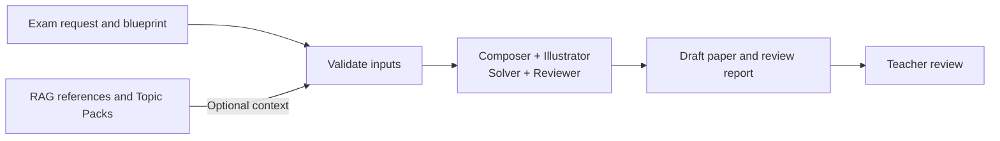

# ASTRA

ASTRA is an exam generation and verification prototype built by **Trial and Success** for CSC10014 Computational Thinking at HCMUS/APCS. It takes an exam blueprint, drafts questions and figures, and produces a paper, answer material, and a review report. Teachers use the report to check the draft before using the exam.

## How ASTRA works



The blueprint specifies topics, question types, difficulty levels, and scoring. The **Composer** drafts questions, answers, and explanations. The **Illustrator** generates figures in TikZ or PGFPlots. The **Solver** works from the questions and figures with the Composer's answer key withheld. The **Reviewer** compares the results, flags issues, and can request one revision. The pipeline saves its artifacts and review notes for the teacher. [Pipeline design and review policy](docs/architecture/PIPELINE_PLAN_AND_BENCHMARK.md)

| Workflow | When to use it | Output |
| --- | --- | --- |
| Single-agent baseline | Run a quick demo or compare against the full pipeline | Markdown report with the exam, answers, and validation results |
| Four-agent pipeline | Generate a LaTeX draft from a general exam blueprint | `de_thi.tex`, a human review checklist, and intermediate artifacts |
| [THPT math](docs/guides/THPT_TOAN.md) | Use the high school graduation math template with 12 multiple-choice, 4 true/false, and 6 short-answer questions | LaTeX paper, worked solutions, JSON answer key, and run report |
| [V-ACT](docs/guides/VACT.md) | Use the 120-question template with shared passages and data tables | LaTeX paper, worked solutions, JSON answer key, and run report |
| [Composer and Illustrator draft](docs/archive/MINI_COMPOSER_ILLUSTRATOR.md) | Prepare a draft for handoff or reviewed export, including the [HCM competency assessment profile](docs/guides/HCM_DE11_FORMAT.md) | Draft JSON, figures, and LaTeX. Approved drafts can be exported as separate student and answer-key files in PDF and DOCX |
| [RAG workbench](docs/rag-workflow.md) | Search reference material, compare retrieval modes, or retrieve context for a THPT math blueprint | Passages, per-question Topic Packs, source references, and coverage gaps |

## Quickstart

Run these commands from the repository root in PowerShell with CPython 3.11. You can reuse an existing `.venv-win` with the project dependencies installed.

```powershell
python -m venv .venv-win
$astraPython = '.\.venv-win\Scripts\python.exe'
& $astraPython -m pip install -e '.[dev]' -c requirements-tested.txt
```

### Generate a sample exam offline

The baseline uses a fixed response. The four-agent replay uses recorded fixtures to exercise the pipeline. Both run without an API key or a LaTeX compiler.

```powershell
& $astraPython -m exam_baseline.baseline.cli --offline
& $astraPython -m exam_baseline.pipeline.cli --request examples/pipeline/text_01/input.json --fixture-dir examples/pipeline/text_01 --output runs/quickstart/pipeline
```

Open `ket_qua.md` at the path printed by the baseline. For the four-agent replay, open `runs/quickstart/pipeline/de_thi.tex` and `runs/quickstart/pipeline/_internal/human_review.md`. Use a fresh output directory for each replay. Add `--compile` if you have XeLaTeX or LuaLaTeX and want to compile the paper.

### Try the retrieval workbench

```powershell
& $astraPython -m rag_workflow.app --demo
```

Open the workbench to search sample notes and compare BM25, embedding, and hybrid retrieval. Stop the server with Ctrl+C. [Local workbench](http://127.0.0.1:8765) | [Workbench guide](docs/rag-workflow.md)

## Use retrieval in exam generation

Retrieval-augmented generation (RAG) supplies reference material for the requested topics. With access to the team corpus, fetch its snapshot and retrieve context for the sample THPT math blueprint.

```powershell
git fetch origin staging/rag
& $astraPython -m rag_workflow.cli --sample-matrix --out runs/quickstart/matrix-context.json | Out-Null
```

Open `runs/quickstart/matrix-context.json`. The `question_contexts` field contains per-question Topic Packs and warnings. The `mas_intake_rag` field contains passages for handoff, and `gaps` records missing coverage. Use `--matrix` with your own blueprint or `--pack-dir` with an exported corpus pack. [Retrieval and handoff guide](docs/rag-workflow.md)

For the general pipeline, assemble a `mas-intake-v1` package with the user request, the resolved exam blueprint, and passages that match its subject, grade, textbook, edition year, and topic IDs. Map the selected passages to the fields accepted by the intake schema. This command validates the example package and writes a `PipelineRequest` for the four-agent CLI. [Example intake package](examples/mas_intake.json)

```powershell
& $astraPython -m exam_baseline.intake --input examples/mas_intake.json --pipeline --output runs/quickstart/pipeline-request.json
```

The template-specific CLIs use their own request schemas. For THPT math, place selected retrieval context in the request's `reference_material` field. [THPT math request example](examples/thpt/request.json)

## Generate with a live model

Copy `.env.example` to `.env` if needed. Set `EXAM_PROVIDER=chat_completions`, `EXAM_MODEL`, `EXAM_API_KEY`, and `EXAM_BASE_URL` for your provider. The configuration template also documents response format and token limits. [Environment template](.env.example)

**CLI.** To run the general pipeline against a live model, remove `--fixture-dir` from the replay command and choose a new output directory. Pass your own blueprint or the request generated by intake with `--request`. Run the template workflows with the following commands.

```powershell
& $astraPython -m exam_baseline.thpt.cli --request examples/thpt/request.json --output runs/thpt/exam-01
& $astraPython -m exam_baseline.vact.cli --request examples/vact/request.json --output runs/vact/exam-01
```

Edit the request files to set the topics and difficulty levels. Use `--composer-concurrency 1` for sequential generation. V-ACT also supports `--solver-concurrency 1`. To resume an interrupted V-ACT run, add `--resume` and keep the request, output path, and concurrency settings. Compile drafts using the default Vietnamese Unicode fonts with XeLaTeX or LuaLaTeX.

**HTTP API.** Start FastAPI and open Swagger UI. `POST /v1/exams/generate` returns the baseline result as JSON. `POST /v2/exams/generate` returns a LaTeX draft when the four-agent pipeline passes its technical checks. [Local Swagger UI](http://127.0.0.1:8000/docs)

```powershell
& $astraPython -m uvicorn exam_baseline.main:app --host 127.0.0.1 --port 8000
```

In a second PowerShell terminal, run the baseline against the server. To use a custom request, export the sample, edit it, and pass it with `--request`.

```powershell
$astraPython = '.\.venv-win\Scripts\python.exe'
& $astraPython -m exam_baseline.baseline.cli --live
& $astraPython -m exam_baseline.baseline.cli --export-example inputs/request.json
& $astraPython -m exam_baseline.baseline.cli --live --request inputs/request.json
```

## Review and export

Use `_internal/human_review.md` to review a four-agent draft alongside its questions, figures, and solutions. For a draft from the Composer and Illustrator workflow, the PDF/DOCX exporter prepares a review record. It requires approval tied to that draft revision and generates separate student and answer-key files. [Review and export commands](docs/MAS_INTAKE_AND_EXPORT.md)

## Tests and benchmarks

```powershell
& $astraPython -m pytest -q
& $astraPython scripts/check_repository.py
& $astraPython scripts/smoke_server.py
& $astraPython -m rag_workflow.eval --demo --mode all --out runs/quickstart/rag-eval.json | Out-Null
```

These commands run the test suite, check repository files, exercise the local API with a mock provider, and evaluate retrieval on sample notes. CI also checks dependency consistency, runs Ruff, and builds the Python wheel. [CI workflow](.github/workflows/ci.yml)

The RAG acceptance suite checks the THPT math handoff against the team corpus. The exam-generation benchmark uses independently reviewed labels to measure correctness, format compliance, validity, and fit to the blueprint. Fixture runs check that the pipeline stages work together. [RAG evaluation](eval/README.md) | [Generation benchmark](docs/architecture/PIPELINE_PLAN_AND_BENCHMARK.md#benchmark)

## Repository map

| Location | Contents |
| --- | --- |
| [`src/exam_baseline/`](src/exam_baseline/) | Exam schemas, validation, agents, template workflows, API, intake, and export |
| [`rag_workflow/`](rag_workflow/) | Corpus loading, retrieval and ranking, Topic Packs, handoff adapter, and web workbench |
| [`examples/`](examples/) and [`tests/`](tests/) | Sample requests, replay fixtures, and automated tests |
| [`docs/`](docs/) and [`eval/`](eval/) | Design notes, guides, course reports, and retrieval evaluation data |

- [Source layout and contributor guide](docs/CAU_TRUC_THU_MUC.md)
- [LaTeX templates, question banks, and answer sheets](docs/guides/LATEX_PIPELINE.md)
- [Project report](docs/reports/ASTRA_Trial_and_Success_Report.md) | [AI use declaration](docs/reports/ASTRA_Trial_and_Success_AI_Usage_Declaration.md)
- [Contribution rules](AGENTS.md) | [Original MVP plan](docs/mvp-plan.md)
