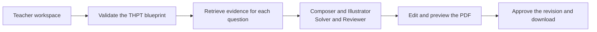

# ASTRA

ASTRA is an exam generation and verification prototype built by **Trial and Success** for CSC10014 Computational Thinking at HCMUS/APCS. The integrated web app connects the React teacher workspace to FastAPI, the retrieval-augmented generation (RAG) library, and the four-agent exam engine.

[Run the web app](#run-the-web-app) · [CLI and offline demos](#cli-and-offline-demos) · [MVP roadmap](#mvp-roadmap) · [Project report](docs/reports/ASTRA_Trial_and_Success_Report.md)

## How the integrated workflow works



The browser workflow generates **THPT math** practice papers with 22 questions and a 90-minute duration. The backend retrieves evidence from the pinned RAG corpus, binds it to blueprint slots, and sends each section's context to the Composer. The Solver uses the illustrated exam with the Composer's answers kept separate. The Reviewer flags issues for teacher inspection. Retrieval gaps stop generation, and warnings remain visible in the draft. [Connected THPT UI and API](docs/integration/CONNECTED_THPT_UI.md)

| Entry point | What it provides |
| --- | --- |
| Web app | THPT math generation, progress and source warnings, question editing or regeneration, PDF preview, and approved PDF/LaTeX and answer JSON downloads |
| Exam CLIs | THPT math and V-ACT template workflows, a general four-agent LaTeX pipeline, and a single-agent baseline |
| RAG workbench | Reference search, retrieval comparisons, Topic Packs, and coverage gaps |
| Reviewed draft exporter | PDF and DOCX student papers and answer keys from supported Composer and Illustrator draft packages |

## Run the web app

Use PowerShell on Windows with Git, CPython 3.11, and Node.js 22.12 or later. Start in the repository root. ASTRA pins Python 3.11.1 and a specific RAG corpus commit.

```powershell
python -m venv .venv-win
$astraPython = '.\.venv-win\Scripts\python.exe'
& $astraPython -m pip install -e '.[dev]' -c requirements-tested.txt
git fetch --no-tags origin 8b8fb7b09182b3d9d1eee0b95818027f52ab004d
if (-not (Test-Path .env)) { Copy-Item .env.example .env }
```

For PDF preview, use XeLaTeX, LuaLaTeX, or Tectonic with Vietnamese Babel support. The optional Windows x64 installer downloads Tectonic. Set `EXAM_LATEX_COMPILER` in the backend environment to select an installed compiler. The first compile may need network access for TeX packages.

```powershell
& $astraPython scripts/install_latex_compiler.py
```

### Configure a live model

Set the following values in the root `.env` to use GPT-6 Luna. Create a key in an OpenAI API project with access to this model. The API project controls usage and billing. [Model reference](https://developers.openai.com/api/docs/models/gpt-6-luna) · [API keys](https://platform.openai.com/api-keys)

```dotenv
EXAM_PROVIDER=chat_completions
EXAM_MODEL=gpt-6-luna
EXAM_API_KEY=<YOUR_OPENAI_API_KEY>
EXAM_BASE_URL=https://api.openai.com/v1
EXAM_TOKEN_LIMIT_FIELD=max_completion_tokens
EXAM_RESPONSE_FORMAT=json_object
EXAM_SCHEMA_AS_TOOL=false
EXAM_STRUCTURED_OUTPUT_STRICT=false
EXAM_MAX_OUTPUT_TOKENS=16384
EXAM_TIMEOUT_SECONDS=120
```

Restart the backend after changing `.env`. Keep credentials in the backend environment. If setting `EXAM_SPEND_LIMIT_USD`, configure both token prices for that model.

### Start the backend and frontend

Run one backend worker from the repository root. The local job runner stores results under `runs/ui/`. [Health endpoint](http://127.0.0.1:8000/api/health) · [Interactive API docs](http://127.0.0.1:8000/docs)

```powershell
.\.venv-win\Scripts\python.exe -m uvicorn exam_baseline.main:app --host 127.0.0.1 --port 8000
```

Start the frontend from the repository root in a second terminal. Vite forwards `/api` to port 8000. Open the URL Vite prints. [Default local web app](http://127.0.0.1:5173)

```powershell
cd astra-frontend
npm.cmd ci
npm.cmd run dev -- --host 127.0.0.1
```

## Generate, preview, and approve

1. Open the template-based composer, select THPT math, and start generation. For a focused paper, enter a line starting with `Chuyên đề:` in the request field before confirming the template. For example, `Chuyên đề: đạo hàm và tích phân lớp 11-12`.
2. Review the questions, proposed answers, and retrieval warnings. Edit or regenerate individual questions as needed.
3. Open the PDF preview to check the actual LaTeX layout, formulas, and figures. When ready, approve the current revision.
4. Download the student PDF or LaTeX and the separate teacher answer JSON. After an edit, preview and approve the new revision before downloading.

The job directory `runs/ui/<job-id>/` contains the LaTeX source and `_internal/result.json`. PDF compilation uses the saved source and runs locally. [PDF preview and export contract](docs/integration/FRONTEND_PDF_PREVIEW_HANDOFF.md)

| If you see | What to check |
| --- | --- |
| Port 8000 is in use | Check the health endpoint and use the existing ASTRA backend or stop that process before starting another. |
| `spend_limit_exceeded` | Check the configured token prices, spend limit, and local ledger. |
| `retrieval_gap` | Check which topics or slots lack evidence. Narrow the scope or load the pinned corpus before retrying. |
| `latex_compile_failed` | Open the preview's compiler log, fix the reported error, and retry compilation of the saved draft. |
| Provider unavailable or generation interrupted | Inspect the job status and run report. Completed jobs persist across backend restarts. For a demonstration, use the local replay options below. |

## CLI and offline demos

From the repository root, run the baseline fixture, four-agent replay, or standalone RAG workbench without a hosted model. Use a new output directory for each pipeline replay.

```powershell
$astraPython = '.\.venv-win\Scripts\python.exe'
& $astraPython -m exam_baseline.baseline.cli --offline
& $astraPython -m exam_baseline.pipeline.cli --request examples/pipeline/text_01/input.json --fixture-dir examples/pipeline/text_01 --output runs/pipeline/demo
& $astraPython -m rag_workflow.app --demo
```

For an offline frontend walkthrough, set `VITE_SERVICE_MODE=mock` in the frontend terminal before starting Vite. Use the browser smoke test for an integrated replay with the real pinned corpus and local PDF compiler. On Windows, use a short checkout path so nested replay checkpoint filenames fit within the path limit. Label replay and mock outputs as such. [Browser replay prerequisites](docs/integration/CONNECTED_THPT_UI.md#checks)

For live CLI generation, use the dedicated THPT math or V-ACT command. A saved run can resume with `--resume` after provider access returns. Keep the request, output path, and concurrency settings the same.

```powershell
& $astraPython -m exam_baseline.thpt.cli --request examples/thpt/request.json --output runs/thpt/exam-01
& $astraPython -m exam_baseline.vact.cli --request examples/vact/request.json --output runs/vact/exam-01
```

For THPT math, `--rag` uses the default blueprint or the supplied `--request` JSON. Use `--prompt` or `--prompt-file` to plan 22 slots within the requested curriculum. Each slot receives its own curriculum evidence, exercise patterns, and source warnings. Use `--plan-only` to inspect `planned_request.json` and `rag_audit.json` without calling the model.

```powershell
& $astraPython -m exam_baseline.thpt.cli --rag --output runs/thpt/rag-01
& $astraPython -m exam_baseline.thpt.cli --prompt "Đề chuyên đề đạo hàm và tích phân lớp 11-12" --plan-only --output runs/thpt/plan-01
```

For the general CLI, assemble `mas-intake-v1` from a resolved blueprint and selected passages, then use the intake command to write a `PipelineRequest`. [CLI retrieval and intake](docs/rag-workflow.md) · [Intake and reviewed PDF/DOCX export](docs/MAS_INTAKE_AND_EXPORT.md)

## Verification and evidence

Run `python -m pytest -q` with the project environment from the repository root. Run `npm.cmd test`, `npm.cmd run lint`, and `npm.cmd run build` from `astra-frontend`. The browser smoke test exercises generation, PDF preview, approval, download, and revision invalidation with replayed model responses. The project report records the held-out RAG metrics, the 40-attempt generation replay, and the live evaluation plan. [Integration checks](docs/integration/CONNECTED_THPT_UI.md#checks) · [Benchmark results and commands](docs/reports/ASTRA_Trial_and_Success_Report.md#measured-prototype-checks)

## MVP roadmap

- Generate exams and separate answer materials for all target subjects.
- Add reusable custom format presets for sections, scoring, and layout.
- Standardize outage recovery and add a configured fallback provider.
- Simplify the teacher workspace from blueprint setup through review and export.
- Compare ASTRA with matched baselines using human-scored quality, teacher effort, latency, and cost.
- Record every implemented feature in a demo video that plays offline.

[Detailed MVP roadmap and evidence to collect](docs/reports/ASTRA_Trial_and_Success_Report.md#mvp-roadmap)

## Source and guides

[React frontend](astra-frontend/) · [Python backend](src/exam_baseline/) · [RAG workbench](rag_workflow/) · [Sample requests](examples/) · [Tests](tests/)

[THPT math CLI](docs/guides/THPT_TOAN.md) · [V-ACT CLI](docs/guides/VACT.md) · [Source layout](docs/CAU_TRUC_THU_MUC.md) · [Project report](docs/reports/ASTRA_Trial_and_Success_Report.md) · [AI use declaration](docs/reports/ASTRA_Trial_and_Success_AI_Usage_Declaration.md)
