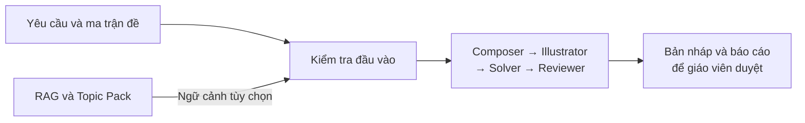
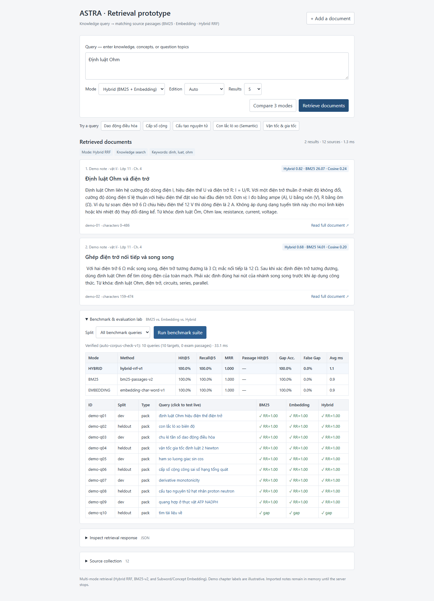

# ASTRA

ASTRA là prototype tạo và kiểm tra đề luyện tập của nhóm **Trial and Success** cho môn Tư duy tính toán (CSC10014, HCMUS/APCS). Từ yêu cầu và ma trận đề, hệ thống tạo câu hỏi, hình minh họa và lời giải, rồi ghi lại các điểm cần kiểm tra để giáo viên duyệt. Kho mã có luồng đối chứng một agent, pipeline bốn agent, các template đề riêng và công cụ truy hồi tài liệu RAG.

## Hệ thống hoạt động thế nào



Trong pipeline bốn agent, Solver nhận đề và hình nhưng không nhận đáp án của Composer. Reviewer có thể yêu cầu Composer sửa tối đa một lần. Pipeline ghi bản LaTeX và báo cáo kiểm tra để giáo viên duyệt. Với bản nháp do luồng Composer → Illustrator tạo, công cụ xuất PDF/DOCX yêu cầu xác nhận duyệt riêng. [Thiết kế pipeline](docs/architecture/PIPELINE_PLAN_AND_BENCHMARK.md) · [Intake và xuất đề sau khi duyệt](docs/MAS_INTAKE_AND_EXPORT.md)

| Luồng | Dùng khi | Kết quả |
| --- | --- | --- |
| Baseline một agent | Cần mẫu chạy nhanh hoặc đối chứng cho benchmark | Báo cáo Markdown gồm đề, đáp án và kết quả kiểm tra |
| Pipeline bốn agent | Cần tạo và kiểm tra đề LaTeX theo ma trận | `de_thi.tex` với hình TikZ/PGFPlots, `human_review.md` và dữ liệu từng bước trong `_internal/` |
| [Toán THPT](docs/guides/THPT_TOAN.md) | Cần đề theo template gốc với 12 câu trắc nghiệm, 4 câu đúng/sai và 6 câu trả lời ngắn | Đề LaTeX, lời giải Markdown, đáp án JSON và báo cáo trong `_internal/` |
| [V-ACT](docs/guides/VACT.md) | Cần đề 120 câu theo template riêng, có nhóm văn bản và bảng dữ liệu | Đề LaTeX, lời giải Markdown, đáp án JSON và báo cáo trong `_internal/` |
| [Bản nháp Composer → Illustrator](docs/archive/MINI_COMPOSER_ILLUSTRATOR.md) | Cần bản nháp để bàn giao hoặc chuẩn bị duyệt xuất đề, ví dụ [khung ĐGNL HCM từ đề tham chiếu 11](docs/guides/HCM_DE11_FORMAT.md) | Gói JSON/PNG và LaTeX nháp. Gói đã duyệt có thể xuất PDF/DOCX nếu nội dung phù hợp với trình xuất |
| [RAG workbench](docs/rag-workflow.md) | Cần tìm nguồn, so sánh BM25, embedding và hybrid, hoặc truy hồi theo ma trận Toán THPT | Đoạn tham chiếu, Topic Pack theo câu, nguồn trích dẫn và danh sách phần thiếu dữ liệu |

## Chạy thử trên máy

Chạy từ thư mục gốc của repo trong PowerShell. Ví dụ dùng CPython 3.11. Nếu đã có môi trường `.venv-win` với các dependency cần thiết, dùng lại môi trường đó.

```powershell
python -m venv .venv-win
$astraPython = '.\.venv-win\Scripts\python.exe'
& $astraPython -m pip install -e '.[dev]' -c requirements-tested.txt
```

**Baseline và pipeline bốn agent** chạy được bằng dữ liệu mẫu, không cần API key hay trình biên dịch LaTeX.

```powershell
& $astraPython -m exam_baseline.baseline.cli --offline
& $astraPython -m exam_baseline.pipeline.cli --request examples/pipeline/text_01/input.json --fixture-dir examples/pipeline/text_01 --output runs/pipeline/demo
```

Mở `ket_qua.md` theo đường dẫn lệnh baseline in ra. Với pipeline, mở `runs/pipeline/demo/de_thi.tex` và `runs/pipeline/demo/_internal/human_review.md`. Chọn thư mục output mới khi chạy lại pipeline. Để biên dịch file `.tex`, cài XeLaTeX hoặc LuaLaTeX rồi thêm `--compile`.

**RAG workbench** cũng có chế độ demo chạy bằng dữ liệu mẫu. Mở [workbench trên máy](http://127.0.0.1:8765) sau khi chạy lệnh và dừng bằng Ctrl+C.

```powershell
& $astraPython -m rag_workflow.app --demo
```

<details>
<summary>Ảnh giao diện RAG workbench</summary>



</details>

## Từ RAG đến đầu vào tạo đề

Với quyền truy cập corpus của nhóm, tải snapshot `origin/staging/rag` và chạy truy hồi cho ma trận Toán THPT mẫu.

```powershell
git fetch origin staging/rag
& $astraPython -m rag_workflow.cli --sample-matrix --out runs/sample-matrix-context.json | Out-Null
```

Mở `runs/sample-matrix-context.json` để xem kết quả. File có Topic Pack và cảnh báo theo câu trong `question_contexts`, các đoạn tham chiếu để bàn giao trong `mas_intake_rag` và danh sách thiếu dữ liệu trong `gaps`. Với ma trận riêng, dùng `--matrix`. Máy làm việc offline có thể dùng gói corpus đã xuất qua `--pack-dir`. [Hướng dẫn truy hồi ma trận và Topic Pack](docs/rag-workflow.md#mas-exam-matrix--topic-pack-handoff-toán-thpt)

Để tạo đầu vào cho pipeline tổng quát, ghép yêu cầu người dùng và cấu hình đề đã xác định với các đoạn đã chọn từ `mas_intake_rag`. Chuyển các đoạn sang trường `rag` theo schema `mas-intake-v1` và kiểm tra môn, lớp, sách, năm xuất bản và mã chủ đề khớp với cấu hình đề. Lệnh dưới đây kiểm tra [gói intake mẫu](examples/mas_intake.json) và ghi một `PipelineRequest`.

```powershell
& $astraPython -m exam_baseline.intake --input examples/mas_intake.json --pipeline --output runs/intake/pipeline_request.json
```

Các CLI theo template dùng schema riêng. Với Toán THPT, có thể chọn ngữ cảnh từ kết quả truy hồi để điền vào `reference_material` trong [request mẫu Toán THPT](examples/thpt/request.json).

## Tạo đề với model thật

Sao chép `.env.example` thành `.env` nếu chưa có file, rồi điền `EXAM_PROVIDER=chat_completions`, `EXAM_MODEL`, `EXAM_API_KEY` và `EXAM_BASE_URL` theo dịch vụ đang dùng. Chỉnh trường giới hạn token và định dạng phản hồi nếu nhà cung cấp yêu cầu. [Mẫu cấu hình](.env.example)

**Chạy trực tiếp.** Với pipeline tổng quát, bỏ `--fixture-dir` ở lệnh chạy thử để dùng model đã cấu hình. Có thể trỏ `--request` tới file từ bước intake. Hai luồng dùng template riêng chạy bằng các lệnh sau.

```powershell
& $astraPython -m exam_baseline.thpt.cli --request examples/thpt/request.json --output runs/thpt/de_01
& $astraPython -m exam_baseline.vact.cli --request examples/vact/request.json --output runs/vact/de_01
```

Sửa các file request mẫu để chọn chủ đề, mức nhận thức và ràng buộc của đề. Dùng `--composer-concurrency 1` nếu hạn mức thấp. Với V-ACT có thể thêm `--solver-concurrency 1` và tiếp tục một lần chạy bị gián đoạn bằng `--resume` với cùng request, output và mức concurrency. Dùng XeLaTeX hoặc LuaLaTeX cho font Unicode mặc định.

**Qua HTTP.** Chạy FastAPI rồi mở [Swagger UI](http://127.0.0.1:8000/docs). `POST /v1/exams/generate` trả JSON của baseline. `POST /v2/exams/generate` trả bản LaTeX nếu pipeline vượt qua các bước kiểm tra kỹ thuật, kèm yêu cầu người dùng duyệt.

```powershell
& $astraPython -m uvicorn exam_baseline.main:app --host 127.0.0.1 --port 8000
```

Trong terminal khác, có thể chạy baseline qua HTTP với request mẫu hoặc xuất mẫu JSON để chỉnh trước.

```powershell
$astraPython = '.\.venv-win\Scripts\python.exe'
& $astraPython -m exam_baseline.baseline.cli --live
& $astraPython -m exam_baseline.baseline.cli --export-example inputs/request.json
& $astraPython -m exam_baseline.baseline.cli --live --request inputs/request.json
```

## Kiểm tra và benchmark

```powershell
& $astraPython -m pytest -q
& $astraPython scripts/check_repository.py
& $astraPython scripts/smoke_server.py
& $astraPython -m rag_workflow.eval --demo --mode all --out runs/eval-rag-demo.json | Out-Null
```

`pytest` chạy bộ test của repo. Hai script kiểm tra file trong repo và gọi thử API với model giả lập. CI còn chạy Ruff, kiểm tra dependency và build wheel. [Cấu hình CI](.github/workflows/ci.yml)

Báo cáo `runs/eval-rag-demo.json` cho biết kết quả truy hồi trên bộ truy vấn mẫu. `python -m rag_workflow.eval --acceptance` kiểm tra thêm việc bàn giao ma trận Toán THPT khi có corpus. Benchmark tạo đề dùng nhãn độc lập để đo độ chính xác, đúng định dạng, hợp lệ và phù hợp yêu cầu. Các lượt chạy bằng fixture kiểm tra cách các bước kết nối với nhau. [Đánh giá RAG](eval/README.md) · [Benchmark tạo đề](docs/architecture/PIPELINE_PLAN_AND_BENCHMARK.md#benchmark)

## Tìm mã nguồn và tài liệu

| Vị trí | Nội dung |
| --- | --- |
| [`src/exam_baseline/`](src/exam_baseline/) | Schema và kiểm tra ma trận, baseline, draft, pipeline, THPT, V-ACT, intake, exporter và API |
| [`rag_workflow/`](rag_workflow/) | Nạp corpus, xếp hạng truy hồi, Topic Pack, bàn giao MAS, CLI và workbench web |
| [`examples/`](examples/) và [`tests/`](tests/) | Request mẫu, dữ liệu replay và test |
| [`docs/`](docs/) và [`eval/`](eval/) | Thiết kế, hướng dẫn theo định dạng, báo cáo môn học và dữ liệu đánh giá truy hồi |

- [Cấu trúc mã nguồn và vị trí sửa code](docs/CAU_TRUC_THU_MUC.md)
- [Nhập mẫu LaTeX, kho đề và xuất phiếu tô](docs/guides/LATEX_PIPELINE.md)
- [Báo cáo dự án](docs/reports/ASTRA_Trial_and_Success_Report.md) · [Khai báo sử dụng AI](docs/reports/ASTRA_Trial_and_Success_AI_Usage_Declaration.md)
- [Quy ước đóng góp](AGENTS.md) · [Kế hoạch MVP ban đầu](docs/mvp-plan.md)
