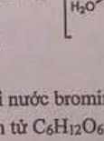
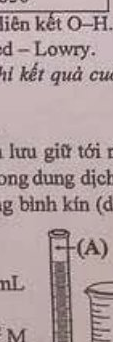
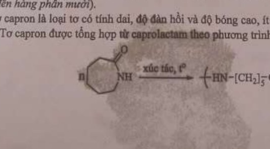
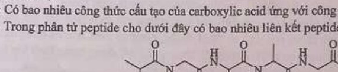

status: ocr-draft
source: official/2025-web/hoa-hoc-2025-ma-0301.pdf

# ĐỀ THI CHÍNH THỨC — KỲ THI TỐT NGHIỆP TRUNG HỌC PHỔ THÔNG NĂM 2025
**Môn thi: HÓA HỌC**  
**Mã đề: 0301**  
(Đề thi có 04 trang; thời gian làm bài 50 phút, không kể thời gian phát đề)

Cho biết nguyên tử khối: H = 1; C = 12; O = 16; Al = 27; S = 32; K = 39; Mn = 55; Fe = 56.  
Các kí hiệu và chữ viết tắt: s: rắn; l: lỏng; g: khí; aq: dung dịch nước.

## PHẦN I
Thí sinh trả lời từ câu 1 đến câu 18. Mỗi câu hỏi thí sinh chỉ chọn một phương án.

**Câu 1.** Số lượng phối tử trong phức chất $[\mathrm{Co(NH_3)_6}]^{3+}$ là

A. 1.  
B. 7.  
C. 3.  
D. 6.

**Câu 2.** Cho thế điện cực chuẩn của $\mathrm{Cu^{2+}/Cu}$ và $\mathrm{Zn^{2+}/Zn}$ lần lượt là $E_1^\circ=+0{,}340\ \mathrm{V}$ và $E_2^\circ=-0{,}763\ \mathrm{V}$. Sức điện động chuẩn của pin Galvani ($E^\circ_{\mathrm{pin}}$) tạo bởi hai cặp oxi hóa–khử $\mathrm{Cu^{2+}/Cu}$ và $\mathrm{Zn^{2+}/Zn}$ được tính theo công thức nào sau đây?

A. $E^\circ_{\mathrm{pin}}=-E_2^\circ-E_1^\circ$.  
B. $E^\circ_{\mathrm{pin}}=E_1^\circ+E_2^\circ$.  
C. $E^\circ_{\mathrm{pin}}=E_1^\circ-E_2^\circ$.  
D. $E^\circ_{\mathrm{pin}}=E_2^\circ-E_1^\circ$.

**Câu 3.** “Phenol là những hợp chất hữu cơ trong phân tử có nhóm ...(1)... liên kết trực tiếp với nguyên tử carbon của vòng benzene”. Nội dung phù hợp trong chỗ trống (1) là

A. carbonyl.  
B. amino.  
C. hydroxy.  
D. carboxyl.

**Câu 4.** Trong phản ứng tách kim loại Zn từ ZnO theo phương trình hoá học $\mathrm{ZnO(s)+C(s)\xrightarrow{t^\circ}Zn(g)+CO(g)}$, phương pháp tách kim loại nào sau đây đã được áp dụng?

A. Nhiệt luyện.  
B. Thủy luyện.  
C. Điện phân dung dịch.  
D. Điện phân nóng chảy.

**Câu 5.** Từ phổ khối lượng, phân tử khối của ester X được xác định là 74. Công thức phù hợp với X là

A. $\mathrm{C_4H_9OH}$.  
B. $\mathrm{CH_3COOCH_3}$.  
C. $\mathrm{C_2H_5COOH}$.  
D. $\mathrm{HCOOCH_3}$.

**Câu 6.** Cho phản ứng thuận nghịch sau: $\mathrm{H_2(g)+I_2(g)\rightleftharpoons 2HI(g)}$. Ở trạng thái cân bằng, nồng độ (mol L$^{-1}$) của $\mathrm{H_2(g)}$, $\mathrm{I_2(g)}$ và $\mathrm{HI(g)}$ được kí hiệu lần lượt là $[\mathrm{H_2}]$, $[\mathrm{I_2}]$ và $[\mathrm{HI}]$. Biểu thức hằng số cân bằng $K_C$ của phản ứng là

A. $K_C=\dfrac{[\mathrm{H_2}][\mathrm{I_2}]}{[\mathrm{HI}]^2}$.  
B. $K_C=\dfrac{[\mathrm{HI}]}{[\mathrm{H_2}][\mathrm{I_2}]}$.  
C. $K_C=\dfrac{[\mathrm{HI}]^2}{[\mathrm{H_2}][\mathrm{I_2}]}$.  
D. $K_C=\dfrac{[\mathrm{H_2}][\mathrm{I_2}]}{[\mathrm{HI}]}$.

**Câu 7.** Trong phòng thí nghiệm, dung dịch chất nào sau đây phù hợp để kiểm tra sự có mặt của ion $\mathrm{SO_4^{2-}(aq)}$?

A. $\mathrm{NaNO_3}$.  
B. HCl.  
C. $\mathrm{BaCl_2}$.  
D. NaCl.

**Câu 8.** Cho các phát biểu sau về tính chất của methylamine:

(a) Methylamine làm giấy quỳ tím ẩm hoá đỏ.  
(b) Methylamine phản ứng được với HCl trong dung dịch.  
(c) Methylamine không phản ứng được với dung dịch $\mathrm{FeCl_3}$ ở điều kiện thường.  
(d) Dung dịch methylamine phản ứng được với $\mathrm{Cu(OH)_2}$.

Số phát biểu đúng là

A. 4.  
B. 2.  
C. 1.  
D. 3.

**Câu 9.** Nhiệt tạo thành chuẩn ($\Delta_f H^\circ_{298}$) của $\mathrm{MgCO_3(s)}$, $\mathrm{MgO(s)}$ và $\mathrm{CO_2(g)}$ lần lượt là $-1096{,}0\ \mathrm{kJ\ mol^{-1}}$; $-602{,}0\ \mathrm{kJ\ mol^{-1}}$ và $-393{,}5\ \mathrm{kJ\ mol^{-1}}$. Biến thiên enthalpy chuẩn ($\Delta_r H^\circ_{298}$) của phản ứng $\mathrm{MgCO_3(s)\rightarrow MgO(s)+CO_2(g)}$ là bao nhiêu?

A. $-494{,}0\ \mathrm{kJ}$.  
B. $+494{,}0\ \mathrm{kJ}$.  
C. $+100{,}5\ \mathrm{kJ}$.  
D. $-100{,}5\ \mathrm{kJ}$.

**Câu 10.** Tên gọi theo danh pháp thay thế của chất có công thức cấu tạo $\mathrm{CH_3-CH_2-NH_2}$ là

A. methanamine.  
B. ethylamine.  
C. ethanamine.  
D. methylamine.

**Câu 11.** Ở điều kiện thường, kim loại nào sau đây tồn tại ở thể lỏng?

A. Hg.  
B. Ag.  
C. Al.  
D. Cu.

**Câu 12.** Trong các phản ứng hữu cơ thường có sự tạo thành các tiểu phân trung gian hoạt động như gốc tự do, carbanion, carbocation. Carbocation là ion mang điện tích dương trên nguyên tử carbon. Có bao nhiêu carbocation trong số các tiểu phân $(\mathrm{CH_3})_3\mathrm{C}^+$, $(\mathrm{CH_3})_2\mathrm{CH}^-$, $\overset{\bullet}{\mathrm{C}}\mathrm{H}_3$ và $(\mathrm{CH_3})_2\mathrm{CH}^+$?

A. 3.  
B. 1.  
C. 4.  
D. 2.

**Câu 13.** Silicon (Si) là chất bán dẫn quan trọng, được sử dụng rộng rãi trong chế tạo các vi mạch và thiết bị điện tử. Ở trạng thái cơ bản, cấu hình electron của nguyên tử Si (số hiệu nguyên tử bằng 14) là

A. $1s^22s^22p^63p^23s^2$.  
B. $1s^22s^22p^63s^33p^1$.  
C. $1s^22s^22p^63s^23p^2$.  
D. $1s^22s^22p^63s^23p^1$.

**Câu 14.** Phản ứng điều chế ethanol từ glucose theo phương trình hoá học $\mathrm{C_6H_{12}O_6\xrightarrow{enzyme}2C_2H_5OH+2CO_2}$ là phản ứng

A. thủy phân.  
B. trùng ngưng.  
C. lên men.  
D. ester hoá.

**Câu 15.** Trong phức chất, số liên kết $\sigma$ (sigma) tạo thành giữa một phối tử với nguyên tử trung tâm được gọi là dung lượng phối trí của phối tử đó. Cấu tạo của phức chất $[\mathrm{Cu(OH_2)_6}]^{2+}$ (hay $[\mathrm{Cu(H_2O)_6}]^{2+}$) được cho ở hình bên. Dung lượng phối trí của mỗi phối tử $\mathrm{H_2O}$ trong phức chất đã cho là

[HÌNH: Sơ đồ ion Cu ở trung tâm liên kết với sáu phối tử H₂O trong ngoặc vuông, điện tích phức 2+ ở phía trên.]  

A. 1.  
B. 6.  
C. 3.  
D. 2.

**Câu 16.** Phát biểu nào sau đây về glucose không đúng?

A. Glucose phản ứng được với thuốc thử Tollens.  
B. Glucose phản ứng được với nước bromine.  
C. Glucose thuộc loại disaccharide.  
D. Glucose có công thức phân tử $\mathrm{C_6H_{12}O_6}$.

Sử dụng thông tin dưới đây để trả lời các câu số 17–18:

Các công trình làm bằng thép (hợp kim của Fe và C) dễ bị ăn mòn điện hoá khi tiếp xúc với nước biển. Một trong số các phương pháp bảo vệ các công trình bằng thép khỏi sự ăn mòn điện hoá là gắn các khối nhôm (aluminium, Al) hoặc kẽm (zinc, Zn) hoặc hợp kim của chúng vào phần chìm dưới nước biển của các công trình đó.

**Câu 17.** Cho các phát biểu sau về ăn mòn điện hoá và phương pháp bảo vệ đối với các công trình bằng thép nêu trên:

(a) Các khối nhôm hoặc khối kẽm bảo vệ thép theo phương pháp điện hoá.  
(b) Khi thép bị ăn mòn điện hoá, sắt trong thép bị oxi hoá.  
(c) Thép bị ăn mòn điện hoá mà không cần tiếp xúc với dung dịch chất điện li.  
(d) Khi bảo vệ thép theo phương pháp điện hoá, nhôm hoặc kẽm đóng vai trò là cathode nên bị ăn mòn trước.

Số phát biểu đúng là

A. 4.  
B. 2.  
C. 1.  
D. 3.

**Câu 18.** Cho biết thế điện cực chuẩn của $\mathrm{Na^+/Na}$ và $\mathrm{Fe^{2+}/Fe}$ lần lượt là $-2{,}713\ \mathrm{V}$ và $-0{,}440\ \mathrm{V}$. Khi thảo luận về phương pháp bảo vệ các công trình bằng thép nêu trên khỏi sự ăn mòn điện hoá, một học sinh đề xuất: “Có thể sử dụng khối kim loại natri (sodium, Na) thay thế cho các khối nhôm hoặc kẽm để bảo vệ các công trình bằng thép đó”. Một số nhận định đồng tình và không đồng tình với đề xuất này được đưa ra như sau:

(1) Có thể sử dụng khối kim loại natri do kim loại này có tính khử mạnh hơn sắt.  
(2) Có thể sử dụng khối kim loại natri do kim loại này và nhôm đều có khối lượng riêng nhỏ.  
(3) Không thể sử dụng khối kim loại natri do kim loại này dễ phản ứng với nước biển.  
(4) Không thể sử dụng khối kim loại natri do kim loại này có tính khử yếu hơn sắt.

Nhận định đúng là

A. nhận định (2).  
B. nhận định (1).  
C. nhận định (3).  
D. nhận định (4).

## PHẦN II
Thí sinh trả lời từ câu 1 đến câu 4. Trong mỗi ý a), b), c), d) ở mỗi câu, thí sinh chọn đúng hoặc sai.

**Câu 1.** Trong phòng thí nghiệm, benzoic acid được điều chế từ toluene theo sơ đồ gồm hai giai đoạn được đánh số (1) và (2) như sau:

$\mathrm{C_6H_5CH_3\xrightarrow[\text{(1)}]{+KMnO_4(aq),\ t^\circ}C_6H_5COOK\xrightarrow[\text{(2)}]{+HCl(aq)}C_6H_5COOH}$

Trong một thí nghiệm tổng hợp benzoic acid theo sơ đồ trên, từ 2,0 mL toluene (khối lượng riêng bằng $0{,}867\ \mathrm{g\ mL^{-1}}$) thu được 1,40 gam benzoic acid. Biết $\mathrm{KMnO_4}$ và HCl được lấy dư. Hiệu suất của quá trình tổng hợp benzoic acid từ toluene là $h\%$.

Cho biết số sóng hấp thụ đặc trưng của một số liên kết trên phổ hồng ngoại như sau:

| Liên kết | O–H (alcohol) | O–H (carboxylic acid) | C=O (ester, carboxylic acid) |
|---|---:|---:|---:|
| Số sóng (cm$^{-1}$) | 3650–3200 | 3300–2500 | 1780–1650 |

(a) Trên phổ hồng ngoại của benzoic acid, tín hiệu (peak) ở $1690\ \mathrm{cm^{-1}}$ đặc trưng cho liên kết O–H.  
(b) Trong phản ứng ở giai đoạn (2), anion $\mathrm{C_6H_5COO^-}$ là một base theo thuyết Brønsted–Lowry.  
(c) Giá trị của $h$ là 60,9. (Kết quả các phép tính trung gian không được làm tròn, chỉ kết quả cuối cùng được làm tròn đến hàng phần mười.)  
(d) Trong phản ứng với $\mathrm{KMnO_4(aq)}$ ở giai đoạn (1), toluene đóng vai trò là chất khử.

**Câu 2.** Trong phòng thí nghiệm, một nhóm học sinh tìm hiểu ảnh hưởng của thời gian lưu giữ tới nồng độ $\mathrm{FeSO_4}$ trong dung dịch. Giả thuyết của nhóm học sinh là: “Khi để lâu, nồng độ $\mathrm{FeSO_4}$ trong dung dịch giảm”. Nhóm học sinh chuẩn bị 250,0 mL dung dịch $\mathrm{FeSO_4}$ (nồng độ khoảng 0,1 M) đựng trong bình kín (dán nhãn bình là Y) và tiến hành thí nghiệm ở hai thời điểm khác nhau như sau:

- Ngày thứ nhất:  
Bước 1: Lấy 10,00 mL dung dịch trong bình Y cho vào bình tam giác rồi thêm tiếp 5 mL dung dịch $\mathrm{H_2SO_4}$ 2 M.  
Bước 2: Chuẩn độ dung dịch trong bình tam giác bằng dung dịch $\mathrm{KMnO_4}$ $2{,}20\times10^{-2}$ M đến khi xuất hiện màu hồng nhạt (bền trong khoảng 20 giây) thì dừng. Ghi lại thể tích dung dịch $\mathrm{KMnO_4}$ đã dùng.

Lặp lại thí nghiệm chuẩn độ thêm 2 lần. Thể tích trung bình của dung dịch $\mathrm{KMnO_4}$ sau 3 lần chuẩn độ là 10,70 mL. Nồng độ của Fe(II) xác định được là $C_1$ M.

- Ngày thứ tám:  
Xác định lại hàm lượng Fe(II) của dung dịch chứa trong bình Y theo các bước tương tự như ngày thứ nhất. Thể tích trung bình của dung dịch $\mathrm{KMnO_4}$ sau 3 lần chuẩn độ là 9,92 mL. Nồng độ của Fe(II) xác định được là $C_2$ M.

Nồng độ dung dịch $\mathrm{KMnO_4}$ như nhau trong các thí nghiệm chuẩn độ. Sự thay đổi nồng độ của Fe(II) ($q\%$) được tính theo công thức: $q\%=\dfrac{C_1-C_2}{C_1}\times100\%$.

[HÌNH: Dụng cụ chuẩn độ gồm burette ký hiệu (A), cốc ký hiệu (B) và bình tam giác ký hiệu (C), có nhãn “Hình 1”.]  

(a) Khi chuẩn độ, dung dịch $\mathrm{KMnO_4}$ được nhỏ trực tiếp vào bình tam giác từ dụng cụ kí hiệu là (B) được minh hoạ ở Hình 1.  
(b) Kết quả thu được từ các thí nghiệm phù hợp với giả thuyết ban đầu của nhóm học sinh.  
(c) Giá trị của $C_1$ là 0,118. (Kết quả các phép tính trung gian không được làm tròn, chỉ kết quả cuối cùng được làm tròn đến hàng phần nghìn.)  
(d) Giá trị của $q$ là 0,7. (Kết quả các phép tính trung gian không được làm tròn, chỉ kết quả cuối cùng được làm tròn đến hàng phần mười.)

**Câu 3.** Tơ capron là loại tơ có tính dai, độ đàn hồi và độ bóng cao, ít thấm nước và được sử dụng để dệt vải may mặc. Tơ capron được tổng hợp từ caprolactam theo phương trình hoá học sau:

[HÌNH: Caprolactam trùng hợp mở vòng tạo mắt xích polymer tơ capron $\left(-\mathrm{HN-[CH_2]_5-CO}-\right)_n$, dưới xúc tác và nhiệt độ.]  

(a) Do tơ capron và tơ nylon-6,6 đều có các nhóm $\mathrm{-CO-NH-}$ nên hai loại tơ này đều bền với dung dịch kiềm mạnh.  
(b) Do tơ capron có các nhóm $\mathrm{-CO-NH-}$ nên tơ capron là peptide.  
(c) Trong phản ứng (1), các phân tử monomer bị mở vòng.  
(d) Tơ capron là tơ bán tổng hợp.

**Câu 4.** Một nhà máy sản xuất sodium hydroxide (NaOH) và chlorine ($\mathrm{Cl_2}$) bằng phương pháp điện phân dung dịch sodium chloride (NaCl) có màng ngăn với điện cực trơ theo phương trình hoá học sau:

$\mathrm{2NaCl(aq)+2H_2O(l)\xrightarrow[\text{có màng ngăn}]{\text{điện phân}}2NaOH(aq)+H_2(g)+Cl_2(g)}$

Sodium hydroxide rắn thu được bằng cách cô đặc rồi hạ nhiệt độ dung dịch chứa NaOH sau điện phân.

(a) Sodium hydroxide rắn thu được từ dung dịch chứa NaOH bằng phương pháp chiết.  
(b) Tại anode, khí chlorine thu được từ sự oxi hoá ion chloride.  
(c) Trong quá trình điện phân, dung dịch ở khu vực cathode có pH < 7.  
(d) Màng ngăn giúp ngăn phản ứng giữa sodium hydroxide và chlorine trong quá trình điện phân.

## PHẦN III
Thí sinh trả lời từ câu 1 đến câu 6.

**Câu 1.** Phần trăm khối lượng carbon trong acetylene là $a\%$. Giá trị của $a$ là bao nhiêu? (Làm tròn kết quả đến hàng phần mười.)

**Câu 2.** Có bao nhiêu công thức cấu tạo của carboxylic acid ứng với công thức phân tử $\mathrm{C_5H_{10}O_2}$?

**Câu 3.** Trong phân tử peptide cho dưới đây có bao nhiêu liên kết peptide?

[HÌNH: Công thức cấu tạo một peptide dạng mạch thẳng, có các nhóm amide nối tiếp, nhóm amino đầu mạch và nhóm carboxyl cuối mạch.]  

**Câu 4.** Oleum Z ($\mathrm{H_2SO_4\cdot nSO_3}$) được tạo thành khi cho 100 kg dung dịch $\mathrm{H_2SO_4}$ 98% hấp thụ hoàn toàn 25 kg $\mathrm{SO_3}$. Phần trăm khối lượng $\mathrm{SO_3}$ trong Z là $b\%$. Xác định giá trị của $b$. (Không làm tròn kết quả các phép tính trung gian, chỉ làm tròn kết quả cuối cùng đến hàng phần mười.)

**Câu 5.** Lượng nhiệt tỏa ra khi đốt cháy hoàn toàn 1 gam nhiên liệu (kí hiệu là $Q$, tính theo kJ g$^{-1}$) được sử dụng để đánh giá mức độ “giàu năng lượng” của nhiên liệu đó. Ở điều kiện chuẩn, giá trị $Q$ của ethanol lỏng và một loại khí đốt G lần lượt là $Q_E$ và $Q_G$. Cho biết G chỉ chứa propane và butane với tỉ lệ mol tương ứng là 1 : 2; nhiệt tạo thành chuẩn ($\Delta_f H^\circ_{298}$) của các chất được cho trong bảng:

| Chất | $\mathrm{C_2H_5OH(l)}$ | $\mathrm{C_3H_8(g)}$ | $\mathrm{CH_3(CH_2)_2CH_3(g)}$ | $\mathrm{CO_2(g)}$ | $\mathrm{H_2O(l)}$ | $\mathrm{O_2(g)}$ |
|---|---:|---:|---:|---:|---:|---:|
| $\Delta_f H^\circ_{298}$ (kJ mol$^{-1}$) | $-277{,}6$ | $-105{,}0$ | $-129{,}0$ | $-393{,}5$ | $-285{,}8$ | 0 |

Đặt $k=\dfrac{Q_G}{Q_E}$, giá trị của $k$ bằng bao nhiêu? (Không làm tròn kết quả các phép tính trung gian, chỉ làm tròn kết quả cuối cùng đến hàng phần trăm.)

**Câu 6.** Luyện thép từ gang là quá trình làm giảm hàm lượng carbon và một số nguyên tố khác có trong gang. Một nhà máy luyện thép sử dụng loại gang nguyên liệu trong đó carbon chiếm 4,60% về khối lượng, còn lại là sắt (coi hàm lượng các nguyên tố khác không đáng kể). Khi tiến hành luyện thép, một lượng 2,88 tấn khí oxygen được thổi vào 45,0 tấn gang nguyên liệu nóng chảy để oxi hoá carbon thành CO và $\mathrm{CO_2}$. Hỗn hợp khí thu được chỉ gồm CO và $\mathrm{CO_2}$ có số mol bằng nhau. Phần trăm khối lượng carbon trong thép thu được là $w\%$, còn lại là sắt. Coi sắt không bị mất đi trong quá trình luyện thép. Giá trị của $w$ là bao nhiêu? (Không làm tròn kết quả các phép tính trung gian, chỉ làm tròn kết quả cuối cùng đến hàng phần trăm.)

— HẾT —

- Thí sinh không được sử dụng tài liệu.
- Giám thị không giải thích gì thêm.