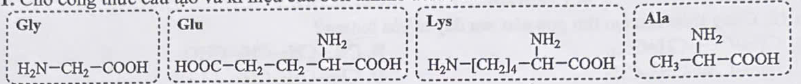
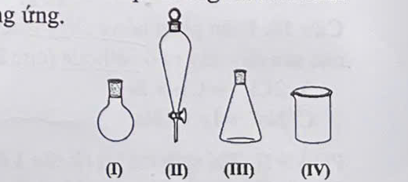
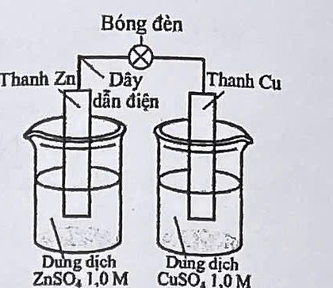
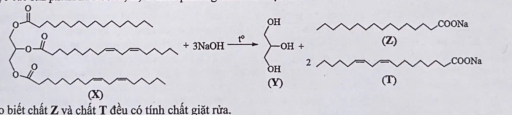

status: ocr-draft
Mã đề: 0323

BỘ GIÁO DỤC VÀ ĐÀO TẠO
ĐỀ THI CHÍNH THỨC
(Đề thi có 04 trang)

KỲ THI TỐT NGHIỆP TRUNG HỌC PHỔ THÔNG NĂM 2026
Môn thi: HOÁ HỌC
Thời gian làm bài: 50 phút, không kể thời gian phát đề

Họ, tên thí sinh: .....................................................................
Số báo danh: .........................................................................

Cho biết nguyên tử khối: $\text{H} = 1$; $\text{C} = 12$; $\text{N} = 14$; $\text{O} = 16$; $\text{Na} = 23$; $\text{Al} = 27$; $\text{Si} = 28$; $\text{S} = 32$; $\text{Cl} = 35,5$; $\text{Ca} = 40$; $\text{Fe} = 56$.
Các kí hiệu và chữ viết tắt: $s$: rắn; $l$: lỏng; $g$: khí; $aq$: dung dịch nước; $xt$: xúc tác; $p$: áp suất.

PHẦN I: Thí sinh trả lời từ câu 1 đến câu 18. Mỗi câu hỏi thí sinh chỉ chọn một phương án.

Câu 1. Cho công thức cấu tạo và kí hiệu của bốn amino acid sau:
[HÌNH: Công thức cấu tạo và kí hiệu Gly, Glu, Lys, Ala]

Công thức cấu tạo của amino acid nào biểu diễn nhiều nhóm amino nhất?
A. Lys.
B. Gly.
C. Ala.
D. Glu.

Câu 2. Ăn mòn kim loại là quá trình phá hủy kim loại hoặc hợp kim do tác dụng với các chất trong môi trường, trong đó kim loại đóng vai trò là
A. chất oxi hoá.
B. base.
C. chất điện li.
D. chất khử.

Câu 3. Phản ứng với thuốc thử Tollens (phản ứng tráng bạc) thể hiện tính chất của nhóm chức nào trong phân tử propanal?
A. $-\text{CHO}$.
B. $-\text{COOH}$.
C. $-\text{C}_2\text{H}_5$.
D. $-\text{OH}$.

Câu 4. Xu hướng biến đổi tính chất của các nguyên tố và đơn chất, cũng như thành phần và tính chất của các hợp chất tạo nên từ các nguyên tố đó được nêu trong
A. định luật tuần hoàn các nguyên tố hoá học.
B. quy tắc Zaitsev.
C. phương pháp Solvay.
D. nguyên lí chuyển dịch cân bằng.

Câu 5. Polypropylene được điều chế bằng phản ứng trùng hợp chất nào sau đây?
A. $\text{CH}_2=\text{CH}_2$.
B. $\text{CH}_2=\text{CH}-\text{Cl}$.
C. $\text{CH}_2=\text{CH}-\text{CH}_3$.
D. $\text{CH}_3-\text{CH}_2-\text{Cl}$.

Câu 6. Kim loại nào sau đây không tan trong dung dịch $\text{HCl}\ 0,10\text{ M}$?
A. Zn.
B. Mg.
C. Au.
D. Fe.

Câu 7. Các đồng vị của một nguyên tố hoá học là những nguyên tử có cùng số proton nhưng khác nhau ...(1)... Nội dung phù hợp trong chỗ trống (1) là
A. số neutron.
B. số hiệu nguyên tử.
C. điện tích hạt nhân.
D. số electron.

Câu 8. Nhôm (aluminium, Al) và kali (potassium, K) đều là kim loại có tính khử mạnh. Tuy nhiên, các vật dụng làm bằng nhôm để được trong không khí do có lớp màng oxide bền vững bảo vệ. Trong khi đó, kim loại kali thường được bảo quản bằng cách ngâm trong dầu hỏa khan mà không để ngoài không khí. Giải thích nào sau đây phù hợp với cơ sở hoá học của phương pháp bảo quản kali?
A. Kim loại kali dễ bị bay hơi khi để ngoài không khí nhưng không bay hơi khi bảo quản trong dầu hỏa khan.
B. Kim loại kali và oxide của nó dễ bị chuyển hoá trong không khí nhưng kali bền khi bảo quản trong dầu hỏa khan.
C. Kim loại kali không bị nóng chảy khi để ngoài không khí nhưng nóng chảy khi bảo quản trong dầu hỏa khan.
D. Kim loại kali không tạo được oxide khi để ngoài không khí nhưng tạo được oxide khi bảo quản trong dầu hỏa khan.

Câu 9. Hình bên minh họa một số dụng cụ thí nghiệm với kí hiệu tương ứng.
[HÌNH: Bốn dụng cụ thí nghiệm được đánh số I–IV]

Kí hiệu nào ứng với dụng cụ phễu chiết?
A. (I).
B. (II).
C. (IV).
D. (III).

Câu 10. Amine nào sau đây là amine bậc hai?
A. $\text{C}_6\text{H}_5\text{NH}_2$.
B. $(\text{CH}_3)_3\text{N}$.
C. $\text{CH}_3\text{NH}_2$.
D. $\text{CH}_3\text{NHCH}_3$.

Câu 11. Khi nghiên cứu về phản ứng điều chế ethyl acetate từ cồn $96^\circ$ và acetic acid với sự có mặt của dung dịch $\text{H}_2\text{SO}_4$ đặc, một nhóm học sinh muốn khảo sát ảnh hưởng của nhiệt độ đến khối lượng ester thu được sau cùng một thời gian phản ứng. Nhóm học sinh dự định thực hiện ba thí nghiệm lần lượt ở ba nhiệt độ $50^\circ\text{C}$, $60^\circ\text{C}$ và $70^\circ\text{C}$. Khi xây dựng kế hoạch thí nghiệm, nhóm thảo luận về một số yếu tố sau:
(1) Thời gian tiến hành phản ứng.
(2) Nồng độ, thể tích ban đầu của các chất phản ứng và dung dịch $\text{H}_2\text{SO}_4$ đặc.
(3) Màu sắc của hỗn hợp trong quá trình phản ứng.
(4) Nhiệt độ tiến hành phản ứng.
Những yếu tố nào trong số các yếu tố ở trên cần được thiết lập giống nhau ở cả ba thí nghiệm?
A. (1), (2).
B. (2), (3).
C. (1), (4).
D. (3), (4).

Câu 12. Dụng cụ nào cần bổ sung vào hệ được mô tả như sơ đồ ở hình bên để tạo thành pin Galvani hoạt động?
[HÌNH: Hai cốc ZnSO₄ và CuSO₄, điện cực Zn/Cu và bóng đèn, chưa có cầu muối]

A. Cầu muối.
B. Vôn kế.
C. Ampe kế.
D. Nhiệt kế.

Câu 13. Phát biểu nào sau đây không đúng về protein?
A. Protein trong lòng trắng trứng có phản ứng màu biuret.
B. Protein đơn giản tạo nên từ các gốc $\beta-$ hoặc $\gamma-$amino acid.
C. Trong thành phần protein luôn có nguyên tố nitrogen.
D. Protein bị thủy phân bởi acid hoặc base.

Câu 14. Công thức hoá học của chromium(III) sulfate là
A. $\text{CrSO}_4$.
B. $\text{Cr}_2(\text{SO}_4)_3$.
C. $\text{K}_2\text{Cr}_2\text{O}_7$.
D. $\text{Cr}_2\text{S}_3$.

Câu 15. Công thức cấu tạo thu gọn nào sau đây là của butane?
A. $\text{CH}_3-\text{CH}_2-\text{CH}=\text{CH}_2$.
B. $\text{CH}_3-\text{CH}_2-\text{CH}_2-\text{CHO}$.
C. $\text{CH}_3-\text{CH}_2-\text{CH}_2-\text{CH}_3$.
D. $\text{CH}_3-\text{CH}_2-\text{CH}_3$.

Sử dụng thông tin cho dưới đây để trả lời các câu số 16 – 17:
Phèn nhôm – kali có công thức hoá học là $\text{K}_2\text{SO}_4 \cdot \text{Al}_2(\text{SO}_4)_3 \cdot 24\text{H}_2\text{O}$, được sử dụng phổ biến để làm giảm độ đục (làm trong nước đục) trong quá trình xử lí nước phục vụ sinh hoạt. Ứng dụng này dựa trên sự thuỷ phân của ion $\text{Al}^{3+}(aq)$ tạo ra $\text{Al}(\text{OH})_3(s)$ theo phương trình sau:
$$\text{Al}^{3+}(aq) + 3\text{H}_2\text{O}(l) \rightleftharpoons \text{Al}(\text{OH})_3(s) + 3\text{H}^+(aq)$$
Kết tủa $\text{Al}(\text{OH})_3$ tạo thành dưới dạng keo, hấp phụ các hạt lơ lửng và lắng xuống đáy. Phèn nhôm – kali làm giảm độ đục hiệu quả đối với nước có pH khoảng $6,5 - 7,5$. Trong nhiều trường hợp, pH của nước chỉ khoảng $5,0$ nên trước khi xử lí nước bằng phèn nhôm – kali, cần điều chỉnh pH phù hợp.

Câu 16. Khi thảo luận về hoá chất phù hợp để làm tăng pH của nước từ $5,0$ lên khoảng $6,5 - 7,5$, một số đề xuất kèm theo lí do được đưa ra như sau:
(1) Có thể sử dụng $\text{Ca}(\text{OH})_2$ vì $\text{Ca}(\text{OH})_2$ là base, phản ứng với ion $\text{H}^+(aq)$.
(2) Có thể sử dụng $\text{NaCl}$ vì dung dịch $\text{NaCl}$ có $\text{pH} = 7$ nằm trong khoảng pH phù hợp với phèn nhôm – kali.
(3) Có thể sử dụng $\text{NH}_4\text{Cl}$ vì ion $\text{NH}_4^+(aq)$ thuỷ phân tạo ra môi trường base làm tăng pH.
(4) Có thể sử dụng $\text{Fe}_2(\text{SO}_4)_3$ vì ion $\text{Fe}^{3+}(aq)$ thuỷ phân tạo ra $\text{Fe}(\text{OH})_3$ làm tăng pH.
Đề xuất kèm theo lí do hợp lí là
A. đề xuất (1).
B. đề xuất (3).
C. đề xuất (4).
D. đề xuất (2).

Câu 17. Ở $25^\circ\text{C}$, một mẫu nước (mẫu X) có $\text{pH} = 6,5$. Để làm giảm độ đục của X, người ta cho vào X một lượng phèn nhôm – kali. Cho các phát biểu sau:
(a) Mẫu X có môi trường acid.
(b) Sự có mặt của các ion $\text{K}^+$ và $\text{Al}^{3+}$ làm cho nước có tính cứng toàn phần.
(c) Nếu thêm acid mạnh vào mẫu X thì hiệu quả làm trong nước đục của phèn nhôm – kali tăng lên.
(d) Sau khi xử lí mẫu X bằng phèn nhôm – kali, nước thu được có $\text{pH} = 7,5$.
Số phát biểu đúng là
A. 3.
B. 2.
C. 1.
D. 4.

Câu 18. Điện phân nóng chảy $\text{NaCl}$ với các điện cực trơ để sản xuất kim loại natri (sodium, Na). Quá trình nào sau đây xảy ra ở cathode (cực âm) của bể điện phân?
A. $2\text{Cl}^- \to \text{Cl}_2 + 2\text{e}$.
B. $2\text{H}_2\text{O} + 2\text{e} \to \text{H}_2 + 2\text{OH}^-$.
C. $\text{Na}^+ + 1\text{e} \to \text{Na}$.
D. $2\text{H}_2\text{O} \to \text{O}_2 + 4\text{H}^+ + 4\text{e}$.

PHẦN II: Thí sinh trả lời từ câu 1 đến câu 4. Trong mỗi ý a), b), c), d) ở mỗi câu, thí sinh chọn đúng hoặc sai.

Câu 1. Các thuốc kháng acid có tác dụng làm giảm lượng acid dư trong dạ dày. Bạn Việt muốn so sánh lượng acid $\text{HCl}$ tối đa mà một số thuốc kháng acid (chứa hoạt chất khác nhau) có thể làm giảm được. Việt sử dụng hai mẫu thuốc dạng viên nén màu trắng: viên thuốc A (chứa hoạt chất là $\text{CaCO}_3$) và viên thuốc B (chứa hoạt chất là $\text{NaHCO}_3$). Coi các thành phần còn lại trong thuốc A và thuốc B không phản ứng với dung dịch $\text{HCl}$ và dung dịch $\text{NaOH}$. Dựa vào hiểu biết hoá học, Việt đề xuất giả thuyết: “Lượng acid $\text{HCl}$ tối đa giảm được bởi một viên thuốc A lớn hơn bởi một viên thuốc B”.
Để kiểm chứng giả thuyết này, Việt tiến hành thí nghiệm lần lượt cho mỗi loại thuốc A và thuốc B theo các bước như sau:
- Bước 1: Cân khối lượng của một viên thuốc, ghi lại giá trị là $m_0\text{ gam}$.
- Bước 2: Nghiền mịn viên thuốc ở trên, cân $m_1\text{ gam}$ thuốc này cho vào bình tam giác, thêm tiếp khoảng $10\text{ mL}$ nước cất và lắc đều.
- Bước 3: Lấy chính xác $25,0\text{ mL}$ dung dịch $\text{HCl}\ 0,1017\text{ M}$ cho vào bình tam giác chứa thuốc để hoà tan hết hoạt chất. Lắc đều và đun nhẹ để đuổi hết $\text{CO}_2$, sau đó làm nguội về nhiệt độ phòng.
- Bước 4: Tráng rửa burette bằng nước cất, sau đó tráng lại bằng dung dịch X. Tiến hành chuẩn độ lượng acid $\text{HCl}$ dư trong bình tam giác ở bước 3 bằng dung dịch $\text{NaOH}\ 0,1008\text{ M}$ với chỉ thị phenolphthalein, thì tiêu tốn $V\text{ mL}$ dung dịch $\text{NaOH}$.

Thí nghiệm được lặp lại thêm 2 lần. Kết quả thí nghiệm lần thứ nhất được ghi lại trong bảng bên. Cho biết: $1\text{ mol} = 10^3\text{ mmol}$.

| | Thuốc A | Thuốc B |
| :--- | :---: | :---: |
| $m_0\text{ (gam)}$ | 1,503 | 0,725 |
| $m_1\text{ (gam)}$ | 0,256 | 0,259 |
| $V\text{ (mL)}$ | 8,10 | 4,10 |

a) Theo kết quả thu được từ thí nghiệm lần thứ nhất, một viên thuốc A làm giảm được tối đa $1,73\text{ mmol HCl}$ (kết quả các phép tính trung gian không được làm tròn, chỉ kết quả cuối cùng được làm tròn tới hàng phần trăm).
b) Phản ứng hoà tan hoạt chất của thuốc A trong dung dịch $\text{HCl}$ ở bước 3 là $\text{HCl} + \text{NaOH} \to \text{NaCl} + \text{H}_2\text{O}$.
c) Ở bước 4, dung dịch X là dung dịch $\text{NaOH}\ 0,1008\text{ M}$.
d) Kết quả thu được từ thí nghiệm lần thứ nhất phù hợp với giả thuyết ban đầu của Việt.

Câu 2. Xét quá trình tạo thành các phức chất của $\text{Co(II)}$ trong sơ đồ gồm hai giai đoạn được đánh số (1), (2) như sau:
$$\text{CoCl}_2(s) \xrightarrow[\text{(1)}]{+\ \text{H}_2\text{O}(l)} [\text{Co}(\text{OH}_2)_6]^{2+}(aq) \xrightarrow[\text{(2)}]{+\ \text{dung dịch HCl đặc}} [\text{CoCl}_4]^{2-}(aq)$$
Trong các phức chất $[\text{Co}(\text{OH}_2)_6]^{2+}$ và $[\text{CoCl}_4]^{2-}$, mỗi phối tử đều liên kết với nguyên tử trung tâm bằng một liên kết cho – nhận.
a) Ở giai đoạn (2) có xảy ra phản ứng thay thế phối tử trong phức chất.
b) Phức chất aqua $[\text{Co}(\text{OH}_2)_6]^{2+}$ có dạng hình học tứ diện.
c) Để hình thành liên kết cho – nhận trong phức chất $[\text{Co}(\text{OH}_2)_6]^{2+}$, các phân tử $\text{H}_2\text{O}$ đã nhận cặp electron hoá trị riêng (cặp electron chưa liên kết) của cation $\text{Co}^{2+}$.
d) Số liên kết cho – nhận giữa nguyên tử trung tâm với các phối tử trong hai phức chất $[\text{Co}(\text{OH}_2)_6]^{2+}$ và $[\text{CoCl}_4]^{2-}$ là bằng nhau.

Câu 3. Chất béo X có trong thành phần dầu đậu nành. Thủy phân X bằng dung dịch $\text{NaOH}$ đun nóng, thu được các sản phẩm hữu cơ Y, Z, T theo phương trình hoá học sau:
[HÌNH: Sơ đồ phản ứng thủy phân triglyceride X tạo Y, Z, T]

Cho biết chất Z và chất T đều có tính chất giặt rửa.
a) Hợp chất Y có tên gọi là glycerol.
b) Trên mỗi phổ hồng ngoại của chất X và chất Y đều có tín hiệu đặc trưng cho các liên kết $\text{C}=\text{O}$ và $\text{O}-\text{H}$.
c) Do X chứa gốc acid béo không no nên chất béo thu được khi hydrogen hoá hoàn toàn X thuộc loại chất béo no (chỉ chứa gốc acid béo no).
d) Chất Z và chất T đều có tính chất giặt rửa do các chất này đều có phần kị nước và phần ưa nước.

Câu 4. Cellulose và tinh bột đều có công thức chung là $(\text{C}_6\text{H}_{10}\text{O}_5)_n$. Tinh bột gồm hai thành phần là amylose và amylopectin. Thuỷ phân hoàn toàn cellulose và tinh bột trong môi trường acid đun nóng, thu được glucose theo phương trình hoá học sau:
$$(\text{C}_6\text{H}_{10}\text{O}_5)_n + n\text{H}_2\text{O} \xrightarrow{\text{H}^+,\ t^\circ} n\text{C}_6\text{H}_{12}\text{O}_6 \qquad (1)$$
a) Cellulose và tinh bột đều là polymer tự nhiên (polymer thiên nhiên).
b) Phản ứng thuỷ phân cellulose và tinh bột theo phương trình (1) là phản ứng tăng mạch polymer.
c) Vì cellulose và tinh bột đều có công thức chung là $(\text{C}_6\text{H}_{10}\text{O}_5)_n$ nên phân tử khối của cellulose và tinh bột đều bằng nhau.
d) Cellulose và amylopectin đều cấu tạo từ các đơn vị glucose liên kết với nhau bằng các liên kết glycoside nên chúng đều có cấu tạo mạch polymer phân nhánh.

PHẦN III: Thí sinh trả lời từ câu 1 đến câu 6.

Câu 1. Cho các phản ứng hoá học được đánh số như sau:
(1) $n\text{CH}_2=\text{CH}-\text{CN} \xrightarrow{xt,\ t^\circ,\ p} -(-\text{CH}_2-\text{CH}(\text{CN})-)-_n$
(2) $\text{CH}_2=\text{CH}_2 + \text{Br}_2 \to \text{CH}_2\text{Br}-\text{CH}_2\text{Br}$
(3) $\text{C}_{12}\text{H}_{22}\text{O}_{11}\ (\text{saccharose}) + \text{H}_2\text{O} \xrightarrow{\text{H}^+,\ t^\circ} \text{C}_6\text{H}_{12}\text{O}_6\ (\text{glucose}) + \text{C}_6\text{H}_{12}\text{O}_6\ (\text{fructose})$
(4) $n\text{H}_2\text{N}-[\text{CH}_2]_5-\text{COOH} \xrightarrow{t^\circ} -(-\text{NH}-[\text{CH}_2]_5-\text{CO}-)-_n + n\text{H}_2\text{O}$

Sắp xếp số tương ứng của mỗi phản ứng theo thứ tự: phản ứng thủy phân, phản ứng trùng ngưng, phản ứng trùng hợp và phản ứng cộng, thành bộ bốn số (ví dụ: 1234, 4321, ...).

Câu 2. Thế điện cực chuẩn của các cặp oxi hoá – khử $\text{Zn}^{2+}/\text{Zn}$ và $\text{Pb}^{2+}/\text{Pb}$ lần lượt là $-0,763\text{ V}$ và $-0,126\text{ V}$. Tính sức điện động chuẩn (theo V) của pin Galvani tạo bởi hai cặp oxi hoá – khử trên (làm tròn kết quả tới hàng phần trăm).

Câu 3. Cho các chất được đánh số như sau:
(1) methyl acetate
(2) propyl acetate
(3) sodium formate
(4) sodium palmitate
(5) methyl methacrylate
(6) methyl formate
Liệt kê theo trình tự từ nhỏ đến lớn các số ứng với tất cả các chất là ester (ví dụ: 56, 124, 3456, ...).

Câu 4. Một nhà máy sản xuất ammonia theo phương pháp Haber – Bosch. Để thu được nitrogen ($\text{N}_2$) và hydrogen ($\text{H}_2$) từ methane, không khí và nước, các giai đoạn chính được thực hiện như sau:
- Giai đoạn 1: Cho hỗn hợp gồm khí methane và hơi nước với tỉ lệ mol tương ứng là $1 : 3,2$ qua tháp phản ứng chứa xúc tác ở $900^\circ\text{C}$, xảy ra phản ứng sau:
$$\text{CH}_4(g) + \text{H}_2\text{O}(g) \xrightarrow{xt,\ 900^\circ\text{C}} \text{CO}(g) + 3\text{H}_2(g)$$
Hiệu suất chuyển hoá $\text{CH}_4$ ở giai đoạn này là $h\ \%$.
- Giai đoạn 2: Hỗn hợp thu được sau giai đoạn 1 được trộn với không khí (chứa $80\ \%\ \text{N}_2$ và $20\ \%\ \text{O}_2$ theo thể tích) để oxi hoá hết methane theo phản ứng:
$$2\text{CH}_4(g) + \text{O}_2(g) \xrightarrow{xt,\ t^\circ} 2\text{CO}(g) + 4\text{H}_2(g)$$
- Giai đoạn 3: Trộn hỗn hợp thu được sau giai đoạn 2 với hơi nước dư để oxi hoá hết $\text{CO}$ thành $\text{CO}_2$ theo phản ứng:
$$\text{CO}(g) + \text{H}_2\text{O}(g) \xrightarrow{t^\circ} \text{CO}_2(g) + \text{H}_2(g)$$
- Giai đoạn 4: Dẫn hỗn hợp thu được sau giai đoạn 3 vào tháp hấp thụ để tách $\text{CO}_2$ và hơi nước. Hỗn hợp khí còn lại chỉ gồm $\text{N}_2$ và $\text{H}_2$ với tỉ lệ mol tương ứng là $1 : 3$ được sử dụng để tổng hợp ammonia.
Coi các phản ứng khác trong các giai đoạn từ 1 đến 4 xảy ra không đáng kể. Xác định giá trị của $h$ (không làm tròn kết quả các phép tính trung gian, chỉ làm tròn kết quả cuối cùng tới hàng phần mười).

Câu 5. Trong một nhà máy sản xuất saccharose, sau một số giai đoạn xử lí thu được đường ẩm (chỉ gồm saccharose và $1,40\ \%$ nước theo khối lượng). Đường ẩm được đưa vào thiết bị sấy cho tiếp xúc với dòng không khí nóng (chứa $0,80\ \%$ nước theo khối lượng). Tỉ lệ khối lượng không khí nóng : đường ẩm là $3 : 1$. Trong quá trình sấy, chỉ xảy ra sự bay hơi của nước từ đường ẩm vào dòng không khí nóng. Sau khi sấy, dòng không khí nóng thoát ra khỏi thiết bị chứa $1,25\ \%$ nước theo khối lượng và thu được đường chứa $a \times 10^{-2}\ \%$ nước theo khối lượng. Xác định giá trị của $a$ (không làm tròn kết quả các phép tính trung gian, chỉ làm tròn kết quả cuối cùng tới hàng phần trăm).

Câu 6. Xi măng Portland có thành phần được biểu diễn như sau: $3\text{CaO}\cdot\text{Al}_2\text{O}_3$ (kí hiệu là $\text{C}_3\text{A}$), $2\text{CaO}\cdot\text{SiO}_2$ (kí hiệu là $\text{C}_2\text{S}$), $3\text{CaO}\cdot\text{SiO}_2$ (kí hiệu là $\text{C}_3\text{S}$), $4\text{CaO}\cdot\text{Al}_2\text{O}_3}\cdot\text{Fe}_2\text{O}_3$ (kí hiệu là $\text{C}_4\text{AF}$), $\text{CaSO}_4$ (hay $\text{CaO}\cdot\text{SO}_3$), còn lại là phụ gia. Thành phần của một loại xi măng Portland quy đổi về $\%$ khối lượng các chất được cho trong bảng sau:

| Thành phần | $\text{CaO}$ | $\text{SiO}_2$ | $\text{Al}_2\text{O}_3$ | $\text{Fe}_2\text{O}_3$ | $\text{SO}_3$ | Phụ gia |
| :--- | :---: | :---: | :---: | :---: | :---: | :---: |
| $\%$ khối lượng | 67,76 | 22,20 | 5,61 | 2,40 | 1,60 | 0,43 |

Phần trăm theo khối lượng của $3\text{CaO}\cdot\text{SiO}_2$ ($\text{C}_3\text{S}$) trong loại xi măng Portland trên là $x\ \%$. Xác định giá trị của $x$ (không làm tròn kết quả các phép tính trung gian, chỉ làm tròn kết quả cuối cùng tới hàng phần mười).

------------------ HẾT ------------------
- Thí sinh không được sử dụng tài liệu;
- Giám thị không giải thích gì thêm.
