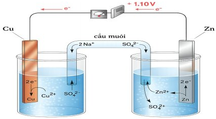
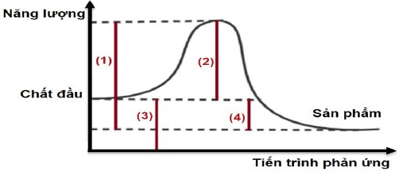
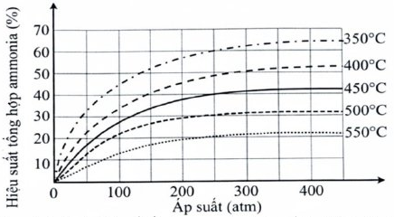
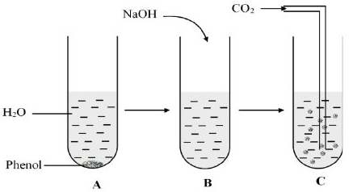
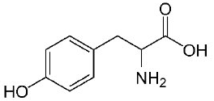

status: ocr-draft
Nguồn: Sở Giáo dục và Đào tạo tỉnh Quảng Ninh — Kỳ thi thử tốt nghiệp THPT năm 2026 — Môn Hóa học — Mã đề 0301.

SỞ GIÁO DỤC VÀ ĐÀO TẠO TỈNH QUẢNG NINH

KỲ THI THỬ TỐT NGHIỆP THPT NĂM 2026

MÔN: HÓA HỌC

ĐỀ THI CHÍNH THỨC

(Đề thi này có 04 trang)

Thời gian làm bài: 50 phút, không kể thời gian giao đề

Họ, tên thí sinh: …………………………………

Số báo danh: …………………………………

Mã đề: 0301

Cho biết nguyên tử khối: H = 1; C = 12; N = 14; O = 16; Na = 23; Al = 27; Ca = 40; Ag = 108.

## Phần I. Câu trắc nghiệm nhiều phương án lựa chọn.

Thí sinh trả lời từ câu 1 đến câu 18. Mỗi câu hỏi thí sinh chỉ chọn một phương án.

**Câu 1:** Tính chất vật lí chung của polymer là

A. chất rắn, không bay hơi, dễ tan trong nước.

B. chất lỏng, không màu, không tan trong nước.

C. chất lỏng, không màu, tan tốt trong nước.

D. chất rắn, không bay hơi, không tan trong nước.

**Câu 2:** Dung dịch chất nào sau đây làm quỳ tím đổi thành màu xanh?

A. Dung dịch glycine.

B. Dung dịch alanine.

C. Dung dịch lysine.

D. Dung dịch valine.

**Câu 3:** Polypropylene (PP) là chất dẻo thường được sử dụng để sản xuất các sản phẩm thiết bị y tế, đồ gia dụng, ... PP được tổng hợp từ monomer nào sau đây?

A. $\mathrm{CH_3-CH=CH_2}$.

B. $\mathrm{CH_2=CH_2}$.

C. $\mathrm{CH_2=CH-CN}$.

D. $\mathrm{C_6H_5OH}$ và $\mathrm{HCHO}$.

**Câu 4:** Kim loại chuyển tiếp dãy thứ nhất thuộc khối nguyên tố nào sau đây?

A. Nguyên tố d.

B. Nguyên tố f.

C. Nguyên tố p.

D. Nguyên tố s.

**Câu 5:** Số lượng phối tử có trong phức chất $\mathrm{[PtCl_4(NH_3)_2]}$ là

A. 4.

B. 6.

C. 2.

D. 7.

**Câu 6:** Phát biểu nào sau đây **sai**?

A. Hạt nhân nguyên tử cấu thành từ các hạt proton và neutron.

B. Nguyên tử có cấu trúc đặc khít, gồm vỏ nguyên tử và hạt nhân nguyên tử.

C. Đa số nguyên tử được cấu thành từ các hạt cơ bản là proton, neutron và electron.

D. Vỏ nguyên tử cấu thành từ các hạt electron.

**Câu 7:** Nguyên nhân chính dầu mỡ thường có mùi khó chịu khi để lâu ngày trong không khí hoặc tái sử dụng nhiều lần vì dầu mỡ bị tác động nào sau đây?

A. Thuỷ phân.

B. Oxi hoá.

C. Xà phòng hoá.

D. Hydrogen hoá.

**Câu 8:** Khi oxi hóa không hoàn toàn alcohol bậc 1 bằng $\mathrm{CuO}$ nung nóng, sản phẩm thu được thường là loại hợp chất hữu cơ nào sau đây?

A. Alkene.

B. Carboxylic acid.

C. Ketone.

D. Aldehyde.

**Câu 9:** Một hydrocarbon **X** mạch hở trong phân tử có phần trăm khối lượng carbon bằng 85,714%. Trên phổ khối lượng của **X** có peak ion phân tử ứng với giá trị $m/z = 42$. Công thức phù hợp với **X** là

A. $\mathrm{CH_3CH_2CH_3}$.

B. $\mathrm{CH\equiv CH}$.

C. $\mathrm{CH_2=CHCH_3}$.

D. $\mathrm{CH_3CH_3}$.

**Câu 10:** Các nguyên tố dinh dưỡng cho cây trồng được chia thành 3 nhóm:

- Nhóm đa lượng: Cây cần lượng lớn, gồm N, P, K.
- Nhóm trung lượng: Cây cần lượng vừa phải, gồm Ca, Mg, S.
- Nhóm vi lượng: Cây cần lượng rất nhỏ, gồm Fe, Zn, Cu, B...

Một loại phân bón hỗn hợp NPK cung cấp đồng thời ba nguyên tố Nitrogen (N), Phosphorus (P) và Potassium (K). Các nguyên tố này thuộc nhóm nào sau đây?

A. Nhóm nguyên tố đa lượng.

B. Nhóm nguyên tố vi lượng.

C. Nhóm nguyên tố trung lượng.

D. Nhóm nguyên tố quý hiếm.

**Câu 11:** Có ba ống nghiệm chứa dung dịch hóa chất sau: ống (1) chứa ethyl alcohol, ống (2) chứa acetic acid và ống (3) chứa acetaldehyde. Nếu cho $\mathrm{Cu(OH)_2}$ trong môi trường kiềm ($\mathrm{NaOH}$) lần lượt vào các dung dịch trên và đun nóng thì trong ống nghiệm nào có phản ứng hóa học xảy ra?

A. Cả ba ống.

B. Ống (2) và ống (3).

C. Ống (1).

D. Ống (1) và ống (3).

**Câu 12:** Trong quá trình Solvay, ở giai đoạn tạo thành $\mathrm{NaHCO_3}$ có cân bằng hóa học sau:

$\mathrm{NaCl + NH_3 + CO_2 + H_2O \rightleftharpoons NaHCO_3 + NH_4Cl}$

Khi làm lạnh dung dịch trên, muối đầu tiên bị tách ra khỏi dung dịch là

A. $\mathrm{NaCl}$.

B. $\mathrm{NH_4HCO_3}$.

C. $\mathrm{NaHCO_3}$.

D. $\mathrm{NH_4Cl}$.

**Câu 13:** Cho các ester sau: ethyl formate (1); vinyl acetate (2); triolein (3); methyl acrylate (4); phenyl acetate (5). Dãy gồm các ester đều phản ứng được với dung dịch $\mathrm{NaOH}$ dư, đun nóng sinh ra alcohol là

A. (3), (4), (5).

B. (2), (3), (5).

C. (1), (2), (3).

D. (1), (3), (4).

**Câu 14:** Chất X có các đặc điểm sau: phân tử có nhiều nhóm $\mathrm{-OH}$, có vị ngọt, hoà tan $\mathrm{Cu(OH)_2}$ ở nhiệt độ thường, phân tử có liên kết glycoside, không làm mất màu nước bromine. Chất X là

A. tinh bột.

B. saccharose.

C. glucose.

D. cellulose.

**Câu 15:** Cho phương trình hóa học của phản ứng nhiệt nhôm: $\mathrm{2Al(s) + Fe_2O_3 \rightarrow Al_2O_3(s) + 2Fe(s)}$

Tính biến thiên enthalpy chuẩn của phản ứng. Biết nhiệt tạo thành chuẩn của $\mathrm{Fe_2O_3}$ và $\mathrm{Al_2O_3}$ lần lượt là $-825{,}5\ \mathrm{kJ/mol}$ và $-1676{,}0\ \mathrm{kJ/mol}$.

A. $-2526{,}5\ \mathrm{kJ}$.

B. $-850{,}5\ \mathrm{kJ}$.

C. $+2501{,}5\ \mathrm{kJ}$.

D. $+850{,}5\ \mathrm{kJ}$.

**Câu 16:** Cho cấu tạo của một pin điện như hình dưới đây:

[HÌNH: Sơ đồ pin điện có điện cực Cu bên trái, Zn bên phải, hai cốc dung dịch nối bằng cầu muối; hình có nhãn ion, mũi tên electron và chỉ số +1.10V.]

Phát biểu nào sau đây **đúng**?

A. Tổng thế điện cực của hai điện cực là 1,10 V.

B. Điện cực Zn là cathode, điện cực Cu là anode.

C. Điện cực Zn là anode, điện cực Cu là cathode.

D. Thế điện cực của điện cực Zn lớn hơn của điện cực Cu là 1,10 V.

**Câu 17:** Năng lượng hoạt hóa là năng lượng tối thiểu mà các chất tham gia phản ứng cần phải có để phản ứng có thể xảy ra. Cho đồ thị biểu diễn năng lượng của một phản ứng như hình bên:

[HÌNH: Đồ thị Năng lượng theo Tiến trình phản ứng, đường cong đi từ mức Chất đầu qua một đỉnh rồi xuống mức Sản phẩm; bốn đoạn thẳng đứng màu đỏ được đánh số (1), (2), (3), (4).]

Đoạn nào ở đồ thị hình bên tương ứng với năng lượng hoạt hóa của phản ứng?

A. Đoạn (2).

B. Đoạn (1).

C. Đoạn (3).

D. Đoạn (4).

**Câu 18:** Cho các quá trình sau:

(1) $\text{Hexane} \xrightarrow[\text{xúc tác}]{t^\circ} \text{isohexane}$.

(2) $\text{Ethylbenzene} \xrightarrow[\text{xúc tác}]{t^\circ} \text{1,2-dimethylbenzene}$.

(3) $\text{Octane} \xrightarrow[\text{xúc tác}]{t^\circ} \text{Butane} + \text{But-1-ene}$.

(4) $\text{Octane} \xrightarrow[\text{xúc tác}]{t^\circ} \text{2,2,4-trimethylpentane}$

Có bao nhiêu quá trình trong số các quá trình trên là quá trình reforming?

A. 3.

B. 2.

C. 1.

D. 4.

## Phần II. Câu trắc nghiệm đúng sai.

Thí sinh trả lời từ câu 1 đến câu 4. **Trong mỗi ý a), b), c), d)** ở mỗi câu, thí sinh chọn đúng hoặc sai.

**Câu 1:** Ammonia có nhiều ứng dụng quan trọng trong đời sống và sản xuất. Trong công nghiệp, ammonia được tổng hợp từ nitrogen và hydrogen theo phương trình nhiệt hóa học sau:

$\mathrm{N_2(g) + 3H_2(g)} \overset{t^\circ,p,xt}{\rightleftharpoons} \mathrm{2NH_3(g)} \qquad \Delta_r H_{298}^{\circ} = -91{,}8\ \mathrm{kJ}$

Kết quả nghiên cứu sự phụ thuộc của hiệu suất tổng hợp ammonia vào áp suất và nhiệt độ của phản ứng được thể hiện ở đồ thị hình bên:

[HÌNH: Đồ thị hiệu suất tổng hợp ammonia (%) theo áp suất (atm), gồm năm đường cong mang nhãn 350°C, 400°C, 450°C, 500°C và 550°C; trục áp suất ghi 0, 100, 200, 300, 400 và trục hiệu suất ghi các mức từ 10 đến 70.]

*Đồ thị sự phụ thuộc của hiệu suất tổng hợp ammonia vào áp suất và nhiệt độ phản ứng*

a) Nếu thực hiện phản ứng ở nhiệt độ càng thấp thì sẽ càng đạt hiệu quả kinh tế cao.

b) Hiệu suất của phản ứng ở 500°C, 300 atm cao hơn hiệu suất ở 450°C, 200 atm.

c) Ở nhiệt độ 500°C, 250 atm, 2 mol $\mathrm{N_2}$ tác dụng với 3 mol $\mathrm{H_2}$ thu được 0,6 mol $\mathrm{NH_3}$.

d) Để tăng hiệu suất tổng hợp ammonia có thể đồng thời tăng áp suất và giảm nhiệt độ.

**Câu 2:** Dùng panh lấy các mẫu kim loại (Li, Na hoặc K) có kích cỡ xấp xỉ nhau đã thấm khô dầu và cho vào các chậu thủy tinh đã chứa khoảng 1/3 thể tích nước. Thêm 2 - 3 giọt dung dịch phenolphthalein vào chậu sau khi kim loại tan hết.

a) Hiện tượng ở chậu thủy tinh chứa Li và K giống nhau.

b) Các dung dịch thu được sau phản ứng đều có màu hồng.

c) Các cặp oxi hóa - khử $\mathrm{M^+/M}$ (M: Li, Na, K) đều có giá trị thế điện cực chuẩn lớn hơn giá trị thế điện cực chuẩn của cặp oxi hóa - khử $\mathrm{2H_2O/H_2,\ 2OH^-}$.

d) Từ hiện tượng thí nghiệm, chứng tỏ tính khử của kim loại tăng dần theo thứ tự sau: K, Na, Li.

**Câu 3:** Thực hiện thí nghiệm sau:

- Bước 1: Cho phenol vào ống nghiệm, thêm nước và lắc đều ống nghiệm thấy dung dịch có màu trắng đục (hình A).
- Bước 2: Tiếp tục cho dung dịch NaOH vào ống nghiệm thấy dung dịch chuyển sang trong suốt (hình B).
- Bước 3: Tiếp tục sục khí $\mathrm{CO_2}$ vào ống nghiệm thấy dung dịch chuyển màu trắng đục như ban đầu (hình C).

[HÌNH: Ba ống nghiệm A, B, C nối tiếp bằng mũi tên; ống A có các nhãn H₂O và Phenol, mũi tên NaOH hướng vào ống B, ống C có ống dẫn khí mang nhãn CO₂.]

a) Trong ống nghiệm ở bước 2 (hình B), dung dịch trong suốt vì sản phẩm tạo ra khi cho NaOH vào ống nghiệm tan tốt trong nước.

b) Nếu cho quỳ tím vào ống nghiệm ở bước 1 (hình A) thì quỳ tím chuyển đỏ.

c) Trong ống nghiệm ở bước 3 (hình C), dung dịch trắng đục là do có phenol tạo thành.

d) Trong ống nghiệm ở bước 1 (hình A), phenol tan tốt trong nước ở điều kiện thường nên dung dịch có màu trắng đục.

**Câu 4:** Tyrosine (Tyr) là một amino acid không thiết yếu nhưng đóng vai trò tiền thân quan trọng để tổng hợp các chất dẫn truyền thần kinh như dopamine và adrenaline. Cho công thức cấu tạo của Tyrosine như hình bên:

[HÌNH: Công thức cấu tạo dạng khung của tyrosine, vòng benzene có nhóm HO và mạch nhánh –CH₂–CH(NH₂)–C(=O)–OH ở hai vị trí đối diện.]

Tại $\mathrm{pH} \approx 5{,}7$, tyrosine tồn tại chủ yếu ở dạng ion lưỡng cực có tổng điện tích bằng không.

a) Tyrosine thuộc loại hợp chất hữu cơ tạp chức, phân tử chứa hai loại nhóm chức khác nhau.

b) 01 mol tyrosine có thể phản ứng tối đa với 01 mol NaOH trong dung dịch.

c) Khối lượng mol phân tử của tyrosine là 179.

d) Khi đặt trong điện trường tại $\mathrm{pH} = 2$, tyrosine sẽ di chuyển về phía cực âm.

## Phần III. Câu trắc nghiệm trả lời ngắn.

Thí sinh trả lời từ câu 1 đến câu 6.

**Câu 1:** Trong quá trình một nhà máy xử lí nước sinh hoạt, đến giai đoạn xử lí tính cứng vĩnh cửu gây ra bởi $\mathrm{Ca^{2+}}$ có độ cứng tính theo $\mathrm{CaCO_3}$ là 300 mg $\mathrm{CaCO_3}$/L (quy đổi nồng độ $\mathrm{Ca^{2+}}$ tương ứng với khối lượng $\mathrm{CaCO_3}$ trong 1 lít nước) về nước có độ cứng không vượt quá 60 mg $\mathrm{CaCO_3}$/L. Tính khối lượng (kg) tối thiểu Soda công nghiệp (chứa 80% $\mathrm{Na_2CO_3}$ về khối lượng, còn lại là tạp chất trơ) cần dùng để xử lý $10\ \mathrm{m^3}$ nước cứng vĩnh cửu trên *(không làm tròn kết quả các phép tính trung gian, chỉ làm tròn kết quả cuối cùng đến hàng phần trăm)*.

**Câu 2:** Khí thiên nhiên là nguồn nhiên liệu quan trọng, phát thải thấp, được sử dụng phổ biến trong các nhà máy nhiệt điện hiện đại. Một loại khí thiên nhiên X (đã qua xử lý để loại bỏ tạp chất) có thành phần phần trăm về thể tích các khí như sau: 95% methane, 3% ethane, 1,5% propane và 0,5% butane. Giả thiết, khi đốt cháy hoàn toàn X ở điều kiện chuẩn chỉ xảy ra các phản ứng nhiệt hóa học sau:

(1) $\mathrm{CH_4(g) + 2O_2(g)} \xrightarrow{t^\circ} \mathrm{CO_2(g) + 2H_2O(l)}$

(2) $\mathrm{2C_2H_6(g) + 7O_2(g)} \xrightarrow{t^\circ} \mathrm{4CO_2(g) + 6H_2O(l)}$

(3) $\mathrm{C_3H_8(g) + 5O_2(g)} \xrightarrow{t^\circ} \mathrm{3CO_2(g) + 4H_2O(l)}$

(4) $\mathrm{2C_4H_{10}(g) + 13O_2(g)} \xrightarrow{t^\circ} \mathrm{8CO_2(g) + 10H_2O(l)}$

Một nhà máy nhiệt điện chu trình hỗn hợp có công suất phát điện ổn định là 150 MW (150.000 kJ/s). Biết rằng có 55% nhiệt lượng tỏa ra khi đốt cháy hoàn toàn khí thiên nhiên X được chuyển hóa thành điện năng. Biết giá khí thiên nhiên trên thị trường hiện nay là 372650 đồng/triệu BTU (với 1 triệu BTU = $1{,}055\cdot10^6\ \mathrm{kJ}$) Hãy tính số tiền (tỷ đồng) nhà máy cần chi trả để mua lượng nhiên liệu trên cho một tháng (30 ngày) hoạt động liên tục *(không làm tròn kết quả các phép tính trung gian, chỉ làm tròn kết quả cuối cùng đến hàng đơn vị)*.

Cho biết: Nhiệt tạo thành chuẩn ($\Delta_f H_{298}^{\circ}$) của các chất được cho trong bảng sau:

| Chất | $\mathrm{CH_4(g)}$ | $\mathrm{C_2H_6(g)}$ | $\mathrm{C_3H_8(g)}$ | $\mathrm{C_4H_{10}(g)}$ | $\mathrm{CO_2(g)}$ | $\mathrm{H_2O(l)}$ |
| --- | --- | --- | --- | --- | --- | --- |
| $\Delta_f H_{298}^{\circ}$ | $-74{,}9$ | $-84{,}7$ | $-105{,}0$ | $-126{,}1$ | $-393{,}5$ | $-285{,}8$ |

**Câu 3:** Trong quá trình điện phân nóng chảy hỗn hợp gồm $\mathrm{Al_2O_3}$ và cryolite với các điện cực bằng than chì (carbon), tại cathode thu được 10,8 tấn aluminium (Al) nguyên chất. Tại anode, carbon bị oxi hóa thành hỗn hợp khí gồm $\mathrm{CO_2}$ (chiếm 70% về thể tích) và CO (chiếm 30% về thể tích). Giả thiết không có sản phẩm phụ nào khác và toàn bộ oxygen sinh ra từ $\mathrm{Al_2O_3}$ đều phản ứng với carbon. Tính khối lượng carbon (theo tấn) đã bị tiêu thụ tại anode *(không làm tròn kết quả các phép tính trung gian, chỉ làm tròn kết quả cuối cùng đến hàng phần trăm)*.

**Câu 4:** Ở điều kiện chuẩn, pin Zn - Fe có sức điện động 0,323V, pin Fe - Pb có sức điện động 0,321V, pin Pb - Cu có sức điện động 0,459V. Sức điện động chuẩn của pin Zn - Cu bằng bao nhiêu volt (V)?

*(không làm tròn kết quả các phép tính trung gian, chỉ làm tròn kết quả cuối cùng đến hàng phần mười).*

Cho các cặp oxi hóa khử được xếp theo chiều tăng dần thế điện cực chuẩn thành dãy như sau:

$\mathrm{K^+/K}\quad \mathrm{Mg^{2+}/Mg}\quad \mathrm{Al^{3+}/Al}\quad \mathrm{Zn^{2+}/Zn}\quad \mathrm{Fe^{2+}/Fe}\quad \mathrm{Pb^{2+}/Pb}\quad \mathrm{H^+/H_2}\quad \mathrm{Cu^{2+}/Cu}\quad \mathrm{Au^{3+}/Au}$

**Câu 5:** Thủy phân $m$ gam saccharose trong môi trường acid với hiệu suất phản ứng đạt 80%, thu được dung dịch X. Trung hòa acid dư trong X, sau đó chia dung dịch làm hai phần bằng nhau:

- **Phần 1:** Cho tác dụng với lượng dư dung dịch $\mathrm{AgNO_3}$ trong $\mathrm{NH_3}$ đun nóng, sau khi các phản ứng xảy ra hoàn toàn thu được 64,8 gam silver (Ag) kết tủa.
- **Phần 2:** Cho tác dụng với $\mathrm{Cu(OH)_2}$ ở nhiệt độ thường.

Giả thiết các phản ứng đều xảy ra hoàn toàn (trừ phản ứng thủy phân). Số mol $\mathrm{Cu(OH)_2}$ tối đa bị hòa tan ở phần 2 là bao nhiêu? *(không làm tròn kết quả các phép tính trung gian, chỉ làm tròn kết quả cuối cùng đến hàng phần trăm)*.

**Câu 6:** Cho các phát biểu sau:

(1) Hợp kim được sử dụng trong đời sống và sản xuất phổ biến hơn so với kim loại.

(2) Kim loại **A** có nhiệt độ nóng chảy cao hơn kim loại **B**, nhiệt độ nóng chảy của hợp kim **A-B** luôn cao hơn nhiệt độ nóng chảy của **B**.

(3) Tính chất hoá học của hợp kim thường tương tự tính chất của các kim loại thành phần.

(4) Hợp kim có thể cứng hơn rất nhiều các kim loại tạo nên nó.

(5) Hợp kim thường khó bị oxi hoá hơn các đơn kim loại thành phần.

Hãy sắp xếp các phát biểu đúng trong các phát biểu trên thành bộ số theo số thứ tự tăng dần (ví dụ 12, 134, …)