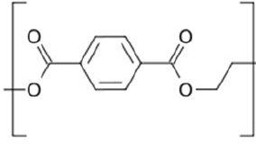
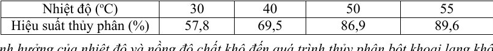

status: ocr-draft
source: Sở GD&ĐT Sơn La, Kỳ thi thử tốt nghiệp THPT lần thứ hai, năm học 2025–2026, môn Hoá học, mã đề 0301

# ĐỀ CHÍNH THỨC

*(Đề thi có 04 trang)* — **Thời gian làm bài: 50 phút, không kể thời gian phát đề**

Họ và tên thí sinh: ……………………………………… SBD: …………………………

Cho biết nguyên tử khối: H = 1; C = 12; N = 14; O = 16; Ca = 40; Fe = 56; Zn = 65.

Các kí hiệu và chữ viết tắt: s: rắn; l: lỏng; g: khí; aq: dung dịch nước.

## Phần I

Thí sinh trả lời từ câu 1 đến câu 18. Mỗi câu hỏi thí sinh chọn một phương án.

### Câu 1

Pin nhôm - không khí (Al - air battery) đang được kỳ vọng sẽ thay thế pin lithium-ion trong các phương tiện giao thông tương lai nhờ mật độ năng lượng cao, sử dụng vật liệu rẻ tiền và an toàn. Một pin nhôm - không khí đơn giản có cấu tạo gồm một cực là tấm nhôm (Al), cực còn lại là vật liệu xốp chứa carbon (đóng vai trò điện cực trơ) tiếp xúc trực tiếp với không khí. Chất điện li thường được sử dụng là dung dịch sodium chloride (NaCl) hoặc dung dịch kiềm. Cho các phát biểu sau về nguyên lý hoạt động của pin nhôm - không khí nêu trên:

(a) Tấm nhôm đóng vai trò là cực âm (anode), tại đó xảy ra quá trình oxi hóa kim loại nhôm.

(b) Ở cực dương (cathode), khí oxygen trong không khí đóng vai trò là chất khử, nhường electron để tạo thành ion $OH^-$. 

(c) Trong quá trình pin phát điện, dòng electron di chuyển ở mạch ngoài (dây dẫn) từ điện cực nhôm sang điện cực carbon xốp.

(d) Trong quá trình pin hoạt động, nhôm kim loại bị oxi hóa, sản phẩm tạo thành có thể hòa tan vào dung dịch hoặc tạo kết tủa bám lại trên điện cực tùy thuộc vào bản chất của chất điện li.

Số phát biểu đúng là

A. 3.  B. 4.  C. 2.  D. 1.

### Câu 2

Trong quy trình xử lý nước cấp sinh hoạt, để tiêu diệt các loại vi khuẩn, vi rút và vi sinh vật gây bệnh (bước khử trùng), người ta thường dùng hóa chất có tính oxi hóa mạnh nào sau đây?

A. Than hoạt tính.  B. Clorua vôi ($CaOCl_2$).

C. Poly(aluminium chloride) (PAC).  D. Phèn chua ($K_2SO_4.Al_2(SO_4)_3.24H_2O$).

### Câu 3

Cho phản ứng hoá học sau: $C_2H_5-Br + NaOH \xrightarrow{t^\circ} C_2H_5-OH + NaBr$.

Phản ứng trên thuộc loại phản ứng nào sau đây?

A. Phản ứng thế.  B. Phản ứng cộng.

C. Phản ứng oxi hoá - khử.  D. Phản ứng tách.

### Câu 4

Khi đốt một hợp chất của kim loại kiềm trên ngọn lửa không màu thấy ngọn lửa có màu tím. Hợp chất kim loại kiềm đem đốt là hợp chất của

A. K.  B. Ca.  C. Li.  D. Na.

### Câu 5

Khi chuẩn bị cần câu cá, các cần thủ thường gắn thêm một mẩu chì nhỏ (chì câu) vào dây câu, nằm cách lưỡi câu một đoạn ngắn, giúp mồi câu chìm nhanh xuống nước. Ứng dụng này của kim loại chì (Pb) chủ yếu dựa trên tính chất vật lí nào sau đây?

A. Có khả năng dẫn nhiệt và dẫn điện rất tốt.  B. Có khối lượng riêng lớn (kim loại nặng).

C. Có tính dẻo cao.  D. Có nhiệt độ nóng chảy thấp.

### Câu 6

Cho các phát biểu sau về protein:

(a) Các protein đều không tan trong nước.

(b) Tương tự như tinh bột, protein chỉ bị thủy phân bởi acid hoặc enzyme.

(c) Protein có khả năng tạo thành sản phẩm màu xanh đặc trưng với thuốc thử biuret.

(d) Protein hình thành sản phẩm rắn màu vàng với dung dịch $HNO_3$ đặc.

Số phát biểu đúng là

A. 3.  B. 1.  C. 4.  D. 2.

### Câu 7

Khác với hầu hết những chất khác, các phân tử nước có thể tập hợp thành một cụm phân tử tương đối bền vững. Do đó, khi làm lạnh, nước có thể hình thành bông tuyết với nhiều hình dạng khác nhau. Đặc điểm tập hợp này của nước là do liên kết nào sau đây?

A. Liên kết ion.  B. Liên kết hydrogen.

C. Tương tác van der Waals.  D. Liên kết cộng hóa trị.

### Câu 8

Phức chất $[Co(NH_3)_6]^{3+}$ có dạng hình học là

A. tứ diện.  B. bát diện.  C. đường thẳng.  D. vuông phẳng.

### Câu 9

Hợp chất nào sau đây được sử dụng làm chất giặt rửa tổng hợp?

A. $CH_3[CH_2]_{12}COOCH_3$.  B. $CH_3[CH_2]_{11}OSO_3Na$.

C. $CH_3[CH_2]_{12}COONa$.  D. $CH_3COONa$.

### Câu 10

Theo thuyết Brønsted–Lowry chất hay ion nào sau đây là base?

A. $CO_3^{2-}$.  B. HCl.  C. $Al^{3+}$.  D. $NH_4^+$.

### Câu 11

Xét phản ứng $3O_2 \rightarrow 2O_3$. Nồng độ ban đầu của oxygen là 0,024 M. Sau 5 giây nồng độ của oxygen còn lại là 0,02 M. Tốc độ trung bình của phản ứng trong khoảng thời gian trên là

A. $5,33.10^{-4}\ mol\ L^{-1}\ s^{-1}$.  B. $2,67.10^{-4}\ mol\ L^{-1}\ s^{-1}$.

C. $8,00.10^{-4}\ mol\ L^{-1}\ s^{-1}$.  D. $2,00.10^{-4}\ mol\ L^{-1}\ s^{-1}$.

### Câu 12

Phát biểu nào sau đây đúng?

A. Saccharose cấu tạo từ hai đơn vị $\alpha$-glucose qua liên kết $\alpha$-1,2-glycoside.

B. Glucose, maltose và saccharose đều có nhóm -OH hemiacetal.

C. Mỗi đơn vị glucose trong phân tử cellulose có 3 nhóm hydroxy nên cellulose tác dụng với hỗn hợp $HNO_3$ đặc và $H_2SO_4$ đặc.

D. Tinh bột và cellulose đều có phản ứng màu với dung dịch iodine.

### Câu 13

Vật liệu composite là vật liệu được tổ hợp từ hai hay nhiều vật liệu khác nhau, tạo nên vật liệu mới có tính chất vượt trội so với các vật liệu ban đầu. Thành phần vật liệu composite gồm …(1)… (chủ yếu là polymer) và …(2)… được trộn vào để tăng tính chất cơ học cần thiết. Nội dung phù hợp trong chỗ trống (1), (2) là

A. vật liệu chính, vật liệu phụ.  B. chất dẻo, chất đóng rắn.

C. vật liệu nền, vật liệu cốt.  D. vật liệu cốt, vật liệu nền.

### Câu 14

Ester methyl methanoate có công thức là

A. $HCOOCH_3$.  B. $CH_3COOCH_3$.

C. $CH_3COOC_2H_5$.  D. $C_2H_5COOCH_3$.

### Câu 15

Hai kim loại X, Y và các dung dịch muối chloride của chúng có các phản ứng hóa học sau:

$X + 2YCl_3 \rightarrow XCl_2 + 2YCl_2$

$Y + XCl_2 \rightarrow YCl_2 + X$

Dãy các chất và ion nào sau đây sắp xếp theo chiều tăng dần tính khử?

A. $Y^{2+}, X, Y$.  B. $X, Y, Y^{2+}$.

C. $Y, X, Y^{2+}$.  D. $Y, Y^{2+}, X$.

### Câu 16

Thực hiện thí nghiệm tách $\beta$-carotene từ nước ép cà rốt theo các bước sau:

*Bước 1:* Cho khoảng 20 mL nước ép cà rốt vào phễu chiết. Thêm tiếp khoảng 20 mL hexane, lắc đều khoảng 2 phút.

*Bước 2:* Để yên phễu chiết trên giá thí nghiệm khoảng 5 phút cho chất lỏng tách thành hai lớp.

*Bước 3:* Mở khoá phễu chiết cho phần nước ở dưới chảy xuống, còn lại phần dung dịch $\beta$-carotene hoà tan trong hexane.

Cho các phát biểu sau:

(a) Phương pháp được sử dụng để tách $\beta$-carotene trong thí nghiệm này là phương pháp chiết lỏng - lỏng.

(b) $\beta$-carotene phân cực mạnh nên tan tốt trong nước hơn là trong dung môi hexane.

(c) Ở bước 2, lớp chất lỏng nhẹ hơn nằm phía trên trong phễu chiết là dung dịch $\beta$-carotene trong hexane.

(d) Ở bước 3, phần dung dịch $\beta$-carotene hoà tan trong hexane có màu vàng cam.

Các phát biểu đúng là

A. (a), (d).  B. (a), (c), (d).

C. (b), (c), (d).  D. (a), (b), (c).

### Câu 17

Thu hồi kim loại từ rác thải điện tử (như bo mạch máy tính, điện thoại cũ) là một quy trình quan trọng nhằm tái chế kim loại quý và bảo vệ môi trường. Một phương pháp phổ biến để tách copper (Cu) và silver (Ag) từ bột bo mạch nghiền vụn là ngâm hỗn hợp bột này vào dung dịch iron(III) sulfate lấy dư. Sau một thời gian phản ứng, người ta tiến hành lọc để tách phần dung dịch và phần chất rắn không tan.

Cho các phát biểu sau về quá trình tách kim loại từ bo mạch điện tử nêu trên:

(a) Phản ứng xảy ra khi ngâm bột bo mạch vào dung dịch muối iron(III) sulfate là phản ứng oxi hóa – khử.

(b) Trong quá trình ngâm, ion $Fe^{3+}$ đóng vai trò là chất oxi hóa, oxi hóa kim loại Cu thành ion $Cu^{2+}$.

(c) Phương pháp tách trên là phương pháp thủy luyện.

(d) Ở điều kiện chuẩn, chất rắn không tan thu được sau quá trình lọc chắc chắn không chứa kim loại silver (Ag).

Số phát biểu đúng là

A. 3.  B. 4.  C. 1.  D. 2.

### Câu 18

Ở điều kiện thường, chất nào sau đây tồn tại ở trạng thái lỏng?

A. Aniline.  B. Methylamine.  C. Ethylamine.  D. Alanine.

## Phần II

Thí sinh trả lời từ câu 1 đến câu 4. Trong mỗi ý a), b), c), d) ở mỗi câu, thí sinh chọn đúng hoặc sai.

### Câu 1

Poly(ethylene terephthalate) (viết tắt là PET hoặc PETE) là một loại polymer nhiệt dẻo không màu, trong suốt, chịu va đập tốt và dễ dàng gia công thành nhiều dạng khác nhau. Nhờ vậy, nó được sử dụng để sản xuất các sản phẩm cần chịu lực cao như chai lọ, bình đựng hóa chất, linh kiện máy móc... Theo tiêu chuẩn quốc tế ASTM, Nhựa PET/ PETE được xếp là nhóm nhựa số 1. Công thức cấu tạo dạng khung của poly(ethylene terephthalate) được biểu diễn như bên.

[HÌNH: Công thức cấu tạo dạng khung của mắt xích polymer PET trong ngoặc vuông, với vòng benzen nối qua hai nhóm ester và đoạn ethylene, ký hiệu n.]

a) Các monomer dùng để tổng hợp nên PET bao gồm một dicarboxylic acid và một dialcohol (diol).

b) PET được tổng hợp từ các monomer thông qua phản ứng trùng hợp.

c) Do có chứa nhóm chức ester trong mạch phân tử nên rác thải nhựa làm từ PET có thể được xử lý hóa học bằng cách đun nóng với dung dịch kiềm (như NaOH) để thu hồi hóa chất cơ bản.

d) Nếu một đoạn mạch phân tử PET có khối lượng 48000 amu thì hệ số polymer hóa của đoạn mạch đó là 250.

### Câu 2

Tiến hành thí nghiệm theo các bước sau:

*Bước 1:* Cho copper(II) sulfate khan, màu trắng vào ống nghiệm.

*Bước 2:* Thêm nước vào ống nghiệm, thấy chất rắn màu trắng bị hòa tan, tạo dung dịch màu xanh.

*Bước 3:* Nhỏ dung dịch HCl đặc, dư vào ống nghiệm thấy dung dịch từ màu xanh chuyển sang màu vàng do tạo phức chất $[CuCl_4]^{2-}$.

a) Ở bước 3, xảy ra phản ứng thay thế phối tử.

b) Ở bước 3, nếu thay dung dịch HCl đặc, dư bằng dung dịch $NH_3$ dư thì hiện tượng vẫn xảy ra tương tự.

c) Ở bước 2, dung dịch màu xanh là phức chất aqua $[Cu(OH_2)_6]$.

d) Trong thí nghiệm trên, phức chất của copper có nguyên tử trung tâm là Cu.

### Câu 3

Để sản xuất glucose bằng phương pháp sinh học, bột khoai lang được hòa với nước (chỉnh pH của dịch về 4,2), hàm lượng bột khoai là 20% khối lượng. Chế phẩm thương mại Stargen 002 (chứa hệ enzyme amylase phân giải tinh bột thành đường) được bổ sung với hàm lượng 1,5 mL/kg bột khoai, rồi tiến hành phản ứng thủy phân ở các nhiệt độ khác nhau là 30, 40, 50 và 55 °C. Hiệu suất của quá trình thủy phân được xác định bằng tỷ lệ giữa lượng glucose thu được sau phản ứng chia cho lượng glucose lý thuyết (quy đổi từ tinh bột trong bột khoai ban đầu). Ảnh hưởng của nhiệt độ phản ứng đến hiệu suất thủy phân được trình bày trong bảng sau:

[HÌNH: Bảng nhiệt độ phản ứng và hiệu suất thủy phân bột khoai lang.]

| Nhiệt độ (°C) | 30 | 40 | 50 | 55 |
|---|---:|---:|---:|---:|
| Hiệu suất thủy phân (%) | 57,8 | 69,5 | 86,9 | 89,6 |

*(Nguồn: Ảnh hưởng của nhiệt độ và nồng độ chất khô đến quá trình thủy phân bột khoai lang không hồ hóa, Tạp chí Nông nghiệp và Phát triển nông thôn 2019, số 372, trang 63-69)*

a) Dựa vào xu hướng của bảng số liệu, nếu tiếp tục tăng nhiệt độ phản ứng lên 90 °C thì hiệu suất thủy phân chắc chắn sẽ đạt gần 100% do tốc độ phản ứng hóa học luôn tỉ lệ thuận với nhiệt độ.

b) Một loại bột khoai lang chứa 68% khối lượng là tinh bột. Phần trăm theo khối lượng glucose thu được sau khi kết thúc thủy phân ở 55 °C là 13,5%. (Không làm tròn kết quả các phép tính trung gian, chỉ làm tròn kết quả cuối cùng đến hàng phần mười).

c) Trong khoảng nhiệt độ từ 30 đến 55 °C nhiệt độ càng tăng thì hoạt tính xúc tác của hệ enzyme amylase trong chế phẩm Stargen 002 càng mạnh.

d) Tác nhân chính để phân giải tinh bột trong bột khoai là $H^+$ từ môi trường pH thấp (pH = 4,2).

### Câu 4

Để bảo vệ vỏ tàu biển làm bằng thép (hợp kim của iron và carbon) khỏi sự ăn mòn trong môi trường nước biển (dung dịch chất điện li), người ta áp dụng phương pháp bảo vệ điện hóa bằng cách gắn các khối zinc (Zn) vào phần vỏ tàu chìm dưới nước.

a) Nếu các khối zinc bị bong tróc và rơi mất, ta có thể thay thế tạm thời bằng các khối tin (Sn) để tiếp tục bảo vệ vỏ tàu khỏi sự ăn mòn điện hóa.

b) Giả sử một khối zinc gắn vào thân tàu có khối lượng 6,50 kg. Biết cường độ dòng điện ăn mòn trung bình sinh ra từ quá trình oxi hóa zinc là 0,5 A và hiệu suất bảo vệ của khối zinc là 80% (20% zinc bị hao hụt cơ học hoặc không tham gia tạo dòng điện). Thời gian tối đa khối zinc này có thể bảo vệ được vỏ tàu là 447 ngày. (Biết 1 ngày = 24 giờ, $F = 96485\ C/mol$, không làm tròn kết quả các phép tính trung gian, chỉ làm tròn kết quả cuối cùng đến hàng đơn vị).

c) Ở bề mặt vỏ tàu biển xảy ra quá trình oxi hóa các phân tử khí oxygen hòa tan trong nước biển.

d) Trong phương pháp này, khối zinc đóng vai trò là cực âm (anode) và vỏ tàu bằng thép đóng vai trò là cực dương (cathode).

## Phần III

Thí sinh trả lời từ câu 1 đến câu 6.

### Câu 1

Tiến hành các thí nghiệm sau:

Thí nghiệm 1: Đun nóng dung dịch glucose và $Cu(OH)_2$ trong môi trường kiềm.

Thí nghiệm 2: Cho dung dịch ethyl amine tác dụng với $Cu(OH)_2$.

Thí nghiệm 3: Cho dung dịch lòng trắng trứng tác dụng với $Cu(OH)_2$.

Thí nghiệm 4: Cho dung dịch acetone tác dụng với iodine trong môi trường kiềm.

Gán số thứ tự các thí nghiệm trên theo các hiện tượng xảy ra: có kết tủa đỏ gạch, có kết tủa màu vàng, có dung dịch phức màu tím, có dung dịch phức màu xanh và sắp xếp theo trình tự dãy bốn số (ví dụ 1234, 4321…).

### Câu 2

Cho bốn lá zinc (Zn) có khối lượng bằng nhau vào bốn ống nghiệm riêng biệt được đánh số thứ tự (1), (2), (3), (4). Mỗi ống nghiệm chứa một dung dịch muối khác nhau có cùng thể tích và cùng nồng độ mol. Sau khi các phản ứng xảy ra hoàn toàn, lượng zinc trong các ống nghiệm đều còn dư và toàn bộ kim loại sinh ra đều bám vào lá zinc.

Hãy ghép các ống nghiệm chứa dung dịch phù hợp với khối lượng của lá zinc sau khi phản ứng xảy ra hoàn toàn. (Câu trả lời ghi số thứ tự ống nghiệm ở cột B ứng với thứ tự (a)-(b)-(c)-(d) ở cột A).

| Khối lượng lá zinc sau phản ứng (cột A) | Ống nghiệm chứa dung dịch (cột B) |
|---|---|
| (a) Giảm nhiều hơn | (1) $CuSO_4$ |
| (b) Không thay đổi | (2) $AgNO_3$ |
| (c) Giảm ít hơn | (3) $FeCl_2$ |
| (d) Tăng | (4) $MgCl_2$ |

### Câu 3

Cho các chất sau: dung dịch NaCl, dung dịch NaOH, dung dịch bromine, dung dịch $Na_2CO_3$, dung dịch $NaHCO_3$. Trong các chất trên có bao nhiêu chất tác dụng với phenol?

### Câu 4

Một khu công nghiệp xả ra môi trường 5000 $m^3$ nước thải mỗi ngày. Kết quả quan trắc cho thấy mẫu nước thải này có pH = 2. Theo quy chuẩn kỹ thuật quốc gia về nước thải công nghiệp, nước thải trước khi xả ra nguồn tiếp nhận phải có pH nằm trong giới hạn từ 5,5 đến 9,0. Để tối ưu hóa chi phí vận hành, ban quản lý nhà máy quyết định chỉ xử lý lượng nước thải này đạt ngưỡng pH = 6,0. Hóa chất được lựa chọn là vôi tôi công nghiệp (chứa 85% $Ca(OH)_2$ về khối lượng, phần còn lại là tạp chất trơ không tan và không tham gia phản ứng). Bỏ qua sự thủy phân của các ion khác có trong nước thải. Tính khối lượng vôi tôi công nghiệp (tính theo kg) mà nhà máy cần sử dụng mỗi ngày. (Không làm tròn kết quả các phép tính trung gian, chỉ làm tròn kết quả cuối cùng đến hàng đơn vị).

### Câu 5

Enzyme chymotrypsine chủ yếu xúc tác cho phản ứng thủy phân liên kết peptide ở phía sau (phía nhóm carboxyl) của các amino acid có gốc R chứa vòng thơm như Phenylalanine (Phe), Tyrosine (Tyr) và Tryptophan (Trp).

Thủy phân hoàn toàn đoạn peptide Val-Phe-Ala-Gly-Tyr-Ser-Trp-Gly-Phe-Val-Phe với xúc tác là enzyme chymotrypsine thì thu được bao nhiêu loại dipeptide?

### Câu 6

Carbon dioxide ($CO_2$) là thành phần chính trong khí thải nhà máy nhiệt điện (than, khí,...), nó là một khí thải gây hiệu ứng nhà kính và gây ra sự biến đổi khí hậu toàn cầu. Để giảm tác động của nó tới môi trường, người ta hấp thụ và tách $CO_2$ từ khí thải nhiệt điện, sau đó lưu trữ hoặc sử dụng $CO_2$ cho các mục đích khác nhau như tái chế hoặc sản xuất các sản phẩm hóa học (urea, soda,...).

Một nhà máy nhiệt điện khí có sản lượng điện $3.10^6$ kWh/ngày (1 kWh = 3600 kJ) đã sử dụng khí thiên nhiên làm nhiên liệu (chứa 90% $CH_4$, 10% $C_2H_6$ về thể tích). Các nhiên liệu bị đốt cháy hoàn toàn (biết 58% nhiệt lượng tỏa ra của quá trình đốt cháy được chuyển hóa thành điện năng). Toàn bộ lượng khí $CO_2$ mà nhà máy này thải ra trong 1 ngày được sử dụng để tổng hợp được m tấn urea chứa 98% $(NH_2)_2CO$, với hiệu suất là 90%.

Biết, $CH_4$ và $C_2H_6$ cháy theo các phương trình:

$CH_4(g) + O_2(g) \rightarrow CO_2(g) + H_2O(g)$

$C_2H_6(g) + O_2(g) \rightarrow CO_2(g) + H_2O(g)$

Urea điều chế theo phương trình:

$NH_3(g) + CO_2(g) \xrightarrow{t^\circ,p,xt} (NH_2)_2CO(s) + H_2O(g)$

Các giá trị nhiệt tạo thành của các chất ở điều kiện chuẩn được cho trong bảng sau:

| Chất | $CH_4(g)$ | $C_2H_6(g)$ | $CO_2(g)$ | $H_2O(g)$ |
|---|---:|---:|---:|---:|
| $\Delta_f H^\circ_{298}$ (kJ mol$^{-1}$) | -74,6 | -84,7 | -393,5 | -241,8 |

Tính giá trị của m. (Không làm tròn kết quả các phép tính trung gian, chỉ làm tròn kết quả cuối cùng đến hàng đơn vị).

-------------Hết-------------

*Thí sinh không sử dụng tài liệu. Giám thị coi thi không giải thích gì thêm.*