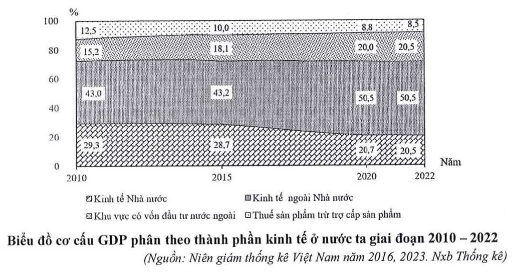
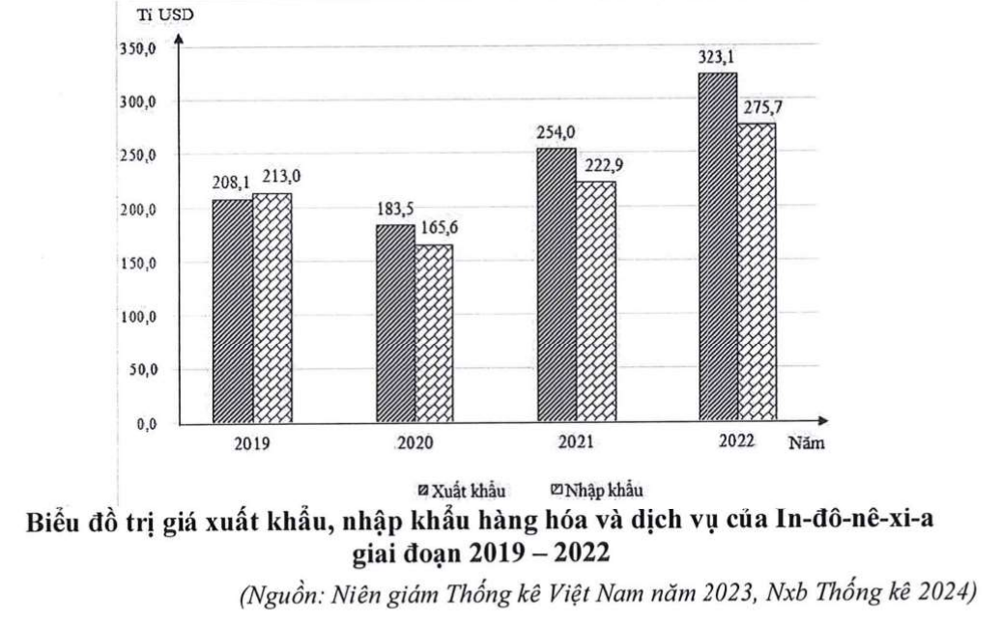

BỘ GIÁO DỤC VÀ ĐÀO TẠO
ĐỀ THI THAM KHẢO
(Đề thi có 04 trang)

KỲ THI TỐT NGHIỆP THPT TỪ NĂM 2025
MÔN: ĐỊA LÍ
Thời gian làm bài 50 phút, không kể thời gian phát đề

Họ, tên thí sinh: .....................................................................
Số báo danh: .........................................................................

PHẦN I. Thí sinh trả lời từ câu 1 đến câu 18. Mỗi câu hỏi thí sinh chỉ chọn một phương án.

Câu 1. Phần đất liền của lãnh thổ nước ta tiếp giáp với quốc gia nào sau đây?
A. Thái Lan.
B. Trung Quốc.
C. Ma-lai-xi-a.
D. Mi-an-ma.

Câu 2. Ở nước ta, bão thường kèm theo
A. mưa lớn, gió mạnh.
B. cát bay, cát chảy.
C. đất nhiễm mặn, nhiễm phèn.
D. động đất, sóng thần.

Câu 3. Thành phố nào sau đây của nước ta thuộc loại đô thị đặc biệt?
A. Hạ Long.
B. Hà Nội.
C. Biên Hòa.
D. Đà Nẵng.

Câu 4. Nguồn lao động ở nước ta hiện nay không có đặc điểm nào sau đây?
A. Lao động chiếm trên $50\%$ dân số.
B. Chất lượng lao động ngày càng tăng.
C. Có khả năng hội nhập với quốc tế.
D. Ít kinh nghiệm sản xuất nông nghiệp.

Câu 5. Vật nuôi cung cấp sản lượng thịt lớn nhất ở nước ta hiện nay là
A. lợn.
B. gia cầm.
C. trâu.
D. bò.

Câu 6. Nhà máy thủy điện nào sau đây có công suất lớn nhất ở nước ta hiện nay?
A. Sơn La.
B. Hòa Bình.
C. Thác Bà.
D. Trị An.

Câu 7. Loại hình vận tải có khối lượng vận chuyển hàng hóa lớn nhất ở nước ta hiện nay là
A. đường bộ.
B. đường hàng không.
C. đường biển.
D. đường sắt.

Câu 8. Văn hóa sông nước miệt vườn là sản phẩm du lịch đặc trưng của vùng du lịch nào sau đây?
A. Đồng bằng sông Cửu Long.
B. Đông Nam Bộ.
C. Bắc Trung Bộ.
D. Tây Nguyên.

Câu 9. Trung du và miền núi Bắc Bộ không có thế mạnh kinh tế nào sau đây?
A. Khai thác và chế biến khoáng sản.
B. Phát triển chăn nuôi gia súc lớn.
C. Trồng cây công nghiệp, rau quả.
D. Phát triển năng lượng điện khí.

Câu 10. Hiện nay, huyện đảo nào sau đây thuộc Đồng bằng sông Hồng?
A. Lý Sơn.
B. Cô Tô.
C. Cồn Cỏ.
D. Côn Đảo.

Câu 11. Duyên hải Nam Trung Bộ có nguồn lợi hải sản phong phú nhờ điều kiện nào sau đây?
A. Vùng biển rộng, khí hậu thuận lợi.
B. Biển có nhiều vịnh sâu, kín gió.
C. Đường bờ biển dài và nhiều đảo.
D. Diện tích nước lợ, nước mặn lớn.

Câu 12. Hiện nay, Đông Nam Bộ đứng đầu cả nước về
A. khai thác dầu thô.
B. nuôi trồng thủy sản.
C. trồng cây lương thực.
D. phát triển thủy điện.

Câu 13. Nguyên nhân chủ yếu nào sau đây làm cho sông ngòi nước ta giàu phù sa?
A. Xâm thực mạnh ở vùng đồi núi.
B. Đất feralit có tầng phong hóa dày.
C. Vùng đồi núi có diện tích rộng lớn.
D. Phong hóa hóa học ở vùng đồi núi.

Câu 14. Cho biểu đồ sau:

[HÌNH: Biểu đồ cột chồng thể hiện cơ cấu GDP phân theo thành phần kinh tế ở nước ta giai đoạn 2010 – 2022 (%). Trục đứng biểu thị tỉ lệ % (từ 0 đến 100), trục hoành là các năm 2010, 2015, 2020, 2022; chú giải gồm 4 thành phần kinh tế: Kinh tế Nhà nước, Kinh tế ngoài Nhà nước, Khu vực có vốn đầu tư nước ngoài, Thuế sản phẩm trừ trợ cấp sản phẩm; số liệu các năm từ dưới lên: năm 2010 là 29,3 - 43,0 - 15,2 - 12,5; năm 2015 là 28,7 - 43,2 - 18,1 - 10,0; năm 2020 là 20,7 - 50,5 - 20,0 - 8,8; năm 2022 là 20,5 - 50,5 - 20,5 - 8,5]

Biểu đồ cơ cấu GDP phân theo thành phần kinh tế ở nước ta giai đoạn 2010 – 2022
*(Nguồn: Niên giám thống kê Việt Nam năm 2016, 2023. Nxb Thống kê)*

Nhận xét nào sau đây đúng với biểu đồ trên?
A. Kinh tế Nhà nước và kinh tế ngoài Nhà nước có tỉ trọng tăng.
B. Khu vực có vốn đầu tư nước ngoài và kinh tế Nhà nước có tỉ trọng giảm.
C. Tỉ trọng kinh tế ngoài Nhà nước tăng $5,3\%$ giai đoạn 2010 - 2022.
D. Tỉ trọng kinh tế ngoài Nhà nước tăng nhiều nhất trong giai đoạn 2010 - 2022.

Câu 15. Phát biểu nào sau đây đúng với ngoại thương ở nước ta hiện nay?
A. Tổng trị giá xuất khẩu và nhập khẩu ngày càng giảm.
B. Mạng lưới siêu thị, trung tâm thương mại ngày càng phát triển.
C. Thị trường mở rộng theo hướng đa dạng hóa, đa phương hóa.
D. Tổng mức bán lẻ hàng hóa và doanh thu dịch vụ tiêu dùng tăng.

Câu 16. Thế mạnh tự nhiên để đa dạng hóa cơ cấu cây trồng ở Bắc Trung Bộ là
A. có nhiều nhóm đất khác nhau, khí hậu phân hóa.
B. nền nhiệt, ẩm cao, mạng lưới sông ngòi dày đặc.
C. địa hình nhiều đồi núi, lượng mưa trung bình năm lớn.
D. nguồn nước dồi dào, tài nguyên sinh vật đa dạng.

Câu 17. Sự phân hóa đa dạng của thiên nhiên nước ta có ảnh hưởng nào sau đây đến phát triển kinh tế?
A. Tạo nên sự đa dạng về các nguồn tài nguyên thiên nhiên.
B. Là cơ sở phân vùng kinh tế với các sản phẩm đặc trưng.
C. Cho phép sản xuất nông nghiệp quy mô lớn ở các vùng.
D. Giảm tính liên kết trong phát triển kinh tế giữa các vùng.

Câu 18. Đồng bằng sông Cửu Long phát triển mạnh các giống lúa cao sản, chất lượng cao nhằm mục đích chủ yếu nào sau đây?
A. Giải quyết việc làm, tạo sinh kế bền vững cho người dân.
B. Phát huy kinh nghiệm sản xuất, bảo vệ môi trường sinh thái.
C. Thích ứng với biến đổi khí hậu, đáp ứng nhu cầu thị trường.
D. Thúc đẩy hợp tác quốc tế, chủ động phòng chống thiên tai.

PHẦN II. Thí sinh trả lời từ câu 1 đến câu 4. Trong mỗi ý a), b), c), d) ở mỗi câu, thí sinh chọn đúng hoặc sai.

Câu 1. Cho thông tin sau:
    Địa hình của miền chủ yếu là đồi núi thấp và đồng bằng, có nhiều dãy núi hướng vòng cung. Khí hậu nhiệt đới ẩm gió mùa có mùa đông lạnh và kéo dài nhất nước ta. Cảnh quan thiên nhiên tiêu biểu là rừng nhiệt đới ẩm gió mùa. Ngoài ra, ở vùng núi cao có sự xuất hiện của các loài sinh vật cận nhiệt và ôn đới.
a) Nội dung trên thể hiện đặc điểm tự nhiên của miền Tây Bắc và Bắc Trung Bộ.
b) Trong miền, thành phần loài sinh vật nhiệt đới chiếm ưu thế với các kiểu rừng nhiệt đới ẩm gió mùa, rừng trên núi đá vôi.
c) Thực vật chính của miền là các cây họ dầu, săng lẻ, tếch,... Ở những nơi có mùa khô sâu sắc, kéo dài xuất hiện cây chịu hạn, rụng lá.
d) Mùa đông lạnh và kéo dài nhất nước ta chủ yếu do các dãy núi chạy theo hướng vòng cung.

Câu 2. Cho thông tin sau:
    Ngành dịch vụ có vai trò quan trọng trong hoạt động sản xuất và đời sống. Sự phát triển dịch vụ góp phần thúc đẩy chuyển dịch cơ cấu kinh tế của nước ta theo hướng công nghiệp hóa, hiện đại hóa, nâng cao chất lượng cuộc sống nhân dân. Nước ta có nhiều điều kiện để phát triển ngành dịch vụ như: vị trí địa lí, địa hình, khí hậu, trình độ phát triển kinh tế, dân cư và nguồn lao động, chính sách phát triển kinh tế, thị trường, lịch sử, văn hóa,...
a) Ngành dịch vụ đóng góp cao nhất trong cơ cấu GDP nước ta, góp phần đẩy nhanh tốc độ tăng trưởng kinh tế.
b) Trình độ phát triển kinh tế, chính sách phát triển kinh tế tác động đến quy mô và cơ cấu dịch vụ.
c) Vị trí địa lí, các điều kiện tự nhiên là điều kiện quan trọng để đáp ứng các tiêu chuẩn toàn cầu trong phát triển dịch vụ.
d) Điều kiện về lịch sử, văn hóa là cơ sở chủ yếu để thúc đẩy phân công lao động dịch vụ theo lãnh thổ.

Câu 3. Cho thông tin sau:
    Đồng bằng sông Cửu Long là một trong những vùng kinh tế ở nước ta chịu ảnh hưởng nặng nề của biến đổi khí hậu như: lũ lụt, hạn hán, xâm nhập mặn, triều cường, nước biển dâng, sạt lở bờ sông, sạt lở các khu vực ven biển và các rủi ro khác liên quan đến biến đổi khí hậu.
a) Đồng bằng sông Cửu Long có ba mặt giáp biển, địa hình thấp nhất nước ta, có nhiều cửa sông đổ ra biển.
b) Chuyển dịch cơ cấu nông nghiệp trong vùng, sử dụng các loại cây trồng, vật nuôi thích ứng với hạn hán, chịu được ngập và xâm nhập mặn là giải pháp chủ yếu để giảm thiểu tác nhân gây ra biến đổi khí hậu.
c) Giải pháp góp phần thích ứng với biến đổi khí hậu của vùng là đẩy mạnh trồng rừng, chủ động hội nhập quốc tế, trao đổi thông tin, huy động các nguồn lực để giảm thiểu phát thải nhà kính.
d) Một trong những mục tiêu để phát triển kinh tế, ứng phó với biến đổi khí hậu của vùng là phát triển các mô hình sinh kế thông minh, nâng cao hiểu biết của người dân, thay đổi tập quán sản xuất.

Câu 4. Cho biểu đồ:

[HÌNH: Biểu đồ cột đôi thể hiện trị giá xuất khẩu, nhập khẩu hàng hóa và dịch vụ của In-đô-nê-xi-a giai đoạn 2019 – 2022. Trục đứng biểu thị giá trị (Tỉ USD, từ 0,0 đến 350,0), trục hoành là các năm 2019, 2020, 2021, 2022; mỗi năm gồm 2 cột: cột gạch chéo nghiêng phải là Xuất khẩu, cột gạch ca-rô chéo là Nhập khẩu; số liệu từng năm: năm 2019 (Xuất khẩu: 208,1; Nhập khẩu: 213,0), năm 2020 (Xuất khẩu: 183,5; Nhập khẩu: 165,6), năm 2021 (Xuất khẩu: 254,0; Nhập khẩu: 222,9), năm 2022 (Xuất khẩu: 323,1; Nhập khẩu: 275,7)]

Biểu đồ trị giá xuất khẩu, nhập khẩu hàng hóa và dịch vụ của In-đô-nê-xi-a giai đoạn 2019 – 2022
*(Nguồn: Niên giám Thống kê Việt Nam năm 2023, Nxb Thống kê 2024)*

a) Năm 2022, In-đô-nê-xi-a có cán cân thương mại xuất siêu với trị giá cao nhất.
b) Từ năm 2019 đến năm 2022, In-đô-nê-xi-a có cán cân thương mại xuất siêu.
c) Trị giá xuất khẩu và trị giá nhập khẩu của In-đô-nê-xi-a có biến động trong giai đoạn 2019 - 2022.
d) Năm 2022 so với năm 2019, trị giá nhập khẩu của In-đô-nê-xi-a tăng nhanh hơn trị giá xuất khẩu.

PHẦN III. Thí sinh trả lời từ câu 1 đến câu 6.

Câu 1. Cho bảng số liệu:

Nhiệt độ không khí trung bình các tháng năm 2022 tại trạm quan trắc Nha Trang
*(Đơn vị: $^\circ\text{C}$)*

| Tháng | 1 | 2 | 3 | 4 | 5 | 6 | 7 | 8 | 9 | 10 | 11 | 12 |
| :--- | :---: | :---: | :---: | :---: | :---: | :---: | :---: | :---: | :---: | :---: | :---: | :---: |
| Nhiệt độ | 25,1 | 25,3 | 26,8 | 27,1 | 28,7 | 29,4 | 28,9 | 28,6 | 28,4 | 26,8 | 26,7 | 24,8 |

*(Nguồn: Niên giám Thống kê Việt Nam năm 2022, Nxb Thống kê 2023)*

Căn cứ vào bảng số liệu trên, hãy cho biết nhiệt độ không khí trung bình năm 2022 tại trạm quan trắc Nha Trang là bao nhiêu $^\circ\text{C}$ (làm tròn kết quả đến một chữ số thập phân).

Câu 2. Cho bảng số liệu:

Mực nước một số sông chính ở nước ta năm 2022
*(Đơn vị: $\text{cm}$)*

| Mực nước | Cao nhất | Thấp nhất |
| :--- | :---: | :---: |
| Sông Mã (trạm Cẩm Thủy) | 1798 | 1120 |
| Sông Cả (trạm Dừa) | 2277 | 1327 |

*(Nguồn: Niên giám Thống kê Việt Nam năm 2022, Nxb Thống kê 2023)*

Căn cứ vào bảng số liệu trên, hãy cho biết năm 2022, sự chênh lệch mực nước cao nhất và mực nước thấp nhất của sông Cả tại trạm Dừa cao hơn so với sự chênh lệch mực nước cao nhất và mực nước thấp nhất của sông Mã tại trạm Cẩm Thủy là bao nhiêu $\text{cm}$.

Câu 3. Năm 2022, nước ta có tỉ suất sinh thô là $15,2\text{‰}$, tỉ suất chết thô là $6,1\text{‰}$. Tỉ lệ tăng dân số tự nhiên của nước ta là bao nhiêu phần trăm? (làm tròn kết quả đến hai chữ số thập phân).

Câu 4. Năm 2022, tổng trị giá xuất khẩu, nhập khẩu hàng hóa của nước ta là $731,5\text{ tỉ USD}$, trong đó trị giá xuất khẩu là $371,7\text{ tỉ USD}$. Hãy cho biết tỉ trọng trị giá nhập khẩu của nước ta trong tổng trị giá xuất khẩu, nhập khẩu hàng hóa là bao nhiêu phần trăm (làm tròn kết quả đến một chữ số thập phân).

Câu 5. Năm 2022, sản lượng lương thực có hạt của nước ta là $47,1\text{ triệu tấn}$, số dân là $99,5\text{ triệu người}$. Hãy cho biết sản lượng lương thực có hạt bình quân đầu người của nước ta là bao nhiêu $\text{kg/người}$ (làm tròn kết quả đến hàng đơn vị).

Câu 6. Cho bảng số liệu:

Tổng diện tích có rừng, diện tích rừng trồng ở Tây Nguyên năm 2015 và năm 2022
*(Đơn vị: nghìn ha)*

| Năm \ Tiêu chí | 2015 | 2022 |
| :--- | :---: | :---: |
| Tổng diện tích có rừng | 2561,9 | 2571,1 |
| Diện tích rừng trồng | 315,9 | 480,3 |

*(Nguồn: Niên giám Thống kê Việt Nam năm 2016, 2022; Nxb Thống kê 2017, 2023)*

Căn cứ vào bảng số liệu trên, hãy cho biết tỉ lệ diện tích rừng trồng trong tổng diện tích có rừng ở Tây Nguyên năm 2022 so với năm 2015 tăng thêm bao nhiêu phần trăm (làm tròn kết quả đến một chữ số thập phân).

-------------------- HẾT --------------------

- Thí sinh không được sử dụng tài liệu;
- Giám thị không giải thích gì thêm.

---

BỘ GIÁO DỤC VÀ ĐÀO TẠO
ĐÁP ÁN ĐỀ THAM KHẢO
Môn: ĐỊA LÍ

PHẦN I. Câu trắc nghiệm nhiều phương án lựa chọn. Thí sinh trả lời từ câu 1 đến câu 18.
(Mỗi câu trả lời đúng thí sinh được 0,25 điểm)

| Câu | 1 | 2 | 3 | 4 | 5 | 6 | 7 | 8 | 9 | 10 |
| :---: | :---: | :---: | :---: | :---: | :---: | :---: | :---: | :---: | :---: | :---: |
| Chọn | B | A | B | D | A | A | A | A | D | B |

| Câu | 11 | 12 | 13 | 14 | 15 | 16 | 17 | 18 |
| :---: | :---: | :---: | :---: | :---: | :---: | :---: | :---: | :---: |
| Chọn | A | A | A | D | C | A | B | C |

PHẦN II. Câu trắc nghiệm đúng sai. Thí sinh trả lời từ câu 1 đến câu 4. Trong mỗi ý a), b), c), d) ở mỗi câu, thí sinh chọn đúng hoặc sai.
- Thí sinh chỉ lựa chọn chính xác 01 ý trong 01 câu hỏi được 0,1 điểm;
- Thí sinh chỉ lựa chọn chính xác 02 ý trong 01 câu hỏi được 0,25 điểm;
- Thí sinh chỉ lựa chọn chính xác 03 ý trong 01 câu hỏi được 0,5 điểm;
- Thí sinh lựa chọn chính xác cả 04 ý trong 01 câu hỏi được 1 điểm.

| Câu | Câu 1 | Câu 2 | Câu 3 | Câu 4 |
| :---: | :---: | :---: | :---: | :---: |
| Đáp án | a) Sai b) Đúng c) Sai d) Sai | a) Đúng b) Đúng c) Sai d) Sai | a) Đúng b) Sai c) Sai d) Đúng | a) Đúng b) Sai c) Đúng d) Sai |

PHẦN III. Câu trắc nghiệm trả lời ngắn. Thí sinh trả lời từ câu 1 đến câu 6
Mỗi câu trả lời đúng thí sinh được 0,25 điểm.

| Câu | Câu 1 | Câu 2 | Câu 3 | Câu 4 | Câu 5 | Câu 6 |
| :---: | :---: | :---: | :---: | :---: | :---: | :---: |
| Đáp án | 27,2 | 272 | 0,91 | 49,2 | 473 | 6,4 |
