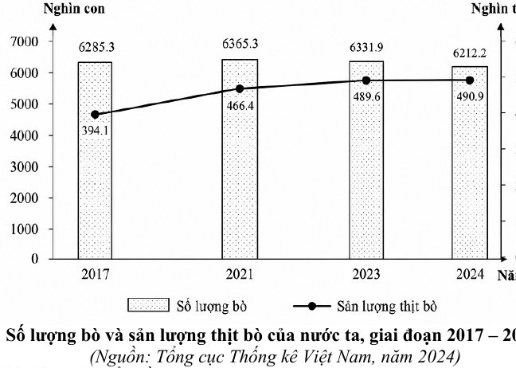
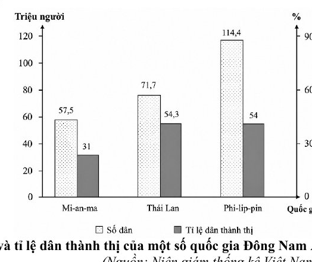

status: ocr-draft
source: dia-li | Sở Giáo dục và Đào tạo tỉnh Thái Nguyên | Thi thử tốt nghiệp THPT năm 2026 (Đợt 2) | Mã đề 0901 | PDF pages 1–4

SỞ GIÁO DỤC VÀ ĐÀO TẠO TỈNH THÁI NGUYÊN
ĐỀ THI CHÍNH THỨC
(Đề thi có 04 trang)

THI THỬ TỐT NGHIỆP THPT NĂM 2026 (Đợt 2)
MÔN: ĐỊA LÍ
Thời gian làm bài: 50 phút, không kể thời gian phát đề

Họ và tên: ………………………………………….. Số báo danh: ……………… Mã đề 0901

## PHẦN I. Câu trắc nghiệm nhiều phương án lựa chọn
Thí sinh trả lời từ câu 1 đến câu 18. Mỗi câu hỏi thí sinh chỉ chọn một phương án.

**Câu 1.** Hiện nay, ảnh hưởng chủ yếu của biến đổi khí hậu đến Đồng bằng sông Cửu Long là

A. nhiều vùng trũng bị ngập, tăng cường lượng phù sa hằng năm, thu hẹp diện tích đất canh tác.
B. gia tăng cường độ lũ, thiếu nước ngọt cho sản xuất và sinh hoạt, thay đổi dòng chảy của sông.
C. nước biển dâng; gia tăng xâm nhập mặn và sạt lở bờ sông, bờ biển; mùa khô thiếu nước ngọt.
D. sụt lún nhiều vùng cửa sông, tăng nguy cơ mất đất sản xuất, nước mặn lấn sâu vào nội đồng.

**Câu 2.** Thế mạnh nổi bật trong thời kì cơ cấu dân số vàng của nước ta hiện nay là

A. lực lượng lao động dồi dào.
B. lao động có nhiều kinh nghiệm.
C. trình độ lao động ở mức cao.
D. nguồn dự trữ lao động lớn.

**Câu 3.** Hiện nay, khu du lịch nào sau đây của nước ta đã được công nhận là khu du lịch cấp quốc gia?

A. Sa Pa (Lào Cai).
B. Tràng An (Ninh Bình).
C. Cát Bà (TP Hải Phòng).
D. Lăng Cô (TP Huế).

**Câu 4.** Lao động nông thôn ở nước ta hiện nay

A. có nhiều kinh nghiệm trong công nghiệp.
B. phần lớn đã qua đào tạo nghề nghiệp.
C. chỉ hoạt động trong ngành nông nghiệp.
D. có số lượng lớn hơn khu vực thành thị.

**Câu 5.** Loại đất chiếm diện tích lớn nhất ở nước ta là

A. đất phù sa.
B. đất xám bạc màu.
C. đất mùn thô.
D. đất feralit.

**Câu 6.** Cho biểu đồ sau:

[HÌNH: Biểu đồ cột và đường về số lượng bò (nghìn con) và sản lượng thịt bò (nghìn tấn) của nước ta các năm 2017, 2021, 2023 và 2024. Cột lần lượt ghi 6285,3; 6365,3; 6331,9; 6212,2. Đường lần lượt ghi 394,1; 466,4; 489,6; 490,9.]

*Số lượng bò và sản lượng thịt bò của nước ta, giai đoạn 2017 – 2024*

*(Nguồn: Tổng cục Thống kê Việt Nam, năm 2024)*

Nhận xét nào sau đây đúng với biểu đồ trên?

A. Số lượng bò và sản lượng thịt bò tăng liên tục.
B. Năm 2024 so với năm 2017, số lượng bò tăng 73,1 nghìn con.
C. Số lượng bò và sản lượng thịt bò giảm liên tục.
D. Năm 2024 so với năm 2017, sản lượng thịt bò tăng hơn 1,2 lần.

**Câu 7.** Vị trí địa lí của nước ta tạo điều kiện thuận lợi chủ yếu cho

A. phát triển kinh tế nhiều thành phần.
B. phát triển nền nông nghiệp cận nhiệt đới.
C. bảo vệ chủ quyền, an ninh quốc phòng.
D. phát triển nền nông nghiệp nhiệt đới.

**Câu 8.** Loại gió nào sau đây gây mưa lớn cho nước ta vào giữa và cuối mùa hạ?

A. Gió phơn Tây Nam.
B. Gió mùa Tây Nam.
C. Gió mùa Đông Bắc.
D. Tín phong bán cầu Bắc.

*Trang 1*

**Câu 9.** Cơ cấu kinh tế nước ta hiện nay đang chuyển dịch theo hướng

A. tăng tỉ trọng kinh tế Nhà nước.
B. công nghiệp hoá, hiện đại hoá.
C. chú trọng sản xuất nông nghiệp.
D. ưu tiên ngành cần nhiều lao động.

**Câu 10.** Hạn chế chủ yếu đối với phát triển kinh tế - xã hội của Đông Nam Bộ hiện nay là

A. khí hậu phân mùa, thiếu khoáng sản kim loại.
B. thiếu nước vào mùa khô, tỉ lệ dân nhập cư cao.
C. tài nguyên nước suy giảm, biến đổi khí hậu.
D. mật độ dân số cao, ảnh hưởng của triều cường.

**Câu 11.** Hiện nay, nguồn điện chiếm tỉ trọng cao nhất trong cơ cấu sản lượng điện của nước ta là

A. điện gió.
B. thủy điện.
C. điện mặt trời.
D. nhiệt điện.

**Câu 12.** Vùng Bắc Trung Bộ không tiếp giáp với vùng kinh tế nào sau đây?

A. Đồng bằng sông Hồng.
B. Nam Trung Bộ.
C. Đông Nam Bộ.
D. Trung du và miền núi phía Bắc.

**Câu 13.** Hiện nay, giải pháp nào sau đây phù hợp nhất để nâng cao hiệu quả phát triển du lịch liên vùng ở Nam Trung Bộ?

A. Xây dựng các tuyến du lịch kết hợp biển – cao nguyên, kết nối giao thông.
B. Hiện đại hoá cơ sở hạ tầng du lịch, quảng bá thương hiệu các điểm du lịch.
C. Phát triển du lịch nghỉ dưỡng biển – đảo, du lịch sinh thái – thể thao biển.
D. Ưu tiên du lịch sinh thái rừng, trải nghiệm không gian văn hoá các dân tộc.

**Câu 14.** Thế mạnh chủ yếu để phát triển các ngành công nghiệp hiện đại ở Đồng bằng sông Hồng hiện nay là

A. lịch sử phát triển sớm, thị trường tiêu thụ rộng lớn.
B. vị trí địa lí thuận lợi, nguồn khoáng sản phong phú.
C. quy mô dân số đông, có nhiều kinh nghiệm sản xuất.
D. lao động có trình độ cao, thu hút nhiều vốn đầu tư.

**Câu 15.** Ở nước ta, mưa lớn sau hoàn lưu bão thường gây ra thiên tai nào ở khu vực miền núi miền núi?

A. Lũ quét.
B. Ngập lụt.
C. Xâm nhập mặn.
D. Động đất.

**Câu 16.** Cây công nghiệp quan trọng số một của vùng Trung du và miền núi phía Bắc là

A. cà phê.
B. quế.
C. hồi.
D. chè.

**Câu 17.** Vùng sản xuất lương thực lớn nhất nước ta hiện nay là

A. Trung du và miền núi phía Bắc.
B. Đông Nam Bộ.
C. Đồng bằng sông Cửu Long.
D. Đồng bằng sông Hồng.

**Câu 18.** Giữa vùng cao nguyên phía tây và đồng bằng ven biển phía đông của vùng Nam Trung Bộ có sự đối lập về thời gian mùa mưa và mùa khô là do

A. dãy Bạch Mã kết hợp với ảnh hưởng của các loại gió.
B. dãy Hoành Sơn kết hợp với ảnh hưởng của các loại gió.
C. dãy Trường Sơn Nam kết hợp với ảnh hưởng của các loại gió.
D. dãy Trường Sơn Bắc kết hợp với ảnh hưởng của các loại gió.

## PHẦN II. Câu trắc nghiệm đúng sai
Thí sinh trả lời từ câu 1 đến câu 4. Trong mỗi ý a), b), c), d) ở mỗi câu, thí sinh chọn đúng hoặc sai.

**Câu 1.** Cho thông tin sau:

Nước ta có khí hậu nhiệt đới ẩm gió mùa với nhiệt, ẩm cao và các loại gió hoạt động theo mùa. Đặc điểm khí hậu này đã tác động sâu sắc tới tất cả các thành phần địa lí tự nhiên, trong đó có địa hình. Biểu hiện rõ rệt nhất của địa hình nhiệt đới ẩm gió mùa là quá trình xâm thực mạnh ở vùng đồi núi và bồi tụ nhanh ở các đồng bằng hạ lưu sông. Khi lên các đỉnh núi cao, tính chất nhiệt đới của khí hậu bị suy giảm.

a) Các vùng núi cao ở nước ta có khí hậu mát mẻ, tạo thuận lợi cho việc phát triển các cây trồng có nguồn gốc cận nhiệt, ôn đới và ngành du lịch.

b) Địa hình cacx-tơ ở nước ta là kết quả tác động của khí hậu nhiệt đới ẩm gió mùa trên vùng núi đá vôi.

c) Địa hình làm khí hậu có sự phân hóa theo đai cao, tuy nhiên phần lãnh thổ phía Nam nước ta có nền nhiệt thấp hơn nên sự phân hóa khí hậu theo đai cao ở miền Nam và miền Bắc không hoàn toàn giống nhau.

d) Quá trình xâm thực mạnh ở vùng đồi núi kéo theo sụt lún ở đồng bằng.

*Trang 2*

**Câu 2.** Cho biểu đồ sau:

[HÌNH: Biểu đồ cột kép thể hiện số dân (triệu người) và tỉ lệ dân thành thị (%) của Mi-an-ma, Thái Lan và Phi-lip-pin năm 2024. Số dân lần lượt là 57,5; 71,7; 114,4 triệu người. Tỉ lệ dân thành thị lần lượt là 31%; 54,3%; 54%.]

*Số dân và tỉ lệ dân thành thị của một số quốc gia Đông Nam Á, năm 2024*

*(Nguồn: Niên giám thống kê Việt Nam 2024, NXB Thống kê, 2024)*

a) Số dân thành thị của Phi-lip-pin gấp 2,5 lần số dân thành thị của Mi-an-ma.

b) Số dân thành thị của Thái Lan thấp nhất.

c) Số dân của Phi-lip-pin cao nhất, tỉ lệ dân thành thị của Mi-an-ma thấp nhất.

d) Số dân thành thị của Phi-lip-pin cao nhất.

**Câu 3.** Cho thông tin sau:

Hiện nay, hoạt động ngoại thương của nước ta ngày càng mở rộng theo hướng đa dạng hoá, đa phương hoá. Việt Nam đã chính thức trở thành thành viên của tổ chức Thương mại thế giới (WTO) vào năm 2007. Hiện nay nước ta có quan hệ buôn bán với phần lớn các nước và vùng lãnh thổ trên thế giới. Cơ cấu trị giá xuất, nhập khẩu có sự thay đổi theo hướng tăng tỉ trọng xuất khẩu.

a) Giải pháp quan trọng nhất để đẩy mạnh hoạt động xuất khẩu ở nước ta hiện nay là sản xuất số lượng lớn, đa dạng hoá các mặt hàng.

b) Trong giai đoạn từ năm 2015 đến nay, cán cân xuất nhập khẩu của nước ta chuyển từ xuất siêu sang nhập siêu.

c) Trị giá xuất khẩu của nước ta tăng trong thời gian gần đây là do sản xuất phát triển, mở rộng thị trường.

d) Nhóm hàng công nghiệp chế biến chiếm tỉ trọng ngày càng cao trong cơ cấu trị giá hàng xuất khẩu do nguồn lực phát triển đa dạng, hiệu quả cao.

**Câu 4.** Cho thông tin sau:

Ở vùng Nam Trung Bộ hiện nay, khai thác hải sản phát triển mạnh, đóng góp chủ yếu vào cơ cấu sản lượng hải sản của vùng (chiếm hơn 90% sản lượng hải sản). Các sản phẩm khai thác ngày càng đa dạng, trong đó nhiều loại có giá trị kinh tế cao như cá thu, cá ngừ, tôm, mực,... Các tỉnh có sản lượng hải sản khai thác dẫn đầu là Quảng Ngãi, Khánh Hòa,...

a) Vùng Nam Trung Bộ không có hoạt động nuôi trồng hải sản.

b) Nam Trung Bộ cần đẩy mạnh hoạt động chế biến nhằm nâng cao giá trị hải sản, tạo nhiều mặt hàng xuất khẩu.

c) Cần đẩy mạnh khai thác hải sản ven bờ nhằm khai thác hợp lí và bảo vệ nguồn lợi hải sản, nâng cao hiệu quả kinh tế, góp phần bảo vệ chủ quyền biển đảo.

d) Hoạt động khai thác hải sản phát triển mạnh do có nhiều bãi tôm, bãi cá thuộc các ngư trường trọng điểm, phương tiện khai thác được đầu tư.

## PHẦN III. Câu trắc nghiệm yêu cầu trả lời ngắn
Thí sinh trả lời từ câu 1 đến câu 6.

**Câu 1.** Năm 2024, vùng Đồng bằng sông Hồng có dân số là 24 753,3 nghìn người; sản lượng lương thực có hạt là 5 838,3 nghìn tấn. Hãy cho biết sản lượng lương thực có hạt bình quân đầu người của vùng Đồng bằng sông Hồng năm 2024 là bao nhiêu kg/người (làm tròn kết quả đến hàng đơn vị).

*Trang 3*

**Câu 2.** Cho bảng số liệu:

**Sản lượng thủy sản của nước ta năm 2020 và năm 2024**

|  | 2020 | 2024 |
|---|---:|---:|
| Tổng sản lượng (nghìn tấn) | 8 635,7 | 9 676,2 |
| Tỉ trọng thủy sản khai thác (%) | 45,1 | 39,9 |
| Tỉ trọng thủy sản nuôi trồng (%) | 54,9 | 60,1 |

*(Nguồn: Tổng cục Thống kê Việt Nam, năm 2024)*

Căn cứ vào bảng số liệu trên, hãy cho biết sản lượng thủy sản khai thác năm 2024 nhỏ hơn sản lượng thủy sản khai thác năm 2020 bao nhiêu nghìn tấn (làm tròn kết quả đến hàng đơn vị).

**Câu 3.** Năm 2024, nước ta có tỉ suất sinh thô là 13,5‰; tỉ suất tử thô là 5,6‰. Hãy cho biết, tỉ suất gia tăng dân số tự nhiên của nước ta năm 2024 là bao nhiêu phần trăm (làm tròn kết quả đến hai chữ số thập phân).

**Câu 4.** Cho bảng số liệu:

**Lượng mưa các tháng tại trạm quan trắc Nam Định, năm 2024**

*(Đơn vị: mm)*

| Tháng | 1 | 2 | 3 | 4 | 5 | 6 | 7 | 8 | 9 | 10 | 11 | 12 |
|---|---:|---:|---:|---:|---:|---:|---:|---:|---:|---:|---:|---:|
| Lượng mưa | 46,3 | 20,6 | 83,8 | 19,6 | 253,0 | 275,0 | 526,0 | 270,8 | 831,8 | 60,6 | 12,3 | 3,7 |

*(Nguồn: Tổng cục Thống kê Việt Nam, năm 2024)*

Căn cứ vào bảng số liệu trên, hãy cho biết tại trạm quan trắc Nam Định, lượng mưa trung bình năm 2024 là bao nhiêu mm (làm tròn kết quả đến hàng đơn vị).

**Câu 5.** Cho bảng số liệu:

**Mực nước sông Đà tại trạm Lai Châu (Mường Lay) và trạm Hoà Bình, năm 2024**

*(Đơn vị: cm)*

| Mực nước | Cao nhất | Thấp nhất |
|---|---:|---:|
| Trạm Lai Châu (Mường Lay) | 21 526 | 19 705 |
| Trạm Hoà Bình | 1 642 | 676 |

*(Nguồn: Tổng cục Thống kê Việt Nam, năm 2024)*

Căn cứ vào bảng số liệu trên, hãy cho biết năm 2024, chênh lệch giữa mực nước cao nhất và mực nước thấp nhất của sông Đà tại trạm Lai Châu (Mường Lay) lớn hơn chênh lệch giữa mực nước cao nhất và mực nước thấp nhất của sông Đà tại trạm Hòa Bình là bao nhiêu cm (làm tròn kết quả đến hàng đơn vị).

**Câu 6.** Cho bảng số liệu:

**Diện tích và sản lượng lúa của nước ta năm 2021 và năm 2024**

|  | 2021 | 2024 |
|---|---:|---:|
| Diện tích (triệu ha) | 7,24 | 7,13 |
| Sản lượng (triệu tấn) | 43,9 | 43,5 |

*(Nguồn: Tổng cục Thống kê Việt Nam, năm 2024)*

Căn cứ vào bảng số liệu trên, hãy cho biết năng suất lúa năm 2024 lớn hơn năng suất lúa năm 2021 bao nhiêu tạ/ha (làm tròn kết quả đến một chữ số thập phân).

------ HẾT ------