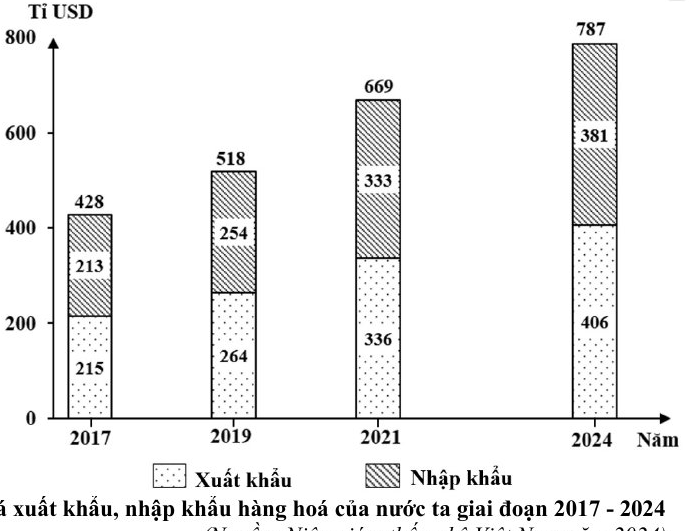
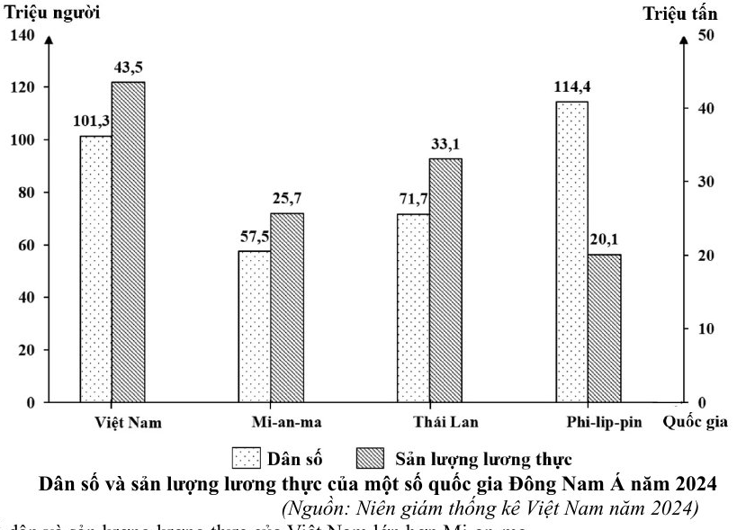

status: ocr-draft
source: official/2026-provincial-dia-li/de-thi-thu-tn-thpt-nam-2026-mon-dia-li-so-gd-da-nang-lan-1/paper.docx; PDF pages 1–4; mã đề 0901

SỞ GIÁO DỤC VÀ ĐÀO TẠO THÀNH PHỐ ĐÀ NẴNG
ĐỀ CHÍNH THỨC

THI THỬ TỐT NGHIỆP TRUNG HỌC PHỔ THÔNG
NĂM HỌC 2025 - 2026
MÔN: ĐỊA LÍ
Thời gian làm bài: 50 phút (không kể thời gian giao đề)
(Đề thi có 28 câu, 04 trang)

Thí sinh làm bài trên Phiếu trả lời trắc nghiệm. Mã đề thi: 0901
Họ và tên thí sinh: ........................................ Số báo danh: ............... Phòng thi: ............

## PHẦN I

Thí sinh trả lời từ câu 1 đến câu 18. Mỗi câu hỏi thí sinh chỉ chọn một phương án.

**Câu 1.** Dân số nước ta hiện nay

A. có tỉ suất sinh thô nhỏ hơn tử thô.  
B. có quy mô lớn và ngày càng tăng.  
C. có tốc độ già hóa ở mức rất chậm.  
D. tập trung chủ yếu ở các thành phố.

**Câu 2.** Cơ cấu lãnh thổ kinh tế nước ta hiện nay chuyển dịch theo hướng

A. phát huy tốt thế mạnh của từng vùng.  
B. tăng nhanh tỉ trọng khu vực dịch vụ.  
C. mở rộng diện tích các vùng trồng lúa.  
D. đẩy mạnh thu hút đầu tư nước ngoài.

**Câu 3.** Ngành dịch vụ nào sau đây giữ vai trò chủ yếu thúc đẩy phát triển kinh tế số ở nước ta hiện nay?

A. Nội thương.  
B. Giao thông vận tải.  
C. Viễn thông.  
D. Du lịch.

**Câu 4.** Vùng Đồng bằng sông Hồng có đặc khu nào sau đây?

A. Vân Đồn.  
B. Phú Quốc.  
C. Lý Sơn.  
D. Cồn Cỏ.

**Câu 5.** Phát biểu nào sau đây đúng về giao thông đường bộ của nước ta hiện nay?

A. Chưa hội nhập vào khu vực.  
B. Mạng lưới vẫn còn thưa thớt.  
C. Khối lượng vận chuyển lớn.  
D. Chủ yếu phục vụ xuất khẩu.

**Câu 6.** Cho biểu đồ sau:

[HÌNH: Biểu đồ cột chồng trị giá xuất khẩu và nhập khẩu hàng hóa của Việt Nam các năm 2017, 2019, 2021 và 2024. Xuất khẩu lần lượt là 215, 264, 336, 406 tỉ USD; nhập khẩu là 213, 254, 333, 381 tỉ USD; tổng trị giá ghi trên cột là 428, 518, 669, 787 tỉ USD. Trục tung tỉ USD.]

*Trị giá xuất khẩu, nhập khẩu hàng hóa của nước ta giai đoạn 2017 - 2024*  
*(Nguồn: Niên giám thống kê Việt Nam năm 2024)*

Nhận xét nào sau đây đúng với biểu đồ trên?

A. Trị giá xuất khẩu tăng ít hơn nhập khẩu.  
B. Trị giá nhập khẩu tăng nhanh hơn xuất khẩu.  
C. Năm 2024, trị giá nhập siêu đạt 25 tỉ USD.  
D. Tỉ trọng nhập khẩu có xu hướng giảm.

**Câu 7.** Ưu thế của ngành nuôi trồng thủy sản so với khai thác thủy sản ở nước ta hiện nay là

A. hiệu quả kinh tế cao, chủ động trong sản xuất.  
B. thu hút nhiều vốn đầu tư, tự nhiên thuận lợi.  
C. có diện tích mặt nước rộng lớn, ít dịch bệnh.  
D. lao động đông, ít chịu ảnh hưởng của thiên tai.

**Câu 8.** Vị trí nước ta ở

A. phía đông của Thái Bình Dương.  
B. phía tây bán đảo Đông Dương.  
C. trung tâm khu vực Đông Nam Á.  
D. vùng nội chí tuyến bán cầu Bắc.

**Câu 9.** Khí hậu là nhân tố chủ yếu làm cho sông ngòi của nước ta

A. có độ dốc lớn, hướng chủ yếu tây bắc - đông nam.  
B. có mạng lưới dày đặc, chế độ nước sông theo mùa.  
C. có một mùa lũ và một mùa cạn, thường gây hạn hán.  
D. ít các sông lớn, chủ yếu là sông nhỏ và trung bình.

**Câu 10.** Giới hạn của đai nhiệt đới gió mùa ở miền Nam nước ta cao hơn so với miền Bắc chủ yếu do

A. gió mùa Đông Bắc, vị trí gần với chí tuyến Bắc, hoạt động của frông.  
B. Tín phong bán cầu Nam, nằm xa chí tuyến Bắc, có nhiều cao nguyên.  
C. nằm ở vĩ độ thấp hơn, các gió hướng tây nam, Tín phong bán cầu Bắc.  
D. nằm ở vĩ độ cao hơn, Tín phong bán cầu Bắc, gió phơn Tây Nam.

**Câu 11.** Nguồn lao động của nước ta hiện nay

A. số lượng ngày càng giảm.  
B. có chất lượng còn thấp.  
C. phần lớn đã qua đào tạo.  
D. phân bố khá đồng đều.

**Câu 12.** Nhóm cây nào sau đây chiếm tỉ trọng lớn nhất trong cơ cấu diện tích ngành trồng trọt ở nước ta hiện nay?

A. Cây ăn quả.  
B. Cây thực phẩm.  
C. Cây lương thực.  
D. Cây công nghiệp.

**Câu 13.** Vùng Trung du và miền núi phía Bắc có thế mạnh kinh tế nào sau đây?

A. Khai thác hải sản.  
B. Du lịch biển đảo.  
C. Khai thác dầu khí.  
D. Phát triển thủy điện.

**Câu 14.** Biện pháp chủ yếu để tăng hiệu quả kinh tế trong phát triển cây công nghiệp ở Trung du và miền núi phía Bắc là

A. đẩy mạnh chuyên môn hóa, nâng cao sản lượng, tăng cường chế biến.  
B. tăng sự liên kết, mở rộng thị trường xuất khẩu, đẩy mạnh thâm canh.  
C. sản xuất tập trung, gắn với chế biến và dịch vụ, áp dụng kĩ thuật mới.  
D. lập vùng chuyên canh, tăng năng suất, ứng dụng khoa học kĩ thuật.

**Câu 15.** Vùng Duyên hải Nam Trung Bộ và Tây Nguyên hiện nay phát triển mạnh

A. cây ăn quả ôn đới, nuôi gia cầm.  
B. đánh bắt gần bờ, sản xuất muối.  
C. đánh bắt xa bờ, du lịch biển đảo.  
D. khai thác than nâu, điện mặt trời.

**Câu 16.** Mục đích chủ yếu của việc phát triển các mô hình sinh kế thông minh ở Đồng bằng sông Cửu Long là

A. sử dụng hiệu quả tài nguyên đất, cung cấp nguồn hàng xuất khẩu, tạo việc làm.  
B. đảm bảo an ninh lương thực, giảm nhẹ biến đổi khí hậu và cải thiện đời sống.  
C. tăng sản lượng nông sản, đa dạng sản phẩm nông nghiệp, bảo vệ môi trường.  
D. ứng phó biến đổi khí hậu, phát huy thế mạnh về tự nhiên, tăng hiệu quả sản xuất.

**Câu 17.** Vùng Đông Nam Bộ hiện nay đứng đầu cả nước về

A. chăn nuôi gia cầm và thủy sản.  
B. trồng các loại cây lương thực.  
C. phát triển khai thác dầu và khí.  
D. trữ năng thủy điện ở các sông.

**Câu 18.** Miền núi nước ta là nơi thường xảy ra thiên tai nào sau đây?

A. Lụt úng.  
B. Sạt lở đất.  
C. Sóng thần.  
D. Hạn mặn.

## PHẦN II

Thí sinh trả lời từ câu 1 đến 4. Trong mỗi ý a), b), c), d) ở mỗi câu, thí sinh chọn đúng hoặc sai.

**Câu 1.** Cho thông tin sau:

Nội thương nước ta hiện nay phát triển nhanh, thể hiện ở trị giá và khối lượng hàng hóa, dịch vụ trao đổi trên thị trường ngày càng lớn. Dự báo trong thời gian tới, mức tăng sẽ nhanh hơn do thị trường trong nước lớn và sức mua tăng lên. Hệ thống bán buôn, bán lẻ phát triển rộng khắp với nhiều hình thức cùng với sự phát triển nhanh của thương mại điện tử. Các trung tâm thương mại có vốn đầu tư nước ngoài xuất hiện tại một số đô thị.

a) Hàng hóa của Việt Nam xuất hiện ngày càng nhiều trong các trung tâm thương mại có vốn đầu tư nước ngoài phản ánh khả năng cạnh tranh của hàng nội địa đang tăng lên.  
b) Ngành nội thương nước ta có sự tham gia của nhiều thành phần kinh tế.  
c) Sự phát triển rộng khắp của hệ thống bán buôn, bán lẻ cùng thương mại điện tử đã làm thu hẹp phần lớn sự chênh lệch về quy mô nội thương giữa các vùng kinh tế.  
d) Chất lượng lao động đang được nâng lên là nhân tố quyết định đến quy mô, tốc độ tăng trưởng và cơ cấu của ngành nội thương nước ta.

**Câu 2.** Cho biểu đồ:

[HÌNH: Biểu đồ cột ghép dân số (triệu người) và sản lượng lương thực (triệu tấn) của Việt Nam, Mi-an-ma, Thái Lan và Phi-lip-pin năm 2024. Dữ liệu lần lượt: Việt Nam 101,3 và 43,5; Mi-an-ma 57,5 và 25,7; Thái Lan 71,7 và 33,1; Phi-lip-pin 114,4 và 20,1.]

*Dân số và sản lượng lương thực của một số quốc gia Đông Nam Á năm 2024*  
*(Nguồn: Niên giám thống kê Việt Nam năm 2024)*

a) Số dân và sản lượng lương thực của Việt Nam lớn hơn Mi-an-ma.  
b) Bình quân lương thực trên đầu người của Thái Lan nhiều hơn Mi-an-ma gần 14,7 kg/người.  
c) Việt Nam có bình quân lương thực trên đầu người cao nhất, Phi-lip-pin có bình quân lương thực trên đầu người thấp nhất.  
d) Sản lượng lương thực của Thái Lan gấp 1,8 lần của Phi-lip-pin.

**Câu 3.** Cho thông tin sau:

Bắc Trung Bộ có tài nguyên du lịch phong phú, gồm tài nguyên tự nhiên với địa hình đa dạng, có nhiều bãi tắm đẹp (Sầm Sơn, Cửa Lò, Lăng Cô) và các vườn quốc gia có hệ sinh thái nguyên sinh, nổi bật là Vườn quốc gia Phong Nha – Kẻ Bàng; cùng với tài nguyên văn hóa đặc sắc, tiêu biểu là Cố đô Huế. Số khách du lịch đến vùng có xu hướng tăng, năm 2023, vùng đón 33,5 triệu lượt khách. Tuy nhiên, du lịch của vùng còn nhiều hạn chế cần khắc phục để phát triển mạnh hơn trong thời gian tới.

a) Tài nguyên du lịch phong phú tạo cơ sở để vùng hình thành các điểm du lịch.  
b) Trong định hướng phát triển du lịch, vùng ưu tiên các lợi ích kinh tế nhằm đưa du lịch phát triển theo hướng bền vững.  
c) Số khách du lịch đến vùng ngày càng tăng cho thấy du lịch của vùng đã phát triển tương xứng với tiềm năng.  
d) Việc tăng cường liên kết quốc tế, liên kết vùng và giữa các tỉnh trong phát triển du lịch sẽ góp phần chia sẻ tài nguyên và tăng sức hấp dẫn đối với du khách.

**Câu 4.** Cho thông tin sau:

Biển Việt Nam có nguồn tài nguyên sinh vật phong phú, đa dạng. Vùng biển có khoảng 2000 loài cá, trong đó có trên 110 loài giá trị kinh tế cao; có nhiều loài động vật giáp xác, thân mềm, nhiều loại có giá trị dinh dưỡng cao như: tôm, cua, mực,...Trữ lượng hải sản của vùng biển nước ta khoảng 4 triệu tấn, thuận lợi để phát triển ngành đánh bắt hải sản. Vùng ven bờ có nhiều loại rong biển được khai thác, sử dụng trong công nghiệp sản xuất và chế biến thực phẩm. Trên các đảo ven bờ còn có chim yến, tạo mặt hàng xuất khẩu có giá trị.

a) Sản lượng hải sản khai thác ngày càng lớn chủ yếu do đáp ứng nhu cầu của thị trường trong nước ngày càng tăng.  
b) Tài nguyên sinh vật biển của nước ta phong phú bao gồm các loài sinh vật nhiệt đới, cận nhiệt và ôn đới, nhưng đang bị suy giảm.  
c) Nguyên nhân chủ yếu làm cho tài nguyên sinh vật biển suy giảm là do khai thác quá mức, ô nhiễm môi trường nước.  
d) Để bảo vệ nguồn lợi hải sản, giải pháp chủ yếu là khai thác hợp lí đi đôi với bảo vệ, giảm khai thác xa bờ.

## PHẦN III

Thí sinh trả lời từ câu 1 đến câu 6.

**Câu 1.** Năm 2010, diện tích cây ăn quả của nước ta là 780 nghìn ha, năm 2024 diện tích cây ăn quả tăng thêm so với năm 2010 là 66,4%. Hãy cho biết diện tích cây ăn quả của nước ta năm 2024 là bao nhiêu nghìn ha (làm tròn kết quả đến hàng đơn vị).

**Câu 2.** Năm 2024, số lao động có việc làm trong nền kinh tế nước ta là 51860,3 nghìn người. Trong đó, tỉ lệ lao động có việc làm đã qua đào tạo là 28,44%. Hãy cho biết số lao động có việc làm đã qua đào tạo năm 2024 là bao nhiêu triệu người (làm tròn kết quả đến hàng đơn vị).

**Câu 3.** Năm 2024, tổng diện tích rừng của nước ta là 14,87 triệu ha. Trong đó, diện tích rừng tự nhiên là 10,13 triệu ha. Hãy cho biết tỉ lệ diện tích rừng trồng của nước ta năm 2024 là bao nhiêu phần trăm (làm tròn kết quả đến một chữ số thập phân).

**Câu 4.** Cho bảng số liệu:

*Diện tích, sản lượng lúa của Đồng bằng sông Hồng và Đồng bằng sông Cửu Long năm 2024*

| Năm | Diện tích (nghìn ha) | Sản lượng (nghìn tấn) |
|---|---:|---:|
| Đồng bằng sông Hồng | 928,1 | 5345,9 |
| Đồng bằng sông Cửu Long | 3858,5 | 24517,4 |

*(Nguồn: Niên giám thống kê Việt Nam năm 2024)*

Căn cứ vào bảng số liệu trên, hãy cho biết năm 2024 chênh lệch năng suất lúa giữa Đồng bằng sông Cửu Long và Đồng bằng sông Hồng là bao nhiêu tạ/ha (làm tròn kết quả đến một chữ số thập phân).

**Câu 5.** Năm 2024, khối lượng hàng hóa vận chuyển của đường bộ là 2029,9 triệu tấn, cự li vận chuyển trung bình là 57,6 km. Hãy cho biết khối lượng luân chuyển hàng hóa của đường bộ của nước ta năm 2024 là bao nhiêu tỉ tấn.km (làm tròn kết quả đến hàng đơn vị).

**Câu 6.** Cho bảng số liệu:

*Lượng mưa các tháng trong năm 2024 tại trạm quan trắc Hà Nội và Huế*  
*(Đơn vị: mm)*

| Tháng | 1 | 2 | 3 | 4 | 5 | 6 | 7 | 8 | 9 | 10 | 11 | 12 |
|---|---:|---:|---:|---:|---:|---:|---:|---:|---:|---:|---:|---:|
| Hà Nội | 53,8 | 12,8 | 32,2 | 41,6 | 213,3 | 196,6 | 339,7 | 306 | 697,6 | 47,4 | 0,6 | 3,7 |
| Huế | 91,3 | 11,3 | 38,6 | 6,6 | 237,1 | 91,1 | 197,8 | 93,5 | 527,5 | 960,5 | 787,6 | 644 |

*(Nguồn: Niên giám thống kê Việt Nam năm 2024)*

Căn cứ vào bảng số liệu trên, hãy cho biết năm 2024 tổng lượng mưa của Huế cao hơn tổng lượng mưa của Hà Nội là bao nhiêu mm (làm tròn kết quả đến hàng đơn vị).

------ HẾT ------

## ĐÁP ÁN

### Phần I

| Câu | 1 | 2 | 3 | 4 | 5 | 6 | 7 | 8 | 9 | 10 | 11 | 12 | 13 | 14 | 15 | 16 | 17 | 18 |
|---|---|---|---|---|---|---|---|---|---|---|---|---|---|---|---|---|---|---|
| Đáp án | B | A | C | A | C | D | A | D | B | C | B | C | D | C | C | D | C | B |

### Phần II

| Câu | a | b | c | d |
|---|---|---|---|---|
| 1 | Đ | Đ | S | S |
| 2 | Đ | Đ | S | S |
| 3 | Đ | S | S | Đ |
| 4 | S | S | Đ | S |

### Phần III

| Câu | 1 | 2 | 3 | 4 | 5 | 6 |
|---|---:|---:|---:|---:|---:|---:|
| Đáp án | 1298 | 15 | 31,9 | 5,9 | 117 | 1742 |
