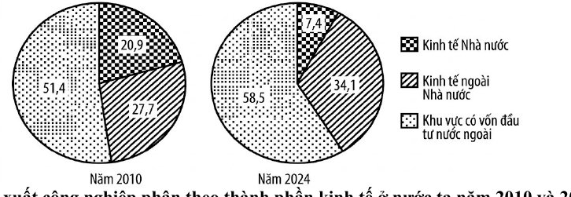
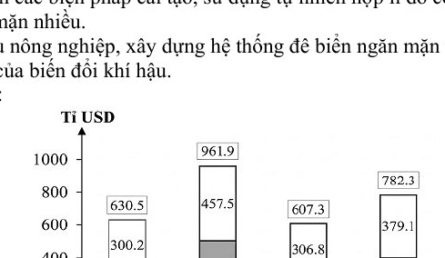

status: ocr-draft
source: official/2026-provincial-dia-li/de-thi-thu-tot-nghiep-2026-dia-li-so-gd-gia-lai/paper.docx

SỞ GIÁO DỤC VÀ ĐÀO TẠO — TỈNH GIA LAI
ĐỀ CHÍNH THỨC

KỲ THI THỬ TRƯỚC KỲ THI TỐT NGHIỆP TRUNG HỌC PHỔ THÔNG NĂM 2026
Môn thi: ĐỊA LÍ
Thời gian làm bài 50 phút, không kể thời gian phát đề
Đề thi có 04 trang

Họ và tên: ………………………………………….. Số báo danh: ……………… Mã đề 0901

## PHẦN I
Thí sinh trả lời từ câu 1 đến câu 18. Mỗi câu hỏi thí sinh chỉ chọn một phương án.

**Câu 1.** Việc bảo vệ môi trường có hiệu quả ở Đông Nam Bộ góp phần chủ yếu để

A. phát triển kinh tế bền vững, nâng cao chất lượng cuộc sống cho người dân.
B. phát triển công nghiệp tập trung, tạo nhiều việc làm cho người lao động.
C. hình thành khu công nghiệp, vùng chuyên canh cây công nghiệp lâu năm.
D. tăng cường khai thác nguồn lợi sinh vật, đa dạng sản phẩm nông nghiệp.

**Câu 2.** Phân bố dân cư nước ta hiện nay có đặc điểm là

A. đồng đều giữa đồng bằng với miền núi.
B. phân bố hợp lí giữa các vùng lãnh thổ.
C. khác nhau giữa thành thị với nông thôn.
D. mật độ rất cao ở các vùng ven biên giới.

**Câu 3.** Loại thiên tai nào sau đây thường xảy ra vào mùa khô ở nước ta?

A. Sương muối.
B. Hạn hán.
C. Động đất.
D. Ngập lụt.

**Câu 4.** Nam Trung Bộ (Duyên hải Nam Trung Bộ và Tây Nguyên) hiện nay có thế mạnh để phát triển

A. chăn nuôi vịt đàn, nhiệt điện khí.
B. khai thác hải sản, cây công nghiệp lâu năm.
C. du lịch sông nước, chăn nuôi gia cầm.
D. chuyên canh cây lúa, cây ăn quả.

**Câu 5.** Cho biểu đồ sau:

[HÌNH: Hai biểu đồ tròn về cơ cấu giá trị sản xuất công nghiệp theo thành phần kinh tế ở Việt Nam năm 2010 và 2024. Năm 2010: kinh tế Nhà nước 20,9%, kinh tế ngoài Nhà nước 27,7%, khu vực có vốn đầu tư nước ngoài 51,4%. Năm 2024: lần lượt 7,4%, 34,1% và 58,5%.]

Cơ cấu giá trị sản xuất công nghiệp phân theo thành phần kinh tế ở nước ta năm 2010 và 2024
(Đơn vị: %)
(Nguồn: Niên giám thống kê Việt Nam năm 2024, Nxb Thống kê)

Nhận xét nào sau đây đúng với biểu đồ trên?

A. Tỉ trọng kinh tế Nhà nước giảm, tỉ trọng khu vực có vốn đầu tư nước ngoài tăng.
B. Tỉ trọng của tất cả các thành phần kinh tế đều có xu hướng tăng liên tục.
C. Thành phần kinh tế ngoài Nhà nước luôn chiếm tỉ trọng cao nhất trong cả hai năm.
D. Cơ cấu giá trị sản xuất công nghiệp năm 2024 không thay đổi so với năm 2010.

**Câu 6.** Công nghiệp sản xuất sản phẩm điện tử, máy vi tính ở Đồng bằng sông Hồng hiện nay phát triển nhanh chủ yếu do

A. giàu tài nguyên khoáng sản, vị trí địa lí thuận lợi.
B. lao động dồi dào, lịch sử khai thác lãnh thổ lâu đời.
C. thu hút đầu tư nước ngoài, trình độ lao động cao.
D. thị trường tiêu thụ rộng lớn, có nhiều khu công nghiệp.

**Câu 7.** Chuyển dịch cơ cấu kinh tế theo hướng công nghiệp hoá, hiện đại hoá là quá trình

A. đẩy mạnh phát triển công nghiệp theo chiều rộng.
B. dịch chuyển công nghiệp lên khu vực đồi núi.
C. chủ yếu dựa vào ngành công nghiệp và nông nghiệp.
D. chuyển đổi toàn diện nền kinh tế và đời sống xã hội.

**Câu 8.** Vị trí địa lí của Bắc Trung Bộ

A. tiếp giáp với Đông Nam Bộ.
B. giáp Trung Quốc ở phía bắc.
C. giáp vịnh Thái Lan ở phía nam.
D. tiếp giáp với Lào ở phía tây.

**Câu 9.** Ngành du lịch ở nước ta hiện nay

A. chưa hình thành trung tâm du lịch.
B. có số lượt du khách luôn ổn định.
C. chỉ tập trung phát triển du lịch biển.
D. phát triển mạnh ở nhiều địa phương.

**Câu 10.** Trung du và miền núi phía Bắc có nhiều thuận lợi để phát triển

A. trồng cây lương thực quy mô lớn.
B. cây công nghiệp lâu năm nhiệt đới.
C. chăn nuôi các loại gia cầm và bò.
D. cây trồng cận nhiệt đới và ôn đới.

**Câu 11.** Đặc điểm tự nhiên chủ yếu nào sau đây làm cho miền Nam Trung Bộ và Nam Bộ có thể phát triển mạnh cây trồng có nguồn gốc nhiệt đới?

A. Vị trí gần chí tuyến Bắc, gió mùa Đông Bắc bị suy yếu, khí hậu có phân hoá.
B. Có nhiều dạng địa hình, đất feralit diện tích lớn, mạng lưới sông hồ dày đặc.
C. Nhiều núi và cao nguyên badan, vùng đồng bằng rộng lớn, mùa mưa kéo dài.
D. Khí hậu cận xích đạo, gió mùa Đông Bắc suy yếu, nền nhiệt cao quanh năm.

**Câu 12.** Tỉnh nào sau đây của nước ta nằm ở vĩ độ cao nhất?

A. Cà Mau.
B. Khánh Hoà.
C. Tuyên Quang.
D. Điện Biên.

**Câu 13.** Loại hình vận tải nào sau đây có khối lượng hàng hoá vận chuyển lớn nhất trong cơ cấu vận tải nước ta hiện nay?

A. Đường sắt.
B. Đường sông.
C. Đường biển.
D. Đường bộ.

**Câu 14.** Vùng đất của nước ta

A. chỉ gồm toàn bộ phần đất liền.
B. mở rộng đến hết vùng lãnh hải.
C. có diện tích nhỏ hơn vùng biển.
D. trải dài theo chiều đông - tây.

**Câu 15.** Tính chất nhiệt đới ẩm gió mùa của địa hình nước ta biểu hiện qua đặc điểm nào sau đây?

A. Xâm thực mạnh ở đồi núi, bồi tụ ở đồng bằng.
B. Địa hình có nhiều cao nguyên và đồi núi thấp.
C. Địa hình cao ở tây bắc thấp dần về đông nam.
D. Vùng đồi núi có diện tích lớn hơn đồng bằng.

**Câu 16.** Biện pháp chủ yếu thúc đẩy sản xuất lương thực thích ứng với biến đổi khí hậu hiện nay ở Đồng bằng sông Cửu Long là

A. bảo vệ rừng, thúc đẩy hợp tác quốc tế, đẩy mạnh thâm canh.
B. phát triển thuỷ lợi, thay đổi cơ cấu mùa vụ, đầu tư giống mới.
C. trồng lúa cao sản, tăng cường chế biến, đẩy mạnh xuất khẩu.
D. phát triển hạ tầng, bảo vệ môi trường, phòng chống thiên tai.

**Câu 17.** Đô thị ở nước ta hiện nay

A. được phân cấp ra nhiều loại đô thị.
B. phân bố chủ yếu ở đồi núi phía tây.
C. phát triển theo xu hướng xanh hoá.
D. có mật độ dân số thấp hơn nông thôn.

**Câu 18.** Các vật nuôi nào sau đây ở nước ta là gia cầm?

A. Trâu, bò.
B. Vịt, gà.
C. Lợn, dê.
D. Bò, gà.

## PHẦN II
Thí sinh trả lời từ câu 1 đến câu 4. Trong mỗi ý a), b), c), d) ở mỗi câu, thí sinh chọn đúng hoặc sai.

**Câu 1.** Cho thông tin sau:

Việt Nam có mạng lưới sông ngòi dày đặc, phân bố rộng khắp trên đất liền. Tổng lượng nước của sông ngòi nước ta khoảng 839 tỉ m³/năm. Tổng lượng phù sa các hệ thống sông khoảng 200 triệu tấn/năm. Chế độ dòng chảy phân mùa rõ rệt, mùa lũ từ 4 - 5 tháng và trùng với mùa mưa, mùa cạn từ 7 - 8 tháng và trùng với mùa khô.

a) Tổng lượng phù sa lớn do quá trình xâm thực mạnh ở miền đồi núi.
b) Chế độ dòng chảy phân mùa rõ rệt do đặc điểm của khí hậu nhiệt đới ẩm gió mùa quy định.
c) Sông ngòi nước ta nhiều nước, giàu phù sa quanh năm.
d) Nguồn nước dồi dào, phân hoá theo mùa rõ rệt, tạo điều kiện thuận lợi để thực hiện tăng vụ và đa dạng hóa cơ cấu cây trồng vật nuôi.

**Câu 2.** Cho thông tin sau:

Nước ta có nhiều điều kiện thuận lợi cho việc khai thác và nuôi trồng thủy sản. Vùng biển với hơn 2000 loài cá, nhiều loài giáp xác, thân mềm và rong biển, trong đó có nhiều loài có giá trị kinh tế cao; vùng ven biển có nhiều vũng vịnh, đầm phá, cửa sông. Giá trị sản xuất cũng như sản lượng thủy sản ngày càng có xu hướng tăng, trong đó sản lượng nuôi trồng luôn cao hơn sản lượng khai thác.

a) Hoạt động khai thác thủy sản xa bờ được đẩy mạnh, chú trọng kiểm soát vùng đánh bắt và truy xuất nguồn gốc.
b) Sản lượng thủy sản nuôi trồng chiếm tỉ trọng cao chủ yếu do diện tích mặt nước lớn, giống, thức ăn, kĩ thuật đảm bảo, nhu cầu của thị trường tăng.
c) Vùng biển nước ta có ít nguồn lợi thủy sản.
d) Vùng ven biển có nhiều vũng vịnh, đầm phá, cửa sông là điều kiện thuận lợi để đẩy mạnh khai thác thủy sản.

**Câu 3.** Cho thông tin sau:

Đồng bằng sông Cửu Long là đồng bằng châu thổ lớn nhất nước ta, địa hình thấp, mạng lưới sông ngòi dày đặc. Vùng có lợi thế về phát triển nông nghiệp, du lịch, năng lượng tái tạo, kinh tế biển,... Tuy nhiên, vùng cũng phải đối mặt với không ít hạn chế như mùa khô kéo dài, thiếu nước ngọt, xâm nhập mặn, triều cường và những thách thức lớn trước tác động của biến đổi khí hậu. Vì vậy, việc sử dụng hợp lí tự nhiên ở Đồng bằng sông Cửu Long đòi hỏi phải đi đôi với cải tạo.

a) Khó khăn chủ yếu trong sử dụng hợp lí tự nhiên của vùng là kinh tế chưa phát triển mạnh, mất cân bằng nguồn nước, diện tích đất phèn và mặn lớn.
b) Vùng có thế mạnh để phát triển loại hình du lịch sông nước.
c) Vùng cần thực hiện các biện pháp cải tạo, sử dụng tự nhiên hợp lí do có diện tích đất phù sa sông lớn, diện tích rừng ngập mặn nhiều.
d) Chuyển đổi cơ cấu nông nghiệp, xây dựng hệ thống đê biển ngăn mặn triệt để là giải pháp chủ yếu để giảm thiểu tác động của biến đổi khí hậu.

**Câu 4.** Cho biểu đồ sau:

[HÌNH: Biểu đồ cột chồng trị giá xuất khẩu và nhập khẩu của Ma-lai-xi-a, Xin-ga-po, Thái Lan và Việt Nam năm 2024. Các trị số xuất khẩu lần lượt là 330,3; 504,4; 300,5; 403,2 tỉ USD; nhập khẩu lần lượt là 300,2; 457,5; 306,8; 379,1 tỉ USD.]

Trị giá xuất khẩu, nhập khẩu của một số quốc gia Đông Nam Á, năm 2024
(Nguồn: ASEAN 2025 Statistical Highlights 2025, https://www.aseanstats.org)

a) Xin-ga-po có cán cân xuất nhập khẩu lớn gấp hơn 1,9 lần cán cân xuất nhập khẩu của Việt Nam.
b) Thái Lan là nước nhập siêu, các nước còn lại đều xuất siêu.
c) Tổng trị giá xuất khẩu và nhập khẩu của Việt Nam lớn nhất.
d) Ma-lai-xi-a là nước có cán cân thương mại nhỏ nhất.

## PHẦN III
Thí sinh trả lời từ câu 1 đến câu 6.

**Câu 1.** Cho bảng số liệu:

Nhiệt độ không khí trung bình các tháng tại trạm quan trắc Quy Nhơn, năm 2024
(Đơn vị: °C)

| Tháng | 1 | 2 | 3 | 4 | 5 | 6 | 7 | 8 | 9 | 10 | 11 | 12 |
|---|---:|---:|---:|---:|---:|---:|---:|---:|---:|---:|---:|---:|
| Nhiệt độ | 24,7 | 25,5 | 26,5 | 28,5 | 30,3 | 30,4 | 30,3 | 30,5 | 30,2 | 27,3 | 26,6 | 24,2 |

(Nguồn: Niên giám thống kê Việt Nam năm 2024, Nxb Thống kê)

Căn cứ vào bảng số liệu trên, hãy cho biết nhiệt độ không khí trung bình của năm 2024 tại trạm quan trắc Quy Nhơn là bao nhiêu °C (làm tròn kết quả đến một chữ số thập phân).

**Câu 2.** Năm 2024, tổng trị giá xuất nhập khẩu hàng hóa của nước ta là 786,9 tỉ USD, trị giá xuất khẩu hàng hóa là 405,9 tỉ USD. Hãy cho biết cán cân xuất nhập khẩu hàng hóa của nước ta năm 2024 là bao nhiêu tỉ USD (làm tròn kết quả đến một chữ số thập phân).

**Câu 3.** Năm 2024, số dân của vùng Đồng bằng sông Cửu Long là 15,8 triệu người, diện tích của vùng là 36,4 nghìn km². Hãy cho biết mật độ dân số của vùng Đồng bằng sông Cửu Long năm 2024 là bao nhiêu người/km² (làm tròn kết quả đến hàng đơn vị).

**Câu 4.** Năm 2024, tổng mức bán lẻ hàng hoá và doanh thu dịch vụ tiêu dùng cả nước là 6 447 nghìn tỉ đồng, trong đó Đông Nam Bộ đạt 1 863 nghìn tỉ đồng. Hãy cho biết tỉ trọng tổng mức bán lẻ hàng hoá và doanh thu dịch vụ tiêu dùng của Đông Nam Bộ trong tổng mức bán lẻ hàng hoá và doanh thu dịch vụ tiêu dùng cả nước là bao nhiêu phần trăm (làm tròn kết quả đến một chữ số thập phân).

**Câu 5.** Cho bảng số liệu:

Số dân và sản lượng lúa của nước ta năm 2010 và năm 2024

|  | Năm 2010 | Năm 2024 |
|---|---:|---:|
| Sản lượng (triệu tấn) | 40,0 | 43,5 |
| Số dân (triệu người) | 87,1 | 101,3 |

(Nguồn: Niên giám Thống kê Việt Nam năm 2011, 2025; NXB Thống kê)

Căn cứ vào bảng số liệu trên, hãy cho biết bình quân sản lượng lúa theo đầu người của nước ta năm 2024 so với năm 2010 giảm bao nhiêu kg/người (làm tròn kết quả đến một chữ số thập phân).

**Câu 6.** Cho bảng số liệu:

Mực nước sông Đà (trạm Lai Châu) và sông Mã (trạm Xã Là), năm 2024
(Đơn vị: cm)

| Mực nước | Cao nhất | Thấp nhất |
|---|---:|---:|
| Sông Đà | 21 526 | 19 705 |
| Sông Mã | 28 268 | 27 701 |

(Nguồn: Tổng cục Thống kê Việt Nam, năm 2024)

Căn cứ vào bảng số liệu trên, hãy cho biết năm 2024, chênh lệch giữa mực nước cao nhất và mực nước thấp nhất của sông Đà (trạm Lai Châu) lớn hơn chênh lệch giữa mực nước cao nhất và mực nước thấp nhất của sông Mã (trạm Xã Là) bao nhiêu cm (lấy kết quả đến hàng đơn vị).

---------------- HẾT ----------------

Thí sinh không được sử dụng tài liệu;
Giám thị không giải thích gì thêm.

## ĐÁP ÁN THAM KHẢO

### PHẦN I

| Câu | 1 | 2 | 3 | 4 | 5 | 6 | 7 | 8 | 9 | 10 | 11 | 12 | 13 | 14 | 15 | 16 | 17 | 18 |
|---|---|---|---|---|---|---|---|---|---|---|---|---|---|---|---|---|---|---|
| Đáp án | A | C | B | B | A | C | D | D | D | D | D | C | D | C | A | B | A | B |

### PHẦN II

| Câu | a | b | c | d |
|---|---|---|---|---|
| Câu 1 | Đ | Đ | S | Đ |
| Câu 2 | Đ | Đ | S | S |
| Câu 3 | S | Đ | S | S |
| Câu 4 | Đ | Đ | S | S |

### PHẦN III

| Câu | Kết quả |
|---|---|
| Câu 1 | 27,9 °C |
| Câu 2 | 24,9 tỉ USD |
| Câu 3 | 434 người/km² |
| Câu 4 | 28,9% |
| Câu 5 | 29,8 kg/người |
| Câu 6 | 1254 cm |