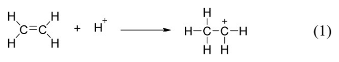
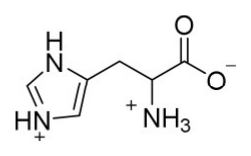
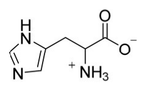
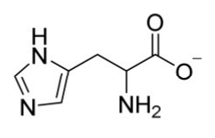
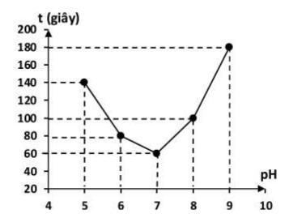
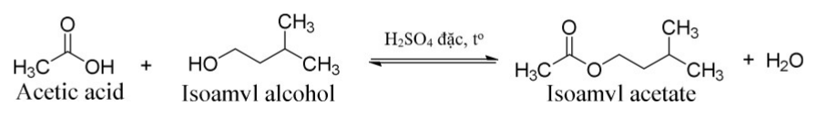

BỘ GIÁO DỤC VÀ ĐÀO TẠO
ĐỀ THAM KHẢO
(Đề thi có 04 trang)

KỲ THI TỐT NGHIỆP THPT TỪ NĂM 2025
MÔN: HÓA HỌC
Thời gian làm bài 50 phút, không kể thời gian phát đề

Họ, tên thí sinh:.....................................................................
Số báo danh: .........................................................................

Cho biết nguyên tử khối: $\text{H} = 1$, $\text{C} = 12$, $\text{N} = 14$, $\text{O} = 16$, $\text{Al} = 27$, $\text{S} = 32$, $\text{K} = 39$; $\text{Fe} = 56$.

PHẦN I. Thí sinh trả lời từ câu 1 đến câu 18. Mỗi câu hỏi thí sinh chỉ chọn một phương án.

Câu 1. “Ăn mòn hóa học là quá trình …(1)…, trong đó các electron của …(2)… chuyển trực tiếp đến các chất trong môi trường”. Nội dung phù hợp trong các ô trống (1), (2) lần lượt là
A. oxi hóa – khử, kim loại.
B. khử, kim loại.
C. oxi hoá, ion kim loại.
D. oxi hóa – khử, ion kim loại.

Câu 2. Thành phần chính của baking soda là $\text{NaHCO}_3$. Tên của hợp chất này là
A. sodium hydrogencarbonate.
B. sodium carbonate.
C. sodium hydrogensulfide.
D. potassium hydrogencarbonate.

Câu 3. Polychloroprene có công thức là
A. $-(\text{CH}_2-\text{CH}_2-)_n$
B. $-(\text{CH}_2-\text{CH}=\text{CH}-\text{CH}_2-)_n$
C. $-(\text{CH}_2-\text{CHCl}-)_n$
D. $-(\text{CH}_2-\text{CCl}=\text{CH}-\text{CH}_2-)_n$

Câu 4. Liên kết kim loại là liên kết được hình thành giữa
A. các cation kim loại và các electron hóa trị tự do trong tinh thể kim loại.
B. các cation và các anion trong tinh thể kim loại.
C. các electron hoá trị trong tinh thể kim loại.
D. các nguyên tử trong tinh thể kim loại.

Câu 5. Nguyên tố natri (sodium, Na) có số hiệu nguyên tử là 11. Ở trạng thái cơ bản, cấu hình electron của ion $\text{Na}^+$ là
A. $1\text{s}^2 2\text{s}^2 2\text{p}^6 3\text{s}^1$.
B. $1\text{s}^2 2\text{s}^2 2\text{p}^6$.
C. $1\text{s}^2 2\text{s}^2 2\text{p}^5$.
D. $1\text{s}^2 2\text{s}^2 2\text{p}^6 3\text{s}^2$.

Câu 6. Hóa chất nào sau đây không sử dụng để làm mềm nước cứng tạm thời?
A. $\text{Na}_2\text{CO}_3$.
B. $\text{Na}_3\text{PO}_4$.
C. $\text{Ca(OH)}_2$.
D. $\text{HCl}$.

Câu 7. Nhiệt độ tự bốc cháy là nhiệt độ thấp nhất ở áp suất khí quyển mà chất cháy tự cháy trong không khí dù không cần tiếp xúc với nguồn lửa. Khi nhà kho chứa các đồ vật làm bằng nhựa poly(vinyl chloride) (PVC) bị cháy sẽ tạo nên khói đám cháy có nhiệt độ rất cao và chứa các khí như $\text{HCl}$, $\text{CO}$,.... Trong khi di chuyển ra xa đám cháy, cần cúi thấp người, đồng thời dùng khăn ướt che mũi và miệng. Cho các phát biểu sau:
(a) Khăn ướt không có tác dụng hạn chế khí $\text{HCl}$ đi vào cơ thể.
(b) Việc cúi thấp người nhằm tránh khói đám cháy (có xu hướng bốc lên cao).
(c) Khói từ đám cháy nhựa PVC độc hại hơn khói từ đám cháy các đồ vật làm bằng gỗ.
(d) Việc sử dụng nước để chữa cháy nhằm mục đích hạ nhiệt độ đám cháy thấp hơn nhiệt độ tự bốc cháy của PVC.
Các phát biểu đúng là
A. (a), (b), (c).
B. (a), (b), (d).
C. (b), (c), (d).
D. (a), (c), (d).

Câu 8. Trong quá trình trồng trọt, người nông dân được khuyến cáo không bón vôi sống (thành phần chính là $\text{CaO}$) cùng với phân đạm ammonium. Nguyên nhân của khuyến cáo này là
A. thất thoát đạm vì giải phóng ammonia.
B. tạo thành hỗn hợp gây cháy nổ.
C. tạo acid làm ảnh hưởng tới cây trồng.
D. làm tăng độ chua của đất.

Câu 9. Phổ khối lượng (MS) là phương pháp hiện đại để xác định phân tử khối của các hợp chất hữu cơ. Kết quả phân tích phổ khối lượng cho thấy phân tử khối của hợp chất hữu cơ X là 74. Chất X có thể là
A. acetic acid.
B. methyl acetate.
C. acetone.
D. trimethylamine.

Câu 10. Phản ứng thủy phân ester trong môi trường kiềm còn được gọi là phản ứng
A. ester hóa.
B. xà phòng hóa.
C. trung hòa.
D. trùng ngưng.

Câu 11. Công thức cấu tạo thu gọn của dimethylamine là
A. $\text{CH}_3-\text{NH}_2$.
B. $\text{CH}_3-\text{NH}-\text{CH}_3$.
C. $\text{CH}_3-\text{NH}-\text{CH}_2-\text{CH}_3$.
D. $\text{CH}_3-\text{CH}_2-\text{NH}_2$.

Câu 12. Chất nào sau đây thuộc loại monosaccharide?
A. Glucose.
B. Saccharose.
C. Maltose.
D. Cellulose.

Câu 13. Phương trình hoá học của phản ứng hydrate hóa ethylene để điều chế ethanol là
$$\text{CH}_2\text{=CH}_2 + \text{H}_2\text{O} \xrightarrow{\text{H}_2\text{SO}_4\text{, } t^\circ} \text{CH}_3\text{CH}_2\text{OH}$$
Giai đoạn (1) trong cơ chế của phản ứng trên xảy ra như sau:
[HÌNH: Cơ chế giai đoạn (1): công thức cấu tạo đầy đủ của ethylene $\text{H}_2\text{C}=\text{CH}_2$ tác dụng với $\text{H}^+$ tạo thành carbocation $\text{H}_3\text{C}\text{--}\overset{+}{\text{C}}\text{H}_2$ (1)]

Nhận định nào sau đây không đúng?
A. Phản ứng hydrate hóa ethylene là phản ứng cộng.
B. Trong giai đoạn (1) có sự phân cắt liên kết $\pi$.
C. Trong giai đoạn (1) có sự hình thành liên kết $\sigma$.
D. Trong phân tử ethylene có 6 liên kết $\sigma$.

Câu 14. Tên gọi của ester $\text{C}_2\text{H}_5\text{COOCH}_3$ là
A. ethyl acetate.
B. methyl propionate.
C. ethyl propionate.
D. methyl acetate.

Câu 15. “Amino acid là hợp chất hữu cơ tạp chức, trong phân tử chứa đồng thời nhóm chức … (1) … và nhóm chức … (2) …”. Nội dung phù hợp trong ô trống (1), (2) lần lượt là
A. carboxyl $(-\text{COOH})$, amino $(-\text{NH}_2)$.
B. carboxyl $(-\text{COOH})$, hydroxy $(-\text{OH})$.
C. hydroxy $(-\text{OH})$, amino $(-\text{NH}_2)$.
D. carbonyl $(-\text{CO}-)$, carboxyl $(-\text{COOH})$.

Câu 16. Histidine là một trong những amino acid thiết yếu đối với cơ thể con người. Với mỗi môi trường có giá trị pH bằng 4,0; 7,6; 12,0, coi histidine chỉ tồn tại ở dạng cho dưới đây:

| pH | 4,0 | 7,6 | 12,0 |
| :---: | :---: | :---: | :---: |
| Dạng tồn tại | [HÌNH: Công thức cấu tạo dạng cation của histidine ở pH = 4,0 mang điện tích +1 (vòng imidazole proton hóa mang điện tích +1, nhóm amino $\text{NH}_3^+$, nhóm carboxylate $\text{COO}^-$)]  Dạng (I) | [HÌNH: Công thức cấu tạo dạng ion lưỡng cực trung hòa của histidine ở pH = 7,6 có tổng điện tích bằng 0 (vòng imidazole trung hòa, nhóm amino $\text{NH}_3^+$, nhóm carboxylate $\text{COO}^-$)]  Dạng (II) | [HÌNH: Công thức cấu tạo dạng anion của histidine ở pH = 12,0 mang điện tích -1 (vòng imidazole trung hòa, nhóm amino $\text{NH}_2$, nhóm carboxylate $\text{COO}^-$)]  Dạng (III) |

Trong quá trình điện di, ion sẽ di chuyển về phía điện cực trái dấu với ion.
Cho các nhận định sau về quá trình điện di của histidine:
(a) Với môi trường $\text{pH} = 7,6$ thì dạng (II) hầu như không dịch chuyển về các điện cực.
(b) Với môi trường $\text{pH} = 4,0$ thì dạng (I) di chuyển về phía cực âm.
(c) Với môi trường $\text{pH} = 12,0$ thì dạng (III) di chuyển về phía cực dương.
(d) Với môi trường $\text{pH} = 7,6$ thì dạng (II) di chuyển về phía cực âm.
Các nhận định đúng là
A. (a), (b), (d).
B. (a), (c), (d).
C. (b), (c), (d).
D. (a), (b), (c).

Sử dụng thông tin ở bảng dưới đây để trả lời các câu 17 – 18:
Cho bảng giá trị thế điện cực chuẩn của các cặp oxi hóa – khử như sau:

| Cặp oxi hóa – khử | $\text{Fe}^{2+}/\text{Fe}$ | $\text{Cu}^{2+}/\text{Cu}$ | $\text{Zn}^{2+}/\text{Zn}$ | $\text{Ag}^+/\text{Ag}$ | $\text{Pb}^{2+}/\text{Pb}$ |
| :--- | :---: | :---: | :---: | :---: | :---: |
| Thế điện cực chuẩn (V) | $-0,44$ | $+0,34$ | $-0,76$ | $+0,80$ | $-0,13$ |

Câu 17. Trong số các ion kim loại gồm $\text{Fe}^{2+}$, $\text{Cu}^{2+}$ và $\text{Zn}^{2+}$, ở điều kiện chuẩn ion nào có tính oxi hóa yếu hơn $\text{Ag}^+$, nhưng mạnh hơn $\text{Pb}^{2+}$?
A. $\text{Fe}^{2+}, \text{Cu}^{2+}, \text{Zn}^{2+}$.
B. $\text{Fe}^{2+}, \text{Cu}^{2+}$.
C. $\text{Zn}^{2+}$.
D. $\text{Cu}^{2+}$.

Câu 18. Sức điện động chuẩn lớn nhất của pin Galvani thiết lập từ hai cặp oxi hóa – khử trong số các cặp trên là
A. $1,24\text{ V}$.
B. $1,56\text{ V}$.
C. $1,60\text{ V}$.
D. $0,93\text{ V}$.

PHẦN II. Thí sinh trả lời từ câu 1 đến câu 4. Trong mỗi ý a), b), c), d) ở mỗi câu, thí sinh chọn đúng hoặc sai.

Câu 1. Một nhóm học sinh tìm hiểu quá trình thu hồi kim loại đồng (copper) bằng phương pháp điện phân từ một đồng xu làm bằng hợp kim $\text{Cu}-\text{Zn}$ chứa khoảng $95\%$ đồng về khối lượng. Giả thuyết của nhóm học sinh là “khi điện phân, chỉ có tạp chất trong đồng xu tan hết vào trong dung dịch, còn lại sẽ là đồng tinh khiết”. Để kiểm tra giả thuyết này, nhóm học sinh đã thực hiện thí nghiệm như sau:
- Cân để xác định khối lượng ban đầu của đồng xu ($2,23\text{ gam}$) và thanh đồng tinh khiết ($2,55\text{ gam}$).
- Nối đồng xu với một điện cực và thanh đồng tinh khiết với điện cực còn lại của nguồn điện một chiều, rồi nhúng vào bình điện phân chứa dung dịch $\text{copper(II) sulfate}$.
- Điện phân ở hiệu điện thế phù hợp.
- Sau một thời gian điện phân, làm khô, rồi cân để xác định lại khối lượng của đồng xu và thanh đồng tinh khiết, thấy khối lượng đồng xu là $1,94\text{ gam}$ và khối lượng thanh đồng là $m_1\text{ gam}$.
a) Trong thí nghiệm trên, đồng xu được nối với cực dương, thanh đồng tinh khiết được nối với cực âm của nguồn điện.
b) Giá trị của $m_1$ lớn hơn $2,55$.
c) Ở cực dương xảy ra quá trình khử.
d) Do khối lượng của đồng xu giảm, nên giả thuyết ban đầu của nhóm học sinh là đúng.

Câu 2. Enzyme amylase là một protein có khả năng xúc tác cho phản ứng thủy phân tinh bột. Hoạt tính xúc tác của enzyme càng cao thì phản ứng thủy phân tinh bột diễn ra càng nhanh. Hoạt tính xúc tác của enzyme phụ thuộc vào các yếu tố như nhiệt độ, pH,... Một nhóm học sinh dự đoán “pH càng tăng thì hoạt tính xúc tác của enzyme amylase càng cao”. Từ đó, học sinh tiến hành thí nghiệm ở nhiệt độ không đổi nhưng thay đổi pH của môi trường để kiểm tra dự đoán trên như sau:
*Bước 1:* Thêm $2,0\text{ mL}$ dung dịch một loại enzyme amylase vào một ống nghiệm chứa $5,0\text{ mL}$ dung dịch có vai trò duy trì ổn định $\text{pH}$ bằng 5.
*Bước 2:* Thêm tiếp $2,0\text{ mL}$ dung dịch tinh bột vào ống nghiệm trên, lắc đều.
*Bước 3:* Sau khoảng mỗi 10 giây, dùng ống hút lấy 1-2 giọt hỗn hợp phản ứng trong ống nghiệm và cho vào đĩa sứ chứa sẵn dung dịch iodine, quan sát để từ đó xác định thời gian tinh bột thủy phân hết.
Lặp lại thí nghiệm theo ba bước trên, chỉ thay đổi $\text{pH}$ dung dịch trong *Bước 1* lần lượt là 6; 7; 8; 9.
Nhóm học sinh ghi lại kết quả thời gian $t$ (giây) mà tinh bột thủy phân hết trong môi trường $\text{pH} = 5\text{; } 6\text{; } 7\text{; } 8\text{; } 9$ và vẽ đồ thị như hình bên.
[HÌNH: Đồ thị biểu diễn thời gian $t$ (giây) tinh bột thủy phân hết theo $\text{pH}$ ở bên phải: trục tung là $t$ (giây) từ 20 đến 200, trục hoành là $\text{pH}$ từ 4 đến 10; các điểm biểu diễn gồm $(5; 140)$, $(6; 80)$, $(7; 60)$, $(8; 100)$, $(9; 180)$ được nối với nhau bằng các đoạn thẳng, đạt cực tiểu tại $\text{pH} = 7$ với $t = 60\text{ s}$]

a) Ở *Bước 3*, nếu dung dịch iodine chuyển sang màu xanh tím nghĩa là tinh bột thủy phân hết.
b) Theo số liệu thu được, phản ứng thủy phân tinh bột ở $\text{pH} = 9$ diễn ra nhanh hơn ở $\text{pH} = 8$.
c) Ở các giá trị $\text{pH}$ nghiên cứu, hoạt tính xúc tác của enzyme amylase cao nhất tại $\text{pH} = 7$.
d) Từ kết quả thí nghiệm, kết luận được hoạt tính xúc tác của enzyme amylase tăng khi $\text{pH}$ tăng.

Câu 3. Một học sinh tiến hành tổng hợp isoamyl acetate (thành phần chính của dầu chuối) từ acetic acid và isoamyl alcohol theo phương trình hóa học sau:
[HÌNH: Phương trình hoá học tổng hợp isoamyl acetate: $\text{CH}_3\text{COOH}$ (Acetic acid) $+ \text{HO--CH}_2\text{--CH}_2\text{--CH(CH}_3\text{)}_2$ (Isoamyl alcohol) $\overset{\text{H}_2\text{SO}_4\text{ đặc, } t^\circ}{\rightleftharpoons} \text{CH}_3\text{COO--CH}_2\text{--CH}_2\text{--CH(CH}_3\text{)}_2$ (Isoamyl acetate) $+ \text{H}_2\text{O}$]

Sau thí nghiệm, tiến hành phân tách sản phẩm. Ghi phổ hồng ngoại của acetic acid, isoamyl alcohol và isoamyl acetate. Cho biết số sóng hấp thụ đặc trưng của một số liên kết trên phổ hồng ngoại như sau:

| Liên kết | $\text{O--H}$ (alcohol) | $\text{O--H}$ (carboxylic acid) | $\text{C=O}$ (ester, carboxylic acid) |
| :--- | :---: | :---: | :---: |
| Số sóng ($\text{cm}^{-1}$) | $3650 - 3200$ | $3300 - 2500$ | $1780 - 1650$ |

a) Phản ứng tổng hợp trong thí nghiệm này là phản ứng thủy phân ester.
b) Phổ hồng ngoại có số sóng hấp thụ ở $3350\text{ cm}^{-1}$ là phổ của isoamyl alcohol.
c) Phổ hồng ngoại có số sóng hấp thụ ở $1750\text{ cm}^{-1}$ mà không có số sóng hấp thụ đặc trưng của liên kết $\text{O--H}$ là phổ của isoamyl acetate.
d) Dựa vào phổ hồng ngoại, phân biệt được acetic acid, isoamyl alcohol và isoamyl acetate.

Câu 4. Muối $\text{CoCl}_2$ khan có màu xanh. Hòa tan một lượng muối này vào nước, thu được dung dịch màu hồng (có chứa phức chất X). Nhúng mảnh giấy lọc vào dung dịch này, sấy khô, thu được mảnh giấy có màu xanh (giấy Y). Giấy Y được sử dụng làm giấy chỉ thị để phát hiện nước.
a) $\text{CoCl}_2$ là hợp chất của kim loại chuyển tiếp.
b) Phức chất X không chứa phối tử aqua (phối tử $\text{H}_2\text{O}$).
c) Trong phức chất X, liên kết giữa nguyên tử trung tâm và phối tử là liên kết ion.
d) Khi nhỏ giọt nước lên giấy Y, giấy Y chuyển màu.

PHẦN III. Thí sinh trả lời từ câu 1 đến câu 6.

Câu 1. Trong công nghiệp, kim loại nhôm (aluminium, Al) được sản xuất bằng phương pháp điện phân nóng chảy aluminium oxide. Biết hiệu suất của quá trình chuyển hóa $\text{Al}_2\text{O}_3$ thành $\text{Al}$ là $95,4\%$. Để sản xuất $5,4\text{ tấn Al}$ cần sử dụng bao nhiêu tấn nguyên liệu $\text{Al}_2\text{O}_3$ *(làm tròn đến hàng phần mười)*?

Câu 2. Đun nóng một loại mỡ động vật với dung dịch $\text{KOH}$, sản phẩm thu được có chứa muối potassium stearate ($\text{C}_{17}\text{H}_{35}\text{COOK}$). Phân tử khối của potassium stearate là bao nhiêu?

Câu 3. Cho phương trình hóa học của các phản ứng được đánh số thứ tự từ 1 tới 4 dưới đây:
$$(1)\quad (\text{C}_6\text{H}_{10}\text{O}_5)_n\text{ (tinh bột)} + n\text{H}_2\text{O} \xrightarrow{\text{H}^+\text{, } t^\circ} n\text{C}_6\text{H}_{12}\text{O}_6\text{ (glucose)}$$
$$(2)\quad \text{C}_6\text{H}_{12}\text{O}_6\text{ (glucose)} \xrightarrow{\quad\text{enzyme}\quad} 2\text{C}_2\text{H}_5\text{OH} + 2\text{CO}_2$$
$$(3)\quad \text{C}_6\text{H}_{12}\text{O}_6\text{ (glucose)} \xrightarrow{\quad\text{enzyme}\quad} 2\text{CH}_3\text{CH(OH)COOH}$$
$$(4)\quad \text{C}_6\text{H}_{12}\text{O}_6\text{ (glucose)} + 2[\text{Ag}(\text{NH}_3)_2]\text{OH} \xrightarrow{\quad t^\circ\quad} \text{CH}_2\text{OH}(\text{CHOH})_4\text{COONH}_4 + 2\text{Ag} + 3\text{NH}_3 + \text{H}_2\text{O}$$
Gán số thứ tự phương trình hoá học của các phản ứng theo tên gọi: lên men rượu, thủy phân, lên men lactic, tráng gương và sắp xếp theo trình tự thành dãy bốn số (ví dụ: 1234, 4321, ...).

Câu 4. Có tổng số bao nhiêu đồng phân cấu tạo amine bậc 1 và bậc 2 ứng với công thức phân tử $\text{C}_4\text{H}_{11}\text{N}$?

Câu 5. Trong một nhà máy sản xuất ammonia theo quy trình Haber, giai đoạn sản xuất khí hydrogen bằng phản ứng của methane và nước được thực hiện theo phương trình hóa học (1) như sau:
$$(1)\quad \text{CH}_4(g) + \text{H}_2\text{O}(g) \xrightarrow{\quad xt\quad} \text{CO}(g) + 3\text{H}_2(g)$$
Phản ứng (1) là phản ứng thu nhiệt mạnh. Lượng nhiệt này được cung cấp từ quá trình đốt cháy hoàn toàn khí methane theo phương trình hóa học (2):
$$(2)\quad \text{CH}_4(g) + 2\text{O}_2(g) \longrightarrow \text{CO}_2(g) + 2\text{H}_2\text{O}(g)$$
Xét các phản ứng ở điều kiện chuẩn và hiệu suất chuyển hóa của methane là $100\%$. Tính khối lượng khí methane (theo tấn, *làm tròn đến hàng phần trăm*) cần thiết để sản xuất $0,30\text{ tấn H}_2(g)$ trong giai đoạn trên. Biết $90\%$ lượng nhiệt tỏa ra từ phản ứng (2) được cung cấp cho phản ứng (1) và các giá trị nhiệt tạo thành ($\Delta_\text{f}\text{H}^\circ_{298}$) của các chất ở điều kiện chuẩn được cho trong bảng sau:

| Chất | $\text{CH}_4(g)$ | $\text{CO}_2(g)$ | $\text{CO}(g)$ | $\text{H}_2\text{O}(g)$ |
| :--- | :---: | :---: | :---: | :---: |
| $\Delta_\text{f}\text{H}^\circ_{298}\text{ (kJ mol}^{-1}\text{)}$ | $-74,6$ | $-393,5$ | $-110,5$ | $-241,8$ |

Câu 6. Khi bảo quản trong phòng thí nghiệm, muối Mohr ($\text{FeSO}_4\cdot(\text{NH}_4)_2\text{SO}_4\cdot 6\text{H}_2\text{O}$) hút ẩm và bị oxi hóa một phần bởi $\text{O}_2$ trong không khí thành hỗn hợp X. Để xác định phần trăm khối lượng muối Mohr trong X, tiến hành hòa tan hoàn toàn $2,656\text{ gam}$ X trong nước rồi pha thành $100,0\text{ mL}$ dung dịch Y. Chuẩn độ $10,00\text{ mL}$ dung dịch Y (trong môi trường sulfuric acid loãng, dư) bằng dung dịch $\text{KMnO}_4$ nồng độ $0,012\text{ M}$ đến khi xuất hiện màu hồng nhạt thì dừng. Lặp lại thí nghiệm chuẩn độ thêm 2 lần nữa. Thể tích trung bình của dung dịch $\text{KMnO}_4$ sau 3 lần chuẩn độ là $9,72\text{ mL}$. Phần trăm khối lượng của muối Mohr trong X là $a\%$. Tính giá trị của $a$ *(làm tròn đến hàng phần mười)*.

-------------------- HẾT --------------------

- Thí sinh không được sử dụng tài liệu.
- Giám thị không giải thích gì thêm.

---

BỘ GIÁO DỤC VÀ ĐÀO TẠO
ĐÁP ÁN ĐỀ THAM KHẢO
Môn: Hóa học

PHẦN I. Câu trắc nghiệm nhiều phương án lựa chọn. Thí sinh trả lời từ câu 1 đến câu 18
(Mỗi câu trả lời đúng thí sinh được 0,25 điểm)

| Câu | 1 | 2 | 3 | 4 | 5 | 6 | 7 | 8 | 9 | 10 |
| :---: | :---: | :---: | :---: | :---: | :---: | :---: | :---: | :---: | :---: | :---: |
| Chọn | A | A | D | A | B | D | C | A | B | B |

| Câu | 11 | 12 | 13 | 14 | 15 | 16 | 17 | 18 |
| :---: | :---: | :---: | :---: | :---: | :---: | :---: | :---: | :---: |
| Chọn | B | A | D | B | A | D | D | B |

PHẦN II. Câu trắc nghiệm đúng sai. Thí sinh trả lời từ câu 1 đến câu 4. Trong mỗi ý a), b), c), d) ở mỗi câu, thí sinh chọn đúng hoặc sai.
- Thí sinh chỉ lựa chọn chính xác 01 ý trong 01 câu hỏi được 0,1 điểm;
- Thí sinh chỉ lựa chọn chính xác 02 ý trong 01 câu hỏi được 0,25 điểm;
- Thí sinh chỉ lựa chọn chính xác 03 ý trong 01 câu hỏi được 0,5 điểm;
- Thí sinh lựa chọn chính xác cả 04 ý trong 01 câu hỏi được 1 điểm.

| Câu | 1 | 2 | 3 | 4 |
| :---: | :---: | :---: | :---: | :---: |
| Đáp án | a) Đúng b) Đúng c) Sai d) Sai | a) Sai b) Sai c) Đúng d) Sai | a) Sai b) Đúng c) Đúng d) Đúng | a) Đúng b) Sai c) Sai d) Đúng |

PHẦN III. Câu trắc nghiệm trả lời ngắn. Thí sinh trả lời từ câu 1 đến câu 6
Mỗi câu trả lời đúng thí sinh được 0,25 điểm.

| Câu | 1 | 2 | 3 | 4 | 5 | 6 |
| :---: | :---: | :---: | :---: | :---: | :---: | :---: |
| Đáp án | 10,7 | 322 | 2134 | 7 | 1,03 | 86,1 |
