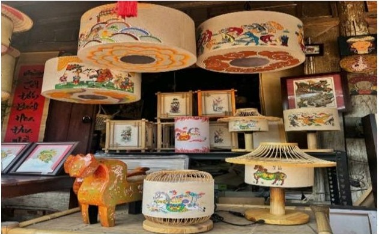

Đề: Sở GD&ĐT Bắc Ninh, Lần 2

SỞ GIÁO DỤC VÀ ĐÀO TẠO
BẮC NINH
ĐỀ THI CHÍNH THỨC
(Đề thi có 02 trang)

ĐỀ THI THỬ KỲ THI TỐT NGHIỆP THPT NĂM 2026
MÔN: NGỮ VĂN
Thời gian làm bài: 120 phút, không kể thời gian phát đề.

Họ và tên: ………………………………………….. Số báo danh: ………………

I. ĐỌC HIỂU (4,0 điểm)

Đọc văn bản sau:

Đưa tranh Đông Hồ vào dòng chảy kinh tế sáng tạo

Những năm gần đây, tranh dân gian Đông Hồ đang dần bước vào đời sống với nhiều hình thức ứng dụng mới, từ thiết kế sản phẩm, quà tặng văn hóa đến công nghệ in 3D hay các hoạt động trải nghiệm sáng tạo... Những hướng tiếp cận mới này vừa góp phần bảo tồn di sản vừa khai thác tiềm năng kinh tế.

Theo các chuyên gia mỹ thuật, tranh Đông Hồ có nhiều ưu thế để ứng dụng trong thiết kế sản phẩm hiện đại. Đặc biệt, tạo hình của tranh Đông Hồ khá cô đọng, đường nét rõ ràng, hình khối đơn giản và màu sắc giàu tính biểu tượng. Chính những đặc điểm này giúp các hình tượng trong tranh dễ dàng chuyển thể sang nhiều chất liệu và hình thức thiết kế khác nhau.

[HÌNH: Ảnh chụp các sản phẩm đèn lồng nan tre, chao đèn và tượng gỗ trang trí hoa văn tranh dân gian Đông Hồ; chú thích: Sản phẩm ứng dụng tranh Đông Hồ]

*Sản phẩm ứng dụng tranh Đông Hồ*

Hiện nay, nhiều cá nhân, doanh nghiệp và nhóm sáng tạo đã bắt đầu tìm kiếm những cách tiếp cận khác để đưa tranh Đông Hồ bước ra khỏi không gian làng nghề truyền thống. Tranh Đông Hồ đang xuất hiện ngày càng nhiều trong hoạt động trải nghiệm văn hóa tại các thành phố lớn và quán cà phê, hay các sự kiện trong trường học... Là người sáng lập dự án Mây Dân Tộc (MOC) với mong muốn tạo ra không gian trải nghiệm dành cho các bạn trẻ đam mê tìm hiểu văn hóa dân gian, Thạc sĩ Nguyễn Thị Hữu, nhà nghiên cứu văn hóa dân gian Việt Nam chia sẻ: "Không chỉ sáng tạo những bức tranh dân gian Đông Hồ theo phong cách mới, chúng tôi còn không ngừng nghiên cứu, ứng dụng hình ảnh tranh dân gian Việt Nam vào các sản phẩm hữu ích trong đời sống như: Túi vải, bình nước giữ nhiệt, cốc, đèn lồng, đồ trang trí nội thất... Đặc biệt, MOC thường xuyên tổ chức hoạt động trải nghiệm làm tranh theo chủ đề, tour thực tế về với làng nghề để các bạn trẻ không chỉ được chiêm ngưỡng, thưởng thức mà còn được hòa mình vào những giá trị văn hóa dân gian truyền thống".

Trong lĩnh vực ẩm thực, một số nghệ nhân trẻ đã thử nghiệm đưa hình ảnh tranh Đông Hồ lên bánh Trung thu. Những chiếc bánh được vẽ tay với hình tượng "Đám cưới chuột" hay "Hứng dừa" đã tạo nên những tác phẩm vừa mang giá trị thẩm mỹ vừa gợi nhắc ký ức văn hóa truyền thống.

Một trong những thử nghiệm đáng chú ý đến từ nhóm sinh viên Khoa Nội thất, Trường Đại học Kiến trúc Hà Nội với dự án "Đông Hồ mới". Thay vì chỉ tồn tại dưới dạng tranh treo tường truyền thống, các hình tượng trong tranh Đông Hồ được chuyển thể thành mô hình 3 chiều sử dụng công nghệ đồ họa và in 3D. Những hình tượng quen thuộc như chú lợn, con gà, cậu bé thổi sáo hay con trâu từ không gian tranh phẳng nay có thể đứng độc lập như những món đồ trang trí trong không gian sống hiện đại.

Những thử nghiệm và hướng đi sáng tạo trên cho thấy tranh Đông Hồ có thể trở thành một "tài nguyên" dồi dào trong chiến lược phát triển kinh tế sáng tạo. Những ứng dụng lấy cảm hứng từ tranh Đông Hồ đã tạo nhịp cầu nối giữa quá khứ và hiện tại. Dòng tranh này đang viết tiếp hành trình mới - hành trình của một di sản dân gian bước vào nền kinh tế sáng tạo thế kỷ XXI.

(Thuận Thảo, dẫn theo https://baobacninhtv.vn/bg1/ve-mien-di-san/dua-tranh-dong-ho-vao-dong-chay-kinh-te-sang-tao-postid442032.bbg, ngày 27/03/2026)

Thực hiện các yêu cầu:

Câu 1. Xác định thông tin chính của văn bản.

Câu 2. Nêu biểu hiện của biện pháp tu từ liệt kê trong câu văn sau: Những năm gần đây, tranh dân gian Đông Hồ đang dần bước vào đời sống với nhiều hình thức ứng dụng mới, từ thiết kế sản phẩm, quà tặng văn hóa đến công nghệ in 3D hay các hoạt động trải nghiệm sáng tạo...

Câu 3. Phân tích hiệu quả của việc sử dụng yếu tố phi ngôn ngữ trong văn bản.

Câu 4. Nhận xét tình cảm, thái độ của người viết được thể hiện trong văn bản.

Câu 5. Từ thông tin được cung cấp trong văn bản, anh/chị suy nghĩ như thế nào về sự cần thiết của việc bảo tồn các giá trị văn hóa dân tộc trong bối cảnh hiện nay?

II. VIẾT (6,0 điểm)

Câu 1. (2,0 điểm)
Viết đoạn văn nghị luận khoảng 200 chữ trình bày suy nghĩ của anh/chị về vai trò của sáng tạo cá nhân trong cuộc sống hiện đại.

Câu 2. (4,0 điểm)
Anh/Chị hãy viết bài văn nghị luận khoảng 600 chữ phân tích, đánh giá nội dung, nghệ thuật của đoạn thơ sau:

*Một ban mai bỗng thơm gió hanh về*
*Tiếng lá rụng ngoài vườn cây xào xạc*
*Em mở cửa, hương lúa vào man mác*
*Anh bàng hoàng tỉnh dậy: đã mùa thu.*

*Thời gian đi êm nhẹ tựa lời ru*
*Em lặng lẽ tháng ngày như thế đó*
*Anh thương lắm đôi bàn tay nhỏ*
*Đã làm nên bao chuyện lạ trên đời.*

*Mảnh đất em chăm nên nụ nên chồi*
*Ong hút mật rù rì chiều nắng biếc*
*Hoa thức suốt đêm dài không mỏi mệt*
*Chợt thu về chín ngọt một mùa hương.*

*Trái tim anh cùng chín với cây vườn*
*Thơ kết mật một đời em chiu chắt*
*Em đan áo cho anh mùa gió bấc*
*Như đan lời vào mỗi một câu thơ...*

(Trích *Vườn thu*, Võ Văn Trực, in trong *Thơ Việt Nam thế kỉ XX (Thơ trữ tình)*, Tập 2, NXB Giáo dục, 2008, tr.

===== HẾT =====

- Thí sinh không được sử dụng tài liệu.
- Giám thị không giải thích gì thêm.
