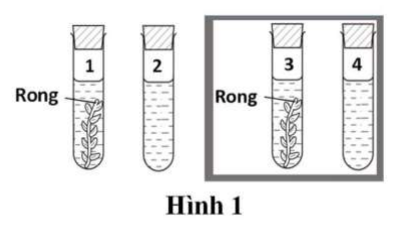
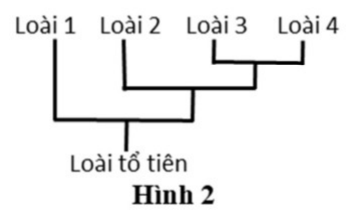
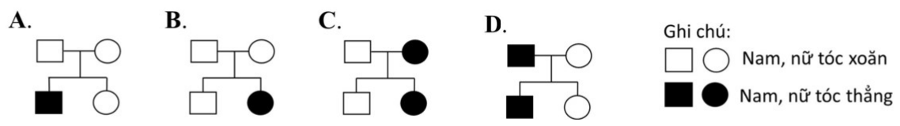
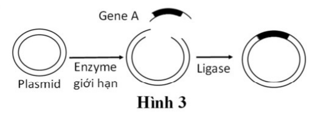
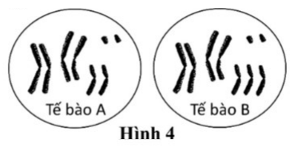
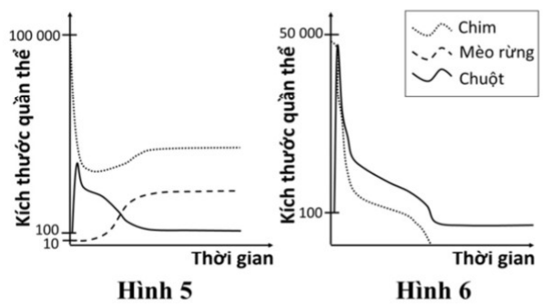
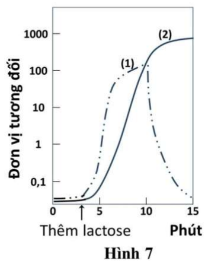
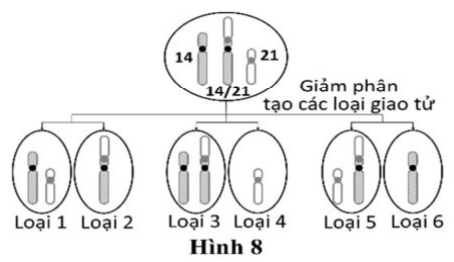
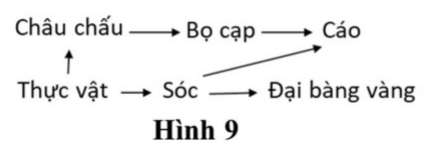
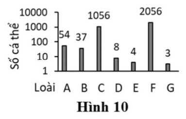

BỘ GIÁO DỤC VÀ ĐÀO TẠO
ĐỀ THAM KHẢO
(Đề thi có 04 trang)

KỲ THI TỐT NGHIỆP THPT TỪ NĂM 2025
MÔN: SINH HỌC
Thời gian làm bài 50 phút, không kể thời gian phát đề

Họ, tên thí sinh: .....................................................................
Số báo danh: .........................................................................

PHẦN I. Thí sinh trả lời từ câu 1 đến câu 18. Mỗi câu hỏi thí sinh chỉ chọn một phương án.

Câu 1. Khi xác định quan hệ huyết thống giữa hai người bất kì, phân tích loại phân tử sinh học nào sau đây cho kết quả chính xác nhất?
A. DNA.
B. RNA.
C. Protein.
D. Carbohydrate.

Câu 2. Trong quá trình giảm phân bình thường, sự tiếp hợp và trao đổi chéo của nhiễm sắc thể chỉ xảy ra ở
A. kì đầu I.
B. kì đầu II.
C. kì giữa I.
D. kì giữa II.

Câu 3. Một thí nghiệm sử dụng rong đuôi chồn được bố trí như Hình 1: ống 1 và ống 2 có chiếu sáng; ống 3 và ống 4 đặt trong tối; các điều kiện thí nghiệm khác là như nhau. Ở ống nghiệm nào bọt khí $\text{O}_2$ được tạo ra nhiều nhất?
[HÌNH: Bố trí thí nghiệm gồm 4 ống nghiệm đánh số từ 1 đến 4: ống 1 và ống 2 được chiếu sáng; ống 3 và ống 4 đặt trong hộp tối; ống 1 và ống 3 chứa cành rong đuôi chồn ngập trong nước, ống 2 và ống 4 chỉ chứa nước không có rong; bọt khí $\text{O}_2$ nổi lên nhiều nhất ở ống 1]

A. 1.
B. 2.
C. 3.
D. 4.

Câu 4. Chất nào sau đây được vận chuyển trong mạch gỗ của cây?
A. Diệp lục.
B. Nước.
C. Tinh bột.
D. Protein.

Dùng thông tin sau để trả lời câu 5 và câu 6: Hình 2 thể hiện sự phát sinh của bốn loài thuộc các chi khác nhau.
[HÌNH: Sơ đồ cây phát sinh chủng loại từ loài tổ tiên phân nhánh thành Loài 1, Loài 2, Loài 3 và Loài 4; trong đó Loài 3 và Loài 4 có chung gốc phân nhánh gần nhất, kế tiếp là Loài 2, và Loài 1 phân nhánh sớm nhất từ loài tổ tiên]

Câu 5. Hai loài nào có quan hệ tiến hóa gần nhất?
A. 1 và 2.
B. 1 và 3.
C. 3 và 4.
D. 2 và 4.

Câu 6. Loài 4 phát sinh từ loài tổ tiên là ví dụ của quá trình
A. tiến hóa nhỏ.
B. tiến hóa lớn.
C. tiến hóa hóa học.
D. tiến hóa tiền sinh học.

Câu 7. Theo thuyết tiến hoá tổng hợp hiện đại, chọn lọc tự nhiên dẫn tới hiện tượng nào sau đây?
A. Tạo ra các kiểu gene thích nghi.
B. Tạo ra các allele mới.
C. Hình thành các kiểu hình mới.
D. Hình thành quần thể thích nghi.

Câu 8. Sự thay đổi tần số allele của quần thể do tác động của các yếu tố ngẫu nhiên như lũ lụt, hạn hán làm giảm mạnh số lượng cá thể của quần thể được gọi là
A. đột biến.
B. chọn lọc tự nhiên.
C. dòng gene.
D. phiêu bạt di truyền.

Câu 9. Ở người, tính trạng tóc xoăn là trội hoàn toàn so với tính trạng tóc thẳng. Một gia đình có bố, mẹ tóc xoăn đã sinh ra hai người con, trong đó có một người con gái tóc thẳng. Phả hệ nào sau đây phản ánh đúng sự di truyền tính trạng dạng tóc ở gia đình này?
[HÌNH: Bốn sơ đồ phả hệ A, B, C, D kèm phần "Ghi chú": ô vuông/hình tròn màu trắng là "Nam, nữ tóc xoăn", ô vuông/hình tròn màu đen là "Nam, nữ tóc thẳng". Sơ đồ A: bố mẹ tóc xoăn sinh con trai tóc thẳng và con gái tóc xoăn; Sơ đồ B: bố mẹ tóc xoăn sinh con trai tóc xoăn và con gái tóc thẳng; Sơ đồ C: bố tóc xoăn, mẹ tóc thẳng sinh con trai tóc xoăn và con gái tóc thẳng; Sơ đồ D: bố tóc thẳng, mẹ tóc xoăn sinh con trai tóc thẳng và con gái tóc xoăn]

A.
B.
C.
D.

Câu 10. Loài cỏ *Spartina alterniflora* ($2n = 62$) giao phấn với loài cỏ *S. maritima* ($2n = 60$) tạo ra cây lai (61 NST). Từ cây lai này đã hình thành nên loài mới là *S. anglica* hữu thụ. Nhận định nào sau đây là đúng?
A. Số NST trong tế bào soma của loài *S. anglica* là 61.
B. Tế bào soma của cây lai chứa các cặp NST tương đồng.
C. Loài *S. alterniflora* và loài *S. maritima* không có sự cách li sinh sản sau hợp tử.
D. Loài *S. anglica* có thể được hình thành bằng con đường lai xa và đa bội hóa.

Dùng thông tin sau để trả lời câu 11 và câu 12: Trên đồng cỏ, các con sư tử trong đàn kết hợp với nhau để săn bắt trâu rừng. Các con trâu rừng tập hợp thành đàn lớn chống lại sư tử.

Câu 11. Mối quan hệ sinh thái giữa những con trâu rừng trong đàn là
A. cộng sinh.
B. hội sinh.
C. hỗ trợ.
D. cạnh tranh.

Câu 12. Mối quan hệ sinh thái giữa sư tử và trâu rừng là
A. hợp tác.
B. cộng sinh.
C. cạnh tranh.
D. vật ăn thịt và con mồi.

Câu 13. Người ta đã tiến hành cài gene $A$ vào plasmid nhằm mục đích tạo giống cây trồng chuyển gene có khả năng tổng hợp một loại carotenoid. Cấu trúc thu được ở giai đoạn cuối cùng trong quy trình được mô tả ở Hình 3 là
[HÌNH: Sơ đồ quy trình tạo DNA tái tổ hợp gồm phân tử plasmid vòng và đoạn gene A được xử lí bằng Enzyme giới hạn, sau đó gắn nối bằng Ligase tạo thành phân tử DNA vòng tái tổ hợp]

A. DNA tái tổ hợp.
B. protein tái tổ hợp.
C. gene chuyển.
D. RNA tái tổ hợp.

Câu 14. Ở người, cùng với hệ nhóm máu ABO, hệ nhóm máu Rhesus (Rh) có vai trò quan trọng do đều gây chứng tan huyết khi không tương đồng nhóm máu. Một người phụ nữ có nhóm máu Rh âm ($\text{Rh}^-$) thường mang thai và sinh con thứ nhất có nhóm máu Rh dương ($\text{Rh}^+$) bình thường, nhưng dễ bị sảy thai ở các lần mang thai tiếp theo nếu thai nhi có nhóm máu $\text{Rh}^+$. Tỉ lệ người có nhóm máu $\text{Rh}^-$ chiếm khoảng $17\%$ ở người da trắng, $7\%$ ở người da đen và $0,5\%$ ở người da vàng (trong đó có người Việt). Gene quy định nhóm máu Rh có 2 allele $R$ và $r$, nằm trên NST thường. Allele $R$ quy định nhóm máu $\text{Rh}^+$ trội hoàn toàn so với allele $r$ quy định nhóm máu $\text{Rh}^-$.
Một cặp vợ chồng người Việt có con thứ nhất $\text{Rh}^+$, nhưng người vợ có một anh ruột và hai cháu ruột $\text{Rh}^-$. Phát biểu tư vấn di truyền nào dưới đây là phù hợp với cặp vợ chồng này khi họ có dự định sinh con lần thứ hai?
A. Người vợ không có nguy cơ sảy thai; vì đã có con thứ nhất $\text{Rh}^+$ và xác suất $\text{Rh}^-$ ở người Việt thấp.
B. Người vợ không có nguy cơ sảy thai; vì con thứ nhất $\text{Rh}^+$ cho thấy kiểu gene người chồng là $RR$.
C. Người vợ có nguy cơ sảy thai; vì xác suất người vợ có nhóm máu $\text{Rh}^-$ cao hơn mức chung của quần thể.
D. Người vợ có nguy cơ sảy thai cao hơn $50\%$ nếu có kiểu gene $rr$ và người chồng có kiểu gene dị hợp tử.

Câu 15. Trong điều trị bệnh rối loạn suy giảm miễn dịch (SCID) ở người do đột biến gene, không tổng hợp enzyme adenosine deaminase (ADA), một nhóm nhà khoa học sử dụng vector chuyển gene ADA bình thường vào tế bào gốc tủy của bệnh nhân SCID. Liệu pháp gene đã được sử dụng trong trường hợp này là gì?
A. Đưa gene bình thường vào cơ thể người bệnh để phá hủy gene đột biến.
B. Đưa gene bình thường vào cơ thể người bệnh để ức chế biểu hiện của gene đột biến.
C. Đưa gene bình thường vào cơ thể người bệnh để chỉnh sửa gene đột biến.
D. Đưa gene bình thường vào cơ thể người bệnh để tạo enzyme hoạt động.

Câu 16. Hình 4 mô tả số lượng NST ở các tế bào soma A và B của hai cơ thể thuộc một loài sinh vật lưỡng bội. Nếu tế bào A là tế bào của cơ thể bình thường, thì tế bào B thuộc thể đột biến nào sau đây?
[HÌNH: Hình 4 mô tả số lượng và hình thái NST: tế bào soma A gồm 4 cặp NST tương đồng ($2n = 8$); tế bào soma B gồm 3 cặp NST tương đồng và 1 bộ ba NST tương đồng ($2n + 1 = 9$)]

A. Thể một nhiễm.
B. Thể ba nhiễm.
C. Thể đa bội.
D. Thể tam bội.

Dùng thông tin sau để trả lời câu 17 và câu 18: Việc khai thác khoáng sản ở một số khu vực rừng mưa nhiệt đới làm huỷ hoại hệ sinh thái: đất bị xáo trộn, nghèo mùn bã hữu cơ, chỉ còn ít cây bụi và ít hạt cây trong đất. Sau khi ngừng khai thác khoáng sản, rừng trên khu vực này phục hồi nhưng tốc độ rất chậm.

Câu 17. Quá trình rừng phục hồi ở khu vực đất đã khai thác khoáng sản này là diễn thế ...(1)... làm ...(2)... độ đa dạng của quần xã. Cụm từ/từ tương ứng với (1), (2) lần lượt là
A. nguyên sinh, tăng.
B. nguyên sinh, giảm.
C. thứ sinh, tăng.
D. thứ sinh, giảm.

Câu 18. Cùng với việc gieo hạt và trồng cây bản địa, để thúc đẩy tốc độ phục hồi hệ sinh thái sau khi ngừng khai thác khoáng sản, biện pháp nào sau đây phù hợp nhất?
A. Di nhập các động vật đào hang để làm tơi xốp đất.
B. Thường xuyên tỉa thưa để hạn chế sự phát triển của các loài ưu thế.
C. Bổ sung vụn cành và lá cây vào trong đất.
D. Gieo hạt của các cây ngoại lai vào trong đất.

PHẦN II. Thí sinh trả lời từ câu 1 đến câu 4. Trong mỗi ý a), b), c), d) ở mỗi câu, thí sinh chọn đúng hoặc sai.

Câu 1. Dựa trên cơ sở các thí nghiệm về di truyền của Morgan, một nhóm học sinh đã thực hiện các phép lai trên ruồi giấm và thu được kết quả như sau:
Phép lai 1: ♂ thân xám, cánh cụt $\times$ ♀ thân đen, cánh dài thu được $\text{F}_1$ gồm $100\%$ thân xám, cánh dài.
Phép lai 2: ♀ $\text{F}_1$ của phép lai 1 ($\text{F}_{1-1}$) $\times$ ♂ thân đen, cánh cụt thu được $\text{F}_{\text{a}}$ gồm 4 loại kiểu hình với tỉ lệ khác nhau.
Phép lai 3: ♀ $\text{F}_{1-1} \times$ ♂ $\text{F}_{1-1}$ thu được $\text{F}_2$ gồm 3 loại kiểu hình với tỉ lệ $1 : 2 : 1$.
Biết rằng, mỗi tính trạng do một gene có 2 allele trội lặn hoàn toàn, nằm trên NST thường quy định.
a) Các phép lai nhằm mục đích xác định cơ chế di truyền chi phối các tính trạng.
b) Tần số hoán vị gene có thể xác định được từ kết quả phép lai 2.
c) Kết quả phép lai 3 cho phép nhận định rằng các gene quy định các tính trạng trên liên kết hoàn toàn ở ♂ $\text{F}_{1-1}$.
d) Nếu cho lai ♂ $\text{F}_{1-1} \times$ ♀ thân đen, cánh cụt thì tỉ lệ các kiểu hình ở đời con giống với phép lai 2.

Câu 2. Phương pháp mô phỏng mô hình sinh thái về sự biến đổi kích thước quần thể của 3 loài chim, chuột và mèo rừng được thực hiện trên một hòn đảo với số lượng cá thể ban đầu của mỗi loài lần lượt là $100\ 000$, 100 và 10. Biến động số lượng cá thể mỗi loài sau một thời gian được biểu thị ở Hình 5 (Thí nghiệm 1). Biết rằng, chim là thức ăn của chuột; cả chim và chuột là thức ăn của mèo rừng.
Khi quần xã trong Thí nghiệm 1 đạt trạng thái ổn định, người ta tiến hành loại bỏ hoàn toàn các cá thể mèo rừng và thu được số liệu về sự biến động số lượng cá thể các loài trong quần xã như biểu thị ở Hình 6 (Thí nghiệm 2).
[HÌNH: Đồ thị biến động kích thước quần thể của 3 loài theo thời gian: Hình 5 (Thí nghiệm 1) khi có đủ 3 loài đạt trạng thái cân bằng ổn định; Hình 6 (Thí nghiệm 2) khi loại bỏ mèo rừng, số lượng chuột ban đầu tăng vọt rồi chim giảm mạnh và chuột giảm theo; đường chấm là Chim, đường nét đứt là Mèo rừng, đường nét liền là Chuột]

a) Mối quan hệ sinh thái giữa loài chim và loài chuột là cạnh tranh khác loài.
b) Mèo rừng là loài chủ chốt trong quần xã.
c) Trong Thí nghiệm 1, tổng số cá thể của quần xã đạt giá trị cao nhất khi quần xã đạt trạng thái ổn định.
d) Kết quả nghiên cứu cho thấy việc loại bỏ một loài có thể xác định được vai trò sinh thái của loài đó trong quần xã.

Câu 3. Trong một nghiên cứu về ảnh hưởng của các khí $\text{O}_2$, $\text{CO}_2$, $\text{CO}$ đến nhịp tim của chuột, một số bước sau đã được thực hiện:
- Bước 1: Xác định vật liệu, phương pháp, bố trí thí nghiệm, kết quả dự kiến.
- Bước 2: Chọn các con chuột đực 10 tuần tuổi khỏe mạnh, đồng đều về kích thước, khối lượng. Chuẩn bị bốn buồng thí nghiệm có áp suất mỗi loại khí ($\text{mmHg}$) khác nhau được thể hiện ở Bảng 1. Trong đó, Buồng I chứa không khí tiêu chuẩn (đối chứng).
- Bước 3: Đo nhịp tim của chuột bằng thiết bị cảm biến.
- Bước 4: Chọn 40 con chuột có nhịp tim tương đương nhau và chia đều thành 4 nhóm. Đưa mỗi nhóm chuột vào từng buồng thí nghiệm.
- Bước 5: Sau 15 phút, đo nhịp tim của chuột trong mỗi buồng thí nghiệm.

Bảng 1
| Loại khí | Buồng I | Buồng II | Buồng III | Buồng IV |
| :---: | :---: | :---: | :---: | :---: |
| $\text{O}_2$ | 159 | 126 | 159 | 159 |
| $\text{CO}_2$ | 0,3 | 0,3 | 8 | 0,3 |
| $\text{CO}$ | 0 | 0 | 0 | 0,4 |

a) Bước 1 thể hiện việc lập kế hoạch nghiên cứu.
b) Để xác định ảnh hưởng của khí $\text{CO}$, cần tiến hành bước tiếp theo là so sánh kết quả đo nhịp tim của chuột ở Buồng II và Buồng IV.
c) Chuột ở Buồng III sẽ không có sự sai khác về nhịp tim đo được ở bước 3 và ở bước 5.
d) Nếu sử dụng chuột bị hỏng thụ thể hóa học ở cung động mạch chủ và xoang động mạch cảnh làm đối tượng thí nghiệm thì nhịp tim của chuột trong Buồng I và Buồng II sẽ không có sự sai khác.

Câu 4. Hình 7 cho thấy kết quả xác định mức biểu hiện (qua phiên mã và dịch mã) của gene *Z* mã hóa enzyme $\beta$-galactosidase ở chủng *E. coli* kiểu dại, sinh trưởng trong môi trường tối thiểu ban đầu không có lactose và được bổ sung một lượng nhất định lactose vào phút thứ 3. Các đường đồ thị (1), (2) biểu thị sản phẩm của gene *Z* (lượng enzyme $\beta$-galactosidase hoặc lượng mRNA).
[HÌNH: Đồ thị Hình 7 biểu diễn mức biểu hiện tương đối của sản phẩm gene Z theo thời gian (phút); mũi tên tại phút thứ 3 ghi 'Thêm lactose'; đường (1) nét gạch chấm tăng vọt đạt đỉnh quanh phút thứ 8 rồi giảm dần đến phút 15; đường (2) nét liền bắt đầu tăng từ phút thứ 4 và đạt mức cao ổn định từ phút thứ 12-15]

a) Lượng mRNA do gene *Z* quy định được biểu thị ở đường (2).
b) Lượng chất được biểu thị ở đường (1) quy định lượng chất được biểu thị ở đường (2).
c) Từ phút thứ 10, đường (1) đi xuống là do cạn kiệt lactose và sản phẩm của gene *Z* được biểu thị bởi đường này bị phân giải.
d) Từ phút thứ 15 trở đi, lượng chất biểu thị ở đường (2) duy trì ổn định.

PHẦN III. Thí sinh trả lời từ câu 1 đến câu 6. Thí sinh điền kết quả mỗi câu vào mỗi ô trả lời tương ứng theo hướng dẫn của phiếu trả lời.

Câu 1. Ở vùng Manchester nước Anh, trước năm 1848, khi môi trường chưa bị ô nhiễm, thân cây bạch dương có màu trắng và quần thể bướm sâu đo sống trên thân cây chủ yếu là các cá thể màu sáng, chỉ một vài cá thể màu sẫm. Từ năm 1848 trở đi, khi môi trường bị ô nhiễm bởi khói bụi than, thân cây bạch dương chuyển màu sẫm. Khoảng 50 năm sau, số lượng cá thể màu sẫm chiếm khoảng $98\%$ trong quần thể. Biết rằng, tính trạng màu sắc thân bướm do một gene có 2 allele trội lặn hoàn toàn quy định. Cho các sự kiện sau đây:
1. Dưới tác động của chọn lọc tự nhiên, các cá thể màu sẫm có ưu thế thích nghi.
2. Các cá thể màu sẫm ngày càng tăng số lượng, hình thành quần thể thích nghi.
3. Thông qua sinh sản, các allele đột biến được nhân lên và kiểu hình biến dị phát tán trong quần thể.
4. Trước năm 1848, trong quần thể bướm đã phát sinh đột biến gene quy định kiểu hình màu sẫm.
Hãy viết liền các số tương ứng với bốn sự kiện theo trình tự của quá trình hình thành quần thể thích nghi.

Câu 2. Hình 8 cho thấy các loại giao tử chứa NST 14, 21 và 14/21 có thể được tạo thành từ các tế bào sinh trứng ở một người phụ nữ bị đột biến chuyển đoạn Robertson (một phần của NST 21 gắn vào NST 14). Loại giao tử nào trong Hình 8 kết hợp với giao tử đực bình thường tạo thành hợp tử có các cặp NST 14 và 21 bình thường?
[HÌNH: Hình 8 thể hiện các loại giao tử sinh ra do chuyển đoạn Robertson giữa NST 14 và NST 21: tế bào sinh trứng chứa NST 14, NST 21 và NST chuyển đoạn 14/21 qua giảm phân tạo 6 loại giao tử: Loại 1 (gồm 1 NST 14 và 1 NST 21 bình thường), Loại 2 (gồm 1 NST 14/21), Loại 3 (gồm 1 NST 14/21 và 1 NST 14), Loại 4 (gồm 1 NST 21), Loại 5 (gồm 1 NST 14/21 và 1 NST 21), Loại 6 (gồm 1 NST 14)]

Câu 3. Một học sinh tiến hành gieo hạt đậu tương và thống kê số lượng cây con với các kiểu hình khác nhau về màu lá sau 14 ngày gieo hạt, thu được kết quả ở Bảng 2. Biết rằng, màu lá đậu do một gene có 2 allele quy định, allele $A$ quy định lá màu xanh đậm trội không hoàn toàn so với allele $a$ quy định lá vàng, kiểu gene $Aa$ quy định kiểu hình lá xanh nhạt. Hãy xác định tần số allele $A$ trong quần thể này (tính làm tròn đến 2 chữ số sau dấu phẩy).

Bảng 2
| Xanh đậm | Xanh nhạt | Vàng |
| :---: | :---: | :---: |
| 50 | 112 | 58 |

Câu 4. Một nhà khoa học muốn tạo ra giống lúa thuần chủng chịu hạn và kháng bệnh từ hai dòng thuần chủng: chịu hạn, không kháng bệnh (dòng 1) và không chịu hạn, kháng bệnh (dòng 2). Biết rằng, allele $A$ quy định chịu hạn trội hoàn toàn so với allele $a$ quy định không chịu hạn, allele $B$ quy định kháng bệnh trội hoàn toàn so với allele $b$ quy định không kháng bệnh. Hai gene này nằm trên cùng một NST, cách nhau $20\text{ cM}$. Nhà khoa học này cho lai cây thuộc dòng 1 với cây thuộc dòng 2, thu được $\text{F}_1$. Nếu cho cây $\text{F}_1$ tự thụ phấn thì tỉ lệ các cây lúa thuần chủng chịu hạn và kháng bệnh ở $\text{F}_2$ là bao nhiêu (tính làm tròn đến 2 chữ số sau dấu phẩy)?

Câu 5. Hình 9 là lưới thức ăn ở một hệ sinh thái trên cạn. Biết rằng, sản lượng của thực vật là $210\text{ kcal/m}^2/\text{năm}$. Nếu hiệu suất sinh thái giữa phần sản lượng của sinh vật tiêu thụ với sản lượng của mỗi loài thức ăn tương ứng đều là $10\%$, thì sản lượng của cáo là bao nhiêu? (tính làm tròn đến 2 chữ số sau dấu phẩy).
[HÌNH: Lưới thức ăn Hình 9 gồm các loài sinh vật với các mối quan hệ dinh dưỡng: Thực vật làm thức ăn cho Châu chấu và Sóc; Châu chấu làm thức ăn cho Bọ cạp; Bọ cạp làm thức ăn cho Cáo; Sóc làm thức ăn cho Cáo và Đại bàng vàng]

Câu 6. Hình 10 cho thấy số lượng cá thể của các loài trong một quần xã thực vật ở đồng cỏ, trong đó chỉ có một loài ưu thế. Độ phong phú của loài ưu thế gấp bao nhiêu lần giá trị trung bình của độ phong phú của tất cả các loài trong quần xã? (tính làm tròn đến 2 chữ số sau dấu phẩy).
[HÌNH: Biểu đồ cột Hình 10 biểu diễn số cá thể của 7 loài thực vật (A, B, C, D, E, F, G) theo thang đo logarit ở trục tung: loài A có 54 cá thể, loài B có 37 cá thể, loài C có 1056 cá thể, loài D có 8 cá thể, loài E có 4 cá thể, loài F có 2056 cá thể, loài G có 3 cá thể]

-------------------- HẾT --------------------

- Thí sinh không được sử dụng tài liệu.
- Giám thị không giải thích gì thêm.

---

BỘ GIÁO DỤC VÀ ĐÀO TẠO
ĐÁP ÁN ĐỀ THAM KHẢO
Môn: Sinh học

PHẦN I. Câu trắc nghiệm nhiều phương án lựa chọn. Thí sinh trả lời từ câu 1 đến câu 18
(Mỗi câu trả lời đúng thí sinh được 0,25 điểm)

| Câu | 1 | 2 | 3 | 4 | 5 | 6 | 7 | 8 | 9 |
| :---: | :---: | :---: | :---: | :---: | :---: | :---: | :---: | :---: | :---: |
| Chọn | A | A | A | B | C | B | D | D | B |

| Câu | 10 | 11 | 12 | 13 | 14 | 15 | 16 | 17 | 18 |
| :---: | :---: | :---: | :---: | :---: | :---: | :---: | :---: | :---: | :---: |
| Chọn | D | C | D | A | C | D | B | C | C |

PHẦN II. Câu trắc nghiệm đúng sai. Thí sinh trả lời từ câu 1 đến câu 4 Trong mỗi ý a), b), c), d) ở mỗi câu, thí sinh chọn đúng hoặc sai.
- Thí sinh chỉ lựa chọn chính xác 01 ý trong 01 câu hỏi được 0,1 điểm;
- Thí sinh chỉ lựa chọn chính xác 02 ý trong 01 câu hỏi được 0,25 điểm;
- Thí sinh chỉ lựa chọn chính xác 03 ý trong 01 câu hỏi được 0,5 điểm;
- Thí sinh lựa chọn chính xác cả 04 ý trong 01 câu hỏi được 1 điểm.

| Câu | 1 | 2 | 3 | 4 |
| :---: | :---: | :---: | :---: | :---: |
| Đáp án | a) Đúng b) Đúng c) Đúng d) Sai | a) Sai b) Đúng c) Sai d) Đúng | a) Đúng b) Sai c) Sai d) Đúng | a) Sai b) Đúng c) Đúng d) Sai |

PHẦN III. Câu trắc nghiệm trả lời ngắn. Thí sinh trả lời từ câu 1 đến câu 6
Mỗi câu trả lời đúng thí sinh được 0,25 điểm.

| Câu | 1 | 2 | 3 | 4 | 5 | 6 |
| :---: | :---: | :---: | :---: | :---: | :---: | :---: |
| Đáp án | 4312 | 1 | 0,48 | 0,01 | 2,31 | 4,47 |
