status: ocr-draft
Sở Giáo dục và Đào tạo Hà Nội — Kiểm tra khảo sát lớp 12 đợt 1, năm 2026 — Môn Sinh học — Mã đề 1231

**Thời gian làm bài:** 50 phút, không kể thời gian phát đề. *(Đề ghi có 04 trang.)*

## Phần I (4,5 điểm). Câu trắc nghiệm nhiều phương án lựa chọn
Thí sinh trả lời từ câu 1 đến câu 18. Mỗi câu hỏi thí sinh chỉ chọn 1 phương án trả lời.

**Câu 1.** Hình 1 mô tả đường đi của máu trong hệ tuần hoàn hở. Phát biểu nào sau đây đúng?

[HÌNH: Sơ đồ tuần hoàn hở gồm tim, mạch và dịch tuần hoàn quanh tế bào; hai vị trí A và B được đánh dấu.]
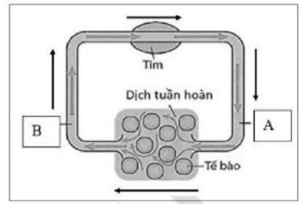

A. [A] là tĩnh mạch, [B] là mao mạch.
B. Tốc độ máu trong mạch nhanh, áp lực máu cao hoặc trung bình tùy loài.
C. Dịch tuần hoàn là máu thuần túy không lẫn dịch mô.
D. Hệ tuần hoàn hở có ở tôm, cua, côn trùng.

**Câu 2.** Ở người, bệnh máu khó đông do một allele lặn ($m$) nằm trên nhiễm sắc thể X không có allele tương ứng trên nhiễm sắc thể Y quy định. Cặp bố mẹ nào sau đây có thể sinh con trai bị bệnh máu khó đông với xác suất 25%?

A. $X^mX^m \times X^mY$.
B. $X^mX^m \times X^MY$.
C. $X^MX^m \times X^mY$.
D. $X^MX^M \times X^MY$.

**Câu 3.** Bằng phương pháp di truyền tế bào, người ta có thể phát hiện được nguyên nhân của những bệnh và hội chứng nào sau đây ở người?

(1) Hội chứng Down.

(2) Hội chứng Patau.

(3) Hội chứng suy giảm miễn dịch mắc phải (AIDS).

(4) Bệnh thiếu máu hồng cầu hình liềm.

(5) Bệnh máu khó đông.

(6) Hội chứng siêu nữ.

Phương án đúng là:

A. (1), (3), (6).
B. (1), (3), (5).
C. (2), (4), (6).
D. (1), (2), (6).

**Câu 4.** Bản đồ di truyền được xây dựng dựa vào tần số trao đổi chéo (hoán vị gene) giữa hai gene. T. H. Morgan và cộng sự đã lập bản đồ của 2 gene màu sắc thân (B, b) và chiều dài cánh (V, v) ở ruồi giấm như sau:

[HÌNH: Bản đồ gene ruồi giấm cho thấy B và V cách nhau 17 cM.]
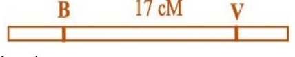

Theo lí thuyết, phép lai $\female\ \dfrac{BV}{bv} \times \male\ \dfrac{bv}{bv}$ tạo ra $F_1$ có biến dị tổ hợp chiếm tỉ lệ bao nhiêu?

A. 34%.
B. 17%.
C. 8,5%.
D. 41,5%.

**Câu 5.** Hình 2 mô tả cơ chế di truyền nào trong tế bào?

[HÌNH: Sơ đồ chạc tái bản DNA, với các mạch mới được tổng hợp theo hai chiều.]
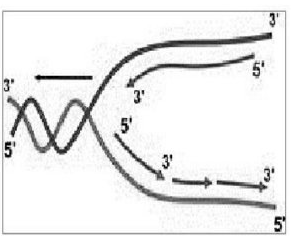

A. Điều hòa hoạt động gene.
B. Dịch mã – tổng hợp polypeptide.
C. Phiên mã của gene.
D. Nhân đôi DNA.

**Câu 6.** Trong công nghệ DNA tái tổ hợp, trình tự nào sau đây đúng?

1. Cắt DNA của tế bào cho và cắt mở vòng plasmid.
2. Tách DNA của tế bào cho và tách plasmid ra khỏi tế bào.
3. Chuyển DNA tái tổ hợp vào tế bào nhận.
4. Nối đoạn DNA của tế bào cho vào DNA của plasmid.

A. 1, 3, 4, 2.
B. 2, 1, 4, 3.
C. 2, 1, 3, 4.
D. 1, 2, 3, 4.

**Câu 7.** Hình 3 mô tả hiện tượng một đột biến điểm xảy ra trên gene β-globin và gây bệnh hồng cầu hình liềm ở người. Quan sát hình và cho biết dạng đột biến gene gây bệnh này thuộc loại nào sau đây?

[HÌNH: So sánh gene β-globin bình thường và đột biến; bộ ba đổi từ CTC/GAG sang CAC/GTG, làm amino acid Glu đổi thành Val.]
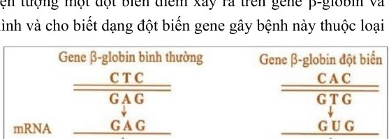

A. Mất 1 cặp nucleotide.
B. Thay thế 1 cặp nucleotide.
C. Thêm 1 cặp nucleotide.
D. Mất 2 cặp nucleotide.

**Câu 8.** Ở sinh vật nhân thực, RNA không đảm nhận chức năng nào sau đây?

A. Mang amino acid tham gia quá trình dịch mã.
B. Làm khuôn tổng hợp chuỗi polypeptide.
C. Phân giải protein.
D. Cấu tạo nên ribosome.

**Câu 9.** Hình 4 mô tả vật chất di truyền có ở tế bào động vật, các kí hiệu H, I, K, N, … cho các gene trên vật chất di truyền trong tế bào. Dựa trên hình 4, có bao nhiêu nhận định sau đây đúng?

[HÌNH: Tế bào động vật với các gene trên nhiễm sắc thể trong nhân và DNA vòng ở ty thể.]
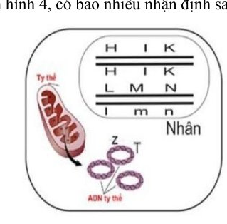

I. Các gene H, K, Z, T có số lần nhân đôi giống nhau.

II. Các gene H, M di truyền phân li độc lập với nhau, các gene H, I, K di truyền liên kết.

III. Các gene L, M, N, K, H, I có số lần nhân đôi giống nhau.

IV. Các gene L, M, N, l, m, n thuộc các nhóm gene liên kết khác nhau.

A. 2.
B. 3.
C. 4.
D. 1.

**Câu 10.** Đồ thị hình 5 mô tả sự thay đổi lượng DNA của một tế bào trong chu kì tế bào ở tế bào mô phân sinh đỉnh. Giai đoạn B trong đồ thị tương ứng là

[HÌNH: Đồ thị lượng DNA theo thời gian, mức tăng từ 1 lên 2 ở giai đoạn B; các đoạn được ghi A, B, C.]
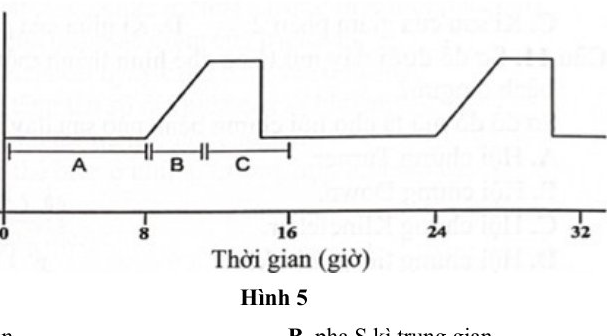

A. pha G1 kì trung gian.
B. pha S kì trung gian.
C. kì giữa.
D. kì đầu.

**Câu 11.** Hình 6 mô tả hiện tượng di truyền liên quan đến màu sắc lá của cây hoa mõm chó (cây hoa phấn, cây hoa mõm sói). Cho biết [3] chỉ vị trí của allele bình thường tạo ra enzyme chuyển hóa tổng hợp diệp lục tạo sắc tố lá xanh; [4] chỉ vị trí của allele đột biến không tạo ra enzyme chuyển hóa tổng hợp diệp lục nên lá trắng; tế bào có thể chứa [3] hoặc [4] hoặc cả hai. Phát biểu nào sau đây đúng?

[HÌNH: Sơ đồ tế bào có lục lạp (a), ty thể, nhân và các vị trí gene được đánh dấu [1]–[4].]
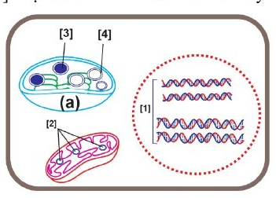

A. Nếu cây chỉ có lá trắng thì lục lạp (a) của nó chỉ mang gene [4].
B. Nếu một cây có lá đốm thì trong lục lạp (a) của nó chỉ chứa gene [2].
C. Gene quy định màu sắc lá liên quan đến gene nằm trong bào quan [1].
D. Nếu cây chỉ có lá xanh thì trong lục lạp (a) của nó chứa gene [3] và [4].

**Câu 12.** Ở thực vật, thành phần chủ yếu của dịch mạch gỗ là

A. nước và các ion khoáng.
B. các ion khoáng.
C. các hợp chất hữu cơ.
D. nước và các chất hữu cơ.

**Câu 13.** Một đoạn của gene cấu trúc ở sinh vật nhân sơ có trật tự nucleotide trên mạch bổ sung như sau:

| Các bộ ba | 3′TAC - AAG - AAT - GAG - … - ATT - TAA - GGT - GTA - ACT - 5′ |
|---|---|
| Số thứ tự các bộ ba | 1  2  3  4  …  80  81  82  83  84 |

Biết rằng các codon 5′GAG3′ và 5′GAA3′ cùng mã hóa cho amino acid (Glu), 5′GAU3′ và 5′GAC3′ cùng mã hóa cho amino acid (Asp). Có bao nhiêu phát biểu sau đây đúng khi nói về đoạn gene trên?

(1) Vùng mã hóa trên mạch gốc của gene trên có 80 triplet.

(2) Đột biến thay thế một cặp nucleotide bất kì xảy ra tại bộ ba thứ 82 trong đoạn gene trên luôn làm biến đổi thành phần amino acid của chuỗi polipeptide do gene quy định tổng hợp.

(3) Đột biến thay thế một cặp nucleotide C-G thành A-T xảy ra tại nucleotide thứ 12 tính từ đầu 3′ của đoạn mạch trên sẽ làm cho chuỗi polipeptide do gene quy định tổng hợp bị mất đi một amino acid so với chuỗi polipeptide bình thường.

(4) Đột biến thay thế một cặp nucleotide C-G thành G-C xảy ra tại nucleotide thứ 10 tính từ đầu 3′ không ảnh hưởng đến số lượng, thành phần và trình tự sắp xếp của các amino acid trong chuỗi polipeptide do gene quy định tổng hợp.

A. 2.
B. 1.
C. 3.
D. 4.

**Câu 14.** Bảng số liệu dưới đây mô tả phần trăm số lượng cặp A–T và G–C trong các phân tử DNA1, DNA2, DNA3 có cùng khối lượng, cho biết phân tử DNA nào có số liên kết hydrogen nhiều nhất?

| Phân tử | Tỉ lệ % số lượng cặp A-T | Tỉ lệ % số lượng cặp G-C |
|---|---:|---:|
| DNA1 | 32 | 68 |
| DNA2 | 25 | 75 |
| DNA3 | 50 | 50 |

A. Các phân tử như nhau.
B. Phân tử DNA3.
C. Phân tử DNA1.
D. Phân tử DNA2.

**Câu 15.** Trong phân tử mRNA không có loại đơn phân nào sau đây?

A. Thymine.
B. Uracil.
C. Cytosin.
D. Adenine.

**Câu 16.** Để tìm hiểu một hội chứng di truyền, người ta đã so sánh bộ nhiễm sắc thể của một người bình thường và một người mắc hội chứng di truyền (người số 1 và người số 2). Bộ nhiễm sắc thể của hai người này được thể hiện ở hình dưới đây.

[HÌNH: Hai bộ nhiễm sắc thể người; người số 1 có ba NST số 21, người số 2 có bộ NST được so sánh bên cạnh.]
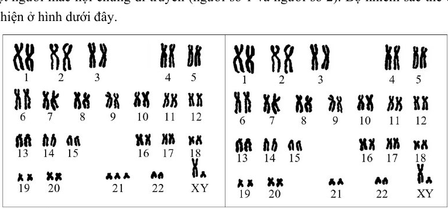

Phát biểu nào dưới đây đúng khi nói về đặc điểm di truyền được mô tả trong hình trên?

A. Hai người trên đều mang bộ nhiễm sắc thể lưỡng bội (2n).
B. Nguyên nhân gây ra hội chứng di truyền đang nghiên cứu là do đột biến cấu trúc nhiễm sắc thể.
C. Người số 1 là người bình thường; người số 2 mắc hội chứng di truyền.
D. Hội chứng di truyền mà người số 1 mắc phải là hội chứng Down.

**Câu 17.** Màu da ở người do 3 cặp gene nằm trên 3 cặp nhiễm sắc thể khác nhau quy định, cứ có mỗi gene trội trong kiểu gene thì tế bào tổng hợp nên một ít sắc tố melanin. Trong tế bào càng có nhiều melanin da càng đen. Người có kiểu gene nào sau đây có màu da ít đen nhất?

A. AABbDD.
B. AaBbDd.
C. AaBBdd.
D. AAbbdd.

**Câu 18.** Nghiên cứu sơ đồ hình 8 về hai pha của quá trình quang hợp ở thực vật và cho biết kết luận nào sau đây đúng?

[HÌNH: Sơ đồ hai pha quang hợp; pha 1 nhận ánh sáng, trao đổi các chất với pha 2, pha 2 tạo (CH₂O)n.]
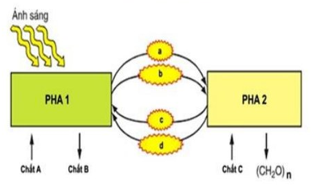

A. Pha 1 xảy ra ở chất nền lục lạp.
B. Chất B là CO₂.
C. Chất C là O₂.
D. Chất A là H₂O.

## Phần II (4,0 điểm). Câu trắc nghiệm đúng/sai
Thí sinh trả lời từ câu 1 đến câu 4. Trong mỗi ý a), b), c), d) ở mỗi câu thí sinh chọn đúng hoặc sai.

**Câu 1.** Ở một loài động vật, quan sát quá trình giảm phân của một tế bào sinh tinh, người ta ghi nhận lại diễn biến nhiễm sắc thể được mô tả bằng hình 9. Các chữ cái A, a, B, b, D, d biểu diễn cho các gene nằm trên các nhiễm sắc thể. Ngoài các sự kiện được mô tả trong hình thì các sự kiện khác diễn ra bình thường. Trong số các nhận xét được cho dưới đây về sự giảm phân của tế bào sinh tinh này, hãy cho biết nhận định nào đúng/sai?

[HÌNH: Sơ đồ giảm phân tế bào sinh tinh với gene A/a, B/b, D/d và hai tế bào con minh họa phân li bất thường.]
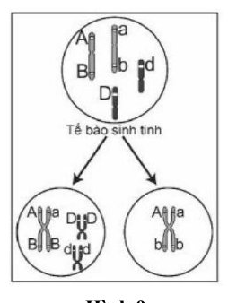

a) Các loại tinh trùng được tạo ra là ABDd, aBDd, Ab và ab.

b) Tế bào sinh tinh giảm phân chỉ tạo ra các loại tinh trùng đột biến.

c) Nếu khoảng cách giữa gene A và B là 20 cM thì tỉ lệ giao tử aBDd là 25%.

d) Trong quá trình sinh tinh đã xảy ra hoán vị gen giữa các gene A và a.

**Câu 2.** Khi nghiên cứu về hoạt động của Operon lac ở ba chủng vi khuẩn E. coli, người ta thu được bảng kết quả như sau:

| Điều kiện nuôi cấy | Chủng 1 Có lactose | Chủng 1 Không có lactose | Chủng 2 Có lactose | Chủng 2 Không có lactose | Chủng 3 Có lactose | Chủng 3 Không có lactose |
|---|---:|---:|---:|---:|---:|---:|
| Protein ức chế | + | + | + | + | - | - |
| mRNA của các gene cấu trúc | + | - | + | + | + | + |

(+: sản phẩm được tạo ra; -: sản phẩm không được tạo ra hoặc tạo ra không đáng kể)

a) Chủng 2 có thể đã bị đột biến trong các gene lac (Z, Y, A) khiến chúng tăng phiên mã.

b) Có thể vùng P của lacI ở chủng 3 đã bị mất hoạt tính.

c) Có 2 chủng bị lãng phí vật chất và năng lượng bởi phiên mã không kiểm soát.

d) Không có chủng nào có Operon lac hoạt động một cách bình thường.

**Câu 3.** Ở một loài thực vật, allele A quy định quả đỏ trội hoàn toàn so với allele a quy định quả vàng. Dùng Colchicine xử lí các hạt của cây lưỡng bội có kiểu gene Aa, sau đó đem gieo các hạt này thu được các cây P. Cho biết quá trình giảm phân không xảy ra đột biến, các cây tứ bội đều tạo giao tử 2n có khả năng thụ tinh. Chọn ngẫu nhiên hai cây bất kỳ ở P cho giao phấn với nhau. Theo lí thuyết, trong những kết quả có thể thu được ở đời F₁ các phát biểu sau đây đúng/sai?

a) Xuất hiện cây lưỡng bội, cây tam bội và cây tứ bội.

b) Tỉ lệ kiểu hình có thể thu được là 35:1 hoặc 11:1.

c) Tỉ lệ kiểu gene và tỉ lệ kiểu hình có thể thu được lần lượt là 1:2:1 và 3:1.

d) Có tối đa 5 loại kiểu gene và tối thiểu 2 loại kiểu gene.

**Câu 4.** Sơ đồ hình 10 mô tả sự di truyền của một bệnh ở người. Biết rằng bệnh này do một trong hai allele của một gene quy định và không phát sinh đột biến mới ở tất cả những người trong phả hệ. Trong các phát biểu sau, phát biểu nào đúng/sai?

[HÌNH: Phả hệ bốn thế hệ, thành viên được đánh số 1–26; biểu tượng tô đen là người bị bệnh.]
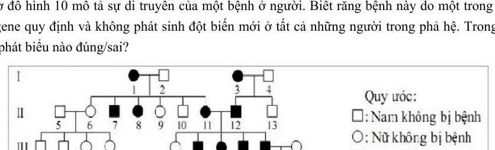

a) Có ít nhất 16 người trong phả hệ này có kiểu gene đồng hợp tử.

b) Có 23 người trong phả hệ này xác định được chính xác kiểu gene.

c) Tất cả những người bị bệnh trong phả hệ này đều có kiểu gene đồng hợp tử.

d) Những người không bị bệnh trong phả hệ này đều không mang allele gây bệnh.

## Phần III (1,5 điểm). Câu trắc nghiệm trả lời ngắn
Thí sinh trả lời từ câu 1 đến câu 6.

**Câu 1.** Hình sau mô tả quá trình phiên mã và dịch mã xảy ra trong vùng mã hóa của một gene ở sinh vật nhân sơ. Các kí hiệu (A), (B), (C), (D), (E), (F), (G) là các vị trí tương ứng, mũi tên chỉ chiều di chuyển của enzyme. Quan sát hình và cho biết có bao nhiêu phát biểu sau đây đúng?

[HÌNH: Sơ đồ phiên mã và dịch mã đồng thời; DNA, mRNA, ribosome và các chuỗi polypeptide tại các vị trí A–G.]
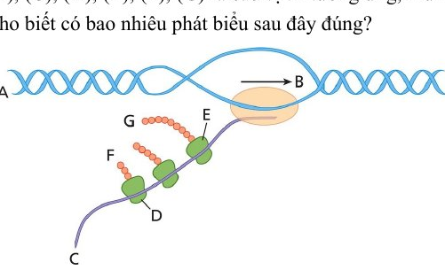

I. Vị trí (A) ứng với đầu 3′ trên mạch gốc và vị trí (C) ứng với đầu 5′ của mRNA.

II. Chuỗi polypeptide ở vị trí (G) được tổng hợp trước chuỗi polypeptide ở vị trí (F).

III. D và E là hai tiểu đơn vị cấu trúc của ribosome.

IV. Enzyme ở vị trí B có chức năng tháo xoắn và tổng hợp mRNA tại vị trí đặc hiệu.

**Câu 2.** Hình 12 mô tả số lượng NST ở một tế bào soma thuộc đột biến đa bội cùng nguồn. Số lượng NST có trong bộ NST lưỡng bội của loài này là bao nhiêu?

[HÌNH: Tế bào soma có 12 nhiễm sắc thể được vẽ thành ba bộ tương đồng.]
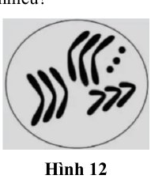

**Câu 3.** Một loài thực vật lưỡng bội, xét 3 cặp gene A,a; B,b; D,d trên 3 cặp NST khác nhau. Biết các allele lặn là allele đột biến. Xác định số kiểu gene quy định các thể đột biến về hai gene?

**Câu 4.** Ở một loài thực vật, để tạo thành màu đỏ của hoa có sự tương tác của hai gene A và B theo sơ đồ hình 13. Gene a và b không có khả năng đó, hai cặp gene nằm trên hai cặp NST khác nhau. Cho cây có kiểu gene AaBb tự thụ phấn được F₁. Trong số các cây hoa trắng ở F₁, cây thuần chủng chiếm tỉ lệ bao nhiêu? (làm tròn đến 2 chữ số thập phân sau dấu phẩy).

[HÌNH: Sơ đồ hai gene A và B tạo enzyme theo hai bước chuyển hóa, từ chất trắng 1 qua chất trắng 2 thành chất đỏ.]
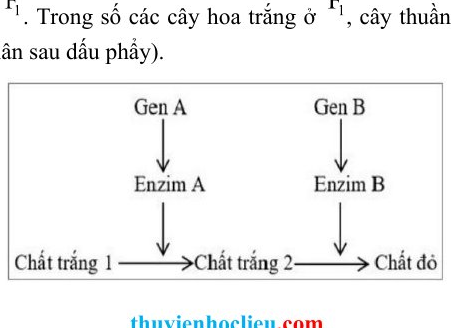

**Câu 5.** Trong quá trình giảm phân ở một cơ thể có kiểu gene [không đọc rõ trên trang 8; phần hướng dẫn giải ở trang 19 cũng không hiển thị kiểu gene], đã xảy ra hoán vị gene giữa các allele D và d với tần số [không đọc rõ trên trang 8]. Cho biết không xảy ra đột biến, tính theo lí thuyết, tỉ lệ loại giao tử [không đọc rõ trên trang 8] được tạo ra từ cơ thể này là bao nhiêu phần trăm? (làm tròn đến 1 chữ số sau dấu phẩy).

**Câu 6.** Hình 14 mô tả các cấu trúc tham gia vào cơ chế điều hoà biểu hiện gene của Operon Lac ở vi khuẩn E. coli. Hãy cho biết gene điều hòa nằm ở vị trí tương ứng với số mấy trên hình?

[HÌNH: Sơ đồ operon Lac với các cấu trúc được đánh số; gene điều hòa được đánh số 1 theo phần hướng dẫn giải.]

---HẾT---