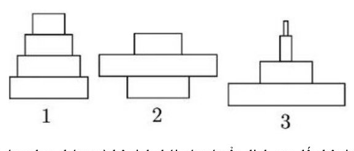
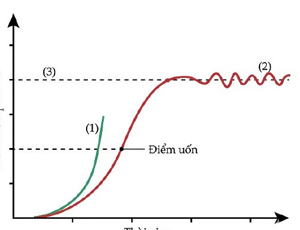
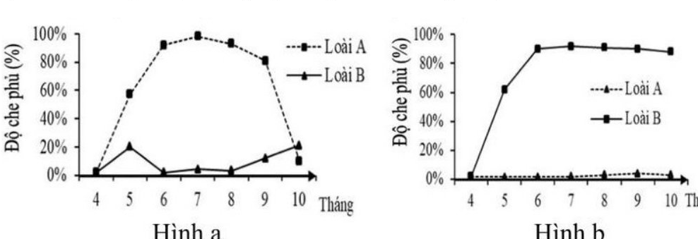
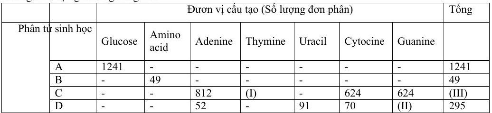
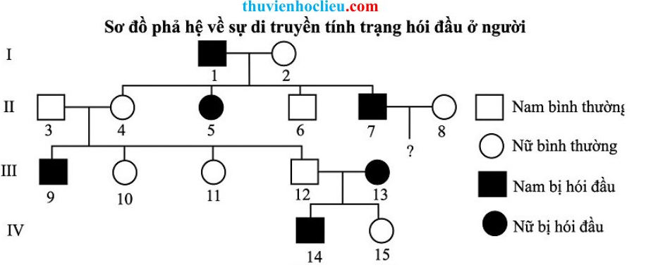

Transcribed by gpt-6-luna, 2026-11-02; second pass separate fresh context by gpt-6-luna; teacher verification no. Third-party copy; private internal evidence only.

## Historical verification issue (resolved by source-image review)
- Lượt hai chưa đạt

Route: docx -> LibreOffice PDF -> text + rendered images

Second-pass pages: [3, 4]; checked addresses: ['p1-01: Câu 1–7 wording and options', 'p1-01: Câu 3 nucleotide table and four statements', 'p1-01: Câu 4 temperature graph and options', 'p2-02: Câu 8–18 wording, table values, formulas and options', 'p2-02: Câu II.1 introduction and figure reference', 'p3-03: Câu II.1 graph and statements', 'p3-03: Câu II.2–3 wording, figures and statements', 'p4-04: Câu II.4 table cells and statements', 'p4-04: Phần III Câu 1 phylogeny diagram', 'p4-04: Phần III Câu 2 biomass pyramids', 'p5-05: Phần III Câu 3 graphs, statements and Câu 4–5 wording', 'p6-06: Phần III Câu 6 pedigree, wording and printed key']

{
  "notes": [
    "Tài liệu khai báo đề có 04 trang nhưng chuỗi câu hỏi hoàn chỉnh tiếp tục qua PDF trang 5–6 và kết thúc bằng HẾT ở trang 6; ghi nhận số trang đề theo chuỗi nội dung thực tế là 6.",
    "Phần đáp án tham khảo in trên PDF trang 6 khớp mã đề 0428; các trang lời giải phía sau không được chép vào đề.",
    "Nguồn PDF được cho biết có 17 trang, nhưng chỉ có ảnh PDF trang 1–8 đính kèm; phần văn bản trích xuất cung cấp phần tiếp theo, bao gồm hết đề, đáp án tham khảo và lời giải. Các trang sau đề là lời giải tham khảo, không phải trang đề bị thiếu."
  ],
  "second_pass": {
    "checked_addresses": [
      "p1-01: Câu 1–7 wording and options",
      "p1-01: Câu 3 nucleotide table and four statements",
      "p1-01: Câu 4 temperature graph and options",
      "p2-02: Câu 8–18 wording, table values, formulas and options",
      "p2-02: Câu II.1 introduction and figure reference",
      "p3-03: Câu II.1 graph and statements",
      "p3-03: Câu II.2–3 wording, figures and statements",
      "p4-04: Câu II.4 table cells and statements",
      "p4-04: Phần III Câu 1 phylogeny diagram",
      "p4-04: Phần III Câu 2 biomass pyramids",
      "p5-05: Phần III Câu 3 graphs, statements and Câu 4–5 wording",
      "p6-06: Phần III Câu 6 pedigree, wording and printed key"
    ],
    "disagreements": [
      {
        "location": "Phần III, Câu 2 figure reference",
        "before": "",
        "after": "",
        "reason": "The attached p4-04 shows the biomass pyramids; the transcript points to the other Câu 2 figure, which is the population growth graph on p3-03.",
        "settled_by_image": true
      },
      {
        "location": "Phần III, Câu 3 figure reference",
        "before": "",
        "after": "",
        "reason": "The attached p5-05 shows the cover-by-month graphs; the transcript points to the phylogeny image on p4-04.",
        "settled_by_image": true
      },
      {
        "location": "Phần III, Câu 6 figure reference",
        "before": "",
        "after": "",
        "reason": "The attached p6-06 shows the pedigree; the transcript points to the cover-by-month graphs on p5-05.",
        "settled_by_image": true
      }
    ],
    "missing_figures": [],
    "unreadable": [],
    "pass": false,
    "independent_key": {
      "part1": [
        "D",
        "D",
        "C",
        "C",
        "C",
        "B",
        "A",
        "B",
        "A",
        "A",
        "C",
        "A",
        "B",
        "C",
        "A",
        "C",
        "D",
        "B"
      ],
      "part2": [
        [
          "Đúng",
          "Sai",
          "Đúng",
          "Đúng"
        ],
        [
          "Sai",
          "Sai",
          "Sai",
          "Đúng"
        ],
        [
          "Sai",
          "Đúng",
          "Đúng",
          "Sai"
        ],
        [
          "Sai",
          "Sai",
          "Đúng",
          "Sai"
        ]
      ],
      "part3": [
        "1235",
        "132",
        "14",
        "40%",
        "42",
        "43,8%"
      ]
    }
  },
  "key_pages": [
    6
  ],
  "solutions_from_page": 6
}
