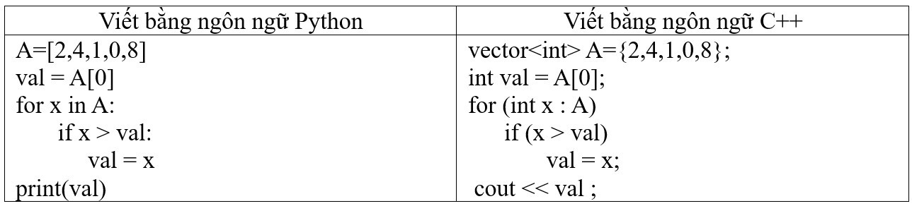
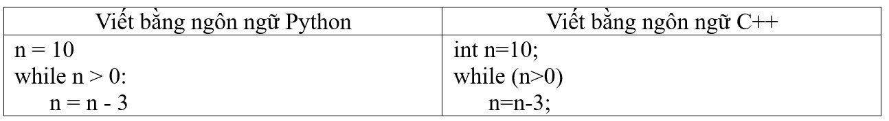
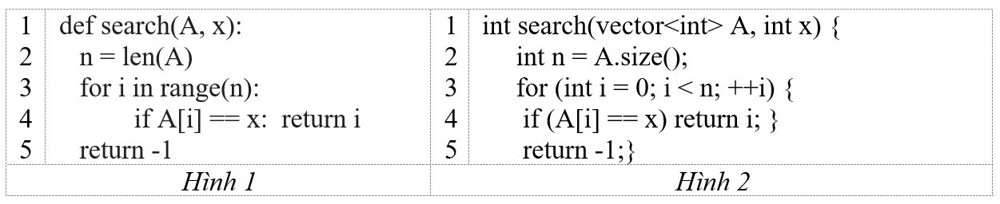

Đề: Sở GD&ĐT Cà Mau, Lần 1, mã đề 0801

SỞ GIÁO DỤC VÀ ĐÀO TẠO
CÀ MAU
ĐỀ THI CHÍNH THỨC
(Đề thi có 04 trang)

KỲ THI THỬ TỐT NGHIỆP THPT NĂM 2026
MÔN: TIN HỌC
Ngày thi: 24/4/2026
Thời gian làm bài: 50 phút, không kể thời gian giao đề

Họ, tên thí sinh: ..........................................................................
Số báo danh: ...............................................................................
Mã đề thi 0801

PHẦN I. Thí sinh trả lời từ câu 1 đến câu 24. Mỗi câu hỏi thí sinh chỉ chọn một phương án.

Câu 1: Việc lồng các thẻ HTML phải tuân theo nguyên tắc nào sau đây?
A. Chỉ được phép lồng tối đa hai cấp thẻ với nhau.
B. Thẻ mở trước thì phải đóng lại trước tiên.
C. Các thẻ không cần đóng nếu nằm trong thẻ 
.
D. Thẻ mở sau cùng thì phải đóng lại đầu tiên.

Câu 2: Thiết bị nào sau đây có chức năng chính là thu phát sóng để kết nối các thiết bị không dây vào mạng cục bộ?
A. Bộ định tuyến Router.
B. Bộ chuyển mạch Switch.
C. Bộ chia tín hiệu Hub.
D. Điểm truy cập Access Point.

Câu 3: Hoạt động nào sau đây thuộc nhóm các thao tác cập nhật dữ liệu thường xuyên trong một hệ cơ sở dữ liệu?
A. Sắp xếp danh sách theo tên.
B. Thêm bản ghi mới vào bảng.
C. Tìm kiếm thông tin khách hàng.
D. Lập các báo cáo định kì tháng.

Câu 4: Phương án nào dưới đây chỉ ra một ưu điểm nổi bật của giao tiếp trong không gian mạng so với giao tiếp trực tiếp?
A. Khả năng tương tác thông qua cử chỉ và ánh mắt.
B. Đảm bảo tuyệt đối quyền riêng tư và bảo mật.
C. Tối ưu hóa thời gian và giảm chi phí đi lại.
D. Không bao giờ xảy ra các sự cố về đường truyền.

Câu 5: Phương án nào sau đây là thuộc tính CSS được dùng để định dạng màu chữ cho văn bản?
A. foreground-color
B. text-background
C. font-color
D. color

Câu 6: Đặc trưng nhận thức của AI trong công nghệ xe tự lái thể hiện qua việc nào sau đây?
A. Sử dụng cảm biến để nhận biết môi trường xung quanh.
B. Xe tự động tắt máy khi gặp thời tiết quá khắc nghiệt.
C. Xe chỉ hoạt động khi nhận được lệnh từ người lái.
D. Xe di chuyển theo một lộ trình cố định trên bản đồ.

Câu 7: Quan sát đoạn mã: `
 <h3>Năng động</h3> 
`.
Để chữ "Năng động" có màu vàng, quy tắc CSS nào sau đây đúng?
A. h3 .slogan { color: yellow; }
B. div .slogan { color: yellow; }
C. #slogan { color: yellow; }
D. .slogan h3 { color: yellow; }

Câu 8: Học sinh sau khi tốt nghiệp THPT muốn theo đuổi nhóm nghề lắp ráp và bảo trì hệ thống máy tính nên lựa chọn ngành học nào dưới đây?
A. Quản trị mạng và truyền thông.
B. Khoa học máy tính chuyên sâu.
C. Công nghệ kỹ thuật máy tính.
D. Công nghệ kỹ thuật điện, điện tử.

Câu 9: Hệ chuyên gia y học đầu tiên có khả năng chẩn đoán các bệnh nhiễm trùng máu có tên gọi nào sau đây?
A. ChatGPT.
B. Sophia.
C. MYCIN.
D. ASIMO.

Câu 10: Phương án nào dưới đây trình bày đúng mục đích của việc kiểm tra tính chính xác của thông tin trước khi chia sẻ lên mạng xã hội?
A. Tránh làm tổn hại danh tiếng, quyền riêng tư.
B. Thay thế các hình thức giao tiếp trực tiếp.
C. Ngăn chặn sự lây lan của các mã độc tống tiền.
D. Giúp bài viết thu hút nhiều lượt tương tác.

Câu 11: Trong một ngôi nhà 3 tầng, nếu sóng Wi-Fi từ Router ở tầng 1 không thể phủ tới tầng 3, bạn nên áp dụng giải pháp nào sau đây?
A. Lắp thêm bộ truy cập Access Point.
B. Thay đổi mật khẩu của Wi-Fi.
C. Tắt bớt các thiết bị ở tầng 1.
D. Đăng ký gói cước Internet mới.

Câu 12: Giả sử A là một dãy số nguyên. Chọn một trong hai ngôn ngữ Python hoặc C++ để tìm hiểu một đoạn chương trình dưới đây thực hiện công việc gì?
[HÌNH: Đoạn mã nguồn Python và C++ tìm giá trị lớn nhất trong mảng A = [2, 4, 1, 0, 8]]

A. Tìm giá trị nhỏ nhất của dãy A.
B. Đếm số lượng phần tử của dãy A.
C. Tìm giá trị lớn nhất của dãy A.
D. Tính tổng tất cả các phần tử dãy A.

Câu 13: Phương án nào dưới đây giải thích tại sao kỹ năng giao tiếp lại quan trọng đối với một kỹ thuật viên bảo trì máy tính khi làm việc với khách hàng?
A. Để có thể làm việc độc lập mà không cần đồng nghiệp.
B. Để thuyết phục khách hàng mua thêm nhiều linh kiện mới.
C. Để từ chối trách nhiệm khi thiết bị gặp sự cố bất ngờ.
D. Để giải thích các vấn đề kỹ thuật một cách dễ hiểu nhất.

Câu 14: Loại cáp mạng nào sau đây có cấu tạo từ lõi thủy tinh, sử dụng nguyên lý phản xạ toàn phần để truyền dữ liệu và không bị nhiễu điện từ?
A. Cáp đồng trục truyền hình cáp.
B. Cáp sợi quang băng thông lớn.
C. Cáp đồng xoắn đôi chuẩn Cat5e.
D. Cáp đồng xoắn đôi chuẩn Cat6.

Câu 15: Phương án nào sau đây giải thích tại sao bộ chuyển mạch Switch thường được ưu tiên sử dụng thay thế cho Hub trong các mạng cục bộ hiện nay?
A. Hỗ trợ quy trình cấu hình mạng đơn giản.
B. Có mức chi phí đầu tư thiết bị thấp.
C. Tích hợp các tính năng quản trị từ xa.
D. Giúp giảm thiểu tối đa xung đột dữ liệu.

Câu 16: Chọn một trong hai ngôn ngữ Python hoặc C++ để tìm hiểu một đoạn chương trình dưới đây:
[HÌNH: Đoạn mã nguồn Python và C++ vòng lặp while với biến n khởi tạo bằng 10, giảm 3 mỗi bước]

Phương án nào sau đây là giá trị của biến n sau khi thực hiện đoạn chương trình trên?
A. -1
B. -2
C. 0
D. 1

Câu 17: Bạn muốn tạo một danh sách các môn học gồm Toán, Lí, Hóa có đánh số thứ tự, đoạn mã nào sau đây là chính xác?
A. <ol><li>Toán</li><li>Lí</li><li>Hóa</li></ol>
B. <ul><li>Toán</li><li>Lí</li><li>Hóa</li></ul>
C. <li><ol>Toán</ol><ol>Lí</ol><ol>Hóa</ol></li>
D. <ol>
Toán

Lí

Hóa
</ol>

Câu 18: Phương án nào sau đây là ký hiệu đúng để thiết lập bộ chọn CSS cho một phần tử có mã định danh (id) là home?
A. #home
B. id(home)
C. .home
D. ^home

Câu 19: Hệ thống trí tuệ nhân tạo chỉ thực hiện được một nhiệm vụ cụ thể được gọi bằng thuật ngữ nào sau đây?
A. Trí tuệ nhân tạo siêu việt.
B. Trí tuệ nhân tạo hẹp.
C. Trí tuệ nhân tạo tổng quát.
D. Trí tuệ nhân tạo mạnh.

Câu 20: Để làm nghề bảo trì máy tính, người lao động cần được trang bị nhóm kiến thức nền tảng nào sau đây?
A. Quản trị kinh doanh và phân tích thị trường.
B. Thiết kế đồ họa và kỹ thuật in ấn quảng cáo.
C. Phần cứng, phần mềm và hệ thống mạng.
D. Kỹ thuật điện dân dụng và lắp đặt điện lưới.

Câu 21: Đoạn mã HTML nào sau đây thực hiện đúng việc chèn một hình ảnh có tên "logo.jpg" và mô tả là "Logo trường"?
A. 
B. <image src="logo.jpg" alt="Logo trường">
C. 
D. 

Câu 22: Khả năng học của một hệ thống AI được hiểu chính xác theo nội dung nào sau đây?
A. Ghi nhớ toàn bộ dữ liệu đầu vào một cách thụ động.
B. Tự rút ra tri thức từ dữ liệu để cải thiện hành vi.
C. Sao chép các chương trình phần mềm của con người.
D. Tự động nâng cấp phần cứng khi dữ liệu quá lớn.

Câu 23: Tại sao chúng ta nên sử dụng tệp CSS riêng biệt thay vì viết định dạng trực tiếp vào từng thẻ HTML?
A. Để dễ quản lí và tái sử dụng các định dạng.
B. Để trang web tự động thay đổi ngôn ngữ hiển thị.
C. Để trang web có thể hoạt động không cần mạng.
D. Để trình duyệt bảo mật mã nguồn HTML tốt hơn.

Câu 24: Ý nghĩa của việc khai báo lớp bằng thuộc tính class trong HTML là nội dung nào sau đây?
A. Để phân loại độ tuổi người dùng xem trang.
B. Để áp dụng cùng một định dạng cho nhiều thẻ.
C. Để định danh một phần tử duy nhất trên trang.
D. Để liên kết trang web với các mạng xã hội.

PHẦN II. Thí sinh trả lời 4 câu hỏi. Trong mỗi ý a), b), c), d) ở mỗi câu, thí sinh chọn đúng hoặc sai.

A. Phần chung dành cho tất cả thí sinh

Câu 1: Một trường học trang bị phòng máy tính gồm 20 máy tính để bàn và một khu vực sảnh chờ có phủ sóng Wi-Fi cho thiết bị di động. Tất cả các thiết bị đều kết nối chung vào một Modem trung tâm để truy cập Internet. Dựa trên kiến thức về mạng máy tính, một số bạn học sinh đưa ra các ý kiến sau:
a) Access Point dùng để tạo điểm truy cập không dây cho thiết bị di động ở sảnh chờ.
b) Switch dùng để kết nối các máy tính để bàn thành một mạng LAN.
c) Mọi máy tính trong phòng máy muốn truy cập Internet đều phải được cấu hình địa chỉ IP và cùng dải mạng với cổng ngầm định của Modem.
d) Trong bộ giao thức TCP/IP, giao thức IP chịu trách nhiệm kiểm tra lỗi dữ liệu và đảm bảo các gói tin đến đích theo đúng thứ tự.

Câu 2: Một cơ sở dữ liệu quan hệ quản lý việc mượn trả sách trong thư viện trường học được xây dựng với 2 bảng có cấu trúc như sau:
- SACH (MaSach, TenSach, TacGia, NamXB) lưu thông tin: mã sách, tên sách, tên tác giả và năm xuất bản.
- MUONTRA (MaMT, MaSach, MaHS, NgayMuon, NgayTra): lưu thông tin: mã mượn trả, mã sách, mã học sinh, ngày mượn và ngày trả.
Khi tìm hiểu cơ sở dữ liệu trên, một số bạn học sinh đưa ra các nhận xét sau:
a) Trường MaSach trong bảng MUONTRA là khóa ngoài liên kết với bảng SACH.
b) Câu lệnh SELECT TenSach FROM SACH WHERE TacGia = 'Nam Cao'; sẽ trả về kết quả bao gồm cả tên sách và tên tác giả của tất cả các cuốn sách do Nam Cao sáng tác.
c) Trường NamXB là một thành phần thuộc khóa chính của bảng SACH.
d) Việc thiết kế thêm một trường tên Sngaymuon để lưu thông tin số ngày mượn trực tiếp vào bảng MUONTRA sẽ gây ra tình trạng dư thừa thông tin trong cơ sở dữ liệu.

B. Phần riêng

Thí sinh chỉ được phép chọn một trong hai phần: Khoa học máy tính (Câu 3 và Câu 4) hoặc Tin học ứng dụng (Câu 5 và Câu 6). Thí sinh không được tính điểm nếu làm cả hai phần.

B1. Định hướng khoa học máy tính

Câu 3: Nhóm học sinh đang tìm hiểu về các thuật toán cơ bản trên dãy số. Cô giáo cung cấp đoạn mã Python (Hình 1) và C++ (Hình 2) thực hiện tìm kiếm vị trí của giá trị x trong dãy A gồm n phần tử và yêu cầu nhóm phân tích.
[HÌNH: Đoạn mã nguồn Python và C++ hàm tìm kiếm tuần tự search(A, x) có đánh số dòng từ 1 đến 5]

Sau khi nghiên cứu, các bạn học sinh đưa ra các nhận xét sau:
a) Ở vòng lặp tại dòng 3, biến chỉ số i sẽ nhận giá trị lần lượt chạy từ 0 đến $n$.
b) Thuật toán được mô tả trong đoạn mã trên là thuật toán tìm kiếm tuần tự.
c) Với đầu vào dãy kết quả là 2 . $A = [5, 3, 8, 2]$ và $x = 8$, hàm sẽ thực hiện so sánh tại dòng 4 đúng ba lần và trả về
d) Trong trường hợp giá trị $x$ xuất hiện nhiều lần trong dãy $A$, hàm sẽ luôn trả về chỉ số của vị trí cuối cùng tìm thấy $x$.

Câu 4: Học máy ngày càng đóng vai trò quan trọng trong việc giải quyết các bài toán thực tế phức tạp. Khi tìm hiểu về phân loại và ứng dụng của Học máy, các bạn học sinh đã đưa ra các phát biểu sau:
a) Một hệ thống phân tích các giao dịch thẻ tín dụng dựa trên dữ liệu không gán nhãn để phát hiện các hành vi gian lận (bất thường) là ví dụ điển hình của phương pháp học có giám sát.
b) Nhờ khả năng tự học từ dữ liệu mới, Học máy có vai trò không thể thiếu trong các ứng dụng mà dữ liệu liên tục thay đổi theo thời gian như mẫu thư rác mới hay triệu chứng bệnh mới.
c) Học máy chỉ được ứng dụng để lọc thư rác đơn giản, không đủ khả năng hỗ trợ các công việc phức tạp như chẩn đoán y khoa hay dịch thuật ngôn ngữ.
d) Học có giám sát là phương pháp sử dụng tập dữ liệu đầu vào đã được gán nhãn để máy tính mô hình hóa mối quan hệ giữa dữ liệu đầu vào và đầu ra.

B2. Định hướng tin học ứng dụng

Câu 5: Một trường học xây dựng cơ sở dữ liệu để quản lý kết quả học tập của học sinh gồm hai bảng có cấu trúc như sau:
- HOCSINH (MaHS, HoTen, NgaySinh, GioiTinh) lưu thông tin: mã học sinh, họ tên học sinh, ngày sinh, giới tính học sinh.
- KETQUA (MaKQ, MaHS, MonHoc, DiemThi) lưu thông tin: mã kết quả, mã học sinh, môn học và điểm thi của học sinh.
Một nhóm học sinh thảo luận về việc sử dụng và khai thác dữ liệu, dưới đây là các ý kiến được đưa ra:
a) Để lập một báo cáo hiển thị "Điểm thi môn Tin học" kèm theo "Ngày sinh" của từng học sinh tương ứng, chúng ta chỉ cần thực hiện truy vấn dữ liệu trên bảng KETQUA là đủ.
b) Lệnh SELECT HoTen FROM HOCSINH; dùng để trích xuất danh sách họ tên học sinh.
c) Từ khóa ORDER BY dùng để thiết lập các điều kiện lọc bản ghi trong SQL.
d) Để liệt kê danh sách các học sinh có điểm thi môn 'Tin học' đạt từ 9.0 trở lên, câu lệnh hợp lệ là:
SELECT * FROM KETQUA WHERE MonHoc = 'Tin học' AND DiemThi >= 9.0;.

Câu 6: Một nhóm học sinh thực hiện dự án xây dựng website "Việt Nam – Vẻ đẹp tiềm ẩn" bằng công cụ Google Sites để giới thiệu danh lam thắng cảnh các vùng miền. Trong quá trình thiết kế và hoàn thiện, các thành viên có đưa ra các nhận xét sau:
a) Khi muốn chèn bản đồ chỉ đường tương tác đến một địa danh du lịch, cách làm tốt nhất là chụp ảnh màn hình bản đồ đó rồi sử dụng chức năng Hình ảnh (Images) trong bảng chọn Chèn để đưa vào trang web.
b) Google Sites là ứng dụng miễn phí tự động lưu thay đổi vào Google Drive.
c) Phần chân trang (footer) thường dùng để hiển thị logo và thanh điều hướng.
d) Việc tổ chức các trang web theo cấu trúc hình cây (trang chủ và các trang con) là giải pháp hữu hiệu để trình bày đầy đủ nội dung chi tiết mà không làm ảnh hưởng đến sự cân đối và mạch lạc của trang chủ.

------ HẾT ------

- Thí sinh không được sử dụng tài liệu.
- Giám thị không giải thích gì thêm.
