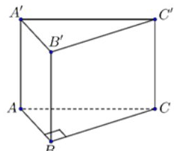
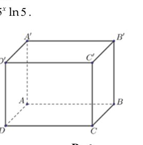
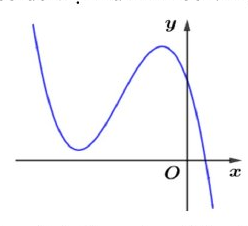
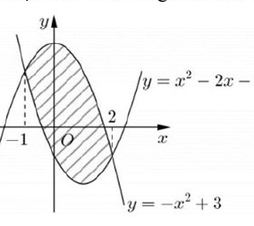
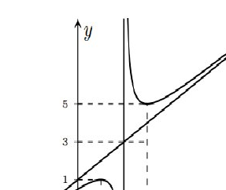
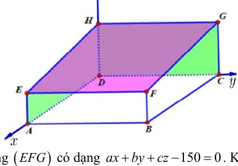

status: ocr-draft
Nguồn: Đề khảo sát chất lượng học sinh lớp 12, lần 1 năm học 2025–2026, Sở GD&ĐT Thanh Hóa; mã đề 1101; PDF trang 1–4.

# ĐỀ CHÍNH THỨC — Mã đề 1101

**MÔN KHẢO SÁT: TOÁN**  
Thời gian làm bài: 90 phút (không kể thời gian phát đề)  
(Đề có 04 trang)

## PHẦN I

Thí sinh trả lời từ câu 1 đến câu 12. Mỗi câu hỏi thí sinh chỉ chọn một phương án.

### Câu 1

Thời gian truy cập Internet trong một buổi tối của một nhóm học sinh được cho trong bảng sau:

| Thời gian (phút) | [9,5; 12,5) | [12,5; 15,5) | [15,5; 18,5) | [18,5; 21,5) | [21,5; 24,5) |
|---|---:|---:|---:|---:|---:|
| Số học sinh | 3 | 12 | 15 | 24 | 2 |

Tính trung vị của mẫu số liệu ghép nhóm này.

A. 18,1.  
B. 18,5.  
C. 15,6.  
D. 17,2.

### Câu 2

Cho khối chóp tam giác $S.ABC$ có chiều cao bằng 3, đáy là tam giác $ABC$ có diện tích bằng 10. Thể tích khối chóp $S.ABC$ bằng

A. 2.  
B. 30.  
C. 15.  
D. 10.

### Câu 3

Cho lăng trụ đứng $ABC.A'B'C'$. Đáy là tam giác $ABC$ vuông cân tại $B$ (hình minh họa bên). Khi đó góc giữa vectơ $\overrightarrow{AB}$ và vectơ $\overrightarrow{A'C'}$ bằng bao nhiêu?

A. $45^\circ$.  
B. $60^\circ$.  
C. $135^\circ$.  
D. $90^\circ$.

[HÌNH: Lăng trụ đứng tam giác $ABC.A'B'C'$, đáy $ABC$ vuông cân tại $B$, có các cạnh bên thẳng đứng và ký hiệu góc vuông tại $B$.]

### Câu 4

Tập nghiệm của phương trình $\log_3(2x-1)=\log_3(x-1)$ là

A. $S=\{0\}$.  
B. $S=\{-2\}$.  
C. $S=\{2\}$.  
D. $S=\varnothing$.

### Câu 5

Cho cấp số nhân $(u_n)$ với $u_1=2$ và công bội $q=3$. Số hạng thứ 4 của cấp số nhân bằng

A. 48.  
B. 162.  
C. 54.  
D. 24.

### Câu 6

Cho $\int 5^x\,dx=F(x)+C$. Khẳng định nào dưới đây đúng?

A. $F'(x)=5^x$.  
B. $F'(x)=\dfrac{5^x}{\ln 5}$.  
C. $F'(x)=5^x+C$.  
D. $F'(x)=5^x\ln 5$.

### Câu 7

Cho hình hộp $ABCD.A'B'C'D'$. Xét các mệnh đề sau:

 i) $AB\parallel CD$;  
 ii) $BB'\parallel (CC'D'D)$;  
 iii) $(A'B'C')\parallel (ABD)$.

Số mệnh đề đúng trong các mệnh đề trên là

A. 2.  
B. 3.  
C. 1.  
D. 0.

[HÌNH: Hình hộp $ABCD.A'B'C'D'$ với các đỉnh được ghi nhãn.]

### Câu 8

Trong không gian $Oxyz$, cho hai điểm $A(0;1;1)$ và $B(1;2;3)$. Phương trình mặt phẳng $(P)$ đi qua điểm $A$ và có vectơ pháp tuyến $\overrightarrow{AB}$ là

A. $(P):x+y+2z-3=0$.  
B. $(P):x+y+2z-9=0$.  
C. $(P):x+3y+4z-26=0$.  
D. $(P):x+3y+4z-7=0$.

### Câu 9

Trong không gian $Oxyz$, cho điểm $A(2;-3;5)$. Gọi điểm $H$ là hình chiếu vuông góc của điểm $A$ trên mặt phẳng $(Oxy)$. Tọa độ của điểm $H$ là

A. $H(0;0;5)$.  
B. $H(2;-3;0)$.  
C. $H(0;-3;5)$.  
D. $H(2;0;5)$.

### Câu 10

Họ nghiệm của phương trình $\cos x=1$ là

A. $x=\dfrac{\pi}{2}+k2\pi,\ k\in\mathbb{Z}$.  
B. $x=k\pi,\ k\in\mathbb{Z}$.  
C. $x=k2\pi,\ k\in\mathbb{Z}$.  
D. $x=\dfrac{k\pi}{2},\ k\in\mathbb{Z}$.

### Câu 11

Cho hàm số bậc ba $y=ax^3+bx^2+cx+d$ $(a,b,c,d\in\mathbb{R})$ có đồ thị như hình bên. Mệnh đề nào dưới đây đúng?

A. $a<0,d>0$.  
B. $a>0,d>0$.  
C. $a>0,d<0$.  
D. $a<0,d<0$.

[HÌNH: Đồ thị hàm bậc ba có nhánh trái hướng lên, nhánh phải hướng xuống, cực tiểu phía trên trục hoành và giao trục tung phía trên trục hoành; có trục tọa độ $Ox,Oy$.]

### Câu 12

Diện tích phần hình phẳng gạch chéo trong hình vẽ bên được tính theo công thức nào dưới đây?

A. $\displaystyle\int_{-1}^{2}(-2x^2+2x+4)\,dx$.  
B. $\displaystyle\int_{-1}^{2}(-2x+2)\,dx$.  
C. $\displaystyle\int_{-1}^{2}(2x-2)\,dx$.  
D. $\displaystyle\int_{-1}^{2}(2x^2-2x-4)\,dx$.

[HÌNH: Miền gạch chéo kẹp giữa hai parabol $y=x^2-2x-1$ và $y=-x^2+3$, giao nhau tại $x=-1$ và $x=2$.]

## PHẦN II

Thí sinh trả lời từ câu 1 đến câu 4. Trong mỗi ý a), b), c), d) ở mỗi câu, thí sinh chọn đúng hoặc sai.

### Câu 1

Cho hàm số $y=\dfrac{mx^2+nx-1}{px-2}$ có đồ thị như hình vẽ bên.

a) Đường tiệm cận đứng của đồ thị là đường thẳng $x=2$.  
b) Tâm đối xứng của đồ thị là điểm $I(3;2)$.  
c) Ta có $m+2n-3p=-4$.  
d) Hàm số nghịch biến trên khoảng $(1;3)$.

[HÌNH: Đồ thị hàm phân thức có tiệm cận đứng, tiệm cận xiên; các điểm cực trị được đánh dấu theo nét đứt tại các mức tọa độ 1, 3 và 5.]

### Câu 2

Khối lượng của một cá thể sinh vật $X$ theo thời gian $t$ tuần $(t\ge 0)$ cho bởi công thức

$$f(t)=0,1+t^2e^{-kt}\quad (k\in\mathbb{R},\text{ đơn vị tính bằng microgram}).$$

Biết rằng sinh vật $X$ chỉ sống được đúng 6 tuần và khối lượng của nó lớn nhất tại thời điểm $t=4$, đúng lúc nó sinh sản.

a) $k=\dfrac12$.  
b) $f'(4)=0$.  
c) $f'(t)=2te^{-kt}$.  
d) Biết rằng mỗi lần sinh sản, mỗi cá thể $X$ sinh ra 10 cá thể con. Nếu ban đầu $(t=0)$, người ta nuôi một cá thể $X$ vừa mới sinh thì số lượng cá thể $X$ tại thời điểm $t=17$ là 11 000.

### Câu 3

Trong một bài kiểm tra trắc nghiệm có 50 câu hỏi, mỗi câu có bốn phương án trả lời A, B, C, D trong đó chỉ có một phương án trả lời đúng. Mỗi câu trả lời đúng được cộng 0,2 điểm và mỗi câu trả lời sai bị trừ 0,1 điểm. Trong 50 câu trên, bạn Nam đã làm được và chắc đúng 35 câu, 15 câu còn lại bạn không biết làm nên ở mỗi câu bạn chọn ngẫu nhiên một đáp án.

a) Nếu trong 15 câu còn lại bạn Nam tô ngẫu nhiên và đúng thêm 3 câu nữa, khi đó bài của bạn Nam được 6,4 điểm.  
b) Ở mỗi câu còn lại, xác suất để bạn Nam làm đúng là $\dfrac14$.  
c) Bạn Nam làm được 7,0 điểm, khi đó bạn Nam làm đúng 35 câu và sai 15 câu.  
d) Xác suất để bạn Nam đạt được 7,0 điểm là 0,165 (kết quả làm tròn đến hàng phần nghìn).

### Câu 4

Sau nhà ông Sơn có mảnh đất hình chữ nhật $ABCD$ có chiều rộng $AB=5$ (mét) và chiều dài $AD=6$ (mét). Ông Sơn dự định dùng mảnh đất này để trồng rau sạch nên thiết kế mái che phẳng và dốc về góc đỉnh $F$. Mái lợp $EFGH$ đặt trên bốn trụ $AE$, $BF$, $CG$ và $DH$ đều vuông góc với mặt phẳng $(ABCD)$ trong đó $DH=5$ (mét), $CG=4$ (mét) và $AE=3$ (mét). Chọn hệ trục tọa độ $Oxyz$ có đơn vị trên mỗi trục là mét (m) như hình vẽ.

a) Phương trình mặt phẳng $(EFG)$ có dạng $ax+by+cz-150=0$. Khi đó $a+b+c=23$.  
b) Điểm $A(6;0;0)$.  
c) Giá một $m^2$ lưới chống nắng là 12 000 đồng. Khi đó, số tiền ông Sơn mua lưới lợp mái $EFGH$ là 386 nghìn đồng (kết quả làm tròn đến hàng nghìn đồng).  
d) Ông Sơn cần lắp đặt dây từ điểm $I$ nằm trên cạnh $AB$ và cách $B$ một mét, đến điểm $M$ nằm trên cạnh $BC$, đến điểm $N$ nằm trên cạnh $CG$, đến điểm $P$ nằm trên cạnh $DH$ và đến điểm $E$. Biết dây luôn áp sát vào các mặt, độ dài ngắn nhất của dây là $\sqrt{305}$ (m).

[HÌNH: Mảnh đất hình chữ nhật $ABCD$ với các trụ thẳng đứng $AE,BF,CG,DH$ và mái phẳng $EFGH$; hệ trục $Oxyz$ được chỉ trên hình.]

## PHẦN III

Thí sinh trả lời từ câu 1 đến câu 6.

### Câu 1

Một vật bắt đầu chuyển động thẳng đều với vận tốc $v_0=a$ (m/s) với $a>0$. Sau 6 giây chuyển động thì gặp chướng ngại vật nên bắt đầu giảm tốc độ với vận tốc chuyển động

$$v(t)=-\frac52t+b\ (\text{m/s}),\quad (t\ge 6)$$

cho đến khi dừng hẳn. Biết rằng, kể từ lúc chuyển động đến lúc dừng thì vật đi được quãng đường là 80 (m). Giá trị của $a^2-b^2$ bằng bao nhiêu?

### Câu 2

Lấy ngẫu nhiên một số tự nhiên có 5 chữ số. Xác suất để chọn được số tự nhiên có dạng $\overline{a_1a_2a_3a_4a_5}$ trong đó $a_1\le a_2+1\le a_3-7<a_4\le a_5+2$ bằng $a$. Giá trị của $\dfrac1a$ bằng bao nhiêu (làm tròn đến hàng đơn vị)?

### Câu 3

Cho hình chóp $S.ABC$ có đáy là tam giác đều cạnh bằng 6. Hình chiếu vuông góc của đỉnh $S$ trên mặt phẳng $(ABC)$ là điểm $H$ thuộc cạnh $AB$ sao cho $HA=2HB$. Góc giữa đường thẳng $SC$ và mặt phẳng $(ABC)$ bằng $60^\circ$. Tính khoảng cách giữa hai đường thẳng $SA$ và $BC$ (làm tròn đến hàng phần trăm).

### Câu 4

Một cái chậu đựng nước có dạng hình chóp cụt đều, đáy chậu là tam giác đều cạnh bằng 2 dm, miệng chậu là tam giác đều cạnh bằng 5 dm và chiều cao chậu nước bằng 3 dm. Người ta bơm nước vào chậu với lưu lượng không đổi $\dfrac{\sqrt3}{3}$ lít/phút. Tại thời điểm 14 phút sau khi bơm tốc độ dâng lên của nước trong chậu là $\dfrac1a$ dm/phút, giá trị của $a$ bằng bao nhiêu?

### Câu 5

Nếu một doanh nghiệp sản xuất $x$ sản phẩm trong một tháng $(x\in\mathbb{N};\ 1\le x\le 300)$ thì doanh thu nhận được khi bán hết số sản phẩm là

$$F(x)=x^3-1999x^2+1001000x+250000\quad(\text{đồng}).$$

Trong đó, chi phí vận hành máy móc bình quân cho mỗi sản phẩm khi sản xuất $x$ sản phẩm là

$$G(x)=300+\frac{100}{x}\quad(\text{nghìn đồng}),$$

chi phí mua nguyên vật liệu để sản xuất $x$ sản phẩm là

$$H(x)=2x^3+100000x-50000\quad(\text{đồng}).$$

Doanh nghiệp cần sản xuất bao nhiêu sản phẩm để lợi nhuận thu được là lớn nhất?

### Câu 6

Trong không gian $Oxyz$, cho ba điểm $A(-1;-4;4)$, $B(-1;-2;4)$ và $C(0;-4;4)$. Mặt phẳng $(P)$ có dạng $ax+2025y+cz+d=0$ đi qua điểm $A$ sao cho hai điểm $B,C$ nằm về cùng một phía. Đặt $h_1=d(B,(P))$ là khoảng cách từ điểm $B$ đến mặt phẳng $(P)$ và $h_2=d(C,(P))$ là khoảng cách từ điểm $C$ đến mặt phẳng $(P)$. Khi biểu thức $2025h_1+2026h_2$ đạt giá trị lớn nhất, giá trị của biểu thức $T=-9a+10c+d$ bằng bao nhiêu?

-------------------- HẾT --------------------