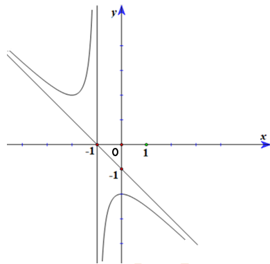
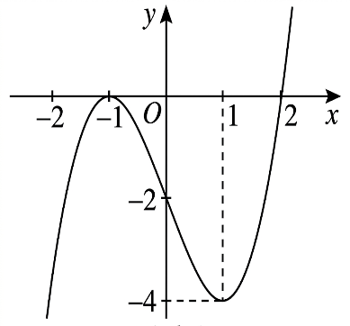
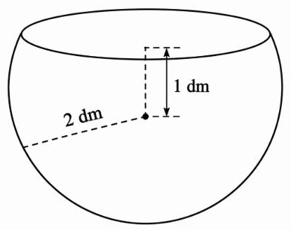

Đề: Sở GD&ĐT Ninh Bình, Lần 4, mã đề 0101

PHẦN I. Thí sinh trả lời từ câu 1 đến câu 12. Mỗi câu hỏi thí sinh chỉ chọn một phương án.

Câu 1. Có bao nhiêu cách chọn 2 học sinh từ một tổ gồm 8 học sinh nam và 10 học sinh nữ để một học sinh làm tổ trưởng và một học sinh làm tổ phó?
A. $C_8^1 \cdot C_{10}^1$.
B. $18!$.
C. $C_{18}^2$.
D. $A_{18}^2$.

Câu 2. Cho hàm số $y = \frac{ax^2 + bx + c}{mx + n}$ (với $a \ne 0; m \ne 0$) có đồ thị như hình vẽ dưới đây.
[HÌNH: Đồ thị hàm phân thức với hai nhánh, tiệm cận đứng $x = -1$, tiệm cận xiên đi qua $(-1; 0)$ và $(0; -1)$, cắt trục hoành tại các điểm đánh dấu $-1, 0, 1$, trục tung có điểm $-1$.]

Phương trình đường tiệm cận xiên của đồ thị hàm số đã cho là
A. $y = x + 1$.
B. $y = -x - 1$.
C. $x = -1$.
D. $y = x - 1$.

Câu 3. Trong không gian với hệ trục tọa độ $Oxyz$, cho hình hộp $ABCD.A'B'C'D'$ có $A(1; 2; -1)$, $B(3; 1; -2)$, $C(4; -2; 1)$ và $D'(2; 1; 5)$. Tọa độ của điểm $A'$ là
A. $(1; 0; -4)$.
B. $(1; 4; 2)$.
C. $(-3; 6; 4)$.
D. $(4; 0; 4)$.

Câu 4. Cho cấp số nhân $(u_n)$ với $u_1 = 8$ và $u_2 = 2$. Công bội của cấp số nhân đã cho là
A. $q = 4$.
B. $q = \frac{1}{4}$.
C. $q = 2$.
D. $q = \frac{1}{2}$.

Câu 5. Trong không gian với hệ trục tọa độ $Oxyz$, tâm của mặt cầu $(S): x^2 + y^2 + z^2 - 2x + 4y + 2z - 3 = 0$ có tọa độ là
A. $(-2; 4; 2)$.
B. $(1; -2; -1)$.
C. $(-1; 2; 1)$.
D. $(2; -4; -2)$.

Câu 6. Biết $\int_{-1}^3 f(x)\,\mathrm{d}x = -2$ và $\int_{-1}^3 g(x)\,\mathrm{d}x = 1$. Khi đó $\int_{-1}^3 [f(x) - g(x)]\,\mathrm{d}x$ bằng
A. $3$.
B. $-1$.
C. $1$.
D. $-3$.

Câu 7. Trong không gian với hệ trục tọa độ $Oxyz$, phương trình của mặt phẳng đi qua $M(1; 3; -2)$ và có một vectơ pháp tuyến $\vec{n} = (2; -1; 3)$ là
A. $2(x + 1) - (y + 3) + 3(z - 2) = 0$.
B. $2(x - 1) - (y - 3) + 3(z + 2) = 0$.
C. $(x + 2) + 3(y - 1) - 2(z + 3) = 0$.
D. $(x - 2) + 3(y + 1) - 2(z - 3) = 0$.

Câu 8. Họ tất cả các nguyên hàm của hàm số $y = \sin x$ là
A. $\cos x + C$.
B. $-\sin x + C$.
C. $\sin x + C$.
D. $-\cos x + C$.

Câu 9. Tập nghiệm của bất phương trình $\log_{0,5} x > \log_{0,5} 9$ là
A. $(-\infty; 9)$.
B. $(0; 9)$.
C. $(0; +\infty)$.
D. $(9; +\infty)$.

Câu 10. Một bác tài xế thống kê độ dài quãng đường (đơn vị: km) bác đã lái xe mỗi ngày trong một tháng (30 ngày) ở bảng số liệu ghép nhóm sau:

| Độ dài quãng đường (km) | [50; 100) | [100; 150) | [150; 200) | [200; 250) | [250; 300) |
| :--- | :---: | :---: | :---: | :---: | :---: |
| Số ngày | 5 | 10 | 9 | 4 | 2 |

Độ lệch chuẩn của mẫu số liệu ghép nhóm trên (kết quả làm tròn đến hàng phần trăm) bằng
A. $3206{,}90$.
B. $56{,}63$.
C. $55{,}68$.
D. $55{,}67$.

Câu 11. Cho hàm số $y = f(x)$ có đồ thị như hình vẽ dưới đây. Điểm cực tiểu của hàm số đã cho là
[HÌNH: Đồ thị hàm số bậc ba với điểm cực đại $(-1; 0)$, điểm cực tiểu $(1; -4)$, cắt trục tung tại $(0; -2)$, cắt trục hoành tại $-1$ và $2$, các mốc tọa độ trên trục $x$ gồm $-2, -1, 0, 1, 2$ và trên trục $y$ gồm $0, -2, -4$.]

A. $1$.
B. $2$.
C. $-1$.
D. $-4$.

Câu 12. Nếu khối lăng trụ $ABC.A'B'C'$ có thể tích bằng 60 thì khối chóp $A'.ABC$ có thể tích bằng
A. $60$.
B. $40$.
C. $180$.
D. $20$.

PHẦN II. Thí sinh trả lời từ câu 1 đến câu 4. Trong mỗi ý a), b), c), d) ở mỗi câu, thí sinh chọn đúng hoặc sai.

Câu 1. Cho hàm số $f(x) = \frac{2x + 3}{x - 1}$ có đồ thị là đường cong $(C)$.
a) Có 2 tiếp tuyến của $(C)$ song song với đường thẳng $d: y = -5x - 3$.
b) Đồ thị hàm số $y = f(x)$ có tiệm cận đứng là $x = 2$ và tiệm cận ngang là $y = 1$.
c) Hàm số $y = f(x)$ nghịch biến trên $\mathbb{R} \setminus \{1\}$.
d) $f'(x) = \frac{-5}{(x - 1)^2},\, \forall x \ne 1$.

Câu 2. Sói đồng cỏ Bắc Mỹ (coyote) là một loài động vật hoang dã phân bố chủ yếu ở Bắc Mỹ. Tại bang Oklahoma, Hoa Kỳ, 70% số coyote bị mắc một căn bệnh gọi là Ehrlichiosis. Người ta thực hiện xét nghiệm giúp phát hiện căn bệnh này. Kết quả xét nghiệm có thể là dương tính hoặc âm tính. Biết rằng nếu coyote bị bệnh, xác suất để xét nghiệm cho kết quả dương tính là 97%; nếu coyote không bị bệnh, xác suất để xét nghiệm cho kết quả âm tính là 95%. Các bác sĩ thú y bắt ngẫu nhiên 1 con coyote ở Oklahoma và tiến hành xét nghiệm cho nó.
a) Xác suất để con coyote bị bắt không bị bệnh và có kết quả xét nghiệm dương tính là $0{,}05$.
b) Xác suất để con coyote bị bắt có kết quả xét nghiệm âm tính là $30{,}6\%$.
c) Giá trị dự đoán âm của xét nghiệm được định nghĩa là xác suất con coyote thực sự không bị bệnh biết rằng kết quả xét nghiệm của nó là âm tính. Giá trị dự đoán âm của xét nghiệm này lớn hơn $95\%$.
d) Các bác sĩ thú y bắt ngẫu nhiên 3 con coyote ở Oklahoma. Xác suất để có đúng 2 con có kết quả xét nghiệm dương tính bằng $44{,}2\%$ (kết quả đã được làm tròn đến hàng phần chục).

Câu 3. Trong một dự án khảo sát địa chất thăm dò tài nguyên, các nhà khoa học phát hiện một túi khí tự nhiên trong lòng đất được xác định có dạng khối cầu $(S)$, một lớp đá móng ngăn cách các địa tầng là mặt phẳng $(P)$. Với hệ trục tọa độ $Oxyz$ phù hợp (mặt đất nằm trên mặt phẳng $Oxy$, chiều dương trục $Oz$ hướng lên trên), đơn vị trên mỗi trục là $10\text{ m}$, mặt cầu $(S)$ có phương trình $(x - 1)^2 + (y - 2)^2 + (z + 11)^2 = 25$, lớp đá móng $(P)$ được coi là một mặt phẳng có phương trình $2x - y + 2z + 22 = 0$. Để thực hiện việc thăm dò, các nhà khoa học đặt mũi khoan được định hướng bắt đầu từ vị trí $A(-3; 8; 0)$ và tiến tới liên tục theo phương của vectơ $\vec{u} = (4; -3; -7)$.
a) Để tránh nguy cơ làm nứt gãy lớp đá móng $(P)$ dẫn đến rò rỉ khí áp suất cao, tiêu chuẩn kỹ thuật yêu cầu: Trong suốt thời gian mũi khoan di chuyển bên trong túi khí $(S)$, khoảng cách từ mũi khoan đến lớp đá móng $(P)$ không được nhỏ hơn $5\text{ m}$. Quá trình khoan theo phương án này đã đáp ứng được tiêu chuẩn kỹ thuật đó.
b) Theo quỹ đạo chuyển động, mũi khoan sẽ đi xuyên qua túi khí $(S)$ tạo thành một đoạn đường ống có độ dài là $100\text{ m}$ ngay trong lòng túi khí.
c) Túi khí $(S)$ bị lớp đá móng $(P)$ chia thành hai phần có thể tích bằng nhau.
d) Quỹ đạo của mũi khoan được mô tả bởi một phần đường thẳng $d$ có phương trình chính tắc là $\frac{x - 3}{4} = \frac{y + 8}{-3} = \frac{z}{-7}$.

Câu 4. Trên một đoạn đường thẳng, hai xe ô tô đang chạy ngược chiều nhau. Khi hai xe cách nhau $110\text{ m}$, hai người lái xe phát hiện ra nguy hiểm phía trước nên quyết định xử lí bằng cách đạp phanh để tránh va chạm. Kể từ lúc đạp phanh, xe 1 chuyển động chậm dần với gia tốc $a_1(t) = -4t\text{ (m/s}^2\text{)}$ và xe 2 chuyển động chậm dần với gia tốc $a_2(t) = -3t\text{ (m/s}^2\text{)}$ (trong đó $t$ là thời gian tính bằng giây kể từ lúc người lái xe đó bắt đầu đạp phanh). Biết vận tốc của xe 1 và xe 2 ngay lúc phát hiện nguy hiểm lần lượt là $18\text{ m/s}$ và $24\text{ m/s}$.
a) Giả sử người lái xe 1 đạp phanh ngay lập tức khi phát hiện ra nguy hiểm, quãng đường xe 1 đi được kể từ lúc đạp phanh đến khi dừng hẳn là $40\text{ m}$.
b) Giả sử người lái xe 2 đạp phanh ngay lập tức khi phát hiện ra nguy hiểm, kể từ lúc đạp phanh, xe 2 cần 4 giây để dừng hẳn.
c) Giả sử người lái xe 1 đạp phanh ngay lập tức khi phát hiện ra nguy hiểm, công thức tính vận tốc của xe 1 kể từ lúc đạp phanh là $v_1(t) = 18 - 2t^2\text{ (m/s)}$.
d) Giả sử khi phát hiện ra nguy hiểm, người lái xe 1 đạp phanh ngay lập tức nhưng người lái xe 2 do lúng túng nên mất 0,5 giây mới bắt đầu đạp phanh. Trong khoảng thời gian 0,5 giây này, xe 2 *tiếp tục chuyển động thẳng đều* với vận tốc ban đầu ($24\text{ m/s}$), sau đó mới bắt đầu đạp phanh với quy luật gia tốc như đã cho. Khi đó, hai xe sẽ xảy ra va chạm.

PHẦN III. Thí sinh trả lời từ câu 1 đến câu 6.

Câu 1. Giáo viên chuẩn bị hai hộp thăm chứa các câu hỏi ôn tập. Hộp thứ nhất gồm 7 thăm câu hỏi Giải tích và 3 thăm câu hỏi Hình học. Hộp thứ hai gồm 6 thăm câu hỏi Giải tích và 4 thăm câu hỏi Hình học. Giáo viên rút ngẫu nhiên 2 thăm từ hộp thứ nhất và 4 thăm từ hộp thứ hai để tạo thành một tổ hợp đề gồm 6 câu hỏi. Một học sinh bốc ngẫu nhiên 2 thăm từ tổ hợp 6 câu hỏi đó. Tính xác suất để học sinh này bốc được ít nhất một câu hỏi Giải tích. (Kết quả làm tròn đến hàng phần trăm)

Câu 2. Độ cao $h$ (tính bằng ki-lô-mét) so với mặt nước biển của một vị trí trong không trung tính theo áp suất không khí $P$ tại điểm đó và áp suất $P_0$ của không khí tại mặt nước biển được cho bởi công thức $h = -19{,}4 \log \frac{P}{P_0}$ (trong đó $P$ và $P_0$ cùng *đơn vị đo áp suất*). Một chiếc máy bay đang bay ngang ở độ cao $10\text{ km}$ thì bắt đầu hạ độ cao. Khi hạ xuống đến vị trí có độ cao $h_1$, áp suất không khí bên ngoài máy bay đo được tăng lên gấp đôi so với lúc máy bay đang ở độ cao $10\text{ km}$. Hỏi máy bay đã hạ xuống một khoảng cách là bao nhiêu ki-lô-mét so với vị trí ban đầu (ở độ cao $10\text{ km}$) theo phương thẳng đứng? (Kết quả cuối cùng làm tròn đến hàng phần chục)

Câu 3. Trạm kiểm soát không lưu của một sân bay đang theo dõi hai chuyến bay thương mại thông qua hệ thống radar. Xét trong không gian tọa độ $Oxyz$ (mặt phẳng $Oxy$ biểu diễn mặt đất, chiều dương trục $Oz$ hướng lên trên, đơn vị trên các trục tính bằng km), tại thời điểm hệ thống bắt đầu theo dõi:
Máy bay thứ nhất đang ở vị trí $A_0(0; 0; 10)$ và di chuyển thẳng đều với vectơ vận tốc $\vec{v}_1 = (15; 0; 0)$.
Máy bay thứ hai đang ở vị trí $B_0(10; -5; 10)$ và di chuyển thẳng đều với vectơ vận tốc $\vec{v}_2 = (13; 5; 0)$.
Biết vận tốc của hai máy bay tính bằng km/phút và trong khoảng thời gian theo dõi, hai máy bay đều giữ nguyên hướng và tốc độ bay. Giả sử quy định an toàn hàng không yêu cầu phải luôn duy trì khoảng cách giữa hai máy bay tối thiểu là $10\text{ km}$. Hệ thống cảnh báo va chạm tự động (TCAS) của trạm sẽ kích hoạt còi báo động ngay khi khoảng cách giữa hai máy bay chạm mốc vi phạm này. Hỏi kể từ lúc bắt đầu theo dõi ($t = 0$), sau bao nhiêu giây thì còi báo động tại trạm kiểm soát không lưu bắt đầu kêu? (Làm tròn kết quả đến hàng phần chục)

Câu 4. Khi xây dựng một căn nhà, chủ đầu tư dự định thi công thêm một lớp tường rỗng cách ẩm. Lớp tường này có tuổi thọ sử dụng là 10 năm. Chi phí thi công là 5 triệu đồng cho mỗi cm độ dày của lớp tường rỗng. Chi phí điện năng tiêu thụ trung bình mỗi năm cho hệ thống máy hút ẩm của toàn bộ căn nhà là $C$ (đơn vị: triệu đồng) phụ thuộc vào độ dày lớp tường rỗng $x$ (đơn vị: cm) theo công thức $C(x) = \frac{k}{2x + 2}$ (với $0 \le x \le 10$), $k$ là hằng số. Biết rằng, nếu không thi công lớp tường rỗng cách ẩm, chi phí điện năng cho máy hút ẩm mỗi năm sẽ lên tới 18 triệu đồng. Gọi $f(x)$ là tổng chi phí thi công lớp cách ẩm và chi phí vận hành máy hút ẩm trong 10 năm. Hỏi cần thiết kế lớp tường rỗng dày bao nhiêu cm để tổng chi phí $f(x)$ nhỏ nhất?

Câu 5. Cho hình lăng trụ đứng $ABCD.A'B'C'D'$ có đáy là hình vuông cạnh $2a$, $AA' = 3a$. Gọi $I$ là tâm hình chữ nhật $ABB'A'$. Tính tang của góc nhị diện $[I, AC, D]$. (Kết quả cuối cùng làm tròn đến hàng phần chục)

Câu 6. Một cơ sở sản xuất làm những chiếc bể cá bằng thủy tinh có dạng một phần hình cầu (như hình vẽ). Biết mặt trong của bể là một phần mặt cầu có bán kính $2\text{ dm}$, khoảng cách từ tâm mặt cầu mặt trong đến mặt phẳng miệng bể là $1\text{ dm}$. Giả sử phần thành thủy tinh của bể có độ dày không đổi là $0{,}3\text{ cm}$ và mặt cắt ở miệng bể được mài bằng phẳng. Tính thể tích thủy tinh cần sử dụng để làm một chiếc bể cá như vậy (đơn vị: $\text{cm}^3$; không làm tròn các kết quả trung gian, chỉ làm tròn kết quả cuối cùng đến hàng đơn vị).
[HÌNH: Bể cá thủy tinh dạng chỏm cầu khuyết đỉnh, tâm mặt cầu có bán kính $2\text{ dm}$ kẻ nét đứt đến thành bể, khoảng cách từ tâm đến mặt phẳng miệng bể là $1\text{ dm}$ với mũi tên hai chiều nét đứt và nét liền.]

