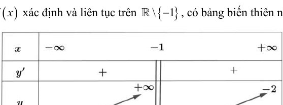
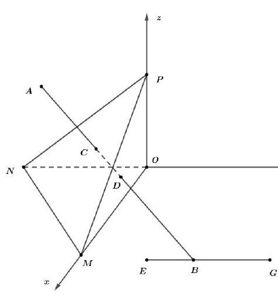
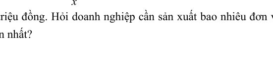
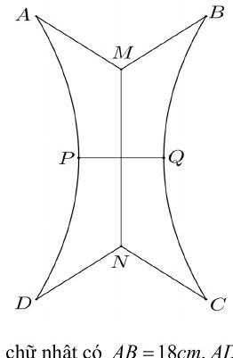
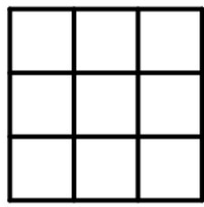

status: ocr-draft
source: official/2026-provincial-toan/de-khao-sat-truc-tuyen-toan-12-nam-2025-2026-so-gddt-quang-ninh/paper.pdf

SỞ GIÁO DỤC VÀ ĐÀO TẠO — TỈNH QUẢNG NINH
ĐỀ KHẢO SÁT CHẤT LƯỢNG HỌC SINH LỚP 12 — NĂM HỌC 2025-2026
Môn: Toán (Khảo sát trực tuyến)
Thời gian làm bài: 90 phút, không kể thời gian giao đề
(Đề thi có 05 trang)

## PHẦN I. Thí sinh trả lời từ câu 1 đến câu 12. Mỗi câu hỏi thí sinh chỉ chọn một phương án.

**Câu 1:** Trong bốn dãy số sau, có bao nhiêu dãy số lập thành một cấp số cộng?

I) $10,-2,-14,-26,-38$.  II) $\frac12,\frac54,2,\frac{11}{4},\frac72$.

III) $\sqrt1,\sqrt2,\sqrt3,\sqrt4,\sqrt5$.  IV) $1,4,7,10,13$.

A. 1. B. 2. C. 3. D. 4.

**Câu 2:** Phương trình $\sin x=0$ có họ nghiệm là

A. $x=\frac\pi2+k2\pi,\ k\in\mathbb Z$. B. $x=k2\pi,\ k\in\mathbb Z$. C. $x=\frac\pi2+k\pi,\ k\in\mathbb Z$. D. $x=k\pi,\ k\in\mathbb Z$.

**Câu 3:** Với mọi số thực dương $a$ thì $\log_2(16a)-\log_2a$ bằng

A. $\log_2(15a)$. B. 8. C. 4. D. $4-2\log_2a$.

**Câu 4:** Cho hình chóp $S.ABC$ có đáy $ABC$ là tam giác vuông tại $B$ và cạnh bên $SA$ vuông góc với đáy, biết $AB=a, AC=2a, SA=a\sqrt3$. Thể tích khối chóp $S.ABC$ bằng

A. $\frac12a^3$. B. $\frac32a^3$. C. $\frac{\sqrt3}{3}a^3$. D. $\frac{\sqrt3}{2}a^3$.

**Câu 5:** Cho hình chóp $S.ABCD$ có đáy là hình bình hành tâm $O$. Đẳng thức nào sau đây sai?

A. $\overrightarrow{AB}+\overrightarrow{AD}=\overrightarrow{AC}$. B. $\overrightarrow{SA}+\overrightarrow{SB}=\overrightarrow{SC}+\overrightarrow{SD}$. C. $\overrightarrow{SA}+\overrightarrow{SC}=2\overrightarrow{SO}$. D. $\overrightarrow{SB}+\overrightarrow{SD}=2\overrightarrow{SO}$.

**Câu 6:** Cho hàm số $y=f(x)$ xác định và liên tục trên $\mathbb R\setminus\{-1\}$, có bảng biến thiên như sau.

[HÌNH: Bảng biến thiên với hai khoảng $(-\infty,-1)$ và $(-1,+\infty)$; $y'$ dương trên cả hai khoảng; hàm tăng từ giới hạn $-2$ đến $+\infty$ ở phía trái $-1$, và từ $-\infty$ đến giới hạn $-2$ ở phía phải.]

Khẳng định nào sau đây là đúng?

A. Đồ thị hàm số có tiệm cận đứng $y=-1$ và tiệm cận ngang $x=-2$. B. Đồ thị hàm số có duy nhất một tiệm cận. C. Đồ thị hàm số có ba tiệm cận. D. Đồ thị hàm số có tiệm cận đứng $x=-1$ và tiệm cận ngang $y=-2$.

**Câu 7:** Hàm số $y=f(x)=x^3-3x^2-9x+7$ có cực đại là

A. $-1$. B. 12. C. 3. D. $-20$.

## PHẦN I (tiếp)

**Câu 8:** Họ nguyên hàm của hàm số $f(x)=2025^x$ là

A. $F(x)=2025^x+C$. B. $F(x)=\frac{2025^x}{\ln(2025)}+C$. C. $F(x)=2025\cdot2024^x+C$. D. $F(x)=2025x+C$.

**Câu 9:** Kết quả kiểm tra điểm môn Toán của học sinh lớp 12A1 được cho bởi mẫu số liệu ghép nhóm như sau:

| Nhóm điểm | [0; 2) | [2; 4) | [4; 6) | [6; 8) | [8; 10) |
|---|---:|---:|---:|---:|---:|
| Tần số | 4 | 5 | 6 | 25 | 10 |

Trung vị của mẫu số liệu ghép nhóm trên thuộc vào nhóm nào dưới đây?

A. [6; 8). B. [2; 4). C. [4; 6). D. [8; 10).

**Câu 10:** Trong không gian $Oxyz$, mặt phẳng $(Oxz)$ có phương trình là

A. $y=0$. B. $z=0$. C. $x=0$. D. $x+y+z=0$.

**Câu 11:** Trong không gian $Oxyz$, cho đường thẳng $d:\frac{x-2}{1}=\frac{y-1}{-2}=\frac{z+1}{3}$. Điểm nào dưới đây thuộc đường thẳng $d$?

A. $Q(2;1;1)$. B. $M(1;2;3)$. C. $P(2;1;-1)$. D. $N(1;-2;3)$.

**Câu 12:** Trong không gian $Oxyz$, phương trình mặt cầu $(S)$ tâm $I(-2;1;0)$ và có đường kính bằng 8 là

A. $(S):(x+2)^2+(y-1)^2+z^2=8$. B. $(S):(x+2)^2+(y-1)^2+z^2=16$.

C. $(S):(x-2)^2+(y+1)^2+z^2=64$. D. $(S):(x+2)^2+(y-1)^2+z^2=64$.

## PHẦN II. Thí sinh trả lời từ câu 1 đến câu 4. Trong mỗi ý a), b), c), d) ở mỗi câu, thí sinh chọn đúng hoặc sai.

**Câu 13:** Cho hàm số $y=f(x)=\frac{x^2-x-12}{x-2}$.

a) Đồ thị hàm số $f(x)$ đi qua điểm $(4;0)$.

b) Đồ thị hàm số $f(x)$ có đường tiệm cận xiên là đường thẳng $y=x-1$.

c) Đồ thị hàm số $f(x)$ có tâm đối xứng là điểm $I(2;3)$.

d) Phương trình đường tiếp tuyến của đồ thị hàm số $f(x)$ tại điểm $x=3$ có dạng $y=mx+n$, giá trị $m-n$ bằng 50.

**Câu 14:** Trong một nhà máy, tốc độ tiêu thụ điện năng của một dây chuyền sản xuất sau khi khởi động có xu hướng giảm dần theo thời gian và tiến về mức ổn định. Giả sử sau khi bắt đầu vận hành được $t$ giờ, tốc độ tiêu thụ điện năng của dây chuyền sản xuất này được mô hình bởi hàm số $E'(t)=A+e^{-0,4t}$ (đơn vị: kWh/giờ) $(0\le t\le8)$, trong đó $E(t)$ (kWh) là lượng điện năng tiêu thụ tính từ lúc bắt đầu vận hành. Biết rằng trong 8 giờ đầu tiên, dây chuyền đã tiêu thụ tổng cộng 120 kWh.

a) $E(t)=At-\frac52e^{-0,4t}+C$, với $C$ là hằng số.

b) $A=14$ (kết quả làm tròn đến hàng đơn vị).

c) Lượng điện năng tiêu thụ của dây chuyền trong 4 giờ đầu lớn hơn 65 kWh.

d) Tốc độ tiêu thụ điện năng trung bình của dây chuyền sản xuất trong khoảng thời gian từ $a$ giờ đến $b$ giờ được xác định bởi công thức $\bar v=\frac{E(b)-E(a)}{b-a}$ (kWh/giờ). Tốc độ tiêu thụ điện năng trung bình của dây chuyền sản xuất này trong 4 giờ cuối bằng 14,6 kWh/giờ (kết quả làm tròn đến hàng phần mười).

**Câu 15:** Một trung tâm ngoại ngữ tổ chức một kỳ thi đánh giá năng lực cho các học viên. Trung tâm thống kê được rằng:

(1) 55% thí sinh là nữ;

(2) trong số các thí sinh nữ có 80% thí sinh vượt qua bài kiểm tra;

(3) trong số các thí sinh nam có 25% thí sinh không vượt qua bài kiểm tra.

Chọn ngẫu nhiên một thí sinh.

a) Xác suất để thí sinh được chọn là nam bằng 0,45.

b) Xác suất để thí sinh được chọn vượt qua bài kiểm tra, biết rằng thí sinh đó là nam, bằng 0,75.

c) Xác suất để thí sinh được chọn vượt qua bài kiểm tra bằng 77,25%.

d) Xác suất để thí sinh được chọn là nữ, biết rằng thí sinh đó không vượt qua bài kiểm tra, nhỏ hơn 0,45.

**Câu 16:** Trong không gian $Oxyz$ (đơn vị trên mỗi trục tọa độ là ki-lô-mét), một máy bay đang ở vị trí $A(3;-1;0,6)$ và sẽ hạ cánh ở vị trí $B(2;3;0)$ ở trên đường băng $EG$ (hình vẽ). Có một lớp mây được mô phỏng bởi mặt phẳng $(\alpha)$ đi qua ba điểm $M(7;0;0)$, $N(0;-7;0)$ và $P(0;0;0,9)$.

[HÌNH: Hệ trục tọa độ và hình không gian gồm các điểm A, B, M, N, P, C, D, O cùng đường băng EG; các đoạn thẳng biểu diễn đường bay, mặt phẳng lớp mây và đường băng.]

## PHẦN II (tiếp)

a) Đường thẳng $AB$ có phương trình tham số là $\begin{cases}x=3-t\\y=-1+4t\\z=0,6-0,6t\end{cases}\ (t\in\mathbb R)$.

b) Khi máy bay cách mặt đất 120m thì vị trí của máy bay trên đường thẳng $AB$ là điểm $D(2,2;2,2;0,12)$.

c) Độ cao của máy bay khi xuyên qua lớp mây để hạ cánh là 0,5 km (làm tròn kết quả tới hàng phần mười).

d) Theo quy định an toàn bay, người phi công phải nhìn thấy điểm cuối $G(4;6;0)$ của đường băng ở độ cao tối thiểu là 120m. Nếu sau khi ra khỏi lớp mây tầm nhìn của người phi công là 1500m thì người phi công đã đạt được quy định an toàn bay.

## PHẦN III. Thí sinh trả lời từ câu 1 đến câu 6.

**Câu 17:** Cho hình chóp $S.ABC$ có đáy là tam giác đều cạnh 6. Hình chiếu vuông góc của $S$ lên mặt phẳng $(ABC)$ trùng với trung điểm của đoạn thẳng $AB$. Biết góc phẳng nhị diện $[S,BC,A]$ bằng $60^\circ$. Tính thể tích $V$ của khối chóp $S.ABC$ (không làm tròn các phép tính trung gian, kết quả cuối cùng làm tròn đến hàng phần mười).

**Câu 18:** Vào ngày 15 tháng 1 năm 2026 anh Bình gửi vào ngân hàng 1 tỷ đồng với lãi suất 0,6%/tháng. Kể từ tháng 2 năm 2026, cứ vào ngày 15 mỗi tháng anh Bình đến ngân hàng rút ra 25 triệu đồng để chi tiêu. Hỏi sau bao nhiêu tháng anh Bình rút hết tiền trong ngân hàng (ở tháng cuối cùng, số tiền rút ra có thể ít hơn 25 triệu đồng).

**Câu 19:** Cho một bảng ô vuông kích thước $2\times7$ như hình vẽ dưới đây.

[HÌNH: Bảng gồm 2 hàng và 7 cột ô vuông.]

Hai ô vuông gọi là kề nhau nếu có chung một cạnh. Người ta tô màu các ô vuông bởi hai màu đen và đỏ sao cho mỗi ô chỉ được tô đúng một màu. Gọi $P$ là xác suất để có đúng 3 ô được tô màu đỏ và không có hai ô đỏ nào kề nhau. Giá trị $8192P$ bằng bao nhiêu?

**Câu 20:** Một doanh nghiệp dự định sản xuất không quá 200 đơn vị sản phẩm. Nếu doanh nghiệp sản xuất $x$ đơn vị sản phẩm $(1\le x\le200)$ thì giá bán của mỗi đơn vị sản phẩm là $f(x)=435-2x$ (triệu đồng) và chi phí sản xuất bình quân cho một đơn vị sản phẩm là $g(x)=\frac{0,7x^2}{125}-1,706x+96,5+\frac{6375}{x}$ (triệu đồng). Biết rằng mức thuế cho một đơn vị sản phẩm này là 2,5 triệu đồng. Hỏi doanh nghiệp cần sản xuất bao nhiêu đơn vị sản phẩm để lợi nhuận thu được lớn nhất?

**Câu 21:** Một mô hình khối tròn xoay có trục là đường thẳng $MN$, khi ta cắt khối tròn xoay đó bởi một mặt phẳng đi qua trục của khối tròn xoay thì ta được mặt cắt có dạng như hình vẽ dưới đây.

[HÌNH: Mặt cắt đối xứng quanh trục MN, có hai cung parabol lõm vào với đỉnh P, Q; các điểm A, B, C, D tạo hình chữ nhật, và đoạn PQ nằm ngang.]

Biết $MN=24\text{ cm}$, $ABCD$ là hình chữ nhật có $AB=18\text{ cm}, AD=36\text{ cm}$, hai cung $APD$ và $BQC$ là một phần của các đường parabol với đỉnh lần lượt là $P,Q$ và $PQ=10\text{ cm}$. Thể tích của mô hình đó bằng bao nhiêu xăng-ti-mét khối (kết quả làm tròn đến hàng đơn vị)?

**Câu 22:** Cho tập hợp gồm 18 số tự nhiên $S=\{1;2;3;4;5;6;7;8;9;10;11;12;13;14;15;16;17;18\}$. Chọn ngẫu nhiên 9 số tự nhiên từ tập và điền vào 9 ô vuông của một bảng $3\times3$ như hình vẽ. Gọi $T$ là số cách điền thỏa mãn hai đường chéo theo thứ tự lập thành cấp số nhân. Tính giá trị $\frac{T}{100}$.

[HÌNH: Bảng ô vuông gồm 3 hàng và 3 cột.]

-------HẾT--------