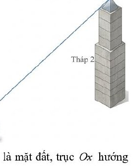
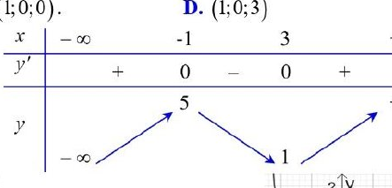
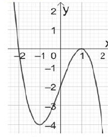
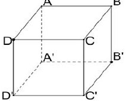
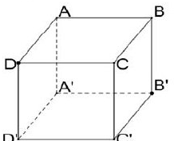
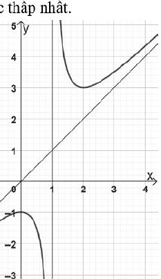
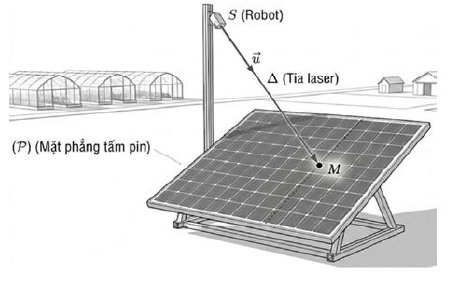
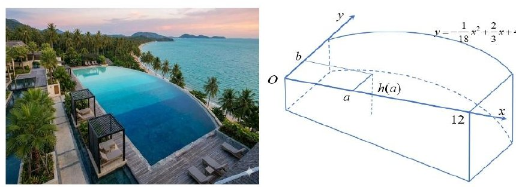

status: ocr-draft
source: official/2026-provincial-toan/de-thi-thu-tot-nghiep-thpt-2026-mon-toan-dot-1-so-gddt-nghe-an/paper.pdf — Nghệ An, mã đề 0101, trang đề 1–4

# SỞ GIÁO DỤC VÀ ĐÀO TẠO NGHỆ AN
## KỲ KHẢO SÁT CHẤT LƯỢNG KẾT HỢP THI THỬ LỚP 12, NĂM HỌC 2025–2026 (Đợt 1)
### Môn thi: TOÁN
**ĐỀ CHÍNH THỨC** (Đề thi có 04 trang) — **Thời gian: 90 phút** (Không kể thời gian phát đề) — **Mã đề thi: 0101**

## PHẦN I. Câu trắc nghiệm nhiều phương án lựa chọn
Thí sinh trả lời từ câu 1 đến câu 12. Mỗi câu hỏi thí sinh chỉ chọn một phương án.

**Câu 1.** Tìm $I=\lim_{x\to0}\frac{1}{x+1}$.

A. $I=\frac12$.  B. $I=1$.  C. $I=+\infty$.  D. $I=0$.

**Câu 2.** Hàm số nào dưới đây có đồ thị như hình vẽ?

[HÌNH: Đồ thị hàm bậc ba có nhánh trái đi lên, nhánh phải đi xuống, một cực tiểu dưới trục hoành và một cực đại phía trên trục hoành; có trục tọa độ $Ox, Oy$.]

A. $f(x)=x^3+3x+1$.  B. $f(x)=-x^3+3x-1$.  C. $f(x)=-x^3+3x+1$.  D. $f(x)=x^3-3x-1$.

**Câu 3.** Thống kê điểm thi tốt nghiệp môn Toán THPT năm 2024 của lớp 12D tại một trường THPT thu được kết quả như sau:

| Nhóm | [3;4) | [4;5) | [5;6) | [6;7) | [7;8) | [8;9) | [9;10] |
|---|---:|---:|---:|---:|---:|---:|---:|
| Tần số | 3 | 4 | 5 | 10 | 15 | 10 | 5 |

Khoảng biến thiên của mẫu số liệu thống kê trên bằng

A. 10.  B. 7.  C. 6.  D. 8.

**Câu 4.** Trong không gian với hệ tọa độ $Oxyz$, cho điểm $M(1;2;3)$. Tìm tọa độ hình chiếu vuông góc của $M$ lên trục $Ox$.

A. $(2;0;0)$.  B. $(3;0;0)$.  C. $(1;0;0)$.  D. $(1;0;3)$.

**Câu 5.** Cho hàm số $y=f(x)$ có bảng biến thiên như sau:

[HÌNH: Bảng biến thiên với các mốc $-\infty,-1,3,+\infty$; dấu $y'$ lần lượt $+ ,0,-,0,+$; hàm tăng đến giá trị 5 tại $x=-1$, giảm đến giá trị 1 tại $x=3$, rồi tăng.]

Điểm cực tiểu của hàm số $y=f(x)$ là

A. $x=1$.  B. $x=3$.  C. $x=-1$.  D. $x=5$.

**Câu 6.** Cho hàm số $y=-x^3+3x-2$ có đồ thị như hình vẽ. Tâm đối xứng của đồ thị hàm số đã cho là

[HÌNH: Đồ thị hàm bậc ba có cực tiểu gần $(-1,-4)$, cực đại gần $(1,0)$ và điểm uốn tại $(0,-2)$ trên hệ trục tọa độ.]

A. $J(0;-2)$.  B. $O(0;0)$.  C. $I(-2;0)$.  D. $K(0;2)$.

**Câu 7.** Cho hình hộp $ABCD.A'B'C'D'$. Xét phép chiếu song song theo phương $A'A$ lên mặt phẳng $(ABCD)$. Ảnh của đoạn thẳng $A'C'$ qua phép chiếu song song đó là

[HÌNH: Hình hộp $ABCD.A'B'C'D'$ với các đỉnh được ghi nhãn.]

A. đoạn thẳng $A'C$.  B. đoạn thẳng $AB$.  C. đoạn thẳng $BD$.  D. đoạn thẳng $AC$.

**Câu 8.** Trong các dãy số có số hạng tổng quát dưới đây, dãy số nào là dãy số tăng?

A. $\frac{1}{3^n}$.  B. $n+1$.  C. $1+\frac1n$.  D. $6-2n$.

**Câu 9.** Tập nghiệm của bất phương trình $\log_2(x-1)>3$ là

A. $(1;+\infty)$.  B. $(1;9)$.  C. $(9;+\infty)$.  D. $(-\infty;9)$.

**Câu 10.** Cho hình lập phương $ABCD.A'B'C'D'$ có cạnh bằng 1. Tích vô hướng của hai vectơ $\overrightarrow{CC'}$ và $\overrightarrow{A'A}$ bằng

[HÌNH: Hình lập phương $ABCD.A'B'C'D'$ có các đỉnh được ghi nhãn.]

A. 0.  B. $-1$.  C. 2.  D. 1.

**Câu 11.** Trong không gian với hệ tọa độ $Oxyz$, phương trình nào sau đây là phương trình tổng quát của một mặt phẳng?

A. $\frac{x-2}{2}=\frac{y-1}{2}=\frac{z}{1}$.  B. $x-1=0$.  C. $x^2+y^2+z^2-4=0$.  D. $\frac2x+\frac1y-\frac3z=0$.

**Câu 12.** Trong không gian với hệ tọa độ $Oxyz$, cho $\vec a=-3\vec i+5\vec j+\vec k$. Độ dài của $\vec a$ là

A. $\sqrt{17}$.  B. 35.  C. 17.  D. $\sqrt{35}$.

## PHẦN II. Câu trắc nghiệm đúng sai
Thí sinh trả lời từ câu 1 đến câu 4. Trong mỗi ý (a), (b), (c), (d) ở mỗi câu, thí sinh chọn đúng hoặc sai.

**Câu 1.** Một hợp tác xã (viết tắt là HTX) nông nghiệp tại Nghệ An đầu tư dự án trồng dưa lưới nhà màng VietGAP. Xét trong một vụ canh tác, với diện tích $x$ (nghìn $m^2$, $x\ge1$), tổng chi phí là $C(x)=x^2+30x+100$ (triệu đồng). Tổng doanh thu dự kiến là $R(x)=x^2+100x$ (triệu đồng).

a) Hàm số lợi nhuận của HTX sau một vụ canh tác là $L(x)=70x-100$ (triệu đồng).

b) Nếu HTX muốn đạt mức lợi nhuận là 250 triệu đồng cho một vụ thì diện tích canh tác cần thiết là 5 nghìn $m^2$.

c) Chi phí trung bình trên mỗi đơn vị diện tích được định nghĩa là $P(x)=\frac{C(x)}x$. Khi diện tích canh tác tăng từ 1 nghìn $m^2$ đến 11 nghìn $m^2$ thì chi phí trung bình luôn giảm.

d) Để đồng vốn đầu tư đạt hiệu quả cao nhất (tỉ lệ lợi nhuận trên tổng chi phí $Q(x)=\frac{L(x)}{C(x)}$ đạt giá trị lớn nhất), HTX cần tính toán để chi phí trung bình trên mỗi đơn vị diện tích $P(x)$ đạt mức thấp nhất.

**Câu 2.** Cho hàm số $y=-x-\frac1{x-1}$ có đồ thị là đường cong $(C)$.

a) Đường thẳng $x=1$ là tiệm cận đứng của đường cong $(C)$.

b) $f'(x)=\frac{-x^2+2x}{(x-1)^2},\ \forall x\ne1$.

c) Điểm cực đại của hàm số là $N(2;3)$.

d) Đường cong $(C)$ có dạng như hình vẽ:

[HÌNH: Đồ thị hàm phân thức có tiệm cận đứng $x=1$, tiệm cận xiên đi qua gốc tọa độ, nhánh phải có cực tiểu gần $(2,3)$ và nhánh trái có cực đại gần $(0,-1)$.]

**Câu 3.** Trong một mô hình nông nghiệp công nghệ cao, một tấm pin năng lượng mặt trời phẳng được lắp đặt nghiêng sao cho bề mặt của nó nằm trên mặt phẳng $(P):2x+2y+z-6=0$ (xét trong hệ không gian tọa độ $Oxyz$ với đơn vị đo là mét, mặt phẳng $(Oxy)$ được xem là mặt đất phẳng). Người ta lắp đặt một robot cố định ở trên cao để kiểm tra bụi bẩn. Robot có mắt phát tia laser tại điểm $S(1;1;6)$. Robot thực hiện quét tia laser trên bề mặt tấm pin. Tại một thời điểm tia laser được chiếu theo đường thẳng $\Delta$ có vectơ chỉ phương $\vec u=(1;-2;-2)$ và chạm vào bề mặt tấm pin tại điểm $M$.

[HÌNH: Hình minh họa robot phát tia laser từ điểm $S$ tới điểm $M$ trên tấm pin năng lượng mặt trời nằm trên mặt phẳng $(P)$.]

a) Khoảng cách từ mắt phát tia laser $S$ đến mặt phẳng $(P)$ bằng $\frac43$ mét.

b) Điểm $M$ có tọa độ là $(1;1;2)$.

c) Góc $\alpha$ hợp bởi tia laser $\Delta$ và mặt phẳng $(P)$ thỏa mãn hệ thức $\sin\alpha=\frac49$.

d) Khi vệ sinh, nước được phun trúng điểm chạm của tia laser trên tấm pin sẽ tạo thành dòng nước chảy trên bề mặt pin xuống đất theo hướng dốc nhất, quỹ đạo chảy của dòng nước nằm trên một đường thẳng. Đường thẳng đó có một vectơ chỉ phương là $\vec v=(1;1;3)$.

**Câu 4.** Để tuyển chọn thành viên cho Câu lạc bộ Toán - Tin, nhà trường tổ chức một bài thi đánh giá năng lực (thang điểm 100) cho 100 học sinh. Kết quả điểm thi được thống kê trong bảng số liệu ghép nhóm gồm 6 nhóm như sau:

| Điểm số | [40;50) | [50;60) | [60;70) | [70;80) | [80;90) | [90;100] |
|---|---:|---:|---:|---:|---:|---:|
| Số học sinh | 10 | 15 | 25 | 30 | 15 | 5 |

An và Bình là hai học sinh tham gia thi, đạt số điểm lần lượt là 82 điểm và 69,5 điểm. Ban chủ nhiệm Câu lạc bộ đưa ra quy định phân loại dựa trên các chỉ số thống kê của toàn bộ mẫu số liệu như sau:

Xếp loại “xuất sắc”: Điểm số lớn hơn hoặc bằng tứ phân vị thứ ba.

Xếp loại “tiềm năng”: Điểm số từ mức điểm trung vị đến dưới tứ phân vị thứ ba.

Xếp loại “chưa đạt”: Điểm số dưới mức điểm trung vị. Một điều hết sức thú vị là không có học sinh nào có điểm số bằng một trong ba giá trị tứ phân vị.

a) Khoảng biến thiên của mẫu số liệu ghép nhóm này là 60.

b) Điểm trung vị của 100 học sinh tham gia kỳ thi là 71 điểm.

c) Mặc dù Bình xếp loại chưa đạt, nhưng điểm số của Bình vẫn cao hơn mức điểm trung bình.

d) Để đánh giá chất lượng đề thi, ban tổ chức chọn ngẫu nhiên 4 học sinh tham gia kỳ thi để phỏng vấn. Xác suất để nhóm 4 học sinh được chọn có đầy đủ đại diện của cả 3 nhóm xếp loại và luôn có mặt An là $\frac{275}{14259}$.

## PHẦN III. Câu trắc nghiệm trả lời ngắn
Thí sinh trả lời từ câu 1 đến câu 6.

**Câu 1.** Một kiến trúc sư thiết kế một hồ bơi vô cực có mặt trên của bể bơi nằm trong mặt phẳng $Oxy$ (đơn vị trục là mét). Một cạnh của hồ bơi dài 12 m nằm trên trục $Ox$; hai cạnh bên lần lượt nằm trên trục $Oy$ và đường thẳng $x=12$; cạnh còn lại (mặt vô cực) là một phần đồ thị của hàm số $y=-\frac1{18}x^2+\frac23x+4$. Đáy hồ bơi không phẳng mà độ sâu tại điểm $(a;b)$ được tính theo công thức $h(a)=\frac14a+1$ (mét). Thể tích nước tối đa mà hồ bơi có thể chứa là bao nhiêu $m^3$?

[HÌNH: Sơ đồ hồ bơi với mặt trên giới hạn bởi trục tọa độ, đường $x=12$ và parabol $y=-\frac1{18}x^2+\frac23x+4$; độ sâu tại hoành độ $a$ được ký hiệu $h(a)$.]

**Câu 2.** Một nhân viên cứu hộ đứng ở mặt đất, điều khiển một drone chở vật tư y tế, dự kiến bay thẳng từ đỉnh $A$ của tháp thứ nhất đến đỉnh $B$ của tháp thứ hai. Tuy nhiên, do gặp một khu vực nhiễu sóng an ninh, nên drone phải bay thẳng từ $A$ đến một điểm $P$ trên mặt đất để hạ cánh. Nhân viên đó mang drone từ điểm $P$ dọc theo hướng Tây 40 m đến điểm $Q$ và sau đó drone bay thẳng từ $Q$ lên đỉnh $B$ của tháp thứ hai (Hình vẽ). Biết đỉnh $A$ cao 100 m và có hình chiếu lên mặt đất cách vị trí người đứng ban đầu 200 m về phía Đông và 100 m về phía Nam. Đỉnh $B$ cao 300 m và có hình chiếu lên mặt đất cách vị trí người đứng ban đầu 140 m về phía Tây và 200 m về phía Nam. Chọn hệ trục tọa độ $Oxyz$ có gốc tại vị trí người đứng ban đầu, mặt phẳng $(Oxy)$ là mặt đất, trục $Ox$ hướng Đông, trục $Oy$ hướng Nam và trục $Oz$ hướng thẳng đứng lên trên (đơn vị trên các trục là 100 m). Để hoàn thành nhiệm vụ, người đó chọn vị trí điểm $P(a;b;c)$ trên mặt đất sao cho tổng quãng đường bay là ngắn nhất. Tính giá trị của biểu thức $S=2a+4b+c$.

[HÌNH: Sơ đồ hai tháp, người điều khiển drone, các đường bay $A\to P$ và $Q\to B$, với $P,Q$ trên mặt đất.]

**Câu 3.** Một doanh nghiệp phân bổ ngân sách quảng cáo trên Facebook và Google với tổng số tiền không vượt quá 80 triệu. Chi phí cho Facebook nằm trong khoảng từ 20 đến 50 triệu. Chi phí cho Google tối thiểu là 15 triệu. Số tiền chi cho chạy quảng cáo trên Google không được vượt quá chi phí chi cho quảng cáo trên Facebook. Biết rằng với mỗi triệu tiền chi cho quảng cáo trên Facebook thì được tiếp cận 4 nghìn khách, và với mỗi triệu tiền chi cho quảng cáo trên Google thì được tiếp cận 6 nghìn khách. Hỏi lượng khách tiếp cận lớn nhất là bao nhiêu nghìn?

**Câu 4.** Cho hình chóp $S.ABCD$ có $ABCD$ là hình vuông cạnh bằng 4. Tam giác $SAB$ cân tại $S$, có diện tích bằng 6 và nằm trong mặt phẳng vuông góc với mặt phẳng đáy. Tính côsin của góc nhị diện $[S;AC;D]$ (làm tròn kết quả đến hàng phần mười).

**Câu 5.** Nồng độ thuốc $C$ (mg/ml) trong máu của một bệnh nhân sau $t$ giờ tiêm vào tĩnh mạch được xác định bởi công thức $C(t)=\frac{at}{t^2+4}$, với $a$ là hằng số dương. Đạo hàm của $C(t)$ được gọi là tốc độ thay đổi tức thời của nồng độ thuốc tại thời điểm $t$. Biết rằng nồng độ thuốc đạt giá trị lớn nhất là 0,5 mg/ml. Một bác sĩ muốn tính tốc độ thay đổi tức thời của nồng độ thuốc tại thời điểm $t=4$ giờ để quyết định liều tiêm tiếp theo. Tính giá trị tuyệt đối của tốc độ này (đơn vị: mg/ml/h).

**Câu 6.** Một khóa mã số sử dụng mật khẩu là một dãy gồm 5 chữ số phân biệt từ 1 đến 9. Một mật khẩu được gọi là mạnh nếu nó thỏa mãn đồng thời hai điều kiện:

i) Không có hai chữ số lẻ nào đứng cạnh nhau.

ii) Chữ số đứng sau luôn lớn hơn chữ số đứng trước hoặc luôn nhỏ hơn chữ số đứng trước.

Chọn ngẫu nhiên một mật khẩu. Xác suất để chọn được mật khẩu mạnh bằng $a\cdot10^{-3}$. Tính giá trị của $a$ (làm tròn kết quả đến hàng phần mười).

**—— HẾT ——**