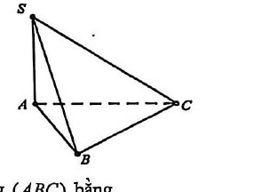
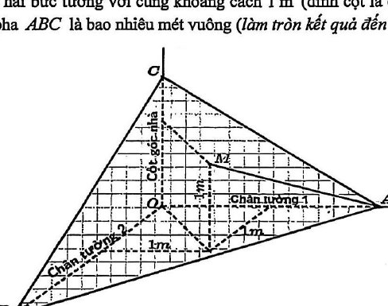
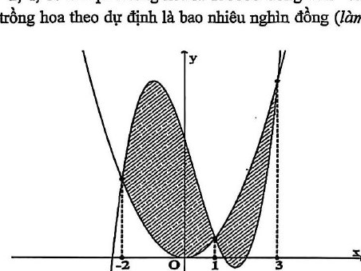

status: ocr-draft
source: official/2026-provincial-toan/de-thi-thu-tot-nghiep-thpt-2026-mon-toan-lan-1-so-gddt-tuyen-quang/paper.pdf — PDF pages 1–4; mã đề 0101

# SỞ GIÁO DỤC VÀ ĐÀO TẠO TỈNH TUYÊN QUANG
## ĐỀ THI CHÍNH THỨC
### KỲ THI THỬ TỐT NGHIỆP THPT NĂM 2026 – LẦN 1
### MÔN THI: TOÁN
Thời gian làm bài: 90 phút (không kể thời gian phát đề)

Mã đề: 0101

## PHẦN I. Thí sinh trả lời từ câu 1 đến câu 12. Mỗi câu hỏi thí sinh chỉ chọn một phương án.

### Câu 1.
Cho hình chóp $S.ABC$ có $SA$ vuông góc với mặt phẳng $(ABC)$, $SA=a\sqrt{2}$, $AB=a\sqrt{2}$ (xem hình dưới).

[HÌNH: Hình chóp $S.ABC$, với $SA$ vuông góc mặt phẳng đáy $(ABC)$; đoạn $AC$ vẽ nét đứt.]

Góc giữa đường thẳng $SB$ và mặt phẳng $(ABC)$ bằng

A. $45^\circ$.  
B. $30^\circ$.  
C. $90^\circ$.  
D. $60^\circ$.

### Câu 2.
Tập xác định của hàm số $y=\tan x$ là

A. $\mathbb{R}\setminus\{0\}$.  
B. $\mathbb{R}$.  
C. $\mathbb{R}\setminus\left\{\dfrac{\pi}{2}+k\pi\mid k\in\mathbb{Z}\right\}$.  
D. $\mathbb{R}\setminus\{k\pi\mid k\in\mathbb{Z}\}$.

### Câu 3.
Tiệm cận xiên của đồ thị hàm số $y=x+1-\dfrac{1}{x-2}$ là đường thẳng có phương trình

A. $y=x$.  
B. $x=2$.  
C. $y=1$.  
D. $y=x+1$.

### Câu 4.
Cho hai vectơ $\vec a$ và $\vec b$ cùng hướng và khác vectơ $\vec 0$. Phát biểu nào sau đây là đúng?

A. $\vec a\cdot\vec b=-1$.  
B. $\vec a\cdot\vec b=0$.  
C. $\vec a\cdot\vec b=|\vec a|\,|\vec b|$.  
D. $\vec a\cdot\vec b=-|\vec a|\,|\vec b|$.

### Câu 5.
Họ nguyên hàm của hàm số $f(x)=2^x-x$ là

A. $\dfrac{2^{x+1}}{x+1}-\dfrac{x^2}{2}+C$.  
B. $\dfrac{2^x}{\ln 2}-\dfrac{x^2}{2}+C$.  
C. $x\cdot 2^{x-1}-\dfrac{x^2}{2}+C$.  
D. $\dfrac{2^x}{x}-\dfrac{x^2}{2}+C$.

### Câu 6.
Cho hàm số $y=f(x)$ có bảng biến thiên như sau.

| $x$ | $-\infty$ | $-1$ | $3$ | $+\infty$ |
|---|---:|---:|---:|---:|
| $y'$ | $+$ | $0$ | $-$ | $0\quad+$ |
| $y$ | $-\infty\nearrow$ | $6$ | $\searrow -26$ | $\nearrow +\infty$ |

Hàm số đã cho nghịch biến trên khoảng nào sau đây?

A. $(-26;6)$.  
B. $(-\infty;-1)$.  
C. $(3;+\infty)$.  
D. $(-1;2)$.

### Câu 7.
Trong không gian với hệ tọa độ $Oxyz$, cho mặt phẳng $(\alpha):3x+2y-4z+1=0$. Vectơ nào sau đây là một vectơ pháp tuyến của mặt phẳng $(\alpha)$?

A. $\vec n_3=(-3;2;-4)$.  
B. $\vec n_2=(3;2;4)$.  
C. $\vec n_1=(3;-2;-4)$.  
D. $\vec n_4=(3;2;-4)$.

### Câu 8.
Thống kê điểm thi đánh giá năng lực của 120 học sinh một trường THPT được cho ở bảng sau.

| Điểm | $[0;20)$ | $[20;40)$ | $[40;60)$ | $[60;80)$ | $[80;100)$ |
|---|---:|---:|---:|---:|---:|
| Số học sinh | 25 | 35 | 37 | 15 | 8 |

Tứ phân vị thứ nhất của mẫu số liệu ghép nhóm trên thuộc nửa khoảng nào sau đây?

A. $[40;60)$.  
B. $[20;40)$.  
C. $[60;80)$.  
D. $[0;20)$.

### Câu 9.
Cho cấp số cộng $(u_n)$ có $u_1=1$ và công sai $d=3$. Giá trị của $u_4$ bằng

A. $10$.  
B. $13$.  
C. $27$.  
D. $4$.

### Câu 10.
Tập nghiệm $S$ của phương trình $\sin x=1$ là

A. $S=\{k2\pi\mid k\in\mathbb{Z}\}$.  
B. $S=\{k\pi\mid k\in\mathbb{Z}\}$.  
C. $S=\left\{\dfrac{\pi}{2}+k2\pi\mid k\in\mathbb{Z}\right\}$.  
D. $S=\left\{-\dfrac{\pi}{2}+k2\pi\mid k\in\mathbb{Z}\right\}$.

### Câu 11.
Trong không gian với hệ tọa độ $Oxyz$, cho hai điểm $A(2;-4;3)$ và $B(2;2;9)$. Trung điểm của đoạn $AB$ có tọa độ là

A. $(2;-1;6)$.  
B. $(0;6;6)$.  
C. $(4;-2;12)$.  
D. $(0;3;3)$.

### Câu 12.
Trong mặt phẳng với hệ tọa độ $Oxy$, diện tích $S$ của hình phẳng giới hạn bởi đồ thị hàm số $y=x^2-2x$, trục hoành và hai đường thẳng $x=-1$, $x=3$ được xác định bằng công thức

A. $S=\pi\displaystyle\int_{-1}^{3}|x^2-2x|\,dx$.  
B. $S=\pi\displaystyle\int_{-1}^{3}(x^2-2x)^2\,dx$.  
C. $S=\displaystyle\int_{-1}^{3}|x^2-2x|\,dx$.  
D. $S=\left|\displaystyle\int_{-1}^{3}(x^2-2x)\,dx\right|$.

## PHẦN II. Thí sinh trả lời từ câu 1 đến câu 4. Trong mỗi ý a), b), c), d) ở mỗi câu, thí sinh chọn đúng hoặc sai.

### Câu 1.
Một hộp chứa các viên bi có kích thước và khối lượng như nhau gồm 5 viên bi trắng, 6 viên bi đỏ và 8 viên bi xanh. Lấy ngẫu nhiên đồng thời 5 viên bi từ hộp, trong đó có $x$ viên bi trắng, $y$ viên bi đỏ và $z$ viên bi xanh.

a) Số phần tử của không gian mẫu là $n(\Omega)=C_{19}^{5}$.  
 b) Xác suất lấy được 5 viên bi đều màu xanh là $\dfrac{1}{969}$.  
 c) Xác suất lấy được 5 viên bi có ít nhất một viên bi màu xanh nhỏ hơn $0,94$.  
 d) Xác suất lấy được 5 viên đủ cả ba màu, đồng thời ba số $x-y$, $y-z$, $z-x$ theo thứ tự lập thành cấp số cộng bằng $\dfrac{215}{969}$.

### Câu 2.
Cho hàm số $f(x)=2x^3-3x^2+1$.

a) Diện tích hình phẳng giới hạn bởi đồ thị hàm số đã cho, trục hoành và hai đường thẳng $x=0$, $x=2$ bằng 2.  
 b) Hàm số đã cho có một nguyên hàm là hàm số $G(x)=\dfrac{x^4}{2}-x^3+x$.  
 c) $F(x)$ là một nguyên hàm của hàm số đã cho thỏa mãn $F(2)=2$, khi đó $F(-1)=\dfrac{1}{2}$.  
 d) Với $a\in[-1;2]$, hàm số $H(a)=\displaystyle\int_{-1}^{a}f(x)\,dx$ đạt giá trị lớn nhất tại $a=1$.

### Câu 3.
Mô hình toán học sau đây được sử dụng trong quan sát chuyển động của một vật. Trong không gian với hệ tọa độ $Oxyz$ có $\vec i,\vec j,\vec k$ lần lượt là các vectơ đơn vị trên các trục $Ox, Oy, Oz$ và độ dài của mỗi vectơ đơn vị đó bằng 1 kilômét. Một tên lửa phóng từ vị trí gốc tọa độ $O$ theo hướng và vận tốc không đổi. Tên lửa bay từ điểm $O(0;0;0)$ đến điểm $A(140;60;6)$ trong 8 phút.

a) Sau 8 phút kể từ lúc phóng, tên lửa bay được quãng đường 152,4 km (làm tròn kết quả đến hàng phần chục).  
 b) Sau đúng 4 phút kể từ lúc phóng, độ cao của tên lửa là 3 km.  
 c) Tọa độ của tên lửa sau 12 phút kể từ lúc phóng là $(210;90;12)$.  
 d) Gọi $(P)$ là mặt phẳng chứa quỹ đạo bay của tên lửa và vuông góc với mặt phẳng $(Oxy)$. Phương trình mặt phẳng $(P)$ là $3x-8y=0$.

### Câu 4.
Cho hàm số $f(x)=92-20\ln(x+1)$.

a) Tập xác định của hàm số đã cho là $D=(-1;+\infty)$.  
 b) Bất phương trình $f(x)\ge 36$ có đúng 15 nghiệm nguyên.  
 c) Hàm số đã cho đồng biến trên khoảng $(-1;+\infty)$.  
 d) Giá trị lớn nhất của hàm số $g(x)=f(x)+5x$ trên đoạn $[1;4]$ bằng $107-40\ln 2$.

## PHẦN III. Thí sinh trả lời từ câu 1 đến câu 6.

### Câu 1.
Ông An đang xây một ngôi nhà, trong quá trình xây phải đổ bê tông cho một mái vát để lợp ngói. Ông tính toán việc ghép cốt pha đi qua điểm $B$ trên một chân tường và điểm $C$ trên cột góc nhà, đồng thời mặt ghép cốt pha phải đi qua điểm $A$ trên chân tường còn lại cách điểm $O$ ở góc giao hai chân tường một khoảng 5 m, ông cũng tận dụng một chiếc cột có sẵn để chống mặt ghép (xem hình dưới). Biết rằng hai bức tường được xây vuông góc với nhau, mỗi bức tường đều vuông góc với sàn mái nhà, cột có chiều cao 1 m và cách hai bức tường với cùng khoảng cách 1 m (đỉnh cột là điểm $M$). Diện tích nhỏ nhất của khung ghép cốt pha $ABC$ là bao nhiêu mét vuông (làm tròn kết quả đến hàng phần trăm)?

[HÌNH: Sơ đồ khung ghép cốt pha tam giác $ABC$ trong góc nhà, thể hiện hai chân tường vuông góc, cột chống và điểm $M$.]

### Câu 2.
Cho hình lăng trụ đứng $ABC.A'B'C'$ có đáy $ABC$ là tam giác vuông tại $A$, $BC=2\sqrt{3}$, $AB=3$. Khoảng cách giữa đường thẳng $AA'$ và mặt phẳng $(BCC'B')$ bằng bao nhiêu?

### Câu 3.
Để gây quỹ từ thiện, câu lạc bộ thiện nguyện của một trường THPT tổ chức hoạt động bán hàng với hai mặt hàng là trà sữa và bánh ngọt. Câu lạc bộ thiết kế hai thực đơn. Thực đơn 1 có giá 40 nghìn đồng, bao gồm hai ly trà sữa và một chiếc bánh ngọt. Thực đơn 2 có giá 65 nghìn đồng, bao gồm ba ly trà sữa và hai chiếc bánh ngọt. Biết rằng câu lạc bộ chỉ làm được không quá 180 ly trà sữa và 110 chiếc bánh ngọt. Số tiền lớn nhất mà câu lạc bộ có thể nhận được sau khi bán hết hàng bằng bao nhiêu nghìn đồng?

### Câu 4.
Người ta dự định trồng hoa để trang trí vào phần tô đậm trong hình vẽ dưới đây. Biết rằng phần tô đậm là diện tích hình phẳng giới hạn bởi đồ thị hai hàm số $y=f(x)=ax^3+bx^2+cx+6$ và $y=g(x)=-bx^2+mx+n$ trong đó $a,b,c,m,n\in\mathbb{R}$. Biết đồ thị hai hàm số đã cho cắt nhau tại các điểm có hoành độ lần lượt bằng $-2;1;3$. Chi phí trồng hoa là 150000 đồng/$1\,\text{m}^2$ và đơn vị trên mỗi trục tọa độ là mét. Tổng chi phí để trồng hoa theo dự định là bao nhiêu nghìn đồng (làm tròn kết quả đến hàng đơn vị)?

[HÌNH: Đồ thị một hàm bậc ba và một parabol cắt nhau tại hoành độ $-2$, $1$, $3$; phần diện tích giữa hai đồ thị được tô đậm.]

### Câu 5.
Một khu chung cư có 120 căn hộ cho thuê. Người quản lí của khu chung cư nhận thấy rằng nếu giá thuê một căn hộ là 7 triệu đồng một tháng thì tất cả các căn hộ đều sẽ có người thuê. Một cuộc khảo sát thị trường cho thấy, trung bình cứ mỗi lần tăng giá thuê một căn hộ mỗi tháng thêm 250 nghìn đồng thì sẽ có thêm ba căn hộ bị bỏ trống. Người quản lí nên đặt giá thuê mỗi căn hộ là bao nhiêu triệu đồng một tháng để doanh thu một tháng là lớn nhất?

### Câu 6.
Gọi $S$ là tập hợp tất cả các số tự nhiên có 6 chữ số khác nhau được lập từ các chữ số $1,2,3,4,5,6$. Lấy ngẫu nhiên một số thuộc $S$, gọi $T$ là xác suất số lấy được là số lẻ đồng thời tổng của ba chữ số đầu lớn hơn tổng của ba chữ số cuối một đơn vị. Giá trị của $230T$ bằng bao nhiêu?

---
Mã đề 0101