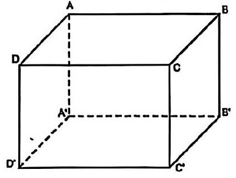
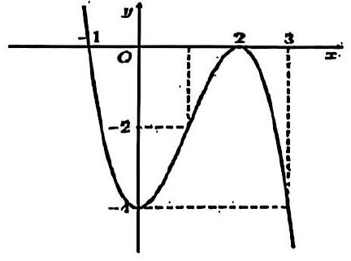
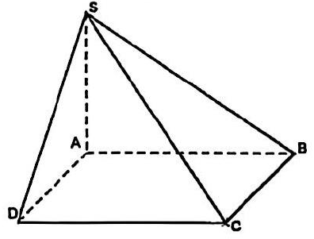
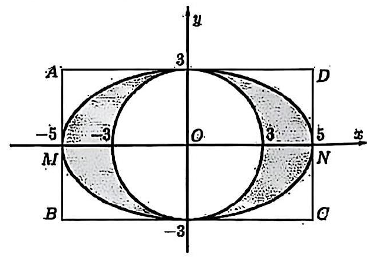
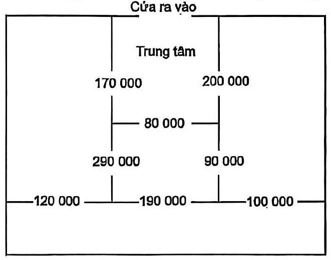
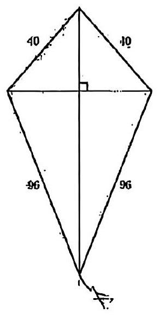
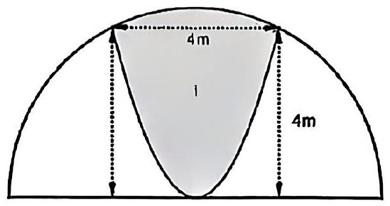

Đề: Sở GD&ĐT Sơn La, lần 3, mã đề 0110

PHẦN I. Câu trắc nghiệm nhiều phương án lựa chọn. Thí sinh trả lời từ câu 1 đến câu 12. Mỗi câu hỏi thí sinh chỉ chọn một phương án.

Câu 1. Tiệm cận đứng của đồ thị hàm số $y = \frac{x^2 + 4x + 1}{x - 1}$ là
A. $y = 1$.
B. $x = 4$.
C. $x = -4$.
D. $x = 1$.

Câu 2. Nghiệm của phương trình $4^{x + 2} = 64$ là:
A. $1$.
B. $3$.
C. $2$.
D. $0$.

Câu 3. Cho cấp số nhân $(u_n)$ có số hạng đầu $u_1 = 2$ và công bội $q = 5$. Giá trị của $u_3$ bằng
A. $50$.
B. $7$.
C. $10$.
D. $12$.

Câu 4. Cho hình hộp $ABCD.A'B'C'D'$ (tham khảo hình vẽ).
[HÌNH: Hình hộp ABCD.A'B'C'D' với mặt đáy trên ABCD và mặt đáy dưới A'B'C'D', các cạnh khuất nét đứt A'A, A'B', A'D']

Khẳng định nào sau đây đúng?
A. $\vec{AB} + \vec{AD} + \vec{AA'} = \vec{AC'}$.
B. $\vec{AB} + \vec{AC} + \vec{AA'} = \vec{AC'}$.
C. $\vec{AB} + \vec{AB'} + \vec{AA'} = \vec{AC'}$.
D. $\vec{AB} + \vec{AD} + \vec{A'A} = \vec{AC'}$.

Câu 5. Hàm số nào dưới đây có đồ thị như hình vẽ?
[HÌNH: Đồ thị hàm số bậc ba đi qua gốc tọa độ và có điểm cực tiểu tại (0; -4), điểm cực đại tại (2; 0), cắt trục tung tại (0; -4), cắt trục hoành tại x = -1 và x = 2, đi qua điểm (1; -2) và (3; -4)]

A. $y = \frac{x^2 + 3x - 4}{x - 2}$.
B. $y = x^3 - 3x^2 - 4$.
C. $y = \frac{x - 4}{x - 1}$.
D. $y = -x^3 + 3x^2 - 4$.

Câu 6. Phương trình $\sin x = 1$ có tập nghiệm là
A. $S = \left\{\frac{\pi}{2} + k\pi \mid k \in \mathbb{Z}\right\}$.
B. $S = \{k2\pi \mid k \in \mathbb{Z}\}$.
C. $S = \{k\pi \mid k \in \mathbb{Z}\}$.
D. $S = \left\{\frac{\pi}{2} + k2\pi \mid k \in \mathbb{Z}\right\}$.

Câu 7. Họ tất cả các nguyên hàm của hàm số $f(x) = e^x + \sin x$ là
A. $e^x - \sin x + C$.
B. $e^x + \sin x + C$.
C. $e^x + \cos x + C$.
D. $e^x - \cos x + C$.

Câu 8. Cho hình phẳng $(H)$ giới hạn bởi các đường thẳng $y = x^3 + x + 2$, $y = 0$, $x = 0$, $x = 2$. Gọi $V$ là thể tích của khối tròn xoay được tạo thành khi quay $(H)$ xung quanh trục $Ox$. Mệnh đề nào dưới đây đúng?
A. $V = \int_0^2 (x^3 + x + 2)^2 \, \mathrm{d}x$.
B. $V = \int_0^2 (x^3 + x + 2) \, \mathrm{d}x$.
C. $V = \pi \int_0^2 (x^3 + x + 2) \, \mathrm{d}x$.
D. $V = \pi \int_0^2 (x^3 + x + 2)^2 \, \mathrm{d}x$.

Câu 9. Cho hình chóp $S.ABCD$ có đáy là hình vuông, cạnh bên $SA$ vuông góc với đáy. Góc giữa đường thẳng $SC$ và mặt phẳng $(ABCD)$ là góc nào sau đây?
[HÌNH: Hình chóp S.ABCD đáy hình vuông ABCD, đường cao SA vuông góc với đáy ABCD, nối S với B, C, D]

A. $SCB$.
B. $SAC$.
C. $SCA$.
D. $ASC$.

Câu 10. Trong không gian $Oxyz$, vectơ chỉ phương của đường thẳng $(d)\colon \frac{x - 2}{2} = \frac{y + 1}{-1} = \frac{z - 3}{1}$ là
A. $\vec{u}_2 = (2; 1; 1)$.
B. $\vec{u}_3 = (2; -1; 3)$.
C. $\vec{u}_1 = (2; -1; 1)$.
D. $\vec{u}_4 = (-1; 1; 3)$.

Câu 11. Thời gian hoàn thành một câu hỏi trả lời ngắn (đơn vị là phút) của học sinh nữ lớp 12A thu được kết quả thống kê như sau:

| Thời gian (phút) | $[0; 4)$ | $[4; 8)$ | $[8; 12)$ | $[12; 16)$ | $[16; 20)$ |
| :--- | :---: | :---: | :---: | :---: | :---: |
| Số học sinh | 2 | 4 | 7 | 4 | 3 |

Khoảng biến thiên của mẫu số liệu trên bằng
A. $4$.
B. $20$.
C. $16$.
D. $10$.

Câu 12. Trong không gian $Oxyz$, cho mặt cầu $(S)\colon (x - 3)^2 + (y + 2)^2 + (z - 1)^2 = 9$. Bán kính của $(S)$ bằng
A. $18$.
B. $3$.
C. $9$.
D. $81$.

PHẦN II. Câu trắc nghiệm đúng sai. Thí sinh trả lời từ câu 1 đến câu 4. Trong mỗi ý a), b), c), d) ở mỗi câu, thí sinh chọn đúng hoặc sai.

Câu 1. Một vật trang trí có dạng một khối tròn xoay được tạo thành khi quay miền $(R)$ (phần tô đậm trong hình vẽ) quanh trục $MN$. Biết rằng $ABCD$ là hình chữ nhật với $AB = 6\text{ cm}$, $AD = 10\text{ cm}$ và $M, N$ lần lượt là trung điểm của $AB, CD$. Hai đường cong là đường Elip có hình chữ nhật cơ sở là $ABCD$ và đường tròn tiếp xúc với hai cạnh $AD$ và $BC$. Gắn hệ tọa độ $Oxy$ (đơn vị trên mỗi trục là $1\text{ cm}$) như hình vẽ.
[HÌNH: Hệ trục tọa độ Oxy, hình chữ nhật ABCD có AB = 6cm, AD = 10cm, trục Ox đi qua M(-5; 0) và N(5; 0), trục Oy đi qua (0; 3) và (0; -3), elip có hình chữ nhật cơ sở ABCD và đường tròn x^2 + y^2 = 9, phần tô đậm nằm giữa hai đường cong]

a) Đường tròn tâm $O$ tiếp xúc với hai cạnh $AD, BC$ có phương trình là $x^2 + y^2 = 9$.
b) Phương trình của đường Elip có hình chữ nhật cơ sở là $ABCD$ là $\frac{x^2}{5} + \frac{y^2}{3} = 1$.
c) Diện tích phần tô đậm là $S = \int_{-5}^5 \sqrt{9\left(1 - \frac{x^2}{25}\right)} \, \mathrm{d}x - \int_{-3}^3 \sqrt{9 - x^2} \, \mathrm{d}x$.
d) Thể tích của vật trang trí đó (kết quả làm tròn đến hàng phần chục) là $75,4\text{ cm}^3$.

Câu 2. Trong không gian với hệ trục tọa độ $Oxyz$, cho hai mặt cầu $(S)\colon (x - 3)^2 + y^2 + z^2 = 9$; $(S')\colon x^2 + y^2 + z^2 - 12y + 12 = 0$ và mặt phẳng $(P)\colon z - m = 0$.
a) Mặt cầu $(S)$ có tâm là $I(3; 0; 0)$ và mặt cầu $(S')$ có bán kính là $\sqrt{24}$.
b) Mặt phẳng $(P)$ có một vectơ pháp tuyến là $\vec{n} = (1; 0; 0)$.
c) Khoảng cách giữa hai tâm của hai mặt cầu $(S)$ và $(S')$ bằng $3\sqrt{5}$.
d) Biết rằng hai mặt cầu $(S)$ và $(S')$ cắt nhau theo giao tuyến là đường tròn $(C)$. Gọi $T$ là tập hợp các giá trị của $m$ để trên mặt phẳng $(P)$ dựng được một tiếp tuyến đến đường tròn $(C)$. Tổng bình phương các phần tử của tập hợp $T$ là $2$.

Câu 3. Cho hàm số $y = \frac{2x^2 - 2x + 2}{-x + 1}$.
a) Hàm số nghịch biến trên khoảng $(-\infty; 0) \cup (2; +\infty)$.
b) Hàm số đạt cực tiểu tại $x = 0$.
c) Giá trị nhỏ nhất của hàm số trên đoạn $\left[\frac{3}{2}; \frac{7}{2}\right]$ bằng $-7$.
d) Gọi $A, B$ là hai điểm cực trị của đồ thị hàm số. Cho điểm $M(-1; 0)$, gọi $D(a; b)$ là chân đường phân giác trong góc $M$ của tam giác $MAB$. Khi đó $a + b = \frac{1}{2}$.

Câu 4. Hai bạn An và Bình tham gia một buổi phỏng vấn tuyển cộng tác viên cho câu lạc bộ truyền thông của nhà trường. Ban xét tuyển có một hộp đựng 10 câu hỏi thuộc lĩnh vực tự nhiên và 20 câu hỏi thuộc lĩnh vực xã hội. An rút ngẫu nhiên 1 câu hỏi (không bỏ lại vào hộp), sau đó Bình rút ngẫu nhiên 1 câu hỏi.
a) Xác suất An rút được câu hỏi thuộc lĩnh vực tự nhiên là $\frac{1}{3}$.
b) Biết rằng An rút được câu hỏi thuộc lĩnh vực tự nhiên, xác suất Bình rút được câu hỏi thuộc lĩnh vực xã hội là $\frac{2}{3}$.
c) Xác suất Bình rút được câu hỏi thuộc lĩnh vực xã hội là $\frac{2}{3}$.
d) Biết rằng Bình rút được câu hỏi thuộc lĩnh vực xã hội, xác suất để An rút được câu hỏi thuộc lĩnh vực tự nhiên là $\frac{19}{29}$.

PHẦN III. Câu trắc nghiệm trả lời ngắn. Thí sinh trả lời từ câu 1 đến câu 6.

Câu 1. Một khu vui chơi có sơ đồ như hình vẽ. Khách hàng xuất phát từ khu Trung tâm, đi qua các cánh cửa để tham quan các khu vực khác. Giá vé cho mỗi lần bước qua một cánh cửa (theo bất kỳ chiều nào) được ghi trên sơ đồ (đơn vị tiền là đồng). Sau khi đã đi qua tất cả các khu vực, khách hàng phải trở lại khu Trung tâm để ra ngoài. Hỏi khách hàng phải tốn ít nhất bao nhiêu nghìn đồng tiền mua vé?
[HÌNH: Sơ đồ khu vui chơi gồm khu Trung tâm và 5 khu vực xung quanh với các cánh cửa ghi giá vé: Cửa ra vào phía trên Trung tâm, các cửa có giá vé 170 000, 200 000, 80 000, 290 000, 90 000, 120 000, 190 000, 100 000]

Câu 2. Cho tập hợp $S = \{1; 2; 3; \ldots; 15\}$. Có bao nhiêu cách chọn ra 6 số phân biệt từ tập $S$ và sắp xếp chúng thành một dãy $(a_1; a_2; a_3; a_4; a_5; a_6)$ thỏa mãn đồng thời hai điều kiện sau:

- Biểu thức $\log_3(a_1) + \log_3(a_2) + \log_3(a_3)$ là một số nguyên.
- $a_1 + a_6 = a_2 + a_5 = a_3 + a_4$.

Câu 3. Năm 2016, trong chiến dịch mang tên “Niềm tự hào cuối cùng của loài người”, kỳ thủ cờ vây số một thế giới Lee Sedol đã có trận đấu lịch sử với trí tuệ nhân tạo AlphaGo. Một trò chơi mô phỏng trận đấu này có luật như sau: Điểm khởi đầu của kỳ thủ là 2. Trong mỗi ván đấu, nếu thắng kỳ thủ được cộng 1 điểm, nếu hòa điểm số không thay đổi, nếu thua bị trừ 1 điểm. Trận đấu kết thúc ngay khi kỳ thủ đạt 3 điểm (giành chiến thắng) hoặc 0 điểm (thất bại). Giả sử xác suất mỗi ván thắng, hòa, thua của kỳ thủ lần lượt là $\frac{1}{4}, \frac{1}{4}, \frac{1}{2}$ và kết quả các ván đấu là độc lập với nhau. Xác suất để trận đấu kết thúc sau đúng 6 ván và kỳ thủ là người giành chiến thắng là $p$. Tính $4096p$.

Câu 4. Khi chế tạo cánh diều hình tứ giác, người ta sẽ tạo khung trước. Một khung cánh diều sẽ được tạo từ hai thanh chéo làm bằng gỗ và bốn sợi dây cước viền. Lấy bốn sợi dây tạo thành viền ngoài đã được cắt đúng độ dài với kích thước là 40, 40, 96, 96 (theo đơn vị cm) như hình vẽ và lắp hai thanh gỗ làm đường chéo. Tính tổng độ dài hai thanh chéo gỗ khi diện tích cánh diều lớn nhất (đơn vị cm, kết quả làm tròn đến hàng đơn vị).
[HÌNH: Khung cánh diều tứ giác với hai đường chéo gỗ vuông góc nhau, viền gồm 4 cạnh có kích thước hai cạnh trên là 40, 40 và hai cạnh dưới là 96, 96]

Câu 5. Cho hình chóp $S.ABCD$ có đáy $ABCD$ là hình thang vuông tại $A$ và $B$, $AB = BC = a$, $AD = 2a$, $SA$ vuông góc với đáy và $SA = a$. Gọi $M, N$ lần lượt là trung điểm của $SB$ và $CD$. Tính góc giữa $MN$ và $(SAC)$ theo đơn vị độ (kết quả làm tròn đến hàng đơn vị).

Câu 6. Một khuôn viên dạng nửa hình tròn, trên đó người ta thiết kế phần để trồng hoa có dạng của một cánh hoa hình parabol có đỉnh trùng với tâm và có trục đối xứng vuông góc với đường kính của nửa hình tròn, hai đầu mút của cánh hoa nằm trên nửa đường tròn (phần tô màu) và cách nhau một khoảng bằng 4m. Phần còn lại của khuôn viên (phần không tô màu) dành để trồng cỏ Nhật Bản. Biết các kích thước cho như hình vẽ, chi phí để trồng hoa và cỏ Nhật Bản tương ứng là 150 000 đồng/m$^2$ và 100 000 đồng/m$^2$. Hỏi cần bao nhiêu tiền (triệu đồng) để trồng hoa và trồng cỏ Nhật Bản trong khuôn viên đó? (Số tiền được làm tròn đến hàng phần trăm).
[HÌNH: Khuôn viên nửa hình tròn, phần trồng hoa hình parabol (phần tô màu) có đỉnh tại tâm và hai đầu mút cách nhau 4m, khoảng cách từ đầu mút đến đường kính đáy là 4m, phần còn lại trồng cỏ Nhật Bản]

