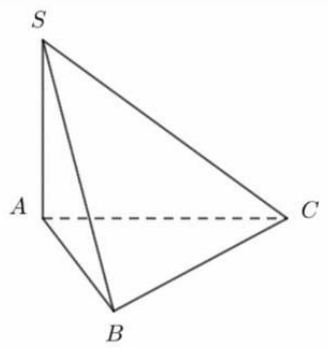
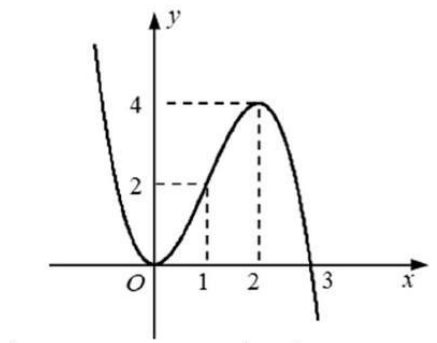
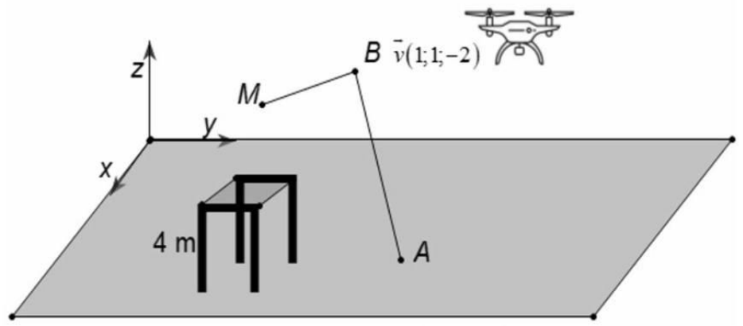
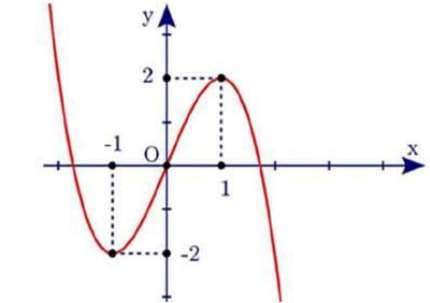
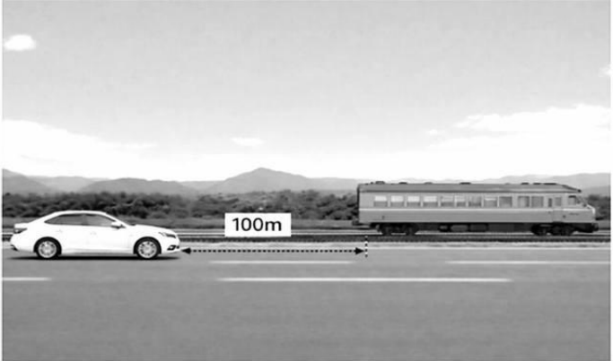
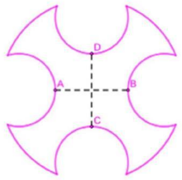
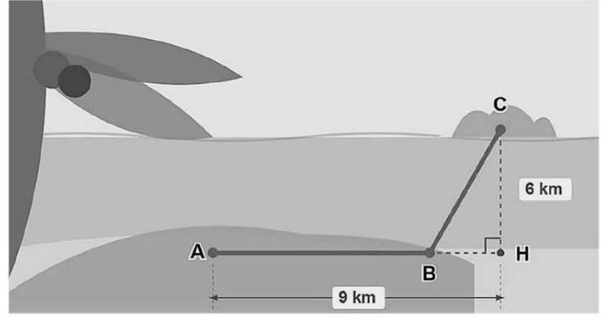

Đề: Sở GD&ĐT Nghệ An - Liên trường THPT, mã đề 0101

PHẦN I. Câu trắc nghiệm nhiều phương án lựa chọn. Thí sinh trả lời từ câu 1 đến câu 12. Mỗi câu hỏi thí sinh chỉ chọn một phương án.

Câu 1. Cho hình chóp $S.ABC$ có cạnh $SA$ vuông góc với đáy và $SA = a\sqrt{3}, AB = a$. Góc giữa $SB$ và mặt phẳng đáy bằng bao nhiêu?
[HÌNH: Hình chóp $S.ABC$ có đáy $ABC$, cạnh bên $SA$ vuông góc với mặt phẳng đáy, đường nét đứt $AC$]

A. $90^\circ$.
B. $45^\circ$.
C. $60^\circ$.
D. $30^\circ$.

Câu 2. Thể tích khối lăng trụ đứng $ABC.A'B'C'$ có đáy $ABC$ là tam giác đều cạnh $a$ và $AA' = a\sqrt{3}$ bằng
A. $\frac{a^3}{2}$.
B. $\frac{a^3\sqrt{3}}{6}$.
C. $\frac{3a^3}{4}$.
D. $\frac{a^3}{4}$.

Câu 3. Cho hàm số $y = f(x)$ có đồ thị như hình vẽ. Hàm số đã cho đồng biến trên khoảng nào?
[HÌNH: Đồ thị hàm số $y = f(x)$ trên hệ trục toạ độ $Oxy$ đi qua gốc toạ độ $O(0;0)$, đạt cực tiểu tại $O(0;0)$, đi qua điểm $(1;2)$, đạt cực đại tại $(2;4)$, cắt trục hoành tại điểm có hoành độ bằng $3$]

A. $(-\infty;0)$.
B. $(0;+\infty)$.
C. $(1;3)$.
D. $(0;2)$.

Câu 4. Mặt phẳng $(P): 2x - 3y + z - 4 = 0$ có một vecto pháp tuyến là:
A. $\vec{n} = (2;3;1)$.
B. $\vec{n} = (4;-6;1)$.
C. $\vec{n} = (2;-3;1)$.
D. $\vec{n} = (2;-3;-1)$.

Câu 5. Cho hàm số $f(x) = 3x^2 + 2x$. Trong các hàm số dưới đây, hàm số nào là một nguyên hàm của $f(x)$ trên $\mathbb{R}$?
A. $F_2(x) = \frac{x^3}{3} + \frac{x^2}{2}$.
B. $F_3(x) = x^3 - x^2 + 1$.
C. $F_1(x) = x^3 + x^2 - 4$.
D. $F_4(x) = 3x^3 + x^2$.

Câu 6. Cho hình hộp $ABCD.A'B'C'D'$. Đẳng thức nào sau đây là đẳng thức đúng.
A. $\vec{AB} + \vec{AD} = \vec{AC}$.
B. $\vec{AD} + \vec{DC} = \vec{AB}$.
C. $\vec{AB} + \vec{AC} = \vec{AD}$.
D. $\vec{AB} + \vec{AD} = \vec{AD}$.

Câu 7. Mặt cầu $(S)$ tâm $I(2;3;1)$ bán kính $R = \sqrt{3}$ có phương trình là:
A. $(x - 2)^2 + (y - 3)^2 + (z - 1)^2 = \sqrt{3}$.
B. $(x - 2)^2 + (y - 3)^2 + (z - 1)^2 = 3$.
C. $(x - 2)^2 + (y - 3)^2 + (z - 1)^2 = 9$.
D. $(x - 2)^2 + (y + 3)^2 + (z - 1)^2 = 3$.

Câu 8. Một vườn thú ghi lại tuổi thọ (đơn vị: năm) của 20 con hổ và thu được kết quả như sau:

| Tuổi thọ | [14;15) | [15;16) | [16;17) | [17;18) | [18;19) |
| :--- | :---: | :---: | :---: | :---: | :---: |
| Số con hổ | 1 | 3 | 8 | 6 | 2 |

Nhóm chứa tứ phân vị thứ nhất là
A. $[14;15)$.
B. $[16;17)$.
C. $[17;18)$.
D. $[15;16)$.

Câu 9. Cấp số cộng $(u_n)$ có $u_4 = 2; u_5 = 4$. Tìm số hạng thứ nhất
A. $u_1 = -4$.
B. $u_1 = \frac{1}{4}$.
C. $u_1 = 2$.
D. $u_1 = -2$.

Câu 10. Nghiệm của phương trình $\sin x = \frac{1}{2}$ là
A. $x = \frac{\pi}{3} + k2\pi \, (k \in \mathbb{Z})$.
B. $\begin{cases} x = \frac{\pi}{6} + k2\pi \\ x = \frac{5\pi}{6} + k2\pi \end{cases} (k \in \mathbb{Z})$.
C. $x = \pm \frac{\pi}{6} + k2\pi \, (k \in \mathbb{Z})$.
D. $x = \frac{\pi}{6} + k\pi \, (k \in \mathbb{Z})$.

Câu 11. Nghiệm của phương trình $3^{2x - 1} = \frac{1}{27}$ là
A. $x = 2$.
B. $x = -2$.
C. $x = 1$.
D. $x = -1$.

Câu 12. Diện tích hình phẳng giới hạn bởi đồ thị hàm số $y = x^2$, trục hoành và hai đường thẳng $x = 0$, $x = 2$ bằng:
A. $\frac{4}{3}$.
B. $\frac{8}{3}$.
C. $\frac{7}{3}$.
D. $\frac{5}{3}$.

PHẦN II. Câu trắc nghiệm đúng sai. Thí sinh trả lời từ câu 1 đến câu 4. Trong mỗi ý a), b), c), d)ở mỗi câu, thí sinh chọn đúng hoặc sai.

Câu 1. Có hai đội thi đấu môn Bóng bàn. Đội I có 6 vận động viên, đội II có 8 vận động viên. Xác suất đạt huy chương đồng của mỗi vận động viên đội I và đội II tương ứng là 0,8 và 0,65. Chọn ngẫu nhiên một vận động viên.
a) Xác suất để vận động viên này thuộc đội I là 0,8.
b) Xác suất để vận động viên được chọn đạt huy chương đồng là $\frac{5}{7}$.
c) Giả sử vận động viên được chọn đạt huy chương đồng. Xác suất để vận động viên đó thuộc đội II là 0,48.
d) Giả sử vận động viên được chọn đạt huy chương đồng. Xác suất để vận động viên đó thuộc đội I là $\frac{12}{25}$.

Câu 2. Một nhóm kỹ sư sử dụng flycam để giám sát một công trình điện mặt trời. Họ mô phỏng không gian công trình trong hệ trục toạ độ $Oxyz$, đơn vị trên mỗi trục toạ độ là mét. Mặt đất được xem là mặt phẳng $(Oxy)$, mái của công trình là một mặt phẳng song song với mặt đất và cách mặt đất $4\text{m}$. Flycam bay theo đường thẳng bắt đầu từ $A(9;-10;0)$ đến điểm $B(0;-3;11)$, sau đó từ điểm $B$ flycam tiếp tục bay theo đường thẳng có vec tơ chỉ phương $\vec{v}(1;1;-2)$ để tìm một vị trí điểm $M$ phù hợp với việc giám sát công trình trên mái.
[HÌNH: Không gian toạ độ $Oxyz$ mô phỏng công trình điện mặt trời cao $4\text{ m}$, đường bay flycam từ $A(9;-10;0)$ đến $B(0;-3;11)$, từ $B$ theo hướng vecto $\vec{v}(1;1;-2)$ đến điểm $M$ quan sát mái]

a) Đường bay $AB$ của flycam có vec tơ chỉ phương $\vec{u} = (-9;7;11)$.
b) Đường bay $BM$ của flycam có phương trình tham số là $\begin{cases} x = 9 + t \\ y = -10 + t \\ z = -2t \end{cases}, t \in \mathbb{R}$.
c) Góc giữa đường bay $BM$ và mái của công trình bằng $55^\circ$ (kết quả làm tròn đến hàng đơn vị).
d) Để đảm bảo an toàn cho công nhân làm việc trên mái công trình, điểm quan sát $M$ của flycam phải ở phía trên mái công trình và cách mái công trình $5\text{m}$. Biết điểm $M(a;b;c)$, khi đó $a - 2b - c = -3$.

Câu 3. Cho đồ thị hàm số $y = f(x) = ax^3 + bx^2 + cx + d, (a \ne 0)$ có hình vẽ dưới đây.
[HÌNH: Đồ thị hàm số bậc ba $y = f(x) = ax^3 + bx^2 + cx + d$ trên mặt phẳng toạ độ $Oxy$ đi qua gốc toạ độ $O(0;0)$, đạt cực tiểu tại $(-1;-2)$ và cực đại tại $(1;2)$]

a) Hàm số đã cho đạt cực đại tại điểm $x = 2$.
b) Hàm số đã cho có hai điểm cực trị.
c) Giá trị nhỏ nhất của hàm số trên đoạn $\left[-2; \frac{1}{2}\right]$ bằng $-2$.
d) Tổng $3a + 2b + c$ bằng 2

Câu 4. Trên đường quốc lộ, một ôtô đang di chuyển với vận tốc $45\text{km/h}$. Cùng lúc, một đoàn tàu chạy trên đường ray (giả thiết đường ray song song với đường quốc lộ) với vận tốc $60\text{km/h}$. Khi ô tô cách đuôi tàu $100\text{m}$ thì ô tô bắt đầu tăng tốc với vận tốc $v(t) = 2,5t + b \, (\text{m/s})$, với $t$ là thời gian kể từ lúc ô tô bắt đầu tăng tốc. Khi đạt đến tốc độ tối đa cho phép $90\text{km/h}$ thì ô tô giữ nguyên vận tốc
[HÌNH: Ô tô màu trắng di chuyển trên đường quốc lộ song song với đoàn tàu trên đường ray, khoảng cách từ đầu ô tô đến đuôi tàu ban đầu là $100\text{m}$]

a) Giá trị của $b$ bằng $12,5$.
b) Thời gian ô tô đạt vận tốc tối đa cho phép là $5\text{s}$.
c) Khoảng cách giữa ô tô và đuôi tàu sau $3\text{s}$ là $51,25\text{m}$.
d) Thời gian ô tô bắt kịp đuôi tàu kể từ lúc ô tô bắt đầu tăng tốc là $15,75\text{s}$.

PHẦN III. Câu trắc nghiệm trả lời ngắn. Thí sinh trả lời từ câu 1 đến câu 6.

Câu 1. Trong một nhà máy cơ khí chế tạo,có một chi tiết máy hình đĩa tròn có dạng như hình vẽ, nhận $AB$ và $CD$ làm các trục đối xứng. Để tăng độ bền cho chi tiết máy này người ta cần phủ sơn cả hai mặt của chi tiết máy. Biết rằng đường tròn lớn có bán kính $5\text{dm}$, các đường tròn nhỏ đều có bán kính bằng $2\text{dm}$, $AB = CD = 4\text{dm}$ và chi phí sơn là $82.000\text{ đồng/m}^2$. Chi phí để sơn hoàn thiện chi tiết máy đó là $a$ ( đơn vị nghìn đồng) khi đó $a$ bằng bao nhiêu (kết quả làm tròn đến hàng đơn vị)?
[HÌNH: Chi tiết máy phẳng đối xứng qua hai trục vuông góc $AB$ và $CD$, với 4 cung tròn ngoài lồi và 4 cung tròn nhỏ lõm bán kính $2\text{dm}$]

Câu 2. Cho hình lăng trụ $ABC.A'B'C'$, đáy là tam giác đều cạnh bằng 12, $A'A = A'B = A'C$ và góc tạo bởi cạnh bên và mặt phẳng đáy bằng $60^\circ$. Tính khoảng cách từ trung điểm $M$ của $CC'$ đến mặt phẳng $(A'BC)$ (kết quả làm tròn đến hàng phần trăm).

Câu 3. Để chuẩn bị cho đội tình nguyện hỗ trợ y tế tại một vùng sâu vùng xa, một bệnh viện đa khoa đã chọn ra 10 bác sỹ giỏi gồm 6 bác sỹ nam trong đó có bác sỹ An và 4 bác sỹ nữ trong đó có bác sỹ Bình. Đội tình nguyện gồm 5 bác sỹ với yêu cầu như sau: có cả nam và nữ, số bác sỹ nữ không ít hơn 2 người. Do yêu cầu về chuyên môn bổ trợ cho nhau nên nếu bác sỹ An tham gia thì bác sỹ Bình cũng phải tham gia, nhưng nếu bác sỹ Bình tham gia thì bác sỹ An không nhất thiết phải tham gia. Hỏi có bao nhiêu cách thành lập đội tình nguyện như trên?

Câu 4. Ông An vay ngân hàng 500 triệu đồng với lãi suất ngân hàng $r = 0,6\%$ trên tháng theo hình thức lãi kép để kinh doanh. Cuối tháng thứ nhất sau khi vay, ông An bắt đầu hoàn nợ bằng cách trả một số tiền cố định 10 triệu đồng vào cuối mỗi tháng. Hỏi sau bao nhiêu tháng thì ông An trả hết nợ?

Câu 5. Một công ty muốn làm một đường ống dẫn từ một điểm $A$ trên bờ đến một điểm $C$ trên một hòn đảo. Hòn đảo cách bờ biển $6\text{ km}$. Để thực hiện, công ty dự định xây dựng phần đường ống trên bờ từ $A$ đến $B$ và đường ống dưới nước từ $B$ đến $C$ (hình vẽ).
[HÌNH: Mô hình lắp đặt đường ống dẫn nước: điểm $A$ và $B$ trên bờ, đảo $C$ cách bờ khoảng vuông góc $CH = 6\text{ km}$, khoảng cách $AH = 9\text{ km}$, đường ống nối từ $A$ đến $B$ trên bờ và từ $B$ đến $C$ trên biển]

Biết giá để xây đường ống trên bờ là $50000\text{USD}$ mỗi km, và $130000\text{USD}$ mỗi km để xây dưới nước. Đoạn đường từ $A$ đến $B$ là bao nhiêu km để tổng chi phí xây dựng lắp đặt từ $A$ đến $C$ khoảng $1170000\text{USD}$ (kết quả làm tròn đến chữ số thập phân thứ nhất)?

Câu 6. Một mã OTP (One Time Password) gồm 7 ký tự số (từ 0 đến 9). Một ngân hàng quy định mã OTP "an toàn" là mã thỏa mãn đồng thời hai điều kiện:
1. Có ít nhất một chữ số xuất hiện đúng 3 lần.
2. Các chữ số còn lại (nếu có) phải khác nhau và khác chữ số đã nêu ở điều kiện 1.
Chọn ngẫu nhiên một mã OTP bất kỳ (từ 0000000 đến 9999999). Xác suất để chọn được một mã "an toàn" bằng $0,ab0cd$; với $a,b,c,d \in \{1;2;3;4;5;6;7;8;9\}$. Tích $a.b.c.d$ có giá trị là:
