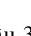
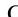

status: ocr-draft
source: Sở Giáo dục và Đào tạo Lào Cai, Thi thử tốt nghiệp THPT năm 2026, mã đề 0101

SỞ GIÁO DỤC VÀ ĐÀO TẠO LÀO CAI                         THI THỬ TỐT NGHIỆP THPT NĂM 2026
ĐỀ THI CHÍNH THỨC                                           Môn: TOÁN
(Đề thi có 04 trang)                    Thời gian làm bài: 90 phút, không kể thời gian phát đề

Họ, tên thí sinh:................................................................. Số báo danh:....................... Mã đề 0101

## PHẦN I. Câu trắc nghiệm nhiều phương án lựa chọn
Thí sinh trả lời từ câu 1 đến câu 12. Mỗi câu hỏi thí sinh chỉ chọn một phương án.

**Câu 1.** Trong không gian $Oxyz$, cho hai điểm $A(1;1;-3)$ và $B(2;-1;-1)$. Độ dài đoạn $AB$ bằng

A. $3$.  B. $4$.  C. $3\sqrt{2}$.  D. $4\sqrt{2}$.

**Câu 2.** Khi cắt một vật thể bởi mặt phẳng vuông góc với trục $Ox$ tại điểm có hoành độ $x$ với mặt cắt là hình vuông có độ dài các cạnh là $\sqrt{3-x^2}$ ($-\sqrt{3}\le x\le\sqrt{3}$). Thể tích của vật thể đã cho bằng

A. $\pi\sqrt{3}$.  B. $\sqrt{3}$.  C. $4\sqrt{3}$.  D. $4\pi\sqrt{3}$.

**Câu 3.** Tập xác định của hàm số $y=\cot x$ là

A. $\mathbb{R}\setminus\left\{\frac{\pi}{2}+k2\pi,\ k\in\mathbb{Z}\right\}$.  B. $\mathbb{R}\setminus\{k\pi,\ k\in\mathbb{Z}\}$.

C. $\mathbb{R}\setminus\{k2\pi,\ k\in\mathbb{Z}\}$.  D. $\mathbb{R}\setminus\left\{\frac{\pi}{2}+k\pi,\ k\in\mathbb{Z}\right\}$.

**Câu 4.** Cho hình lập phương $ABCDEFGH$. Góc giữa hai đường thẳng $AF$ và $EG$ là

A. $90^\circ$.  B. $60^\circ$.  C. $0^\circ$.  D. $30^\circ$.

**Câu 5.** Cho cấp số nhân $(u_n)$ với $u_1=3$ và công bội $q=4$. Giá trị của $u_2$ bằng

A. $5$.  B. $\frac{4}{3}$.  C. $12$.  D. $\frac{3}{4}$.

**Câu 6.** Cho hàm số $y=f(x)=\frac{ax^2+bx+c}{mx+n}$ có đồ thị như hình vẽ dưới đây. Đường tiệm cận xiên của đồ thị hàm số đã cho có phương trình là

[HÌNH: Đồ thị hàm phân thức có tiệm cận đứng $x=1$, tiệm cận xiên nét đứt đi qua các điểm thể hiện $y$-intercept 3 và $I(1;4)$.]

A. $y=x-1$.  B. $y=3x+1$.  C. $y=x-2$.  D. $y=x+3$.

**Câu 7.** Tập nghiệm của bất phương trình $3^{x-1}\ge 9$ là

A. $[2;+\infty)$.  B. $(-\infty;2)$.  C. $[3;+\infty)$.  D. $(-\infty;3]$.

**Câu 8.** Trong không gian $Oxyz$, cho hai vectơ $\vec a=(1;2;-1)$ và $\vec b=(2;-1;3)$. Tọa độ của vectơ $4\vec a-\vec b$ là

A. $(2;9;-7)$.  B. $(2;9;7)$.  C. $(-2;9;7)$.  D. $(-2;-9;7)$.

**Câu 9.** Khảo sát thời gian tự học bài ở nhà của học sinh khối 9 ở trường X, ta thu được bảng sau:

| Thời gian (phút) | $[0;30)$ | $[30;60)$ | $[60;90)$ | $[90;120)$ | $[120;150)$ |
|---|---:|---:|---:|---:|---:|
| Số học sinh | 9 | 10 | 9 | 15 | 7 |

Phương sai của mẫu số liệu ghép nhóm là

A. $1602$.  B. $1601{,}64$.  C. $1601{,}9$.  D. $1603$.

## PHẦN I (tiếp)

**Câu 10.** Cho hàm số $f(x)$ có bảng biến thiên như sau:

[HÌNH: Bảng biến thiên với các mốc $x=-\infty,-1,2,+\infty$; dấu đạo hàm $+ ,0,-,0,+$; cực đại $f(-1)=1$ và cực tiểu $f(2)=-2$.]

Hàm số đã cho đạt cực đại tại

A. $x=2$.  B. $x=-1$.  C. $x=-2$.  D. $x=1$.

**Câu 11.** Nguyên hàm của hàm số $y=5^x$ là

A. $5^x\ln 5+C$.  B. $x\cdot5^{x-1}+C$.  C. $\frac{5^x}{\ln 5}+C$.  D. $\frac{5^{x+1}}{x+1}+C$.

**Câu 12.** Cho hình lập phương $ABCD.A'B'C'D'$. Khi đó $\overrightarrow{AD'}$ bằng vectơ nào sau đây?

A. $\overrightarrow{BC}$.  B. $\overrightarrow{BC'}$.  C. $\overrightarrow{B'C'}$.  D. $\overrightarrow{BB'}$.

## PHẦN II. Câu trắc nghiệm đúng sai
Thí sinh trả lời từ câu 1 đến câu 4. Trong mỗi ý a), b), c), d) ở mỗi câu, thí sinh chọn đúng hoặc sai.

**Câu 1.** Cho hàm số $f(x)=\sin x+\cos x$ và $g(x)=3-2\sin x$.

a) $\displaystyle\int_0^{\pi/2}f(x)\,dx=2$.

b) Tập giá trị của hàm số $g(x)=3-2\sin x$ là $T=[1;5]$.

c) $\displaystyle\int g(x)\,dx=3x-2\cos x+C$.

d) Số nghiệm phương trình $\displaystyle\int_0^{\pi/2}f(x)\,dx=3-2\sin x$ trên đoạn $[0;2\pi]$ là 2.

**Câu 2.** Cho hình lập phương $ABCD.A'B'C'D'$ có cạnh bằng $a$ (tham khảo hình vẽ).

[HÌNH: Hình lập phương với các đỉnh $A,B,C,D$ ở mặt trên và $A',B',C',D'$ ở mặt dưới; các cạnh khuất được nét đứt.]

a) $\overrightarrow{AC}=\overrightarrow{AB}+\overrightarrow{AD}$.

b) $\overrightarrow{AC'}=\overrightarrow{AD}+\overrightarrow{AB}+\overrightarrow{AA'}$.

c) $(\overrightarrow{AC},\overrightarrow{B'C'})=45^\circ$.

d) $\overrightarrow{AC}\cdot\overrightarrow{B'C'}=\frac{\sqrt{2}a^2}{2}$.

**Câu 3.** Cho hàm số $y=\frac{ax^2+bx+c}{mx+n}$ có đồ thị như hình vẽ dưới đây.

[HÌNH: Đồ thị hàm phân thức có tiệm cận đứng $x=-1$, tiệm cận xiên dốc xuống qua $(0;1)$ và $(-1;2)$; hai điểm cực trị được đánh dấu tại $(-2;4)$ và $(0;0)$.]

a) Hàm số nghịch biến trên khoảng $(-1;0)$.

b) $m=n$.

c) Tâm đối xứng của đồ thị hàm số là $I(-1;2)$.

d) Khoảng cách giữa hai điểm cực trị của đồ thị hàm số bằng $2\sqrt{5}$.

**Câu 4.** Một người chuyển động trên một quãng đường thẳng, mối quan hệ giữa vận tốc và thời gian được minh họa như hình vẽ. Đường cong trong hình vẽ là một phần của parabol.

[HÌNH: Đồ thị vận tốc-thời gian bắt đầu tại $(0;0)$, tăng tuyến tính đến $(5;20)$, theo cung parabol đạt đỉnh $(12{,}5;22)$ và đi qua $(20;20)$, rồi giảm tuyến tính về $(25;0)$.]

a) Trong 5 giây đầu tiên, người đó chuyển động nhanh dần đều với gia tốc $a=5\ \mathrm{m/s^2}$.

b) Quãng đường đi được trong 5 giây đầu tiên là $100\ \mathrm{m}$.

c) Quãng đường vật đi được trong 20 giây đầu tiên là $370\ \mathrm{m}$.

d) Vận tốc trung bình của người đó trên cả hành trình là $16{,}8\ \mathrm{m/s}$.

## PHẦN III. Câu trắc nghiệm trả lời ngắn
Thí sinh trả lời từ câu 1 đến câu 6.

**Câu 1.** Cho hình chóp $S.ABCD$ có đáy $ABCD$ là hình thoi tâm $O$, cạnh bằng 6 và góc $ABC=60^\circ$. Biết rằng hình chiếu vuông góc của $S$ lên mặt phẳng $(ABCD)$ trùng với trọng tâm $G$ của tam giác $ABC$ và số đo góc nhị diện $[S,AC,G]$ bằng $60^\circ$. Khi đó, khoảng cách giữa hai đường thẳng $SD$ và $AC$ bằng $\frac{b}{\sqrt{a}}$ (với $a,b\in\mathbb{Z}$). Giá trị của $a^2-b^2$ bằng bao nhiêu?

**Câu 2.** Một khối bê tông có chiều cao 2 mét được đặt trên mặt đất. Nếu cắt khối bê tông bởi một mặt phẳng nằm ngang và cách mặt đất $x$ mét ($0\le x\le 2$) thì được mặt cắt là một hình chữ nhật có chiều dài 5 mét và chiều rộng bằng $(0{,}5)^x$ mét (xem hình dưới). Thể tích của khối bê tông đó bằng bao nhiêu mét khối (kết quả làm tròn đến hàng phần mười)?

[HÌNH: Khối bê tông cao 2 m; mặt cắt ngang hình chữ nhật được tô màu, có chiều dài 5 m và chiều rộng $(0{,}5)^x$ m tại độ cao $x$ m.]

**Câu 3.** Trong một trò chơi điện tử, có bốn chất điểm $A,B,C,D$ đang di chuyển trên các đường thẳng song song như hình vẽ. Lập trình viên đã lập trình vận tốc của các chất điểm $A,B,C$ lần lượt là $v_A(t)=t+2$; $v_B(t)=2t$ và $v_C(t)=11-2t$ (với $t$ tính bằng giây từ lúc bắt đầu chuyển động và $v$ tính bằng m/s và giả thiết rằng khi $v<0$ thì chất điểm đang di chuyển từ phải qua trái).

[HÌNH: Bốn đường thẳng song song có mũi tên sang phải, lần lượt mang nhãn $A,B,C,D$; một chấm đánh dấu vị trí trên mỗi đường.]

Biết vận tốc của chất điểm $D$ tại một thời điểm bất kì được tính bằng vận tốc nhỏ nhất của ba chất điểm $A,B,C$. Quãng đường chất điểm $D$ đi được trong 5 giây đầu tiên bằng bao nhiêu mét?

**Câu 4.** Hai bạn An và Bình cùng chơi trò chơi đánh cờ carô trên một bảng ô vuông kích thước $3\times3$ (gồm 9 ô trống). Luật chơi quy định An đi trước, mỗi lượt điền một dấu “X” vào một ô trống và Bình đi sau, mỗi lượt điền một dấu “O” vào một ô trống. Trò chơi kết thúc và xác định được người chiến thắng nếu người đó tạo được 3 dấu của mình nằm liên tiếp nhau trên cùng một hàng ngang, hàng dọc hoặc đường chéo. Hỏi có tất cả bao nhiêu trình tự các nước đi để ván cờ kết thúc chính xác ở nước đi thứ 5 với An là người giành chiến thắng?

[HÌNH: Bảng cờ caro 3×3 với O ở ô trên trái, X ở ô trên phải, X ở ô giữa và X ở ô dưới trái.]

**Câu 5.** Một doanh nghiệp sản xuất thiết bị điện tử thông minh có quy trình vận hành và chính sách thuế như sau: Trong mỗi tháng, doanh nghiệp phải chi trả một khoản chi phí cố định 200 triệu đồng, khoản chi phí này không phụ thuộc vào số lượng sản phẩm sản xuất. Ngoài ra, để hoàn thiện mỗi sản phẩm, doanh nghiệp phải chịu chi phí biến đổi 1 triệu đồng cho mỗi sản phẩm. Mỗi sản phẩm được bán ra thị trường với giá 3 triệu đồng một sản phẩm. Nhằm khuyến khích gia tăng quy mô sản xuất, cơ quan quản lý áp dụng chính sách thuế tính theo tổng doanh thu trong tháng, với mức thuế suất giảm dần theo sản lượng. Nếu doanh nghiệp bán dưới 100 sản phẩm trong tháng, thuế suất là 10% tổng doanh thu. Nếu bán từ 100 đến dưới 300 sản phẩm, thuế suất là 8% tổng doanh thu. Nếu bán từ 300 sản phẩm trở lên, thuế suất là 5% tổng doanh thu. Gọi $x$ là số lượng sản phẩm doanh nghiệp sản xuất và bán ra trong một tháng ($x\in\mathbb{N}^*$). Tìm số sản phẩm tối thiểu để doanh nghiệp bắt đầu có lãi.

**Câu 6.** Bé An vừa kết thúc năm học lớp 1. Nghỉ hè, mẹ bé khuyến khích bé An tập viết để chữ viết đẹp và viết được nhanh hơn. Mẹ giao ngày thứ hai này bé luyện viết 1 trang trong quyển luyện viết và cứ thế tăng mỗi ngày thêm một trang. Đến ngày chủ nhật của tuần đó bé An đã viết được bao nhiêu trang luyện chữ?

-------- HẾT--------

- Thí sinh không được sử dụng tài liệu.
- Giám thị không giải thích thêm.
