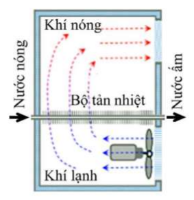
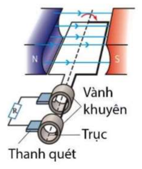
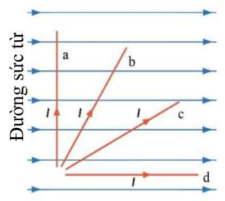
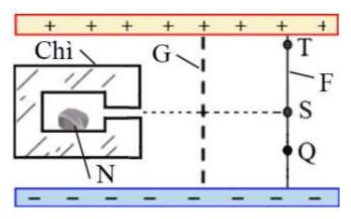
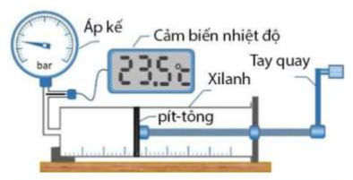
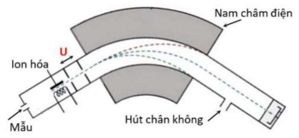
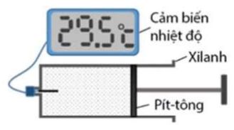

BỘ GIÁO DỤC VÀ ĐÀO TẠO
ĐỀ THAM KHẢO
(Đề thi có 04 trang)

KỲ THI TỐT NGHIỆP THPT TỪ NĂM 2025
MÔN: VẬT LÍ
Thời gian làm bài 50 phút, không kể thời gian phát đề

Họ, tên thí sinh:.....................................................................
Số báo danh: .........................................................................

Cho biết: $\pi = 3,14$; $T\text{ (K)} = t\text{ }(^\circ\text{C}) + 273$; $R = 8,31\text{ J.mol}^{-1}.\text{K}^{-1}$; $N_{\text{A}} = 6,02.10^{23}\text{ hạt/mol}$.

PHẦN I. Thí sinh trả lời từ câu 1 đến câu 18. Mỗi câu hỏi thí sinh chỉ chọn một phương án.

Câu 1. Quá trình một chất chuyển từ thể lỏng sang thể khí được gọi là quá trình
A. nóng chảy.
B. hóa hơi.
C. hóa lỏng.
D. đông đặc.

Câu 2. Biển báo nào dưới đây cảnh báo khu vực có chất phóng xạ?
[HÌNH: Bốn biển báo hình tam giác đều viền đen nền vàng đặt phía trên các phương án A, B, C, D: biển A có hình tia sét; biển B có biểu tượng cánh quạt ba lá (chất phóng xạ); biển C có biểu tượng nguy hiểm sinh học; biển D có hình dấu chấm than]

A.
B.
C.
D.

Sử dụng các thông tin sau cho Câu 3 và Câu 4: Hình bên là sơ đồ nguyên lí hoạt động của một máy sưởi dùng nước nóng. Nước nóng được bơm vào ống bên trong máy, hệ thống tản nhiệt được gắn với ống này. Không khí lạnh được hút vào trong máy sưởi bằng quạt và được làm ấm lên nhờ hệ thống tản nhiệt. Mỗi giờ có $575\text{ kg}$ nước nóng được bơm qua máy. Biết nhiệt độ của nước giảm $5,0\ ^\circ\text{C}$ khi đi qua máy; nhiệt dung riêng của nước là $c = 4180\text{ J/(kg.K)}$.
[HÌNH: Sơ đồ nguyên lí máy sưởi dùng nước nóng ở bên phải: nước nóng đi vào bộ tản nhiệt từ phía trên bên trái và đi ra thành nước ấm ở bên phải; quạt hút không khí lạnh từ phía dưới qua bộ tản nhiệt và thổi không khí nóng ra ở phía trên]

Câu 3. Nhiệt độ của nước giảm bao nhiêu kelvin khi đi qua máy sưởi?
A. $5\text{ K}$.
B. $278\text{ K}$.
C. $268\text{ K}$.
D. $4\text{ K}$.

Câu 4. Nhiệt lượng tỏa ra từ nước trong mỗi giờ là
A. $12\text{ MJ}$.
B. $670\text{ MJ}$.
C. $2,5\text{ MJ}$.
D. $21\text{ kJ}$.

Câu 5. Một vật đang được làm lạnh sao cho thể tích của vật không thay đổi. Nội năng của vật
A. tăng lên.
B. giảm đi.
C. không thay đổi.
D. tăng lên rồi giảm đi.

Câu 6. Một khối khí lí tưởng xác định có áp suất bằng áp suất khí quyển. Nếu giữ nhiệt độ của khối khí đó không đổi và làm cho áp suất của nó bằng một nửa áp suất khí quyển thì thể tích của khối khí
A. bằng một nửa giá trị ban đầu.
B. bằng hai lần giá trị ban đầu.
C. bằng giá trị ban đầu.
D. bằng bốn lần giá trị ban đầu.

Câu 7. Gọi $p$, $V$ và $T$ lần lượt là áp suất, thể tích và nhiệt độ tuyệt đối của một khối khí lí tưởng xác định. Công thức nào sau đây mô tả đúng định luật Charles?
A. $pV = \text{hằng số}$.
B. $\frac{V}{T} = \text{hằng số}$.
C. $VT = \text{hằng số}$.
D. $\frac{p}{T} = \text{hằng số}$.

Câu 8. Khi chưa đóng cửa, không khí bên trong ô tô có nhiệt độ là $25\ ^\circ\text{C}$. Sau khi đóng cửa và đỗ ô tô dưới trời nắng một thời gian, nhiệt độ không khí trong ô tô là $55\ ^\circ\text{C}$. So với số mol khí trong ô tô ngay khi vừa đóng cửa, phần trăm số mol khí đã thoát ra là
A. $9\%$.
B. $91\%$.
C. $10\%$.
D. $55\%$.

Câu 9. Trong sóng điện từ, cường độ điện trường $\vec{E}$ và cảm ứng từ $\vec{B}$
A. ngược chiều nhau.
B. cùng chiều nhau.
C. tạo với nhau góc $45^\circ$.
D. tạo với nhau góc $90^\circ$.

Sử dụng các thông tin sau cho Câu 10 và Câu 11: Một khung dây dẫn phẳng có diện tích $S$, gồm $N$ vòng dây quay đều với tốc độ góc $\omega$ quanh trục cố định vuông góc với cảm ứng từ $\vec{B}$ của từ trường đều (hình bên).
[HÌNH: Khung dây dẫn phẳng quay quanh trục thẳng đứng giữa hai cực N và S của từ trường đều, hai đầu dây nối qua vành khuyên và thanh quét tới điện trở R ở bên ngoài]

Câu 10. Nối hai đầu khung dây với điện trở $R$ thành một mạch kín, trong mạch sẽ
A. xuất hiện dòng điện không đổi.
B. không xuất hiện dòng điện.
C. xuất hiện dòng điện xoay chiều.
D. xuất hiện dòng điện có cường độ lớn dần.

Câu 11. Suất điện động cực đại xuất hiện trong khung dây nói trên là
A. $E_0 = NBS$.
B. $E_0 = \frac{NBS}{R}$.
C. $E_0 = NBS\omega$.
D. $E_0 = \frac{NBS\omega}{R}$.

Câu 12. Bốn đoạn dây dẫn a, b, c, d có cùng chiều dài được đặt trong từ trường đều (hình bên). Các dòng điện chạy trong bốn đoạn dây dẫn này có cùng cường độ $I$. Lực từ tác dụng lên đoạn dây dẫn nào là mạnh nhất?
[HÌNH: Bốn đoạn dây dẫn mang dòng điện cùng cường độ I đặt trong từ trường đều có các đường sức từ nằm ngang hướng sang phải: đoạn a thẳng đứng vuông góc với đường sức từ; đoạn b và c nghiêng các góc khác nhau; đoạn d nằm ngang cùng phương với đường sức từ]

A. Đoạn a.
B. Đoạn b.
C. Đoạn c.
D. Đoạn d.

Câu 13. Khi nói về từ trường, phát biểu nào sau đây sai?
A. Từ trường là trường lực gây ra bởi dòng điện hoặc nam châm.
B. Cảm ứng từ tại một điểm đặc trưng cho từ trường về mặt tác dụng lực tại điểm đó.
C. Từ trường tác dụng lực từ lên một dòng điện hay một nam châm đặt trong nó.
D. Phương của lực từ tại một điểm trùng với phương tiếp tuyến của đường sức từ tại điểm đó.

Câu 14. Khi bác sĩ đang siêu âm người bệnh (hình bên), đầu dò của máy siêu âm phát ra
[HÌNH: Bác sĩ cầm đầu dò máy siêu âm đặt lên cơ thể người bệnh]

A. tia X.
B. sóng siêu âm.
C. sóng ánh sáng.
D. tia gamma.

Câu 15. Số nucleon có trong hạt nhân $^{39}_{19}\text{K}$ là
A. 19.
B. 20.
C. 39.
D. 58.

Câu 16. Hạt nhân càng bền vững nếu nó có
A. khối lượng càng lớn.
B. độ hụt khối càng lớn.
C. năng lượng liên kết càng lớn.
D. năng lượng liên kết riêng càng lớn.

Câu 17. Trong hình bên, N là một mẫu phóng xạ được đặt trong một điện trường đều do hai bản kim loại phẳng song song và tích điện trái dấu tạo ra. Các tia phóng xạ phát ra từ N đập vào màn huỳnh quang F gây ra các chấm sáng. Hệ thống được đặt trong chân không.
[HÌNH: Sơ đồ nguồn phóng xạ N đặt trong hộp chì phát ra các tia phóng xạ đi qua tấm giấy G vào điện trường giữa bản dương (+) ở trên và bản âm (-) ở dưới, đập vào màn huỳnh quang F tạo ra các chấm sáng T (lệch lên), S (truyền thẳng), Q (lệch xuống)]

Phát biểu nào sau đây đúng?
A. Chấm sáng tại S do tia $\beta^-$ gây ra.
B. Hầu hết các tia $\gamma$ gây ra chấm sáng tại T.
C. Chấm sáng tại Q có thể do tia $\alpha$ gây ra.
D. Hầu hết các tia $\beta^+$ bị chắn bởi tờ giấy G.

Câu 18. Khi chụp cộng hưởng từ, để máy ghi nhận thông tin chính xác và tránh nguy hiểm, phải bỏ trang sức kim loại khỏi cơ thể người bệnh. Giả sử có một vòng kim loại nằm trong máy sao cho mặt phẳng của vòng vuông góc với cảm ứng từ của từ trường do máy tạo ra khi chụp. Biết bán kính và điện trở của vòng này lần lượt là $3,9\text{ cm}$ và $0,010\ \Omega$. Nếu trong $0,40\text{ s}$, độ lớn của cảm ứng từ này giảm đều từ $1,80\text{ T}$ xuống $0,20\text{ T}$ thì cường độ dòng điện trong vòng kim loại này là
A. $7,6\text{ A}$.
B. $1,9\text{ A}$.
C. $8,5\text{ A}$.
D. $3,8\text{ A}$.

PHẦN II. Thí sinh trả lời từ câu 1 đến câu 4. Trong mỗi ý a), b), c), d) ở mỗi câu, thí sinh chọn đúng hoặc sai.

Câu 1. Có thể sử dụng bộ thí nghiệm (hình bên) để tìm hiểu về mối liên hệ giữa áp suất và thể tích của một lượng khí xác định ở nhiệt độ không đổi.
[HÌNH: Bộ thí nghiệm khảo sát định luật Boyle gồm xilanh có thang đo thể tích, pít-tông gắn tay quay, áp kế đo áp suất khí và cảm biến nhiệt độ gắn hiển thị điện tử 23,5 °C]

| Lần đo | $V\text{ (cm}^3\text{)}$ | $p\text{ (bar)}$ |
| :---: | :---: | :---: |
| 1 | 22 | 1,04 |
| 2 | 20 | 1,14 |
| 3 | 18 | 1,29 |
| 4 | 16 | 1,43 |
| 5 | 14 | 1,64 |

a) Trình tự thí nghiệm: Nén (giữ nguyên nhiệt độ) khí trong xilanh; Ghi giá trị thể tích và giá trị áp suất khí; Lặp lại các thao tác.
b) Với kết quả thu được ở bảng bên, công thức liên hệ áp suất theo thể tích là $p = \frac{23}{V}$, $p$ đo bằng bar ($1\text{ bar} = 10^5\text{ Pa}$), $V$ đo bằng $\text{cm}^3$.
c) Lượng khí đã dùng trong thí nghiệm là $8.10^{-4}\text{ mol}$.
d) Thí nghiệm này đã chứng minh được định luật Boyle.

Câu 2. Để xác định các chất trong một mẫu, người ta dùng một máy được gọi là máy quang phổ khối (khối phổ kế, hình bên). Khi cho mẫu vào máy này, hạt có khối lượng $m$ bị ion hóa sẽ mang điện tích $q$. Sau đó, hạt được tăng tốc đến tốc độ $v$ nhờ hiệu điện thế $U$. Tiếp theo, hạt sẽ chuyển động vào vùng từ trường theo phương vuông góc với cảm ứng từ $\vec{B}$. Lực từ tác dụng lên hạt có độ lớn $F = Bv|q|$, có phương vuông góc với cảm ứng từ $\vec{B}$ và với vận tốc $\vec{v}$ của hạt. Bán kính quỹ đạo tròn của hạt trong vùng có từ trường là $r$. Dựa trên tỉ số $\frac{|q|}{m}$, có thể xác định được các chất trong mẫu.
[HÌNH: Sơ đồ nguyên lí máy quang phổ khối (khối phổ kế): mẫu qua buồng ion hóa được gia tốc bởi hiệu điện thế U, sau đó đi vào buồng cong hình quạt hút chân không đặt trong từ trường của nam châm điện]

a) Tốc độ của hạt bị thay đổi do tác dụng của từ trường trong máy.
b) Bỏ qua tốc độ ban đầu của hạt. Sau khi được tăng tốc bởi hiệu điện thế $U$, tốc độ của hạt là $v = \sqrt{\frac{2|q|U}{m}}$.
c) Tỉ số giữa độ lớn điện tích và khối lượng của hạt là $\frac{|q|}{m} = \frac{2U}{Br^2}$.
d) Biết $U = 3,00\text{ kV}$; $B = 3,00\text{ T}$; $1\text{ amu} = 1,66.10^{-27}\text{ kg}$; $|e| = 1,60.10^{-19}\text{ C}$. Bán kính quỹ đạo của ion âm $^{35}\text{Cl}^-$ trong vùng có trường là $r = 0,0156\text{ m}$.

Câu 3. Một nhóm học sinh tìm hiểu về mối liên hệ giữa sự thay đổi nội năng của một khối khí xác định và nhiệt độ của nó. Họ đã thực hiện các nội dung sau: (I) Chuẩn bị các dụng cụ: Xilanh có pit-tông và cảm biến nhiệt độ (hình vẽ); (II) Họ cho rằng khi làm thay đổi nội năng của khối khí trong xilanh bằng cách tăng, giảm thể tích thì nhiệt độ của khối khí thay đổi; (III) Họ đã làm thí nghiệm nén khối khí trong xilanh và thu được kết quả là nhiệt độ khối khí tăng lên; (IV) Họ kết luận rằng thí nghiệm này đã chứng minh được nội dung ở (II).
[HÌNH: Sơ đồ thí nghiệm gồm xilanh có pít-tông nén khí và cảm biến nhiệt độ hiển thị số 29,5 °C]

a) Nội dung (I) thể hiện việc thực hiện một phần kế hoạch nghiên cứu.
b) Nội dung (II) là giả thuyết của nhóm học sinh.
c) Nội dung (III) là đủ để đưa ra kết luận (IV).
d) Trong thí nghiệm ở nội dung (III), nội năng của khối khí tăng lên là do khối khí đã nhận công.

Câu 4. Đồng vị xenon ($^{133}_{\ 54}\text{Xe}$) là chất phóng xạ $\beta^-$ có chu kì bán rã là 5,24 ngày. Trong y học, hỗn hợp khí chứa xenon được sử dụng để đánh giá độ thông khí của phổi người bệnh. Một người bệnh được chỉ định sử dụng liều xenon có độ phóng xạ $3,18.10^8\text{ Bq}$. Coi rằng $85,0\%$ lượng xenon trong liều đó lắng đọng tại phổi. Người bệnh được chụp ảnh phổi lần thứ nhất ngay sau khi hít khí và lần thứ hai sau đó 24,0 giờ. Biết khối lượng mol nguyên tử của xenon là $133\text{ g/mol}$.
a) Hạt nhân $^{133}_{\ 54}\text{Xe}$ phóng ra hạt electron để biến đổi thành hạt nhân $^{133}_{\ 55}\text{Cs}$.
b) Hằng số phóng xạ của $^{133}_{\ 54}\text{Xe}$ là $0,132\text{ s}^{-1}$.
c) Khối lượng $^{133}_{\ 54}\text{Xe}$ có trong liều mà người bệnh đã hít vào là $0,0459\ \mu\text{g}$.
d) Sau khi dùng thuốc 24,0 giờ, lượng $^{133}_{\ 54}\text{Xe}$ đã lắng đọng tại phổi có độ phóng xạ là $2,79.10^8\text{ Bq}$.

PHẦN III. Thí sinh trả lời từ câu 1 đến câu 6.

Sử dụng các thông tin sau cho Câu 1 và Câu 2: Thông thường, phổi của một người trưởng thành có thể tích khoảng 5,7 lít. Biết không khí trong phổi có áp suất bằng áp suất khí quyển ($101\text{ kPa}$) và nhiệt độ là $37\ ^\circ\text{C}$. Giả sử số phân tử khí oxygen chiếm $21\%$ số phân tử không khí có trong phổi.

Câu 1. Số phân tử oxygen có trong phổi là $x.10^{22}$. Tìm $x$ (làm tròn kết quả đến chữ số hàng phần mười).

Câu 2. Khi người đó hít sâu, giả sử không khí trong phổi có $1,4.10^{23}$ phân tử. Dung tích phổi khi đó là bao nhiêu lít (làm tròn kết quả đến chữ số hàng phần mười)?

Sử dụng các thông tin sau cho Câu 3 và Câu 4: Một dây dẫn thẳng nằm ngang, được dùng để truyền tải dòng điện xoay chiều đi xa. Cường độ dòng điện hiệu dụng trong dây dẫn này là $106\text{ A}$.

Câu 3. Cường độ dòng điện cực đại trong dây dẫn trên là bao nhiêu ampe (làm tròn kết quả đến chữ số hàng đơn vị)?

Câu 4. Tại khu vực dây dẫn đi qua, thành phần nằm ngang của cảm ứng từ của từ trường Trái Đất (có độ lớn $B = 1,8.10^{-5}\text{ T}$) tạo với dây dẫn một góc sao cho lực từ do thành phần nằm ngang này tác dụng lên mỗi mét chiều dài dây dẫn có thời điểm đạt độ lớn cực đại. Độ lớn cực đại này là bao nhiêu miliniutơn (làm tròn kết quả đến chữ số hàng phần mười)?

Sử dụng các thông tin sau cho Câu 5 và Câu 6: Công suất phát điện của một nhà máy điện hạt nhân là $1060\text{ MW}$ ở hiệu suất $35\%$. Coi rằng mỗi hạt nhân $^{235}_{\ 92}\text{U}$ phân hạch tỏa ra năng lượng là $203\text{ MeV}$. Biết $1\text{ eV} = 1,60.10^{-19}\text{ J}$. Khối lượng mol nguyên tử của $^{235}_{\ 92}\text{U}$ là $235\text{ g/mol}$.

Câu 5. Trong một giây, số nguyên tử $^{235}_{\ 92}\text{U}$ trong lò phản ứng đã phân hạch là $x.10^{19}$. Tìm giá trị của $x$ (làm tròn kết quả đến chữ số hàng phần mười).

Câu 6. Biết chỉ có $80\%$ số nguyên tử $^{235}_{\ 92}\text{U}$ phân hạch. Nhà máy điện hạt nhân nói trên sẽ sử dụng hết $220\text{ kg}$ $^{235}_{\ 92}\text{U}$ trong bao nhiêu ngày (làm tròn kết quả đến chữ số hàng đơn vị)?

-------------------- HẾT --------------------

- Thí sinh không được sử dụng tài liệu.
- Giám thị không giải thích gì thêm.

---

BỘ GIÁO DỤC VÀ ĐÀO TẠO
ĐÁP ÁN ĐỀ THAM KHẢO
Môn: Vật lí

PHẦN I. Thí sinh trả lời từ câu 1 đến câu 18.
(Mỗi câu trả lời đúng thí sinh được 0,25 điểm)

| Câu | 1 | 2 | 3 | 4 | 5 | 6 | 7 | 8 | 9 |
| :---: | :---: | :---: | :---: | :---: | :---: | :---: | :---: | :---: | :---: |
| Chọn | B | B | A | A | B | B | B | A | D |

| Câu | 10 | 11 | 12 | 13 | 14 | 15 | 16 | 17 | 18 |
| :---: | :---: | :---: | :---: | :---: | :---: | :---: | :---: | :---: | :---: |
| Chọn | C | C | A | D | B | C | D | C | B |

PHẦN II. Thí sinh trả lời từ câu 1 đến câu 4. Trong mỗi ý a), b), c), d) ở mỗi câu, thí sinh chọn đúng hoặc sai.
- Thí sinh chỉ lựa chọn chính xác 01 ý trong 01 câu hỏi được 0,1 điểm;
- Thí sinh chỉ lựa chọn chính xác 02 ý trong 01 câu hỏi được 0,25 điểm;
- Thí sinh chỉ lựa chọn chính xác 03 ý trong 01 câu hỏi được 0,5 điểm;
- Thí sinh lựa chọn chính xác cả 04 ý trong 01 câu hỏi được 1 điểm.

| Câu | Câu 1 | Câu 2 | Câu 3 | Câu 4 |
| :---: | :---: | :---: | :---: | :---: |
| Đáp án | a) Đúng b) Đúng c) Sai d) Sai | a) Sai b) Đúng c) Sai d) Đúng | a) Đúng b) Đúng c) Sai d) Đúng | a) Đúng b) Sai c) Đúng d) Sai |

PHẦN III. Thí sinh trả lời từ câu 1 đến câu 6.
Mỗi câu trả lời đúng thí sinh được 0,25 điểm.

| Câu | 1 | 2 | 3 | 4 | 5 | 6 |
| :---: | :---: | :---: | :---: | :---: | :---: | :---: |
| Đáp án | 2,8 | 5,9 | 150 | 2,7 | 9,3 | 56 |
