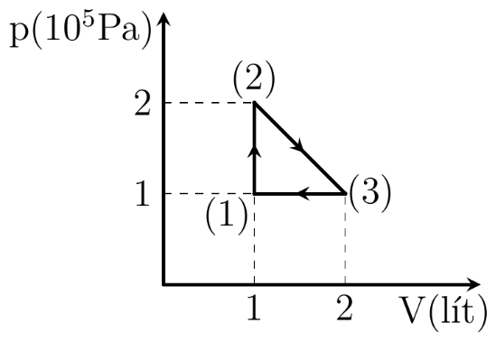
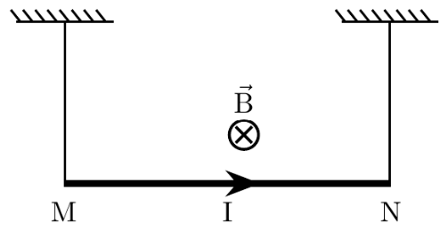

Đề: Sở Giáo dục và Đào tạo Thành phố Cần Thơ, Kỳ thi thử nghiệm tốt nghiệp THPT năm 2026, mã đề 0201

+ Cho biết: $\text{T}(\text{K}) = \text{t}(^\circ\text{C}) + 273$; $\text{R} = 8,31\text{ J}\cdot\text{mol}^{-1}\cdot\text{K}^{-1}$; $\text{N}_{\text{A}} = 6,02\cdot 10^{23}\text{ hạt/mol}$; $\text{k} = 1,38\cdot 10^{-23}\text{ J/K}$; $1\text{ amu} = 931,5\text{ MeV/c}^2$; $\ln 2 = 0,693$.

+ Không làm tròn kết quả các phép tính trung gian.

PHẦN I. Thí sinh trả lời từ câu 1 đến câu 18. Mỗi câu hỏi thí sinh chỉ chọn một phương án.

Câu 1: Một khung dây dẫn kín, phẳng hình vuông gồm 120 vòng dây, diện tích mỗi vòng dây là $60\text{ cm}^2$, được đặt trong một từ trường đều có độ lớn cảm ứng từ $0,04\text{ T}$ sao cho vectơ pháp tuyến của mặt phẳng khung dây cùng hướng với vectơ cảm ứng từ $\text{B}$. Cho độ lớn cảm ứng từ giảm đều từ $0,04\text{ T}$ xuống $0\text{ T}$ trong thời gian $0,2\text{ s}$. Biết cường độ dòng điện cảm ứng xuất hiện trong khung dây có độ lớn là $120\text{ mA}$. Điện trở của khung dây bằng
A. $1,2\text{ }\Omega$.
B. $0,12\text{ }\Omega$.
C. $0,24\text{ }\Omega$.
D. $2,4\text{ }\Omega$.

Câu 2: Khi nói về sóng điện từ, phát biểu nào sau đây sai?
A. Sóng điện từ là quá trình lan truyền của điện từ trường trong không gian.
B. Sóng điện từ là sóng dọc hoặc sóng ngang tùy thuộc vào môi trường truyền sóng.
C. Sóng điện từ truyền được trong các môi trường vật chất và trong chân không.
D. Sóng điện từ có vectơ cường độ điện trường và vectơ cảm ứng từ luôn dao động cùng pha.

Câu 3: Sự nóng chảy là quá trình chuyển từ
A. thể rắn sang thể lỏng của các chất.
B. thể lỏng sang thể rắn của các chất.
C. thể rắn sang thể khí của các chất.
D. thể lỏng sang thể khí của các chất.

Câu 4: Một ấm đun nước bằng nhôm có khối lượng $250\text{ g}$, chứa $1,1\text{ kg}$ nước tinh khiết ở $25\text{ }^\circ\text{C}$. Biết nhiệt dung riêng của nhôm và của nước lần lượt là $880\text{ J/(kg.K)}$ và $4200\text{ J/(kg.K)}$. Bỏ qua sự trao đổi nhiệt với môi trường. Nhiệt lượng cần cung cấp để đun nóng ấm nhôm và lượng nước bên trong ấm từ $25\text{ }^\circ\text{C}$ đến khi nước bắt đầu sôi ở $100\text{ }^\circ\text{C}$ bằng
A. $151,5\text{ kJ}$.
B. $346,5\text{ kJ}$.
C. $435\text{ kJ}$.
D. $363\text{ kJ}$.

Câu 5: Cường độ dòng điện $i = 2\cos(100\pi t)\text{ (A)}$ có giá trị hiệu dụng bằng
A. $\sqrt{2}\text{ A}$.
B. $2\sqrt{2}\text{ A}$.
C. $2\text{ A}$.
D. $1\text{ A}$.

Câu 6: Một lượng khí lí tưởng xác định chuyển từ trạng thái (1), có áp suất $\text{p}_1$, thể tích $\text{V}_1$, nhiệt độ tuyệt đối $\text{T}_1$ sang trạng thái (2), có áp suất $\text{p}_2$, thể tích $\text{V}_2$, nhiệt độ tuyệt đối $\text{T}_2$. Hệ thức nào sau đây đúng với phương trình trạng thái của khí lí tưởng?
A. $\text{V}_1\text{T}_2\text{p}_2 = \text{p}_1\text{V}_2\text{T}_1$.
B. $\text{V}_1\text{T}_1\text{p}_2 = \text{p}_1\text{V}_2\text{T}_2$.
C. $\frac{\text{p}_1\text{V}_1}{\text{T}_1} = \frac{\text{p}_2\text{V}_2}{\text{T}_2}$.
D. $\frac{\text{p}_1\text{T}_1}{\text{V}_1} = \frac{\text{p}_2\text{T}_2}{\text{V}_2}$.

Câu 7: Lực từ tác dụng lên đoạn dây dẫn mang dòng điện đặt trong từ trường đều có
A. phương vuông góc với đoạn dây dẫn và song song với vectơ cảm ứng từ.
B. độ lớn đạt cực đại khi đoạn dây dẫn đặt song song với đường sức từ.
C. phương vuông góc với mặt phẳng chứa đoạn dây dẫn và vectơ cảm ứng từ.
D. độ lớn tỉ lệ thuận với bình phương cường độ dòng điện chạy qua dây dẫn.

Câu 8: Hai bình kín chứa cùng một loại khí lí tưởng được nối với nhau bằng một ống dẫn nhỏ có khóa, thể tích ống dẫn không đáng kể. Ban đầu, khóa đóng nên khí trong hai bình chưa thông với nhau. Bình thứ nhất có thể tích 2 lít, chứa khí ở áp suất $2.10^5\text{ Pa}$; bình thứ hai có thể tích 3 lít, chứa khí ở áp suất $10^5\text{ Pa}$. Nhiệt độ của khí trong hai bình như nhau và được giữ không đổi. Mở khóa để khí trong hai bình thông nhau thì áp suất khí trong hai bình khi đạt trạng thái cân bằng là
A. $2,8.10^5\text{ Pa}$.
B. $1,4.10^5\text{ Pa}$.
C. $1,2.10^5\text{ Pa}$.
D. $2,4.10^5\text{ Pa}$.

Câu 9: Một dây dẫn thẳng, đồng chất, dài $15\text{ cm}$ có dòng điện không đổi $2\text{ A}$ chạy qua, được đặt trong một từ trường đều sao cho hướng của dòng điện hợp với cảm ứng từ $\text{B}$ một góc $30^\circ$. Lực từ tác dụng lên dây dẫn có độ lớn $7,8.10^{-3}\text{ N}$. Cảm ứng từ có độ lớn bằng
A. $52\text{ mT}$.
B. $0,52\text{ mT}$.
C. $0,30\text{ mT}$.
D. $30\text{ mT}$.

Câu 10: Đường sức từ là các đường được vẽ trong không gian có từ trường sao cho tiếp tuyến với nó tại mỗi điểm
A. vuông góc với phương của vectơ cảm ứng từ tại điểm đó.
B. trùng với phương của vectơ cảm ứng từ tại điểm đó.
C. trùng với hướng của lực từ tác dụng lên dòng điện tại điểm đó.
D. vuông góc với hướng của lực từ tác dụng lên dòng điện tại điểm đó.

Câu 11: Nhiệt lượng cần để làm cho một kilôgam chất lỏng hóa hơi hoàn toàn ở nhiệt độ xác định được gọi là
A. nhiệt độ hóa hơi.
B. nhiệt hóa hơi riêng.
C. nhiệt độ nóng chảy.
D. nhiệt nóng chảy riêng.

Câu 12: Ở áp suất không đổi, thể tích của một lượng khí xác định
A. tỉ lệ nghịch với bình phương nhiệt độ tuyệt đối của nó.
B. tỉ lệ thuận với nhiệt độ tuyệt đối của nó.
C. tỉ lệ thuận với bình phương nhiệt độ tuyệt đối của nó.
D. tỉ lệ nghịch với nhiệt độ tuyệt đối của nó.

Câu 13: Gọi $\text{m}_{\text{p}}$, $\text{m}_{\text{n}}$, $\text{m}_{\text{X}}$ lần lượt là khối lượng của proton, neutron và của hạt nhân $^\text{A}_\text{Z}\text{X}$; $\text{c}$ là tốc độ ánh sáng trong chân không. Năng lượng liên kết $\text{W}_{\text{lk}}$ của hạt nhân này được tính bằng công thức
A. $\text{W}_{\text{lk}} = [\text{Z}\text{m}_{\text{p}} + (\text{A} - \text{Z})\text{m}_{\text{n}} + \text{m}_{\text{X}}]\text{c}^2$.
B. $\text{W}_{\text{lk}} = [\text{Z}\text{m}_{\text{p}} - (\text{A} - \text{Z})\text{m}_{\text{n}} - \text{m}_{\text{X}}]\text{c}^2$.
C. $\text{W}_{\text{lk}} = [\text{Z}\text{m}_{\text{p}} + (\text{A} - \text{Z})\text{m}_{\text{n}} - \text{m}_{\text{X}}]\text{c}^2$.
D. $\text{W}_{\text{lk}} = [\text{Z}\text{m}_{\text{p}} - (\text{A} - \text{Z})\text{m}_{\text{n}} + \text{m}_{\text{X}}]\text{c}^2$.

Câu 14: Số neutron trong hạt nhân $^{234}_{\phantom{0}90}\text{Th}$ là
A. 144.
B. 234.
C. 324.
D. 90.

Câu 15: Trong y học, phương pháp nào dưới đây sử dụng bức xạ điện từ có bước sóng ngắn để tạo ảnh bên trong cơ thể?
A. Nội soi.
B. Chụp MRI.
C. Chụp X-quang.
D. Siêu âm.

Câu 16: Một lượng khí xác định có thể tích $\text{V}$. Gọi $\text{N}$ là tổng số phân tử khí trong bình, $\text{m}$ là khối lượng của một phân tử khí và $\overline{\text{v}^2}$ là giá trị trung bình của bình phương tốc độ chuyển động nhiệt của các phân tử khí. Áp suất $\text{p}$ của khí tác dụng lên thành bình được tính bằng công thức
A. $\text{p} = \frac{1}{3}\frac{\text{N}}{\text{V}}\text{m}\overline{\text{v}^2}$.
B. $\text{p} = \frac{3}{2}\frac{\text{V}}{\text{N}}\text{m}\overline{\text{v}^2}$.
C. $\text{p} = \frac{1}{3}\frac{\text{V}}{\text{N}}\text{m}\overline{\text{v}^2}$.
D. $\text{p} = \frac{3}{2}\frac{\text{N}}{\text{V}}\text{m}\overline{\text{v}^2}$.

Câu 17: Một mẫu chất phóng xạ có chu kì bán rã là $\text{T}$. Sau thời gian $\text{t} = 2\text{T}$ kể từ thời điểm ban đầu ($\text{t} = 0$), tỉ số giữa số hạt nhân đã bị phân rã và số hạt nhân ban đầu của mẫu bằng
A. 0,33.
B. 0,75.
C. 0,67.
D. 0,25.

Câu 18: Các hạt nhân đồng vị là những hạt nhân có
A. cùng số nucleon, khác số neutron.
B. cùng số proton, khác số neutron.
C. cùng số nucleon, khác số proton.
D. cùng số neutron, khác số proton.

PHẦN II. Thí sinh trả lời từ câu 1 đến 4. Trong mỗi ý a), b), c), d) ở mỗi câu, thí sinh chọn đúng hoặc sai.

Câu 1: Học sinh tiến hành thí nghiệm đun nước: Cho 1 kg nước tinh khiết vào một ấm nhôm có khối lượng 0,5 kg. Dùng nhiệt kế đo nhiệt độ ban đầu của nước là 25 °C. Đặt ấm lên một bếp điện rồi đun. Biết bếp điện có công suất tỏa nhiệt không đổi trong suốt quá trình đun; nhiệt dung riêng của nước là 4200 J/(kg.K) và của nhôm là 880 J/(kg.K). Bỏ qua sự trao đổi nhiệt với môi trường. Theo dõi quá trình đun liên tục, học sinh thu được các số liệu sau:
- Thời gian để đun nóng ấm và nước từ 25 °C đến khi nước bắt đầu sôi ở 100 °C là 240 s.
- Kể từ lúc nước bắt đầu sôi, tiếp tục đun thêm 160 s thì ghi nhận được 100 g nước đã hóa hơi.
a) Trong suốt quá trình nước sôi, nhiệt độ của nước không thay đổi.
b) Công suất của bếp điện dùng trong thí nghiệm là 1850 W.
c) Tổng nhiệt lượng bếp điện đã cung cấp từ lúc bắt đầu đun nước ở 25 °C đến khi 100 g nước đã hóa hơi là 348 kJ.
d) Nhiệt hóa hơi riêng của nước ở 100 °C bằng $2,32.10^6\text{ J/kg}$.

Câu 2: Một khung dây dẫn kín hình chữ nhật gồm 80 vòng dây, diện tích mỗi vòng là $64\text{ cm}^2$. Khung dây được đặt trong từ trường đều có độ lớn cảm ứng từ $0,05\text{ T}$ sao cho mặt phẳng khung dây vuông góc với vectơ cảm ứng từ $\text{B}$. Biết khung dây có điện trở là $1,28\text{ }\Omega$. Cho độ lớn cảm ứng từ giảm đều từ $0,05\text{ T}$ xuống $0\text{ T}$ trong thời gian $0,2\text{ s}$.
a) Tốc độ biến thiên của cảm ứng từ có độ lớn bằng $0,5\text{ T/s}$.
b) Trong thời gian giảm độ lớn cảm ứng từ, vectơ cảm ứng từ $\text{B}_{\text{C}}$ do dòng điện cảm ứng sinh ra cùng chiều với vectơ cảm ứng từ $\text{B}$.
c) Suất điện động cảm ứng xuất hiện trong khung dây có độ lớn bằng $0,128\text{ V}$.
d) Cường độ dòng điện cảm ứng chạy trong khung dây bằng $100\text{ mA}$.

Câu 3: Quá trình biến đổi trạng thái của một lượng khí lí tưởng xác định được biểu diễn bằng đồ thị p – V như hình vẽ. Biết ở trạng thái (1) khối khí có nhiệt độ 300 K.
[HÌNH: Đồ thị p - V gồm 3 trạng thái (1), (2), (3) theo chu trình khép kín; trục tung là p($10^5$ Pa) với các vạch 1, 2; trục hoành là V(lít) với các vạch 1, 2; trạng thái (1) tại (V=1, p=1), (2) tại (V=1, p=2), (3) tại (V=2, p=1); chiều biến đổi (1) -> (2) -> (3) -> (1)]

a) Quá trình $(1) \to (2)$ là quá trình đun nóng đẳng tích, quá trình $(3) \to (1)$ là quá trình nén đẳng áp.
b) Nhiệt độ tuyệt đối của khối khí ở trạng thái (2) là $800\text{ K}$ và ở trạng thái (3) là $800\text{ K}$.
c) Quá trình $(2) \to (3)$ là quá trình biến đổi đẳng nhiệt vì nhiệt độ của khối khí ở trạng thái (2) và trạng thái (3) bằng nhau.
d) Nhiệt độ cao nhất mà lượng khí đạt được trong toàn bộ quá trình biến đổi là 675 K.

Câu 4: Cho hai hạt nhân là sodium ($^{23}_{11}\text{Na}$) và uranium ($^{235}_{\phantom{0}92}\text{U}$). Biết khối lượng của proton, neutron, hạt nhân sodium và uranium lần lượt là $1,0073\text{ amu}$; $1,0087\text{ amu}$; $22,9837\text{ amu}$ và $234,9934\text{ amu}$. Bán kính hạt nhân được tính theo công thức $\text{R} = 1,2.10^{-15}\cdot\text{A}^{1/3}\text{ (m)}$ với A là số khối.
a) Hạt nhân $^{235}_{\phantom{0}92}\text{U}$ nhiều hơn hạt nhân $^{23}_{11}\text{Na}$ 81 proton.
b) Bán kính của hạt nhân $^{235}_{\phantom{0}92}\text{U}$ bằng $7,4052.10^{-15}\text{ cm}$.
c) Năng lượng liên kết của hạt nhân $^{23}_{11}\text{Na}$ bằng $8,1405\text{ MeV}$.
d) Hạt nhân $^{23}_{11}\text{Na}$ bền vững hơn hạt nhân $^{235}_{\phantom{0}92}\text{U}$.

PHẦN III. Thí sinh trả lời từ câu 1 đến 6.

Câu 1: Một đoạn dây dẫn thẳng MN đồng chất, cứng, tiết diện đều, khối lượng phân bố đều, có chiều dài 24 cm và khối lượng 10 g. Dây được treo nằm ngang bằng hai sợi dây mảnh, nhẹ, cách điện và không dãn tại hai đầu M và N. Toàn bộ hệ thống được đặt trong một từ trường đều có độ lớn cảm ứng từ là 0,08 T sao cho vectơ cảm ứng từ $\text{B}$ vuông góc với mặt phẳng chứa dây treo và dây dẫn, đi vào phía trong như hình vẽ. Lấy $\text{g} = 10\text{ m/s}^2$. Để lực căng của các sợi dây treo bằng 0 thì cường độ dòng điện chạy qua đoạn dây MN có độ lớn bằng bao nhiêu ampe (A) (làm tròn kết quả đến chữ số hàng phần mười)?
[HÌNH: Đoạn dây dẫn thẳng MN nằm ngang treo bởi hai dây thẳng đứng lên trần; dòng điện I trong đoạn MN hướng từ M sang N; từ trường B vuông góc với mặt phẳng hướng vào trong kí hiệu vòng tròn có dấu nhân]

Câu 2: Một học sinh thả một quả cầu bằng thép có khối lượng $500\text{ g}$ ở nhiệt độ $100\text{ }^\circ\text{C}$ vào một bình chứa $200\text{ g}$ nước ở $20\text{ }^\circ\text{C}$. Bỏ qua sự truyền nhiệt cho bình chứa và môi trường xung quanh. Biết nhiệt dung riêng của thép là $460\text{ J/(kg.K)}$ và của nước là $4200\text{ J/(kg.K)}$. Nhiệt độ của hệ khi đạt trạng thái cân bằng nhiệt là $\text{x }^\circ\text{C}$. Tìm x (làm tròn kết quả đến chữ số hàng đơn vị).

Câu 3: Cho phản ứng phân hạch: $^1_0\text{n} + {}^{235}_{\phantom{0}92}\text{U} \to {}^{95}_{39}\text{Y} + {}^{138}_{\phantom{0}53}\text{I} + 3\,^1_0\text{n}$. Biết mỗi phản ứng phân hạch tỏa năng lượng 200 MeV. Cho khối lượng mol của uranium ($^{235}_{\phantom{0}92}\text{U}$) là 235 g/mol. Năng lượng tỏa ra khi $47\text{ g}$ $^{235}_{\phantom{0}92}\text{U}$ phân hạch hoàn toàn là $\text{x}.10^{25}\text{ MeV}$. Tìm x (làm tròn kết quả đến chữ số hàng phần mười).

Câu 4: Một bình kín chứa khí oxygen ở nhiệt độ $34\text{ }^\circ\text{C}$. Cho khối lượng mol của khí oxygen là 32 g/mol và xem khí oxygen là khí lí tưởng. Căn bậc hai của trung bình bình phương tốc độ chuyển động nhiệt của các phân tử khí oxygen bằng bao nhiêu m/s (làm tròn kết quả đến chữ số hàng đơn vị)?

Câu 5: Một bình kín có thể tích không đổi $0,2\text{ m}^3$ chứa khí hydrogen ở nhiệt độ $30\text{ }^\circ\text{C}$, có áp suất $1,8.10^5\text{ Pa}$. Xem khí hydrogen là khí lí tưởng. Số phân tử khí hydrogen chứa trong bình là $\text{x}.10^{23}$ phân tử. Tính giá trị của x (làm tròn kết quả đến chữ số hàng đơn vị).

Câu 6: Polonium ($^{210}_{\phantom{0}84}\text{Po}$) là chất phóng xạ alpha ($\alpha$) có chu kì bán rã là 138,4 ngày. Ban đầu, một mẫu chất phóng xạ $^{210}_{\phantom{0}84}\text{Po}$ có chứa $34,6.10^{21}$ hạt nhân. Sau 276,8 ngày kể từ thời điểm ban đầu, độ phóng xạ của mẫu $^{210}_{\phantom{0}84}\text{Po}$ là $\text{x}.10^{14}\text{ Bq}$. Tìm x (làm tròn kết quả đến chữ số hàng đơn vị).
--------- HẾT ---------
- Thí sinh không được sử dụng tài liệu;
- Giám thị không giải thích gì thêm.
