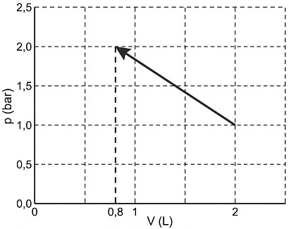
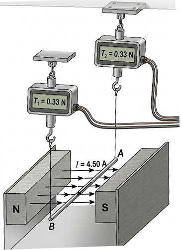
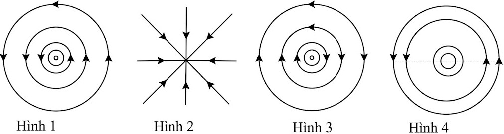
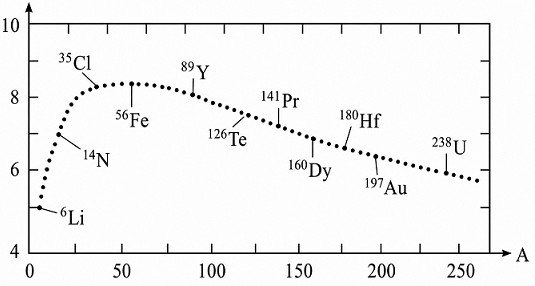
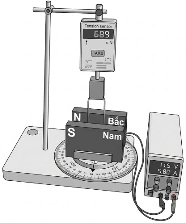
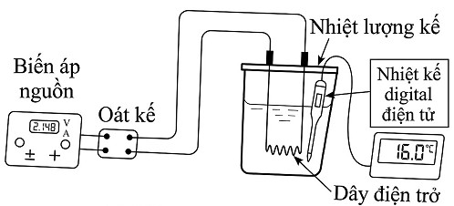
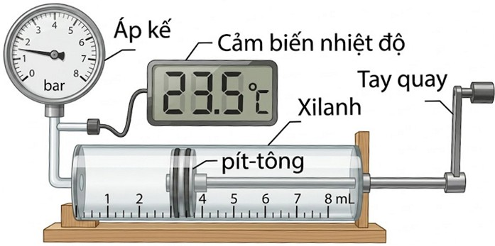
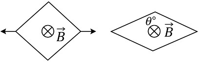

Đề: Sở Giáo dục và Đào tạo Tỉnh Gia Lai, Kỳ thi thử trước kỳ thi tốt nghiệp THPT năm 2026, mã đề 0227

SỞ GIÁO DỤC VÀ ĐÀO TẠO
TỈNH GIA LAI
ĐỀ CHÍNH THỨC
(Đề thi có 04 trang)

KỲ THI THỬ TRƯỚC KỲ THI TỐT NGHIỆP TRUNG HỌC PHỔ THÔNG NĂM 2026
Môn thi: VẬT LÍ
Thời gian làm bài 50 phút, không kể thời gian phát đề

Họ và tên: ………………………………………….. Số báo danh: ……………… Mã đề 0227

• Cho biết: $\pi = 3,14$; $T(\text{K}) = t(^\circ\text{C}) + 273$; $N_A = 6,02 \cdot 10^{23}\text{ mol}^{-1}$; $R = 8,31\text{ J}\cdot\text{mol}^{-1}\cdot\text{K}^{-1}$; $1\text{amu} = 931,5\frac{\text{MeV}}{c^2}$.
• Không làm tròn kết quả các phép trung gian.

PHẦN I. Thí sinh trả lời từ câu 1 đến câu 18. Mỗi câu hỏi thí sinh chỉ chọn một phương án.

Câu 1. Một học sinh làm thí nghiệm tìm hiểu sự biến đổi nội năng của một lượng khí. Bạn dùng một ống bơm xe đạp, bịt kín vòi bơm rồi đẩy pít-tông để nén khí thì nhận thấy thân ống bơm nóng lên, chứng tỏ nội năng của khí đã tăng. Nếu trong quá trình bơm, áp suất và thể tích khí biến đổi theo đồ thị bên và khí tỏa nhiệt ra bên ngoài 40 J thì nội năng khí tăng một lượng là bao nhiêu? Biết $1\text{bar} = 10^5\text{ Pa}$.
[HÌNH: Đồ thị p-V biểu diễn quá trình nén khí từ trạng thái (V = 2 L, p = 1,0 bar) đến (V = 0,8 L, p = 2,0 bar), trục tung p (bar) chia từ 0,0 đến 2,5, trục hoành V (L) có các mốc 0, 0,8, 1, 2]

A. 140 J.
B. 20 J.
C. 180 J.
D. 220 J.

Câu 2. Phát biểu nào sau đây nói về mô hình động học của các phân tử khí lí tưởng là sai?
A. Các phân tử khí chuyển động hỗn loạn không ngừng, chúng chuyển động càng nhanh thì nhiệt độ chất khí càng cao.
B. Khi chuyển động hỗn loạn, các phân tử khí va chạm vào thành bình và gây áp suất lên thành bình.
C. Giữa hai lần va chạm liên tiếp, các phân tử khí lí tưởng chuyển động thẳng biến đổi đều.
D. Chất khí được cấu tạo từ những phân tử có kích thước rất nhỏ so với khoảng cách giữa chúng.

Câu 3. Một đoạn dây dẫn AB được treo nằm ngang vào hai lực kế điện tử trong từ trường đều như hình bên. Đoạn dây AB vuông góc với các đường sức từ, có chiều dài 10 cm. Biết đoạn dây dẫn và dây treo không nhiễm từ, bỏ qua khối lượng dây treo. Khi chưa cho dòng điện qua đoạn dây, mỗi lực kế chỉ 0,30 N. Khi cho dòng điện chạy qua đoạn dây có chiều từ B đến A với cường độ 4,50 A thì mỗi lực kế chỉ 0,33 N. Cảm ứng từ của nam châm là
[HÌNH: Sơ đồ thí nghiệm gồm đoạn dây dẫn AB nằm ngang giữa hai cực N và S của nam châm, vuông góc đường sức từ, dòng điện I = 4,50 A từ B đến A; hai đầu dây treo vào hai lực kế điện tử chỉ T1 = 0.33 N và T2 = 0.33 N]

A. $0,47\cdot 10^{-2}\text{ T}$.
B. $0,13\cdot 10^{-2}\text{ T}$.
C. $0,13\text{ T}$.
D. $0,47\text{ T}$.

Câu 4. Hạt nhân bạc ($Ag$) có 47 proton và 60 neutron, hạt nhân bạc này được kí hiệu là
A. ${}_{47}^{107}Ag$.
B. ${}_{60}^{47}Ag$.
C. ${}_{47}^{60}Ag$.
D. ${}_{107}^{47}Ag$.

Câu 5. Giả sử có một dây dẫn thẳng dài vô hạn có dòng điện $I$ chạy qua theo phương vuông góc với mặt phẳng hình vẽ và có chiều từ trong ra ngoài. Hình vẽ nào dưới đây mô tả đúng các đường sức từ của dòng điện đó?
[HÌNH: Bốn hình vẽ đường sức từ: Hình 1 là các đường tròn đồng tâm có chiều ngược chiều kim đồng hồ; Hình 2 là các tia hướng vào tâm; Hình 3 là các đường tròn đồng tâm có chiều cùng chiều kim đồng hồ; Hình 4 là các đường tròn đồng tâm có chiều ngược chiều kim đồng hồ]

A. Hình 2.
B. Hình 4.
C. Hình 3.
D. Hình 1.

Câu 6. Cách nào sau đây không làm thay đổi nội năng của lượng khí trong một xilanh?
A. Nén, dãn khí trong xilanh.
B. Cho ánh sáng chiếu vào xilanh.
C. Đẩy cho xilanh chuyển động nhanh dần.
D. Dùng đèn cồn đốt nóng xilanh.

Câu 7. Cường độ dòng điện tức thời qua một điện trở thuần $R$ có dạng $i = I_0\cos\omega t$ thì công suất tỏa nhiệt trung bình của điện trở $R$ là
A. $\text{P} = 2I_0^2 R$.
B. $\text{P} = \frac{I_0^2 R}{\sqrt{2}}$.
C. $\text{P} = I_0^2 R$.
D. $\text{P} = \frac{I_0^2 R}{2}$.

Câu 8. Khi phân tích một mẫu gỗ của cổ vật, người ta xác định được: 87,5% số nguyên tử đồng vị phóng xạ $^{14}_{6}\text{C}$ có trong mẫu gỗ đã bị phân rã thành các nguyên tử $^{14}_{7}\text{N}$. Biết chu kì bán rã của $^{14}_{6}\text{C}$ là 5570 năm. Tuổi của mẫu gỗ này bằng
A. 5570 năm.
B. 16710 năm.
C. 1140 năm.
D. 44560 năm.

Câu 9. Năng lượng tỏa ra của phản ứng nhiệt hạch: $1^2 H + 1^2 H \rightarrow 2^3 He + 0^1 n$ xấp xỉ 3,27 MeV. Nếu 1 g $^2_1 H$ tham gia phản ứng hết thì sẽ tỏa ra năng lượng là
A. $7,87\cdot 10^{10}\text{ J}$.
B. $4,92\cdot 10^{23}\text{ J}$.
C. $9,84\cdot 10^{23}\text{ J}$.
D. $15,7\cdot 10^{10}\text{ J}$.

Câu 10. Theo mô hình động học phân tử chất khí, phát biểu nào sau đây sai?
A. Các phân tử khí chuyển động càng nhanh thì nhiệt độ của chất khí càng cao.
B. Các phân tử khí va chạm vào nhau và va chạm vào thành bình.
C. Các phân tử khí ở cạnh nhau nên lực liên kết giữa chúng rất mạnh.
D. Các phân tử khí chuyển động hỗn loạn, không ngừng.

Câu 11. Từ thông $\Phi$ qua một diện tích phẳng $S$ đặt trong từ trường đều $B$ được xác định bởi: $\Phi = BScos\alpha$. Đại lượng $\alpha$ trong công thức này là góc hợp bởi
A. vectơ cảm ứng từ $B$ và vectơ pháp tuyến $n$ của mặt phẳng chứa diện tích $S$.
B. vectơ cảm ứng từ $B$ và mặt phẳng chứa diện tích $S$.
C. vectơ pháp tuyến $n$ và phương thẳng đứng.
D. chiều dòng điện cảm ứng và mặt phẳng diện tích $S$.

Câu 12. Phát biểu nào sau đây không đúng nguyên tắc an toàn phóng xạ?
A. Cần sử dụng các tấm chắn nguồn phóng xạ đủ tốt.
B. Đeo khẩu trang y tế khi tiếp xúc với nguồn phóng xạ.
C. Giảm thiểu thời gian phơi nhiễm phóng xạ.
D. Giữ khoảng cách đủ xa với nguồn phóng xạ.

Câu 13. Bên trong bóng đèn dây tóc có chứa khí trơ. Nhiệt độ của khí trong đèn khi đèn tắt bằng $25^\circ\text{C}$, khi đèn sáng bằng $323^\circ\text{C}$. Bỏ qua sự giãn nở của bóng đèn. Tỉ số áp suất khí trơ trong bóng đèn khi sáng và khi tắt bằng
A. 1,5.
B. 2,0.
C. 12,9.
D. 10,8.

Câu 14. Lực từ không phải là lực tương tác giữa
A. một nam châm và một dòng điện.
B. hai điện tích điểm đứng yên.
C. hai dòng điện.
D. hai nam châm.

Câu 15. Một tesla (1 T) là độ lớn cảm ứng từ của một từ trường đều mà khi ta đặt vào trong nó một dòng điện thẳng có cường độ 1 ampe vuông góc với các đường sức từ thì
A. mỗi mét dài của dòng điện chịu tác dụng của một lực từ bằng 1 niuton.
B. mỗi xentimét dài của dòng điện chịu tác dụng của một lực từ bằng 1 niuton.
C. mỗi mét dài của dòng điện chịu tác dụng của một lực từ bằng 1 miliniuton.
D. mỗi milimét dài của dòng điện chịu tác dụng của một lực từ bằng 1 niuton.

Câu 16. Đồ thị phụ thuộc của năng lượng liên kết riêng $(E_{lkr})$ của hạt nhân một số nguyên tử theo số khối $(A)$ được cho trên hình vẽ. Căn cứ vào thông tin trên đồ thị, trật tự nguyên tử nào sau đây được sắp xếp theo thứ tự tăng dần về độ bền vững của hạt nhân?
[HÌNH: Đồ thị năng lượng liên kết riêng (Elkr) theo số khối A từ 0 đến 250, thể hiện các hạt nhân 6Li, 14N, 35Cl, 56Fe, 89Y, 126Te, 141Pr, 160Dy, 180Hf, 197Au, 238U]

A. $^{89}Y, {}^{160}Dy, {}^{180}Hf$.
B. $^{197}Au, {}^{126}Te, {}^{89}Y$.
C. $^{56}Fe, {}^{35}Cl, {}^{14}N$.
D. $^{6}Li, {}^{89}Y, {}^{141}Pr$.

Câu 17. Nhiệt dung riêng của một chất là nhiệt lượng cần
A. truyền cho 1 lít chất đó để làm cho nhiệt độ của nó tăng thêm $1^\circ\text{C}$.
B. cung cấp để đun nóng 1 kg chất đó trong khoảng thời gian 1 giây.
C. truyền cho $1\text{m}^3$ chất đó để làm cho nhiệt độ của nó tăng thêm $1^\circ\text{C}$.
D. truyền cho 1 kg chất đó để làm cho nhiệt độ của nó tăng thêm $1^\circ\text{C}$.

Câu 18. Một đoạn dây dẫn thẳng dài $MN = 10\text{cm}$ đặt nằm ngang trong từ trường đều có $B = 0,8\text{T}$. Dòng điện $I = 0,75\text{A}$ có chiều hướng từ Tây sang Đông, cảm ứng từ nằm ngang hướng về phía Bắc. Lực từ $F$ tác dụng lên đoạn dây dẫn thẳng MN có chiều và độ lớn là
A. thẳng đứng hướng xuống và $F = 0,06\text{N}$.
B. hướng về phía Tây và $F = 0,03\text{N}$.
C. hướng về phía Nam và $F = 0,03\text{N}$.
D. thẳng đứng hướng lên và $F = 0,06\text{N}$.

PHẦN II. Thí sinh trả lời từ câu 1 đến câu 4. Trong mỗi ý a), b), c), d) ở mỗi câu, thí sinh chọn đúng hoặc sai.

Câu 1. Hình bên là sơ đồ nguyên lí của phương án đo lực từ và cảm ứng từ bằng lực kế điện tử. Khung dây hình chữ nhật được quấn 4 vòng, treo vào lực kế điện tử. Cạnh dưới của khung dây dài $l = 4\text{cm}$ nằm ngang trong lòng một nam châm vĩnh cửu và song song với các mặt của nam châm. Trục đối xứng của nam châm đi qua tâm của thước đo góc. Chưa cho dòng điện chạy vào khung dây, nhấn nút TARE (nút trừ bì) để số chỉ của lực kế về 0. Tiếp theo, cho dòng điện có cường độ 4,48 A vào khung dây thì lực kế chỉ thị 68,9 mN.
[HÌNH: Sơ đồ đo lực từ và cảm ứng từ gồm giá đỡ, cảm biến lực treo Tension sensor hiển thị 689 mN có nút TARE, khung dây hình chữ nhật cạnh dưới nằm giữa hai cực N (Bắc) và S (Nam) của nam châm vĩnh cửu đặt trên thước chia độ tròn, nối với bộ nguồn DC hiển thị 11.5 V và 5.88 A]

a) Nam châm vĩnh cửu trên gây ra một từ trường đều trong lòng nó, các đường sức từ vuông góc với các mặt của nam châm, có chiều từ cực Bắc sang cực Nam của nam châm.
b) Khi đoạn dây thẳng có tổng chiều dài $L$ mang dòng điện $I$ đặt vuông góc với các vectơ cảm ứng từ $B$ thì chịu tác dụng của một lực từ $F$. Cảm ứng từ của nam châm là $B = \frac{F.L}{I}$.
c) Cảm ứng từ của nam châm xấp xỉ 96,1 mT.
d) Nếu xoay nam châm quanh trục thêm một góc $30^\circ$ thì số chỉ lực kế là 59,7 mN.

Câu 2. Một học sinh tiến hành thí nghiệm xác định nhiệt nóng chảy riêng của nước đá theo các bước cụ thể sau:
Bước 1: Lấy viên nước đá có khối lượng $m_1$ (kg) từ tủ lạnh và chuẩn bị một nhiệt lượng kế không hấp thụ nhiệt chứa $m_2$ (kg) nước, đo nhiệt độ ban đầu $t_1$ của nước đá và nhiệt độ $t_2$ của nước trong nhiệt lượng kế bằng nhiệt kế có độ nhạy cao. Ghi vào bảng kết quả thí nghiệm.
Bước 2: Cho viên nước đá vào bình nhiệt lượng kế.
Bước 3: Khi nước đá tan hoàn toàn, lấy nhiệt kế đo nhiệt độ $t$ của nước và ghi vào bảng kết quả thí nghiệm.
Biết nhiệt dung riêng của nước đá và của nước lần lượt là 2100 J/(kg.K) và 4200 J/(kg.K). Bỏ qua sự trao đổi nhiệt giữa nước, nước đá với môi trường xung quanh và nhiệt lượng kế.
[HÌNH: Sơ đồ thí nghiệm nhiệt kế gồm biến áp nguồn hiển thị 2.148 V và A, oát kế, bình nhiệt lượng kế có dây điện trở và nhiệt kế digital điện tử hiển thị 16.0 °C]

Bảng ghi kết quả thí nghiệm

| Nước đá | | Nước | | Hỗn hợp | |
| :---: | :---: | :---: | :---: | :---: | :---: |
| $m_1$ | 0,15 kg | $m_2$ | 3,03 kg | $t$ | $16^\circ\text{C}$ |
| $t_1$ | $-10^\circ\text{C}$ | $t_2$ | $21^\circ\text{C}$ | | |

a) Nhiệt nóng chảy riêng của nước đá được tính bằng đơn vị jun trên kilôgam (J/kg).
b) Nước đá đã truyền nhiệt lượng cho nước.
c) Nhiệt lượng viên nước đá thu vào để nóng chảy hoàn toàn ở $0^\circ\text{C}$ là 3150 J.
d) Nhiệt nóng chảy riêng của nước đá tính được từ bảng số liệu trên là 336 kJ/kg.

Câu 3. Một nhóm học sinh tìm hiểu về mối liên hệ giữa áp suất của một khối khí xác định theo nhiệt độ và thể tích của nó. Họ đã chuẩn bị các dụng cụ: Xilanh khí nối với áp kế; cảm biến nhiệt độ đo nhiệt độ khí; tay quay để làm di chuyển pít-tông (hình vẽ). Khi quay tay quay để pít-tông nén khí thì thấy số chỉ của áp kế và cảm biến nhiệt độ đều tăng.
[HÌNH: Thiết bị thí nghiệm gồm xilanh chia độ từ 1 đến 8 mL có pít-tông nối với tay quay, một đầu nối áp kế chỉ vạch trên 1 bar và cảm biến nhiệt độ hiển thị 23.5 °C]

a) Các phân tử khí chuyển động hỗn loạn không ngừng va chạm với nhau và va chạm với thành xilanh gây ra áp suất lên thành xilanh.
b) Động năng trung bình của các phân tử khí tăng tỉ lệ với nhiệt độ tuyệt đối của khí.
c) Áp suất khí trong bình tăng tỉ lệ thuận với nhiệt độ tuyệt đối của khí.
d) Biết $1\text{bar} = 10^5\text{ Pa}$. Khi không khí trong xilanh bị nén đến thể tích 3,0 mL, nhiệt độ khí là $23,5^\circ\text{C}$ thì số chỉ áp kế là 1,24 bar. Số mol khí trong xilanh xấp xỉ $1,51\cdot 10^{-4}\text{ mol}$.

Câu 4. Đồng vị phóng xạ $53^{131}\text{I}$ có chu kì bán rã 8 ngày đêm được dùng để điều trị các bệnh về tuyến giáp. Sau khi uống vào cơ thể, tuyến giáp của người bệnh hấp thụ mạnh $53^{131}\text{I}$, đồng vị này phân rã $\beta^-$ và biến thành hạt nhân Xe. Tia $\beta^-$ có tác dụng tiêu diệt các tế bào bệnh. Một bệnh nhân uống một liều phóng xạ $53^{131}\text{I}$ có độ phóng xạ ban đầu 36,0 mCi. Bệnh nhân có thể xuất viện khi độ phóng xạ của $53^{131}\text{I}$ giảm xuống còn 30,0 mCi. Bỏ qua sự bài tiết hay hấp thụ thêm $^{131}_{53}\text{I}$ trong khoảng thời gian này.
a) Sau khi uống 60 giờ, bệnh nhân có thể được xuất viện.
b) Tia phóng xạ $\beta^-$ có bản chất là hạt positron $(^0_1\text{e})$.
c) Cứ sau 8 ngày đêm thì một nửa số hạt nhân $^{131}_{53}\text{I}$ hiện có bị phân rã.
d) Sau 48 giờ kể từ lúc mới uống khối lượng $^{131}_{53}\text{I}$ còn lại trong người bệnh nhân là 0,43 $\mu\text{g}$.

PHẦN III. Thí sinh trả lời từ câu 1 đến câu 6.

Câu 1. Trong thành phần sữa bò có chứa potassium với nồng độ 2 g/l. Trong đó có 0,0117% là đồng vị phóng xạ potassium $19^{40}\text{K}$ với chu kì bán rã $1,25\cdot 10^9$ năm. Độ phóng xạ của đồng vị phóng xạ $19^{40}\text{K}$ có trong 2 lít sữa bò là bao nhiêu becơren (làm tròn kết quả đến chữ số hàng đơn vị)?

Câu 2. Hạt nhân $92^{235}\text{U}$ hấp thụ một neutron nhiệt rồi vỡ ra thành hai hạt nhân $^{95}\text{X}$ và $55^{137}\text{Cs}$ kèm theo giải phóng một số hạt neutron mới. Số hạt nucleon không mang điện trong hạt nhân $X$ là bao nhiêu (làm tròn kết quả đến chữ số hàng đơn vị)?

Câu 3. Một lượng khí lí tưởng có động năng trung bình của các phân tử là $6,29\cdot 10^{-21}\text{ J}$. Biết hằng số Boltzmann $k = 1,38\cdot 10^{-23}\text{ J/K}$. Nhiệt độ của lượng khí này trong thang Celsius là bao nhiêu độ (làm tròn kết quả đến chữ số hàng đơn vị)?

Câu 4. Một khung dây dẫn hình vuông, độ dài mỗi cạnh là $l = 20\text{cm}$ đặt trong một từ trường đều $B$ có phương vuông góc với mặt phẳng của khung, chiều hướng từ ngoài vào trong và có độ lớn cảm ứng từ $B = 0,5\text{T}$ (hình vẽ). Trong khoảng thời gian $\Delta t = 0,05\text{s}$, khung dây bị kéo dãn tại hai đỉnh của nó để tạo thành một hình thoi. Biết góc ở đỉnh hình thoi tạo thành là $\theta = 120^\circ$. Điện trở của khung dây $R = 5\Omega$. Cường độ dòng điện cảm ứng trung bình xuất hiện trong khung dây xấp xỉ bằng bao nhiêu miliampe (làm tròn kết quả đến chữ số hàng đơn vị)?
[HÌNH: Hình vuông ban đầu đặt trong từ trường đều B hướng vào trong (ký hiệu ⊗ B) có hai mũi tên kéo dãn sang hai bên tạo thành hình thoi góc đỉnh θ° trong từ trường ⊗ B]

Câu 5. Khi truyền nhiệt lượng cho khối khí trong một xilanh hình trụ, khí dãn nở đẩy pit-tông làm thể tích khối khí tăng thêm 7 lít. Biết áp suất của khối khí là $3\cdot 10^5\text{ Pa}$ và không đổi trong quá trình dãn nở. Biết rằng trong quá trình này, nội năng của khối khí giảm đi 1020 J. Nhiệt lượng cung cấp cho khối khí là bao nhiêu kilôjun (viết kết quả đến chữ số hàng phần trăm)?

Câu 6. Một học sinh sử dụng bình giữ nhiệt có chức năng hiển thị nhiệt độ, dung tích 1000 mL. Vào một buổi sáng, học sinh rót nước nóng vào bình để mang đi học. Trong thời gian học, học sinh này đã sử dụng nên chỉ còn lại một ít nước trong bình, bình hiển thị nhiệt độ là $84^\circ\text{C}$. Học sinh này lấy nước nguội $24^\circ\text{C}$ đổ thêm vào bình để được 320 mL nước ở $39^\circ\text{C}$. Biết nước có nhiệt dung riêng là 4200 J/(kg.K). Khối lượng riêng của nước xem như không đổi khi thay đổi nhiệt độ. Coi rằng chỉ có sự trao đổi nhiệt giữa nước nóng và nước nguội. Lượng nước nguội đổ thêm vào bình là bao nhiêu mililít (viết kết quả đến chữ số hàng đơn vị)?
