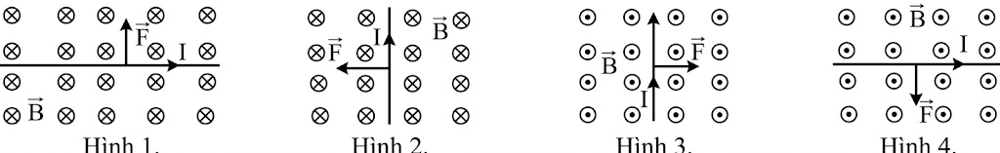
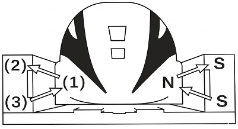
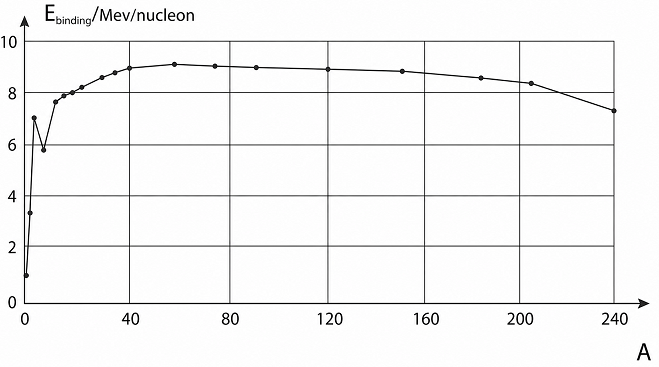
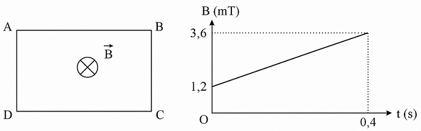
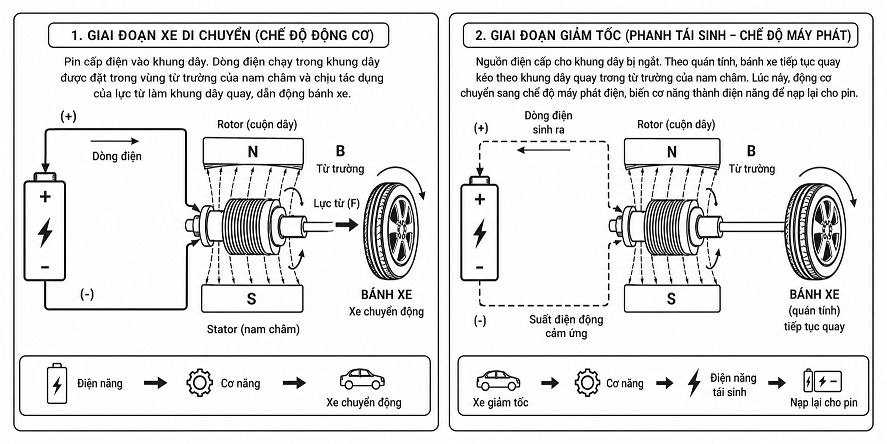
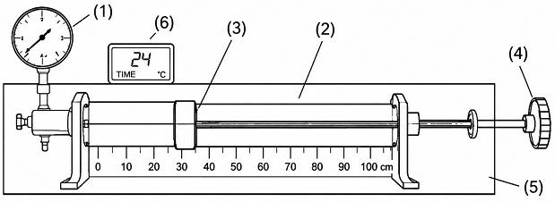
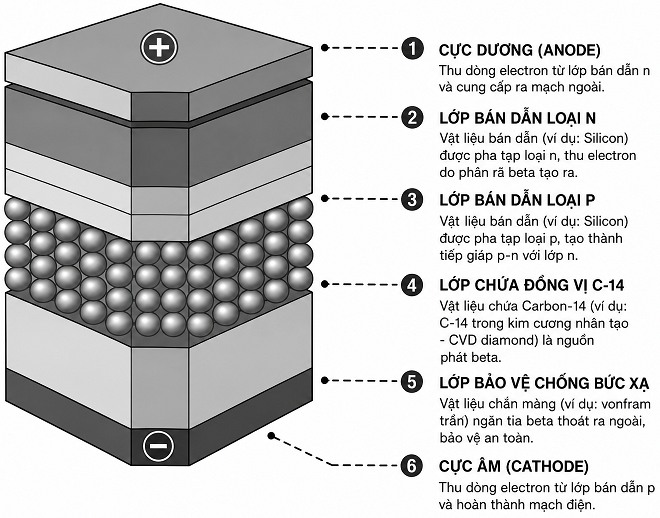
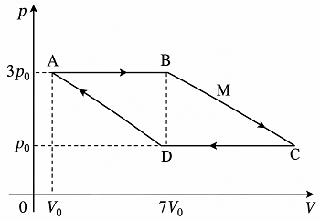
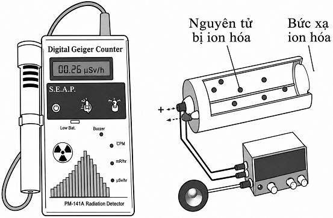

Đề: Sở Giáo dục và Đào tạo Hà Tĩnh, Lần 2, mã đề 0306

SỞ GIÁO DỤC VÀ ĐÀO TẠO
HÀ TĨNH
ĐỀ CHÍNH THỨC
(Đề thi có 04 trang)

ĐỀ THI THỬ TỐT NGHIỆP THPT NĂM 2026
BÀI THI MÔN: VẬT LÍ
Thời gian làm bài: 50 phút (không tính thời gian phát đề)

Họ và tên: ………………………………………….. Số báo danh: ……………… Mã đề 0306

PHẦN I. Thí sinh trả lời từ câu 1 đến câu 18. Mỗi câu hỏi thí sinh chỉ chọn một phương án.

Câu 1. Từ trường là một dạng của vật chất tồn tại xung quanh các nam châm hoặc dòng điện mà biểu hiện cụ thể là sự xuất hiện của lực từ tác dụng lên
A. nam châm và dòng điện khác đặt trong nó.
B. điện tích đứng yên đặt trong nó.
C. mọi vật đặt trong nó.
D. chất điện môi đặt trong nó.

Câu 2. Trong quá trình hóa hơi của một lượng chất lỏng ở nhiệt độ sôi thì
A. nhiệt độ của chất lỏng giảm liên tục.
B. thể tích khối chất lỏng không thay đổi.
C. nhiệt độ của chất lỏng tăng liên tục.
D. nhiệt độ chất lỏng không thay đổi.

Câu 3. Một bình nhiệt lượng kế chứa nước có khối lượng nước $m_1 = 100\text{ g}$, đang ở nhiệt độ $t_1 = 25^\circ\text{C}$. Người ta thả vào bình một quả cầu bằng kim loại có khối lượng $m = 300\text{ g}$, đang ở nhiệt độ $t = 100^\circ\text{C}$. Nhiệt độ của hệ thống khi cân bằng nhiệt là $t_{\text{cb}1} = 30^\circ\text{C}$. Sau đó, người ta đổ thêm vào bình một lượng nước có khối lượng $m_2 = 400\text{ g}$ cũng có nhiệt độ $t_2 = 25^\circ\text{C}$ thì nhiệt độ của hệ thống khi cân bằng nhiệt là $t_{\text{cb}2} = 27,5^\circ\text{C}$. Cho biết nhiệt dung riêng của nước là $c_1 = 4200\text{ J/(kg}\cdot\text{K)}$. Bỏ qua sự trao đổi nhiệt của hệ thống với môi trường bên ngoài. Bình nhiệt lượng kế có thu và tỏa nhiệt. Nhiệt dung riêng của kim loại chế tạo quả cầu bằng
A. $255,5\text{ J/(kg}\cdot\text{K)}$.
B. $488,6\text{ J/(kg}\cdot\text{K)}$.
C. $194,4\text{ J/(kg}\cdot\text{K)}$.
D. $373,3\text{ J/(kg}\cdot\text{K)}$.

Câu 4. Hình nào sau đây biểu diễn không đúng chiều của lực từ $\vec{F}$ tác dụng lên dây dẫn mang dòng điện đặt trong từ trường đều?

[HÌNH: Bốn hình vẽ Hình 1, Hình 2, Hình 3, Hình 4 biểu diễn chiều của đoạn dây mang dòng điện I, vectơ cảm ứng từ B (dấu nhân vào trong hoặc chấm ra ngoài) và vectơ lực từ F]

A. Hình 3.
B. Hình 1.
C. Hình 2.
D. Hình 4.

Câu 5. Tàu đệm từ là một phương tiện giao thông chạy trên đệm từ trường, tàu vận hành rất êm, không rung lắc và không gây ra nhiều tiếng ồn như tàu truyền thống. Tàu sử dụng cơ chế nâng, đẩy và dẫn lái để khi di chuyển với tốc độ cao mà tàu không bay khỏi bề mặt đường ray. Trong hình vẽ bên mô tả cơ chế nâng để nâng tàu lên trong quá trình tàu di chuyển. Các cực từ ở các vị trí (1), (2) và (3) theo thứ tự là

[HÌNH: Sơ đồ cơ chế nâng tàu đệm từ gồm đường ray có các cực từ đối diện với các cực từ gắn trên thân tàu ở các vị trí (1), (2), (3) và bên phải có các cực S, N]

A. S – S – N.
B. N – S – N.
C. S – N – S.
D. N – N – S.

Câu 6. Xét phản ứng nhiệt hạch: $^2_1\text{D} + ^2_1\text{D} \rightarrow ^3_2\text{He} + \text{X}$. Hạt X là
A. neutron.
B. positron.
C. proton.
D. neutrino.

Câu 7. Hình bên là đồ thị đơn giản hoá phân bố năng lượng liên kết riêng $E_{\text{lkr}}$ theo số khối A của hạt nhân. Từ đồ thị cho biết hạt nhân nào bền vững nhất trong các hạt nhân sau: $^{63}_{29}\text{Cu}$, $^{238}_{92}\text{U}$, $^{206}_{82}\text{Pb}$, $^4_2\text{He}$?

[HÌNH: Đồ thị năng lượng liên kết riêng E_binding (MeV/nucleon) theo số khối A từ 0 đến 240, đỉnh cực đại ở vùng số khối khoảng 50 đến 80]

A. $^{238}_{92}\text{U}$.
B. $^4_2\text{He}$.
C. $^{63}_{29}\text{Cu}$.
D. $^{206}_{82}\text{Pb}$.

Câu 8. Dùng một bơm hút để hút khí khỏi một bình có thể tích $V = 2,20\text{ lít}$, ban đầu chứa không khí ở áp suất $p_0 = 1,00 \cdot 10^5\text{ N/m}^2$. Mỗi lần hút, bơm hút ra khỏi bình một lượng khí chiếm thể tích $110\text{ cm}^3$ ở áp suất khí trong bình tại thời điểm đó. Coi quá trình hút diễn ra đẳng nhiệt. Áp suất khí trong bình sau 8 lần hút là
A. 64,5 kPa.
B. 67,7 kPa.
C. 71,7 kPa.
D. 85,2 kPa.

Câu 9. Gọi Q là nhiệt lượng cần thiết để làm nóng chảy hoàn toàn một vật có khối lượng m ở nhiệt độ nóng chảy thì nhiệt nóng chảy riêng $\lambda$ của chất làm vật đó được tính theo công thức
A. $\lambda = \dfrac{m}{Q}$.
B. $\lambda = \dfrac{m}{2Q}$.
C. $\lambda = \dfrac{Q}{2m}$.
D. $\lambda = \dfrac{Q}{m}$.

Câu 10. Trong hạt nhân nguyên tử americium $^{240}_{95}\text{Am}$ có
A. 95 neutron.
B. 135 proton.
C. 240 nucleon.
D. 95 nucleon.

Câu 11. Đơn vị của từ thông là
A. weber (Wb).
B. ampe (A).
C. volt (V).
D. tesla (T).

Câu 12. Một vòng dây phẳng, kín, có diện tích $10\text{ cm}^2$ đặt trong một từ trường đều có vectơ cảm ứng từ vuông góc với mặt phẳng vòng dây và có độ lớn $0,1\text{ T}$. Từ thông qua vòng dây có độ lớn là
A. 1 Wb.
B. $10^{-4}\text{ Wb}$.
C. 0 Wb.
D. $10^{-2}\text{ Wb}$.

Câu 13. Hai hạt nhân đồng vị là hai hạt nhân có
A. cùng số nucleon và khác số neutron.
B. cùng số neutron và khác số nucleon.
C. cùng số nucleon và khác số proton.
D. cùng số proton và khác số nucleon.

Câu 14. Biết khối lượng của các hạt proton, neutron và hạt nhân $^{23}_{11}\text{Na}$ lần lượt là 1,0073 amu; 1,0087 amu và 22,9838 amu. Lấy $1\text{ amu}\cdot c^2 = 931,5\text{ MeV}$. Năng lượng liên kết của hạt nhân $^{23}_{11}\text{Na}$ bằng
A. 0,1949 MeV.
B. 7,893 MeV.
C. 187,1 MeV.
D. 180,2 MeV.

Câu 15. Nhiệt hóa hơi riêng là thông tin cần thiết trong việc thiết kế, chế tạo sản phẩm nào dưới đây?
A. Nhiệt kế.
B. Nồi hấp tiệt trùng trong y học.
C. Bếp từ.
D. Thiết bị xử lí rác thải ứng dụng công nghệ tái chế.

Câu 16. Một lượng khí được truyền 10 kJ nhiệt lượng, đồng thời bị nén bởi một công có độ lớn 100 kJ. Độ biến thiên nội năng của lượng khí này bằng
A. 110 kJ.
B. -110 kJ.
C. -90 kJ.
D. 90 kJ.

Sử dụng các thông tin sau cho Câu 17 và Câu 18:
Một khung dây dẫn ABCD có diện tích $25\text{ cm}^2$, gồm 10 vòng dây. Khung dây dẫn được đặt trong từ trường đều có các đường sức từ vuông góc với mặt phẳng khung dây. Cho biết từ trường biến thiên theo thời gian như đồ thị trong hình vẽ bên: $B$ tăng đều từ $1,2\text{ mT}$ tại $t = 0$ đến $3,6\text{ mT}$ tại $t = 0,4\text{ s}$.

[HÌNH: Khung dây dẫn hình chữ nhật ABCD đặt trong từ trường đều hướng vào trong và đồ thị cảm ứng từ B(mT) tăng tuyến tính từ 1,2 mT tại t = 0 đến 3,6 mT tại t = 0,4 s]

Câu 17. Cho biết khung dây dẫn có điện trở $R = 0,3\ \Omega$. Dòng điện xuất hiện trong khung dây có cường độ
A. 0,6 mA và có chiều từ A → D → C → B.
B. 0,6 mA và có chiều từ A → B → C → D.
C. 0,5 mA và có chiều từ A → D → C → B.
D. 0,5 mA và có chiều từ A → B → C → D.

Câu 18. Suất điện động cảm ứng xuất hiện trong khung dây đó có độ lớn bằng
A. 0,18 mV.
B. 0,30 mV.
C. 0,15 mV.
D. 0,36 mV.

PHẦN II. Câu trắc nghiệm đúng sai. Thí sinh trả lời từ câu 1 đến câu 4. Trong mỗi ý a), b), c), d) ở mỗi câu, thí sinh chọn đúng hoặc sai.

Câu 1. Một bồn tắm có hai vòi nước vào, gồm một vòi nước nóng và một vòi nước lạnh, có thể trộn với nhau với lưu lượng có thể điều chỉnh được. Mỗi vòi được trang bị một cái van để điều chỉnh lưu lượng nước từ 0 đến giá trị cực đại là 0,7 lít/s. Nhiệt độ của nước nóng là $80^\circ\text{C}$, còn nhiệt độ của nước lạnh là $20^\circ\text{C}$. Bỏ qua sự mất mát nhiệt lượng ra môi trường. Biết nhiệt dung riêng của nước là $4200\text{ J/(kg}\cdot\text{K)}$.
a) Nếu 1 kg nước muốn tăng thêm $1^\circ\text{C}$ thì cần phải cung cấp một nhiệt lượng là 4200 J.
b) Lưu lượng của dòng nước cực đại chảy vào bồn tắm khi nhiệt độ của nó là $48,0^\circ\text{C}$ là 1,4 lít/s.
c) Trong thang nhiệt giai Kelvin, nhiệt độ nước trong vòi lạnh là 293 K.
d) Để nước chảy vào bồn tắm đạt nhiệt độ $48,0^\circ\text{C}$ cần điều chỉnh các van sao cho tỉ lệ lưu lượng nước nóng và lạnh là 0,875.

Câu 2. Hệ thống phanh tái sinh là công nghệ tiêu chuẩn trên các phương tiện giao thông chạy điện. Sơ đồ nguyên lí hoạt động được mô tả như sau:

[HÌNH: Sơ đồ nguyên lí phanh tái sinh gồm 2 giai đoạn: (1) Giai đoạn xe di chuyển (chế độ động cơ) và (2) Giai đoạn giảm tốc (phanh tái sinh - chế độ máy phát) với pin, khung dây quay giữa hai cực nam châm N - S và bánh xe]

a) Trong giai đoạn pin cung cấp điện cho khung dây, lực từ tác dụng lên các cạnh của khung dây tạo ra một ngẫu lực làm quay bánh xe.
b) Khi giảm tốc, dòng điện cảm ứng sinh ra trong khung dây tạo ra một ngẫu lực từ cùng chiều với chiều quay của bánh xe.
c) Phanh tái sinh giúp chuyển đổi động năng khi giảm tốc thành điện năng sạc ngược lại cho pin thay vì thất thoát dưới dạng nhiệt.
d) Trong giai đoạn xe giảm tốc, từ thông qua diện tích khung dây biến thiên là nguyên nhân sinh ra dòng điện nạp cho pin.

Câu 3. Để khảo sát mối liên hệ giữa thể tích và nhiệt độ của một lượng khí xác định khi giữ áp suất không đổi người ta bố trí thí nghiệm như hình vẽ. Cho biết số chỉ áp kế ở mức 0 ứng với áp suất khí quyển là $10^5\text{ Pa}$. Cảm biến nhiệt được đặt trong nước. Đổ nước nóng vào hộp chứa để xilanh ngập hoàn toàn trong nước. Dịch chuyển pít-tông thật chậm, sao cho số chỉ của áp kế không đổi. Kết quả đo giá trị của phần thể tích chứa khí và nhiệt độ sau mỗi phút được ghi lại ở bảng số liệu.

[HÌNH: Bộ dụng cụ thí nghiệm khảo sát định luật Charles gồm áp kế (1), xilanh chia độ (2), pit-tông (3), tay quay (4), hộp chứa nước (5) và cảm biến nhiệt độ (6)]

• Áp kế (1) có mức 0 ứng với áp suất khí quyển;
• Xilanh (2)
• Pit-tông (3) gắn với tay quay (4);
• Hộp chứa nước nóng (5) và cảm biến nhiệt độ (6).

| Lần đo | Nhiệt độ của khí trong xilanh $t\ (^\circ\text{C})$ | Thể tích khí trong xilanh $V\ (\text{ml})$ |
| :---: | :---: | :---: |
| 1 | 45 | 75 |
| 2 | 41 | 74 |
| 3 | 37 | 73 |
| 4 | 32 | 72 |
| 5 | 28 | 71 |

a) Lượng khí chứa trong xilanh ở thí nghiệm trên xấp xỉ là $1,85 \cdot 10^{-3}\text{ mol}$.
b) Với số liệu thu được ở bảng trên, công thức liên hệ giữa thể tích $V\text{ (ml)}$ theo nhiệt độ $t\ (^\circ\text{C})$ là $V \approx 0,236(t + 273)$.
c) Trong các lần đo, mật độ phân tử khí trong xilanh trong lần đo thứ 1 là lớn nhất.
d) Chất khí trong xilanh biến đổi đẳng áp khi thực hiện thí nghiệm ở các lần đo.

Câu 4. Các nhà khoa học Trung Quốc đã phát triển pin hạt nhân đầu tiên trên thế giới sử dụng đồng vị carbon $^{14}_6\text{C}$, loại pin này thường được sử dụng trong các nhiệm vụ có yêu cầu đặc biệt như thiết bị y tế (máy tạo nhịp tim), tàu vũ trụ hoặc các thiết bị hoạt động trong môi trường khắc nghiệt như biển sâu hay vùng cực. Biết rằng hạt nhân $^{14}_6\text{C}$ là đồng vị phóng xạ $\beta^-$ với chu kì bán rã là 5730 năm. Độ phóng xạ ban đầu của lượng $^{14}_6\text{C}$ đưa vào pin là 10 mCi. Lấy 1 năm = 365 ngày, $1\text{ Ci} = 3,7 \cdot 10^{10}\text{ Bq}$ và khối lượng hạt nhân tính theo đơn vị amu xấp xỉ bằng số khối.

[HÌNH: Sơ đồ cấu tạo pin hạt nhân C-14 gồm cực dương (Anode), lớp bán dẫn loại n, lớp bán dẫn loại p, lớp chứa đồng vị C-14, lớp bảo vệ chống bức xạ bằng Vonfram và cực âm (Cathode)]

a) Lớp chắn làm bằng Vonfram có tác dụng ngăn tia $\beta$ thoát ra ngoài, bảo vệ an toàn.
b) Đồng vị $^{14}_6\text{C}$ có chu kì bán rã lớn nên pin có thể hoạt động được trong thời gian rất dài.
c) Sau 2026 năm kể từ thời điểm ban đầu, độ phóng xạ của $^{14}_6\text{C}$ trong pin giảm đi khoảng 25%.
d) Electron được tạo ra trong lớp chứa đồng vị $^{14}_6\text{C}$.

PHẦN III. Câu trắc nghiệm trả lời ngắn. Thí sinh trả lời từ câu 1 đến câu 6.

Câu 1. Arktika là tàu phá băng chạy bằng năng lượng hạt nhân của Nga. Tàu được trang bị hai lò phản ứng hạt nhân, mỗi lò có công suất nhiệt 175 MW, giúp tàu phá lớp băng dày đến 3 m. Nếu lò phản ứng này sử dụng năng lượng từ sự phân hạch của $^{235}_{92}\text{U}$, mỗi phân hạch sinh ra trung bình 203 MeV. Biết hiệu suất của lò phản ứng hạt nhân là 25%, khối lượng mol của nguyên tử $^{235}_{92}\text{U}$ là 235 g/mol. Trong 24 giờ, mỗi lò tiêu thụ hết bao nhiêu gam $^{235}_{92}\text{U}$ ở dạng nguyên chất (làm tròn kết quả đến chữ số hàng đơn vị)?

Câu 2. Một lượng khí lí tưởng thực hiện một chu trình ABCDA được biểu diễn trên đồ thị $p-V$ có dạng hình bình hành như hình vẽ. Biết $p_A = p_B = 3p_0$, $p_C = p_D = p_0$, $V_A = V_0$, $V_B = V_D = 7V_0$. Tỷ số giữa nhiệt độ lớn nhất và nhỏ nhất của khí trong chu trình bằng bao nhiêu (làm tròn kết quả đến chữ số hàng phần trăm)?

[HÌNH: Đồ thị chu trình ABCDA trên hệ trục toạ độ p-V có dạng hình bình hành với các đỉnh A(V0, 3p0), B(7V0, 3p0), C và D(7V0, p0)]

Câu 3. Trong y học, người ta dùng từ trường tác động lên một số vùng mô trong não, tạo ra dòng điện để chữa trị các bệnh về thần kinh. Bằng phương pháp này, tại một vùng mô trong não có dạng hình tròn bán kính $r = 0,10\text{ cm}$, người ta tạo một từ trường đều có đường sức từ vuông góc với mặt phẳng chứa vùng mô và có độ lớn cảm ứng từ biến thiên đều theo thời gian một lượng $\Delta B = 0,02\text{ T}$ trong $\Delta t = 75\text{ ms}$. Suất điện động cảm ứng xuất hiện trong vùng mô này trong thời gian từ trường biến thiên bằng bao nhiêu $\mu\text{V}$ (làm tròn kết quả đến chữ số hàng phần trăm)?

Câu 4. Một chất khí có khối lượng riêng là $\rho = 6 \cdot 10^{-2}\text{ kg/m}^3$, tốc độ căn quân phương của các phân tử khí này là 450 m/s. Áp suất của chất khí tác dụng lên thành bình bằng bao nhiêu kPa (làm tròn kết quả đến chữ số hàng phần trăm)?

Câu 5. Loa điện động có ống dây gồm $N = 100$ vòng, quấn sít nhau tạo thành ống dây có chiều dài ống $L = 2\text{ cm}$. Biết độ lớn cảm ứng từ trong cuộn dây được tính bằng công thức $4\pi \cdot 10^{-7}nI$, trong đó n là số vòng dây dẫn trên một mét chiều dài của ống dây. Giả sử dòng điện trong cuộn dây tại một thời điểm có cường độ $I = 2\text{ A}$ thì cảm ứng từ do chính cuộn dây sinh ra trong lòng nó có độ lớn bằng bao nhiêu mT (làm tròn kết quả đến chữ số hàng phần mười)?

Câu 6. Máy đo bức xạ (máy đếm/ống đếm) Geiger-Muller được sử dụng rộng rãi trong việc đo số lượng hạt $\alpha$, $\beta$ bằng cách ứng dụng khả năng ion hoá của các tia bức xạ này. Số tín hiệu máy đếm được tỉ lệ thuận với số lượng hạt nhân bị phân rã. Xét hai máy đếm Geiger-Muller giống nhau lần lượt được chiếu xạ bởi hai mẫu chất phóng xạ $^{210}_{84}\text{Po}$ và $^{131}_{53}\text{I}$ (mỗi hạt nhân khi phân rã chỉ phát ra một tia phóng xạ). Biết rằng các mẫu chất phóng xạ được đặt ở cùng một khoảng cách so với các máy đếm tại hai phòng khác nhau. Cho khối lượng của từng mẫu phóng xạ tại thời điểm ban đầu là như nhau. Chu kì bán rã của $^{210}_{84}\text{Po}$ và $^{131}_{53}\text{I}$ lần lượt là 138,4 ngày và 8,02 ngày. Sau 1 ngày đầu tiên, máy đo bức xạ ứng với mẫu chất chứa $^{131}_{53}\text{I}$ đếm được nhiều tín hiệu gấp x lần tín hiệu từ mẫu phóng xạ $^{210}_{84}\text{Po}$. Giá trị x bằng bao nhiêu (làm tròn kết quả đến chữ số hàng đơn vị)?

[HÌNH: Sơ đồ cấu tạo và nguyên lí hoạt động của ống đếm Geiger-Muller với nguồn phóng xạ, cửa sổ mỏng cho tia bức xạ đi vào ống ion hoá chất khí và mạch đếm xung điện thế cao]

--------- HẾT ---------
