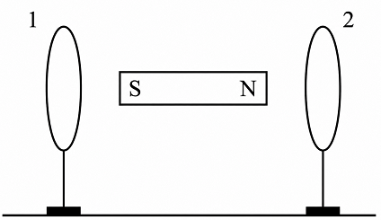
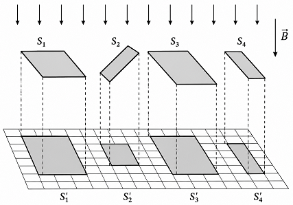
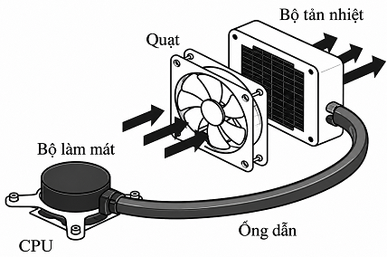
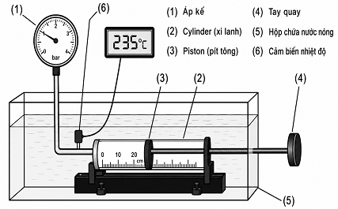
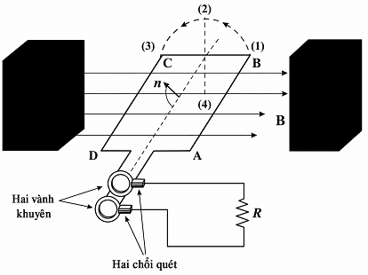
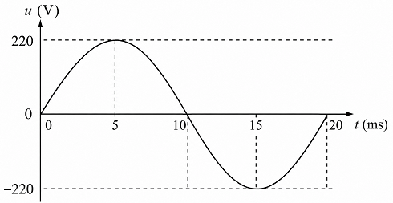
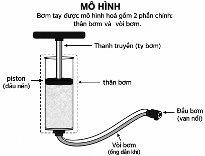

Đề: Sở Giáo dục và Đào tạo Ninh Bình, Lần thứ tư, mã đề 0201

SỞ GIÁO DỤC VÀ ĐÀO TẠO
NINH BÌNH
ĐỀ CHÍNH THỨC
(Đề thi có 04 trang)

ĐỀ KHẢO SÁT, ĐÁNH GIÁ CHẤT LƯỢNG GIÁO DỤC LỚP 12 THPT
LẦN THỨ TƯ - NĂM HỌC 2025 - 2026
MÔN THI: VẬT LÍ - THPT, GDTX
Thời gian làm bài: 50 phút

Họ và tên: ………………………………………….. Số báo danh: ……………… Mã đề: 0201

• Cho biết: $T(\text{K}) = t(^\circ\text{C}) + 273$; $N_A = 6,02 \cdot 10^{23}\text{ hạt/mol}$.
• Không làm tròn kết quả các phép tính trung gian.

PHẦN I. Thí sinh trả lời từ câu 1 đến câu 18. Mỗi câu, thí sinh chỉ chọn một phương án.

Câu 1. Khi cho 2 vật có nhiệt độ khác nhau tiếp xúc nhau thì nhiệt lượng luôn tự truyền từ
A. vật nóng hơn sang vật lạnh hơn.
B. vật lạnh hơn sang vật nóng hơn.
C. vật nhẹ hơn sang vật nặng hơn.
D. vật nặng hơn sang vật nhẹ hơn.

Câu 2. Cảm ứng từ là đại lượng đặc trưng cho từ trường về
A. phương diện tác dụng lực của từ trường.
B. chiều của từ trường.
C. năng lượng của từ trường.
D. mặt sinh công của từ trường.

Câu 3. Một khối khí lí tưởng đang ở nhiệt độ tuyệt đối $T$. Với $k$ là hằng số Boltzman, động năng chuyển động nhiệt trung bình của mỗi phân tử khí bằng
A. $k T^2$.
B. $\frac{k T^2}{2}$.
C. $\frac{2 k T}{3}$.
D. $\frac{3 k T}{2}$.

Câu 4. Gọi $Q$ là nhiệt lượng cần thiết để làm một lượng chất có khối lượng $m$ chuyển hoàn toàn từ thể lỏng sang thể khí ở nhiệt độ sôi. Nhiệt hóa hơi riêng của chất này bằng
A. $\frac{m}{Q}$.
B. $\frac{m}{2Q}$.
C. $\frac{Q}{m}$.
D. $\frac{Q}{2m}$.

Câu 5. Một dây dẫn thẳng có dòng điện $2\text{ A}$ chạy qua, được đặt trong từ trường đều. Vectơ cảm ứng từ có độ lớn $0,5\text{ T}$ và có phương song song với dây dẫn. Độ lớn lực từ tác dụng lên $1\text{ m}$ của dây dẫn này bằng
A. $2\text{ N}$.
B. $1\text{ N}$.
C. $0\text{ N}$.
D. $0,5\text{ N}$.

Câu 6. Biển báo nào dưới đây là biển cảnh báo khu vực nguy hiểm về điện?
[HÌNH: Bốn biển báo hình tam giác viền đen nền trắng: Biển 1 hình đầu lâu xương chéo, Biển 2 hình biểu tượng ba cánh cảnh báo phóng xạ, Biển 3 hình tia sét cảnh báo nguy hiểm về điện, Biển 4 hình biểu tượng nguy hiểm sinh học]

A. Biển 2.
B. Biển 4.
C. Biển 3.
D. Biển 1.

Câu 7. Với cùng một chất, quá trình chuyển thể nào sau đây sẽ làm giảm lực tương tác giữa các phân tử nhiều nhất?
A. Đông đặc.
B. Thăng hoa.
C. Nóng chảy.
D. Ngưng tụ.

Câu 8. Trong trường hợp nào sau đây, nội năng của một đồng xu biến đổi bằng cách thực hiện công?
A. Đốt nóng đồng xu bằng bếp lửa.
B. Phơi nắng để đồng xu nóng lên.
C. Nhúng đồng xu vào chậu nước nóng.
D. Cọ xát đồng xu vào mặt sàn.

Câu 9. Hạt nhân càng bền vững khi có
A. độ hụt khối càng nhỏ.
B. độ hụt khối càng lớn.
C. năng lượng liên kết càng lớn.
D. năng lượng liên kết riêng càng lớn.

Câu 10. Một thanh nam châm được đặt ở giữa hai vành kim loại cũng như hình bên. Hai vành được gắn vào đế cách điện với thanh ray nằm ngang. Các đế có thể chuyển động không ma sát dọc theo thanh ray. Biết mặt phẳng các vành song song với nhau, vuông góc với trục của một nam châm thẳng và thanh ray. Nếu dịch chuyển nam châm về bên phải thì các vành sẽ chuyển động thế nào?
[HÌNH: Hai vành kim loại 1 và 2 đặt thẳng đứng trên ray nằm ngang, ở giữa là thanh nam châm thẳng với cực Nam S bên trái và cực Bắc N bên phải]

A. Cả hai vành chuyển động về bên trái.
B. Cả hai vành đứng yên.
C. Vành 1 đứng yên, vành 2 chuyển động về bên phải.
D. Cả hai vành chuyển động về bên phải.

Câu 11. Xét một sóng điện từ truyền theo phương thẳng đứng, chiều từ dưới lên. Tại một điểm nhất định trên phương truyền sóng, khi vectơ cảm ứng từ hướng về hướng Nam thì vectơ cường độ điện trường hướng về hướng
A. Bắc.
B. Tây.
C. Đông.
D. Nam.

Câu 12. Cho phản ứng hạt nhân: $_{92}^{235}\text{U} + _0^1\text{n} \rightarrow _{37}^{95}\text{Rb} + _{55}^{137}\text{Cs} + x _0^1\text{n}$.
Giá trị của $x$ bằng
A. 3.
B. 2.
C. 4.
D. 1.

Câu 13. Đặt 4 kim nam châm nằm cân bằng trong từ trường của một nam châm thẳng ở các vị trí như hình vẽ bên. Bỏ qua ảnh hưởng của từ trường ngoài. Số nam châm trên hình chỉ đúng hướng của từ trường tại điểm đặt nó bằng
A. 2.
B. 1.
C. 3.
D. 4.

Câu 14. Một mẫu chất phóng xạ có hằng số phóng xạ $\lambda$. Tại thời điểm ban đầu mẫu có $N_0$ hạt. Số hạt nhân phóng xạ còn lại trong mẫu tại thời điểm $t$ bằng
A. $N_0 \cdot e^{\lambda t}$.
B. $N_0 \cdot e^{-t}$.
C. $N_0 \cdot e^{-\lambda t}$.
D. $N_0 \cdot e^{-\lambda}$.

Câu 15. Trong hệ đơn vị SI, đơn vị của cảm ứng từ là
A. volt (V).
B. weber (Wb).
C. tesla (T).
D. coulomb (C).

Câu 16. Trong không khí, tia phóng xạ nào sau đây có tốc độ nhỏ nhất?
A. Tia $\alpha$.
B. Tia $\beta^-$.
C. Tia $\beta^+$.
D. Tia $\gamma$.

Câu 17. Bốn khung dây $S_1, S_2, S_3, S_4$ nằm trong cùng từ trường đều, vị trí các khung và hình chiếu các khung lên mặt phẳng vuông góc với các đường sức được như hình vẽ bên. Khung dây có từ thông lớn nhất là khung
[HÌNH: Bốn khung dây S1, S2, S3, S4 trong từ trường đều có các vectơ B thẳng đứng hướng xuống, và các hình chiếu tương ứng S1', S2', S3', S4' trên mặt phẳng nằm ngang chia ô lưới vuông góc với đường sức từ]

A. $S_2$.
B. $S_3$.
C. $S_1$.
D. $S_4$.

Câu 18. Một lượng khí lí tưởng đang ở trạng thái có nhiệt độ $27^\circ\text{C}$, áp suất $100\text{ kPa}$ thì có thể tích $V$. Khi ở trạng thái có nhiệt độ $177^\circ\text{C}$ và áp suất $300\text{ kPa}$ thì lượng khí có thể tích bằng
A. $2V$.
B. $4,5V$.
C. $0,5V$.
D. $3V$.

PHẦN II. Thí sinh trả lời từ câu 1 đến câu 4. Trong mỗi ý a), b), c), d) ở mỗi câu, thí sinh chọn đúng hoặc sai.

Câu 1. Một hệ thống tản nhiệt cho CPU, có cấu trúc như hình dưới đây. Bộ làm mát tiếp xúc trực tiếp với CPU, giúp hấp thụ nhiệt từ CPU. Nước làm mát sẽ chảy qua bộ làm mát, hấp thụ nhiệt và nóng lên. Các ống dẫn giúp lưu thông nước từ bộ làm mát đến bộ tản nhiệt và ngược lại. Tại bộ tản nhiệt, nhiệt lượng được giải phóng ra ngoài không khí nhờ luồng không khí mát được quạt thổi liên tục. Khi hoạt động, hệ thống này có thông số sau: Lưu lượng nước bằng $0,6\text{ lít/phút}$.
• Công suất tỏa nhiệt của CPU khi hoạt động bình thường bằng $210\text{ W}$.
• Hiệu suất làm mát của hệ thống bằng $80\%$ (tức là $80\%$ nhiệt lượng tỏa ra từ CPU được nước hấp thụ).
[HÌNH: Mô hình hệ thống tản nhiệt nước cho CPU gồm CPU, Bộ làm mát tiếp xúc với CPU, Ống dẫn, Quạt và Bộ tản nhiệt]

a) Nguyên nhân chủ yếu mà nước được sử dụng làm chất làm mát là do nhiệt dung riêng của nước lớn hơn hầu hết các chất lỏng thông thường.
b) Bộ làm mát hấp thụ nhiệt từ CPU giúp nhiệt độ CPU không tăng quá cao, tránh bị quá nhiệt dẫn đến hư hỏng.
c) Cho khối lượng riêng của nước bằng $1000\text{ kg/m}^3$, nhiệt dung riêng của nước bằng $4200\text{ J/(kg}\cdot\text{K)}$. Chênh lệch nhiệt độ của nước đầu vào và đầu ra ở bộ làm mát bằng $4\text{ K}$.
d) Nhiệt lượng CPU tỏa ra trong một giờ khi hoạt động bình thường bằng $210\text{ kJ}$.

Câu 2. Một nhóm học sinh bố trí thí nghiệm như hình vẽ bên, nhằm khảo sát mối liên hệ giữa thể tích và nhiệt độ của một lượng khí xác định khi giữ áp suất khí không đổi. Trong quá trình thí nghiệm, nhóm học sinh đổ nước nóng vào hộp chứa cho ngập hoàn toàn cylinder, khi nhiệt độ ổn định, dùng tay quay điều chỉnh thể tích khí sao cho số chỉ áp kế không đổi, sau đó ghi lại giá trị thể tích khí và số chỉ của cảm biến nhiệt độ.
[HÌNH: Bộ thí nghiệm khảo sát định luật Charles gồm (1) Áp kế, (2) Cylinder (xi lanh) có thước chia vạch 0 đến 20 cm, (3) Piston (pít tông), (4) Tay quay, (5) Hộp chứa nước nóng, (6) Cảm biến nhiệt độ hiển thị 235°C]

a) Động năng chuyển động nhiệt trung bình của phân tử khí trong bình tỉ lệ thuận với số chỉ của cảm biến nhiệt độ.
b) Thí nghiệm trên dùng để kiểm chứng mối quan hệ giữa thể tích và nhiệt độ của lượng khí xác định có tuân theo định luật Charles hay không.
c) Khi nhiệt độ nước trong hộp tăng lên, phải điều chỉnh piston dịch sang bên trái.
d) Khi số chỉ cảm biến nhiệt độ tăng thì mật độ phân tử khí giảm.

Câu 3. Mô hình nguyên lý cấu tạo của máy phát điện xoay chiều gồm khung dây hình chữ nhật $ABCD$ có thể quay trong từ trường đều có phương ngang và đi ra từ giữa hai diện điện xoay chiều do máy tạo ra như hình vẽ. Khung dây quay đều theo chiều mũi tên quanh trục đối xứng nằm trong mặt phẳng khung dây và vuông góc với các đường sức từ.
[HÌNH: Mô hình máy phát điện xoay chiều gồm khung dây ABCD quay quanh trục giữa hai cực nam châm, vectơ pháp tuyến n, bốn vị trí (1), (2), (3), (4), hai vành khuyên, hai chổi quét nối với điện trở R]

[HÌNH: Đồ thị điện áp xoay chiều u (V) theo thời gian t (ms) hình sin có biên độ 220 V, chu kì 20 ms]

a) Trong thời gian điểm $B$ quay từ vị trí số (2) đến vị trí số (3), dòng điện qua cạnh $AB$ có chiều từ $A$ đến $B$.
b) Tần số của suất điện động xoay chiều bằng $50\text{ Hz}$.
c) Rotor là phần cảm, stato là phần ứng.
d) Chọn pháp tuyến của khung như trên hình vẽ, mốc thời gian $t = 0$ được chọn vào thời điểm $B$ của khung dây ở vị trí số 4.

Câu 4. Chiếu xạ là phương pháp dùng tia bức xạ năng lượng cao (như tia gamma, tia X) để tiêu diệt côn trùng, vi sinh vật gây hại và làm chậm quá trình chín của nông sản. Một trung tâm chiếu xạ bằng tia gamma phát ra từ nguồn $_{27}^{60}\text{Co}$ (phóng xạ $\beta^-$). Chu kì bán rã của $_{27}^{60}\text{Co}$ là $1945,5$ ngày. Tại thời điểm hiện tại, để chiếu xạ cho 1 container hoa quả cần thời gian $10$ phút. Cho rằng liều lượng chiếu xạ cho mỗi container là giống nhau.
a) Sau một năm sử dụng, thời gian chiếu xạ cho 1 container phải lớn hơn $10$ phút.
b) Hằng số phóng xạ của cobalt $_{27}^{60}\text{Co}$ bằng $5,2 \cdot 10^{-9}\text{ s}^{-1}$.
c) Hạt nhân $_{27}^{60}\text{Co}$ phân rã biến thành hạt nhân $_{28}^{60}\text{Ni}$.
d) Nguồn phóng xạ sẽ được thay thế khi thời gian chiếu xạ cho 1 container hoa quả vượt quá $15$ phút. Có thể sử dụng nguồn chiếu xạ trên trong $1138$ ngày trước khi cần thay mới.

PHẦN III. Thí sinh trả lời từ câu 1 đến câu 6.

Câu 1. Một nhà máy điện hạt nhân sử dụng nhiên liệu là $_{92}^{235}\text{U}$, có công suất phát điện $1000\text{ MW}$ và hiệu suất bằng $50\%$ (hiệu suất chuyển đổi từ năng lượng hạt nhân thành điện năng là $50\%$). Với mỗi phân hạch $_{92}^{235}\text{U}$ giải phóng năng lượng $200\text{ MeV}$, khối lượng mol $_{92}^{235}\text{U}$ là $235\text{ g/mol}$. Trong điều kiện nhà máy hoạt động liên tục với công suất như trên, khối lượng $_{92}^{235}\text{U}$ tiêu thụ trong 1 ngày đêm bằng bao nhiêu kilogram (làm tròn kết quả đến chữ số hàng phần mười)?

Câu 2. Một vòng dây dẫn phẳng hình vuông có cạnh dài $40\text{ cm}$ đặt trong từ trường đều có cảm ứng từ hợp với mặt phẳng vòng dây góc $30^\circ$. Trong khoảng thời gian $0,02\text{ s}$, độ lớn cảm ứng từ giảm từ $0,8\text{ T}$ xuống còn $0,3\text{ T}$, suất điện động cảm ứng xuất hiện trên vòng dây dẫn có độ lớn bằng bao nhiêu Volt (làm tròn kết quả đến chữ số hàng đơn vị)?

Dùng thông tin sau cho câu 3 và câu 4: Một xưởng đúc đồng sử dụng lò nung trung tần có công suất $100\text{ kW}$, hiệu suất $80\%$ (tỉ lệ chuyển hóa điện năng thành nhiệt năng để nung nóng đồng). Xưởng này muốn đúc một một pho tượng từ $2$ tấn đồng nguyên chất ở nhiệt độ ban đầu $33^\circ\text{C}$. Biết đồng có nhiệt độ nóng chảy là $1083^\circ\text{C}$, nhiệt dung riêng bằng $380\text{ J/(kg}\cdot\text{K)}$, nhiệt nóng chảy riêng $1,8 \cdot 10^5\text{ J/kg}$.

Câu 3. Thời gian để làm đồng nóng chảy hoàn toàn từ nhiệt độ ban đầu bằng bao nhiêu giờ (làm tròn kết quả đến chữ số hàng đơn vị)?

Câu 4. Nhiệt lượng cần cung cấp để lượng đồng cần nung đạt đến nhiệt độ nóng chảy bằng bao nhiêu mega Joule (MJ, làm tròn kết quả đến chữ số hàng đơn vị)?

Dùng thông tin sau cho câu 5 và câu 6: Một bơm không khí bằng tay có mô hình như hình bên. Thể tích khí có thể chứa trong thân bơm bằng $150\text{ cm}^3$, trong vòi bơm bằng $15\text{ cm}^3$. Piston có thể thực hiện hành trình dài $30\text{ cm}$ trong thân bơm. Khi kéo tay bơm lên, lỗ gió tự động mở để lấy không khí khiến áp suất $1\text{ bar}$ vào thân bơm. Trong quá trình bơm coi nhiệt độ khí không thay đổi. Khi bơm xe, vòi bơm được nối với săm xe qua van 1 chiều, van này chỉ mở cho khí vào săm khi áp suất khí bên ngoài lớn hơn áp suất khí trong săm. Một học sinh dùng bơm này để bơm khí sao cho áp suất khí trong săm tăng từ $1,5\text{ bar}$ đến $2,3\text{ bar}$, mỗi lần bơm piston thực hiện hết 1 hành trình. Trong quá trình bơm, coi nhiệt độ khí không đổi, thể tích khí trong săm luôn bằng $1500\text{ cm}^3$.
[HÌNH: Mô hình bơm không khí bằng tay gồm thân bơm và vòi bơm với các chú thích: Thanh truyền (ty bơm), piston (đầu nén), thân bơm, vòi bơm (ống dẫn khí), Đầu bơm (van nối)]

Câu 5. Trong lần bơm đầu tiên, khi bắt đầu được bơm vào săm sau khi tay piston từ vị trí cao nhất xuống một khoảng bằng bao nhiêu centimet (làm tròn kết quả đến chữ số hàng đơn vị)?

Câu 6. Khí trong săm đạt đến áp suất $2,3\text{ bar}$ ở lần bơm thứ mấy?

--------- HẾT ---------
