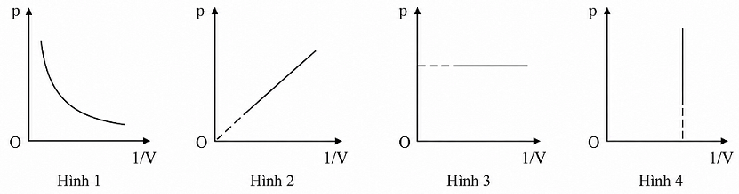
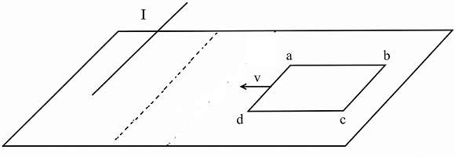
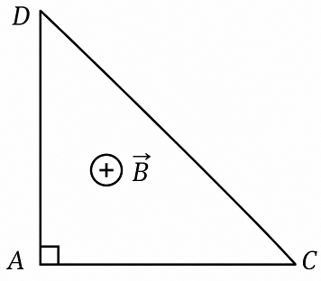
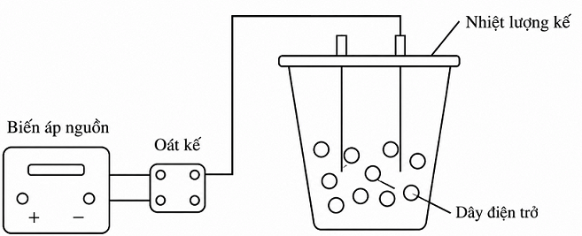
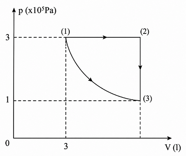
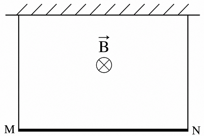
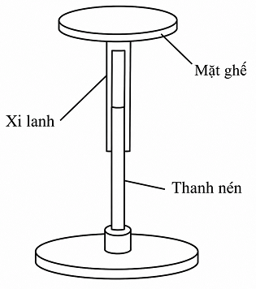
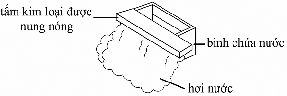
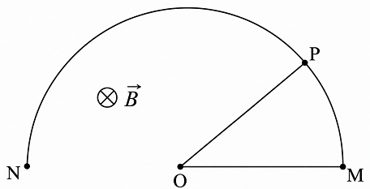

Đề: Sở Giáo dục và Đào tạo Sơn La, Lần thứ ba, mã đề 0210

SỞ GIÁO DỤC VÀ ĐÀO TẠO
SƠN LA
ĐỀ THI CHÍNH THỨC
(Đề thi có 04 trang)

KỲ THI THỬ TỐT NGHIỆP THPT LẦN THỨ BA
NĂM HỌC: 2025 - 2026
MÔN: VẬT LÍ
Thời gian làm bài 50 phút, không kể thời gian phát đề

Họ và tên: ………………………………………….. Số báo danh: ……………… Mã đề 0210

PHẦN I. Thí sinh trả lời từ câu 1 đến câu 18. Mỗi câu hỏi thí sinh chỉ chọn một phương án.

Câu 1. Trong y học, kỹ thuật “đánh dấu phóng xạ” thường sử dụng các đồng vị có chu kì bán rã ngắn để chẩn đoán bệnh. Nguyên lý cơ bản của kỹ thuật này là gì?
A. Sử dụng tia gamma để chiếu xạ thực phẩm nhằm tiêu diệt vi khuẩn và kéo dài thời gian bảo quản.
B. Sử dụng năng lượng của tia phóng xạ để tiêu diệt trực tiếp các tế bào ung thư đang khu trú.
C. Dùng các hạt alpha bắn phá vào nhân tế bào để làm thay đổi cấu trúc di truyền của các loại virus gây bệnh.
D. Đưa đồng vị phóng xạ vào cơ thể để theo dõi sự tập trung hoặc di chuyển của chúng thông qua việc ghi đo bức xạ từ bên ngoài.

Câu 2. Cho hai dây dẫn đặt gần nhau và song song với nhau. Khi cho hai dòng điện cùng chiều chạy qua hai dây dẫn thì hai dây dẫn
A. hút nhau.
B. đẩy nhau.
C. đều dao động.
D. không tương tác.

Câu 3. Một máy biến áp lí tưởng, cuộn sơ cấp có $N_1$ vòng dây, cuộn thứ cấp có $N_2$ vòng dây. Khi đặt vào hai đầu cuộn sơ cấp điện áp hiệu dụng $U_1$ thì điện áp hiệu dụng ở hai đầu cuộn thứ cấp là
A. $U_2 = \frac{N_1}{U_1} \cdot N_2$.
B. $U_2 = \frac{N_2}{N_1} \cdot U_1$.
C. $U_2 = \frac{N_1}{N_2} \cdot U_1$.
D. $U_2 = \frac{N_1}{U_1 \cdot N_2}$.

Câu 4. Gọi k là hằng số Boltzmann, T là nhiệt độ tuyệt đối của khí lí tưởng. Động năng tịnh tiến trung bình của phân tử khí được xác định bởi công thức
A. $\overline{E_đ} = \frac{3}{2}kT^2$.
B. $\overline{E_đ} = \frac{2}{3}kT^2$.
C. $\overline{E_đ} = \frac{2}{3}kT$.
D. $\overline{E_đ} = \frac{3}{2}kT$.

Câu 5. Nội năng của một vật là
A. tổng động năng và thế năng của vật.
B. nhiệt lượng mà vật nhận được trong quá trình truyền nhiệt.
C. tổng nhiệt lượng và cơ năng mà vật nhận được trong quá trình truyền nhiệt và thực hiện công.
D. tổng động năng và thế năng của các phân tử cấu tạo nên vật.

Câu 6. Khi nói về hạt $\beta^+$ và hạt $\beta^-$, phát biểu nào sau đây là không đúng?
A. Hạt $\beta^+$ và hạt $\beta^-$ được phóng ra có tốc độ bằng nhau (gần bằng tốc độ ánh sáng).
B. Khi đi qua điện trường giữa hai bản tụ hạt $\beta^+$ và hạt $\beta^-$ bị lệch về hai phía khác nhau.
C. Hạt $\beta^+$ và hạt $\beta^-$ được phóng ra từ cùng một đồng vị phóng xạ.
D. Hạt $\beta^+$ và hạt $\beta^-$ có khối lượng bằng nhau.

Câu 7. Nguyên lý hoạt động chung của các loại nhiệt kế thường dùng (như nhiệt kế thủy ngân, nhiệt kế rượu) dựa trên hiện tượng nào sau đây?
A. Sự bay hơi của các chất lỏng.
B. Sự nở vì nhiệt của các chất.
C. Sự dẫn nhiệt của các chất rắn.
D. Sự thay đổi màu sắc của các chất khi nhiệt độ thay đổi.

Câu 8. Số neutron trong hạt nhân $_Z^A X$ là
A. $A + Z$.
B. $A$.
C. $Z$.
D. $A - Z$.

Câu 9. Đồ thị nào sau đây biểu diễn đúng định luật Boyle?
[HÌNH: Bốn đồ thị biến thiên của áp suất p theo 1/V: Hình 1 (đường cong hyperbol dốc xuống), Hình 2 (đường thẳng kéo dài đi qua gốc tọa độ O, đoạn gần O nét đứt), Hình 3 (đường nằm ngang song song trục 1/V, đoạn đầu nét đứt), Hình 4 (đường thẳng đứng song song trục p, đoạn dưới nét đứt).]

A. Hình 3.
B. Hình 4.
C. Hình 1.
D. Hình 2.

Câu 10. Lực nào làm thay đổi phương của hạt alpha ($^4_2\text{He}$) khi được bắn vào lá vàng mỏng?
A. Lực hạt nhân giữa hạt nhân $^{197}_{79}\text{Au}$ đẩy $^4_2\text{He}$.
B. Lực hạt nhân giữa hạt nhân $^{197}_{79}\text{Au}$ hút $^4_2\text{He}$.
C. Lực đẩy tĩnh điện giữa hạt nhân $^{197}_{79}\text{Au}$ và $^4_2\text{He}$.
D. Lực hút tĩnh điện giữa các electron của phân tử vàng và $^4_2\text{He}$.

Câu 11. Nhiệt hóa hơi riêng của một chất là nhiệt lượng cần cung cấp cho
A. 1 kg chất đó để nhiệt độ của nó tăng thêm 1 °C.
B. một lượng chất đó (ở trạng thái lỏng) hóa hơi hoàn toàn ở nhiệt độ sôi.
C. 1 kg chất đó (ở trạng thái rắn) hóa hơi hoàn toàn ở nhiệt độ xác định.
D. 1 kg chất đó (ở trạng thái lỏng) hóa hơi hoàn toàn ở nhiệt độ xác định.

Câu 12. Một dây dẫn thẳng dài, cố định, nằm ngang có dòng điện cường độ I không đổi chạy qua như hình vẽ. Một khung dây dẫn kín abcd hình chữ nhật đặt trong cùng một mặt phẳng nằm ngang với dây dẫn. Khung dây chuyển động thẳng đều với vận tốc $\vec{v}$ theo phương ngang, băng qua phía dưới dây dẫn từ khoảng cách xa lại gần rồi ra xa. Trong suốt quá trình đó, chiều dòng điện cảm ứng xuất hiện trong khung dây (nếu có) thay đổi như thế nào?
[HÌNH: Dây dẫn thẳng dài mang dòng điện không đổi I nằm ngang, khung dây dẫn kín hình chữ nhật abcd đặt cùng mặt phẳng chuyển động thẳng đều với vận tốc v hướng sang trái qua vị trí nét đứt dưới dây dẫn.]

A. Lúc đầu có chiều adcba, khi khung nằm đối xứng dưới dây dẫn thì đổi sang chiều dabcd, và cuối cùng đổi lại chiều adcba.
B. Luôn có chiều dabcd trong suốt quá trình chuyển động.
C. Lúc đầu có chiều dabcd, lúc sau có chiều adcba.
D. Lúc đầu có chiều adcba, lúc sau có chiều dabcd.

Câu 13. Trong thời tiết lạnh giá, cơ thể con người bị tiêu hao một phần năng lượng đáng kể để làm ấm luồng không khí hít vào phổi. Giả sử nhiệt dung riêng của không khí là $c = 1005\text{ J}/(\text{kg}\cdot\text{K})$ và khối lượng riêng của không khí ở điều kiện nhiệt độ môi trường là $\rho = 1,29\text{ kg}/\text{m}^3$. Vào một ngày mùa đông lạnh giá khi nhiệt độ không khí là 10 °C, một người hít vào mỗi hơi thở trung bình 0,45 lít không khí. Để làm lượng không khí này lên bằng nhiệt độ cơ thể (37 °C), nhiệt lượng mà cơ thể cần cung cấp để làm ấm lượng khí hít vào xấp xỉ là.
A. 16335,0 J.
B. 18,2 J.
C. 15685,0 J.
D. 15,8 J.

Câu 14. Đại lượng nào sau đây được giữ không đổi theo định luật Charles?
A. Khối lượng khí và áp suất khí.
B. Chỉ khối lượng khí.
C. Chỉ nhiệt độ khí.
D. Khối lượng khí và nhiệt độ khí.

Câu 15. Các biểu thức sau đây mô tả sự biến thiên nội năng ($\Delta U$) của hệ trong các quá trình khác nhau. Phát biểu nào dưới đây diễn giải không đúng về mặt vật lý?
A. $\Delta U = A + Q$, khi $Q > 0$ và khi $A < 0$: Hệ nhận nhiệt để thực hiện công.
B. $\Delta U = A + Q$, khi $Q < 0$ và khi $A > 0$: Hệ nhận nhiệt để thực hiện công.
C. $\Delta U = A$, khi $A > 0$ và khi $A < 0$: Hệ chỉ trao đổi công với bên ngoài.
D. $\Delta U = Q$, khi $Q > 0$ và khi $Q < 0$: Hệ chỉ trao đổi nhiệt với bên ngoài.

Câu 16. Trong quá trình nung nóng đẳng áp một khối lượng khí xác định, khoảng cách giữa các phân tử khí
A. không đổi.
B. giảm đi.
C. tăng lên.
D. giảm đến cực tiểu rồi tăng lên.

Câu 17. Một khung dây dẫn có dạng tam giác vuông cân ADC như hình vẽ. Khung dây đặt trong từ trường đều có cảm ứng từ $B = 0,1\text{ T}$, sao cho vector cảm ứng từ vuông góc với mặt phẳng ADC (hình vẽ). Biết $AD = AC = 20\text{ cm}$, dòng điện qua khung có cường độ 5 A theo chiều CADC. Bỏ qua trọng lượng khung dây, nếu khung tự do thì hợp lực từ tác dụng lên khung làm cho khung.
[HÌNH: Khung dây dẫn hình tam giác ADC vuông cân tại A đặt trong mặt phẳng hình vẽ, vectơ cảm ứng từ B vuông góc mặt phẳng ADC hướng ra ngoài kí hiệu vòng tròn có dấu cộng ở tâm.]

A. đứng yên.
B. chuyển động sang trái.
C. chuyển động sang phải.
D. chuyển động xuống dưới.

Câu 18. Trên nhãn các loại bình xịt côn trùng, sơn xịt hoặc bình gas mini (vỏ bằng kim loại), thường có dòng cảnh báo: “Không được ném bình vào lửa, ngay cả khi đã dùng hết”. Xét dưới góc độ Vật lý, khuyến cáo này nhằm mục đích gì?
A. Ngăn chặn việc nhiệt độ tăng cao làm áp suất khí còn lại trong bình tăng mạnh, vượt quá giới hạn bền của vỏ bình gây ra nổ.
B. Tránh việc vỏ bình kim loại bị nóng chảy dưới tác dụng của nhiệt độ cao.
C. Tiết kiệm tài nguyên bằng cách thu gom vỏ bình để tái chế.
D. Tránh việc áp suất trong bình giảm đột ngột do nhiệt độ làm vỏ bình biến dạng và rò rỉ hóa chất.

PHẦN II. Thí sinh trả lời từ câu 1 đến câu 4. Trong mỗi ý a), b), c), d) ở mỗi câu, thí sinh chọn đúng hoặc sai.

Câu 1. Để xác định nhiệt nóng chảy riêng của nước đá, có thể tiến hành thí nghiệm theo sơ đồ nguyên lí như hình dưới đây. Dòng điện làm nóng dây điện trở trong một nhiệt lượng kế và làm nước đá nóng chảy. Lượng nước được sau khi toàn bộ nước đá nóng chảy được đem đi cân thì thấy nó có khối lượng 15 g. Công suất điện tiêu thụ được xác định bằng oát kế là 24 W. Thời gian đun được xác định bằng đồng hồ là 180 s. Bỏ qua sự trao đổi nhiệt với môi trường xung quanh.
[HÌNH: Sơ đồ thí nghiệm gồm biến áp nguồn hai cực dương âm, oát kế 4 chốt, dây nối với dây điện trở đặt bên trong bình nhiệt lượng kế chứa các viên nước đá.]

a) Ở áp suất tiêu chuẩn, nước đá tinh khiết nóng chảy ở nhiệt độ 100 °C.
b) Khi nóng chảy hoàn toàn, thể tích nước tạo thành bằng thể tích nước đá ban đầu.
c) Nhiệt lượng nước đá nhận được từ dây điện trở trong thời gian đun là 4320 J.
d) Nhiệt nóng chảy riêng của nước đá đo được là $3,3 \cdot 10^5\text{ J}/\text{kg}$.

Câu 2. Pin hạt nhân Betavoltaic hoạt động dựa trên nguyên lí sử dụng các hạt electron năng lượng cao phát ra từ quá trình phân rã của đồng vị phóng xạ như Nickel – 63 ($^{63}\text{Ni}$) bắn vào lớp bán dẫn silicon tạo ra cặp electron – lỗ trống, tương tự như cách photon ánh sáng kích hoạt pin mặt trời. $^{63}\text{Ni}$ có chu kì bán rã là 100 năm. Năng lượng trung bình của hạt $\beta^-$ tạo ra khoảng 17,4 keV (mức năng lượng thấp, dễ dàng chặn lại bởi vỏ bọc mỏng, không xuyên thấu gây hại cho cơ thể). Trong y tế, pin hạt nhân là giải pháp lí tưởng cho máy trợ tim. Cho 1 năm có 365 ngày.
a) Pin Betavoltaic hoạt động giống như một “pin Mặt trời trong bóng tối” nơi hạt $\beta^-$ đóng vai trò thay thế cho các hạt photon.
b) Pin Nickel – 63 có thể tích hợp an toàn trong cơ thể người (máy trợ tim) mà không cần lớp che chắn chì dày hàng mét.
c) Hằng số phóng xạ của Nickel – 63 là $2,2 \cdot 10^{10}\text{ s}^{-1}$.
d) Một trạm cảm biến đặt dưới đáy đại dương sâu 6000 m để theo dõi động đất. Trạm này yêu cầu một công suất điện duy trì ổn định là 200 μW và hoạt động liên tục trong 20 năm mà không cần bảo trì. Các kĩ sư quyết định sử dụng pin hạt nhân đồng vị phóng xạ Nickel – 63. Biết khối lượng mol của $^{63}\text{Ni}$ là 63 g/mol. Hiệu suất chuyển đổi từ năng lượng tia $\beta^-$ sang điện năng của lớp bán dẫn là 8%. Cho $1\text{ eV} = 1,6 \cdot 10^{-19}\text{ J}$; $N_A = 6,022 \cdot 10^{23}\text{ mol}^{-1}$. Để 20 năm trạm vẫn đủ công suất 200 μW thì khối lượng Nickel – 63 cần thiết để chế tạo viên pin này là 0,49 gam.

Câu 3. Một khối khí lí tưởng biến đổi trạng thái từ (1) đến (2) đến (3) rồi về (1) như hình bên. Đường biến đổi từ trạng thái (3) đến (1) là một nhánh của đường hyperbol. Biết nhiệt độ ở trạng thái (1) là 27 °C.
[HÌNH: Đồ thị p-V mô tả chu trình biến đổi chất khí: trạng thái (1) có p = 3 (x10^5 Pa), V = 3 (l); quá trình (1)-(2) đẳng áp dãn nở đến trạng thái (2); quá trình (2)-(3) đẳng tích hạ áp suất xuống p = 1 (x10^5 Pa) tại trạng thái (3); quá trình (3)-(1) là một nhánh hyperbol.]

a) Nhiệt độ ở trạng thái (3) là 300 K.
b) Thể tích của khối khí ở trạng thái (2) là $9\text{ m}^3$.
c) Trong quá trình biến đổi từ trạng thái (2) đến (3) khối khí không thực hiện công.
d) Quá trình biến đổi từ trạng thái (1) đến (2) nội năng của khí đã giảm.

Câu 4. Một đoạn dây dẫn MN có chiều dài 40 cm, khối lượng $m = 10\text{ g}$, được treo bằng hai sợi dây nhẹ không giãn, cả hệ thống nằm trong mặt phẳng thẳng đứng và đặt trong từ trường đều có cảm ứng từ $\vec{B}$ vuông góc với mặt phẳng chứa MN (hình vẽ). Biết độ lớn của cảm ứng từ là 0,05 T. Lấy $g = 10\text{ m}/\text{s}^2$.
[HÌNH: Đoạn dây dẫn thẳng MN nằm ngang treo bởi hai sợi dây nhẹ thẳng đứng vào giá đỡ, đặt trong từ trường đều có vectơ cảm ứng từ B vuông góc mặt phẳng hình vẽ hướng vào trong kí hiệu vòng tròn có dấu nhân.]

a) Luôn có lực từ tác dụng lên dây dẫn MN.
b) Để lực từ tác dụng lên MN thẳng đứng từ dưới lên trên thì dòng điện qua MN có chiều từ N đến M.
c) Để lực căng của hai dây bằng không thì dòng điện chạy qua MN có độ lớn là 5 A và có chiều từ M đến N.
d) Cho dòng điện có cường độ 10 A chạy từ N đến M. Thay đổi hướng của từ trường 90° so với hướng ban đầu thì khi cân bằng hai dây treo hợp với phương thẳng đứng góc 45°.

PHẦN III. Thí sinh trả lời từ câu 1 đến câu 6.

Câu 1. Hạt nhân $^{13}_6\text{C}$ có khối lượng 13,0001 amu. Cho khối lượng proton và neutron lần lượt là 1,0073 amu và 1,0087 amu. Lấy $1\text{ amu} = 931,5\text{ MeV}/c^2$. Năng lượng liên kết của $^{13}_6\text{C}$ là bao nhiêu MeV (kết quả làm tròn đến chữ số hàng phần mười)?

Câu 2. Hình bên mô tả cấu tạo của một chiếc ghế nâng hạ bằng khí thông qua chuyển động lên xuống của một xilanh được gắn với mặt ghế. Thanh nén khí được gắn cố định trên đế đóng vai trò như một pittông. Bên trong xilanh có chứa một lượng khí. Tổng khối lượng của mặt ghế và xilanh là 6 kg, tiết diện của thanh nén là $30\text{ cm}^2$. Một học sinh có khối lượng 45 kg ngồi hoàn toàn lên ghế (hai chân không chạm mặt sàn) thì mặt ghế hạ xuống một đoạn 10 cm rồi dừng lại. Coi nhiệt độ của khí trong xi lanh không đổi, áp suất khí quyển là $p_0 = 10^5\text{ Pa}$ và $g = 10\text{ m}/\text{s}^2$. Bỏ qua ma sát giữa thanh nén và xilanh. Hỏi khi ghế để trống thì cột khí trong xilanh có chiều cao là bao nhiêu xentimét (cm)?
[HÌNH: Sơ đồ cấu tạo ghế nâng hạ bằng khí gồm mặt ghế tròn phía trên gắn với xilanh hình trụ rỗng úp bên ngoài thanh nén hình trụ gắn cố định trên chân đế tròn.]

Câu 3. Polonium – 210 ($^{210}_{84}\text{Po}$) là chất phóng xạ $\alpha$ có chu kì bán rã 138 ngày và biến đổi thành Plumbum – 206 ($^{206}_{82}\text{Pb}$). Ban đầu một mẫu có trong đó 80% khối lượng là chất phóng xạ $^{210}_{84}\text{Po}$, phần còn lại không có tính phóng xạ. Giả sử toàn bộ hạt $\alpha$ sinh ra trong quá trình phóng xạ đều thoát ra khỏi mẫu. Lấy khối lượng các hạt nhân bằng số khối của chúng tính theo đơn vị amu. Sau bao nhiêu ngày thì khối lượng $^{210}_{84}\text{Po}$ chiếm 30% khối lượng của mẫu (kết quả làm tròn đến chữ số hàng đơn vị)?

Câu 4. Hình bên mô tả một chiếc bàn là hơi nước. Nước từ một bình chứa nhỏ giọt vào một tấm kim loại được nung nóng bằng điện. Bộ phận làm nóng tiêu thụ công suất điện 1000 W. Giả sử rằng toàn bộ năng lượng điện từ bộ phận làm nóng được truyền đến tấm kim loại. Tấm kim loại luôn được duy trì ở nhiệt độ làm việc của nó. Nước ở 27 °C nhỏ giọt vào tấm kim loại biến thành hơi nước ở 100 °C liên tục bay ra từ bàn là. Nhiệt hóa hơi riêng của nước là $L = 2,3 \cdot 10^6\text{ J}/\text{kg}$, nhiệt dung riêng của nước là $c = 4200\text{ J}/(\text{kg}\cdot\text{K})$. Mỗi phút bàn là tạo ra bao nhiêu gam hơi nước (kết quả làm tròn đến chữ số hàng đơn vị)?
[HÌNH: Sơ đồ cấu tạo bàn là hơi nước gồm bình chứa nước phía sau, tấm kim loại được nung nóng phía trước bên trên và hơi nước bốc ra phía dưới.]

Câu 5. Một bình đun nước có công suất không đổi, trên bình có nhiệt kế hiển thị nhiệt độ tức thời của nước trong bình. Một bạn học sinh dùng bình để đun nước pha trà. Ban đầu trong bình có chứa một khối lượng nước $m_0 = 0,5\text{ kg}$, nhiệt độ hiển thị là $t_0 = 20^\circ\text{C}$. Sau khoảng thời gian đun $\Delta t_1 = 2\text{ phút}$ thì nhiệt độ hiển thị là $t_1 = 50^\circ\text{C}$, đồng thời bạn học sinh thêm một khối lượng nước $m_t$ ở nhiệt độ $t_x$ vào trong bình. Bạn học sinh đun thêm 5 phút thì nhiệt độ của nước đạt $t_2 = 70^\circ\text{C}$; tiếp tục đun thêm 5 phút nữa thì nước bắt đầu sôi. Bỏ qua mất mát nhiệt ra môi trường và coi quá trình trao đổi nhiệt diễn ra nhanh chóng. Biết nhiệt dung riêng của nước là 4200 J/kg. Khối lượng nước $m_t$ mà bạn học sinh đã thêm vào trong bình là bao nhiêu kg?

Câu 6. Một dây dẫn bằng đồng có tiết diện ngang $1,5\text{ mm}^2$, điện trở suất $1,7 \cdot 10^{-8}\text{ }\Omega\text{m}$, được uốn thành nửa vòng tròn tâm O có bán kính 20 cm như hình vẽ. Hai đoạn dây dẫn OM và OP cùng loại với dây trên. Dây OM cố định, dây OP quay quanh O sao cho P luôn tiếp xúc với cung tròn. Hệ thống đặt trong từ trường đều có độ lớn 0,2 T có hướng vuông góc với mặt phẳng chứa nửa vòng tròn. Tại thời điểm ban đầu OP trùng với OM và góc quay $\alpha = \widehat{POM}$ của OP kể từ thời điểm ban đầu được xác định bởi biểu thức $\alpha = 2t$ ($\alpha$ tính theo đơn vị rad, t tính theo đơn vị giây). Độ lớn cường độ dòng điện cảm ứng tại thời điểm $t = 1\text{ giây}$ trong mạch kín là bao nhiêu A (kết quả làm tròn đến chữ số hàng phần mười)?
[HÌNH: Nửa vòng tròn kim loại MN tâm O bán kính 20 cm, thanh dẫn OM cố định nằm ngang, thanh dẫn OP quay quanh O hợp với OM góc alpha = POM, trong từ trường đều B vuông góc mặt phẳng hình vẽ hướng vào trong kí hiệu vòng tròn có dấu nhân.]

