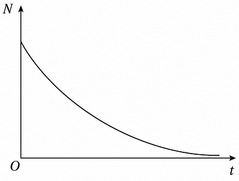
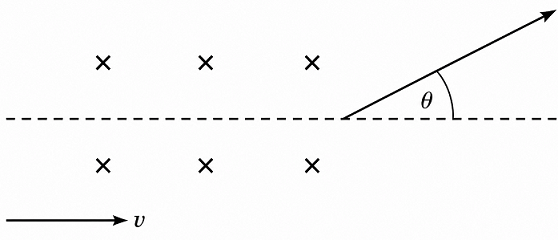
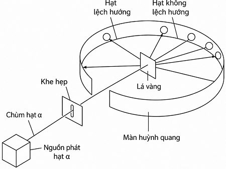
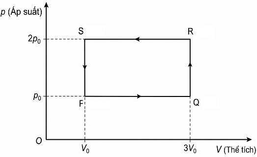

Đề: Sở Giáo dục và Đào tạo Vĩnh Long, Kỳ thi thử tốt nghiệp THPT năm 2026, mã đề 0201

SỞ GIÁO DỤC VÀ ĐÀO TẠO
VĨNH LONG
ĐỀ THI CHÍNH THỨC
(Đề thi có 04 trang)

KỲ THI THỬ TỐT NGHIỆP THPT NĂM 2026
Môn thi: VẬT LÍ
Thời gian làm bài 50 phút, không kể thời gian phát đề

Họ và tên: ………………………………………….. Số báo danh: ………………Mã đề 0201

• Cho biết: $T(\text{K}) = t(^\circ\text{C}) + 273$; $R = 8,31\text{ J.mol}^{-1}\text{.K}^{-1}$.
• Không làm tròn kết quả các phép tính trung gian.

PHẦN I. Câu trắc nghiệm nhiều phương án lựa chọn. Thí sinh trả lời từ câu 1 đến câu 18. Mỗi câu hỏi thí sinh chỉ chọn một phương án.

Câu 1. Nội năng của một hệ là đại lượng được xác định bằng tổng
A. động năng chuyển động vĩ mô và thế năng trọng trường của toàn bộ hệ.
B. động năng chuyển động nhiệt và thế năng tương tác của các phân tử cấu tạo nên hệ.
C. động năng tịnh tiến trung bình và năng lượng tỏa ra của hệ trong quá trình biến đổi.
D. nhiệt lượng hệ thu vào và công cơ học hệ nhận được trong suốt quá trình biến đổi.

Câu 2. Xét đồ thị biểu diễn số hạt nhân chưa bị phân rã $(N)$ theo thời gian $(t)$. Phát biểu nào sau đây là đúng?
[HÌNH: Đồ thị hàm mũ biểu diễn số hạt nhân chưa bị phân rã N theo thời gian t, trục tung N, trục hoành t, gốc tọa độ O]

A. Đồ thị có dạng là một đường hypebol.
B. Lượng hạt nhân bị phân rã trong những khoảng thời gian bằng nhau bất kì là như nhau.
C. Đồ thị sẽ cắt trục thời gian $(Ot)$ sau thời gian hai chu kì bán rã.
D. Độ lớn hệ số góc của tiếp tuyến với đồ thị tại mỗi điểm bằng độ phóng xạ tại thời điểm đó.

Câu 3. Trong hệ đo lường SI, đơn vị của từ thông là
A. ampe (A).
B. weber (Wb).
C. vôn (V).
D. tesla (T).

Câu 4. Khoảng thời gian để một nửa số hạt nhân của một lượng chất phóng xạ bị phân rã là
A. đồng vị phóng xạ.
B. chu kì bán rã.
C. hằng số phóng xạ.
D. độ phóng xạ.

Câu 5. Đại lượng đặc trưng cho mức độ bền vững của hạt nhân là
A. tổng số nucleon của hạt.
B. năng lượng liên kết toàn phần.
C. khối lượng của toàn bộ hạt.
D. năng lượng liên kết riêng.

Câu 6. Một lượng khí lí tưởng xác định biến đổi trạng thái với áp suất không đổi thì thể tích
A. tỉ lệ thuận với nhiệt độ tuyệt đối.
B. tỉ lệ thuận với nhiệt độ Celsius.
C. tỉ lệ nghịch với nhiệt độ Celsius.
D. tỉ lệ nghịch với nhiệt độ tuyệt đối.

Câu 7. Môi trường vật chất tồn tại xung quanh một thanh nam châm đứng yên được gọi là
A. trường hấp dẫn.
B. trường điện từ.
C. điện trường tĩnh.
D. từ trường.

Câu 8. Dòng điện cảm ứng xuất hiện trong mạch kín có chiều sao cho từ trường do nó sinh ra
A. luôn cùng chiều với từ trường bên ngoài.
B. có tác dụng chống lại sự biến thiên từ thông qua mạch kín.
C. luôn ngược chiều với từ trường bên ngoài.
D. có tác dụng tăng cường sự biến thiên từ thông qua mạch kín.

Câu 9. Trước cơn mưa giông, thời tiết thường oi bức và cơ thể đổ mồ hôi nhưng không thấy mát vì
A. áp suất khí quyển giảm mạnh làm cơ thể tỏa nhiệt kém hơn.
B. mây đen hấp thụ bức xạ mặt trời rồi phản xạ xuống đất.
C. từ trường trong đám mây giông làm tăng nội năng của cơ thể.
D. độ ẩm cao làm mồ hôi khó bay hơi để lấy đi nhiệt từ cơ thể.

Câu 10. Đại lượng được đo bằng nhiệt lượng cần cung cấp để 1 kg chất tăng thêm 1 K là
A. nhiệt nóng chảy riêng.
B. nhiệt hoá hơi riêng.
C. nhiệt dung riêng.
D. nhiệt lượng tỏa ra.

Câu 11. Với $k$ là hằng số Boltzmann, công thức nào thể hiện đúng mối liên hệ giữa động năng tịnh tiến trung bình ($W_{\text{đ}}$) của phân tử khí lí tưởng và nhiệt độ tuyệt đối $T$?
A. $W_{\text{đ}} = 2,5kT$.
B. $W_{\text{đ}} = kT$.
C. $W_{\text{đ}} = 0,5kT$.
D. $W_{\text{đ}} = 1,5kT$.

Câu 12. Phản ứng trong đó hai hạt nhân nhẹ kết hợp với nhau tạo thành một hạt nhân nặng hơn được gọi là
A. phản ứng nhiệt hạch.
B. hiện tượng phóng xạ.
C. phản ứng phân hạch.
D. hiện tượng cảm ứng điện từ.

Câu 13. Theo mô hình động học phân tử, các phân tử chất khí luôn
A. chuyển động nhiệt hỗn loạn.
B. đứng yên ở vị trí cân bằng.
C. hút và đẩy lẫn nhau liên tục.
D. dao động quanh một vị trí.

Câu 14. Một lượng khí lí tưởng xác định bị nén đẳng nhiệt thì khối khí sẽ
A. sinh công và giảm nội năng.
B. sinh công và thu nhiệt.
C. nhận công và tỏa nhiệt.
D. nhận công và tăng nội năng.

Câu 15. Trong sự chuyển thể, quá trình chuyển từ thể rắn sang thể lỏng được gọi là
A. sự nóng chảy.
B. sự hoá hơi.
C. sự đông đặc.
D. sự ngưng tụ.

Câu 16. Hai hạt nhân được gọi là đồng vị của cùng một nguyên tố hoá học khi chúng có số khối khác nhau nhưng phải có cùng
A. bán kính hạt nhân.
B. khối lượng hạt nhân.
C. số neutron.
D. số proton.

Câu 17. Cường độ hiệu dụng của dòng điện xoay chiều được định nghĩa là đại lượng có giá trị bằng cường độ của một dòng điện không đổi, sao cho khi đi qua cùng một điện trở trong cùng một khoảng thời gian thì
A. chúng tải đi cùng một điện lượng.
B. chúng tỏa ra cùng một nhiệt lượng.
C. chúng sinh ra cùng một từ trường.
D. chúng sinh ra cùng một công cơ học.

Câu 18. Phát biểu nào sau đây là đúng khi nói về khí lí tưởng?
A. Tốc độ trung bình của các phân tử khí bằng không do các phân tử chuyển động hỗn loạn.
B. Khi nhiệt độ tăng, tốc độ của mọi phân tử khí đều tăng thêm một lượng như nhau.
C. Động năng tịnh tiến trung bình của các phân tử khí tỉ lệ thuận với nhiệt độ tuyệt đối.
D. Vận tốc trung bình của các phân tử khí tăng khi nhiệt độ tăng.

PHẦN II. Câu trắc nghiệm đúng sai. Thí sinh trả lời từ câu 1 đến câu 4. Trong mỗi ý a), b), c), d) ở mỗi câu, thí sinh chọn đúng hoặc sai.

Câu 1. Một hạt A mang điện tích $q$ và có khối lượng $m$ bay theo phương ngang với vận tốc $v$ vào một vùng không gian có từ trường đều cảm ứng từ $B$, bề rộng vùng từ trường là $L$. Hướng của vận tốc $v$ vuông góc với các đường sức từ. Trong vùng từ trường này, hạt chịu tác dụng của lực từ có độ lớn $f = |q|vB$. Sau khi bay xuyên qua và ra khỏi vùng từ trường, quỹ đạo chuyển động của hạt bị lệch đi một góc $\theta$ so với phương ngang ban đầu như hình vẽ.
[HÌNH: Hạt mang điện tích bay theo phương ngang với vận tốc v vào vùng từ trường đều có các đường sức từ hướng vào trong mặt phẳng hình vẽ (dấu x), sau khi qua vùng từ trường quỹ đạo bị lệch góc theta so với phương ngang]

a) Lực từ tác dụng lên hạt A có phương vuông góc với cả vận tốc $v$ và cảm ứng từ $B$.
b) Hạt A mang điện tích âm.
c) Khi chuyển động trong vùng từ trường, quỹ đạo của hạt A là một phần của đường tròn.
d) Độ lớn góc lệch $\theta$ của hạt A khi ra khỏi từ trường được tính bằng công thức $\sin\theta = \frac{|q|B}{Lmv}$.

Câu 2. Một nhóm học sinh dự đoán: “Hạt $\alpha$ có động năng rất lớn nên khi bắn qua lá vàng, sẽ không có bất kì phần tử nào bên trong nguyên tử đủ lực đẩy nó bật ngược lại.”
Để kiểm chứng dự đoán này, nhóm học sinh tiến hành phân tích dữ liệu từ thí nghiệm tán xạ hạt $\alpha$ do Rutherford thực hiện. Dữ liệu ghi nhận từ kết quả thí nghiệm thực tế cho thấy: “Hầu hết các hạt $\alpha$ đi thẳng nhưng có một số hạt bị lệch so với hướng truyền ban đầu với các góc lệch khác nhau. Trong đó, có những hạt $\alpha$ bị lệch ở góc lớn hơn $90^\circ$.”
[HÌNH: Sơ đồ thí nghiệm tán xạ Rutherford gồm nguồn phát hạt alpha, chùm hạt alpha qua khe hẹp bắn vào lá vàng bao quanh bởi màn huỳnh quang, các hạt bị tán xạ hoặc đi thẳng tới màn huỳnh quang]

a) Hạt $\alpha$ là hạt nhân của nguyên tử $^4_2\text{He}$.
b) Lực làm hạt $\alpha$ bị lệch đi có bản chất là lực hút tĩnh điện giữa hạt $\alpha$ và các electron.
c) Hiện tượng hạt $\alpha$ bị lệch ở góc lớn hơn $90^\circ$ đã bác bỏ dự đoán ban đầu của nhóm học sinh.
d) Kết quả thí nghiệm chứng tỏ toàn bộ điện tích dương của nguyên tử tập trung trong một thể tích nhỏ gọi là hạt nhân và khối lượng nguyên tử tập trung chủ yếu ở hạt nhân.

Câu 3. Một khối khí lí tưởng xác định thực hiện quá trình biến đổi trạng thái theo chu trình khép kín $P \to Q \to R \to S \to P$ có đồ thị như hình vẽ.
[HÌNH: Đồ thị chu trình nhiệt động lực học p-V dạng hình chữ nhật với các đỉnh P(V0, p0), Q(3V0, p0), R(3V0, 2p0), S(V0, 2p0), chiều biến đổi P -> Q -> R -> S -> P]

a) Quá trình $P \to Q$ là quá trình đẳng áp.
b) Động năng tịnh tiến trung bình của các phân tử khí lớn nhất tại trạng thái $R$.
c) Trong quá trình $S \to P$, khối khí nhận nhiệt từ môi trường làm tăng nội năng.
d) Sau một chu trình, khối khí đã sinh công cơ học có độ lớn bằng $2p_0 V_0$.

Câu 4. Để loại bỏ ảnh hưởng sự hao phí do tỏa nhiệt ra môi trường khi đo nhiệt hóa hơi riêng $L$ của nước, một nhóm học sinh tiến hành thí nghiệm như sau:
• Đặt một bình đun hở nắp chứa nước lên một cân điện tử;
• Tiến hành đun nước trong bình ở hai mức công suất điện khác nhau $P_1$ và $P_2\ (P_1 < P_2)$;
• Khi nước đã sôi ổn định, dựa vào sự sụt giảm số chỉ trên cân điện tử, nhóm học sinh đo được khối lượng nước đã bay hơi trong cùng một khoảng thời gian $t$ lần lượt là $\Delta m_1$ và $\Delta m_2$.
a) Nhiệt hóa hơi riêng của nước là nhiệt lượng cần cung cấp để làm hóa hơi hoàn toàn nước trong bình ở nhiệt độ sôi.
b) Đun với công suất điện $P_2$ sẽ làm nước sôi ở nhiệt độ cao hơn so với khi đun ở công suất điện $P_1$.
c) Khi nước sôi ổn định, công suất hao phí do tỏa nhiệt ra môi trường trong hai lần đun là như nhau.
d) Nhiệt hóa hơi riêng của nước trong thí nghiệm này được xác định theo công thức $L = \frac{(P_2 - P_1)t}{\Delta m_2 - \Delta m_1}$.

PHẦN III. Câu trắc nghiệm trả lời ngắn. Thí sinh trả lời từ câu 1 đến câu 6.
Dùng thông tin sau cho câu 1 và câu 2: Một buồng nghỉ nhỏ trên đỉnh Fansipan. Ở đây, một nhà leo núi đo được nhiệt độ không khí là $17^\circ\text{C}$ và áp suất khí quyển là $66,48\text{ kPa}$. Coi không khí là khí lí tưởng với khối lượng mol $M = 29\text{ g/mol}$.
Câu 1. Buồng nghỉ có thể tích $29\text{ m}^3$, số mol không khí trong buồng là bao nhiêu?
Câu 2. Khối lượng riêng của không khí trong buồng là bao nhiêu $\text{kg/m}^3$?

Dùng thông tin sau cho câu 3 và câu 4: Để đo thành phần nằm ngang của từ trường Trái Đất, học sinh sử dụng một cuộn dây dẹt gồm 1000 vòng, diện tích mỗi vòng dây là $0,1\text{ m}^2$. Cuộn dây có tổng điện trở là $6,0\ \Omega$. Ban đầu, mặt phẳng cuộn dây vuông góc với thành phần nằm ngang của từ trường Trái Đất. Sau đó, học sinh thực hiện thao tác lật nhanh cuộn dây một góc $180^\circ$. Một thiết bị đo điện lượng nối với cuộn dây ghi nhận được điện lượng di chuyển qua mạch trong quá trình lật là $1,0\text{ mC}$.
Câu 3. Thành phần nằm ngang của từ trường Trái Đất tại nơi này là bao nhiêu $\mu\text{T}$?
Câu 4. Độ biến thiên từ thông qua cuộn dây trong quá trình lật có độ lớn là bao nhiêu $\text{mWb}$?

Dùng thông tin sau cho câu 5 và câu 6: Phương pháp xác định tuổi tritium/helium-3 được sử dụng để xác định thời gian một khối nước biển bị cô lập dưới tầng sâu đại dương. Các hạt nhân tritium ($^3_1\text{H}$) phóng xạ biến đổi thành hạt nhân helium-3 ($^3_2\text{He}$). Khi khối nước ở trên bề mặt, lượng $^3_2\text{He}$ sinh ra sẽ thoát ngay vào bầu khí quyển. Khi khối nước chìm xuống sâu và bị cô lập, lượng $^3_2\text{He}$ sinh ra bị giữ lại hoàn toàn trong nước. Phân tích một mẫu nước lấy từ một dòng hải lưu ngầm, người ta đo được tỉ lệ số nguyên tử $^3_2\text{He}$ bị giữ lại và số nguyên tử $^3_1\text{H}$ hiện còn trong mẫu nước là 1,5. Biết chu kì bán rã của $^3_1\text{H}$ là 12,3 năm.
Câu 5. Số hạt neutron trong một hạt nhân $^3_1\text{H}$ là bao nhiêu?
Câu 6. Khối nước này đã bị cô lập (không tiếp xúc với khí quyển) trong thời gian là bao nhiêu năm (làm tròn kết quả đến chữ số hàng phần mười)?

----- HẾT -----

• Thí sinh không được sử dụng tài liệu;
• Giám thị không giải thích gì thêm.
