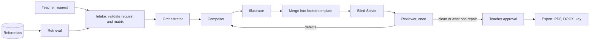

# ASTRA: MVP documentation (Pre-Presentation)

Team Trial and Success, CSC10014 Computational Thinking. Draft for team review; it becomes the submission text after the team agrees (AGENTS.md rule 12).

**Vocabulary (one word per thing, used the same way in every section).** *Request* is what the teacher asks for. *Matrix* is the per-question specification of an exam (topic, type, level). *Reference* is approved source material. *Exam* is the student paper. *Key* is the answer key. *Solution* is a worked solution. *Review* is the Reviewer's list of defects. *Approval* is the teacher's sign-off.

**Evidence rule.** "Implemented" means the code and tests are in `origin/main`. It does not mean accurate. No accuracy, cost or time-saving number has been measured on real teacher tasks yet; the report's targets (95% key accuracy, VND 2,000 per exam) stay targets.

---

## 1. Project analysis

Source of the reasoning below: the team's slide plan (`docs/ct-slide-plan.en.md`, branch `docs/huy/ct-slide-plan`, v2). The order of 1.2 is the order of that deck; each step starts from what the step before it established. Places the draft leaves open are marked **[TO FILL]**.

### 1.1 Problem definition

**The problem we are trying to solve is: given a teacher's exam intent, reference documents and a matrix, produce an exam package whose content is correct, whose form matches the matrix and the template, and which the teacher can review and export without redoing it.**

| | Symbol | Content | Status in the MVP |
| :--- | :--- | :--- | :--- |
| Input, from the teacher, required | *I* | exam intent (free text and constraints: grade, curriculum, duration) | implemented |
| Input, from the teacher, optional | *S* | sample exam | not implemented |
| | *R* | reference documents | implemented as retrieval over the approved corpus; teacher uploads not implemented |
| | *F* | template requirements | implemented as a locked LaTeX template per exam profile |
| | *M* | matrix: per question, topic, type, level (NB, TH, VD, VDC), objective | implemented |
| Input, from the dataset | *K* | approved corpus: curriculum map and past-exam transcriptions (687 curriculum rows, 108 exam papers in the benchmark snapshot) | implemented. **[TO FILL: required vs optional split of the teacher inputs]** |
| Output, the teacher sees | *E* | exam package: paper (`de_thi.tex`), key and solution, review flags (`human_review.md`), PDF and DOCX after approval | implemented |
| Output, the teacher need not see | updated memory | what the application keeps for the next run | not implemented. **[TO FILL: what is stored]** |

> **Given** *I*, *S*, *R*, *F*, *M* and *K*. **Find** an exam package *E* such that (1) **content is correct**: keys and solutions are right and grounded in a reference; (2) **form is correct**: it matches *F* and *M* (counts, parts, marks, duration); (3) **it is usable**: the teacher reviews and exports it without redoing it.

**Scope.** In: Toán THPT (22-question matrix) and V-ACT (120-question matrix); one exam per run. Out: other subjects, grading, learning analytics, publishing without teacher approval. Every exam is `pending_human_review`.

### 1.2 Line of thought: the four pillars, in the order the argument needs them

The pillars are not presented one by one. Each step below is one tag sentence and depends on the step before it.

**Step 1, Pattern recognition. When exams are of one kind, they follow one shared format, and their questions come from a small set of types written in a similar way.** (Subject: exams of one kind, for example THPTQG. Frequency: most of them **[TO FILL: counted or stated qualitatively]**. Content: one format, a few question types.) The two profiles show it: THPT is 12 multiple-choice, 4 true/false of four statements each, 6 short-answer; V-ACT is 120 multiple-choice in 5 sections.

**Step 2, Abstraction. The year, the school and the wording of an exam do not decide its structure; the format and the question types do.** So we drop the first and keep the second, and we solve a class of exams with one fixed set θ: *E* = Φ(*I*, *K*; θ). In the code, θ is the **exam profile**: locked template, matrix shape, validators.

**Step 3, Decomposition. Because Φ is one large function, we split it into three subproblems: the input, θ, and quality control of the output.** The input decides what data θ gets; θ decides what quality control must check; quality control results tune θ. The three cannot be solved in isolation.

**Step 4, baseline. Before building θ, the simplest design is one model in a loop: write the exam, ask it to re-check, add evidence, repeat.** It is kept as the comparison target (`baseline/`). It is not enough because nothing enforces count, marks and levels at once, one model certifies itself, and nothing can be measured.

**Step 5, Pattern recognition. When an official exam is written, the author who drafts the questions is not the person who checks the keys.** A committee has a writer, a blind solver, a challenger and a validator. Self-checking fails for lack of independence, so θ mirrors the committee: one agent per role. **[TO FILL: full citation of the reference paper on committee-style agents; not in the repository]**

**Step 4 to 5 result, Decomposition. Because each role has one job, we split the system into agents and stop splitting when an agent has one job, can be understood alone and can be tested alone.**

| Role in the committee | Agent in θ | In the repository |
| :--- | :--- | :--- |
| writer | Composer | implemented |
| blind solver | Solver | implemented (never sees the Composer's key) |
| challenger and validator | Reviewer (clarity, ambiguity, level, key against the Solver) and Python validators (counts, schema, hash) | implemented |
| (figures) | Illustrator | implemented |
| (coordination) | Orchestrator, plain Python | implemented |
| (request to matrix) | Intake, plain Python | implemented |
| pedagogical fit | Educator | **not implemented. [TO FILL: separate agent or part of the Reviewer]** |

**Step 6, Abstraction. The task of an agent does not decide its interface; every agent has the same frame.** The frame: goal, input schema, output schema, context policy, tools, and a status field so an agent can say it is unsure. Messages are JSON that the code can check, so an agent can be swapped and tested alone. Gates and schemas are declarative (what must be true); the Orchestrator is imperative (how to proceed).

**Step 7, Pattern recognition. When teachers write an exam, they look back at old exams, use experience and follow the constraints of the subject.** So *K* is a corpus of real exams and curriculum, preprocessed, with the writing factors extracted, and loaded selectively into retrieval and the Composer. Only data with an approved source and licence enters (AGENTS.md rule 8). **[TO FILL: contents and size of *K* that the team will ship, and what "factors" are extracted]**

**Step 8, Pattern recognition and Abstraction. When teachers make a request, it is usually vague; the matrix must be completed before generation.** The request is resolved (grade, subject, time), then deepened by asking about gaps, a bounded number of times. In the code, Intake refuses a missing field instead of guessing; the chatbot that asks the questions is outside this repository.

**Step 9, Algorithm design. Since the agents, the frame and the corpus are fixed, the procedure is a bounded sequence with one repair round, then a stop for the human.**

```
Request + matrix + references
  -> validate matrix (counts, levels, score budget)       [code]
  -> Composer drafts each part, in parallel                [model]
  -> Illustrator writes TikZ for figures                   [model]
  -> merge into the locked template                        [code]
  -> Solver solves independently                           [model]
  -> Reviewer reviews once                                 [model]
  -> defects? one feedback to Composer, rerun once         [bounded]
  -> STOP: teacher approval, then export                   [human]
```

High-level pseudocode, as in the slide plan:

```
draft = compose(matrix)
repeat up to MAX_ROUNDS (= 1):
    if check(draft) is ok: return draft
    draft = repair(draft)
give draft and flags to the teacher
```

Bounds: `max_repair_rounds = 1`, `max_provider_calls = 12`, 120 s per call, 600 s per run. Normal run: 4 calls (generic pipeline), 6 calls (THPT), 12 Composer + 12 Solver + 1 Reviewer (V-ACT, no figures). A run that cannot produce a valid draft stops and produces no exam.

**Step 10, Problem definition, measured. Because "correct, in form, usable" are the three criteria of *E*, quality control measures them, and the parameters of θ are turned to improve them.**

| Measure | Status |
| :--- | :--- |
| key correctness, matrix and format compliance, source validity, difficulty distribution, ambiguity rate | benchmark code exists, metrics are `null` until independent labels exist |
| teacher revision minutes, export success | **[TO FILL: who measures, how]** |
| cost per approved paper | recorded per run in `_internal/result.json` |
| retrieval: Hit@5, Recall@5, MRR, gap accuracy | measured on 35 gold queries (see section 4) |

Parameters we turn: MAS architecture, retrieval approach, number of repair rounds, input size, confidentiality (local or cloud model), temperature and context selection, model per role. **[TO FILL: the ranges the team will test]** Diversity (two exams for one request must differ) is an open subproblem with four candidate directions: a large database in context; a code assigner of topic, form and parameters per question; generate then filter near-duplicates; vary one axis per run. **[TO FILL: which directions the team tests, and the metric]**

**The whole analysis in one graph.** P0 (a correct, usable exam in the right form) splits into P1 input and database, P2 θ and P3 quality control. P2 splits into the baseline and the multi-agent system (agents and frame, composer and retrieval, pipeline and parameters). P3 raises P3.3 diversity. P4, getting the exam to users (interface, assistant, extra features), depends on P2.3 and is outside the MVP. **[TO FILL: the final graph, with decided nodes linked to `D-nnn` entries]**

### 1.3 Requirements derived from the analysis

| # | Requirement | Comes from |
| :--- | :--- | :--- |
| R1 | The exam matches the matrix exactly (counts, parts, options) | step 3: structure is checked by code |
| R2 | Every key has an independent solution | step 5: the drafter is not the checker |
| R3 | Subject-specific rules live in an exam profile, not in the pipeline | step 2 |
| R4 | A run is bounded and ends in an exam or in a visible failure | step 9 |
| R5 | A teacher approves before any export | scope: no autonomous publishing |
| R6 | Every claim from a reference keeps its source and locator | step 7 |

---

## 2. Feature specification

Statuses: **Implemented** (in `origin/main`, tests exist, not measured on real tasks), **Planned** (not in the repository).

| ID | Feature | What it does, and the expected behavior | Where | Status |
| :--- | :--- | :--- | :--- | :--- |
| F1 | Matrix and request validation | Rejects a request whose counts, levels or score budget are inconsistent, before any model call | `core/`, `intake.py` | Implemented |
| F2 | Exam profiles (THPT, V-ACT) | Locked LaTeX template, checked by SHA-256 before every run; only the question regions are replaced | `thpt/`, `vact/` | Implemented |
| F3 | Composer | Drafts questions per part against the matrix; parts run in parallel (default 3) | `pipeline/agents/composer.py` | Implemented |
| F4 | Illustrator | Writes TikZ/PGFPlots for each figure from the student view only; unsafe commands are blocked | `pipeline/agents/illustrator.py` | Implemented |
| F5 | Blind Solver | Solves from the merged file without the Composer's key | `pipeline/agents/solver.py` | Implemented |
| F6 | Reviewer | One review of the whole exam, with location and evidence for every defect | `pipeline/agents/reviewer.py` | Implemented |
| F7 | Orchestrator | Schema, budget, hash and deadline checks; one repair round; checkpoint and `--resume`; trace of every call | `pipeline/orchestration/` | Implemented |
| F8 | Retrieval (RAG) | Hybrid search (BM25 + embedding, fused by RRF) over curriculum and exam corpus, with source and locator; reports a gap instead of guessing | `rag_workflow/` | Implemented |
| F9 | MAS intake | Joins user request, chatbot intent and RAG passages into one validated request; refuses missing fields | `intake.py` | Implemented |
| F10 | Human review and export | Teacher edits and approves a review file bound to the draft hash; export to PDF and DOCX, then re-reads the files to check content | `exporter.py` | Implemented |
| F11 | Single-prompt baseline | One-agent run kept as the comparison target | `baseline/` | Implemented |
| F12 | Benchmark | Replay and live runs; reports matrix compliance, key accuracy, figure usability, Reviewer recall; unlabeled metrics stay `null` | `benchmarks/` | Implemented (replay only) |
| F13 | Web interface for the teacher | Request form, matrix editor, review screen, approve and export | none (RAG workbench only) | Planned |
| F14 | Run cost and time report | Tokens, calls, time and estimated cost per exam | `_internal/result.json` | Implemented |

---

## 3. System design

### 3.1 Architecture



### 3.2 Key components

| Component | Responsibility | Must not |
| :--- | :--- | :--- |
| Intake | validate the request and the matrix; refuse, never guess | fill a missing field |
| Retrieval | return passages with source and locator, or a named gap | invent a source |
| Composer | draft questions, keys and solutions per part | judge its own key |
| Illustrator | draw figures | see keys or solutions |
| Solver | solve independently | see the Composer's key |
| Reviewer | review the whole exam, once | change the exam |
| Orchestrator | order, budget, hash, retry, trace | contain exam content |
| Exporter | render approved files | change meaning |

### 3.3 Design decisions (each one with its reason)

| # | Decision | Reason |
| :--- | :--- | :--- |
| D1 | Python pipeline, four model roles, Orchestrator is code | stage failures stay separate; no model needed to coordinate |
| D2 | JSON between stages, validated by Pydantic | one contract, checked at every boundary |
| D3 | One repair round, then stop for the human | bounded cost and time; loops hide failures |
| D4 | Template is locked by SHA-256; only question regions change | the layout of a known exam format must not drift |
| D5 | The Solver never receives the key | otherwise agreement proves nothing |
| D6 | IDs, revisions and hashes are set by the Orchestrator | models copy hashes wrongly |
| D7 | Output is one LaTeX file, figures in TikZ | teacher can read and edit it; no image files to lose |
| D8 | Every exam is `pending_human_review` | a passing structural check does not prove the mathematics |
| D9 | Retrieval runs offline with no model call | no cost, repeatable benchmark |
| D10 | Keep a single-prompt baseline | the target must beat something measurable |

Known limit that follows from D5 and D10: the agents may share model biases, so independent solving lowers but does not remove errors.

---

## 4. Testing

**Plan.** Four levels, each tied to a requirement.

| Level | Checks | Requirement | Location |
| :--- | :--- | :--- | :--- |
| Contract tests | matrix counts, levels, score budget, option labels, JSON schema | R1, R4 | `tests/core`, `tests/thpt`, `tests/vact` |
| Agent and orchestrator tests with replay fixtures | the order of stages, one repair round, call limit, resume, no key reaches the Solver | R2, R4 | `tests/pipeline`, `tests/thpt` |
| Retrieval tests and benchmark | Hit@5, Recall@5, MRR, gap accuracy on 35 gold queries (17 dev, 18 held-out) | R6 | `tests/test_rag_*`, `eval/` |
| Export and architecture tests | exported files keep all text and figures; module boundaries hold | R5 | `tests/test_intake_exporter.py`, `tests/architecture` |

The repository has 223 test functions. CI runs lint, format check, repository check, pytest with coverage and a server smoke test on Ubuntu and Windows, Python 3.10 and 3.13.

**Test cases to show in the demo** (replay fixtures, no API key):

| # | Case | Expected |
| :--- | :--- | :--- |
| T1 | THPT request with 22 slots | exam has 12 + 4 + 6 questions; P2 has four statements each |
| T2 | request whose counts do not add up | rejected before any model call |
| T3 | template with one changed byte | run stops, hash mismatch |
| T4 | Solver disagrees with a key | Reviewer reports the question; one feedback; second run; stop |
| T5 | a run that needs a second repair | stops with a failure, no exam file |
| T6 | RAG query with no matching source | reports a gap, no passage |
| T7 | exporter with an unapproved review | refused |

**Results.**

| Item | Result | Status |
| :--- | :--- | :--- |
| RAG retrieval on 35 gold queries, hybrid mode | Hit@5 100.0%, Recall@5 91.7%, MRR 1.000, false-gap 0.0% (measured on snapshot `8b8fb7b`, from `docs/rag-workflow.md`) | measured |
| Pipeline benchmark, 10 requests x 2 repeats x 2 systems | plumbing only | replay, not a quality result |
| One recorded THPT run | 6 calls, 30,499 input and 11,288 output tokens, about USD 0.0246 at the stated price | single run, not a benchmark |
| Key accuracy, blueprint compliance on real tasks | none | **not measured** |
| Full test suite and CI on current `main` | result to be pasted here from a recorded run | **not verified by the author of this document** |

---

## 5. MVP feature selection (MoSCoW)

**MVP definition.** The MVP is the ability to **generate an exam** from a request, a matrix and references, with independent solving and teacher approval. This is the narrowest set that still answers the problem definition (section 1.1).

Timing: **MVP** = demonstrated at the MVP session; **Week 10** = final presentation.

| Priority | Feature | Timing | Rationale |
| :--- | :--- | :--- | :--- |
| Must | F1 Matrix and request validation | MVP | R1: without it nothing else can be trusted |
| Must | F2 Exam profile for Toán THPT | MVP | one real format, answers checkable by computation |
| Must | F3 Composer, F5 Blind Solver, F6 Reviewer, F7 Orchestrator | MVP | R2, R4: the minimum loop of draft, solve, review |
| Must | F10 Human review and export | MVP | R5: the teacher approves before export |
| Must | F14 Run cost and time report | MVP | the cost target can only be tested if cost is recorded |
| Should | F4 Illustrator | MVP (already built) | many Toán items need a figure; failure stops the run, so it is shown, not hidden |
| Should | F8 Retrieval | MVP (already built) | R6: gives evidence to the Composer; the loop runs without it |
| Should | F9 MAS intake | MVP (already built) | joins the chatbot request and retrieval into one request |
| Should | F11 Baseline and F12 Benchmark with human labels | Week 10 | needed for a real number; needs labeled tasks first |
| Could | F2 Exam profile for V-ACT (120 questions) | Week 10 | proves abstraction (same pipeline, new profile); costs about 25 calls per exam |
| Could | F13 Web interface for the teacher | Week 10 | convenience; the CLI and review file already cover the flow |
| Won't (this course) | other subjects, uploaded teacher files | after the course | each needs its own checker and data approval |
| Won't (this course) | grading, learning analytics, student practice mode | after the course | outside the problem definition |
| Won't (this course) | autonomous publishing | never | the teacher keeps the final decision |

**What the demo shows:** T1 to T4 on a replay fixture, then one live THPT run with its cost report, then the review file. **What it does not claim:** accuracy on real tasks.

---

## Not verified

This document was drafted with AI help (declare in `agent-log/huy.log` and the PR). It is based on reading `origin/main` at `f6b7ea8`. The test suite, CI and the live runs were not run for this document, and the existing numbers are copied from the repository's own docs.
