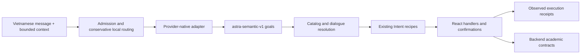

# Unified semantic workflows: implementation and operator guide

For ASTRA maintainers and the owner preparing the next controlled release. This describes the local implementation, its observed evidence, and the remaining external gates. The [master specification](UNIFIED_SEMANTIC_WORKFLOW_SPEC.md) supersedes older single-pool and provider-shaped decision requirements.

The current candidate is verified with synthetic provider/business fixtures. Production forwarding remains disabled. Successful live semantic interpretation and independent live MAS generation are not verified.

## Contracts and migration

- Provider envelope: Gemini `generateContent`, its finish reason, text parts, schema mechanism and usage metadata. The private direct/Gateway adapters use the same semantic request builder. Alternate Chat Completions envelopes are tested as fixtures; no additional paid provider was enabled.
- Meaning: [semantic-catalog.json](../../src/exam_baseline/resources/agent/semantic-catalog.json), [semantics.py](../../src/exam_baseline/agent/semantics.py). There are 36 goal IDs: the 34 existing operations are mapped through capability, catalog-intake or format resolvers, with two application-guidance goals. The catalog records meaning, parameters, examples, ambiguity, workflow rules and confirmation metadata. It is not an exact-sentence router.
- Execution: the existing `Decision`, `Intent`, `validIntent`, `execute` and React handlers. Application IDs, actual format IDs, revision bindings and confirmation closures are produced locally. Academic generation remains a confirmation-gated React business operation.
- Academic domain: the existing MAS `CompletionRequest`, stage schemas, format catalog and validation. The semantic layer does not redefine them.

`scripts/export_semantic_contract.py` generates the strict canonical schema, compact Gemini schema, semantic Worker fingerprint and native request fixture. Run with `--check` to detect drift. Python and TypeScript also consume the same goal catalog. Both validate the shared corpus. The Worker validates the compact native representation and then the strict per-goal canonical representation.

The original `generated.json`, `worker-contract.json` fingerprint and `/v1/agent/interpret` stay compatible. `/v2/agent/interpret` uses its own fingerprint and returns a semantic frame. The local `/agent/turn` accepts `X-Astra-Semantic: astra-semantic-v1`; older clients receive a conservative compatibility decision. A newer Worker transport fails closed if deployed infrastructure lacks v2; it does not silently fall back to a private credential.

Optional null/omitted goal fields have defined defaults. Invalid optional title metadata is discarded. Unknown goals/fields, invalid slot types or enums, fabricated IDs and raw commands are rejected. Meaning is never repaired to a nearby action. Safe diagnostic paths omit arbitrary rejected field names and private prompt content.

## Workflow behavior

`PREPARE_EXAM(family=thpt)` resolves through the runtime catalog. Missing subject information is stored in the existing session intake, with source-message provenance. An exact subject answer during that pending question can resolve locally, including accentless aliases. Unsupported subjects remain explicit and the Agent does not substitute Mathematics. The test catalog can add Chemistry without changing routing code.

Questions about a stored question/answer use the current package and revision to assemble a read-only reply. Stored keys and explanations are labeled as stored data, and any recorded Solver disagreement is retained. This does not navigate, regenerate or run an academic solver. The mounted check also exposed an old broad “là gì / như thế nào” substring shortcut; it was removed so domain questions reach semantic interpretation instead of generic setup guidance.

`PREPARE_EXAM` selects/configures. `REQUEST_GENERATION` prepares the existing evaluated generation request; React still asks for confirmation. `NO_GENERATION` keeps the operation in setup. Questions about structure are read-only. Changing family clears obsolete subject/topic/count requirements. Cancelling pending dialogue clears intake without cancelling an already submitted job.

The resolver scans the entire frame before producing effects. Negation, conditions, contradictions, ambiguity, unsupported goals and out-of-scope dialogue have no-action outcomes. A semantic `CONFIRM` is only a candidate; the existing exact confirmation path requires one pending, unexpired operation with the same workspace and state binding. An unresolved new turn invalidates an older pending write unless it is a known local read.

Up to four goals resolve into ordered existing recipes. Required parameters are checked for the whole request before execution. Each dependent step waits for the previous receipt and fresh binding. Mixed intake/action compositions pause for clarification rather than executing an early side effect. Previous-question references use the last successfully observed navigation/editor target only when its source message, job, stable question and revision remain current. Missing, stale, conflicting or composed implicit references ask for clarification. Branches clear that job-bound reference, and retraction invalidates a reference whose source was removed.

The observation deadline is 15 seconds for the UI workflow; a pending operation yields an unknown receipt and stops dependencies. It does not imply upstream cancellation. Late setup/evaluation completions require the originating turn object and binding. Generation/revision operations retain their independent Backend deadlines and lifecycle.

Memory and titles remain in `ExamSessions`. Bounded structured dialogue, recent turns, relevant older excerpts and source-linked facts accompany interpretation. Retraction and branching invalidate derived intake when its sources are lost. Manual titles and the established limited naming period remain authoritative; title generation makes no additional model call.

## Capability mapping and evidence

The [capability matrix](CAPABILITY_MATRIX.md) records actual handler owners. The machine-readable goal catalog contains workflow mappings and runtime/confirmation preconditions.

`scripts/agent_browser_smoke.py` observes the canonical frame path, real catalog intake, setup selection, title, fixture generation, concurrent progress/notes, editing, approval and export. `scripts/agent_capability_smoke.py` covers the other 16 adapters, using explicit semantic/business response fixtures. Their union observes all 34 registered adapters in mounted React, including pending confirmation where required. This proves integration and gates, not live academic inference or every possible state combination.

The additional browser script verifies expired and duplicate confirmations and a late interpretation after a workspace switch. Its only business writes are synthetic verification and PDF retry responses. It does not run paid inference. Clipboard copying still depends on a browser gesture/permission; message drafting is observed. V-ACT single-question regeneration, job cancellation, Word export, custom/random generation and unsupported upload/search remain genuine product limitations.

## Independent workloads

[workloads.json](../../src/exam_baseline/resources/agent/workloads.json) versions workload limits. ADMISSION keeps the existing `global-v1` durable ledger. Migration is additive: older leases/rates without an operation belong to Chat, and consumed attempt counters are preserved. Nothing clears storage or resets history.

| Policy | Chat | MAS |
| --- | --- | --- |
| Credential/model | Existing Agent BYOK configuration | Independent academic credential/model required |
| Daily attempts | `ASTRA_AGENT_DAILY` | `ASTRA_MAS_DAILY` |
| Estimated token reservations | `ASTRA_AGENT_TOKEN_DAILY` | `ASTRA_MAS_TOKEN_DAILY` |
| Concurrency | `ASTRA_AGENT_CONCURRENCY`, legacy `ASTRA_CONCURRENCY` fallback | `ASTRA_MAS_CONCURRENCY`, default zero |
| Rate protection | Existing Agent global/IP per-minute settings | `ASTRA_MAS_PER_MINUTE`, `ASTRA_MAS_IP_PER_MINUTE` |
| Circuit state | Durable Agent failures/cooldown | Independent durable MAS failures/cooldown |
| Kill switch | Existing global forwarding switch plus optional `ASTRA_AGENT_FORWARDING_ENABLED=false` | Public route absent; internal admission disabled unless explicitly configured |

`ASTRA_CHAT_RESERVED_DAILY` reserves Chat attempts from the shared global ceiling; default is the Agent allowance. Workload concurrency, rate, replay and circuit accounting are separate. MAS cannot occupy Chat's reserved admission capacity. The simulated FastAPI job test also verifies Chat availability while MAS is running and independent failure behavior.

Token reservations use serialized request byte count plus output allowance as a conservative application estimate. They are not actual provider billing. Historical pre-migration token consumption cannot be reconstructed; historical attempt counts still enforce the approved allowance. Timeout/uncertain transport failure retains the in-flight lease until expiry; attempts are not refunded. Successful/known completed responses release their lease. Provider cancellation remains best effort.

Separate keys in one provider project can still share upstream limits. Independent upstream quota pools and gateway-wide reservations require operator verification. No resource was provisioned and no normal anonymous budget was activated. Diagnostic and normal allowances remain configurable, with explicit operator approval before changing production policy.

## MAS contract inventory and disabled transport

All roles use the existing `CompletionRequest(system, user, output_schema, images)` and return `Completion(text, model, usage, response_id)`. The independent adapter preserves those fields, the configured academic model, images, 8192-token default and 90-second default; it does not apply the Agent's schema or 1024-token ceiling.

| Stage | Authoritative academic contract | Important boundary |
| --- | --- | --- |
| THPT Composer | Section-specific MultipleChoiceSection, TrueFalseSection, ShortAnswerSection; slot IDs, matrix and bound RAG evidence | Question counts/types/topics and locked format stay Backend-owned |
| V-ACT Composer | Dynamically bound batch Section, question IDs and shared passage IDs | Batch count/passage validation stays in `vact/agents.py` |
| Illustrator | Illustrations and native drawing restrictions | Existing no-external-files/shell-code checks remain |
| THPT Solver | Solutions or SingleQuestionSolutions | Receives student-visible data, no Writer key |
| V-ACT Solver | SolutionBatch with exact batch count | Student passages/questions only; independent answers |
| Reviewer | THPT Review / V-ACT ReviewReport | Sees private comparison data; one review, bounded feedback |

The inherited academic Agent allows up to two contract attempts for non-reviewer stages and one for Reviewer. RecordingProvider permits one transient retry for non-reviewer stages, none for Reviewer. Calls depend on sections, batches, drawings, corrections and repairs; an exam job is not one upstream call. Existing concurrency settings and feedback policy are unchanged. Solver-key isolation and academic regressions remain covered by the native job tests.

`ASTRA_MAS_TRANSPORT=worker` selects the disabled provider boundary through `JobManager.provider_scope`. `ASTRA_MAS_FORWARDING_ENABLED=true` is rejected by its local settings. A caller's stage name is not authentication for arbitrary prompts/schemas. The public Worker has no MAS completion endpoint. Paid forwarding requires an approved caller-authorization design, an independent credential/quota pool, provider compatibility, and separate generation authorization. The ordinary demo and private existing MAS diagnostic transport remain available.

## Extending providers

1. Implement native request construction and response extraction in an adapter. Describe its supported schema mechanism, limits, usage and cancellation behavior. Do not reuse a different provider's schema grammar blindly.
2. Normalize into `SemanticFrame` using explicit representation rules. Preserve abstention and missing information. Do not generate application IDs or confirmations.
3. Prove equivalent canonical output with synthetic alternate envelopes. Add invalid/truncated/blocked/HTTP/timeout cases with safe stage diagnostics.
4. Reuse the semantic goal resolver and existing React executor. Keep academic transport contracts separate.
5. Generate/check versioned resources and run the focused checks. Real provider acceptance needs a separately authorized budget. The current direct/Worker native request fixture is compared structurally in Python and workerd tests.

The current Gemini model retains MINIMAL thinking. Other configured model IDs do not inherit this model-specific setting automatically. Provider fallback remains disabled during initial acceptance. No runtime path selects Codex CLI implicitly.

## Evaluation and release

The [dataset and harness](../../eval/agent-semantic/README.md) contains 197 initial records/scenarios: 153 semantics, 21 workflows with 28 turns, and 23 adversarial fixtures. This is a representative subset of the proposed approximately 700-record objective. No exact production rules were added for its evaluation paraphrases.

The generated [offline report](../../eval/agent-semantic/offline-results.json) measures canonical validation and deterministic workflow resolution using labeled oracle frames. It does not measure model interpretation accuracy. Optional saved predictions from an authorized run enable independent semantic metrics; the harness itself cannot invoke a provider.

Use [PROGRESS.md](PROGRESS.md), [NEXT_TASK.md](NEXT_TASK.md) and [the Worker deployment gate](WORKER_RUNBOOK.md) for the latest actual state. No production deployment, inference, real generation, push or merge is included in this checkpoint.
