# Agent: cấu trúc, vận hành và nhật ký công việc

Đợt sửa lỗi kết nối và retry tiếp theo được ghi tại `CONNECTION_RECOVERY_REPORT.md`:
nguyên nhân 502, dev launcher, controller ledger, executor concurrency và browser tests thật.

## Cách đọc module

| File | Trách nhiệm |
|---|---|
| `models.py` | Turn/context/draft/approval/job contracts; runtime validation |
| `understanding.py` | Chuẩn hóa tiếng Việt và trích xuất intent/slot deterministic |
| `requirements.py` | Descriptor/preset ports, kiểm tra draft và evaluator fixture |
| `orchestrator.py` | Hội thoại, draft revision, clarification, action proposal, mock jobs |
| `capabilities.py` | ActionPlan/Receipt, registry allowlist và executor mock |
| `service.py` | Serialized access, bounded sessions/turns, request replay, receipt correlation |
| `http.py` | HTTP app độc lập; chỉ chuyển request vào service |
| `jobs.py` | Mock job manager và pending edit ledger |
| `knowledge.py` | Product facts fixture có nguồn |
| `demo.py`, `evaluation.py` | Demo offline và đánh giá corpus |

## Luồng đã chạy được bằng test

```mermaid
flowchart LR
  Request[POST agent/turns] --> Service[AgentService: validate replay + limits]
  Service --> Core[ConversationOrchestrator]
  Core --> Plan[Typed action plan]
  Plan --> Executor[Mock executor trong test]
  Executor --> Feedback[POST agent/execution-results]
  Feedback --> Correlation[Đối chiếu conversation/workspace/request/plan/action]
  Correlation --> Reply[Final reply sau receipt]
```



UI thật có thể dùng transport này sau khi hai team thống nhất contract và cài executor. Registry
mặc định vẫn disabled. Service không tự thực thi giao diện.

## Chạy service độc lập

```powershell
.\.venv-agent\Scripts\python.exe -m uvicorn exam_baseline.agent.http:create_agent_app --factory --host 127.0.0.1 --port 8010
```

Contract thực tế có tại `http://127.0.0.1:8010/openapi.json` và `/docs` khi chạy lệnh trên.
Hai endpoint đã triển khai:

- `POST /agent/turns`: `TurnRequest` → `TurnResponse`.
- `POST /agent/execution-results`: `ExecutionFeedback` → final `TurnResponse`.

Validation sai JSON trả 422; conflict identity/replay/limit trả 409. App này không load `.env`,
không tạo generation service, không gọi inference. Tests dùng TestClient nên không cần mở port.

## Nhật ký thay đổi độc lập với UI/UX

Đợt tiếp theo sau Phase 1:

1. Siết `ActionPlan.schema_version` thành literal; receipt chỉ nhận success/failed/skipped và
   kiểm tra status/error nhất quán.
2. Từ chối conversation/workspace hoặc context/workspace lệch trước khi cập nhật draft.
3. Approval mock bắt buộc có preview/hash và actor không rỗng.
4. Thêm `AgentService` với lock, tối đa 100 conversation và 200 turn/conversation mặc định.
   Không tự xóa replay ledger khi đầy; trả lỗi để tránh thực hiện lại request cũ.
5. Retry request giống hệt trả response cũ; cùng request ID nhưng payload khác bị từ chối.
6. Thêm receipt handler đối chiếu đúng action list theo thứ tự, plan ID và navigation observation.
   Receipt sai target, unknown action, success sau dependency failure và conflicting settlement
   bị từ chối. Feedback lặp cùng ID có cùng payload trả kết quả cũ.
7. Thêm standalone HTTP app; không sửa app generation hoặc frontend.
8. Empty required values và suggested fields không được coi là collection complete; list/string
   sai type trả invalid thay vì rơi vào validation không đầy đủ.
9. Tests mới ở `tests/agent/test_transport.py` và `test_requirements.py`.

## Giới hạn còn lại, để lần sau không hiểu nhầm

- Contract JSON vẫn dùng snake_case của core; chưa tuyên bố tương thích camelCase handoff UI.
- `TurnResponse.data` còn generic; cần freeze discriminated response payload cùng UI trước khi
  công bố protocol ổn định. OpenAPI hiện phản ánh đúng giới hạn này.
- Receipt là lời báo của adapter; chưa có auth để chứng minh caller là UI tin cậy. Chỉ chạy local
  development. Không expose generation approval endpoint.
- Service giữ dữ liệu in-memory một process, mất khi restart; không chạy nhiều worker cho cùng
  conversation. Lock bảo vệ state process, không thay thế database hoặc distributed locking.
- Không có persistence/auth, real converter, generation jobs, UI executor thật hoặc revision API.
- Parser vẫn deterministic, multi-intent được nhận diện nhưng core hiện ưu tiên status/help;
  chưa thực thi mọi intent trong một câu. Cần acceptance policy trước khi mở rộng.
- Mock approval/start hiện là harness-only; designated UI generation owner chưa được nối.
- Bộ 55 câu evaluation là tập curated in-sample, không phải benchmark độc lập.

## Công việc kế tiếp phía Agent

Freeze typed response union và naming cùng UI; thay data map bằng schema cụ thể; thêm repository
ports khi quyết định persistence; mở rộng policy multi-intent với test giữ đủ các ý người dùng.
Phía UI chỉ cần triển khai context/exporter + navigation executor + transport để thử vòng hiện có.

## Nhật ký M2 UI orchestration — 2026-11-16

1. Tạo branch riêng `feat/longlth2297/m2-ui-agent-orchestration` từ commit tích hợp `afdbcd6`;
   không sửa branch `uiux` của đồng đội.
2. Thêm runtime parser TypeScript, HTTP adapter, executor có stale guard/replay ledger và controller
   turn → action → receipt → final reply trong `astra-frontend/src/integration`.
3. Bỏ canned assistant reply; tách Agent pending/error khỏi generation status. Navigation không làm
   mất conversation gốc vì reply luôn ghi theo workspace khởi phát.
4. Tái sử dụng state/function hiện hữu của App cho bốn capability local: navigate, create session,
   open setup và sidebar collapse. Không thay layout/style hay luồng `examService`.
5. Mở đúng bốn capability trong factory HTTP local; `ConversationOrchestrator()` dùng độc lập vẫn
   disabled-by-default. Mở rộng deterministic intent, receipt observation và final reply theo action.
6. Thêm tests parser/executor/store và 18 ca Agent M2/understanding; phát hiện và sửa thứ tự replay/stale
   trong UI ledger trước khi giao.
7. Chạy full regression và smoke qua Vite proxy. Không gọi LLM, generation Backend hoặc API ngoài.

Giới hạn còn lại: chat shell toàn cục chưa có vì UI hiện chỉ render chat trong workspace; browser
automation không chạy được do native pipe của công cụ thiếu; auth/persistence/backend generation vẫn
ngoài M2. Chi tiết review và các quyết định cần UI/UX xác nhận nằm tại
`astra-frontend/UI_AGENT_DELIVERY.md`.
