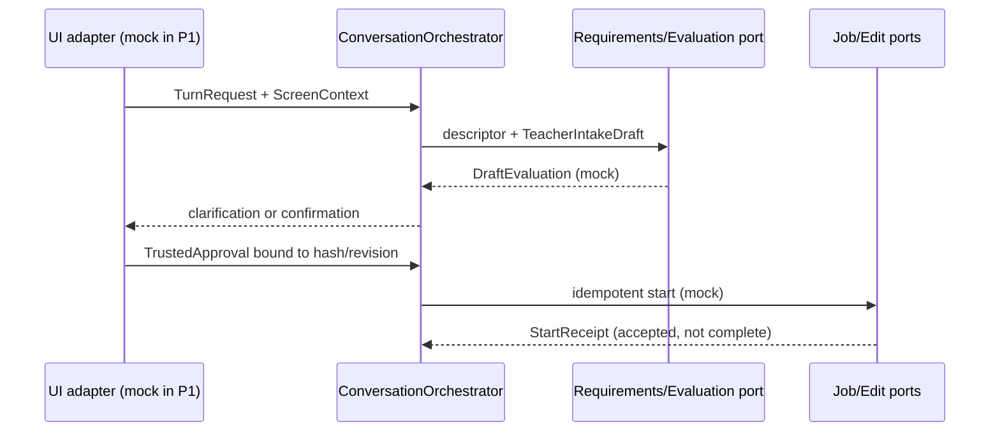

# Agent contracts (Phase 1 proposed/mock)

Runtime contracts live in `src/exam_baseline/agent/models.py`; action contracts live in
`capabilities.py`. They are independent P1 contracts and are not claims about backend routes.

## Data flow



## Core types

- `TurnRequest`: stable request/conversation/workspace IDs, bounded message, trusted context.
- `TeacherIntakeDraft`: dynamic field map with source, status, message, and revision provenance.
- `RequirementsDescriptor`: versioned field/default/preset source; fixture is explicitly mock.
- `DraftEvaluation`: `needs_input|validated_ready|invalid|unsupported|unavailable`; source label.
- `TrustedApproval`: exact draft/hash/schema/workspace/conversation/actor binding.
- `JobSnapshot`: compact truth source; mock/backend label and final-package flag.
- `PendingChange`: stable target if available, audit status, and origin message.
- `ActionPlan`/`ActionReceipt`: max five allowlisted actions, state guard, serial receipts.

## Collection is not professional normalization

`TeacherIntakeDraft` stores what the teacher said. `collection complete` means only that all
fixture-declared fields exist. It does not produce the matrix distributions required by
`exam_baseline.core.models.ExamMatrix`. Only a future backend evaluator may return real
`validated_ready` and a backend-owned resolved reference.

## Example (MOCK)

```json
{
  "request_id": "req-1",
  "conversation_id": "conv-1",
  "workspace_session_id": "ws-1",
  "message": "Tạo đề Toán lớp 12",
  "screen_context": {"screen_id":"workspace","state_version":1,"available_actions":[]}
}
```

The response asks for all fixture-required missing fields together. Once complete, it includes
`evaluation_source="mock"`, a deterministic hash, and a disclosure that no `ExamMatrix` or
backend call exists. Text such as `approved=true` is ignored; tests call `approve_and_start`
with a typed trusted adapter event.

## Availability matrix

| Boundary | P1 status |
|---|---|
| Deterministic understanding/draft/dialogue | implemented and tested |
| Requirements/evaluation | fixture/mock |
| Product knowledge | small versioned fixture grounded in inspected refs |
| Approval | trusted typed mock event |
| Generation/status | in-process mock |
| UI navigation | mock executor only when test explicitly enables it |
| Deferred edits | in-memory ledger/proposal; no apply |
| Model assistance | interface only, disabled |
