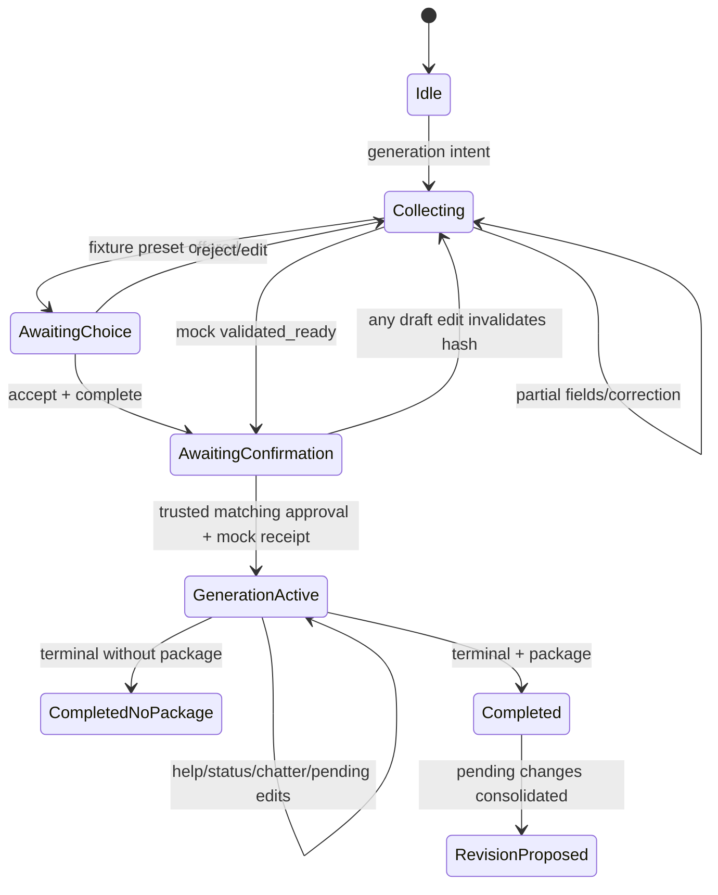

# Agent state machine and invariants

The implementation represents these states through validated draft/job/ledger data rather than
one mutable enum.

## Invariants

1. Draft revision increases only when field values/status/source change.
2. A field edit clears normalized preview, request hash, and prior approval revision.
3. Suggested preset fields are not added until explicit acceptance.
4. Approval must match conversation, workspace, draft ID/revision/hash/schema and actor.
5. One active mock job exists per workspace; replay returns the same receipt.
6. The active job snapshot never receives draft corrections or pending edits.
7. A question display index resolves only through `ScreenContext.question_index_map`.
8. New structural pending changes supersede older pending structural changes but retain history.
9. Completion and final-package availability are separate.
10. Consolidation creates a proposal; without an edit executor nothing becomes `applied`.
11. Capability plans fail on stale state, unknown/disabled capabilities, targets, or extra keys.
12. Process restart loses all state; no durability is claimed.
