# SLIDE PLAN: ASTRA through the 4 Pillars of Computational Thinking

**What this is:** the draft layout and content of the slide deck that analyses ASTRA through the four pillars (Decomposition, Pattern Recognition, Abstraction, Algorithmic Design). **Primary version for the teams to work from.** The Vietnamese counterpart is [ct-slide-plan.md](ct-slide-plan.md); keep the two in step (slide numbers are identical). **Who it is for:** team Trial and Success (CSC10014), slide authors and reviewers. **Status:** v2, 2026-11-12. v1 was AI-drafted from Huy's notes; v2 applies the team's review comments (see "Changes in v2"). Not yet re-reviewed.

Theory sources: Slide01 (Intro to CT), Slide02 (Thinking and Reasoning), Slide03 (Decomposition), Slide04 (Pattern Recognition). Project sources: [ASTRA_Trial_and_Success_Report.md](../ASTRA_Trial_and_Success_Report.md), [mvp-plan.md](mvp-plan.md).

> **Caution (from the team): the reasoning types and techniques attached to items below are NOT verified against what the lecturer teaches.** Treat them as hints, check against the lecture before they go on a slide. Where the lecturer's own framing is known (Pattern = Subject + frequency + content), it is used instead.
>
> **No lecture slides were supplied for Abstraction and Algorithmic Design.** For these two pillars only the definitions in Slide01/02 are used (Abstraction = drop noise, keep the core model; Algorithmic Design = complete steps a machine can follow; pseudocode; imperative vs declarative).

---

## 0. How to read this file

### Slide convention

Each slide has: a **large title**, one tag line, **Visual** (the one figure that carries the slide), **Say** (what the presenter says, one line per item), and **Next** (why the next slide follows). On the real slide there is **one figure and few words**; this file may say more than the slide will.

### Tags (kept to one line per slide, no tag per item)

| Tag | Step |
| :--- | :--- |
| 🟥 PROBLEM | Problem Definition |
| 🟦 DECOMP | Decomposition |
| 🟩 PATTERN | Pattern Recognition |
| 🟨 ABSTRACT | Abstraction |
| 🟪 ALGO | Algorithmic Design |
| ➕ | Proposed addition (author's idea, not in the notes; Huy keeps or drops) |
| 🔲 | Placeholder for the team |

### Complexity levels

`L1` one function → `L2` three subproblems → `L3` multi-agent system → `L4` system design → `L5` product. Shown on the map slide only; slides carry no level badge.

### Slide index

| # | Title | Tags | Visual |
| :--- | :--- | :--- | :--- |
| 1 | Map of the line of thought ➕ | all | route diagram |
| 2 | The problem: input and output | 🟥 + 🟨 🟦 | input/output diagram |
| 3 | Exams are consistent | 🟩 | observation → consequence |
| 4 | One model for a whole class of exams | 🟨 | formula panel |
| 5 | Three subproblems | 🟦 | tree |
| 6 | Baseline: the naive LLM loop | 🟥 🟩 | loop |
| 7 | The exam committee becomes a multi-agent system | 🟩 🟦 | role mapping |
| 8 | The agents | 🟦 | org chart |
| 9 | One frame for every agent | 🟨 | class diagram |
| 10 | What teachers need | 🟩 🟨 | loop |
| 11 | The corpus | 🟩 🟨 | pipeline |
| 12 | The composing pipeline | 🟪 | swimlane with loopback |
| 13 | The same logic as pseudocode | 🟪 | pseudocode |
| 14 | Output and benchmark | 🟥 🔲 | tree + metric chart |
| 15 | Diversity: directions to try | 🟦 🔲 | option tree |
| 16 | Parameters: what we turn | 🟪 🔲 | tuning loop |
| 17 | Zoom out: from exam writing to an assistant app | 🟦 | nested circles |
| 18 | UI/UX | 🟩 🟨 🔲 | team's choice |
| 19 | The assistant | 🟩 🟪 🔲 | team's choice |
| 20 | Extra features | 🟩 🟪 🔲 | team's choice |
| 21 | Wrap-up: reasoning × pillar, and the loop ➕ | all | matrix + loop |
| 22 | Graph of the whole problem | 🟦 🟥 | graph |

Slides in the deck must not repeat one format: the 22 slides above use tree, loop, flow, swimlane, class diagram, graph, chart, matrix, nested circles, pseudocode. Avoid the two-column table except where it really is a table.

---

# SLIDE 1 · MAP OF THE LINE OF THOUGHT ➕

🟥 🟦 🟩 🟨 🟪

**Visual:** one wide route figure, horizontal axis = talk time, vertical axis = rising complexity.

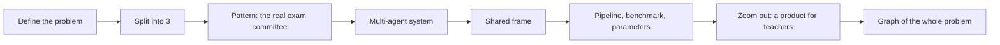

**Say**
- The talk does not go "pillar 1, then 2, 3, 4". The pillars recur at most layers, and each layer is bigger than the last.
- Each layer ends with a new subproblem; that is why complexity grows.
- CT is the design phase; doing and measuring come after (Slide01).

**Next:** the route is set; start with the problem.

---

# SLIDE 2 · THE PROBLEM: INPUT AND OUTPUT

🟥 PROBLEM · 🟨 ABSTRACT · 🟦 DECOMP

**Visual:** left, an input → black box → output diagram, inputs and outputs grouped by who provides or sees them; right, the Given/Find box.

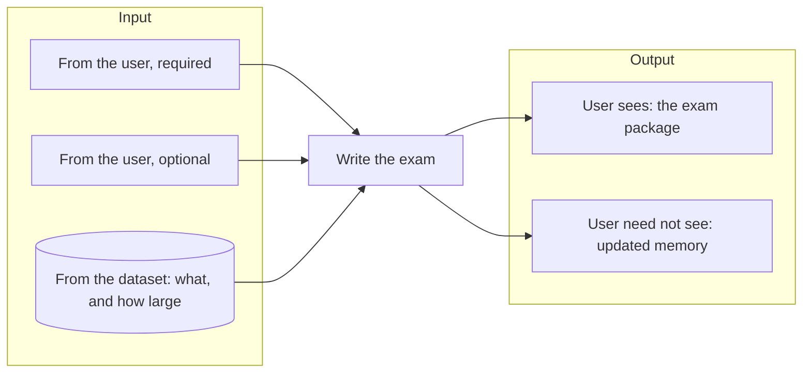

| Group | Content | Status |
| :--- | :--- | :--- |
| User, required | exam intent *I* | proposal ➕ (team confirms which are required) |
| User, optional | sample exam *S*, reference documents *R*, template requirements *F*, exam matrix *M* | proposal ➕ |
| Dataset | application database *K*; what it holds and its size | 🔲 `[PLACEHOLDER — contents and size]` |
| User sees | paper, answer key, solutions, review flags | from Huy's notes |
| User need not see | updated memory (what the app keeps for next time) | 🔲 `[PLACEHOLDER — what is stored]` |

> **Given:** exam intent *I*, sample exam *S*, reference documents *R*, template requirements *F*, exam matrix *M* (from the teacher); and the application database *K*.
> **Find:** an exam package *E* = (paper, answer key, solutions, review flags) such that
> (1) **content is correct:** answers and solutions are right and grounded;
> (2) **form is correct:** matches *F* and *M*, item counts, marks, duration;
> (3) **it is usable:** the teacher reviews and exports it without redoing it.

**Say**
- Splitting input and output by who sees them already makes this a product-shaped problem (note from the team: that is fine, but say so).
- Naming "what is the input, what is hidden" is abstraction; grouping them is decomposition. The metrics for "correct" come later, at the output (slide 14).

**Next:** the problem is fixed; where do exams resemble each other?

---

# SLIDE 3 · EXAMS ARE CONSISTENT

🟩 PATTERN

**Visual:** three observation cards in the lecturer's form **Subject + frequency + content**, then one arrow to the consequence. Not a table.

| Subject | Frequency | Content |
| :--- | :--- | :--- |
| Exams of one kind (e.g. THPTQG) | most of them `[PLACEHOLDER — count]` | follow one shared format |
| Questions in an exam | always | belong to a small, fairly fixed set of types (multiple choice, true/false, short answer, essay…) |
| Questions of one type | usually | are written in a similar way (form, number of parts, length, level) |
| Subject knowledge | year after year | changes little; only the topic distribution shifts |

**Consequence (the point of the slide):** exams are consistent, so we can fit them with one **stable workflow**. The stable parts become the **blueprint**; the workflow is the process that fills it (slide 4, slide 12).

**Say**
- Pattern is a phenomenon with a subject, a frequency and a content; fill all three, otherwise it is only an impression.
- Spotting the groups and features (types, number of parts, level) is also a way of splitting the exam; the techniques of Slide04 are hints only and are not verified here.

**Next:** if exams are consistent, throw away what differs and keep the shared model.

---

# SLIDE 4 · ONE MODEL FOR A WHOLE CLASS OF EXAMS

🟨 ABSTRACT

**Visual:** a large formula panel; left of it, "dropped" (year, school, wording), right of it, "kept" (what slide 3 found stable).

> **E = Φ(T, K; θ)**, where θ is the fixed **formula set**: blueprint rules, difficulty distribution, scoring profile, prompt templates.

**Say**
- This follows slide 3 directly: the consistent parts (format, question types, per-type method) become θ; what differs per exam (year, school) is dropped.
- We do not solve one exam; we solve a class of exams with one formula set.
- The blueprint and workflow are the two faces of θ: what must hold, and how to proceed.

**Next:** Φ is still one big function; split it.

---

# SLIDE 5 · THREE SUBPROBLEMS

🟦 DECOMP

**Visual:** a tree, three branches, dependency arrows between them.

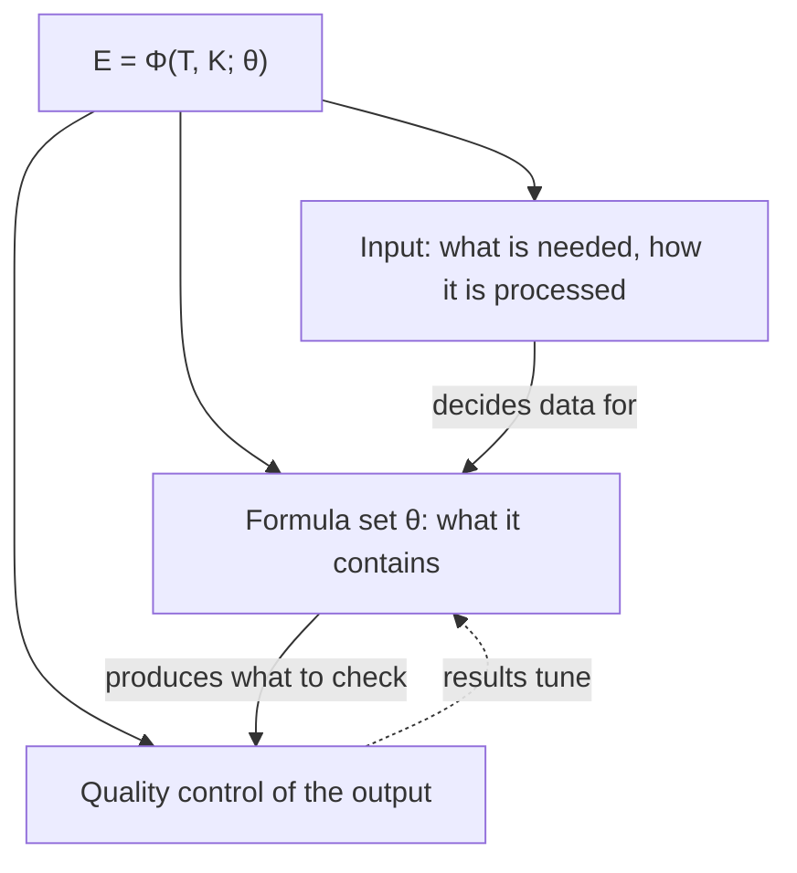

**Say**
- Split by function. The dependencies are the point; they are why the three cannot be solved in isolation.
- The next slides work on the middle branch, θ.

**Next:** before building θ, what is the simplest thing that could work?

---

# SLIDE 6 · BASELINE: THE NAIVE LLM LOOP

🟥 PROBLEM · 🟩 PATTERN

**Visual:** a loop diagram only; the reasons go in the speaker notes.

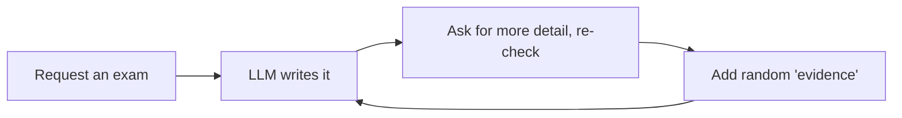

**Say**
- This is the **baseline**: the thing every later design must beat, kept for comparison (Report sections 16, 17).
- Why it is not enough (Report section 03): nothing enforces item count, marks, levels at once; one model grades itself; fluent but wrong output; nothing to measure.

**Next:** self-checking lacks independence; how do people solve this?

---

# SLIDE 7 · THE EXAM COMMITTEE BECOMES A MULTI-AGENT SYSTEM

🟩 PATTERN · 🟦 DECOMP

**Visual:** two columns of roles joined by arrows: committee roles on the left, agents on the right.

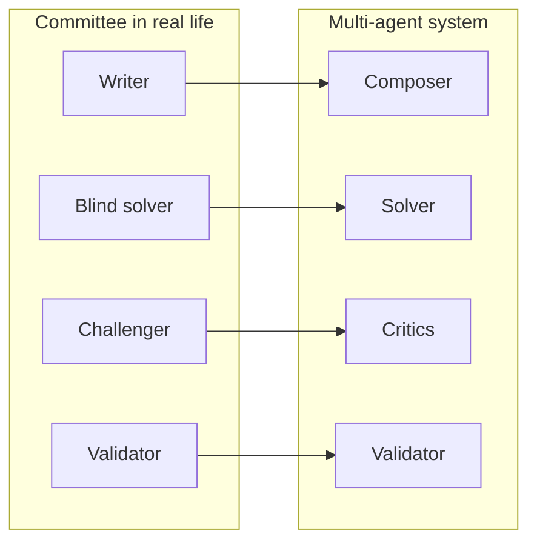

**Say**
- Pattern in the lecturer's form: **Subject** official exam writing; **frequency** every time; **content** several people in different roles, one of whom does not see the key, with objectivity as the aim.
- So the solution mirrors it: one agent per role. Reference paper: 🔲 `[PLACEHOLDER — full title and citation of the "EduAgent…" paper; not found in the repo, not guessed]`.

**Next:** who exactly are the agents, and where do we stop splitting?

---

# SLIDE 8 · THE AGENTS

🟦 DECOMP

**Visual:** an org chart: Orchestrator on top, agents below, each box one phrase.

> **Stop splitting when each agent has one job, can be understood on its own, and can be tested on its own** (Slide03: single responsibility, understandable, independent).

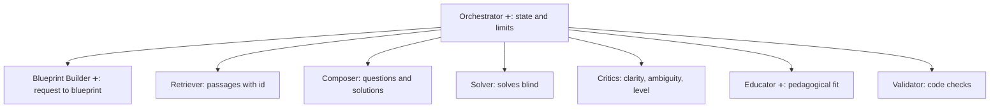

**Say**
- A failure can be pinned on one agent, instead of drowning in one long answer.
- Names: Huy's names; Report calls Composer "Writer", Solver "Blind Solver", Critics "Appraiser", Validator "Guardrail Gate". Whether Educator is separate from Critics, and whether Validator is pure code, is open (Appendix B).

**Next:** six different jobs; what do they share?

---

# SLIDE 9 · ONE FRAME FOR EVERY AGENT

🟨 ABSTRACT

**Visual:** a UML class diagram. Beside it a short list: one line per element, saying why it is needed.

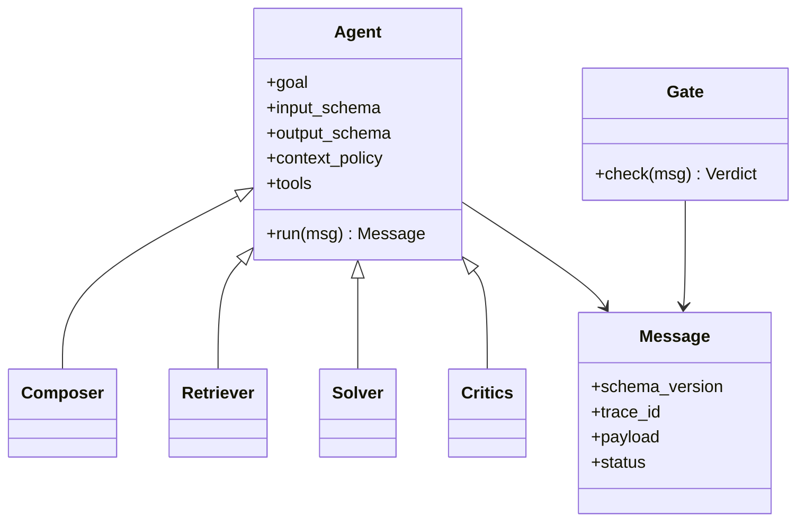

| Element | Why it is needed |
| :--- | :--- |
| Goal | so each agent optimises one thing |
| Input / output schema | so agents can be swapped and tested |
| Context | the model sees only what the job needs |
| Protocol | one message format that the code can check |
| Tools | what the agent may call, nothing else |
| Flag | an agent can say "I am unsure" instead of guessing |
| Gate | the pass condition is written down, not felt |

**Say**
- Design the frame once; only data and job change per agent. This is also where the two styles split: the **gates and schemas are declarative** ("what must be true"), the **orchestration is imperative** ("how to proceed"; slide 13).

**Next:** the agents exist; what do teachers actually need from them?

---

# SLIDE 10 · WHAT TEACHERS NEED

🟩 PATTERN · 🟨 ABSTRACT

**Visual:** a loop: vague request → resolve → deepen → complete blueprint, with the four observations as short labels on the left.

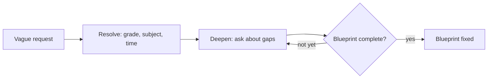

**Say** (one line each, *Subject + frequency + content*)
- Teachers write exams at set times, for one grade or a group of grades, in one or a few subjects, by personal goals.
- So we need: curriculum map, knowledge framework, difficulty distribution, illustrative matrix.
- And a way to turn a vague request into a full blueprint, asking until it is complete (bounded, no endless questions).

**Next:** a good exam needs background knowledge; where does it come from?

---

# SLIDE 11 · THE CORPUS

🟩 PATTERN · 🟨 ABSTRACT

**Visual:** a left-to-right pipeline.

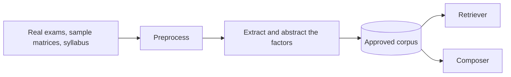

**Say**
- Pattern: when writing an exam, teachers look back at old exams, use experience, and follow subject constraints.
- So we prepare a corpus of real exams, preprocessed, with the writing factors extracted, and load it selectively into Composer and Retriever.
- ➕ Only data whose source and licence are approved enters the corpus (AGENTS.md rule 8).

**Next:** all the parts exist; put them in order in time.

---

# SLIDE 12 · THE COMPOSING PIPELINE

🟪 ALGO

**Visual:** this slide is one diagram and nothing else. Four swimlanes in time order; the repair arrow is highlighted.

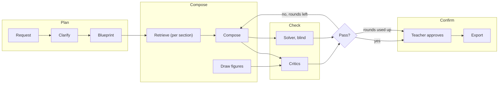

**Say**
- Only the algorithm is claimed here; no decomposition kind is attributed to it (not verified).
- Parallel steps are drawn side by side. The arrow "no, rounds left" is the loopback to highlight.

**Next:** write the same logic as steps a machine can follow.

---

# SLIDE 13 · THE SAME LOGIC AS PSEUDOCODE

🟪 ALGO

**Visual:** one short block, dark background (as in Slide02).

```text
draft = compose(blueprint)
repeat up to MAX_ROUNDS:
    if check(draft) is ok:  return draft  // passed
    draft = repair(draft)
give draft and flags to the teacher
```

**Say**
- High level on purpose: if the exam is ok it passes; otherwise loop back until the round limit, then hand it to the teacher.
- `check` is the declarative part (rules from the frame, slide 9); this loop is the imperative part. Details (retrieve, per-section parallelism) stay in slide 12.
- The state diagram of the Orchestrator (Clarify → Compose → Check → Repair → Teacher review → Export) can go in the notes.

**Next:** we have a design; how do we know it is good?

---

# SLIDE 14 · OUTPUT AND BENCHMARK

🟥 PROBLEM · 🔲 PLACEHOLDER

**Visual:** left, a small output tree; right, a bar chart of metrics with **empty bars** labelled `[NOT MEASURED]`. The benchmark sits here, right before the parameters that try to improve it.

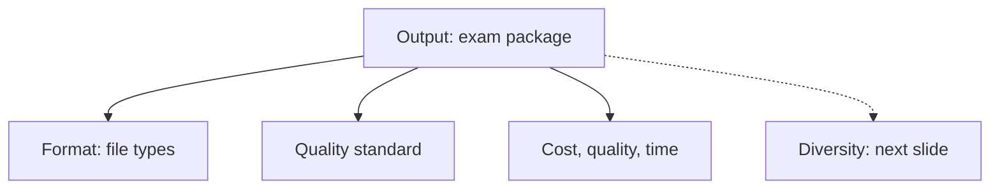

| Group | Metric | Value |
| :--- | :--- | :--- |
| Quality | answer correctness, blueprint/format compliance, scope and source validity, difficulty distribution, ambiguity rate | `[PLACEHOLDER]` |
| Teacher | revision minutes, export success | `[PLACEHOLDER]` |
| Cost | cost per approved paper | `[PLACEHOLDER]` |
| Retrieval (for the corpus) | content coverage, context precision, context recall, faithfulness | `[PLACEHOLDER]` |

**Say**
- Metric names come from Report section 17 and the author's proposal; the report's targets are goals, not results.
- Output format: DOCX to edit, PDF to print, LaTeX for maths (team decides, mvp-plan Problem 2). Keep evaluation criteria apart from file types.
- Quality metrics "from Huy's labs": 🔲 `[PLACEHOLDER — team doing this part fills]`.

**Next:** one criterion is not a number but a new problem: diversity.

---

# SLIDE 15 · DIVERSITY: DIRECTIONS TO TRY

🟦 DECOMP · 🔲 PLACEHOLDER

**Visual:** an option tree. No final conclusion box; the directions are ideas the team may test.

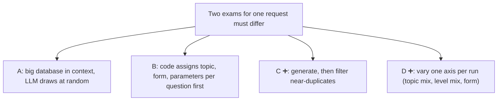

**Say**
- A and B are Huy's; C and D are the author's proposals, none tested. Not choosing yet is fine: the team proposes more and tests them.
- Cost and time differ per direction (A: context size, data, cost; B: the assigner must be designed and may be rigid).
- How to measure: share of near-duplicate questions, number of distinct forms for one blueprint 🔲 `[PLACEHOLDER — team fixes the metric]`.

**Next:** now the knobs: what do we turn to push the benchmark up?

---

# SLIDE 16 · PARAMETERS: WHAT WE TURN

🟪 ALGO · 🔲 PLACEHOLDER

**Visual:** a tuning loop; the parameter list around it. Metrics (slide 14) are what we measure; parameters are what we turn.

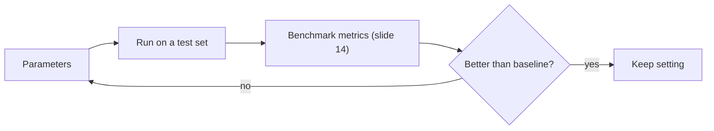

| Parameter | Range |
| :--- | :--- |
| MAS architecture (number, kind, sequential or parallel) | `[PLACEHOLDER]` |
| RAG approach (chunking, embedding, hybrid) | `[PLACEHOLDER]` |
| Number of repair loops | `[PLACEHOLDER]` |
| Size of input | `[PLACEHOLDER]` |
| Confidentiality (which data leaves, local or cloud model) | `[PLACEHOLDER]` |
| Temperature and context selection | `[PLACEHOLDER]` |
| ➕ Model per role; gate thresholds | `[PLACEHOLDER]` |
| 🔲 `[PLACEHOLDER — team adds]` | |

**Say**
- This is why the benchmark was introduced: to be maximised by these parameters. The baseline (slide 6) is the first row of the comparison.

**Next:** the design is complete at system level; zoom out.

---

# SLIDE 17 · ZOOM OUT: FROM EXAM WRITING TO AN ASSISTANT APP

🟦 DECOMP

**Visual:** nested circles: a small circle "exam writing" (slides 2 to 16) inside a larger shape "virtual assistant app for teachers", with three more circles around it.

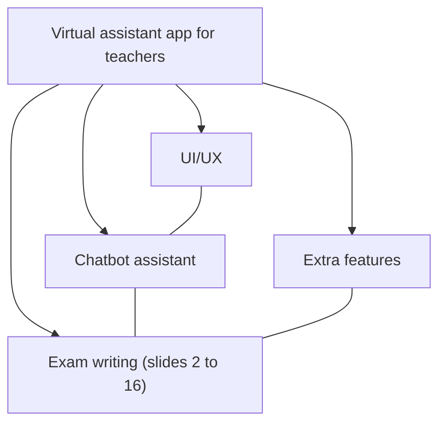

**Say**
- Everything so far was one branch of a bigger picture. Zooming out changes the problem: the user is no longer "a request" but a person with habits.
- Each new branch needs its own pattern, starting from the user.

**Next:** UI/UX first. (Slides 18 to 20 are brief: teams fill in what they did and how work was split.)

---

# SLIDE 18 · UI/UX

🟩 PATTERN · 🟨 ABSTRACT · 🔲 TEAM'S CHOICE

**Visual:** the team chooses (mock screen, journey, tree). Not a table.

**Say**
- Pattern: main users are teachers; limited comfort with technology; low patience; some have poor eyesight or are older.
- So the interface needs: live progress and small steady feedback, simple steps, large text, high contrast ➕.
- ➕ A simple interface must not hide uncertainty (Report section 15).
- 🔲 `[TEAM FILLS: evidence of what was done, who did what]`

---

# SLIDE 19 · THE ASSISTANT

🟩 PATTERN · 🟪 ALGO · 🔲 TEAM'S CHOICE

**Visual:** a conversation flow or a state diagram (team's choice).

**Say**
- Pattern: most main users do not know how to prompt well.
- So the assistant suggests the next step along predefined flows, shows progress on the UI, answers questions about the app and the exam, and gathers basic inputs into an `ExamRequest`.
- 🔲 `[TEAM FILLS: evidence and work split]`

---

# SLIDE 20 · EXTRA FEATURES

🟩 PATTERN · 🟪 ALGO · 🔲 TEAM'S CHOICE

**Visual:** a circle "refer back, then edit" with the features around it, or a version timeline.

**Say**
- Pattern: teachers refer back to work they have done, or fix things based on it.
- So: review and revise an exam; replicate, change the numbers, restructure.
- ➕ "Change the numbers" is rule-based, so code checks it, not another LLM call.
- 🔲 `[TEAM FILLS]`

---

# SLIDE 21 · WRAP-UP: REASONING × PILLAR, AND THE LOOP ➕

All 4 pillars

**Visual:** left, the matrix (Slide02 asks us to draw the mapping matrix); right, the loop design → do → measure → analyse.

> **Unverified:** the cells are the author's examples. Check them with the lecturer's definitions before this goes on a slide; drop any cell that is not defensible.

| | Decomposition | Pattern Recognition | Abstraction | Algorithmic Design |
| :--- | :--- | :--- | :--- | :--- |
| Deductive | stop criteria checked per agent | template match | schema makes a question valid | gates run by code |
| Inductive | roles from the real committee | rules drawn from old exams | core model from many exams | process chosen from experiments |
| Abductive | pin a failure on one layer | why the baseline fails | find the variable behind errors | repair loop guesses the cause |
| Probabilistic | cost/quality trade-off | topic trends over years | enough context, no noise | temperature, sampling |
| Deontic | agent responsibility | subject constraints | policy, licences | round limits, teacher approval |
| Spatial/Temporal | pipeline order | trend over time | states | parallel, sequential, loopback |

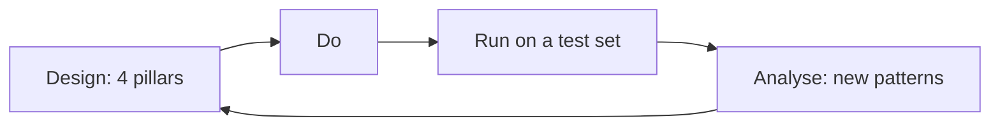

**Say**
- CT is the strategy of the design phase, not the product; real results come from the doing and measuring phase.
- Back to slide 1: thinking went from one function to one product through five layers.

**Next:** the final picture.

---

# SLIDE 22 · GRAPH OF THE WHOLE PROBLEM

🟦 DECOMP · 🟥 PROBLEM

**Visual:** a full-screen graph. Rectangles are problems; rounded nodes are decisions or solutions; solid arrows "split into", dashed arrows "raises a subproblem".

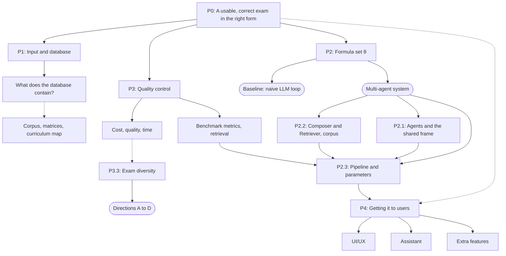

**Say**
- Read top-down: each layer is one split; dashed arrows are problems left unsolved on purpose.
- The graph is the complexity of the thinking: one function at the start, a multi-layer system of dependencies at the end.
- ➕ Mark which nodes are decided (link `D-nnn` in [DECISIONS.md](DECISIONS.md)) and which are open.

---

## Changes in v2 (team review, 2026-11-12)

| Team comment | What changed |
| :--- | :--- |
| Deslop, fewer icons; tags only as a hint | One tag line per slide; no tag per row; emoji only in the tag line |
| Reasoning/technique not verified | Banner at top; reasoning tags dropped from slides; matrix on slide 21 flagged unverified |
| Slide 2 does not define the problem | Input (user required, user optional, dataset) and output (seen, not seen) added; the Given/Find box kept |
| Old slides 3, 4 | Dropped; metrics moved to slide 14 (at the output); scope and non-goals moved out (see Appendix A) |
| Old slide 5: 3 patterns in 1 slide, wrong mapping | Split into slides 3, 4, 5; pattern written as Subject + frequency + content; wrong rows removed; consistency → blueprint/workflow made explicit |
| Old slide 6 | Kept, word "baseline" used |
| Old slide 7, 8 | Pattern rewritten; three stop criteria merged into one statement; ticks table dropped |
| Old slides 9 to 11: too much | One line per element |
| Old slides 12 to 14 should sit before 17 | Benchmark (merged 12 and 13) and diversity moved right before parameters; slide 14 no longer ends with a conclusion, it lists directions |
| Old slide 15 | One diagram; no decomposition claim |
| Old slide 16 | Pseudocode made high level; declarative vs imperative introduced on slide 9 |
| Old slide 18 | Zoom-out wording added |
| Old slides 19 to 21 | Brief; team fills in evidence and work split; format left open |
| Too many 2-column tables | Visual format named per slide (tree, loop, flow, class diagram, chart, graph…) |
| Old slide 22 after 23 | Graph is now the last slide |

## Appendix A. Proposed additions ➕ (Huy keeps or drops)

| # | Proposal | Slide |
| :--- | :--- | :--- |
| 1 | Map-of-thought slide at the start | 1 |
| 2 | Which inputs are required and which optional | 2 |
| 3 | Scope and non-goals, if the team wants them back (non-goals: Report section 04; first subject by "answer checkable by code", mvp-plan Problem 1) | after 2 |
| 4 | Educator, Orchestrator, Blueprint Builder as agents | 8 |
| 5 | Diversity directions C and D | 15 |
| 6 | Model per role, gate thresholds as parameters | 16 |
| 7 | Large text and high contrast; "simple must not hide uncertainty" | 18 |
| 8 | "Change the numbers" checked by code | 20 |
| 9 | Reasoning × pillar matrix | 21 |
| 10 | Link graph nodes to decisions `D-nnn` | 22 |
| 11 | Risks: correlated errors between agents, copyright, privacy (Report section 18) | after 16 |
| 12 | Evaluation protocol: baseline vs ASTRA vs teacher-edited, blind (Report section 17) | after 16 |

## Appendix B. Open questions for the team

1. Which inputs are required, which optional (slide 2)? What does "updated memory" hold?
2. What are the contents and size of the dataset K (slide 2)?
3. Frequencies in slide 3: counted, or stated qualitatively?
4. Educator and Critics separate or merged? Validator pure code or partly LLM (slide 8)?
5. Name and citation of the "EduAgent…" reference paper (slide 7); not found in the repo.
6. Which labs supply the quality metrics (slide 14)?
7. Which diversity directions do we test, measured how (slide 15)?
8. Do the matrix cells on slide 21 survive a check against the lecture?
9. Format and content of slides 18 to 20 (team's choice).

## Not verified

- AI-drafted (Claude, 2026-11-12) from Huy's notes, the four course slides, the Report and mvp-plan; v2 applies the team's comments. Nothing was run; nobody has re-read v2.
- All target figures in the Report (≥95%, 100%, about VND 2,000 per exam) are goals, not results. This file creates no new numbers.
- Mermaid diagrams were not rendered here; view them in a Markdown viewer with Mermaid support before building slides.
- Reasoning types and techniques are not verified against the lecturer's teaching (team caution). There are no lecture slides for Abstraction and Algorithmic Design.
