# SLIDE PLAN: ASTRA through the 4 Pillars of Computational Thinking

**What this is:** the draft layout and content of the slide deck that analyses ASTRA through the four pillars (Decomposition, Pattern Recognition, Abstraction, Algorithmic Design). **Primary version for the teams to work from.** The Vietnamese counterpart is [ct-slide-plan.md](ct-slide-plan.md); keep the two in step (slide numbers and tags are identical). **Who it is for:** team Trial and Success (CSC10014), slide authors and reviewers. **Status:** AI-drafted on 2026-11-12 from Huy's notes, not yet reviewed by anyone (see "Not verified" at the end).

Theory sources: Slide01 (Intro to CT), Slide02 (Thinking and Reasoning), Slide03 (Decomposition), Slide04 (Pattern Recognition). Project sources: [ASTRA_Trial_and_Success_Report.md](../ASTRA_Trial_and_Success_Report.md), [mvp-plan.md](mvp-plan.md).

> **No lecture slides were supplied for Abstraction and Algorithmic Design.** For these two pillars this file only uses the definitions in Slide01/02 (Abstraction = drop noise, keep the core model; Algorithmic Design = complete steps a machine can follow; pseudocode; imperative vs declarative). No other technique is attributed to the course.

---

## 0. How to read this file

### Slide convention

Every slide has a **large title (H1)**, a tag line, **Layout** (what is on the screen), **Content** (every item carries a tag), and **Line of thought** (why this slide follows the previous one). Content uses diagrams, tables and sequences wherever possible.

### Step tags (every content item carries one main tag)

| Tag | Step | Meaning (per Slide01) |
| :--- | :--- | :--- |
| 🟥 `PROBLEM` | Problem Definition | fix input, output, scope, criteria; CT starts here, not at the algorithm |
| 🟦 `DECOMP` | 01 Decomposition | split a complex problem into smaller parts; name the kind: Structural, Functional, Data-driven, Object-oriented, Temporal |
| 🟩 `PATTERN` | 02 Pattern Recognition | find similarities, trends, repetitions; name the technique: Feature extraction, Grouping, Trend and sequence, Template matching, Regex, ML |
| 🟨 `ABSTRACT` | 03 Abstraction | keep only the important information, drop noise; yields a core model |
| 🟪 `ALGO` | 04 Algorithmic Design | complete steps a machine can follow |
| ⬜ `DOING` | Implementation and Simulation | the doing phase, no longer pure CT (Slide01: Design → Action) |
| ➕ | **Proposed addition** | idea added by the author of this file, not in Huy's notes; Huy keeps or drops it |
| 🔲 | Placeholder | space for the team to fill |

### Reasoning tags (Slide02, six types)

`Deductive` (rule → certain consequence), `Inductive` (observations → probable rule), `Abductive` (result → most likely explanation, i.e. debugging), `Probabilistic` (uncertainty, incomplete data), `Deontic` (must, may, must not), `Spatial/Temporal` (where and when). Short forms: 🧠D, 🧠I, 🧠A, 🧠P, 🧠Dn, 🧠ST.

### Complexity scale (complexity of thinking)

Every slide carries a level `L1` to `L5`. This is how the deck shows thinking growing from one function to a product.

| Level | The problem at this point | Slides |
| :--- | :--- | :--- |
| L1 | one function: (input) → exam | 2 to 4 |
| L2 | three subproblems: input, formula set, quality control | 5 to 6 |
| L3 | a multi-agent system playing the exam-writing committee | 7 to 10 |
| L4 | system design: context, protocol, pipeline, parameters | 11 to 17 |
| L5 | product: UI/UX, assistant, features, environment | 18 to 21 |

### Slide index

| # | Title | Main tag | Level |
| :--- | :--- | :--- | :--- |
| 1 | Map of the line of thought ➕ | all 4 pillars | L1 to L5 |
| 2 | The problem: Given… Find… | 🟥 | L1 |
| 3 | Quality of the output exam: metrics | 🟥 🔲 | L1 |
| 4 | Scope | 🟥 | L1 |
| 5 | From pattern to mapping model to three subproblems | 🟩 🟨 🟦 | L2 |
| 6 | Naive solution: the LLM loop | 🟥 🟩 | L2 |
| 7 | The real exam committee and the multi-agent system | 🟩 🟦 | L3 |
| 8 | The agents and when to stop decomposing | 🟦 | L3 |
| 9 | The abstract problem shared by every agent | 🟨 | L3 |
| 10 | Teacher needs and the intent-clarification mechanism | 🟩 🟨 | L3 |
| 11 | Focus on Composer and Retriever: the corpus | 🟩 🟨 | L4 |
| 12 | Metrics for retrieval and coverage | 🟥 🔲 | L4 |
| 13 | The output problem: format, quality, cost, diversity | 🟥 🟦 | L4 |
| 14 | Diversity subproblem: two approaches | 🟦 🔲 | L4 |
| 15 | The composing pipeline (Temporal) | 🟪 🟦 | L4 |
| 16 | Pseudocode and the Orchestrator states ➕ | 🟪 | L4 |
| 17 | Parameters to tune and how to measure | 🟪 🔲 | L4 |
| 18 | Transfer: from exam writing to a virtual assistant | 🟦 | L5 |
| 19 | UI/UX for teachers | 🟩 🟨 | L5 |
| 20 | The assistant | 🟩 🟪 | L5 |
| 21 | Extra features and working environment | 🟩 🟪 | L5 |
| 22 | Graph of the whole problem process | 🟦 🟥 | L1 to L5 |
| 23 | Wrap-up: reasoning × pillar matrix, and the loop ➕ | all 4 pillars | L1 to L5 |

Appendices at the end: list of proposed additions, open questions, and the not-verified note.

---

# SLIDE 1 · MAP OF THE LINE OF THOUGHT ➕

🟥 `PROBLEM` · 🟦 `DECOMP` · 🟩 `PATTERN` · 🟨 `ABSTRACT` · 🟪 `ALGO` · Level L1 → L5

**Layout:** one wide figure filling the slide; the horizontal axis is the time of the talk, the vertical axis is rising complexity. Each arrow carries a pillar tag.

```mermaid
flowchart LR
    P["🟥 Define the problem<br/>Given → Find"]
    D1["🟦 Split: input, formulas, quality control"]
    PR1["🟩 Pattern: the real exam committee"]
    M["🟩 Solution: a multi-agent system"]
    A1["🟨 Abstract problem shared by agents"]
    D2["🟦 Split: Composer and Retriever, output"]
    AL["🟪 Pipeline, parameters, repair loop"]
    T["🟥 Transfer: a product for teachers"]
    D3["🟦 Split: exam writing, UI/UX, assistant, features"]
    PR2["🟩 Pattern: users and repeated work"]
    G["Graph of the whole problem"]
    P --> D1 --> PR1 --> M --> A1 --> D2 --> AL --> T --> D3 --> PR2 --> G
```

**Content**

| Item | Tag |
| :--- | :--- |
| State clearly: the talk does not go "pillar 1, then 2, then 3, then 4"; it **repeats all four pillars at every layer** of the problem, and each layer is more complex than the last | 🟥 `PROBLEM` |
| Each layer ends with a new subproblem, which is why complexity grows | 🟦 `DECOMP` (Functional) |
| Slide01: CT is the **design** phase; implementation and simulation belong to the doing phase, in a continuous loop | ⬜ `DOING` |

**Line of thought:** the opening slide promises a route; slide 23 comes back to this same figure to close.

---

# SLIDE 2 · THE PROBLEM: GIVEN… FIND…

🟥 `PROBLEM` · 🧠Dn (constraints) · Level L1

**Layout:** left, a block of text stating the problem formally; right, a diagram input → function → output. Bottom line: "predecomposition: the output is defined before we split anything".

**Content**

| Item | Tag |
| :--- | :--- |
| **Teacher input (T):** exam intent, sample exam, reference documents, template requirements, exam matrix | 🟥 `PROBLEM` |
| **Application input (K):** a database of whatever the app needs to write an exam (what the database contains is a subproblem, solved later) | 🟥 `PROBLEM` |
| **Output (E):** a usable exam, correct in content and correct in form | 🟥 `PROBLEM` |

**Formal statement**

> **Given:** exam intent *I*, sample exam *S*, reference documents *R*, template requirements *F*, exam matrix *M* (from the teacher); and the application database *K*.
> **Find:** an exam package *E* = (paper, answer key, solutions, review flags) such that
> (1) **content is correct:** answers and solutions are right and grounded;
> (2) **form is correct:** matches *F* and *M*, item counts, marks, duration;
> (3) **it is usable:** the teacher reviews and exports it without redoing it.

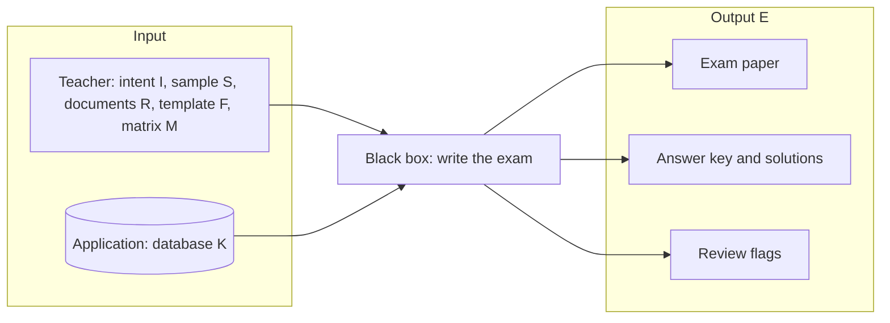

**Line of thought:** before thinking about how to solve it, we must fix what "correct" means → slide 3.

---

# SLIDE 3 · QUALITY OF THE OUTPUT EXAM: METRICS 🔲

🟥 `PROBLEM` · 🔲 Placeholder · Level L1

**Layout:** one large table with columns "Metric", "Measured by", "Measured value". The last column is empty on purpose and labelled `[NOT MEASURED]`.

**Content** (metric names come from Report section 17; no numbers are filled in)

| Metric | Measured by | Value | Tag |
| :--- | :--- | :--- | :--- |
| Answer correctness | against a reference key | `[PLACEHOLDER — team fills after runs]` | 🟥 `PROBLEM` |
| Blueprint/format compliance | checked by code | `[PLACEHOLDER]` | 🟥 |
| Scope and source validity | against syllabus and source ids | `[PLACEHOLDER]` | 🟥 |
| Difficulty distribution | against the requested matrix | `[PLACEHOLDER]` | 🟥 |
| Ambiguity rate | blind teacher review | `[PLACEHOLDER]` | 🟥 |
| Teacher revision minutes | timer during review | `[PLACEHOLDER]` | 🟥 |
| Cost per approved paper | token and money log | `[PLACEHOLDER]` | 🟥 |
| Export success rate | run the export | `[PLACEHOLDER]` | 🟥 |

Small note at the bottom: the report's goals (≥95% answer accuracy, 100% format compliance, ≥95% scope validity, about VND 2,000 per exam) **are goals, not measured results**.

**Line of thought:** with criteria we know what a "good exam" is; next we bound the scope to something feasible → slide 4.

---

# SLIDE 4 · SCOPE

🟥 `PROBLEM` · Level L1

**Layout:** two columns, "In scope" / "Out of scope", plus a yellow box holding the open question.

**Content**

| Item | Tag |
| :--- | :--- |
| **In scope:** THPTQG exams, subject **[PLACEHOLDER — which subject?]**; V-ACT competency-assessment exams | 🟥 `PROBLEM` |
| ➕ **Out of scope (non-goals, Report section 04):** fully automatic grading of free-form writing, personalised learning analytics, replacing the teacher's final decision | 🟥 `PROBLEM` |
| ➕ Pick the first subject by the test "can the answer be checked by code" (mvp-plan, Problem 1) | 🟥 `PROBLEM` · 🧠D |
| Why a narrow scope is an abstraction decision, not a lack of ambition (Report section 05) | 🟨 `ABSTRACT` |

**Line of thought:** the boundary is clear; now look at existing exams to see where they resemble each other → slide 5.

---

# SLIDE 5 · FROM PATTERN TO A MAPPING MODEL TO THREE SUBPROBLEMS

🟩 `PATTERN` → 🟨 `ABSTRACT` → 🟦 `DECOMP` · Level L2

**Layout:** three rows joined by downward arrows, one pillar tag per row; the last row is a diagram of three subproblems with dependency arrows.

### Row 1 · Pattern

| Observation | Technique (Slide04) | Reasoning |
| :--- | :--- | :--- |
| Most exams share one format | 🟩 Direct template matching (a new exam fits an old frame) | 🧠I |
| A finite, fairly fixed set of question types (multiple choice, true/false, short answer, essay…) | 🟩 Grouping and classification | 🧠I |
| Each question type is written by a similar method | 🟩 Feature extraction (question form, number of parts, length, level) | 🧠I |
| Subject knowledge changes little between years; only the topic distribution shifts | 🟩 Trend and sequence analysis (topic frequency per year, order of questions in a paper) | 🧠I + 🧠P |
| ➕ Numbering, answer labels and section headings follow repeated syntax | 🟩 Regex (build the form checker) | 🧠D |

### Row 2 · Abstraction

🟨 `ABSTRACT` (Slide01: drop noise, keep the core model): drop the details of each year and each school; keep **one mapping**

> **E = Φ(T, K; θ)**, where θ is a fixed **formula set** (blueprint rules, difficulty distribution, scoring profile, prompt templates).

In other words: we do not solve each exam; we solve a **class** of exams with one formula set.

### Row 3 · Decomposition

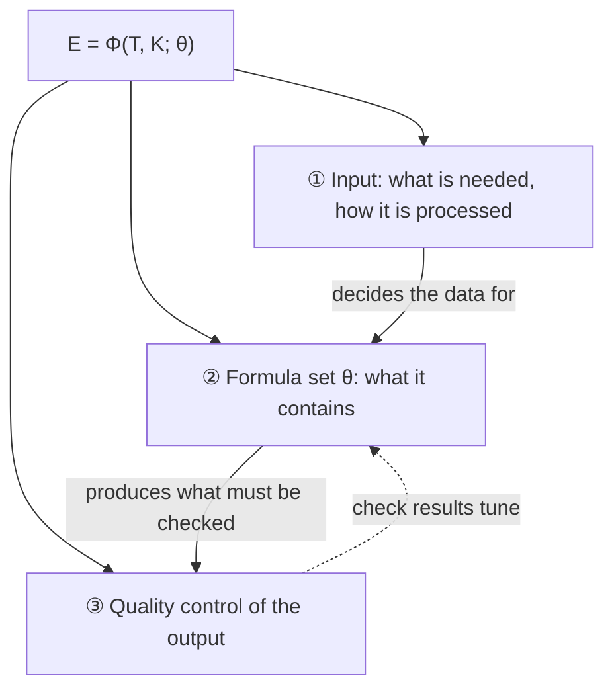

🟦 `DECOMP` (Functional + Data-driven): three related subproblems (arrows in the diagram), as in Huy's notes. The next slides go into problem ②, the formula set.

**Line of thought:** the same structure repeats → abstract it into one function → that function is too big, so split it in three.

---

# SLIDE 6 · NAIVE SOLUTION: THE LLM LOOP

🟥 `PROBLEM` (first attempt) · 🟩 `PATTERN` (spot where it fails) · Level L2

**Layout:** left, the loop (diagram); right, a "why it is not enough" table.

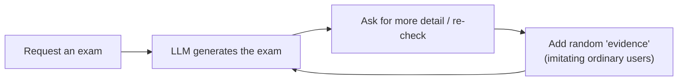

**Content**

| Item | Tag |
| :--- | :--- |
| Naive solution: keep repeating the request, ask the LLM for more detail, let it re-check, add random evidence the way ordinary users do | 🟥 `PROBLEM` |
| Why it is not enough (Report section 03): no mechanism to **enforce at once** the item count, marks and levels; one model grades itself; wrong but fluent output ("exam slop"); nothing to measure | 🟩 `PATTERN` · 🧠A (find the cause of the error) |
| Kept as the **baseline** for comparison (Report sections 16 and 17), not as the goal | 🟥 `PROBLEM` |
| ➕ Every run differs, so it is hard to reproduce and to debug | 🟩 `PATTERN` · 🧠P |

**Line of thought:** self-checking lacks independence → ask how people handle this → slide 7.

---

# SLIDE 7 · THE REAL EXAM COMMITTEE AND THE MULTI-AGENT SYSTEM

🟩 `PATTERN` → 🟦 `DECOMP` (Structural) · Level L3

**Layout:** top, a picture of the "exam committee" with its roles; bottom, an arrow "map role → agent".

**Content**

| Item | Tag |
| :--- | :--- |
| **Pattern:** official exam writing needs a committee of several people with different roles: write, solve blind, challenge, validate; the aim is **objectivity** | 🟩 `PATTERN` · Grouping · 🧠I |
| **Proposed solution:** an LLM-based multi-agent system, one function per agent: Composer, Solver, Critics, Educator, Validator, Retriever | 🟦 `DECOMP` · Structural · Object-oriented |
| Reference paper: **[PLACEHOLDER — full title and citation of the "EduAgent…" paper Huy remembers; not found in the repo, not guessed]** | 🔲 |
| ➕ Slide03 asks us to choose a kind of split; here **Structural + Object-oriented**, because each real-world role is an "object" with its own data and behaviour | 🟦 `DECOMP` |

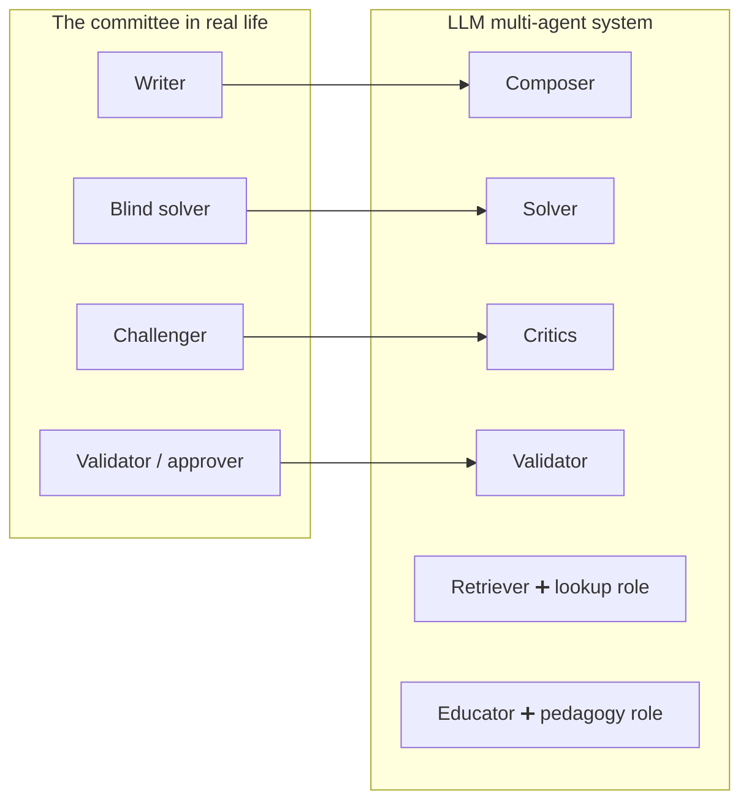

**Line of thought:** once the team exists we must say what each member does and where to stop splitting → slide 8.

---

# SLIDE 8 · THE AGENTS AND WHEN TO STOP DECOMPOSING

🟦 `DECOMP` (Structural + Functional) · Level L3

**Layout:** a table of agents; the last three columns are the three ticks of "When to stop decomposing" (Slide03).

**Content**

| Agent (Huy) | Counterpart in Report/mvp-plan | One job | Single responsibility | Understandable | Independent |
| :--- | :--- | :--- | :---: | :---: | :---: |
| Composer | Writer | draft questions and provisional solutions from the blueprint | ✔ | ✔ | ✔ |
| Retriever | Retriever | fetch passages with id and locator | ✔ | ✔ | ✔ |
| Solver | Blind Solver | solve without seeing the Composer's key | ✔ | ✔ | ✔ |
| Critics | Appraiser | clarity, ambiguity, distractors, difficulty, syllabus fit | ✔ | ✔ | ✔ |
| Educator ➕ | (inside Appraiser) | judge pedagogical fit: objectives, cognitive level | ✔ | ✔ | ✔ |
| Validator | Guardrail Gate | check by **code**: item count, marks, labels, schema | ✔ | ✔ | ✔ |
| Orchestrator ➕ | Orchestrator | manage state, retry limits, logging | ✔ | ✔ | ✔ |
| Blueprint Builder ➕ | Planner | turn the request into a blueprint, ask about gaps | ✔ | ✔ | ✔ |

Note: the ticks are a **proposal** by the Slide03 criteria; the team re-checks each row. The boundaries of Educator and Validator need a team decision (see open questions).

| Item | Tag |
| :--- | :--- |
| Stop rule: one job, understandable on its own, testable on its own | 🟦 `DECOMP` |
| Point to make: a failure can be pinned on one layer instead of drowning in one long answer | 🟦 `DECOMP` · 🧠A |

**Line of thought:** the agents are separated; now ask what they have in common → abstraction → slide 9.

---

# SLIDE 9 · THE ABSTRACT PROBLEM SHARED BY EVERY AGENT

🟨 `ABSTRACT` · Level L3

**Layout:** one "agent frame" table (one frame for all six agents), next to a class diagram.

**Content**

| Shared component | Design question | Example for the Composer | Tag |
| :--- | :--- | :--- | :--- |
| Goal | what the agent optimises | write exactly to the blueprint | 🟨 `ABSTRACT` |
| Input | what it receives, which schema | blueprint + passages | 🟨 |
| Output | what it returns, which schema | a list of `Question` | 🟨 |
| Context management | what goes into the context window, what stays out | only the topic of the current section, not the whole corpus | 🟨 · 🧠P |
| Protocol | message format and envelope | JSON with `schema_version`, `trace_id` | 🟨 · 🧠Dn |
| Tools | what the agent may call | retrieval, calculator, sympy | 🟨 |
| Flag | how it reports an anomaly | `needs_teacher_review` + reason | 🟨 |
| Gate | condition to pass | correct item count, evidence id present | 🟨 · 🧠D |
| Orchestration | order, parallelism, limits | states, budgets, number of repair rounds | 🟨 · 🧠ST |

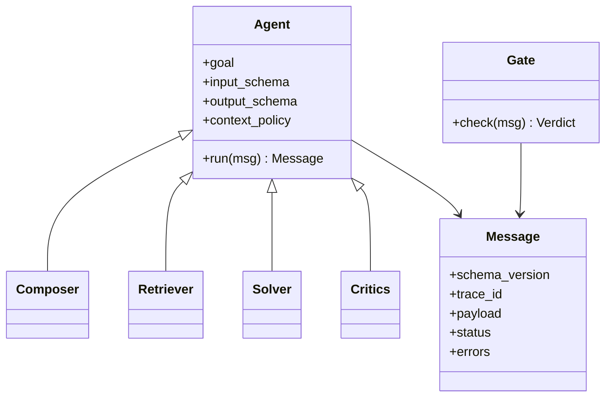

🟦 `DECOMP` (UML class diagram, Slide03): shows the abstraction as a class structure.

**Line of thought:** with a shared frame we design the frame once; only the data and the job change per agent.

---

# SLIDE 10 · TEACHER NEEDS AND THE INTENT-CLARIFICATION MECHANISM

🟩 `PATTERN` → 🟨 `ABSTRACT` · Level L3

**Layout:** left, a table "observed pattern → required component"; right, a loop diagram "clarify and deepen the intent".

**Content**

| Observed pattern | Design consequence | Tag |
| :--- | :--- | :--- |
| Teachers write exams at **set times** (mid-term, final…) | exam plan tied to a point in time | 🟩 Trend and sequence · 🧠ST |
| For **one grade or a group of related grades** | curriculum map across grades | 🟩 Grouping |
| For **one or a few subjects** | per-subject profile (subject profile, Report section 10) | 🟩 Grouping |
| By **personal teaching goals** | illustrative matrix, adjustable difficulty distribution | 🟩 Feature extraction |
| → Needed: **curriculum map**, knowledge framework, difficulty distribution, illustrative matrix | | 🟨 `ABSTRACT` |
| → A mechanism to **resolve and deepen** the need: turn a vague request into a full blueprint | | 🟨 |

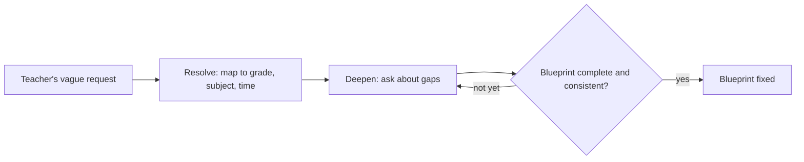

| Item | Tag |
| :--- | :--- |
| Each clarification round is bounded (no endless questioning) | 🟪 `ALGO` · 🧠Dn |
| The blueprint is fixed only when total marks, item counts and levels agree | 🟪 `ALGO` · 🧠D |

**Line of thought:** a good exam needs background knowledge; return to the two most important agents → slide 11.

---

# SLIDE 11 · FOCUS ON COMPOSER AND RETRIEVER: THE CORPUS

🟩 `PATTERN` → 🟨 `ABSTRACT` · Level L4

**Layout:** left, how teachers write exams (pattern); middle, an arrow "prepare the corpus"; right, a diagram of loading into context.

**Content**

| Item | Tag |
| :--- | :--- |
| **Pattern:** when writing an exam teachers look back at old exams, use experience and method, and follow subject-knowledge constraints (in other words, they draw on their own **profile**) | 🟩 `PATTERN` · 🧠I |
| **Solution:** prepare a **corpus** of real exams written by teachers, preprocessed; extract and abstract the factors needed to write exams; sample matrices | 🟨 `ABSTRACT` |
| Each document goes through feature extraction: question type, topic, level, structure, common mistakes | 🟩 Feature extraction |
| Group by question type and topic; count frequency across years | 🟩 Grouping · Trend and sequence |
| Load into the context of Composer and Retriever (selectively, not everything) | 🟪 `ALGO` · 🧠P |
| ➕ Rule: only data whose source and licence are approved enters the corpus (AGENTS.md rule 8; mvp-plan section 6) | 🟨 · 🧠Dn |

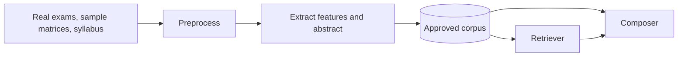

**Line of thought:** with a corpus we must measure whether it serves us well → slide 12.

---

# SLIDE 12 · METRICS FOR RETRIEVAL AND COVERAGE 🔲

🟥 `PROBLEM` (criteria) · 🔲 Placeholder · Level L4

**Layout:** two blocks: "measure content coverage" and "measure RAG". No data, only definitions and empty cells.

**Content** (metric names are the author's proposal)

| Metric | The question it answers | Value | Tag |
| :--- | :--- | :--- | :--- |
| Content coverage | how many syllabus topics the corpus covers | `[PLACEHOLDER]` | 🟥 |
| Context precision | are the retrieved passages relevant | `[PLACEHOLDER]` | 🟥 |
| Context recall | were the needed passages retrieved | `[PLACEHOLDER]` | 🟥 |
| Faithfulness / factual | does the question stay with its source passage | `[PLACEHOLDER]` | 🟥 |
| Answer relevance | does the question match the blueprint topic | `[PLACEHOLDER]` | 🟥 |
| ➕ Source validity | do evidence ids exist, are quotes exact | `[PLACEHOLDER]` | 🟥 · 🧠D |
| ➕ Distribution drift | topics in the exam against the matrix | `[PLACEHOLDER]` | 🟥 |

**Line of thought:** the input side of composing is measured; now the output side → slide 13.

---

# SLIDE 13 · THE OUTPUT PROBLEM: FORMAT, QUALITY, COST, DIVERSITY

🟥 `PROBLEM` → 🟦 `DECOMP` · Level L4

**Layout:** one output in the middle; three branches: format, the two main criteria, and a new subproblem (diversity) with a dashed outline.

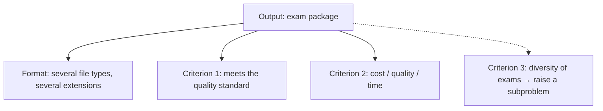

**Content**

| Item | Tag |
| :--- | :--- |
| **Output format:** several file types and extensions (for example DOCX to edit, PDF to print, LaTeX for maths; the team decides, mvp-plan Problem 2) | 🟥 `PROBLEM` · 🧠Dn |
| **Meets the quality standard:** use the metrics from Huy's labs as examples; the team doing this part fills in | 🔲 `[PLACEHOLDER — metrics taken from the labs; team fills]` |
| **Cost / quality / time:** three trade-off quantities, measured on the same test set | 🟥 `PROBLEM` · 🧠P |
| **Diversity:** two exams for the same request must not be the same; this raises a subproblem | 🟦 `DECOMP` |
| ➕ Keep "evaluation criteria" (accurate, cheap, easy to use) apart from "file types" (Report section 15, "central distinction") | 🟥 `PROBLEM` |

**Line of thought:** diversity is a subproblem of its own → slide 14.

---

# SLIDE 14 · DIVERSITY SUBPROBLEM: TWO APPROACHES 🔲

🟦 `DECOMP` (Functional) · 🔲 Placeholder · Level L4

**Layout:** two columns comparing A and B; the bottom row is the box "conclusion: deferred until after evaluation".

| | Approach A: put a large database in the context and let the LLM pull at random | Approach B: a preassigned mechanism |
| :--- | :--- | :--- |
| Idea | the LLM picks at random from a large body of data in the context | code assigns topic, form and parameters to each question beforehand; the LLM only writes |
| Problems | context size, data, cost, time | `[PLACEHOLDER — team lists]`; ➕ hint: the assigner must be designed, may be rigid |
| Reasoning | 🧠P (randomness) | 🧠Dn (rules) + 🧠D |
| Tag | 🟦 `DECOMP` | 🟦 `DECOMP` |

> **Conclusion:** not chosen yet. A solution will be proposed later, after **evaluating** both (the team runs trials and measures cost and diversity).

➕ Hint for measuring diversity: share of near-duplicate questions (similarity), number of distinct exam forms for one blueprint. `[PLACEHOLDER — team fixes the metric]`.

**Line of thought:** we have agents, data and subproblems; now arrange them into an ordered process → slide 15.

---

# SLIDE 15 · THE COMPOSING PIPELINE (TEMPORAL)

🟪 `ALGO` · 🟦 `DECOMP` (Temporal) · 🧠ST · 🧠Dn · 🧠A (repair loop) · Level L4

**Layout:** one large diagram in time order, three lanes in sequence, a highlighted label on the repair (loopback) arrow. Parallel steps are drawn side by side.

**Content**

| Item | Tag |
| :--- | :--- |
| The composing processes **depend on each other in time**: fix intent and plan → write the exam and draw figures → validate and challenge → confirm and export | 🟦 `DECOMP` · Temporal · 🧠ST |
| Some steps run **in parallel**: Retriever per section; Composer per section; drawing figures ∥ writing text ➕; Critics ∥ Solver ➕; Solver per item | 🟪 `ALGO` · 🧠ST |
| **Repair loop:** failures go back to the Composer, with a bounded number of rounds; once the rounds run out the item goes to the teacher | 🟪 `ALGO` · 🧠A + 🧠Dn |
| The teacher approves before export; this is the boundary between automation and responsibility | 🟪 · 🧠Dn |

```mermaid
flowchart LR
    subgraph L1["① Fix intent and exam plan"]
        direction TB
        I1["Receive teacher request"] --> I2["Clarify and deepen"]
        I2 --> I3["Blueprint"]
        I3 --> G1{"Gate 1: blueprint valid?"}
        G1 -- "missing or contradictory" --> I2
    end
    subgraph L2["② Composing pipeline"]
        direction TB
        RT["Retriever (per section, parallel)"]
        CP["Composer: questions and solutions"]
        IL["Draw illustrations (parallel with text)"]
        G2{"Gate 2: structure and policy"}
        RT --> CP
        CP --> G2
        IL --> G2
    end
    subgraph L3["③ Validation and challenge pipeline"]
        direction TB
        CR["Critics + Educator"]
        SV["Solver (does not see the key)"]
        G3{"Gate 3: Solver matches key and Critics pass?"}
        CR --> G3
        SV --> G3
    end
    subgraph L4["④ Confirm and export"]
        direction TB
        FL["Review flags"] --> AP["Teacher approves"]
        AP --> EX["Export files"]
    end
    G1 -- "valid" --> RT
    G2 -- "pass" --> CR
    G2 -- "pass" --> SV
    G2 -- "structure error" --> CP
    G3 -- "pass" --> FL
    G3 -- "fail: repair (rounds left)" --> CP
    G3 -- "rounds used up" --> FL
```

> The arrow label "fail: repair (rounds left)" is the **loopback to the Composer step**; this is the arrow to highlight on the slide.

**Line of thought:** with a pipeline, write it as steps a machine can run → slide 16.

---

# SLIDE 16 · PSEUDOCODE AND THE ORCHESTRATOR STATES ➕

🟪 `ALGO` · Level L4

**Layout:** left, a pseudocode block (dark background as in Slide02); right, a state diagram. Caption below: the rules are **declarative** ("what must hold"), the orchestration is **imperative** ("how to proceed").

```text
// Orchestrate one exam run (pseudocode, not real code)
SET blueprint = BUILD_BLUEPRINT(request)          // clarify, at most N_CLARIFY times
IF NOT GATE_BLUEPRINT(blueprint): ASK_TEACHER; RETURN
FOR EACH section IN blueprint.sections (in parallel):
    passages = RETRIEVE(section)
    items    = COMPOSE(section, passages)
SET round = 0
WHILE round < MAX_ROUNDS:
    flags = GATE_STRUCTURE(items) UNION CRITICS(items) UNION COMPARE(SOLVE_BLIND(items), items.key)
    IF flags IS EMPTY: BREAK
    items = REPAIR(items, flags);  round = round + 1
RETURN PACKAGE(items, flags)    // the teacher approves before export
```

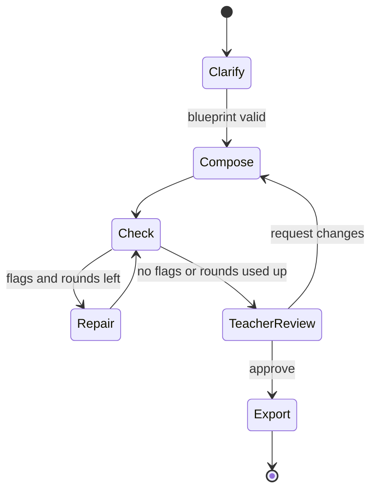

| Item | Tag |
| :--- | :--- |
| Check item count, total marks, answer labels, schema and duration by **code** (deterministic) | 🟪 `ALGO` · 🧠D |
| Round limit, cost limit, behaviour when a model call fails | 🟪 `ALGO` · 🧠Dn |
| Slide02: pseudocode is the bridge between thinking and code; check the logic before choosing a language | 🟪 `ALGO` |

**Line of thought:** the algorithm has many "knobs"; list them and decide how to measure → slide 17.

---

# SLIDE 17 · PARAMETERS TO TUNE AND HOW TO MEASURE 🔲

🟪 `ALGO` · ⬜ `DOING` (simulation) · 🔲 Placeholder · Level L4

**Layout:** a three-column table "Parameter", "Range to try", "Metric used". Empty rows at the end for the team to add to.

**Content**

| Parameter | Range to try | Measured by which metric | Tag |
| :--- | :--- | :--- | :--- |
| MAS architecture (number and kind of agents, sequential or parallel) | `[PLACEHOLDER]` | correctness, cost, time | 🟪 |
| RAG approach (chunking, embedding, hybrid) | `[PLACEHOLDER]` | context precision/recall | 🟪 |
| Number of repair loops | `[PLACEHOLDER]` | share of repaired items that pass, cost | 🟪 |
| Size of input | `[PLACEHOLDER]` | cost, correctness | 🟪 |
| Confidentiality (which data leaves, local or cloud model) | `[PLACEHOLDER]` | no leak, quality | 🟪 · 🧠Dn |
| Temperature and context selection | `[PLACEHOLDER]` | diversity, correctness | 🟪 · 🧠P |
| ➕ Model per role | `[PLACEHOLDER]` | cost/quality/time | 🟪 |
| ➕ Gate thresholds (longest allowed quote, number of rounds) | `[PLACEHOLDER]` | errors that slip through | 🟪 |
| 🔲 `[PLACEHOLDER — team adds parameters]` | | | 🔲 |

Last line of the slide: **metrics are what we measure; parameters are what we turn.** The two columns must not be mixed.

**Line of thought:** the algorithm is done at design level; a bigger problem remains: getting it to users → slide 18.

---

# SLIDE 18 · TRANSFER: FROM EXAM WRITING TO A VIRTUAL ASSISTANT

🟦 `DECOMP` (Functional + Structural) · Level L5

**Layout:** a small circle "Exam writing" inside a larger shape "Virtual assistant app"; the three other circles around it.

**Content**

| Item | Tag |
| :--- | :--- |
| **Transfer problem:** exam writing becomes **one subproblem** in a bigger picture, a virtual-assistant app (idea transition) | 🟦 `DECOMP` |
| Split into 4: **Exam writing**, **UI/UX**, **Chatbot assistant**, **Extra features** | 🟦 `DECOMP` · Structural |

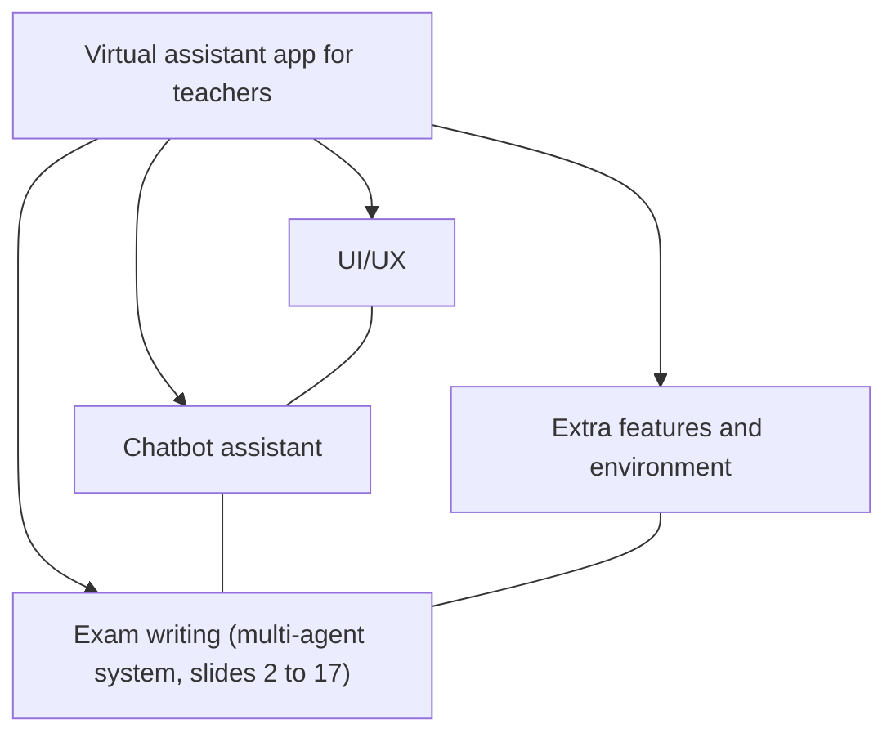

**Line of thought:** each new branch needs its own pattern, starting from the user → slide 19.

---

# SLIDE 19 · UI/UX FOR TEACHERS

🟩 `PATTERN` → 🟨 `ABSTRACT` · Level L5

**Layout:** left, a user persona ➕; right, the list of UI requirements.

**Content**

| Item | Tag |
| :--- | :--- |
| **Pattern:** the main users are teachers; limited comfort with technology; low tolerance for complicated steps (friction); limited patience | 🟩 `PATTERN` · 🧠P |
| **Pattern:** some users have poor eyesight or are older | 🟩 `PATTERN` · Grouping |
| **UI requirements** (lazy-user skill): animation and live progress updates; "dopamine" management (small, steady feedback); simple, easy to use; large text, high contrast ➕ | 🟨 `ABSTRACT` |
| ➕ Ethical constraint: a simple interface must not **hide uncertainty** (Report section 15) | 🟨 · 🧠Dn |
| ➕ Naming rule: name things by the teacher's task, not by technical terms | 🟨 |

**Line of thought:** users do not know how to state requests → a proactive assistant → slide 20.

---

# SLIDE 20 · THE ASSISTANT

🟩 `PATTERN` → 🟪 `ALGO` · Level L5

**Layout:** left, the pattern; right, a diagram of "assistant behaviour" along predefined flows.

**Content**

| Item | Tag |
| :--- | :--- |
| **Pattern:** most main users do not know how to prompt effectively | 🟩 `PATTERN` · 🧠I |
| **Suggest the next step** along predefined flows | 🟪 `ALGO` · 🧠ST |
| **Onboarding in an agentic way:** instead of only doing the work, **show progress on the UI** so users understand | 🟪 `ALGO` |
| **Q&A** about the app and about the exam | 🟪 `ALGO` |
| **Gather basic inputs** (subject, grade, duration, matrix) from the conversation into an `ExamRequest` | 🟪 `ALGO` · 🧠A |

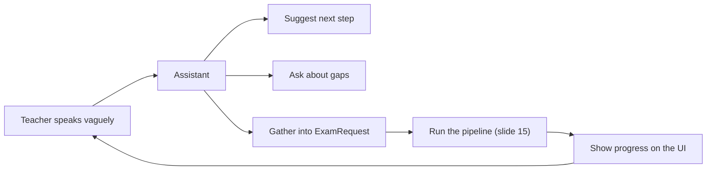

**Line of thought:** after the exam is made the teacher does not stop → slide 21.

---

# SLIDE 21 · EXTRA FEATURES AND WORKING ENVIRONMENT

🟩 `PATTERN` → 🟪 `ALGO` · Level L5

**Layout:** a "refer back, then edit" circle in the middle; small features around it.

**Content**

| Item | Tag |
| :--- | :--- |
| **Pattern:** teachers tend to refer back to work they have done, or fix things based on it | 🟩 `PATTERN` · Template matching · 🧠I |
| **Mechanism to review and revise an exam** (version history, comparison) | 🟪 `ALGO` |
| **Basic operations:** replicate an exam, change the numbers, restructure | 🟪 `ALGO` · 🧠D |
| ➕ "Change the numbers" is a rule-based transformation, so it is checked by code, not by calling the LLM again | 🟪 · 🧠D |
| ➕ Every operation keeps its provenance and records the decision | 🟪 · 🧠Dn |
| ➕ Student modes (practice, mock exam) are an extension, not the core (Report section 15) | 🟦 `DECOMP` |

**Line of thought:** all four branches are in place; redraw the whole problem tree → slide 22.

---

# SLIDE 22 · GRAPH OF THE WHOLE PROBLEM PROCESS

🟦 `DECOMP` · 🟥 `PROBLEM` · Level L1 → L5

**Layout:** a full-screen graph. Rectangular nodes are **problems**; rounded nodes are **decisions/solutions**; solid arrows mean "split into", dashed arrows mean "raises a subproblem".

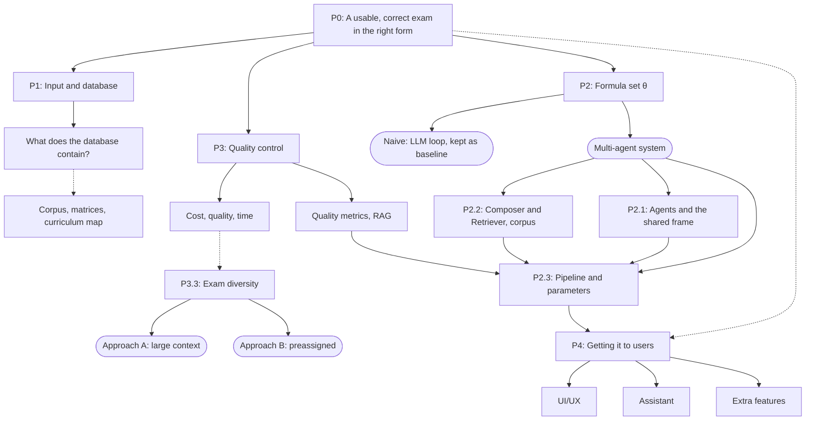

| Item | Tag |
| :--- | :--- |
| Read the graph top-down: each layer is one split; dashed arrows are unsolved problems, left for later | 🟦 `DECOMP` |
| The graph shows the **complexity of the thinking**: one function at the start grows into a multi-layer system of dependencies | 🟥 `PROBLEM` |
| ➕ Mark which nodes are **decided** (link `D-nnn` in [DECISIONS.md](DECISIONS.md)) and which are still open | 🟥 |

**Line of thought:** the overview comes before the close.

---

# SLIDE 23 · WRAP-UP: REASONING × PILLAR MATRIX, AND THE LOOP ➕

All 4 pillars · Level L1 → L5

**Layout:** left, the matrix (Slide02 asks us to "draw the mapping matrix"); right, the loop "design → do → measure → fix" (Slide01: continuous loop).

### Reasoning × pillar matrix (examples from ASTRA)

| | 🟦 Decomposition | 🟩 Pattern Recognition | 🟨 Abstraction | 🟪 Algorithmic Design |
| :--- | :--- | :--- | :--- | :--- |
| 🧠 Deductive | stop criteria → check each agent | template match → exam fits the frame | schema → every question is valid | gates checked by code |
| 🧠 Inductive | split by the roles of the real committee | rules drawn from old exams | core model from many exams | choose the process from experiments |
| 🧠 Abductive | pin a failure on one layer | why the naive loop fails | find the key variable behind errors | repair loop: guess the cause of the error |
| 🧠 Probabilistic | measure cost/quality | topic trends over the years | pick enough context, drop noise | temperature, sampling, diversity |
| 🧠 Deontic | boundaries of agent responsibility | subject constraints | policy, licences | round limits, teacher approval |
| 🧠 Spatial/Temporal | pipeline order | trend over time | states | parallel and sequential, loopback |

### The loop

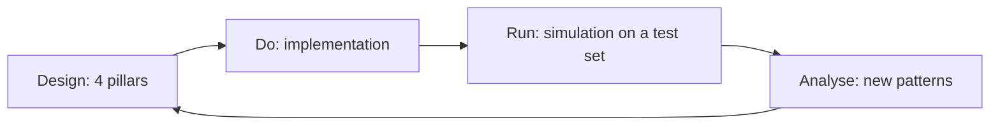

| Item | Tag |
| :--- | :--- |
| Message: CT is the strategy of the design phase, not the product; real results come from the doing and measuring phase | ⬜ `DOING` |
| ➕ Return to slide 1: thinking went from **one function** to **one product** through 5 layers; each layer reused all 4 pillars | 🟦 🟩 🟨 🟪 |

---

## Appendix A. Proposed additions ➕ (Huy keeps or drops)

| # | Proposal | Why | Slide |
| :--- | :--- | :--- | :--- |
| 1 | A map-of-thought slide at the start | the audience sees the route and the rising complexity first | 1 |
| 2 | Non-goals (out of scope) | Report section 04; avoids "why no grading?" | 4 |
| 3 | Pick the first subject by "answer checkable by code" | mvp-plan Problem 1 | 4 |
| 4 | Tag the kind of decomposition and pattern technique on every item | uses Slide03/04 terms, easier to grade | whole file |
| 5 | A table mapping Huy's agent names to the Report's | avoids two parallel sets of names | 8 |
| 6 | Educator, Orchestrator, Blueprint Builder as separate agents | Report has Planner, Orchestrator; Educator is Huy's idea | 8 |
| 7 | Pseudocode slide and state diagram | Slide02: pseudocode is the bridge; shows imperative and declarative | 16 |
| 8 | Critics in parallel with Solver, drawing figures in parallel with text | saves time; the steps are independent | 15 |
| 9 | Teacher persona, large text and high contrast | the "poor eyesight, older" pattern | 19 |
| 10 | Constraint "simple must not hide uncertainty" | Report section 15 | 19 |
| 11 | Reasoning × pillar matrix | Slide02 assigns this | 23 |
| 12 | Link graph nodes to decisions `D-nnn` | AGENTS.md rule 12; shows the reason for each choice | 22 |
| 13 | Risks: correlated errors between agents, copyright, privacy | Report section 18; Huy's "Confidential" parameter | 17 or its own slide |
| 14 | Evaluation protocol: baseline vs ASTRA vs teacher-edited, blind, report denominators | Report section 17; shows that added complexity pays off | after slide 17 |
| 15 | "Change the numbers" as a code-checked operation | cheap, correct, repeatable | 21 |

## Appendix B. Open questions for the team

1. Which THPTQG subject goes first (slide 4)?
2. Are Educator and Critics separate or merged? Is Validator pure code or partly LLM (slide 8)?
3. Name and citation of the "EduAgent…" reference paper (slide 7); not found in the repo.
4. Which labs supply the quality metrics (slide 13); the team fills in.
5. Approach A or B for diversity, and measured how (slide 14)?
6. Do we need to present Abstraction and Algorithmic Design with specific techniques from the lecturer? (no lecture slides for these two pillars yet)
7. Do the slides show levels L1 to L5, or keep them as internal notes?

## Not verified

- AI-drafted (Claude, 2026-11-12) from Huy's notes, the four course slides, the Report and mvp-plan. Nobody in the team has read or approved it; nothing was run.
- All target figures (≥95%, 100%, ≥95%, about VND 2,000 per exam) come from the Report and are **goals**, not measured results. This file creates no new numbers.
- Mermaid diagrams were not rendered anywhere; view them in a Markdown viewer with Mermaid support before building slides.
- The ticks on slide 8 and the reasoning tags (🧠) are the author's **proposals**; the team should check them.
- The four course slides are Slide01 to Slide04; there are no slides for Abstraction and Algorithmic Design, so those two pillars use only the general definitions.
