# KẾ HOẠCH SLIDE: ASTRA qua 4 trụ cột Computational Thinking

> **English is the primary version for the teams: [ct-slide-plan.en.md](ct-slide-plan.en.md).** This Vietnamese file mirrors it (same slide numbers and tags); change the English file first, then this one.

**Đây là gì:** bố cục và nội dung nháp của bộ slide phân tích ASTRA qua bốn trụ cột (Decomposition, Pattern Recognition, Abstraction, Algorithmic Design). Dành cho nhóm Trial and Success (CSC10014), người làm slide và người duyệt. **Trạng thái:** v2, 2026-11-12. v1 do AI soạn từ ghi chú của Huy; v2 áp các góp ý của nhóm (xem "Thay đổi ở v2"). Chưa ai đọc lại.

Nguồn lý thuyết: Slide01 (Intro to CT), Slide02 (Thinking and Reasoning), Slide03 (Decomposition), Slide04 (Pattern Recognition). Nguồn dự án: [ASTRA_Trial_and_Success_Report.md](../ASTRA_Trial_and_Success_Report.md), [mvp-plan.md](mvp-plan.md).

> **Cảnh báo (từ nhóm): các kiểu reasoning và kĩ thuật gắn vào mục bên dưới CHƯA được kiểm chứng với những gì thầy dạy.** Coi chúng là gợi ý, đối chiếu bài giảng trước khi đưa lên slide. Chỗ nào biết cách thầy nói (Pattern = Subject + frequency + content) thì dùng cách đó.
>
> **Chưa có slide giảng cho Abstraction và Algorithmic Design.** Hai trụ này chỉ dùng định nghĩa trong Slide01/02 (Abstraction = bỏ nhiễu, giữ mô hình lõi; Algorithmic Design = các bước đầy đủ để máy làm theo; pseudocode; imperative vs declarative).

---

## 0. Cách đọc file

### Quy ước slide

Mỗi slide có: **tiêu đề lớn**, một dòng tag, **Visual** (một hình duy nhất mang slide), **Nói** (người thuyết trình nói gì, mỗi ý một dòng), **Tiếp** (vì sao slide sau nối vào). Trên slide thật chỉ **một hình và ít chữ**; file này được phép nói nhiều hơn slide.

### Tag (một dòng mỗi slide, không gắn tag từng dòng)

| Tag | Bước |
| :--- | :--- |
| 🟥 PROBLEM | Problem Definition |
| 🟦 DECOMP | Decomposition |
| 🟩 PATTERN | Pattern Recognition |
| 🟨 ABSTRACT | Abstraction |
| 🟪 ALGO | Algorithmic Design |
| ➕ | Đề xuất thêm (ý của người soạn, không có trong ghi chú; Huy giữ hoặc bỏ) |
| 🔲 | Chỗ trống cho nhóm |

### Các mức phức tạp

`L1` một hàm → `L2` ba bài toán con → `L3` hệ đa tác tử → `L4` thiết kế hệ thống → `L5` sản phẩm. Chỉ hiện ở slide bản đồ; các slide khác không gắn nhãn mức.

### Mục lục slide

| # | Tiêu đề | Tag | Visual |
| :--- | :--- | :--- | :--- |
| 1 | Bản đồ mạch tư duy ➕ | tất cả | sơ đồ lộ trình |
| 2 | Bài toán: đầu vào và đầu ra | 🟥 + 🟨 🟦 | sơ đồ input/output |
| 3 | Đề thi có tính nhất quán | 🟩 | quan sát → hệ quả |
| 4 | Một mô hình cho cả lớp đề | 🟨 | khung công thức |
| 5 | Ba bài toán con | 🟦 | cây |
| 6 | Baseline: vòng lặp LLM ngây thơ | 🟥 🟩 | vòng lặp |
| 7 | Hội đồng ra đề thành hệ đa tác tử | 🟩 🟦 | ánh xạ vai trò |
| 8 | Các agent | 🟦 | sơ đồ tổ chức |
| 9 | Một khung chung cho mọi agent | 🟨 | sơ đồ lớp |
| 10 | Giáo viên cần gì | 🟩 🟨 | vòng lặp |
| 11 | Corpus | 🟩 🟨 | pipeline |
| 12 | Pipeline soạn đề | 🟪 | swimlane có vòng lặp lại |
| 13 | Cùng logic đó dưới dạng pseudocode | 🟪 | pseudocode |
| 14 | Đầu ra và benchmark | 🟥 🔲 | cây + biểu đồ metric |
| 15 | Đa dạng: các hướng thử | 🟦 🔲 | cây lựa chọn |
| 16 | Tham số: thứ ta vặn | 🟪 🔲 | vòng lặp chỉnh |
| 17 | Zoom out: từ soạn đề sang app trợ lý | 🟦 | vòng tròn lồng nhau |
| 18 | UI/UX | 🟩 🟨 🔲 | nhóm tự chọn |
| 19 | Trợ lý | 🟩 🟪 🔲 | nhóm tự chọn |
| 20 | Tính năng bổ sung | 🟩 🟪 🔲 | nhóm tự chọn |
| 21 | Tổng kết: reasoning × trụ cột, và vòng lặp ➕ | tất cả | ma trận + vòng lặp |
| 22 | Đồ thị toàn bộ bài toán | 🟦 🟥 | đồ thị |

Các slide trong deck không được lặp một dạng hình: 22 slide trên dùng cây, vòng lặp, flow, swimlane, sơ đồ lớp, đồ thị, biểu đồ, ma trận, vòng tròn lồng, pseudocode. Tránh bảng hai cột trừ chỗ nó thật sự là bảng.

---

# SLIDE 1 · BẢN ĐỒ MẠCH TƯ DUY ➕

🟥 🟦 🟩 🟨 🟪

**Visual:** một hình lộ trình rộng, trục ngang là thời gian buổi nói, trục dọc là độ phức tạp tăng dần.

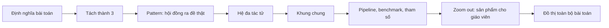

**Nói**
- Buổi nói không đi "trụ 1, rồi 2, 3, 4". Các trụ lặp lại ở hầu hết các tầng, và mỗi tầng lớn hơn tầng trước.
- Mỗi tầng kết thúc bằng một bài toán con mới; vì vậy độ phức tạp tăng.
- CT là giai đoạn thiết kế; làm và đo đến sau (Slide01).

**Tiếp:** lộ trình đã rõ; bắt đầu từ bài toán.

---

# SLIDE 2 · BÀI TOÁN: ĐẦU VÀO VÀ ĐẦU RA

🟥 PROBLEM · 🟨 ABSTRACT · 🟦 DECOMP

**Visual:** bên trái, sơ đồ đầu vào → hộp đen → đầu ra, chia theo ai cung cấp hoặc ai nhìn thấy; bên phải, khung Given/Find.

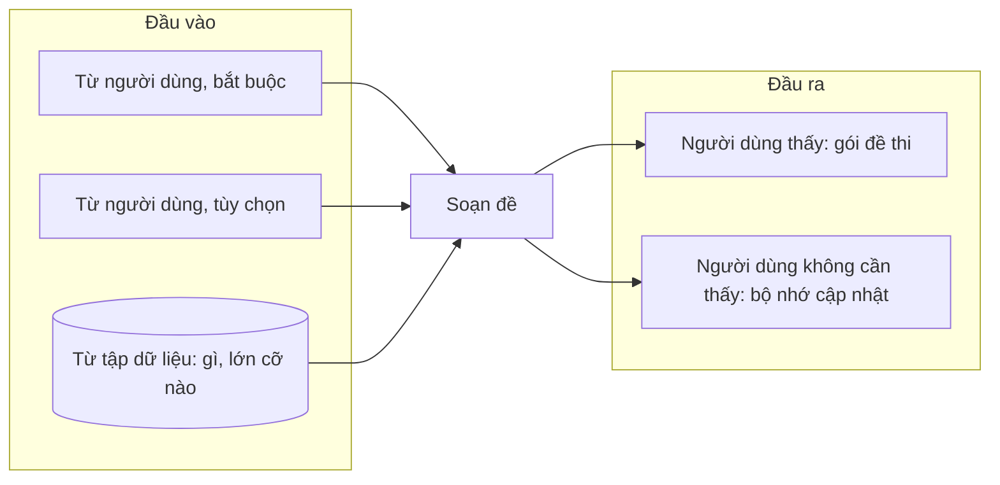

| Nhóm | Nội dung | Trạng thái |
| :--- | :--- | :--- |
| Người dùng, bắt buộc | ý định đề thi *I* | đề xuất ➕ (nhóm xác nhận cái nào bắt buộc) |
| Người dùng, tùy chọn | đề mẫu *S*, tài liệu tham khảo *R*, yêu cầu mẫu đề *F*, ma trận đề *M* | đề xuất ➕ |
| Tập dữ liệu | cơ sở dữ liệu của ứng dụng *K*; nó chứa gì và lớn cỡ nào | 🔲 `[PLACEHOLDER — nội dung và kích thước]` |
| Người dùng thấy | đề, đáp án, lời giải, cờ cần xem lại | từ ghi chú của Huy |
| Người dùng không cần thấy | bộ nhớ cập nhật (thứ app giữ lại cho lần sau) | 🔲 `[PLACEHOLDER — lưu gì]` |

> **Cho (Given):** ý định đề thi *I*, đề mẫu *S*, tài liệu tham khảo *R*, yêu cầu mẫu đề *F*, ma trận đề *M* (từ giáo viên); và cơ sở dữ liệu của ứng dụng *K*.
> **Tìm (Find):** một gói đề *E* = (đề, đáp án, lời giải, cờ cần xem lại) sao cho
> (1) **nội dung đúng:** đáp án và lời giải đúng và có căn cứ;
> (2) **hình thức đúng:** khớp *F* và *M*, số câu, điểm, thời lượng;
> (3) **dùng được:** giáo viên xem và xuất file mà không phải làm lại.

**Nói**
- Chia đầu vào/ra theo ai thấy đã làm bài toán nghiêng về hướng sản phẩm (nhóm nhận xét: được, nhưng hãy nói rõ ra).
- Gọi tên "cái gì là đầu vào, cái gì ẩn" là abstraction; gom nhóm là decomposition. Metric cho "đúng" nằm ở phần đầu ra (slide 14).

**Tiếp:** bài toán đã chốt; các đề giống nhau ở đâu?

---

# SLIDE 3 · ĐỀ THI CÓ TÍNH NHẤT QUÁN

🟩 PATTERN

**Visual:** ba thẻ quan sát theo cách thầy nói **Subject + frequency + content**, rồi một mũi tên tới hệ quả. Không dùng bảng.

| Subject | Frequency | Content |
| :--- | :--- | :--- |
| Các đề cùng loại (vd THPTQG) | phần lớn `[PLACEHOLDER — đếm]` | theo một format chung |
| Các câu trong một đề | luôn luôn | thuộc một tập loại câu nhỏ, khá cố định (nhiều lựa chọn, đúng–sai, trả lời ngắn, tự luận…) |
| Các câu cùng loại | thường | được ra theo cách giống nhau (dạng, số ý, độ dài, mức độ) |
| Kiến thức môn học | qua các năm | thay đổi ít; chỉ phân bố chủ đề dịch chuyển |

**Hệ quả (ý chốt của slide):** đề thi nhất quán, nên ta có thể áp một **workflow ổn định**. Phần ổn định thành **blueprint**; workflow là quy trình điền vào nó (slide 4, slide 12).

**Nói**
- Pattern là một hiện tượng có subject, frequency, content; điền đủ ba thì mới là pattern, không thì chỉ là cảm giác.
- Nhận ra nhóm và đặc trưng (loại câu, số ý, mức độ) cũng là một cách chia đề; các kĩ thuật của Slide04 chỉ là gợi ý và chưa kiểm chứng ở đây.

**Tiếp:** nếu đề nhất quán, bỏ phần khác nhau và giữ mô hình chung.

---

# SLIDE 4 · MỘT MÔ HÌNH CHO CẢ LỚP ĐỀ

🟨 ABSTRACT

**Visual:** khung công thức lớn; bên trái "bỏ" (năm, trường, cách diễn đạt), bên phải "giữ" (phần ổn định ở slide 3).

> **E = Φ(T, K; θ)**, trong đó θ là **bộ công thức** cố định: luật blueprint, phân bố độ khó, hồ sơ chấm điểm, mẫu prompt.

**Nói**
- Nối thẳng từ slide 3: phần nhất quán (format, loại câu, cách ra từng loại) thành θ; phần khác nhau theo từng đề (năm, trường) bị bỏ.
- Ta không giải từng đề; ta giải một lớp đề bằng một bộ công thức.
- Blueprint và workflow là hai mặt của θ: cái gì phải đúng, và làm thế nào.

**Tiếp:** Φ vẫn là một hàm lớn; tách nó ra.

---

# SLIDE 5 · BA BÀI TOÁN CON

🟦 DECOMP

**Visual:** một cây, ba nhánh, mũi tên phụ thuộc giữa chúng.

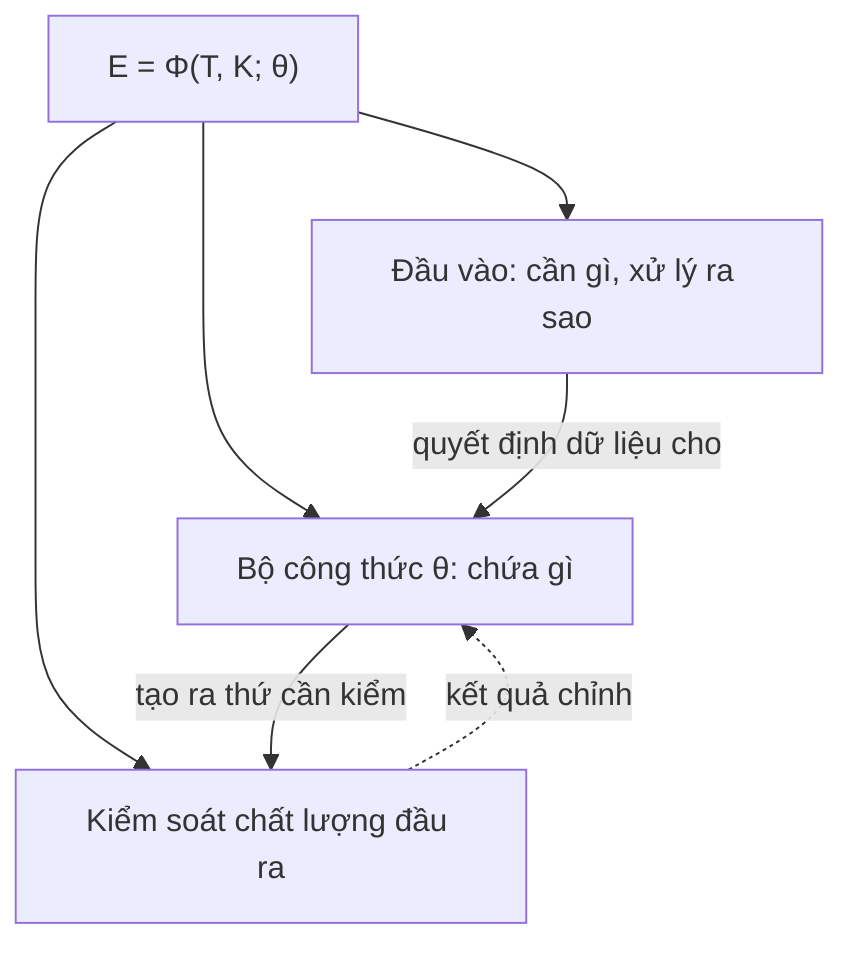

**Nói**
- Chia theo chức năng. Phụ thuộc mới là điểm chính: chúng là lí do ba phần không giải riêng lẻ được.
- Các slide sau làm việc trên nhánh giữa, θ.

**Tiếp:** trước khi xây θ, thứ đơn giản nhất có thể chạy là gì?

---

# SLIDE 6 · BASELINE: VÒNG LẶP LLM NGÂY THƠ

🟥 PROBLEM · 🟩 PATTERN

**Visual:** chỉ một sơ đồ vòng lặp; lí do để ở ghi chú người nói.

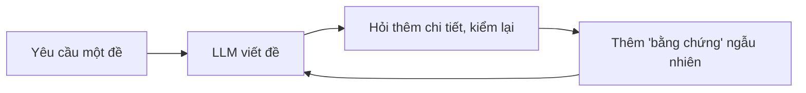

**Nói**
- Đây là **baseline**: thứ mọi thiết kế sau phải vượt qua, giữ để so sánh (Report mục 16, 17).
- Vì sao chưa đủ (Report mục 03): không gì ép số câu, điểm, mức độ cùng lúc; một mô hình tự chấm; đầu ra trôi chảy nhưng sai; không có gì để đo.

**Tiếp:** tự kiểm thiếu tính độc lập; con người xử lý việc này thế nào?

---

# SLIDE 7 · HỘI ĐỒNG RA ĐỀ THÀNH HỆ ĐA TÁC TỬ

🟩 PATTERN · 🟦 DECOMP

**Visual:** hai cột vai trò nối bằng mũi tên: vai trò hội đồng bên trái, agent bên phải.

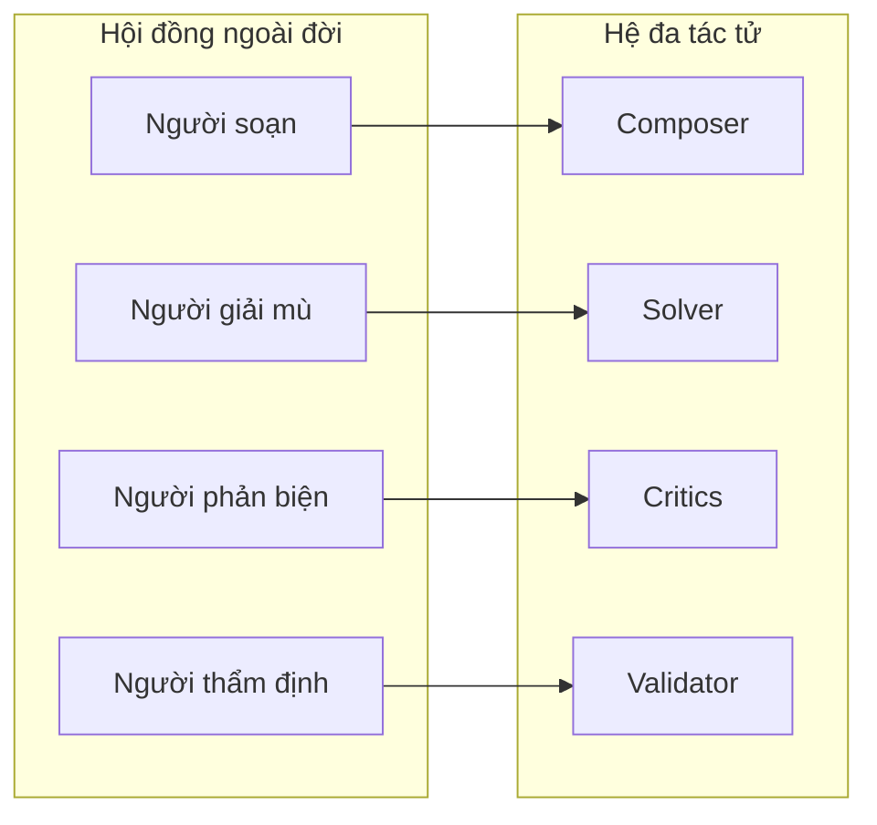

**Nói**
- Pattern theo cách thầy: **Subject** ra đề chính thức; **frequency** lần nào cũng vậy; **content** nhiều người, vai trò khác nhau, trong đó có người không thấy đáp án, mục đích là khách quan.
- Nên lời giải phản chiếu nó: mỗi vai trò một agent. Bài báo tham khảo: 🔲 `[PLACEHOLDER — tên đầy đủ và trích dẫn bài "EduAgent…"; không tìm thấy trong repo, không đoán]`.

**Tiếp:** các agent cụ thể là ai, và dừng chia ở đâu?

---

# SLIDE 8 · CÁC AGENT

🟦 DECOMP

**Visual:** sơ đồ tổ chức: Orchestrator ở trên, các agent bên dưới, mỗi hộp một cụm từ.

> **Dừng chia khi mỗi agent có một việc, tự hiểu được, và tự kiểm thử được** (Slide03: single responsibility, understandable, independent).

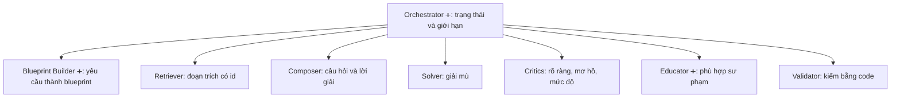

**Nói**
- Một lỗi có thể quy về một agent, thay vì chìm trong một câu trả lời dài.
- Tên: tên của Huy; Report gọi Composer là "Writer", Solver là "Blind Solver", Critics là "Appraiser", Validator là "Guardrail Gate". Educator có tách khỏi Critics không, và Validator có thuần code không, còn mở (Phụ lục B).

**Tiếp:** sáu việc khác nhau; chúng có gì chung?

---

# SLIDE 9 · MỘT KHUNG CHUNG CHO MỌI AGENT

🟨 ABSTRACT

**Visual:** sơ đồ lớp UML. Bên cạnh là danh sách ngắn: mỗi phần tử một dòng nói vì sao cần.

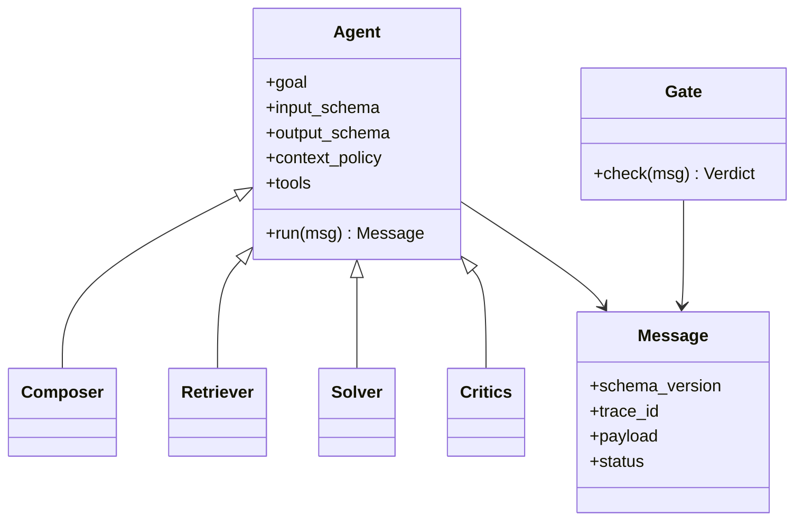

| Phần tử | Vì sao cần |
| :--- | :--- |
| Goal | để mỗi agent tối ưu một thứ |
| Input / output schema | để đổi và kiểm thử từng agent |
| Context | mô hình chỉ thấy thứ công việc cần |
| Protocol | một định dạng thông điệp mà code kiểm được |
| Tools | agent được gọi gì, ngoài ra không có |
| Flag | agent có thể nói "tôi không chắc" thay vì đoán |
| Gate | điều kiện qua cổng được viết ra, không phải cảm giác |

**Nói**
- Thiết kế khung một lần; mỗi agent chỉ đổi dữ liệu và việc. Đây cũng là chỗ hai kiểu tách nhau: **cổng và schema là declarative** ("cái gì phải đúng"), **điều phối là imperative** ("làm thế nào"; slide 13).

**Tiếp:** agent đã có; giáo viên thật sự cần gì ở chúng?

---

# SLIDE 10 · GIÁO VIÊN CẦN GÌ

🟩 PATTERN · 🟨 ABSTRACT

**Visual:** một vòng lặp: yêu cầu mơ hồ → làm rõ → đào sâu → blueprint đủ, với bốn quan sát ngắn ở bên trái.

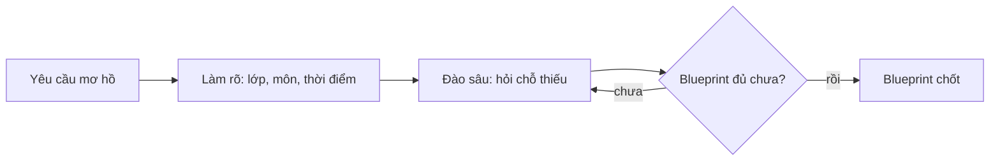

**Nói** (mỗi ý một dòng, *Subject + frequency + content*)
- Giáo viên ra đề vào các thời điểm cố định, cho một khối lớp hoặc nhóm khối liên quan, một hoặc vài môn, theo mục tiêu giảng dạy cá nhân.
- Nên cần: bản đồ chương trình, khung kiến thức, phân bố độ khó, ma trận minh họa.
- Và một cách biến yêu cầu mơ hồ thành blueprint đầy đủ, hỏi tới khi đủ (có giới hạn, không hỏi mãi).

**Tiếp:** đề tốt cần kiến thức nền; nó đến từ đâu?

---

# SLIDE 11 · CORPUS

🟩 PATTERN · 🟨 ABSTRACT

**Visual:** pipeline từ trái sang phải.

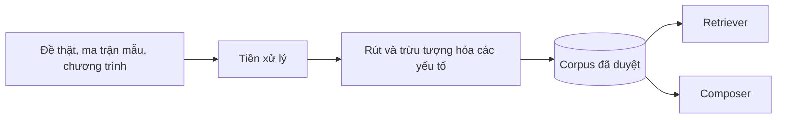

**Nói**
- Pattern: khi ra đề, giáo viên nhìn lại đề cũ, dùng kinh nghiệm, và theo ràng buộc kiến thức môn.
- Nên ta chuẩn bị corpus đề thật, tiền xử lý, rút các yếu tố ra đề, và nạp có chọn lọc vào Composer và Retriever.
- ➕ Chỉ dữ liệu có nguồn và giấy phép được duyệt mới vào corpus (AGENTS.md quy tắc 8).

**Tiếp:** các phần đã có; xếp chúng theo thứ tự thời gian.

---

# SLIDE 12 · PIPELINE SOẠN ĐỀ

🟪 ALGO

**Visual:** slide này chỉ một sơ đồ, không gì khác. Bốn làn theo thứ tự thời gian; mũi tên sửa lỗi được làm nổi.

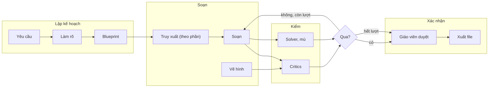

**Nói**
- Ở đây chỉ nói về thuật toán; không gán loại decomposition nào cho nó (chưa kiểm chứng).
- Bước song song vẽ cạnh nhau. Mũi tên "không, còn lượt" là vòng lặp lại cần làm nổi.

**Tiếp:** viết cùng logic đó thành các bước máy làm theo được.

---

# SLIDE 13 · CÙNG LOGIC ĐÓ DƯỚI DẠNG PSEUDOCODE

🟪 ALGO

**Visual:** một khối ngắn, nền tối (như Slide02).

```text
draft = compose(blueprint)
repeat up to MAX_ROUNDS:
    if check(draft) is ok:  return draft  // passed
    draft = repair(draft)
give draft and flags to the teacher
```

**Nói**
- Cố ý ở mức cao: nếu đề ổn thì qua; không thì lặp lại đến giới hạn số vòng, rồi giao cho giáo viên.
- `check` là phần declarative (luật từ khung ở slide 9); vòng lặp này là phần imperative. Chi tiết (truy xuất, song song theo phần) ở slide 12.
- Sơ đồ trạng thái của Orchestrator (Clarify → Compose → Check → Repair → Teacher review → Export) có thể để ở ghi chú.

**Tiếp:** đã có thiết kế; làm sao biết nó tốt?

---

# SLIDE 14 · ĐẦU RA VÀ BENCHMARK

🟥 PROBLEM · 🔲 PLACEHOLDER

**Visual:** bên trái, cây đầu ra nhỏ; bên phải, biểu đồ cột các metric với **cột trống** ghi `[NOT MEASURED]`. Benchmark đặt ở đây, ngay trước phần tham số cố tối đa hóa nó.

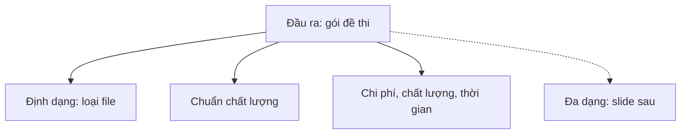

| Nhóm | Metric | Giá trị |
| :--- | :--- | :--- |
| Chất lượng | đáp án đúng, tuân thủ blueprint/format, hợp lệ phạm vi và nguồn, phân bố độ khó, tỉ lệ mơ hồ | `[PLACEHOLDER]` |
| Giáo viên | số phút sửa, xuất file thành công | `[PLACEHOLDER]` |
| Chi phí | chi phí mỗi đề được duyệt | `[PLACEHOLDER]` |
| Truy xuất (cho corpus) | độ phủ nội dung, context precision, context recall, faithfulness | `[PLACEHOLDER]` |

**Nói**
- Tên metric lấy từ Report mục 17 và đề xuất của người soạn; mục tiêu trong report là mục tiêu, không phải kết quả.
- Định dạng đầu ra: DOCX để sửa, PDF để in, LaTeX cho toán (nhóm quyết, mvp-plan Problem 2). Tách tiêu chí đánh giá khỏi loại file.
- Metric chất lượng "từ các lab của Huy": 🔲 `[PLACEHOLDER — nhóm làm phần này điền]`.

**Tiếp:** một tiêu chí không phải con số mà là bài toán mới: đa dạng.

---

# SLIDE 15 · ĐA DẠNG: CÁC HƯỚNG THỬ

🟦 DECOMP · 🔲 PLACEHOLDER

**Visual:** cây lựa chọn. Không có hộp kết luận cuối; các hướng là ý để nhóm thử.

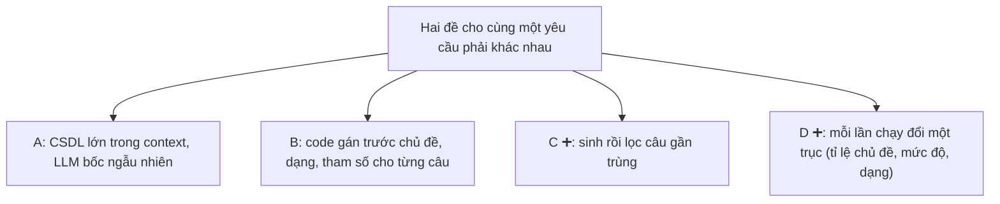

**Nói**
- A và B là của Huy; C và D là đề xuất của người soạn, chưa hướng nào được thử. Chưa chọn cũng được: nhóm đề xuất thêm và thử.
- Chi phí và thời gian khác nhau theo hướng (A: cỡ context, dữ liệu, chi phí; B: phải thiết kế bộ gán, có thể cứng).
- Cách đo: tỉ lệ câu gần trùng, số dạng đề khác nhau cho một blueprint 🔲 `[PLACEHOLDER — nhóm chốt metric]`.

**Tiếp:** giờ đến các núm vặn: vặn gì để đẩy benchmark lên?

---

# SLIDE 16 · THAM SỐ: THỨ TA VẶN

🟪 ALGO · 🔲 PLACEHOLDER

**Visual:** vòng lặp chỉnh; danh sách tham số xung quanh. Metric (slide 14) là thứ ta đo; tham số là thứ ta vặn.

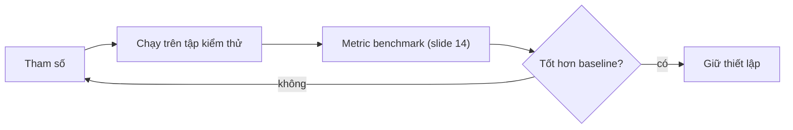

| Tham số | Khoảng |
| :--- | :--- |
| Kiến trúc MAS (số lượng, loại, tuần tự hay song song) | `[PLACEHOLDER]` |
| Cách làm RAG (chunking, embedding, hybrid) | `[PLACEHOLDER]` |
| Số vòng sửa | `[PLACEHOLDER]` |
| Cỡ đầu vào | `[PLACEHOLDER]` |
| Bảo mật (dữ liệu nào ra ngoài, mô hình cục bộ hay cloud) | `[PLACEHOLDER]` |
| Temperature và cách chọn context | `[PLACEHOLDER]` |
| ➕ Mô hình theo vai trò; ngưỡng cổng | `[PLACEHOLDER]` |
| 🔲 `[PLACEHOLDER — nhóm thêm]` | |

**Nói**
- Đây là lí do benchmark được giới thiệu: để các tham số này tối đa hóa nó. Baseline (slide 6) là dòng đầu của phép so sánh.

**Tiếp:** thiết kế đã xong ở mức hệ thống; zoom out.

---

# SLIDE 17 · ZOOM OUT: TỪ SOẠN ĐỀ SANG APP TRỢ LÝ

🟦 DECOMP

**Visual:** các vòng tròn lồng nhau: vòng nhỏ "soạn đề" (slide 2 đến 16) nằm trong hình lớn "app trợ lý ảo cho giáo viên", ba vòng khác xung quanh.

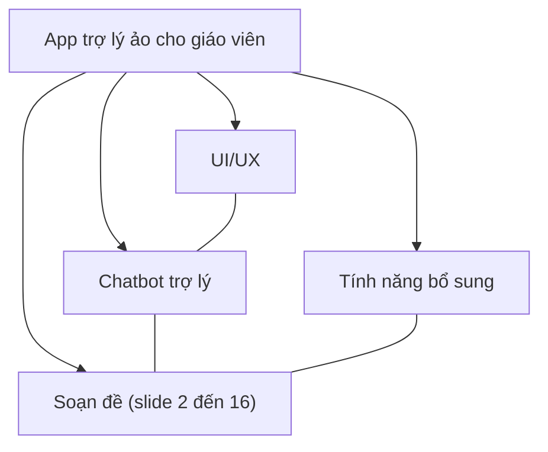

**Nói**
- Mọi thứ nãy giờ chỉ là một nhánh của bức tranh lớn hơn. Zoom out làm bài toán đổi: người dùng không còn là "một yêu cầu" mà là một con người có thói quen.
- Mỗi nhánh mới cần pattern riêng, bắt đầu từ người dùng.

**Tiếp:** UI/UX trước. (Slide 18 đến 20 ngắn: các nhóm điền việc đã làm và cách chia việc.)

---

# SLIDE 18 · UI/UX

🟩 PATTERN · 🟨 ABSTRACT · 🔲 NHÓM TỰ CHỌN

**Visual:** nhóm chọn (màn hình mock, hành trình, cây). Không dùng bảng.

**Nói**
- Pattern: người dùng chính là giáo viên; không quá thoải mái với công nghệ; ít kiên nhẫn; một số người mắt kém hoặc lớn tuổi.
- Nên giao diện cần: tiến độ trực tiếp và phản hồi nhỏ đều đặn, bước đơn giản, chữ lớn, tương phản cao ➕.
- ➕ Giao diện đơn giản không được giấu sự không chắc chắn (Report mục 15).
- 🔲 `[NHÓM ĐIỀN: minh chứng việc đã làm, ai làm gì]`

---

# SLIDE 19 · TRỢ LÝ

🟩 PATTERN · 🟪 ALGO · 🔲 NHÓM TỰ CHỌN

**Visual:** luồng hội thoại hoặc sơ đồ trạng thái (nhóm chọn).

**Nói**
- Pattern: phần lớn người dùng chính không biết prompt hiệu quả.
- Nên trợ lý gợi ý bước kế tiếp theo các flow định sẵn, hiện tiến độ trên UI, trả lời câu hỏi về app và về đề, và gom đầu vào cơ bản thành một `ExamRequest`.
- 🔲 `[NHÓM ĐIỀN: minh chứng và chia việc]`

---

# SLIDE 20 · TÍNH NĂNG BỔ SUNG

🟩 PATTERN · 🟪 ALGO · 🔲 NHÓM TỰ CHỌN

**Visual:** vòng tròn "xem lại rồi sửa" với các tính năng xung quanh, hoặc dòng thời gian phiên bản.

**Nói**
- Pattern: giáo viên hay xem lại việc đã làm, hoặc sửa dựa trên nó.
- Nên có: xem lại và chỉnh sửa đề; nhân bản, đổi số, sắp xếp lại.
- ➕ "Đổi số" là phép biến đổi theo luật, nên code kiểm, không gọi LLM lần nữa.
- 🔲 `[NHÓM ĐIỀN]`

---

# SLIDE 21 · TỔNG KẾT: REASONING × TRỤ CỘT, VÀ VÒNG LẶP ➕

Cả 4 trụ

**Visual:** bên trái, ma trận (Slide02 yêu cầu vẽ ma trận ánh xạ); bên phải, vòng lặp thiết kế → làm → đo → phân tích.

> **Chưa kiểm chứng:** các ô là ví dụ của người soạn. Đối chiếu định nghĩa của thầy trước khi đưa lên slide; bỏ ô nào không bảo vệ được.

| | Decomposition | Pattern Recognition | Abstraction | Algorithmic Design |
| :--- | :--- | :--- | :--- | :--- |
| Deductive | tiêu chí dừng kiểm từng agent | khớp mẫu | schema làm câu hỏi hợp lệ | cổng chạy bằng code |
| Inductive | vai trò từ hội đồng thật | luật rút từ đề cũ | mô hình lõi từ nhiều đề | chọn quy trình từ thực nghiệm |
| Abductive | quy lỗi về một tầng | vì sao baseline sai | tìm biến đứng sau lỗi | vòng sửa đoán nguyên nhân |
| Probabilistic | đánh đổi chi phí/chất lượng | xu hướng chủ đề theo năm | đủ context, không nhiễu | temperature, lấy mẫu |
| Deontic | trách nhiệm của agent | ràng buộc môn học | chính sách, giấy phép | giới hạn vòng, giáo viên duyệt |
| Spatial/Temporal | thứ tự pipeline | xu hướng theo thời gian | trạng thái | song song, tuần tự, lặp lại |

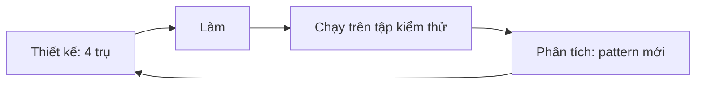

**Nói**
- CT là chiến lược của giai đoạn thiết kế, không phải sản phẩm; kết quả thật đến từ giai đoạn làm và đo.
- Về lại slide 1: tư duy đi từ một hàm đến một sản phẩm qua năm tầng.

**Tiếp:** bức tranh cuối.

---

# SLIDE 22 · ĐỒ THỊ TOÀN BỘ BÀI TOÁN

🟦 DECOMP · 🟥 PROBLEM

**Visual:** đồ thị toàn màn hình. Hình chữ nhật là bài toán; nút bo tròn là quyết định hoặc lời giải; mũi tên liền "tách thành", mũi tên đứt "sinh ra bài toán con".

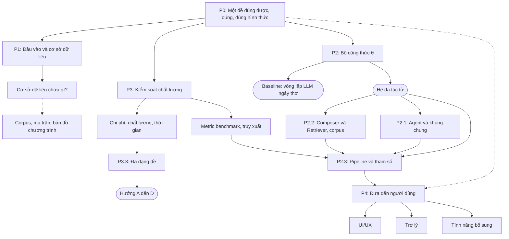

**Nói**
- Đọc từ trên xuống: mỗi tầng là một lần tách; mũi tên đứt là bài toán cố ý để lại chưa giải.
- Đồ thị chính là độ phức tạp của tư duy: một hàm lúc đầu, hệ nhiều tầng phụ thuộc lúc cuối.
- ➕ Đánh dấu node nào đã quyết (liên kết `D-nnn` trong [DECISIONS.md](DECISIONS.md)) và node nào còn mở.

---

## Thay đổi ở v2 (góp ý của nhóm, 2026-11-12)

| Góp ý của nhóm | Đã đổi gì |
| :--- | :--- |
| Deslop, bớt icon; tag chỉ để biết trước | Một dòng tag mỗi slide; không tag từng dòng; emoji chỉ ở dòng tag |
| Reasoning/kĩ thuật chưa kiểm chứng | Cảnh báo ở đầu file; bỏ tag reasoning khỏi slide; ma trận slide 21 đánh dấu chưa kiểm chứng |
| Slide 2 chưa define được problem | Thêm đầu vào (người dùng bắt buộc, tùy chọn, tập dữ liệu) và đầu ra (thấy, không thấy); giữ khung Given/Find |
| Slide 3, 4 cũ | Bỏ; metric dời xuống slide 14 (ở đầu ra); scope và non-goals dời ra ngoài (xem Phụ lục A) |
| Slide 5 cũ: 3 pattern trong 1 slide, ánh xạ sai | Tách thành slide 3, 4, 5; pattern viết theo Subject + frequency + content; bỏ các dòng sai; nói rõ nhất quán → blueprint/workflow |
| Slide 6 cũ | Giữ, dùng từ "baseline" |
| Slide 7, 8 cũ | Viết lại pattern; gộp ba tiêu chí dừng thành một câu; bỏ bảng dấu tick |
| Slide 9 đến 11 cũ: nói quá nhiều | Mỗi phần tử một dòng |
| Slide 12 đến 14 cũ nên đứng trước 17 | Benchmark (gộp 12 và 13) và đa dạng dời ngay trước tham số; slide đa dạng không còn kết luận, mà liệt kê các hướng |
| Slide 15 cũ | Một sơ đồ; bỏ khẳng định decomposition |
| Slide 16 cũ | Pseudocode nâng lên mức cao; declarative vs imperative giới thiệu ở slide 9 |
| Slide 18 cũ | Thêm cách nói về zoom out |
| Slide 19 đến 21 cũ | Ngắn; nhóm điền minh chứng và chia việc; để mở dạng hình |
| Quá nhiều bảng 2 cột | Ghi dạng hình cho từng slide (cây, vòng lặp, flow, sơ đồ lớp, biểu đồ, đồ thị…) |
| Slide 22 cũ đứng sau 23 | Đồ thị giờ là slide cuối |

## Phụ lục A. Đề xuất thêm ➕ (Huy giữ hoặc bỏ)

| # | Đề xuất | Slide |
| :--- | :--- | :--- |
| 1 | Slide bản đồ mạch tư duy ở đầu | 1 |
| 2 | Đầu vào nào bắt buộc, nào tùy chọn | 2 |
| 3 | Scope và non-goals, nếu nhóm muốn đưa lại (non-goals: Report mục 04; chọn môn đầu tiên theo "đáp án kiểm được bằng code", mvp-plan Problem 1) | sau 2 |
| 4 | Educator, Orchestrator, Blueprint Builder làm agent riêng | 8 |
| 5 | Hướng đa dạng C và D | 15 |
| 6 | Mô hình theo vai trò, ngưỡng cổng làm tham số | 16 |
| 7 | Chữ lớn, tương phản cao; "đơn giản không được giấu sự không chắc chắn" | 18 |
| 8 | "Đổi số" kiểm bằng code | 20 |
| 9 | Ma trận reasoning × trụ cột | 21 |
| 10 | Liên kết node đồ thị với quyết định `D-nnn` | 22 |
| 11 | Rủi ro: lỗi tương quan giữa agent, bản quyền, riêng tư (Report mục 18) | sau 16 |
| 12 | Giao thức đánh giá: baseline vs ASTRA vs giáo viên sửa, mù (Report mục 17) | sau 16 |

## Phụ lục B. Câu hỏi mở cho nhóm

1. Đầu vào nào bắt buộc, nào tùy chọn (slide 2)? "Bộ nhớ cập nhật" chứa gì?
2. Nội dung và kích thước của tập dữ liệu K (slide 2)?
3. Tần suất ở slide 3: đếm thật, hay nêu định tính?
4. Educator và Critics tách hay gộp? Validator thuần code hay một phần LLM (slide 8)?
5. Tên và trích dẫn bài báo tham khảo "EduAgent…" (slide 7); không tìm thấy trong repo.
6. Lab nào cung cấp metric chất lượng (slide 14)?
7. Thử hướng đa dạng nào, đo thế nào (slide 15)?
8. Các ô ma trận slide 21 có qua được bước đối chiếu bài giảng không?
9. Dạng hình và nội dung slide 18 đến 20 (nhóm tự chọn).

## Chưa kiểm chứng

- AI (Claude, 2026-11-12) soạn từ ghi chú của Huy, bốn slide môn học, Report và mvp-plan; v2 áp góp ý của nhóm. Chưa chạy gì; chưa ai đọc lại v2.
- Mọi con số mục tiêu trong Report (≥95%, 100%, khoảng 2.000 đồng mỗi đề) là mục tiêu, không phải kết quả. File này không tạo con số mới.
- Các sơ đồ Mermaid chưa được render ở đây; xem bằng trình đọc Markdown hỗ trợ Mermaid trước khi dựng slide.
- Kiểu reasoning và kĩ thuật chưa được đối chiếu với những gì thầy dạy (cảnh báo của nhóm). Chưa có slide giảng cho Abstraction và Algorithmic Design.
