# KẾ HOẠCH SLIDE: ASTRA qua 4 trụ cột Computational Thinking

**Đây là gì:** bản draft bố cục và nội dung cho bộ slide phân tích ASTRA theo 4 pillars (Decomposition, Pattern Recognition, Abstraction, Algorithmic Design). **Cho ai:** nhóm Trial and Success (CSC10014), người soạn slide và người phản biện. **Ngôn ngữ:** thân bài tiếng Việt, thuật ngữ và tag giữ tiếng Anh theo slide môn học. **Trạng thái:** draft do AI soạn từ ý tưởng của Huy ngày 2026-11-12, chưa ai duyệt (xem mục "Chưa kiểm chứng" cuối file).

Nguồn khung lý thuyết: Slide01 (Intro CT), Slide02 (Thinking & Reasoning), Slide03 (Decomposition), Slide04 (Pattern Recognition). Nguồn nội dung dự án: [ASTRA_Trial_and_Success_Report.md](../ASTRA_Trial_and_Success_Report.md), [mvp-plan.md](mvp-plan.md).

> **Slide về Abstraction và Algorithmic Design chưa được cung cấp.** Với hai trụ này file chỉ dùng định nghĩa ở Slide01/02 (Abstraction = bỏ nhiễu, giữ mô hình lõi; Algorithmic Design = các bước máy làm được; pseudocode; imperative và declarative). Không gán kỹ thuật nào khác cho môn học.

---

## 0. Cách đọc file này

### Quy ước slide

Mỗi slide có: **tiêu đề lớn (H1)**, dòng tag, **Bố cục** (hình dung trên màn hình), **Nội dung** (mỗi mục gắn một tag), và **Dòng tư duy** (vì sao slide này đứng sau slide trước). Nội dung dùng sơ đồ, bảng, sequence khi có thể.

### Tag bước tư duy (mỗi mục nội dung gắn đúng một tag chính)

| Tag | Bước | Ý nghĩa (theo Slide01) |
| :--- | :--- | :--- |
| 🟥 `PROBLEM` | Problem Definition | xác định input, output, phạm vi, tiêu chí; CT bắt đầu từ đây, không phải từ thuật toán |
| 🟦 `DECOMP` | 01 Decomposition | chia vấn đề phức tạp thành phần nhỏ; ghi loại: Structural, Functional, Data-driven, Object-oriented, Temporal |
| 🟩 `PATTERN` | 02 Pattern Recognition | tìm điểm giống, xu hướng, lặp lại; ghi kỹ thuật: Feature extraction, Grouping, Trend and sequence, Template matching, Regex, ML |
| 🟨 `ABSTRACT` | 03 Abstraction | chỉ giữ thông tin quan trọng, bỏ nhiễu; ra mô hình lõi |
| 🟪 `ALGO` | 04 Algorithmic Design | các bước đầy đủ mà máy làm theo được |
| ⬜ `DOING` | Implementation và Simulation | pha làm, không còn là CT thuần (Slide01: Design → Action) |
| ➕ | **Đề xuất thêm** | ý mới của người soạn file, chưa có trong ghi chú của Huy; Huy giữ hoặc bỏ |
| 🔲 | Placeholder | chỗ để nhóm điền |

### Tag kiểu lập luận (Slide02, sáu loại)

`Deductive` (quy tắc → hệ quả chắc chắn), `Inductive` (quan sát → quy luật, chỉ có xác suất), `Abductive` (kết quả → giải thích khả dĩ nhất, tức debug), `Probabilistic` (không chắc chắn, dữ liệu thiếu), `Deontic` (phải, được, cấm), `Spatial/Temporal` (đâu và khi nào). Ghi tắt: 🧠D, 🧠I, 🧠A, 🧠P, 🧠Dn, 🧠ST.

### Thang độ phức tạp (complexity of thinking)

Mỗi slide ghi mức `L1` đến `L5`. Đây là cách slide cho thấy tư duy đi từ một bài toán đơn thành một sản phẩm.

| Mức | Bài toán lúc này | Slide |
| :--- | :--- | :--- |
| L1 | một hàm: (input) → đề thi | 2 đến 4 |
| L2 | ba bài toán con: input, bộ công thức, kiểm soát chất lượng | 5 đến 6 |
| L3 | hệ nhiều tác nhân đóng vai tổ ra đề | 7 đến 10 |
| L4 | thiết kế hệ thống: context, giao thức, pipeline, tham số | 11 đến 17 |
| L5 | sản phẩm: UI/UX, trợ lý, tính năng, môi trường | 18 đến 21 |

### Chỉ mục slide

| # | Tiêu đề | Tag chính | Mức |
| :--- | :--- | :--- | :--- |
| 1 | Bản đồ dòng tư duy ➕ | cả 4 trụ | L1 đến L5 |
| 2 | Bài toán: Given… Find… | 🟥 | L1 |
| 3 | Chất lượng đề đầu ra: các metric | 🟥 🔲 | L1 |
| 4 | Phạm vi (Scope) | 🟥 | L1 |
| 5 | Từ pattern đến mô hình ánh xạ rồi ba bài toán con | 🟩 🟨 🟦 | L2 |
| 6 | Giải pháp ngây thơ: vòng lặp LLM | 🟥 🟩 | L2 |
| 7 | Tổ ra đề thật và hệ đa tác nhân | 🟩 🟦 | L3 |
| 8 | Các tác nhân và nguyên tắc dừng chia | 🟦 | L3 |
| 9 | Bài toán trừu tượng chung của mọi tác nhân | 🟨 | L3 |
| 10 | Nhu cầu giáo viên và cơ chế làm rõ ý định | 🟩 🟨 | L3 |
| 11 | Tập trung Composer và Retriever: corpus | 🟩 🟨 | L4 |
| 12 | Metric cho retrieval và độ phủ | 🟥 🔲 | L4 |
| 13 | Bài toán đầu ra: định dạng, chất lượng, chi phí, đa dạng | 🟥 🟦 | L4 |
| 14 | Bài toán con đa dạng: hai hướng | 🟦 🔲 | L4 |
| 15 | Pipeline soạn đề (Temporal) | 🟪 🟦 | L4 |
| 16 | Pseudocode và trạng thái Orchestrator ➕ | 🟪 | L4 |
| 17 | Tham số cần tune và cách đo | 🟪 🔲 | L4 |
| 18 | Chuyển bài toán: từ ra đề đến trợ lý ảo | 🟦 | L5 |
| 19 | UI/UX cho giáo viên | 🟩 🟨 | L5 |
| 20 | Trợ lý (assistant) | 🟩 🟪 | L5 |
| 21 | Tính năng thêm và môi trường làm việc | 🟩 🟪 | L5 |
| 22 | Đồ thị toàn bộ quá trình bài toán | 🟦 🟥 | L1 đến L5 |
| 23 | Tổng kết: ma trận lập luận × trụ cột, và vòng lặp ➕ | cả 4 trụ | L1 đến L5 |

Phần cuối file có danh sách đề xuất thêm, câu hỏi mở và ghi chú chưa kiểm chứng.

---

# SLIDE 1 · BẢN ĐỒ DÒNG TƯ DUY ➕

🟥 `PROBLEM` · 🟦 `DECOMP` · 🟩 `PATTERN` · 🟨 `ABSTRACT` · 🟪 `ALGO` · Mức L1 → L5

**Bố cục:** một hình ngang chiếm cả slide; trục ngang là thời gian của bài nói, trục dọc là độ phức tạp tăng dần. Mỗi mũi tên mang một tag trụ cột.

```mermaid
flowchart LR
    P["🟥 Định nghĩa bài toán<br/>Given → Find"]
    D1["🟦 Chia: input, công thức, kiểm soát"]
    PR1["🟩 Pattern: tổ ra đề thật"]
    M["🟩 Giải pháp: hệ đa tác nhân"]
    A1["🟨 Bài toán trừu tượng chung cho tác nhân"]
    D2["🟦 Chia: Composer và Retriever, đầu ra"]
    AL["🟪 Pipeline, tham số, vòng sửa"]
    T["🟥 Chuyển bài toán: sản phẩm cho giáo viên"]
    D3["🟦 Chia: ra đề, UI/UX, trợ lý, tính năng"]
    PR2["🟩 Pattern: người dùng và công việc lặp"]
    G["Đồ thị toàn bộ vấn đề"]
    P --> D1 --> PR1 --> M --> A1 --> D2 --> AL --> T --> D3 --> PR2 --> G
```

**Nội dung**

| Mục | Tag |
| :--- | :--- |
| Nói rõ: bài nói không đi theo "4 trụ lần lượt" mà **lặp cả 4 trụ ở mỗi tầng** của vấn đề; mỗi tầng phức tạp hơn tầng trước | 🟥 `PROBLEM` |
| Mỗi tầng kết thúc bằng một bài toán con mới, đó là lý do độ phức tạp tăng | 🟦 `DECOMP` (Functional) |
| Slide01: CT là giai đoạn **thiết kế**; thực thi và mô phỏng nằm ở pha làm, vòng lặp liên tục | ⬜ `DOING` |

**Dòng tư duy:** slide mở bài, hứa với người nghe một lộ trình; slide 23 quay lại đúng hình này để chốt.

---

# SLIDE 2 · BÀI TOÁN: GIVEN… FIND…

🟥 `PROBLEM` · 🧠Dn (ràng buộc) · Mức L1

**Bố cục:** trái là khối chữ phát biểu bài toán dạng toán học; phải là sơ đồ input → hàm → output. Dòng dưới cùng ghi "predecomposition: output được định nghĩa trước khi chia nhỏ".

**Nội dung**

| Mục | Tag |
| :--- | :--- |
| **Input của giáo viên (T):** ý định ra đề, đề mẫu, tài liệu tham khảo, yêu cầu về template, ma trận đề | 🟥 `PROBLEM` |
| **Input của ứng dụng (K):** một database những dữ liệu cần cho việc ra đề (nội dung database là bài toán con, giải ở phần sau) | 🟥 `PROBLEM` |
| **Output (E):** một đề thi dùng được, chính xác về nội dung và đúng về hình thức | 🟥 `PROBLEM` |

**Phát biểu hình thức**

> **Given:** ý định ra đề *I*, đề mẫu *S*, tài liệu tham khảo *R*, yêu cầu template *F*, ma trận đề *M* (từ giáo viên); và cơ sở dữ liệu *K* của ứng dụng.
> **Find:** một gói đề thi *E* = (đề, đáp án, lời giải, cờ cần xem lại) sao cho
> (1) **đúng nội dung**: đáp án và lời giải chính xác, có căn cứ;
> (2) **đúng hình thức**: khớp *F* và *M*, số câu, điểm, thời lượng;
> (3) **dùng được**: giáo viên duyệt và xuất file mà không phải làm lại.

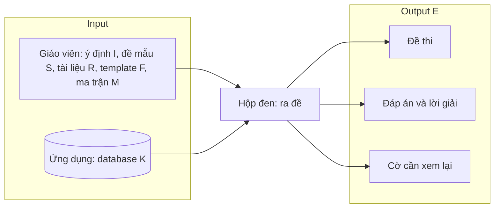

**Dòng tư duy:** trước khi nghĩ cách giải, phải chốt "đúng" nghĩa là gì → slide 3.

---

# SLIDE 3 · CHẤT LƯỢNG ĐỀ ĐẦU RA: CÁC METRIC 🔲

🟥 `PROBLEM` · 🔲 Placeholder · Mức L1

**Bố cục:** một bảng lớn, cột "Metric", "Đo bằng gì", "Giá trị đo được". Cột cuối để trống có chủ ý và gắn nhãn `[CHƯA ĐO]`.

**Nội dung** (tên metric lấy từ Report mục 17; không điền số)

| Metric | Đo bằng gì | Giá trị | Tag |
| :--- | :--- | :--- | :--- |
| Độ đúng đáp án | so với đáp án tham chiếu | `[PLACEHOLDER — nhóm điền sau khi chạy]` | 🟥 `PROBLEM` |
| Tuân thủ blueprint/format | kiểm tra bằng code | `[PLACEHOLDER]` | 🟥 |
| Hợp lệ phạm vi và nguồn | đối chiếu chương trình, mã nguồn dữ liệu | `[PLACEHOLDER]` | 🟥 |
| Phân bố độ khó | so với ma trận yêu cầu | `[PLACEHOLDER]` | 🟥 |
| Tỉ lệ câu mơ hồ | giáo viên đánh giá mù | `[PLACEHOLDER]` | 🟥 |
| Phút giáo viên phải sửa | đồng hồ trong lần duyệt | `[PLACEHOLDER]` | 🟥 |
| Chi phí mỗi đề được duyệt | log token và tiền | `[PLACEHOLDER]` | 🟥 |
| Tỉ lệ xuất file thành công | chạy export | `[PLACEHOLDER]` | 🟥 |

Ghi chú nhỏ cuối slide: các mục tiêu trong báo cáo (≥95% đúng đáp án, 100% đúng format, ≥95% đúng phạm vi, chi phí khoảng 2.000 VND mỗi đề) **là mục tiêu, chưa phải kết quả đo**.

**Dòng tư duy:** có tiêu chí rồi mới biết "đề tốt" là gì; tiếp theo giới hạn phạm vi cho vừa sức → slide 4.

---

# SLIDE 4 · PHẠM VI (SCOPE)

🟥 `PROBLEM` · Mức L1

**Bố cục:** hai cột "Trong phạm vi" / "Ngoài phạm vi", kèm một ô vàng ghi câu hỏi mở.

**Nội dung**

| Mục | Tag |
| :--- | :--- |
| **Trong phạm vi:** đề THPTQG, môn **[PLACEHOLDER — môn ?]**; đề ĐGNL V-ACT | 🟥 `PROBLEM` |
| ➕ **Ngoài phạm vi (non-goals, từ Report mục 04):** chấm tự luận tự động hoàn toàn, phân tích học tập cá nhân hoá, thay giáo viên quyết định cuối | 🟥 `PROBLEM` |
| ➕ Môn đầu tiên nên chọn theo tiêu chí "đáp án kiểm bằng code được" (mvp-plan, Problem 1) | 🟥 `PROBLEM` · 🧠D |
| Vì sao phạm vi hẹp là một quyết định trừu tượng hoá, không phải thiếu tham vọng (Report mục 05) | 🟨 `ABSTRACT` |

**Dòng tư duy:** biên bài toán đã rõ; giờ nhìn vào các đề thi có sẵn xem chúng giống nhau ở đâu → slide 5.

---

# SLIDE 5 · TỪ PATTERN ĐẾN MÔ HÌNH ÁNH XẠ RỒI BA BÀI TOÁN CON

🟩 `PATTERN` → 🟨 `ABSTRACT` → 🟦 `DECOMP` · Mức L2

**Bố cục:** ba hàng nối bằng mũi tên xuống, mỗi hàng một tag trụ cột; hàng cuối là sơ đồ ba bài toán con có mũi tên phụ thuộc.

### Hàng 1 · Pattern

| Quan sát | Kỹ thuật (Slide04) | Lập luận |
| :--- | :--- | :--- |
| Đa số đề thi thống nhất về format | 🟩 Direct template matching (đề mới khớp khung đề cũ) | 🧠I |
| Số loại câu hỏi hữu hạn và tương đối cố định (nhiều lựa chọn, đúng–sai, trả lời ngắn, tự luận…) | 🟩 Grouping and classification | 🧠I |
| Mỗi loại câu có cách ra đề tương tự nhau | 🟩 Feature extraction (rút đặc trưng: dạng câu, số ý, độ dài, mức độ) | 🧠I |
| Nội dung kiến thức ít đổi qua các năm, chỉ dịch chuyển phân bố chủ đề | 🟩 Trend and sequence analysis (tần suất chủ đề theo năm, thứ tự câu trong đề) | 🧠I + 🧠P |
| ➕ Mã đánh số, nhãn đáp án, tiêu đề phần có cú pháp lặp | 🟩 Regex (làm bộ kiểm hình thức) | 🧠D |

### Hàng 2 · Abstraction

🟨 `ABSTRACT` (Slide01: bỏ nhiễu, giữ mô hình lõi): bỏ chi tiết từng năm, từng trường; giữ lại **một phép ánh xạ**

> **E = Φ(T, K; θ)**, với θ là một **bộ công thức** cố định (quy tắc blueprint, phân bố độ khó, hồ sơ chấm điểm, mẫu prompt).

Nói cách khác: không giải từng đề; giải **một lớp** đề bằng một bộ công thức.

### Hàng 3 · Decomposition

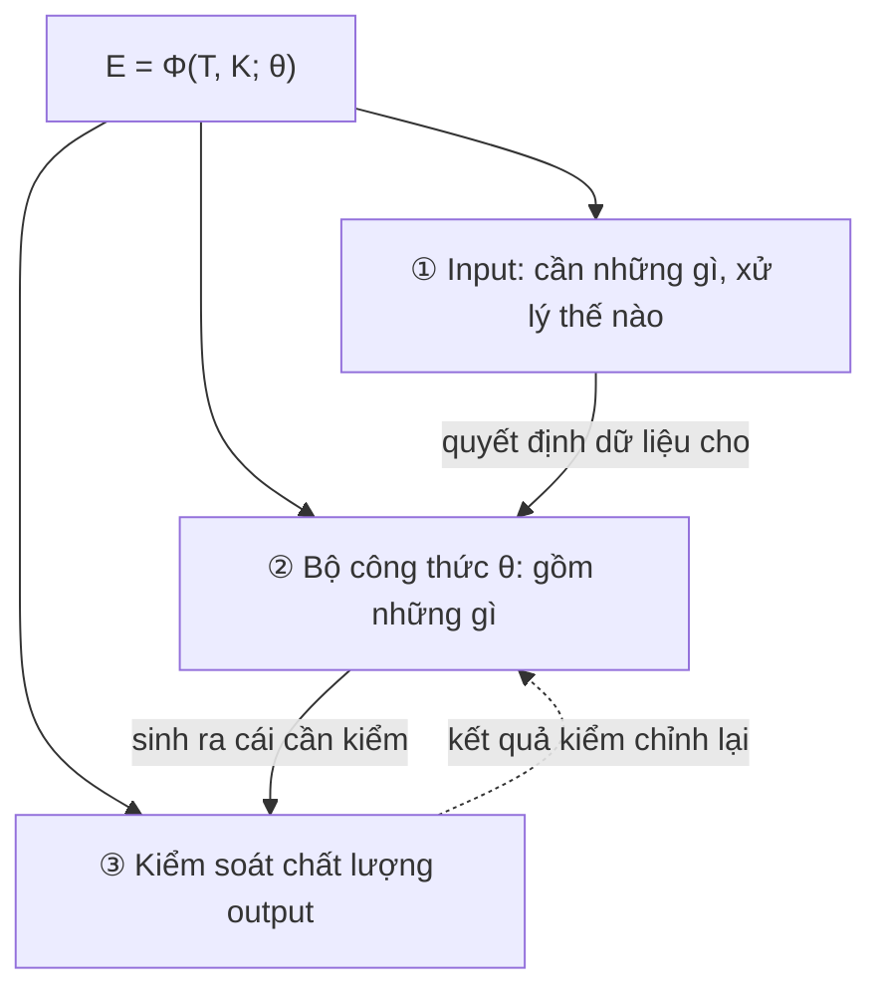

🟦 `DECOMP` (Functional + Data-driven): ba bài toán con có quan hệ với nhau (mũi tên trên sơ đồ), đúng như ghi chú của Huy. Phần tiếp theo đi vào bài toán ②, bộ công thức.

**Dòng tư duy:** cùng một cấu trúc lặp → trừu tượng thành một hàm → hàm đó quá lớn nên chia ba.

---

# SLIDE 6 · GIẢI PHÁP NGÂY THƠ: VÒNG LẶP LLM

🟥 `PROBLEM` (cách giải đầu tiên) · 🟩 `PATTERN` (nhận ra nó sai ở đâu) · Mức L2

**Bố cục:** trái là vòng lặp (sơ đồ); phải là bảng "vì sao chưa đủ".

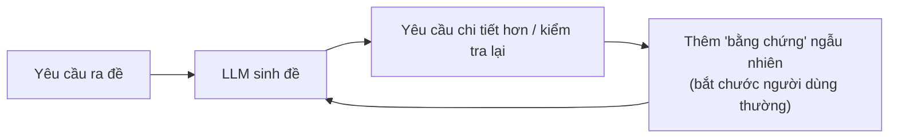

**Nội dung**

| Mục | Tag |
| :--- | :--- |
| Giải pháp ngây thơ: lặp yêu cầu, bảo LLM làm chi tiết hơn, tự kiểm, thêm bằng chứng ngẫu nhiên giống cách người dùng bình thường vẫn làm | 🟥 `PROBLEM` |
| Chưa đủ vì (từ Report mục 03): không có cơ chế **ép đồng thời** số câu, điểm, mức độ; một mô hình tự chấm chính mình; lỗi sai nhưng trôi chảy ("exam slop"); không đo được kết quả | 🟩 `PATTERN` · 🧠A (tìm nguyên nhân lỗi) |
| Dùng làm **baseline** để so sánh (Report mục 16, mục 17), không phải đích | 🟥 `PROBLEM` |
| ➕ Mỗi lần chạy khác nhau, khó lặp lại và khó debug | 🟩 `PATTERN` · 🧠P |

**Dòng tư duy:** vòng lặp tự kiểm thiếu độc lập → hỏi con người xử lý chuyện này thế nào → slide 7.

---

# SLIDE 7 · TỔ RA ĐỀ THẬT VÀ HỆ ĐA TÁC NHÂN

🟩 `PATTERN` → 🟦 `DECOMP` (Structural) · Mức L3

**Bố cục:** trên là ảnh "tổ ra đề" với các vai; dưới là mũi tên "ánh xạ vai → tác nhân".

**Nội dung**

| Mục | Tag |
| :--- | :--- |
| **Pattern:** ra đề chính thức cần một tổ nhiều người, vai trò khác nhau: soạn đề, giải mù, phản biện, thẩm định; mục đích là **khách quan** | 🟩 `PATTERN` · Grouping · 🧠I |
| **Giải pháp đề xuất:** hệ đa tác nhân dựa trên LLM, mỗi tác nhân một chức năng: Composer, Solver, Critics, Educator, Validator, Retriever | 🟦 `DECOMP` · Structural · Object-oriented |
| Tham chiếu: paper **[PLACEHOLDER — tên đầy đủ và trích dẫn paper "EduAgent…" mà Huy nhớ; chưa tìm thấy trong repo, không tự đoán]** | 🔲 |
| ➕ Slide03 yêu cầu chọn kiểu chia; ở đây chọn **Structural + Object-oriented**, vì mỗi vai ngoài đời là một "đối tượng" có dữ liệu và hành vi riêng | 🟦 `DECOMP` |

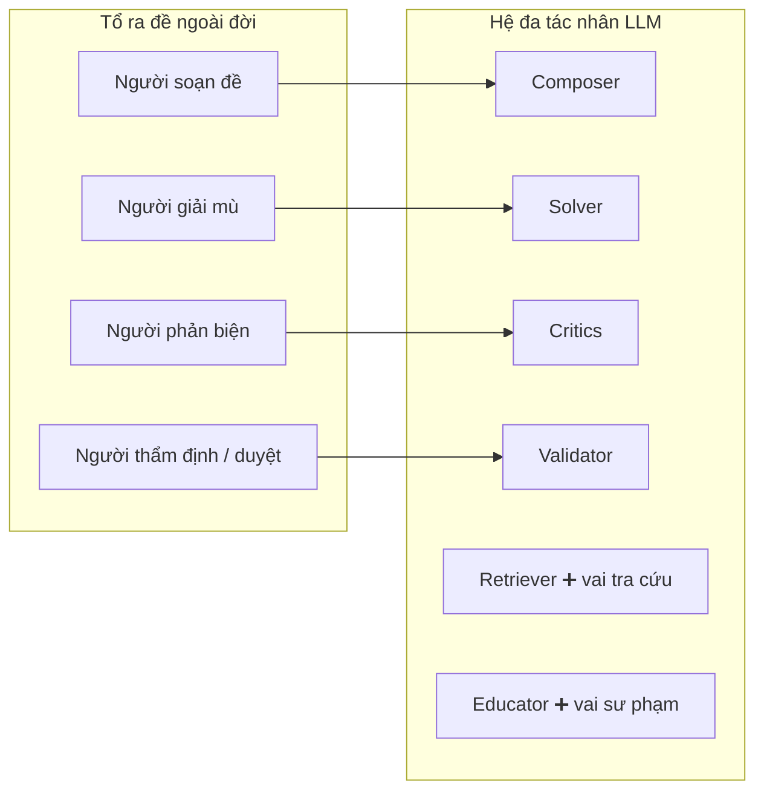

**Dòng tư duy:** có đội ngũ rồi thì phải xác định mỗi người làm gì và dừng chia ở đâu → slide 8.

---

# SLIDE 8 · CÁC TÁC NHÂN VÀ NGUYÊN TẮC DỪNG CHIA

🟦 `DECOMP` (Structural + Functional) · Mức L3

**Bố cục:** bảng 6 hàng; cột cuối là ba dấu tích của "When to stop decomposing" (Slide03).

**Nội dung**

| Tác nhân (Huy) | Tương ứng trong Report/mvp-plan | Một việc duy nhất | Single responsibility | Understandable | Independent |
| :--- | :--- | :--- | :---: | :---: | :---: |
| Composer | Writer | soạn câu và lời giải nháp theo blueprint | ✔ | ✔ | ✔ |
| Retriever | Retriever | lấy đoạn tài liệu kèm id và vị trí | ✔ | ✔ | ✔ |
| Solver | Blind Solver | giải không nhìn đáp án của Composer | ✔ | ✔ | ✔ |
| Critics | Appraiser | rõ ràng, mơ hồ, đáp án nhiễu, độ khó, khớp chương trình | ✔ | ✔ | ✔ |
| Educator ➕ | (trong Appraiser) | đánh giá phù hợp sư phạm: mục tiêu, mức độ nhận thức | ✔ | ✔ | ✔ |
| Validator | Guardrail Gate | kiểm bằng **code**: số câu, điểm, nhãn, schema | ✔ | ✔ | ✔ |
| Orchestrator ➕ | Orchestrator | điều phối trạng thái, giới hạn vòng, log | ✔ | ✔ | ✔ |
| Blueprint Builder ➕ | Planner | biến yêu cầu thành blueprint, hỏi lại chỗ thiếu | ✔ | ✔ | ✔ |

Ghi chú: các dấu ✔ là **đề xuất** theo tiêu chí Slide03, nhóm kiểm lại từng dòng; hai tác nhân Educator và Validator cần nhóm chốt ranh giới (xem câu hỏi mở).

| Mục | Tag |
| :--- | :--- |
| Quy tắc dừng chia: một việc, hiểu được độc lập, kiểm thử được riêng | 🟦 `DECOMP` |
| Ưu điểm cần nói: lỗi gán được cho một tầng thay vì chìm trong một câu trả lời dài | 🟦 `DECOMP` · 🧠A |

**Dòng tư duy:** tác nhân đã tách; giờ hỏi chúng có gì chung → trừu tượng hoá → slide 9.

---

# SLIDE 9 · BÀI TOÁN TRỪU TƯỢNG CHUNG CỦA MỌI TÁC NHÂN

🟨 `ABSTRACT` · Mức L3

**Bố cục:** một bảng "khung tác nhân" (một khung dùng cho cả sáu tác nhân), cạnh đó sơ đồ lớp.

**Nội dung**

| Thành phần chung | Câu hỏi thiết kế | Ví dụ cho Composer | Tag |
| :--- | :--- | :--- | :--- |
| Goal | tác nhân tối ưu gì | soạn đúng blueprint | 🟨 `ABSTRACT` |
| Input | nhận gì, schema nào | blueprint + đoạn tài liệu | 🟨 |
| Output | trả gì, schema nào | danh sách `Question` | 🟨 |
| Context management | nạp gì vào cửa sổ ngữ cảnh, bỏ gì | chỉ chủ đề của phần đang soạn, không nạp cả corpus | 🟨 · 🧠P |
| Protocol | định dạng và phong bì thông điệp | JSON có `schema_version`, `trace_id` | 🟨 · 🧠Dn |
| Tools | tác nhân gọi được gì | retrieval, máy tính, sympy | 🟨 |
| Flag | báo cáo bất thường thế nào | `needs_teacher_review` + lý do | 🟨 |
| Gate | điều kiện qua cổng | số câu đúng, có evidence id | 🟨 · 🧠D |
| Orchestration | thứ tự, song song, giới hạn | trạng thái, ngân sách, số vòng sửa | 🟨 · 🧠ST |

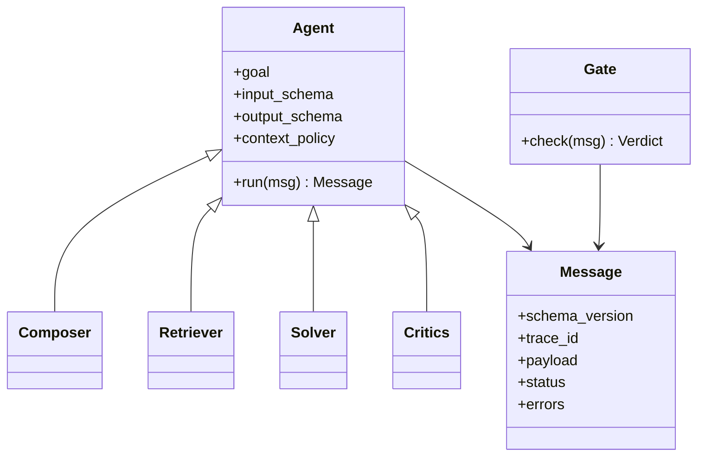

🟦 `DECOMP` (UML Class diagram, Slide03): hiển thị phần trừu tượng như một cấu trúc lớp.

**Dòng tư duy:** có khung chung thì chỉ cần thiết kế khung một lần; phần dữ liệu và công việc thay đổi theo từng tác nhân.

---

# SLIDE 10 · NHU CẦU GIÁO VIÊN VÀ CƠ CHẾ LÀM RÕ Ý ĐỊNH

🟩 `PATTERN` → 🟨 `ABSTRACT` · Mức L3

**Bố cục:** trái là bảng "pattern nhu cầu → thành phần cần có"; phải là sơ đồ vòng "làm rõ và đào sâu ý định".

**Nội dung**

| Pattern quan sát | Hệ quả thiết kế | Tag |
| :--- | :--- | :--- |
| Giáo viên ra đề theo **khoảng thời gian** nhất định (giữa kỳ, cuối kỳ…) | kế hoạch ra đề theo thời điểm | 🟩 Trend and sequence · 🧠ST |
| Cho **một hoặc một nhóm khối lớp** có liên đới | curriculum map giữa các khối | 🟩 Grouping |
| Cho **một hoặc vài môn** | profile theo môn (subject profile, Report mục 10) | 🟩 Grouping |
| Theo **mục tiêu giảng dạy cá nhân** | ma trận minh hoạ, phân bố độ khó có thể chỉnh | 🟩 Feature extraction |
| → Cần: **curriculum map**, khung kiến thức chương trình, phân bố độ khó, ma trận minh hoạ | | 🟨 `ABSTRACT` |
| → Cơ chế **resolve và deepen** nhu cầu: biến yêu cầu mơ hồ thành blueprint đầy đủ | | 🟨 |

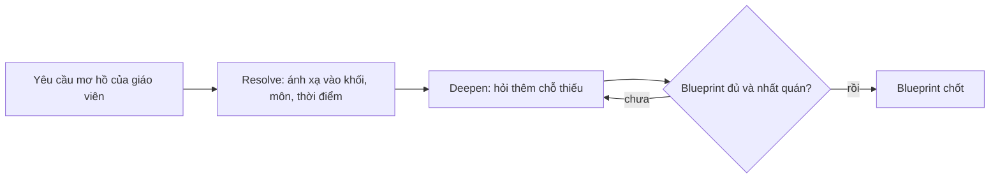

| Mục | Tag |
| :--- | :--- |
| Mỗi vòng hỏi lại có giới hạn (không hỏi vô hạn) | 🟪 `ALGO` · 🧠Dn |
| Blueprint chỉ chốt khi tổng điểm, số câu, mức độ khớp nhau | 🟪 `ALGO` · 🧠D |

**Dòng tư duy:** đề muốn tốt thì phải có tri thức nền; quay lại hai tác nhân quan trọng nhất → slide 11.

---

# SLIDE 11 · TẬP TRUNG COMPOSER VÀ RETRIEVER: CORPUS

🟩 `PATTERN` → 🟨 `ABSTRACT` · Mức L4

**Bố cục:** trái là cách giáo viên ra đề (pattern); giữa là mũi tên "chuẩn bị corpus"; phải là sơ đồ nạp vào context.

**Nội dung**

| Mục | Tag |
| :--- | :--- |
| **Pattern:** giáo viên ra đề thường nhìn lại đề cũ, dùng kinh nghiệm và phương pháp ra đề, tuân thủ ràng buộc kiến thức môn học (tức là dựa vào **profile** của mình) | 🟩 `PATTERN` · 🧠I |
| **Giải pháp:** chuẩn bị một **corpus** gồm đề thật do giáo viên ra, đã tiền xử lý; rút và trừu tượng các yếu tố cần khi làm đề; ma trận mẫu | 🟨 `ABSTRACT` |
| Mỗi tài liệu qua trích xuất đặc trưng: loại câu, chủ đề, mức độ, cấu trúc, lỗi hay gặp | 🟩 Feature extraction |
| Phân nhóm theo loại câu và chủ đề; thống kê tần suất qua các năm | 🟩 Grouping · Trend and sequence |
| Nạp vào context của Composer và Retriever (chọn lọc, không nạp tất cả) | 🟪 `ALGO` · 🧠P |
| ➕ Quy tắc: chỉ dữ liệu đã duyệt nguồn và giấy phép mới vào corpus (AGENTS.md rule 8; mvp-plan mục 6) | 🟨 · 🧠Dn |

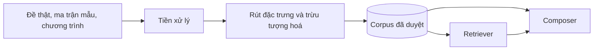

**Dòng tư duy:** đã có corpus thì phải đo xem nó phục vụ đúng không → slide 12.

---

# SLIDE 12 · METRIC CHO RETRIEVAL VÀ ĐỘ PHỦ 🔲

🟥 `PROBLEM` (tiêu chí) · 🔲 Placeholder · Mức L4

**Bố cục:** hai khối: "đo độ phủ nội dung" và "đo RAG". Không có số liệu, chỉ có định nghĩa và ô trống.

**Nội dung** (tên metric là đề xuất của người soạn file)

| Metric | Câu hỏi nó trả lời | Giá trị | Tag |
| :--- | :--- | :--- | :--- |
| Độ phủ nội dung (coverage) | corpus phủ bao nhiêu chủ đề của chương trình | `[PLACEHOLDER]` | 🟥 |
| Context precision | đoạn lấy về có liên quan không | `[PLACEHOLDER]` | 🟥 |
| Context recall | đoạn cần thiết có được lấy về không | `[PLACEHOLDER]` | 🟥 |
| Faithfulness / factual | nội dung câu có bám đoạn nguồn không | `[PLACEHOLDER]` | 🟥 |
| Answer relevance | câu có đúng chủ đề blueprint không | `[PLACEHOLDER]` | 🟥 |
| ➕ Source validity | evidence id có thật, trích nguyên văn có đúng | `[PLACEHOLDER]` | 🟥 · 🧠D |
| ➕ Độ lệch phân bố | chủ đề trong đề so với ma trận | `[PLACEHOLDER]` | 🟥 |

**Dòng tư duy:** đo xong phần đầu vào của soạn đề; chuyển sang đầu ra → slide 13.

---

# SLIDE 13 · BÀI TOÁN ĐẦU RA: ĐỊNH DẠNG, CHẤT LƯỢNG, CHI PHÍ, ĐA DẠNG

🟥 `PROBLEM` → 🟦 `DECOMP` · Mức L4

**Bố cục:** một đầu ra ở giữa; ba nhánh: định dạng, hai tiêu chí chính, và một bài toán con mới (đa dạng) có viền nét đứt.

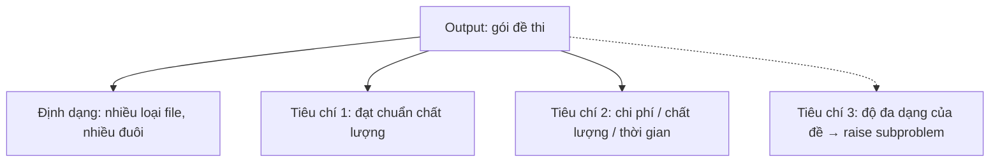

**Nội dung**

| Mục | Tag |
| :--- | :--- |
| **Định dạng ra:** đa dạng file, extension (ví dụ DOCX để sửa, PDF để in, LaTeX cho toán; nhóm chốt, mvp-plan Problem 2) | 🟥 `PROBLEM` · 🧠Dn |
| **Đạt chuẩn chất lượng:** gán các metric từ lab của Huy làm ví dụ; nhóm làm phần này điền | 🔲 `[PLACEHOLDER — metric lấy từ các lab; nhóm điền]` |
| **Cost / quality / time:** ba đại lượng đánh đổi, đo trên cùng một bộ test | 🟥 `PROBLEM` · 🧠P |
| **Độ đa dạng:** hai đề cho cùng một yêu cầu không được giống nhau; nảy ra bài toán con | 🟦 `DECOMP` |
| ➕ Phân biệt rõ "tiêu chí đánh giá" (chính xác, rẻ, dễ dùng) và "loại file" (Report mục 15, "central distinction") | 🟥 `PROBLEM` |

**Dòng tư duy:** bài toán đa dạng là một bài toán con riêng → slide 14.

---

# SLIDE 14 · BÀI TOÁN CON ĐA DẠNG: HAI HƯỚNG 🔲

🟦 `DECOMP` (Functional) · 🔲 Placeholder · Mức L4

**Bố cục:** hai cột so sánh A và B, hàng dưới cùng là ô "kết luận: để lại sau đánh giá".

| | Hướng A: nhét database lớn vào context để LLM rút ngẫu nhiên | Hướng B: cơ chế gán trước (preassigned) |
| :--- | :--- | :--- |
| Ý tưởng | LLM tự chọn ngẫu nhiên từ dữ liệu lớn trong context | code gán trước chủ đề, dạng, tham số cho từng câu, LLM chỉ viết |
| Vấn đề | context, dữ liệu, chi phí, thời gian | `[PLACEHOLDER — nhóm liệt kê]`; ➕ gợi ý: phải thiết kế bộ gán, dễ cứng nhắc |
| Lập luận | 🧠P (ngẫu nhiên) | 🧠Dn (quy tắc) + 🧠D |
| Tag | 🟦 `DECOMP` | 🟦 `DECOMP` |

> **Kết luận:** chưa chọn. Sẽ đề xuất giải pháp sau khi **đánh giá** cả hai (nhóm chạy thử, đo cost và độ đa dạng).

➕ Gợi ý số đo độ đa dạng: tỉ lệ câu trùng ý (similarity), số dạng đề khác nhau cho cùng blueprint. `[PLACEHOLDER — nhóm chốt metric]`.

**Dòng tư duy:** đã có tác nhân, dữ liệu và bài toán con; giờ sắp xếp thành quy trình có thứ tự → slide 15.

---

# SLIDE 15 · PIPELINE SOẠN ĐỀ (TEMPORAL)

🟪 `ALGO` · 🟦 `DECOMP` (Temporal) · 🧠ST · 🧠Dn · 🧠A (vòng sửa) · Mức L4

**Bố cục:** một sơ đồ lớn theo thứ tự thời gian, ba "làn" nối tiếp, nhãn nổi trên mũi tên vòng sửa (loopback). Các bước song song được vẽ cạnh nhau.

**Nội dung**

| Mục | Tag |
| :--- | :--- |
| Các quá trình soạn đề **phụ thuộc nhau theo thời gian**: chốt ý định và kế hoạch → soạn đề và vẽ hình → thẩm định và phản biện → xác nhận và xuất file | 🟦 `DECOMP` · Temporal · 🧠ST |
| Có bước chạy **song song**: Retriever theo từng phần; Composer theo từng phần; vẽ hình ∥ soạn chữ ➕; Critics ∥ Solver ➕; Solver theo từng câu | 🟪 `ALGO` · 🧠ST |
| **Vòng sửa:** lỗi quay lại Composer, có giới hạn số vòng; hết vòng thì chuyển giáo viên | 🟪 `ALGO` · 🧠A + 🧠Dn |
| Giáo viên duyệt trước khi xuất, đây là biên giữa tự động và trách nhiệm | 🟪 · 🧠Dn |

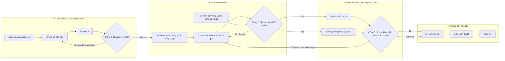

> Nhãn mũi tên "không đạt: sửa (còn vòng)" là **loopback về bước Soạn đề**; đây là mũi tên cần tô nổi trên slide.

**Dòng tư duy:** có pipeline rồi thì viết nó thành các bước máy chạy được → slide 16.

---

# SLIDE 16 · PSEUDOCODE VÀ TRẠNG THÁI ORCHESTRATOR ➕

🟪 `ALGO` · Mức L4

**Bố cục:** trái là khối pseudocode (nền tối như Slide02); phải là sơ đồ trạng thái. Chú thích dưới: phần quy tắc là **declarative** ("cái gì phải đúng"), phần điều phối là **imperative** ("làm thế nào").

```text
// Điều phối một lần ra đề (pseudocode, chưa phải code)
SET blueprint = BUILD_BLUEPRINT(request)          // làm rõ, tối đa N_CLARIFY lần
IF NOT GATE_BLUEPRINT(blueprint): ASK_TEACHER; RETURN
FOR EACH section IN blueprint.sections (song song):
    passages = RETRIEVE(section)
    items    = COMPOSE(section, passages)
SET round = 0
WHILE round < MAX_ROUNDS:
    flags = GATE_STRUCTURE(items) UNION CRITICS(items) UNION COMPARE(SOLVE_BLIND(items), items.key)
    IF flags IS EMPTY: BREAK
    items = REPAIR(items, flags);  round = round + 1
RETURN PACKAGE(items, flags)    // giáo viên duyệt trước khi xuất
```

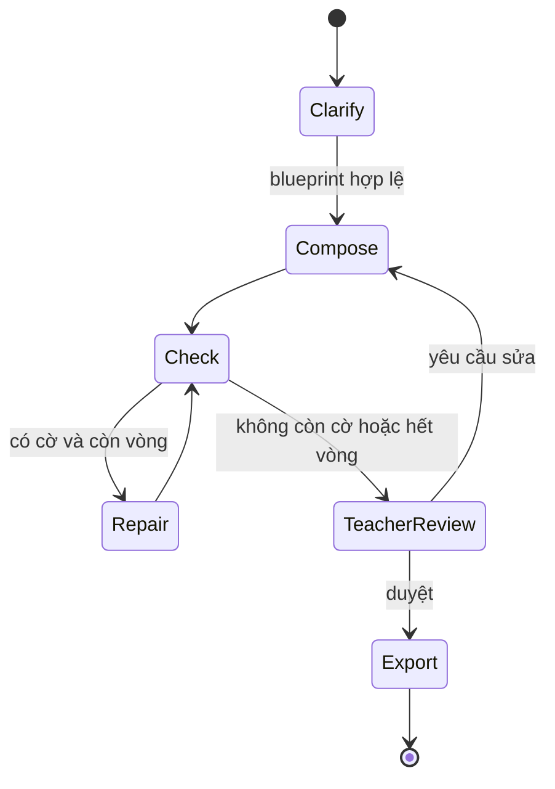

| Mục | Tag |
| :--- | :--- |
| Kiểm tra số câu, tổng điểm, nhãn đáp án, schema, thời lượng bằng **code** (deterministic) | 🟪 `ALGO` · 🧠D |
| Giới hạn vòng, giới hạn chi phí, hành vi khi gọi mô hình lỗi | 🟪 `ALGO` · 🧠Dn |
| Slide02: pseudocode là cầu nối giữa tư duy và code, kiểm logic trước khi chọn ngôn ngữ | 🟪 `ALGO` |

**Dòng tư duy:** thuật toán có nhiều "núm vặn"; liệt kê và quyết định cách đo → slide 17.

---

# SLIDE 17 · THAM SỐ CẦN TUNE VÀ CÁCH ĐO 🔲

🟪 `ALGO` · ⬜ `DOING` (mô phỏng) · 🔲 Placeholder · Mức L4

**Bố cục:** bảng ba cột "Tham số", "Khoảng thử", "Metric đo". Cuối bảng để dòng trống cho nhóm thêm.

**Nội dung**

| Tham số | Khoảng thử | Đo bằng metric nào | Tag |
| :--- | :--- | :--- | :--- |
| Kiến trúc MAS (số và loại tác nhân, tuần tự hay song song) | `[PLACEHOLDER]` | độ đúng, chi phí, thời gian | 🟪 |
| Cách làm RAG (chunk, embedding, hybrid) | `[PLACEHOLDER]` | context precision/recall | 🟪 |
| Số vòng lặp sửa | `[PLACEHOLDER]` | tỉ lệ câu được sửa đạt, chi phí | 🟪 |
| Kích thước input | `[PLACEHOLDER]` | chi phí, độ đúng | 🟪 |
| Confidential (dữ liệu nào được gửi ra ngoài, mô hình cục bộ hay đám mây) | `[PLACEHOLDER]` | không rò, chất lượng | 🟪 · 🧠Dn |
| Temperature và cách chọn context | `[PLACEHOLDER]` | độ đa dạng, độ đúng | 🟪 · 🧠P |
| ➕ Mô hình cho từng vai | `[PLACEHOLDER]` | cost/quality/time | 🟪 |
| ➕ Ngưỡng của cổng (độ dài trích tối đa, số vòng) | `[PLACEHOLDER]` | lỗi lọt qua | 🟪 |
| 🔲 `[PLACEHOLDER — nhóm thêm tham số]` | | | 🔲 |

Dòng cuối slide: **Metrics là cái để đo; tham số là cái để vặn.** Hai cột không được trộn.

**Dòng tư duy:** thuật toán xong ở mức thiết kế; còn một bài toán lớn hơn: đưa nó tới người dùng → slide 18.

---

# SLIDE 18 · CHUYỂN BÀI TOÁN: TỪ RA ĐỀ ĐẾN TRỢ LÝ ẢO

🟦 `DECOMP` (Functional + Structural) · Mức L5

**Bố cục:** một vòng tròn nhỏ "Ra đề" nằm trong một hình lớn hơn "Ứng dụng trợ lý ảo"; xung quanh ba vòng còn lại.

**Nội dung**

| Mục | Tag |
| :--- | :--- |
| **Transfer problem:** bài toán ra đề trở thành **một bài toán con** trong bức tranh lớn là một app trợ lý ảo (transition ý tưởng) | 🟦 `DECOMP` |
| Chia thành 4: **Ra đề**, **UI/UX**, **Trợ lý chatbot**, **Tính năng thêm** | 🟦 `DECOMP` · Structural |

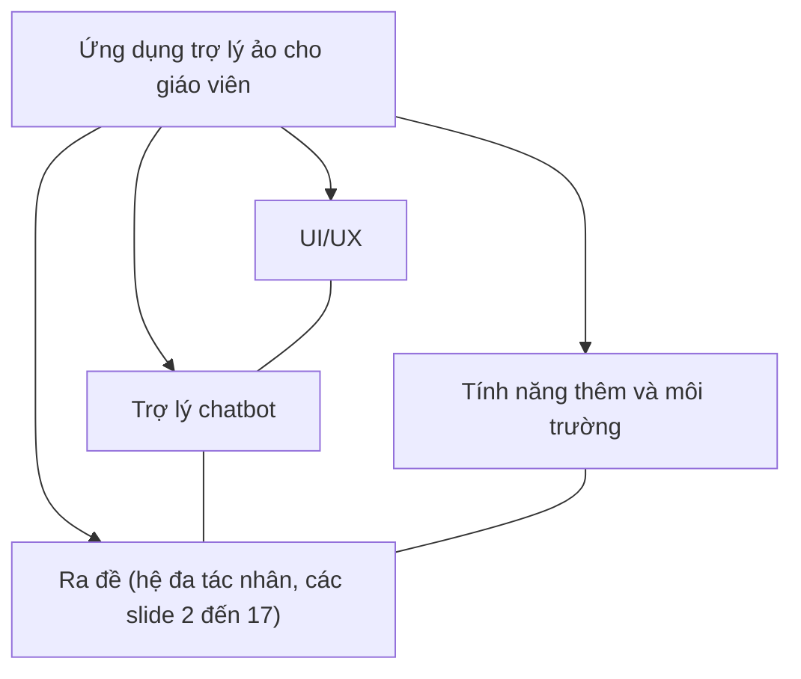

**Dòng tư duy:** mỗi nhánh mới lại cần pattern riêng, bắt đầu từ người dùng → slide 19.

---

# SLIDE 19 · UI/UX CHO GIÁO VIÊN

🟩 `PATTERN` → 🟨 `ABSTRACT` · Mức L5

**Bố cục:** trái là chân dung người dùng (persona) ➕; phải là danh sách yêu cầu UI.

**Nội dung**

| Mục | Tag |
| :--- | :--- |
| **Pattern:** người dùng chính là giáo viên; khả năng tiếp cận công nghệ không cao; ngại thao tác phức tạp (friction); mức kiên nhẫn có hạn | 🟩 `PATTERN` · 🧠P |
| **Pattern:** một số người mắt kém, lớn tuổi | 🟩 `PATTERN` · Grouping |
| **Yêu cầu UI** (lazy-user skill): hoạt ảnh và cập nhật tiến độ trực tiếp; quản lý "dopamine" (phản hồi nhỏ, liên tục); đơn giản, dễ dùng; chữ to, tương phản cao ➕ | 🟨 `ABSTRACT` |
| ➕ Ràng buộc đạo đức: giao diện đơn giản không được **che giấu độ không chắc chắn** (Report mục 15) | 🟨 · 🧠Dn |
| ➕ Quy tắc đặt tên: dùng tên theo việc của giáo viên, không dùng tên kỹ thuật | 🟨 |

**Dòng tư duy:** người dùng ít biết nói yêu cầu → cần trợ lý chủ động → slide 20.

---

# SLIDE 20 · TRỢ LÝ (ASSISTANT)

🟩 `PATTERN` → 🟪 `ALGO` · Mức L5

**Bố cục:** trái là pattern; phải là sơ đồ "hành vi trợ lý" theo luồng đã định.

**Nội dung**

| Mục | Tag |
| :--- | :--- |
| **Pattern:** đa số người dùng chính ít biết prompt hiệu quả | 🟩 `PATTERN` · 🧠I |
| **Gợi ý việc tiếp theo** theo các flow đã định | 🟪 `ALGO` · 🧠ST |
| **Hướng dẫn làm quen bằng agentic:** thay vì chỉ làm thì **hiện tiến độ trên UI** để người dùng hiểu | 🟪 `ALGO` |
| **Hỏi đáp** về app và về đề | 🟪 `ALGO` |
| **Tổng hợp một số input cơ bản** (môn, khối, thời lượng, ma trận) từ cuộc hội thoại thành `ExamRequest` | 🟪 `ALGO` · 🧠A |

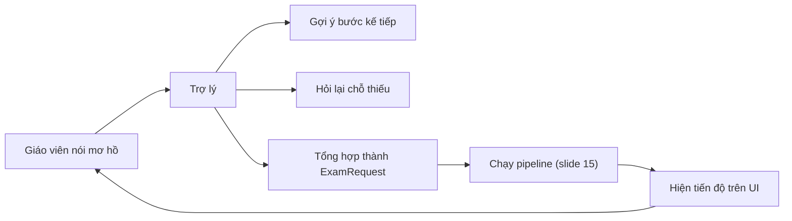

**Dòng tư duy:** sau khi ra đề, giáo viên không dừng lại → slide 21.

---

# SLIDE 21 · TÍNH NĂNG THÊM VÀ MÔI TRƯỜNG LÀM VIỆC

🟩 `PATTERN` → 🟪 `ALGO` · Mức L5

**Bố cục:** vòng tròn "tham chiếu rồi sửa" ở giữa; xung quanh là các tính năng nhỏ.

**Nội dung**

| Mục | Tag |
| :--- | :--- |
| **Pattern:** giáo viên luôn có xu hướng tham chiếu lại công việc đã làm, hoặc sửa chữa dựa trên đó | 🟩 `PATTERN` · Template matching · 🧠I |
| **Cơ chế xem lại, sửa lại đề** (lịch sử phiên bản, so sánh) | 🟪 `ALGO` |
| **Tác vụ cơ bản:** replicate (nhân bản đề), đổi số, tái cấu trúc | 🟪 `ALGO` · 🧠D |
| ➕ "Đổi số" là phép biến đổi có quy tắc nên kiểm bằng code, không gọi LLM lại | 🟪 · 🧠D |
| ➕ Mỗi thao tác giữ nguồn gốc (provenance) và lưu quyết định | 🟪 · 🧠Dn |
| ➕ Chế độ học sinh (luyện tập, thi thử) là hướng mở rộng, chưa phải lõi (Report mục 15) | 🟦 `DECOMP` |

**Dòng tư duy:** đủ bốn nhánh; vẽ lại toàn bộ cây vấn đề → slide 22.

---

# SLIDE 22 · ĐỒ THỊ TOÀN BỘ QUÁ TRÌNH BÀI TOÁN

🟦 `DECOMP` · 🟥 `PROBLEM` · Mức L1 → L5

**Bố cục:** một đồ thị toàn màn hình. Nút hình chữ nhật là **bài toán**; nút bo tròn là **quyết định/giải pháp**; mũi tên đặc là "chia nhỏ", mũi tên đứt là "nảy sinh bài toán con".

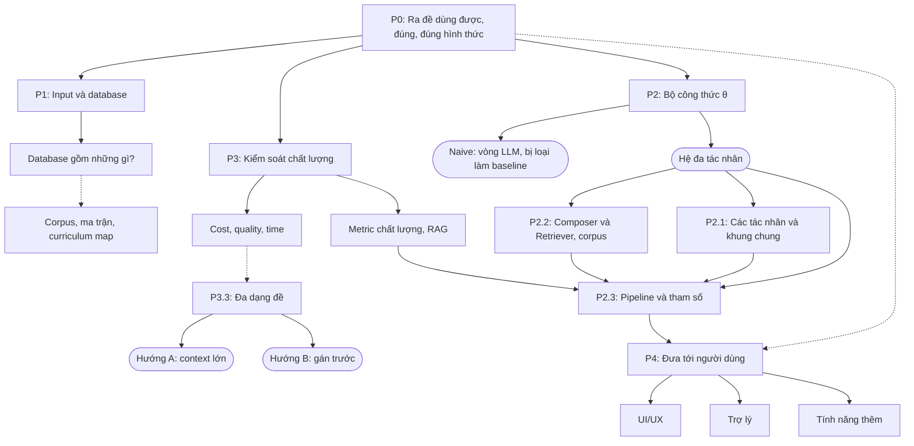

| Mục | Tag |
| :--- | :--- |
| Đọc đồ thị từ trên xuống: mỗi tầng là một lần chia; các mũi tên đứt là bài toán chưa giải, để làm sau | 🟦 `DECOMP` |
| Đồ thị cho thấy **độ phức tạp của tư duy**: một hàm ban đầu trở thành một hệ phụ thuộc nhiều tầng | 🟥 `PROBLEM` |
| ➕ Đánh dấu nút nào **đã quyết định** (liên kết `D-nnn` trong [DECISIONS.md](DECISIONS.md)) và nút nào còn mở | 🟥 |

**Dòng tư duy:** hình tổng quan trước phần kết.

---

# SLIDE 23 · TỔNG KẾT: MA TRẬN LẬP LUẬN × TRỤ CỘT, VÀ VÒNG LẶP ➕

Cả 4 trụ cột · Mức L1 → L5

**Bố cục:** trái là ma trận (Slide02 yêu cầu "draw the mapping matrix"); phải là vòng "thiết kế → làm → đo → sửa" (Slide01: continuous loop).

### Ma trận lập luận × trụ cột (ví dụ từ ASTRA)

| | 🟦 Decomposition | 🟩 Pattern Recognition | 🟨 Abstraction | 🟪 Algorithmic Design |
| :--- | :--- | :--- | :--- | :--- |
| 🧠 Deductive | tiêu chí dừng chia → kiểm từng tác nhân | khớp template → đề đúng khung | schema → mọi câu hợp lệ | cổng kiểm bằng code |
| 🧠 Inductive | chia theo vai tổ ra đề thật | quy luật rút từ đề cũ | mô hình lõi từ nhiều đề | chọn quy trình từ thực nghiệm |
| 🧠 Abductive | gán lỗi cho một tầng | vì sao naive sai | tìm biến chính gây lỗi | vòng sửa: đoán nguyên nhân lỗi |
| 🧠 Probabilistic | đo cost/quality | xu hướng chủ đề theo năm | chọn đủ context, bỏ nhiễu | temperature, lấy mẫu, độ đa dạng |
| 🧠 Deontic | ranh giới trách nhiệm tác nhân | ràng buộc môn học | chính sách, giấy phép | giới hạn vòng, giáo viên duyệt |
| 🧠 Spatial/Temporal | thứ tự pipeline | trend theo thời gian | trạng thái | song song và tuần tự, loopback |

### Vòng lặp

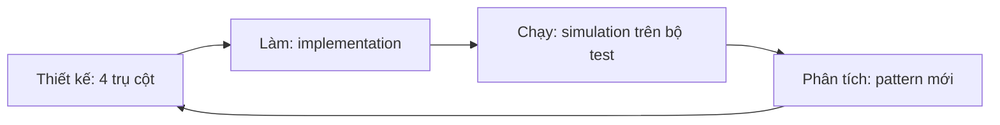

| Mục | Tag |
| :--- | :--- |
| Thông điệp: CT là chiến lược ở pha thiết kế, không phải sản phẩm; kết quả thật đến từ pha làm và đo | ⬜ `DOING` |
| ➕ Quay lại slide 1: tư duy đi từ **một hàm** đến **một sản phẩm** qua 5 tầng; mỗi tầng dùng lại đủ 4 trụ | 🟦 🟩 🟨 🟪 |

---

## Phụ lục A. Đề xuất thêm ➕ (để Huy giữ hoặc bỏ)

| # | Đề xuất | Vì sao | Nằm ở slide |
| :--- | :--- | :--- | :--- |
| 1 | Slide bản đồ dòng tư duy ở đầu | người nghe thấy trước lộ trình và độ phức tạp tăng | 1 |
| 2 | Non-goals (ngoài phạm vi) | Report mục 04; tránh bị hỏi "sao không làm chấm điểm" | 4 |
| 3 | Chọn môn đầu theo "đáp án kiểm bằng code được" | mvp-plan Problem 1 | 4 |
| 4 | Gắn tag loại decomposition và kỹ thuật pattern cho mọi mục | đúng thuật ngữ Slide03/04, dễ chấm | cả file |
| 5 | Bảng ánh xạ tên tác nhân Huy ↔ Report | tránh hai bộ tên song song | 8 |
| 6 | Educator, Orchestrator, Blueprint Builder làm tác nhân riêng | Report có Planner, Orchestrator; Educator là ý của Huy | 8 |
| 7 | Slide pseudocode và state diagram | Slide02: pseudocode là cầu nối; thể hiện imperative và declarative | 16 |
| 8 | Critics song song với Solver, vẽ hình song song với chữ | giảm thời gian; hai bước độc lập | 15 |
| 9 | Persona giáo viên, chữ to và tương phản | pattern "mắt kém, lớn tuổi" | 19 |
| 10 | Ràng buộc "đơn giản không được che giấu độ không chắc chắn" | Report mục 15 | 19 |
| 11 | Ma trận lập luận × trụ cột | Slide02 giao bài này | 23 |
| 12 | Liên kết nút đồ thị với quyết định `D-nnn` | AGENTS.md rule 12; chứng minh lý do chọn | 22 |
| 13 | Rủi ro: lỗi tương quan giữa các tác nhân, bản quyền, riêng tư | Report mục 18; thông số "Confidential" của Huy | 17 hoặc slide riêng |
| 14 | Giao thức đánh giá: baseline vs ASTRA vs giáo viên sửa, mù, báo mẫu số | Report mục 17; chứng minh "tăng độ phức tạp có lợi" | sau slide 17 |
| 15 | "Đổi số" là phép kiểm bằng code | rẻ, đúng, lặp lại được | 21 |

## Phụ lục B. Câu hỏi mở cần nhóm chốt

1. Môn nào trong THPTQG đi đầu (slide 4)?
2. Educator và Critics tách hay gộp? Validator là code thuần hay có phần LLM (slide 8)?
3. Tên và trích dẫn paper tham chiếu "EduAgent…" (slide 7); chưa tìm thấy trong repo.
4. Metric chất lượng lấy từ lab nào (slide 13); nhóm điền.
5. Hướng A hay B cho độ đa dạng, và đo bằng gì (slide 14).
6. Slide có cần nói Abstraction và Algorithmic Design theo kỹ thuật cụ thể nào của giảng viên không? (chưa có Slide cho hai trụ này)
7. Slide có dùng mức L1 đến L5 hay chỉ dùng như ghi chú nội bộ?

## Chưa kiểm chứng

- File do AI soạn (Claude, 2026-11-12) từ ghi chú của Huy, 4 slide môn học, Report và mvp-plan. Chưa ai trong nhóm đọc và duyệt; chưa chạy thử gì.
- Mọi con số mục tiêu (≥95%, 100%, ≥95%, ~2.000 VND mỗi đề) lấy từ Report là **mục tiêu**, không phải kết quả đo. File không tạo số liệu mới.
- Sơ đồ Mermaid chưa render thử trong môi trường nào; nên xem bằng bộ xem Markdown hỗ trợ Mermaid trước khi dựng slide.
- Dấu ✔ ở slide 8 và các ánh xạ lập luận (🧠) là **đề xuất của người soạn**, cần nhóm kiểm.
- Bốn slide môn học là Slide01 đến Slide04; chưa có slide Abstraction và Algorithmic Design, nên hai trụ này chỉ dùng định nghĩa chung.
