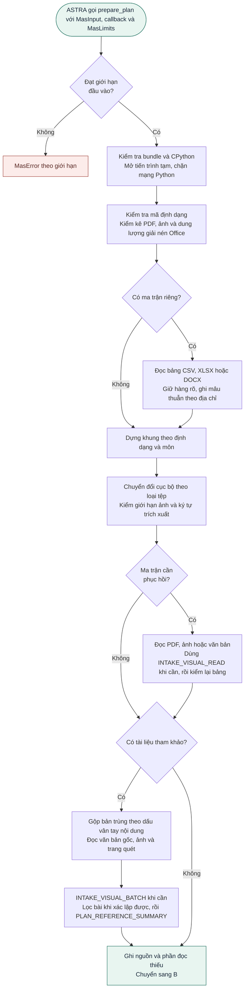
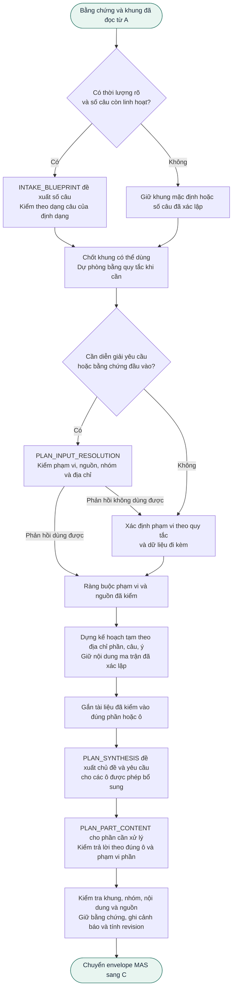
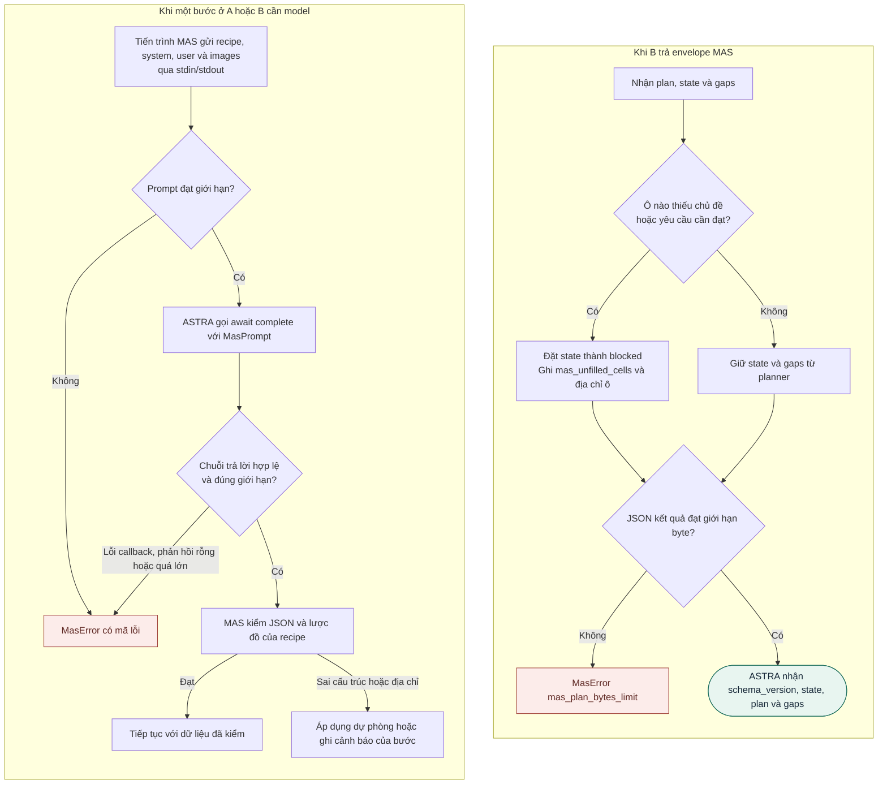

# Luồng lập kế hoạch MAS trong ASTRA

Đặc tả hành vi của runtime `astra_mas` 0.1.1, từ `prepare_plan` đến
`MasResult`. Các trường dữ liệu, mã lỗi và cấu hình nằm trong
[hợp đồng I/O](ASTRA_MAS_IO_CONTRACT.md).

## A. Kiểm tra đầu vào và đọc tệp

ASTRA kiểm tra kiểu dữ liệu khi tạo `MasInput` và `MasLimits`, rồi chọn vai
tệp qua `matrix` và `materials`. Đề mẫu gửi trong `materials`
đi qua bộ đọc tài liệu tham khảo. Một bảng có hàng đã đọc được hoặc có mâu
thuẫn theo địa chỉ được giữ để xử lý bằng chứng. Nhánh phục hồi áp dụng khi
bảng còn thiếu cấu trúc và chưa có mâu thuẫn đã ghi.

Poppler kiểm kê và đọc PDF. Pandoc đọc công thức DOCX khi có sẵn. Bộ đọc giữ
dấu vết mất công thức, ảnh hay đoạn đọc thiếu. Trình đọc ảnh gửi ảnh PNG qua
callback ở C. Các lỗi kiểm kê, định dạng hoặc giới hạn dừng lần gọi bằng mã
lỗi. Tài liệu đọc thiếu có thể được ghi cảnh báo để tiếp tục với nguồn còn lại.

## B. Xác định phạm vi và lập kế hoạch

Nếu ma trận đã được gửi hoặc số câu đã xác lập, bước blueprint giữ số câu.
Bộ phân giải dùng yêu cầu, ma trận, phần tài liệu đọc được và dữ liệu đi kèm
để chọn phạm vi. Khi nguồn chưa đủ để xác lập nội dung, kế hoạch giữ các
ô có bằng chứng và ghi phần thiếu. Một phản hồi model sai cấu trúc hoặc sai
địa chỉ có thể bị loại. Luồng dùng phần hợp lệ và quy tắc dự phòng trong
phạm vi còn được xác lập.

Các tên viết hoa là `recipe`. Mỗi lần cần model, bước đang chạy dùng callback
ở C rồi tiếp tục với kết quả đã kiểm. Phần đã đủ nội dung và mô tả nhóm trong
các chế độ cho phép có thể bỏ lượt gọi riêng cho phần đó.

## C. Trao đổi với LLM và trả về ASTRA

ASTRA sở hữu model và thông tin xác thực. Tiến trình lập kế hoạch trao đổi
với ASTRA qua luồng nội bộ. Lỗi cài đặt, lỗi giao thức hoặc quá thời gian
trao đổi cũng trả `MasError`. Khi nhận `ready`, ASTRA vẫn đọc `gaps` để hiển
thị cảnh báo. Khi nhận `blocked`, ASTRA vẫn nhận bản kế hoạch ứng viên cùng
các địa chỉ cần bổ sung. Bước cuối của runtime là trả `MasResult`.
