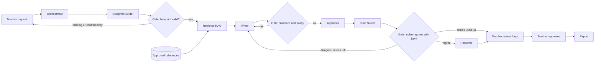

# ASTRA MVP plan: exam generator first (abstract, for team discussion)

**What this is:** a draft outline of the first thing we build, written by Huy on 2026-10-23 as a starting point. **Who it is for:** the seven members of team Trial and Success. **What it is not:** a decision. Every choice below is a problem for the group (section 10 lists them). Nothing here claims a result; numbers from the report are targets.

Source of the scope: [ASTRA_Trial_and_Success_Report.md](../ASTRA_Trial_and_Success_Report.md) (sections 03, 08 to 15). Rules for working on it: [AGENTS.md](../AGENTS.md).

## Summary

- **MVP goal:** given a teacher's request and approved references, produce a reviewable exam package (paper, answer key, solutions, review flags, references) in which structure is checked by code and every answer was solved independently.
- **Shape:** a Python web app. A request goes to an orchestrator that runs Blueprint Builder, Retriever, Writer, Appraiser, Blind Solver and a Guardrail Gate, then asks the teacher to approve. Messages between stages are versioned JSON.
- **Leaning, not decided:** Python + FastAPI + Pydantic, JSON, in-process agents first, one subject with checkable answers, a free hosted model for development and a stronger one for comparison, no computer vision until figures are in scope.
- **Open problems:** 14, in section 10. The first three (subject and format, data, stack) block everything else.

## 1. Scope of the MVP

From the report: center on **exam generation and verification**; defer lesson plans, grading and analytics; the teacher keeps final approval; one chatbot prompt is the baseline to beat, not the target.

| In the MVP | Out of the MVP |
| :--- | :--- |
| One request in, one exam package out | Grading of subjective writing |
| Blueprint with sections, counts, difficulty, score | Learning analytics, student practice mode |
| Multiple-choice items first | Fully autonomous publishing |
| Retrieval from approved references | Several subjects at once |
| Independent solving and a gate | Accounts, payments, deployment at scale |
| Teacher review and export | |

**Problem 1 (open): which subject and which exam format first?** Options: Mathematics multiple-choice (answers can be checked by computation, which makes the gate meaningful); a language exam (needs source integrity checks, harder to verify); a sciences paper with numerical items. The choice decides the checker, the data we need and the figures problem. The report also lists dataset selection as unresolved.

## 2. Input and output

Defined from the report's abstractions (section 10): `ExamRequest`, `Blueprint`, `Question`, `ExamPackage`.

| Object | Carries |
| :--- | :--- |
| `ExamRequest` | audience, subject, objectives, duration, constraints, free-text intent, list of reference ids to use |
| `Blueprint` | sections, item types, topics and learning outcomes, difficulty allocation as integers, scoring profile id and version, total score |
| `Question` | stem, choices, key, rationale, evidence (source ids and passages), figure reference, status, revision history |
| `ExamPackage` | paper, answer key, solutions, references, blueprint summary, review flags, approval record |

Every object has `schema_version` and an `id`. Illustrative shape (names are a proposal):

```json
{
  "schema_version": "0.1",
  "type": "Question",
  "id": "q-012",
  "section": "mcq-1",
  "stem": "...",
  "choices": {"A": "...", "B": "...", "C": "...", "D": "..."},
  "key": "C",
  "rationale": "...",
  "evidence": [{"source_id": "ref-003", "locator": "p. 14"}],
  "status": "needs_teacher_review",
  "revisions": [{"round": 1, "error_type": "ambiguous_stem"}]
}
```

**Outputs to decide:** editable paper (DOCX, HTML or LaTeX), printable PDF, answer key, solution sheet, review flags, blueprint summary. **Problem 2 (open): which export formats are in the MVP?** A teacher can edit DOCX; LaTeX gives clean mathematics; PDF is for printing. **Problem 3 (open): how does the teacher state the request?** A form with fields, free text, or both; and how many missing constraints the system may ask back about before refusing.

## 3. Tech stack

Starting point given to the group: **Python, web app, FastAPI.**

| Layer | Candidate | Why it is a candidate | Question for the group |
| :--- | :--- | :--- | :--- |
| Language and API | Python 3 + FastAPI | async, automatic OpenAPI, Pydantic models double as the JSON contract | Which Python version do we pin? |
| Contract | Pydantic models, exported as JSON Schema | one definition, validated at every boundary | Who owns `schemas/`? |
| Front end | server-rendered pages (Jinja + HTMX), or React + Vite, or Gradio/Streamlit for a demo | trade-off: speed to a demo against polish | Is a demo UI enough for the MVP? |
| Storage | SQLite + files | no server to run, easy to share | Do runs and reviews need a database yet? |
| Retrieval | see section 5 | | |
| Tests and checks | pytest, ruff, GitHub Actions | `scripts/verify.sh` runs the same thing locally and in CI | Who writes the first CI file? |
| Packaging | `uv` or `venv` + `requirements.txt` | everyone can reproduce | Which one? |

**Problem 4 (open): web framework and front end.** FastAPI is assumed; the front end is not. **Problem 5 (open): where does it run for the demo?** A laptop, a free host, or a university machine. Free hosts sleep and limit memory, which matters if retrieval holds an index.

## 4. Protocol between the parts

**JSON or XML?** Proposal: **JSON** for everything inside the system.

| | JSON | XML |
| :--- | :--- | :--- |
| Fit with FastAPI and Pydantic | native | needs extra code |
| Fit with LLM structured output | most providers support a JSON schema directly | possible, less supported |
| Readability for review | good | verbose |
| Where it may still appear | | exam interchange formats such as QTI (IMS) are XML; prompts may use tag-like markers to separate sections |

**Problem 6 (open): confirm JSON, and decide if a QTI export is a later goal or never.**

Message envelope (proposal), used between stages:

```json
{
  "schema_version": "0.1",
  "trace_id": "run-2026-10-30-001",
  "from": "writer", "to": "gate",
  "type": "QuestionBatch",
  "payload": {},
  "provenance": {"model": "...", "sources": ["ref-003"], "tokens_in": 0, "tokens_out": 0},
  "status": "ok",
  "errors": []
}
```

**How agents talk (Problem 7, open):** plain function calls inside one process (simplest, enough for the MVP); HTTP between services (clear boundaries, more to run); a queue (later). Tool access for agents (retrieval, calculator) can be plain functions or the Model Context Protocol; the group decides whether MCP is worth the extra part now. Whatever we pick, the message contract is the same, so the transport can change later.

## 5. Baseline architecture of the multi-agent system



Elements (from report section 12):

| Element | Job | Must not |
| :--- | :--- | :--- |
| Orchestrator | state machine, budgets, retry limits, logging every step | contain educational rules |
| Blueprint Builder | turn the request into a blueprint, ask about gaps | write questions |
| Retriever | fetch passages from approved references with ids and locators | return anything outside the approved list |
| Writer | draft items and rationales within the blueprint and retrieved context | certify its own key |
| Appraiser | clarity, ambiguity, distractors, difficulty, syllabus fit, time load | change the key |
| Blind Solver | answer without the Writer's key | see the key |
| Guardrail Gate | check, block, route | call a model for facts it can check in code |
| Renderer | produce files from validated data | alter meaning |

**Guardrail gate (proposal):** three checkpoints, mostly deterministic code.

1. *Blueprint gate:* totals add up, counts and score sums match, difficulty allocation is integer, duration is feasible, no contradictory constraint.
2. *Content gate (after Writer):* schema valid, item count and option labels correct, no duplicate stems, every factual item has an evidence id, no verbatim copy longer than an agreed limit from a source, no personal data, output length within budget.
3. *Verdict gate (after Solver):* solver answer equals the key; if not, one bounded revision round; after the limit the item is flagged for the teacher. Disagreement is never resolved by trusting either model.

**Problem 8 (open): numbers for the gate.** How many revision rounds, token and cost budget per paper, the longest allowed quote, and what the gate does when a model call fails. **Problem 9 (open): how independent must the Blind Solver be?** Same model with a different prompt, a different model, or a computation tool for mathematics. The report warns that agents may share model biases.

**RAG (retrieval-augmented generation).** Ingest approved references, split into chunks with metadata (`source_id`, page, license status, language), embed, store, and retrieve per item or per section with the blueprint topic as the query. Each question keeps the ids it used. **Problem 10 (open): retrieval design.** Chunk size and splitting rule, embedding model (it must handle Vietnamese well), vector store (FAISS, Chroma, SQLite-based, pgvector are candidates), hybrid keyword search, and how to measure retrieval quality before trusting it.

## 6. Feeding approved references, images and other data

Principle: **nothing enters retrieval or a prompt until a named member has approved it and recorded where it came from.**

- **Manifest.** `data/manifest.csv` (committed) lists each item: `id`, title, type (syllabus, textbook, past paper, sample question, figure), source or link, license or permission, approved by, approved on, checksum, language. The files themselves stay in `data/raw/` (ignored) or in the team Drive when the license does not allow committing them.
- **Samples.** A few sample questions teach style and format (few-shot). Keep them in a small structured file with the same fields as `Question`; mark the origin. Do not paste real exam papers or student information into any prompt.
- **Images and figures.** Three routes, to be chosen per subject: (a) reuse an approved figure with a caption and a description; (b) generate the figure from code (matplotlib, TikZ, a geometry script), which can be validated against the question's numbers; (c) read a figure with a vision model or OCR when the input is an image. A generated picture from a general image model is not trusted for mathematics. The report lists figure handling as unresolved.
- **Other data.** Syllabi, assessment matrices, scoring rules (versioned profiles), and teacher-uploaded files with the same approval step.
- **Copyright and privacy.** Retrieval is not permission to reproduce; keep what is quoted short and cited.

**Problem 11 (open): the first approved data set.** Which documents, who approves them, what licence evidence we need, and who owns the manifest. **Problem 12 (open): figures in the MVP or not?**

## 7. Models and tools

Names change quickly and free limits change more; check each provider's current page before the group decides. This list is a map of kinds, not a recommendation.

| Kind | Examples to compare | Use in ASTRA | Watch |
| :--- | :--- | :--- | :--- |
| Free hosted LLM | Gemini API free tier, Groq, OpenRouter free models, Hugging Face Inference | development and the baseline run | rate limits per key and per model, data-use terms, Vietnamese quality |
| Local LLM | Ollama, llama.cpp or LM Studio with open models (Qwen, Llama, Gemma, Mistral families) | private drafts, no network, no per-call cost | needs RAM or GPU; weaker on hard mathematics |
| Paid LLM | Claude family (for example Haiku 5.5 and Sonnet 5.5), OpenAI GPT, Gemini paid tiers | the Solver or Appraiser when accuracy matters | cost per paper against the VND 2,000 target |
| Embeddings | multilingual open models (BGE-M3, multilingual-e5) or a provider API | retrieval | Vietnamese support, index size |
| Math checking | sympy, plain Python | the Solver and gate for numeric items | not a model; deterministic |
| Local computer vision | OpenCV, Tesseract, PaddleOCR, EasyOCR, MediaPipe; Google ML Kit if we ever build a mobile app | figure quality (blur, resolution), OCR of figure text, table extraction | ML Kit is a mobile SDK and does not plug straight into a Python web app |

A cheap-first routing idea from Huy's other projects: use the cheapest model that can pass a task's check, escalate only on failure, and record which model answered. Every call logs model, tokens and cost, so the cost target can be tested rather than assumed.

**Problem 13 (open): which models for which role, and the monthly budget.** Does the team pool free API keys (each key has its own quota), and where are keys kept (`.env`, never Git)? **Problem 14 (open): is local computer vision in the MVP?** Suggested answer: no, unless Problem 12 says figures are in; then start with OpenCV and OCR checks on figures we generate.

## 8. Evaluation hooks (so we can report real numbers later)

From report section 17: compare the single-prompt baseline, the ASTRA workflow, and teacher-edited output on the same tasks. Record per run: correctness against a reference key, blueprint compliance, source validity, ambiguity rate, teacher revision minutes, cost per approved paper, export success. Store runs as JSON lines in `runs/` (ignored; commit only a small sample). Report **measured** and **target** values in separate columns.

## 9. Milestones (order, not dates)

| Milestone | Outcome | Needs |
| :--- | :--- | :--- |
| M0 Decide | Problems 1 to 5 answered and written in `docs/DECISIONS.md` | team meeting |
| M1 Skeleton | repo layout, schemas, orchestrator, stub agents, the three gates with tests, `scripts/verify.sh`, CI | M0 |
| M2 One subject end to end | real model calls, one blueprint, a package exported, teacher review screen | M1, Problem 11 |
| M3 Retrieval | approved references indexed, evidence on every question | M2 |
| M4 Figures (if in scope) | generated figures with validation | M2, Problem 12 |
| M5 Evaluation | baseline comparison with real numbers | M2 |

Who does what is for the team to assign; Huy will take whichever of M0 and M1 the group prefers.

## 10. Decision register

Each row becomes an entry in `docs/DECISIONS.md` when settled.

| # | Question | Needed to decide | Status |
| :--- | :--- | :--- | :--- |
| 1 | First subject and exam format | pick by "can the answer be checked by code" and by data we can legally use | open |
| 2 | Export formats | what teachers can edit and print | open |
| 3 | How the teacher states a request | form vs free text, clarifying questions | open |
| 4 | Web framework and front end | demo needs, who knows what | open |
| 5 | Where the demo runs | free host limits, a laptop | open |
| 6 | JSON confirmed; QTI later or never | | open |
| 7 | How agents communicate; MCP or not | | open |
| 8 | Gate numbers: retries, budgets, quote limit | a few trial runs | open |
| 9 | Independence of the Blind Solver | model biases, tools | open |
| 10 | Retrieval design | embeddings, store, chunking, test queries | open |
| 11 | First approved data set and manifest owner | licence evidence | open |
| 12 | Figures in the MVP or not | subject choice | open |
| 13 | Models per role, budget, key handling | current free tiers and prices | open |
| 14 | Local computer vision in the MVP | depends on 12 | open |

Suggested way to discuss: one short issue per problem with the label `decision`, options and a recommendation; settle in the meeting; one PR records the decision.

## Not verified

This plan was drafted with AI help (see `agent-log/huy.log`). It restates the team report and common practice; it has **not** been checked against current provider limits, prices or library versions, and nothing in it has been run.
