> Tài liệu lịch sử/thiết kế tham khảo. Cấu trúc và policy hiện hành: [Pipeline hiện tại](../architecture/PIPELINE_PLAN_AND_BENCHMARK.md).

# Kế hoạch chi tiết: Composer → Illustrator → Solver → Reviewer

Ngày: 03/11/2026. Tài liệu tham khảo để triển khai và benchmark lâu dài.
Bản ngắn để giao việc: [Kế hoạch 2 người làm lần lượt](PIPELINE_PLAN_VA_BENCHMARK.md).

Tài liệu này khôi phục nội dung kiến trúc và benchmark của bản dài, đồng thời áp dụng
phân công hiện tại: **người 1 làm xong Composer/Illustrator rồi mới đến người 2 làm
Solver/Reviewer và benchmark**. Không yêu cầu hai người phát triển song song.

Đây là **thiết kế đề xuất**, chưa phải tính năng đã triển khai hoặc kết quả đo thực tế.
Các cỡ dataset, ngân sách và ngưỡng nghiệm thu là điểm khởi đầu để chốt sau pilot.
Không phải toàn bộ tài liệu này đều nằm trong phạm vi MVP.

## 1. Các quyết định kiến trúc cần giữ

1. Giữ nguyên single-agent baseline làm đối chứng; pipeline là mode/version riêng.
2. Bản đầu chạy tuần tự, mỗi stage có schema, artifact và trace riêng.
3. Composer tạo câu hỏi; Illustrator tạo hình; Solver giải độc lập; Reviewer phát hiện
   lỗi và ra quyết định. Python kiểm tra hợp đồng và ma trận ở các checkpoint.
4. Reviewer V1 **không tự viết lại đề**. Vòng sửa tối đa một lần là biến thể V2 riêng.
5. Solver không nhận đáp án/lời giải của Composer hoặc ngân hàng. Gold benchmark chỉ
   thuộc evaluator độc lập, không thuộc bất kỳ stage nào của pipeline.
6. Hình bắt buộc bị thiếu là lỗi. Không cần hình thì Illustrator trả `skipped`, có lý do.
7. Chưa thêm framework orchestration, RAG, frontend, queue phân tán hoặc cloud deployment.
8. Giới hạn calls, tokens, thời gian và số lần sửa nằm trong config; không retry ngầm.

Phạm vi pilot đề xuất: Toán phổ thông tiếng Việt, gồm đại số, hàm số, hình học, xác suất;
MCQ và trả lời ngắn trước. Essay/môn khác là slice mới với rubric riêng, không gộp vào
điểm pilot. Hai người có thể chấm chéo sau khi ghép xong; nếu thiếu chuyên môn cần SME.

## 2. Hiện trạng repo và phần tái sử dụng

Baseline tham chiếu: commit `42f3244bc886b443aaca795495fb9dcc744a58cd`, nhánh `multiagent`.
Tên nhánh không có nghĩa baseline đã triển khai multi-agent.

| Phần hiện có | Giữ/tái sử dụng | Bổ sung |
| --- | --- | --- |
| `core/models.py` | Matrix, bank, question, validation contracts V1 | Draft, visual, solution, review và pipeline contracts V2 |
| `contracts.py` | Provider abstraction, metadata, agent độc lập | Stage protocol và trace nhiều calls |
| `agent.py` | Single-call baseline, parser và schema errors | Composer adapter mới, không biến baseline thành orchestrator |
| `bootstrap.py` | Injection và resource ownership | Ghép stage theo workflow config |
| `context.py` | Chuẩn hóa request | Data views riêng tránh rò đáp án |
| `validation.py` | Bộ kiểm tra ma trận độc lập | Visual references, revision và answer-key checks |
| `evaluation.py` | Fingerprints, usage, latency, cost | Aggregate stage/call/tool và mọi attempts |
| `service.py` | Luồng baseline V1 | PipelineService riêng, giữ route V1 |
| `providers/` | Adapter text và mock | Capability flags, media input và renderer/image adapter |
| `cli.py`, `reporting.py` | Lưu và đọc kết quả | Hình, solution book, review findings, stage trace |
| `tests/` | Regression baseline | Contract, stage, pipeline, fault và benchmark tests |

Record 127 tests pass/97% coverage trước đó là kiểm chứng code với mock; **không phải**
127 đề thật đúng hoặc điểm benchmark model. Chưa có corpus/nhãn người chấm để tuyên bố
chất lượng thực tế của baseline hoặc mức tăng của pipeline.

## 3. Kiến trúc pipeline V1

```mermaid
flowchart LR
    A[Request + matrix + bank] --> B[Input validation]
    B --> C[Composer]
    C --> D[Draft + deterministic checks]
    D --> I[Illustrator or skipped]
    I --> V[Render + visual contract checks]
    V --> S[Solver: question and actual image]
    S --> R[Reviewer]
    R --> F[Final deterministic validation]
    F --> O[Exam + answer book + review + trace]
```



Orchestrator là Python điều phối, không phải một agent LLM bổ sung. Mỗi stage chỉ đọc
input contract được cấp, không tùy ý đọc toàn bộ state hoặc file của stage khác.
Một stage có thể dùng 0/1/n calls nhưng phải khai báo và trace; MVP ưu tiên batch theo
cả đề, tránh tự biến 20 câu thành hàng chục calls không có budget.

### 3.1 Trách nhiệm và giới hạn stage

| Stage | Input được phép | Output bắt buộc | Không được làm |
| --- | --- | --- | --- |
| Composer | Matrix, bank/context được phép, visual requirements | ExamDraft, question IDs, visual requests, optional private answer proposal | Tự xác nhận đúng, đọc gold, đổi yêu cầu ma trận |
| Illustrator | Draft, VisualSpec và dữ kiện liên quan | FigureArtifact theo question/revision, báo cáo render | Đổi dữ kiện hoặc đáp án để vẽ dễ hơn |
| Solver | StudentView: stem, choices, hình thực, tài liệu đề cho phép | SolutionBook: answer, lời giải, solvability, ambiguity | Xem bank answer, Composer answer, gold hoặc review cũ |
| Reviewer | Đề/hình, solution book, yêu cầu, deterministic reports | ReviewReport và issues có bằng chứng | Sửa đề ngầm, coi đồng thuận với Solver là bằng chứng đúng |
| Finalizer Python | Artifact cùng revision và các report | StudentExam, AnswerBook, status, links/trace | Gọi LLM sửa output hoặc đổi đề lỗi thành success |

Bank có đáp án là input hợp lệ cho Composer và baseline theo cùng policy. Riêng Solver
dùng view đã loại answer/solution. Không chỉ ẩn hai field ở JSON cuối: kiểm tra cả tài
liệu, metadata, alt text, tên file và state chuyển tiếp có chứa đáp án của câu đang giải.
StudentView bị rò đáp án thì ghi lỗi và hủy phép đo Solver, không chấm là đúng.

### 3.2 Hợp đồng dữ liệu cần chốt

Hiện thực các hợp đồng bằng Pydantic; không truyền dict tùy ý giữa stages.

| Contract | Trường cốt lõi và invariant |
| --- | --- |
| `PipelineRequest` | request/matrix/bank/context, workflow_version, stage configs, budget, output policy |
| `QuestionDraft` | question_id ổn định, revision, nội dung/type/topic/objectives/points, visual_refs |
| `ExamDraft` | draft_id, revision, matrix_hash, ordered questions, visual_requests |
| `VisualSpec` | visual_id, question_id/revision, required, purpose, kind, facts/data, axes/units/labels, scaling policy, constraints |
| `FigureArtifact` | visual_id/revision, local URI, SHA-256, MIME, width/height, renderer/version, spec_hash, check outcome |
| `SolutionEntry` | question_id/revision, answer, lời giải, solvability, ambiguity, verification results, optional confidence |
| `ReviewIssue` | issue_id, code, severity, blocking, question/visual/revision, evidence, explanation, suggested action |
| `ReviewReport` | reviewed_artifact_hash, approved/needs_revision/rejected/inconclusive, issues, rubric |
| `StageResult` | stage/version, status, input/output refs+hashes, error, call traces |
| `PipelineResult` | run/experiment/case IDs, final artifact, stage results, validation, review, aggregate evaluation |
| `CallTrace` | stage, attempt, provider/model, prompt hash, token/media/tool usage, latency, cost, error, timestamps |

Invariants cần code/test:

- Một question ID chỉ xuất hiện một lần trong cùng revision. Sửa nội dung làm tăng revision.
- Figure/Solution/Review tham chiếu đúng question revision và artifact hash.
- Source bank ID hợp lệ không chứng minh câu đúng; giữ provenance policy hiện tại.
- V1 không thay đổi ngầm. Thêm `/v2/exams/generate` hoặc mode có version rõ ràng.
- Tách `execution_status` khỏi `quality_decision`: reviewer reject có thể là lần pipeline
  hoàn tất kỹ thuật, nhưng không phải đề dùng được.
- `stage_status`: succeeded/skipped/failed; skipped phải có lý do. Missing required
  artifact là failed. `inconclusive` không tự chuyển thành approved.
- `approved` chỉ là máy đã duyệt theo policy, không phải gold hay xác nhận của giáo viên.

### 3.3 Illustrator: đường kỹ thuật đơn giản trước

V1 ưu tiên scene graph có schema + renderer SVG/plot xác định cho hình toán, đồ thị,
biểu đồ. Không thực thi Python/JavaScript tùy ý do LLM trả về. Illustrator có thể dùng
một call chuyển spec thành primitives được cho phép; hình đơn giản có thể render với
0 call. Chiến lược và số calls phải có trong config/trace.

Renderer xác định giúp đo dữ kiện/nhãn/tỉ lệ. Mỹ thuật đứng sau tính đúng. Nếu cần
raster/image generation, thêm `FigureGenerator` adapter sau với metric/cost riêng.
Không dùng hình đẹp để bù hình sai làm thay đổi đáp án.

Solver/Reviewer kiểm tra hình phải nhận **ảnh render thực tế**. Nếu provider không có
vision, capability check phải chặn visual track hoặc ghi `spec_only` như ablation riêng.
Không báo đã kiểm tra hình khi model chỉ đọc JSON scene graph.

Provider text hiện tại nhận system/user chuỗi. Vision cần media/message contract typed,
adapter upload/base64 và content hashes. Không hardcode khả năng model vào service.
Một đường dẫn local trong prompt không có nghĩa provider đã đọc được ảnh.

### 3.4 Điều phối và mở rộng

Stage interface đề xuất:

```python
class PipelineStage(Protocol):
    name: str
    version: str
    async def run(self, stage_input: StageInput, context: RunContext) -> StageResult: ...
```

`StageInput` là model/union theo stage. Không tự động chuyển toàn bộ output trước sang
stage sau. RunContext chứa run/budget/artifact store/cancellation, không chứa gold hoặc
một mutable dict để mọi agent tùy ý ghi.

Workflow config khai báo ordered stages, implementation/provider/prompt versions và
limits. Registry nhỏ ở composition root đủ cho MVP. Stage mới cần contract, adapter,
data view, capabilities, config, trace, metric, tests và migration artifact nếu có.
Chỉ chuyển sang DAG khi có phụ thuộc/nhánh song song thực sự cần thiết trong hệ thống.
Điều này không yêu cầu hai người phát triển song song.

Fail-fast khi thiếu schema/hình bắt buộc, budget hoặc revision sai; giữ partial artifacts
và trace. Không trả success khi một stage bắt buộc thất bại. Resume/cache phải dựa trên
input+prompt+config+asset hashes; mặc định tắt cache trong benchmark.

Ví dụ policy để thảo luận, **chưa phải config được code hiện tại đọc**:

```yaml
workflow_version: cisr-v1
stages: [composer, illustrator, solver, reviewer]
max_questions: 20
max_required_figures: 4
max_total_provider_calls: 4
max_repair_rounds: 0
stage_timeout_seconds: 120
run_timeout_seconds: 480
max_total_input_tokens_estimate: 64000
output_token_limits:
  composer: 6000
  illustrator: 4000
  solver: 8000
  reviewer: 6000
max_estimated_cost_usd: null
cache_enabled: false
```

Cap là giả định pilot. Text-only thường dùng 3 calls vì Illustrator skipped; renderer
local không phải provider call. Image API hoặc calls thêm cần config biến thể khác.
Preflight/admission, timeout và output limits chặn calls không hợp lệ; input tokens có
thể chỉ là estimate. Khi mất response, spend có thể không biết chính xác. Phân biệt
controller vi phạm policy với actual usage/cost vượt estimate hoặc chưa biết; timer
local không bảo đảm hard billing cap tại provider.

### 3.5 Vòng sửa V2 — chưa bật ở V1

Reviewer chỉ phát issue/routing request. Controller cho tối đa một vòng sửa, gửi đúng
stage chịu trách nhiệm. Không có vòng lặp until-approved vô hạn.

| Sửa gì? | Kết quả mất hiệu lực |
| --- | --- |
| Nội dung, choices, số liệu hoặc điểm | Validation, hình phụ thuộc, solution và review liên quan |
| Hình/nhãn/tỉ lệ có ý nghĩa | Visual checks, solution và review của câu dùng hình |
| Answer/solution | Answer-key checks và review |
| Lỗi render không đổi content/spec | Visual checks; downstream dùng đúng ảnh đã xác nhận |

Routing, invalidation và call thêm đều vào trace/budget. Chỉ reuse output không phụ thuộc
phần đổi; khi không xác định được dependency thì invalidate toàn bộ downstream.
Review read-only không thể tự làm nội dung tốt hơn; nó thay đổi quyết định nhận/loại.
Chỉ đo hiệu quả sửa ở V2 thực sự có sửa.

### 3.6 Đầu ra LaTeX

- Đề giao cho người dùng là `de_thi.tex`; đáp án/lời giải ở `dap_an.tex` khi được yêu cầu.
- JSON vẫn là dữ liệu nội bộ giữa stages và phục vụ validation/benchmark.
- Người 1 bàn giao hình PNG/PDF. Người 2 thêm exporter sau Reviewer/final validation;
  đây là bước Python xác định, không thêm một agent hoặc lần gọi model.
- Exporter hỗ trợ công thức toán, tiếng Việt, escape ký tự đặc biệt và đường dẫn hình
  tương đối; đề học sinh không chứa các trường đáp án/lời giải.
- Thêm kiểm thử xuất/biên dịch để phát hiện lỗi công thức, font và hình. Biên dịch PDF
  là bước riêng; chưa chạy compiler thì không tuyên bố đã kiểm chứng PDF.

## 4. Cấu trúc code và migration

```text
src/exam_baseline/
  ...baseline modules...          Giữ V1 và regression tests
  pipeline/
    contracts.py                  Draft/Visual/Solution/Review/Stage/Pipeline schemas
    context_views.py              ComposerView, StudentView, ReviewerView
    orchestrator.py               Tuần tự, skip, fail-fast, budgets
    registry.py                   Chọn implementation từ config
    stages/
      composer.py
      illustrator.py
      solver.py
      reviewer.py
    rendering/                    Renderer xác định và visual checks
    artifacts.py                  Content/hash/revision
    tracing.py                    Nhiều calls/tools và aggregation
benchmarks/
  manifests/                      Case IDs, splits, config versions; không secret
  rubrics/                        Tiêu chí chấm và issue taxonomy
  runners/                        Chung protocol cho baseline/pipeline
  scorers/                        Deterministic, reference và human aggregation
tests/
  ...baseline tests...
  pipeline/                       Contract/unit/integration/fault tests
  benchmark/                      Formulas, denominators, missing-data tests
runs/experiments/                 Kết quả local, mặc định không commit
```

Giữ tên package hiện tại trong MVP, không đổi imports hàng loạt. Không thay `Evaluation`
V1 khiến baseline mất nghĩa; thêm `PipelineEvaluation` V2 và adapter sang benchmark
record chung. Một `Completion` không biểu diễn đủ nhiều stage hoặc image tools.

Freeze baseline theo git SHA. Mỗi PR thay một ranh giới hợp đồng/tính năng. Không sửa
prompt baseline trong lúc đo pipeline, trừ khi công bố thành một đối chứng khác.

## 5. Phân công: hai người làm lần lượt

Phân công này thay mô hình nhiều workstream của bản thảo đầu. Người 1 hoàn thành phần
tạo đề/hình và bàn giao; **sau đó** người 2 mới phát triển giải/review/benchmark.

### 5.1 Giai đoạn A — Người 1: tạo đề và hình

1. Freeze baseline SHA và giữ endpoint V1 hoạt động.
2. Chốt ExamDraft/VisualSpec/FigureArtifact, ID/revision và ranh giới StudentView.
3. Xây stage infrastructure, artifact store, trace và budget tối thiểu cho C/I.
4. Triển khai Composer theo ma trận, giữ provenance và deterministic checks.
5. Triển khai Illustrator, renderer và kiểm tra required assets.
6. Nối API/CLI ở mode draft-only để xuất đề và hình; không giả là full pipeline đã xong.
7. Chạy 5 request mẫu, bàn giao code, schema, artifacts, tests, lệnh chạy và hạn chế.

Điều kiện bàn giao: người 2 lấy một request là tạo được draft/hình nhất quán mà không
cần sửa code Composer/Illustrator để bắt đầu. Hình/text phải có ID/revision rõ ràng.
Đáp án đề xuất nếu có nằm ở teacher artifact riêng, không lẫn vào StudentView.

### 5.2 Giai đoạn B — Người 2: giải, review và đánh giá

1. Kiểm tra hợp đồng bàn giao bằng fixtures trước khi viết Solver.
2. Hoàn thiện StudentView và media provider để Solver đọc đúng hình render.
3. Triển khai Solver, normalized answers, solvability/ambiguity và solution book.
4. Triển khai Reviewer read-only, issue taxonomy, evidence và severity.
5. Nối đủ bốn stage, final validation, output policy và trace aggregation.
6. Làm benchmark runner/scorers; chạy pilot và báo quality/cost/latency.
7. Hai người chấm chéo kết quả sau tích hợp; chưa tự bật repair loop.

Nếu bàn giao lỗi contract, ghi issue cụ thể để người 1 sửa. Không cho người 2 tự đoán
cấu trúc hoặc viết lại toàn bộ C/I chỉ để ghép được luồng.

### 5.3 Mốc và effort dự kiến

| Mốc | Owner | Deliverable | Điều kiện xong |
| --- | --- | --- | --- |
| A0 — freeze/spec | Người 1 | SHA, draft/visual schemas, sample inputs | Contracts và defaults rõ, không lộ key |
| A1 — Composer | Người 1 | Draft đúng schema, validation/provenance | Request → ExamDraft chạy được, có tests |
| A2 — Illustrator | Người 1 | Renderer và assets | Required figures có ảnh hợp lệ đúng revision |
| A3 — bàn giao | Người 1 | 5 bộ input/output, lệnh chạy, tests và known issues | Người 2 xác nhận đọc/chạy được |
| B1 — Solver | Người 2 | Solutions và StudentView | Giải độc lập, không nhận teacher key |
| B2 — Reviewer | Người 2 | ReviewReport và issue matching | Test được clean/defect packets |
| B3 — integration | Người 2 | Full pipeline và reports | Fail/skip/budget/revision đúng; V1 không hỏng |
| B4 — pilot | Người 2, chấm chéo | Metrics và bảng so sánh | Có raw attempts, independent labels và limitations |
| V2 — repair | Sau B4 | Một vòng sửa có invalidation | Đo repair/regression/cost, không trộn V1 |

Dự toán thảo luận: 10–15 ngày làm việc cho A, rồi 10–15 ngày cho B, ngoài công tạo/chấm
corpus lớn. Đây không phải deadline cam kết. Pilot nhỏ trước; thiếu SME thì giảm mẫu và
ghi hạn chế, không thay gold bằng kết luận của model để làm nhanh.

### 5.4 Backlog có thể chuyển thành issues

| ID | Công việc | Owner | Depends | Acceptance criteria |
| --- | --- | --- | --- | --- |
| P01 | Freeze baseline/config | 1 | — | B0 SHA cố định; V1 hoạt động |
| P02 | Typed draft/visual/stage contracts | 1 | P01 | Revision/hash, good/bad fixtures, schema tests |
| P03 | Data-view contract, teacher artifact tách biệt | 1; 2 hoàn thiện SolverView | P02 | Không gắn key vào student output; rõ trường được đọc |
| P04 | Stage config/composition | 1 | P02 | Có thể ghép stage mới mà không sửa từng stage cũ |
| P05 | Controller tuần tự và budgets C/I | 1 | P04 | Skip/abort/timeout đúng; no hidden retry |
| P06 | Trace/artifact primitives | 1; 2 aggregate đủ pipeline | P02,P05 | Mỗi call/tool có record; usage unknown rõ |
| P07 | Composer | 1 | P02,P03 | Draft/schema/matrix/provenance tests |
| P08 | Illustrator và renderer | 1 | P02 | Primitives allowlist, render ảnh, không exec code LLM |
| P09 | Actual-image solver input | 2 | Bàn giao P08 | Vision nhận ảnh, text-only không giả vision |
| P10 | Solver và answer normalization | 2 | P03,P07,P09 | Frozen text/visual items, ambiguity/unknown rõ |
| P11 | Reviewer và issue matching | 2 | P10 | Read-only, evidence/severity, clean/defect tests |
| P12 | Full V2 API/CLI/report | 2 | P05–P11 | Giữ V1; đủ assets/solutions/review/trace |
| P13 | Benchmark manifests/splits/rubrics | 2 | Handoff | Gold ngoài stage input; không trùng nguồn dev/test |
| P14 | Scorers/failure accounting | 2 | P06,P13 | Denominator, abort/missing/N/A tests |
| P15 | Integration/fault/revision tests | 2 | P12 | Lỗi từng stage, quota, truncation, bad image, budget |
| P16 | Pilot/ablations/go-no-go | 2; hai người chấm chéo | P14,P15 | Paired report, labels, uncertainty, cost/latency |
| P17 | Bounded repair V2 | Giao sau pilot | P16 | Một vòng, invalidation, toàn bộ calls/regressions được đo |

Mỗi stage phải bàn giao contract, prompt/version, capability needs, errors, sample trace
và tests. Không coi một prompt riêng lẻ là stage đã hoàn thành.

## 6. Benchmark: tách điều đang muốn chứng minh

### 6.1 Các hệ thống đối chứng

| ID | Cấu hình | Mục đích |
| --- | --- | --- |
| B0 | Baseline SHA hiện tại, 1 call, text-only | Mốc lịch sử, đối chiếu text track |
| B1 | Một authoring agent sinh question/visual spec/answer trong 1 call + cùng renderer | Đối chứng visual; triển khai/freeze riêng |
| P1 | C → I → S → R, no repair | Chuyên môn hóa, giải độc lập và lọc lỗi |
| P2 | P1 + một vòng sửa | Lợi ích sửa so với regression/cost |
| B2, optional | Một agent self-check/refine nhiều calls với budget tương đương | Tách lợi ích nhiều calls khỏi lợi ích chia vai |

Track T: B0 vs P1 với I skipped. Track V: B1 vs P1 có cùng modality/spec/renderer và dữ
kiện hình. B0 chưa có hình nên ghi `unsupported` trên V; không biến thiếu capability
của B0 thành tuyên bố pipeline tăng chất lượng. B1 không thay baseline lịch sử B0.

Hai protocol cần tách:

- **Cấu hình thực tế:** mỗi hệ thống dùng config chốt trước, đo quality–cost–latency.
- **Budget-matched:** cùng tổng caps tiền/token/call/time khả thi; thêm B2 nếu muốn suy
  luận lợi ích riêng của kiến trúc. Cùng tên model chưa đủ là công bằng.

Một-call baseline có thể không dùng hết budget cấp. Ghi cả cap và actual usage. Thiếu
control nhiều-call tương đương thì không tuyên bố đã tách hoàn toàn hiệu ứng compute.

### 6.2 Dataset và splits

| Dataset | Quy mô đề xuất | Mục đích/gold |
| --- | --- | --- |
| Smoke | 12 cases nhỏ, mock | Contracts/routes, không phải điểm model |
| Dev | 48 blueprints, 24 text + 24 visual | Sửa prompt/config, được xem lỗi |
| Pilot freeze | 24 blueprints 4 câu, 12 text + 12 visual, 2 repeats | Thử protocol/effort/failure modes |
| Test freeze | 120 blueprints, 60 text + 60 visual, 3 repeats | Báo cáo cuối, không tune trên test |
| Illustrator isolated | 40 VisualSpecs có checks chuyên gia | Geometry/graph/chart/coordinates, 10 mỗi nhóm |
| Solver isolated | 120 câu, 60 text + 60 visual | 80 solvable, 20 unsolvable, 20 ambiguous; key/reference khi có nghiệm |
| Reviewer isolated | 200 packets: 80 clean + 120 có lỗi xác nhận | Mỗi packet một gold defect; có bài khó nhưng đúng |
| Robustness | 24 cases ngoài primary valid set | 6 invalid matrix, 6 invalid bank/schema, 6 injection, 6 provider faults mô phỏng |

Test 120 blueprints phân cỡ: 48 đề 4 câu, 48 đề 10 câu, 24 đề 20 câu. Strata gồm chủ đề,
độ khó, loại câu, số hình, độ dài ngữ cảnh và mức tái dùng bank. Các chiều chồng nhau;
không giả định đủ mọi tổ hợp. Required figure count/facts được khai báo trước, không
lấy số hình Composer tự chọn làm mẫu số để nó né yêu cầu.

Case manifest gồm: case/source-group IDs, split, request/hash, K yêu cầu, visual facts,
expected constraints, allowed tools/context, hidden grading notes, rubric/version.
Provider/token/image configs thuộc experiment manifest riêng.

Tách theo nguồn/template, không chỉ đổi số rồi chia ngẫu nhiên dev/test. Variants của
cùng đề thuộc cùng source group. Reviewer clean/defect variants không chia chéo dev/test.
Gold ở storage/evaluator riêng, không là file mà agent có thể đọc trong context.

Reviewer defect packets: 20 sai key; 20 vô nghiệm/thiếu điều kiện; 20 MCQ nhiều đáp án
đúng; 20 lời giải sai dù key đúng; 20 hình sai dữ kiện; 20 sai mục tiêu/cấp học. Severity
do người chấm xác nhận, không mặc định mọi lỗi critical. Clean packets có cách giải
khác chuẩn, bài khó hợp lệ, hình schematic được phép không đúng tỉ lệ để đo báo nhầm.

### 6.3 Gold và đánh giá độc lập

- Corpus cố định: hai người có chuyên môn kiểm gold; bất đồng được adjudicate. Lưu rubric,
  evidence và provenance, không để production agent tự quyết gold.
- Đề mới sinh: hai người giải/chấm sau khi sinh, ẩn system/model/reviewer decision và
  score của người kia. Gold post-hoc chỉ để đo, không quay lại sửa test output.
- Numeric tolerance phải có abs/rel, đơn vị, miền xác định và rounding theo case. Không
  exact-match chuỗi cho biểu thức tương đương; vài điểm thử số không là chứng minh đồng nhất.
- LLM judge bên ngoài có thể triage nhưng chưa thay human cho headline accuracy nếu chưa
  hiệu chuẩn. Ẩn identity, random/swap thứ tự A/B và đo disagreement với human. MT-Bench
  chỉ ra position/verbosity/self-preference biases nên judge cũng cần được kiểm.
  [Nguồn: MT-Bench](https://arxiv.org/html/2306.05685v4).

### 6.4 Tính cả ngân sách người chấm

Pilot: 24 × 2 repeats × 2 hệ thống × 4 câu = 384 generated questions. Hai lượt chấm,
giả định 2 phút/câu/lượt: khoảng **25.6 giờ**, chưa gồm gold/hình/adjudication.
Đây là dự toán workload, không phải số liệu đã đo.

Full test có 1,152 câu yêu cầu/corpus. Với 3 repeats và 2 hệ thống: 6,912 generated
questions. Chấm hai lượt, 2 phút/câu: **460.8 giờ** chưa kể adjudication. Không giao
full annotation như một task nhỏ cho một người.

Thiếu nguồn lực thì chạy deterministic/trace toàn tập và preselect human-audit subset
theo strata **trước khi xem output**. Muốn exam-level readiness phải chấm mọi câu trong
đề được chọn. Báo audit numerator/denominator, sampling weights và CI. Không gọi điểm
subset là observed score toàn bộ 360 attempts. Chưa chấm thì `not_evaluated`, không
tự gán pass hoặc 0 cho artifact chưa có nhãn.

## 7. Ưu tiên và quy ước metrics

Danh mục có **63 metrics**, không yêu cầu triển khai tất cả ngay trong hai giai đoạn.
Bản ngắn chọn 6 nhóm để bắt đầu; khi đủ dữ liệu mới tiến tới bộ P0 bên dưới.

- P0: E01/E02/E05/E06, I01/I05, S02, R02/R03/R05/R06, O01/O05/O06/O10/O11/O12.
  Đây là 17 chỉ số chính/gate cho pilot mở rộng.
- P1: các chỉ số chẩn đoán còn lại; nhiều số suy ra từ cùng trace/rubric, không thêm calls.
- P2: confidence calibration, calibrated student difficulty và nghiên cứu annotation
  sâu khi đủ dữ liệu. Không bắt MVP thu thập dữ liệu học sinh.
- Stage smoke có thể bắt đầu 12 visual specs, 24 solver items, 40 review packets.
  Các bộ 40/120/200 là đích rộng hơn, không phải dữ liệu hiện đã có.

Thiếu nhãn cho quality gate thì bàn giao technical MVP nhưng ghi quality chưa đánh giá.
Không lấy số unit tests thay bằng chứng chất lượng model.

### 7.1 Ký hiệu và mẫu số

`N`: valid attempts đã lên lịch cho một configuration/track = cases × repeats.
`K_i`: số câu yêu cầu; `H_i`: hard checks theo request/policy; `V_i`: số hình bắt buộc.
Invalid-input suite không nằm trong N valid-generation.

- Provider error, timeout, parse fail, abort, hết budget hoặc thiếu final artifact vẫn
  thuộc N và có điểm 0 cho tỷ lệ thành công cần final artifact.
- Metric conditional ghi rõ tên, mẫu số và coverage; không drop failures rồi gọi accuracy.
- Không áp dụng, như không cần hình: N/A. Expected artifact bị thiếu: fail/0, không N/A.
- Không có gold/chưa chấm: unknown/not_evaluated. Chỉ tính primary human metric khi nhãn
  assigned audit set hoàn tất, hoặc công bố thiếu nhãn và không kết luận metric đó.
- Đếm extra output, retry, repair, image/render tools và failed calls. Unknown cost không
  tự đổi thành 0. Queue waits được ghi rõ và nằm trong wall time thích hợp.
- Stage prefix metric dùng các case được giao stage; kèm reached-stage count để thấy
  upstream failures. Không gộp isolated stage score với end-to-end score.

## 8. Metrics cấp toàn pipeline

`oracle_ready`: independent audit xác nhận artifact đủ, hard checks pass, mọi câu/key
phù hợp yêu cầu, không còn critical/major semantic defects, hình bắt buộc đúng/đọc được.
`machine_accepted`: pipeline policy cho chuyển sang người dùng duyệt. B0 dùng quyết định
deterministic V1; P1 dùng deterministic + reviewer. Machine decision không phải gold.

| ID | Metric / công thức | Mẫu số / cách chấm | Báo cáo |
| --- | --- | --- | --- |
| E01 | Technical completion = hoàn tất required stages/result contract / N | Reviewer reject vẫn có thể technical-complete; abort thì không | % + failure breakdown |
| E02 | Deterministic full-pass = final exams qua mọi H_i / N | Không artifact =0; validator/version chung | Primary structural |
| E03 | Constraint satisfaction = mean_i(sum_h pass_ih / số H_i) | No artifact/report =0; H_i xác định trước | Diagnostic macro %, không thay E02 |
| E04 | Oracle-ready artifact rate | oracle_ready / assigned human-audit attempts; failed audit attempts =0 | Quality + CI + coverage |
| E05 | Deliverable-ready rate | oracle_ready AND machine_accepted / assigned audit attempts | Primary utility + CI |
| E06 | Accepted-defect fraction | accepted có critical defect / accepted đã audit; không accepted =N/A | Kèm accepted critical / all assigned audit |
| E07 | Correct-question yield | sum_i min(C_i,K_i) / sum_i K_i trong audit; C_i đúng, trong scope, không trùng; missing/error =0 | %, kèm E02/E05 |
| E08 | Conditional answer correctness | Key đúng / câu được trả và chấm; ambiguous/sai là không đúng | Conditional %, coverage, micro/macro |
| E09 | Human quality rubric | 0–4 mỗi chiều nơi có nhãn; không bù critical bằng điểm đẹp | Mean/median + distribution |
| E10 | Semantic duplicate rate | Cặp trùng ý / cặp được chấm trong đề; <2 câu =N/A | Per-exam và macro |
| E11 | True objective alignment | Câu đúng mục tiêu/cấp học theo human / câu được chấm | Tách khỏi label checks |
| E12 | Stable-all-repeats | Cases thành công ở mọi R repeats / cases; ghi E02 hay E05 | E05 cần nhãn mọi repeat liên quan |
| E13 | Clean-output privacy policy pass | Không có answer/solution ở StudentExam khi yêu cầu ẩn; field + leakage audit | % và failure examples |

`C_i` là kết quả chấm, không phải việc Solver trả một answer. E07 có thể cao dù sai
phân bố nên phải báo E02/E05. Với audit subset, dùng sampling weights định trước và
ghi là estimate, không observed full-corpus score. Không lấy BLEU/ROUGE/F1 chuỗi làm
metric chính cho đề sáng tạo có nhiều diễn đạt đúng.

Rubric 0–4: 0 hỏng/thiếu; 1 lỗi lớn; 2 cần chỉnh đáng kể; 3 dùng được sau sửa nhỏ;
4 đạt. Chấm riêng correctness, clarity, alignment, solution completeness và visual
usability khi có hình. Critical defect là gate fail dù điểm trung bình cao.
Trước dữ liệu học sinh, độ khó chỉ là **expert-rated**, không gọi calibrated difficulty.

## 9. Metrics theo stage

### 9.1 Composer

| ID | Metric | Công thức / điều kiện |
| --- | --- | --- |
| C01 | Draft contract pass | Draft hợp schema / all Composer attempts |
| C02 | Draft full matrix pass | Draft qua count/topic/type/difficulty/points/ID checks / attempts |
| C03 | Count error | abs(actual_count − K); không draft là thiếu K câu |
| C04 | Distribution error | sum_b abs(actual_count_b − target_b) / K, riêng từng distribution; có thể >1 |
| C05 | Point error | abs(sum points − target), thêm relative / target và từng topic/type |
| C06 | Source fidelity | Reuse entries đúng source/content/classification / declared reuse; không reuse =N/A |
| C07 | Missing provenance | Exact bank copies không source / exact copies; không copies =N/A |
| C08 | Label vs true coverage | ID/subtopic/objective checks từ code và semantic coverage từ human, hai cột riêng |
| C09 | Visual requirement planning | Required visual slots có usable spec / required slots benchmark chỉ định |

C02 không chứng minh kiến thức/độ khó đúng. Provenance scan/human audit cũng cần tìm
copy bị đổi nhẹ mà lexical matcher bỏ sót.

### 9.2 Illustrator

| ID | Metric | Công thức / điều kiện |
| --- | --- | --- |
| I01 | Required asset coverage | Required slots có artifact mở được, đúng question/revision / sum V_i |
| I02 | Render success | Specs render thành ảnh hợp lệ / specs được giao; tool error/timeout là fail |
| I03 | Spec fidelity | Constraints hình đạt / constraints phải kiểm; tolerance theo spec |
| I04 | All-facts visual pass | Required figures đạt mọi dữ kiện bắt buộc / required figures |
| I05 | Semantic visual correctness | Human xác nhận ảnh thực đúng câu hỏi, không chỉ đúng JSON / required figures audited |
| I06 | Label/unit accuracy | Nhãn/đơn vị/legend đúng, đủ, không chồng lấp gây hiểu sai / required labels |
| I07 | Legibility | Hình được chấm >=3/4 ở kích thước mục tiêu / hình audit |
| I08 | Visual-caused wrong-answer rate | Câu text giải được nhưng hình sai làm không giải/sai đáp án / visual questions audited |
| I09 | Asset reproducibility | Cùng spec+renderer version cho cùng hash/checks; raster model báo variability riêng |

Chốt kích thước xem/in, ví dụ PNG 1024px cạnh dài cho màn hình; print setting thêm sau.
Không dùng tolerance pixel chung: graph cần đúng tọa độ/miền/tỉ lệ trục; hình schematic
có thể không theo tỉ lệ nếu đề cho phép. I03/I04 là internal fidelity; I05 xem ảnh cuối
để tránh renderer và checker cùng sai. Không có hình cần chấm thì N/A, không tự cộng pass.

### 9.3 Solver

| ID | Metric | Công thức / điều kiện |
| --- | --- | --- |
| S01 | Solution coverage | Entry hợp lệ đúng revision / câu được giao; có answer không có nghĩa đúng |
| S02 | Reference answer accuracy | Key/giá trị/biểu thức đúng / toàn bộ 80 assigned solvable items; missing/error =0 |
| S03 | Solvability classification | Precision/recall/F1 cho solvable/unsolvable/ambiguous trên 120 items |
| S04 | Explanation correctness | Lời giải đúng/đủ bước, không có bước sai đổi kết luận; ghi rõ assigned hoặc conditional denominator |
| S05 | Unit/domain compliance | Đúng units/domain/rounding theo gold / applicable items |
| S06 | Image-use accuracy | S02 trên actual-image slice, đối chiếu spec-only ablation cùng frozen item |
| S07 | Independent agreement | Solver vs Composer private answer sau khi giải; chỉ diagnostic, không accuracy |
| S08 | Confidence calibration, optional | Brier mean((p_correct − correct)^2), ECE theo bins chốt trước khi đủ mẫu; không p thì N/A |

Không thưởng vì đồng ý Composer: hai bên có thể cùng sai. Self-reported confidence
chưa hiệu chuẩn chỉ là research feature, không tự duyệt đề. Numeric/symbolic checker
cần tests riêng cho equivalence, units và admissible domains.

### 9.4 Reviewer — cần benchmark riêng

Match issue theo packet/question/visual, defect code và evidence. Mỗi gold defect chỉ
match một lần; nhiều cảnh báo lặp không thành nhiều true positives.

- TP: gold defect được định vị đúng, có evidence, được flag đủ mức blocking theo rubric.
- FP: predicted blocking issue không có gold match/không được human xác nhận.
- FN: gold defect chưa được phát hiện đúng; abstain/missing/provider fail là miss theo
  recall trên toàn bộ assigned packets.
- Inconclusive không là phát hiện đúng và cũng không là chấp nhận sạch; ghi coverage.

| ID | Metric | Công thức / cách dùng |
| --- | --- | --- |
| R01 | Grounded defect recall | TP/(TP+FN), toàn bộ 120 gold defects trong mẫu số |
| R02 | Critical defect recall | TP_critical / gold critical, tách defect family |
| R03 | Issue precision | TP/(TP+FP); không predictions =N/A, không đổi thành 100% |
| R04 | Issue F1 | 2TP/(2TP+FP+FN); denominator >0 và TP=0 thì 0; denominator=0 thì N/A |
| R05 | Clean false-alarm rate | Clean bị reject/needs_revision vì blocking issue sai / 80 clean |
| R06 | Clean retention | Clean approved / 80; abstain/error/reject không giữ được |
| R07 | Critical escape | Critical-defective approved / gold critical; thêm escape/approved |
| R08 | Evidence validity | Findings có evidence đúng revision và thực sự hỗ trợ claim / predicted findings |
| R09 | Actionability | Suggested actions đủ cụ thể để sửa theo human / findings sampled |
| R10 | Decision availability | Review conclusive hợp contract / all assigned packets; kèm abstain/failure |
| R11 | Severity agreement | Confusion matrix critical/major/minor/none và weighted kappa với gold |

Không dùng recall một mình: reject-all có thể an toàn nhưng vô dụng. Đọc cùng R02/R03/
R05/R06/R07/R10. Reviewer production không tự làm gold cho E04/E05 hoặc TP/FP của nó.

## 10. Chi phí, độ trễ, độ ổn định và telemetry

| ID | Metric | Định nghĩa |
| --- | --- | --- |
| O01 | End-to-end wall latency | Nhận request → persisted final result; P50/P90/P95, cả fail; timeout/censor flag |
| O02 | Queue/quota wait | Tách wait khỏi active stage nhưng vẫn nằm trong wall time |
| O03 | Stage/call/render latency | P50/P95 theo C/I/S/R/renderer, contribution trên critical path |
| O04 | Usage per attempt | Input/output/cached/reasoning tokens khi có, image/tool units, mọi failed calls |
| O05 | Total known cost | Sum call/tool/render paid costs theo price card/time; known subtotal riêng unknown |
| O06 | Cost coverage | Calls đủ cost data / billable calls; missing usage không là free |
| O07 | Cost per attempt | Total/N; có unknown thì chỉ là known subtotal/lower bound |
| O08 | Cost per usable exam | Chi phí mọi attempts / số E05 đạt trên cùng fully assessed set; zero usable =undefined/infinite |
| O09 | API error/quota/timeout rate | Từng lỗi/N và stage; không bỏ lỗi khỏi latency/cost |
| O10 | Calls/retry/repair count | Total calls và reasons, gồm failed calls; skipped stage =0 |
| O11 | Budget admission violation rate | Run mà controller gọi stage/call bị admission policy cấm / N; expected=0; usage vượt estimate/unknown báo riêng |
| O12 | Trace completeness | Required fields đủ/required fields, thêm run đủ trace/N |
| O13 | Human edit effort | Phút sửa và số edits để được human chấp nhận trên random audit; tính đề phải bỏ |

Tách actual billed USD khỏi normalized list-price estimate khi có free credits/tier;
đồng thời báo quota requests/tokens. API miễn phí không có nghĩa compute bằng 0.
Evaluation/judge/human spend báo riêng inference cost, rồi cộng khi báo experiment cost.

Wall time gồm normalize, render, queue, validate, persist, không chỉ sum model latency.
Khi chạy song song trong tương lai, critical path khác sum spans. Giữ time-to-failure
và success-only latency thành các cột khác nhau.

Trace mỗi call: run/case/repeat IDs, variant, stage/version/attempt, artifact hashes,
provider/model/snapshot nếu có, prompt/schema version/hash, effective parameters,
capability mode, UTC start/end, monotonic duration, usage/cost knownness, finish reason,
error, tool/renderer version. Manifest giữ dataset/validator/rubric/git SHA/price-card
versions. Không ghi key hoặc private provider headers.

## 11. Ví dụ tính điểm

Đây là **ví dụ minh họa**, không phải kết quả ASTRA: 10 assigned audited attempts,
2 provider fail, 8 có artifact, 6 full hard-pass, 5 oracle_ready. Reviewer nhận 4 đề,
trong đó 3 oracle_ready và 1 có critical defect.

- E02 =6/10=60%, không phải 6/8=75%.
- E04 =5/10=50%.
- E05 =3/10=30%.
- E06 accepted critical fraction =1/4=25%; overall accepted critical =1/10=10%.
- Total cost mọi attempts là $1 thì cost/usable =$1/3, không chia 4 accepted và không
  chỉ cộng chi phí 3 đề đúng. Mất usage của một call thì $1 là subtotal đã biết.
- Không yêu cầu hình thì I01=N/A. Yêu cầu 2 hình nhưng không có ảnh thì I01=0/2, kể cả
  output tự gắn nhãn skipped.

## 12. Protocol thí nghiệm và thống kê

1. Freeze dataset/splits/gold access, prompts/configs, code/validator và primary metrics.
2. Chạy contract tests/mocks, pilot để đo variance, human effort và failure modes.
3. Chốt model/capabilities/budget; ghi caps khác actual usage.
4. Cùng case/repeat, chạy config theo thứ tự random trong cùng time block; khống chế
   concurrency/RPM/cache/tool policy. Không đo B0 lúc provider khỏe, P1 lúc hết quota.
5. Giữ mọi scheduled attempt. Rerun lỗi hạ tầng theo policy predeclared cho cả hai phía,
   lưu attempt gốc; không âm thầm thay lần fail bằng lần đẹp.
6. Automated scorer chạy trước; human/judge xem artifact ẩn identity, thứ tự ngẫu nhiên.
7. Báo paired difference P−B trên cùng cases, không so hai tập khác nhau.
8. Bootstrap theo source/case clusters, giữ repeats/configs cùng nhau, ví dụ 10,000
   resamples và 95% CI. Nhiều cases chung nguồn thì cluster theo source group; không coi
   hàng nghìn câu trong cùng đề là quan sát độc lập.
9. Wilson/exact binomial intervals dùng khi phù hợp cho independent packets/tỷ lệ hiếm,
   không áp công thức độc lập cho repeats tương quan. NIST mô tả các phương pháp này,
   đặc biệt khi mẫu ít lỗi.
   [Nguồn: NIST](https://www.itl.nist.gov/div898/handbook/prc/section2/prc241.htm).
10. Báo slices text/visual, topic, cỡ đề, difficulty, provenance. Primary outcomes chốt
    trước; ablations/slices khác exploratory hoặc cần multiple-testing adjustment.

Không có lỗi quan sát không có nghĩa xác suất lỗi bằng 0. Ví dụ 0 escapes trên 120
independent critical packets cho upper one-sided 95% bound khoảng
`1 − 0.05^(1/120) ≈ 2.47%`. Muốn bound dưới 1% với 0 lỗi cần khoảng 299 packets độc lập,
không chỉ lặp một đề 299 lần. Đây là ví dụ thống kê, không tuyên bố corpus hiện có 120
critical packets. Dùng pilot để tính power/cỡ mẫu cho effect muốn phát hiện.

E12 tránh chọn output may mắn. Ý tưởng đo reliability qua nhiều trials cũng có trong
[τ-bench](https://arxiv.org/abs/2406.12045); ở đây tính all-R success trên repeats đã chạy,
không gọi nhầm best-of-R/pass@R. Đánh giá nhiều trục thay vì một score phù hợp hướng
[HELM](https://arxiv.org/abs/2211.09110); metrics/ngưỡng ASTRA là thiết kế riêng, không
phải chuẩn do HELM quy định.

## 13. Ablations trước khi kết luận pipeline tốt hơn

| Thí nghiệm | Giữ cố định | Cần trả lời |
| --- | --- | --- |
| B0 vs C+S+R, text | Cases, model family, matrix/context/tools | Giải độc lập/review thay usable yield và wrong acceptance thế nào? |
| B1 vs C+I+S+R, visual | Cùng modality/spec/renderer | Lợi ích phân vai hay baseline thiếu hình? |
| C vs C+S | Composer outputs replay/frozen | Solver sửa key bao nhiêu, làm sai câu đúng bao nhiêu? |
| C+I+S vs C+I+S+R | Cùng candidate artifacts | Reviewer bắt lỗi và bỏ nhầm đề đúng bao nhiêu? |
| P1 vs P2 | Cùng initial candidates, budget policy | Repair tăng ready yield hay tạo regression/cost? |
| Actual image vs spec-only | Frozen visual item và gold | Model thật sự hiểu ảnh hay chỉ spec? |
| Same vs mixed models | Khả năng/cost/capability được báo | Diversity giảm shared failures hay chỉ tăng giá? |
| P1/P2 vs B2, optional | Budget/calls/sampling tương đương | Lợi ích vượt thêm test-time compute không? |

Replay ablations là causal diagnostic trên cùng candidates, không thay end-to-end runs.
Overhead/data access khác thì ghi rõ. Đồng thuận model cùng family cũng không là gold.

## 14. Tiêu chí nghiệm thu và go/no-go đề xuất

Các số sau là **mục tiêu khởi đầu**, chưa phải ASTRA đã đạt. Có thể sửa sau dev/pilot,
không sửa sau khi thấy final test. Bản ngắn là phạm vi giao việc trước mắt.

| Gate | Mục tiêu ban đầu | Ghi chú |
| --- | --- | --- |
| Baseline regression | V1 tests/semantics tiếp tục pass | Không chỉ giữ số tests |
| Trace/revision/budget | 100% contract tests; 0 wrong-revision acceptance/admission violations | Bắt buộc |
| Solver leakage | 0 phát hiện trên leak tests/audit | Có leak thì sửa và loại phép đo bị ảnh hưởng |
| Technical completion | >=95% pilot valid attempts | CI và lỗi/quota vẫn báo |
| E02 deterministic full pass | >=95%, không giảm đáng kể so đối chứng | E03 cao không che count fail |
| I01 required asset coverage | >=98% visual-required | Không tính no-figure cases |
| I05 visual correctness | >=95% audited figures | CI có thể rộng |
| S02 isolated accuracy | >=90% solvable items; tách hard/visual | Không phải calibrated student difficulty |
| R02 critical recall | >=90% grounded recall | Đọc cùng precision và clean retention |
| R03/R05/R06 | Precision >=80%, clean false alarms <=10%, retention >=85% | Tune dev, test chỉ đo |
| Critical escape | Mục tiêu không quan sát escape trong pilot | Vẫn báo upper bound, không bảo đảm 100% |
| E05 utility | Mục tiêu +10 percentage points so matched baseline | CI paired chứa 0 thì chưa đủ bằng chứng |
| Cost/latency | Chốt cap sau pilot; mục tiêu cost/usable <=2×, P95 <=3× đối chứng | Vượt cap thì ghi trade-off, không mặc định go |

Go/no-go không dựa một average score. Chỉ go khi contracts không hỏng, chất lượng không
đánh đổi critical defects và trade-off cost/latency được chấp nhận. Mẫu nhỏ/CI rộng thì
`inconclusive, cần thêm dữ liệu`, không cố tuyên bố thắng. Người có chuyên môn vẫn duyệt
trước khi dùng đề thật với người học.

## 15. Tests và artifacts bàn giao

### 15.1 Tests tối thiểu

- Schema tốt/xấu từng stage, unknown fields, missing required visual, corrupt image.
- Skipped đúng ở text, không skip hình bắt buộc.
- Solver không đọc teacher key/gold/review cũ qua state hoặc metadata.
- Sai revision/hash không được finalizer nhận; đổi hình invalidate downstream.
- Lỗi C/I/S/R, timeout, 429, refusal, truncated JSON, render fail, cancellation.
- Hết budget chặn call kế tiếp; failed calls vẫn vào trace/cost knownness.
- Baseline/pipeline cùng benchmark record; provider failures không rơi khỏi N.
- Zero denominator, unknown cost, missing labels, strata weights.
- Reviewer matching một-một, clean false alarms, abstain/fail, severity mismatch.
- Provider không vision không được báo actual-image benchmark success.
- Repair V2 không quá một vòng; count/points/revision không hỏng sau sửa.

### 15.2 Benchmark CLI đề xuất

Các lệnh này là **đặc tả cho người 2 triển khai**, repo hiện chưa có benchmark CLI:

```text
benchmark run --manifest test-v1 --system B0 --repeats 3
benchmark run --manifest test-v1 --system P1 --repeats 3
benchmark score --experiment EXP_ID --human-labels LABEL_FILE
benchmark compare --baseline B0 --candidate P1 --paired --cluster source_group
```

### 15.3 Mỗi experiment cần có

```text
experiment_manifest.json      Code/dataset/prompt/model/config/budget/price-card versions
attempts.jsonl               Mọi scheduled attempts/outcomes, kể cả failures
calls.jsonl                  Mỗi model/tool call, retries/repairs/errors
artifacts/                   Drafts/images/solutions/reviews/final exams/hashes
human_labels.jsonl           Raters/rubrics/evidence/adjudication; ngoài stage inputs
metrics.json                 Numerators/denominators/unknown/CI theo metric và slice
comparison.csv               Configs, quality/cost/latency và paired differences
report.md                    Kết luận, failures, limitations, go/no-go
```

Bảng kết quả có: config/track, scheduled/completed/audited N, E02, E05+CI, critical
accepted numerator/denominator, I05 khi áp dụng, isolated S02/R02/R06, P50/P95 wall,
actual/normalized cost, cost coverage và cost/usable. Chưa đo ghi `not_evaluated`, không
điền mục tiêu thành kết quả thực.

### 15.4 Checklist bàn giao người 1 → người 2

- Git SHA/branch, lệnh cài/chạy/test; baseline V1 vẫn hoạt động.
- ExamDraft/VisualSpec/FigureArtifact schemas và ví dụ đầy đủ.
- 5 bộ input/output chạy được, gồm đề không hình và có hình bắt buộc.
- Mỗi ảnh có path/hash/question/revision và renderer version.
- Teacher key/private proposals được tách, không nằm trong StudentView.
- Draft-only API/CLI trả đúng artifact, không tự gọi Solver/Reviewer giả là xong.
- Lỗi/schema/skip/budget behavior có tests; known issues được ghi ngắn.
- Người 2 chạy lại được fixtures rồi mới bắt đầu Solver/Reviewer.

### 15.5 Mẫu giao việc

> Người 1 hoàn thành Composer → Illustrator và bàn giao hợp đồng, code, fixtures, hình,
> lệnh chạy và tests. Người 2 nhận bàn giao rồi làm Solver → Reviewer, tích hợp đủ luồng
> và benchmark. Dùng bản ngắn để giao việc; bản chi tiết này là tài liệu tra cứu contracts,
> metrics và mở rộng, không phải yêu cầu triển khai tất cả ngay trong MVP.
