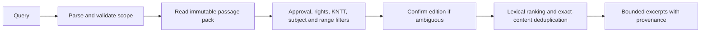

# Scoped retrieval workflow

For ASTRA members integrating the Retriever stage. This implements the Week 4
retrieval baseline: a subject/range query returns approved reference passages,
source locators, versions, and explicit gaps. Python 3.11.1, standard library only.
The implementation is a proposal for this feature; it does not settle the open
team stack or data decisions in [mvp-plan.md](mvp-plan.md).

## Run and verify

From the repository root:

```powershell
python -m rag_workflow.cli --query "Physics grade 11 chapter 4 Ohm" --corpus tests/fixtures/rag_demo_documents.jsonl
python -m rag_workflow.cli --query "Physics grade 11 chapter 2" --corpus tests/fixtures/rag_demo_documents.jsonl
python -m unittest discover -s tests -v
```

In Git Bash, `bash scripts/verify.sh` checks compilation, tests, and whitespace.
The CLI writes UTF-8 JSON. Exit code 0 means success; 2 means a structured gap.
The fixture is original synthetic text. Its approval fields simulate a published
pack for testing; they are not teacher approval or a verified curriculum mapping.
Chapter 4 / lesson 24 in the fixture are illustrative, not textbook assertions.

## Runtime flow



The Python entry point is `rag_workflow.workflow.run(payload, corpus_path)`.
`payload` contains `schema_version` (default `1.0`), `query_text`, optional `top_k`,
and optional exact `edition`. Contracts live in `rag_workflow/models.py`.
Weights, aliases and limits live in versioned `rag_workflow/config.json`.

Queries require one subject and grade 10–12, plus a chapter, lesson, semester,
or topic. Vietnamese accents and English subject aliases are supported.
Examples: `Vật lý lớp 11 chương II đến IV`, `Toán lớp 10 bài 2-4`,
`Physics grade 11 Ohm`. Numeric chapter/lesson ranges are inclusive; Roman
numerals I–X are recognized. Multiple ranges, uncertain progress and half-chapters
produce clarification gaps. Formula-heavy queries with unresolved numbers need
an upstream structured scope resolver; this conservative parser rejects them.

Documents have explicit chapter/lesson membership; the retriever does not derive
membership from filenames, semantic similarity, volume, or position. A document
with an unknown semester cannot satisfy a semester request. Each passage must
fit wholly within its metadata scope; a whole mixed-chapter exam is not a passage.
If approved candidates span editions, the caller must select one before ranking.

Ranking counts unique keyword matches, weights title matches more highly, and
adds an exact-phrase bonus. Scores are raw lexical weights, not probabilities.
Ties use document ID. Exact content hashes are deduplicated. With no keywords,
eligible range documents receive score 0 and sort by ID. Excerpts begin near the
first keyword match and are limited to 500 characters; at most 20 results are
allowed. Both limits are configurable. There is no broader fallback search.

Every result preserves document ID, source ID, locator, source version, content
checksum, edition, evidence class, approval and rights metadata. The response
also fingerprints the exact corpus bytes and retrieval configuration for replay.
Sources and excerpts are untrusted data; a downstream prompt must label them
as data, never execute their instructions, and cite the source locator.

## Corpus instructions applied

The following files were read from `origin/staging/rag` before implementation:

- `corpus/README.md`, `corpus/registry/README.md`, `corpus/audit/PROTOCOL.md`:
  usable transcription is not teacher approval; official and provincial evidence
  retain separate authority; generated examples are not real-exam evidence.
- `corpus/profiles/README.md`, `corpus/profiles/DOSSIER-SPEC.md`:
  technical checks and model labels do not establish a complete reviewed dossier.
- `rag/README.md`, `rag/docs/astra-curriculum-rag-plan.md`,
  `rag/docs/textbook-series-ket-noi-tri-thuc.md`, and both groups' CHECKS/GAPS notes:
  KNTT only; curriculum rows are draft metadata; unknown outcomes, semesters and
  teaching progress remain unknown. Group A source notes were also read.

The legacy map uses `unit_id`, `book`, `parent_id`, `typical_phase`, and `source`.
It supplies scope structure, not explanatory knowledge. Loading it directly
returns `curriculum_metadata_only`; it is never silently upgraded to approved.
The exam registry's `usable_as_content_evidence` flag is likewise not approval.
No staging corpus, exam text, answer keys or audit output was copied here.

## Publishing a real passage pack

Prepare UTF-8 JSONL under an approved local data root, following the synthetic
fixture's field names and the canonical `SourceDocument` definition. The pack
is a retrieval projection of the team's source registry, not a replacement registry.
Preserve the original source authority in `evidence_class`; a third-party copy
must not become `official` merely because its contents describe an official paper.

Each semantic passage needs a stable ID, canonical subject, grade, KNTT edition,
explicit range membership, source ID/version/locator, SHA-256 of its exact UTF-8
content, permission evidence, and named approval/date. Unknown range metadata
stays null. Approval requires `approval_status: approved`; `draft`, `ocr-draft`,
`teacher-checked`, and `superseded` remain ineligible. Both local retrieval and
quotation must be permitted. Malformed records and duplicate IDs fail the whole
pack with a line-numbered gap. Source checksums are validated before retrieval.

This local implementation trusts the pack publisher to verify approvals and
permissions; it is not a permission adjudication service. It accepts knowledge
and curriculum passages only. Private tenant content, reference items with keys,
shared stimuli, and role-specific views need a reviewed integration before use.
Source links are returned as provenance and never opened automatically.

## Verification and remaining work

Tests cover accent/alias handling, range ambiguity, missing scope, wrong subjects
and grades, later-chapter distractors, edition selection, unapproved/forbidden
sources, malformed packs, checksums, deduplication, deterministic ranking,
provenance, excerpts and real CLI exit codes. These are synthetic correctness
tests, not measurements of retrieval quality on the real corpus.

Observed on 2026-11-06: `bash scripts/verify.sh` passed compilation, all 17 tests,
and whitespace checks. The CLI returned one synthetic passage for chapter 4
(exit 0), and an explicit empty-scope gap for chapter 2 (exit 2).
An additional read-only check against staging snapshot
`8b8fb7b09182b3d9d1eee0b95818027f52ab004d` found 26 map files / 687 rows:
25 nonempty files returned `curriculum_metadata_only`; one was empty. None was
promoted to approved evidence. No real-corpus relevance benchmark was run.

Next integration: publish a teacher-reviewed KNTT passage pack with explicit
lesson mappings, then label held-out subject queries and measure recall, ranking,
out-of-scope results and gap handling. Dense/hybrid retrieval and synonym
expansion should be evaluated against this baseline. Screenshot evidence and the
personal Week 4 development report belong in the member's lab repository.
