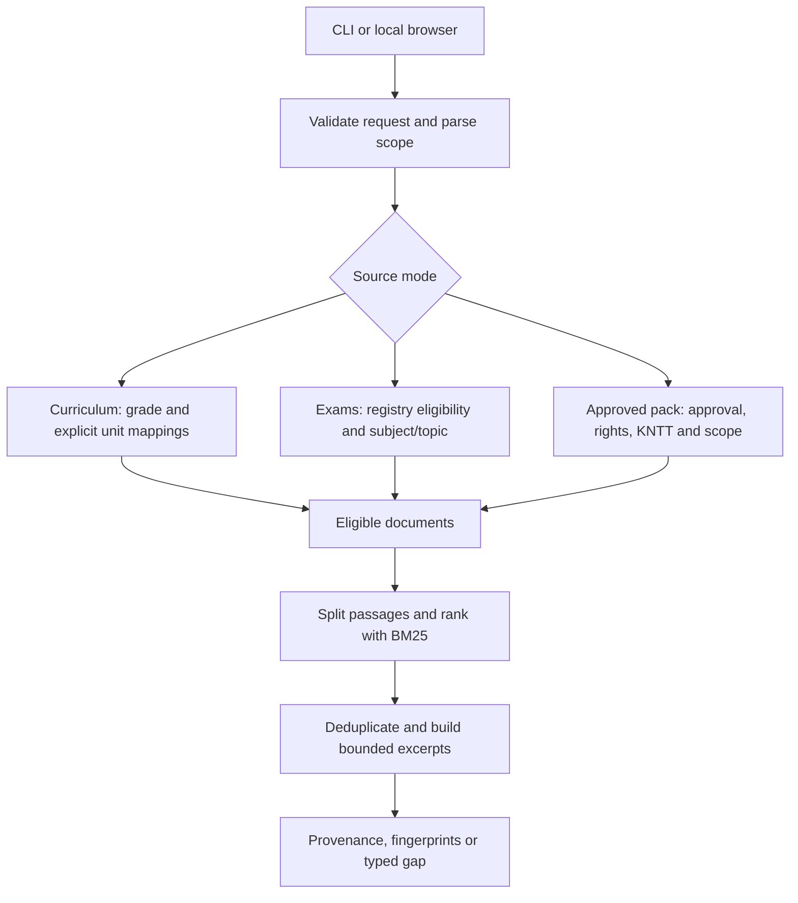
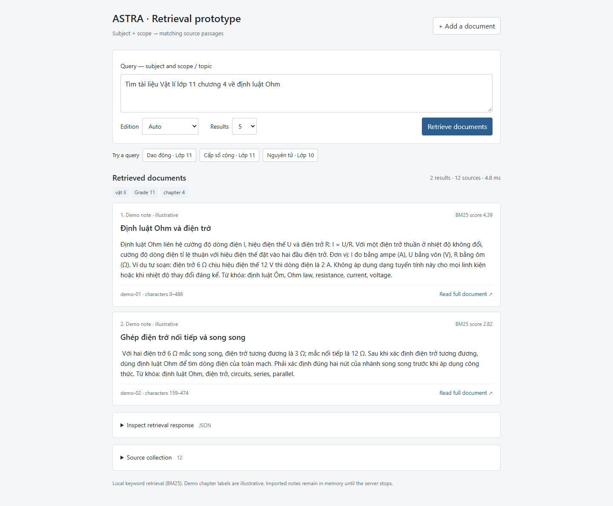

# RAG retrieval prototype

For ASTRA teammates running, reviewing or integrating the Week 4 retrieval stage.
Input: a subject and scope/topic query. Output: ranked passages, provenance and
explicit gaps. Runtime: Python 3.11 standard library; UI: plain HTML/CSS/JavaScript.
Retrieval uses BM25. Embeddings, LLM answers and exam generation are future work.
This feature does not settle overall team choices in [mvp-plan.md](mvp-plan.md).

## Quick start

From the repository root, with Python 3.11 (tested with 3.11.1):

```powershell
python -m rag_workflow.app
```

Open <http://127.0.0.1:8765>. Stop with Ctrl+C. No runtime packages, API keys or
frontend build are needed. The default source is the existing private corpus in
the local `origin/staging/rag` Git snapshot. Git and that local ref are required;
run `git fetch --all` once if needed. Startup makes no network/model calls.

| Mode | Command | Behavior |
| --- | --- | --- |
| Existing corpus | `python -m rag_workflow.app` | Curriculum and usable exam transcriptions; internal prototype |
| Original demo | `python -m rag_workflow.app --demo` | 12 original notes, optional session text imports |
| Approved pack | `python -m rag_workflow.app --corpus path/to/passages.jsonl` | Strict approval, permissions, KNTT and scope filters |

Use `--port 8766` if the port is occupied; `--corpus-ref <commit-sha>` pins an
existing-corpus snapshot. The server binds to `127.0.0.1`, for local use.

## Using the app

Choose **Search in**, enter the query and select a result limit. Results show
status, excerpt and BM25 score. **Read full document** opens the parent text and
source metadata. The JSON response and source collection are collapsed by
default. The collection scrolls inside a bounded panel; Segoe UI/Arial support
Vietnamese text. Text is displayed with `textContent`, including imported HTML.

| View | Example | Meaning |
| --- | --- | --- |
| Curriculum | `Vật lí lớp 11 chương 1 về dao động` | Grade 11, chapter 1 draft KNTT scope records |
| Curriculum | `Toán lớp 11 bài 6-7` | Inclusive lesson range, using available mappings |
| Exam transcriptions | `Vật lí về dao động` | Matching passages from usable Physics papers |
| Demo | `Vật lí lớp 11 chương 4 về định luật Ohm` | Original notes with illustrative chapter labels |

Curriculum, demo and approved-pack queries need one subject, grade 10–12 and a
chapter, lesson, semester or topic. Vietnamese accents, unaccented text, English
subject aliases and Roman range numerals I–X are supported. Ambiguous ranges,
multiple subjects and partial chapters return gaps. Unknown semesters remain
unknown. Unresolved numeric formulas/years may require a clearer query; the
current parser is deliberately conservative.

Exam passages lack verified grade/chapter mappings. Search by subject and topic,
without a grade. Grade/chapter/lesson/semester constraints return
`unmapped_exam_scope`. Exam scope reports `grade: null` and `series: null`.

## Workflow and architecture



Transport, source ingestion, eligibility and ranking have separate responsibilities.
Source artifacts remain canonical; the search view is a rebuildable projection.

| Module in `rag_workflow/` | Responsibility |
| --- | --- |
| `models.py` | Versioned request, source, scope and response contracts |
| `query_parser.py` | Unicode normalization, aliases and conservative range parsing |
| `document_loader.py` | UTF-8 JSONL validation, duplicate IDs and content checksums |
| `existing_corpus.py` | Git snapshot projection and internal corpus eligibility |
| `retriever.py` | Approved-pack approval, rights, edition and scope filters |
| `search_index.py` | Passage splitting, token statistics and BM25 ranking |
| `results.py` | Shared deduplication, excerpts, serialization and collection hashing |
| `workflow.py` | File-backed and in-memory retrieval entry points |
| `app.py`, `cli.py` | Local HTTP and command-line entry points |
| `web/` | Browser form, result/source viewer and session import |
| `config.json` | Versioned aliases, limits, passage sizes and ranking parameters |

Python integration:

```python
from pathlib import Path
from rag_workflow.workflow import run

response = run(
    {"query_text": "Physics grade 11 chapter 4 Ohm", "top_k": 5},
    Path("tests/fixtures/rag_demo_documents.jsonl"),
)
```

`run_documents(payload, documents, corpus_sha256, corpus_info=None)` serves the
in-memory app. Existing-corpus metadata selects its internal search policy.
Both policies share `ranked_results`; internal corpus access does not weaken
approved-pack checks.

### Ranking and excerpts

After eligibility filtering, text is split into passages of up to 900 characters
with a target overlap of 120. The splitter prefers paragraph, sentence and word
boundaries, with character fallback for very long words. Offsets refer to the
unchanged source text.

BM25 scores token rarity, frequency saturation and passage length (`k1=1.2`,
`b=0.75`). Title weight is 3, content weight 1 and normalized exact-phrase bonus 2.
Parameters live in `config.json`; they are provisional rather than optimized on
a benchmark. There is no embedding model, vector database or semantic similarity.

One best passage is returned per unique document content hash. Ties use document
ID and passage start. A range without topic keywords returns eligible documents
at score 0 in deterministic order. Scores are ranking weights, not confidence.
Excerpts center on a matching term where possible and are capped at 500
characters. `top_k` defaults to 5, with a maximum of 20.

Offsets are zero-based Python character indices, end-exclusive:

```python
source.content[hit["excerpt_start"]:hit["excerpt_end"]] == hit["excerpt"]
```

## Corpus ingestion and provenance

Observed snapshot: `8b8fb7b09182b3d9d1eee0b95818027f52ab004d`.
It contains 687 curriculum rows and 134 registered papers: 108 searchable, 26
excluded. Counts are calculated at startup and depend on the selected snapshot.

The adapter reads a Git archive into memory, without checking out source files:

- **Curriculum:** `rag/data/*.jsonl` titles, supplied keywords and outcomes.
  Subject aliases become canonical names; chapter membership follows explicit
  parents/unit identifiers. The original row and draft status stay attached.
  The English `Kết nối tri thức (Global Success)` label is an explicit series
  alias. Semester values with missing or `assumed` provenance remain null in the
  searchable scope; their original values remain visible in provenance.
  These are scope metadata, not textbook explanations or approved knowledge.
- **Exams:** registry-listed `corpus/transcriptions/**/de.md` only when
  `usable_as_content_evidence=True` and class is `official` or
  `provincial_third_party`. Incomplete, excluded and reference-only papers are
  omitted. Registry row, STATUS note, source path and available source card stay
  attached. Exam classification and source authority are separate: a third-party
  scan remains `third_party`. The view conservatively labels text `ocr-draft`
  while preserving the original status note.

Keys, profiles, model calls, generated papers and audits are outside the search
view. The archive can contain companion files/figures; only allowlisted text and
provenance become searchable records. No source files are written back, copied
into this feature's code/test fixtures or sent to external services.

Applied guidance: corpus README, registry README, audit protocol, RAG README,
curriculum architecture/KNTT decision and group CHECKS/GAPS notes. Registry
usability indicates transcription completeness, not teacher approval. Unknown
item mappings, semesters and source quality stay explicit. Existing-corpus access
is authorized for this private internal prototype.

### Replay identifiers

- `corpus_snapshot`: Git commit ID for existing-corpus runs; null for other modes.
- `corpus_sha256`: 64-character SHA-256 of canonical ordered JSON for in-memory
  search projections, or exact file bytes for the file-backed approved-pack API.
- `config_sha256`: SHA-256 of canonical retrieval configuration.
- `content_sha256` and `source_version`: each document's text hash and source version.

Reproduce a run with the same mode, snapshot/pack, configuration and request. A
Git commit ID is recorded separately from the corpus SHA-256.

## CLI and HTTP API

```powershell
python -m rag_workflow.cli --existing --query "Vật lí lớp 11 chương 1 dao động"
python -m rag_workflow.cli --existing --collection exam --query "Vật lí dao động"
python -m rag_workflow.cli --corpus tests/fixtures/rag_demo_documents.jsonl --query "Physics grade 11 chapter 4 Ohm"
```

The CLI prints UTF-8 JSON. Exit 0 means success; exit 2 means a structured gap,
including missing snapshots. See `--help` for `--top-k`, `--edition` and
`--corpus-ref`.

| Method | Route | Behavior |
| --- | --- | --- |
| GET | `/api/collection` | Summaries, aliases, editions, limits and optional `corpus_info` |
| POST | `/api/search` | Retrieval response plus elapsed milliseconds and collection size |
| GET | `/api/documents/{id}` | Full parent text, provenance and content checksum |
| POST | `/api/documents` | Session text import in demo/pack mode; disabled for existing corpus |

Send UTF-8 JSON with `Content-Type: application/json`. Existing-corpus request:

```json
{
  "schema_version": "1.0",
  "collection": "exam",
  "query_text": "Vật lí dao động",
  "top_k": 5,
  "edition": null
}
```

`collection` defaults to `curriculum`, or accepts `exam`, in existing-corpus mode.
Omit this field for demo/approved packs. Response contract:

| Field | Meaning |
| --- | --- |
| `status` | `success` or `gap`; check even after HTTP 200 |
| `resolved_scope` | Subject, nullable grade, range, keywords, edition and applicable series |
| `documents` | Ranked metadata, excerpts, passage offsets, matched terms and relevance score |
| `gaps` | Machine-readable code and actionable message |
| `corpus_sha256`, `corpus_snapshot`, `config_sha256` | Replay identifiers |
| `elapsed_ms`, `collection_size` | HTTP diagnostics, not benchmark results |

Common gaps: `missing_subject`, `missing_grade`, `ambiguous_range`,
`unmapped_exam_scope`, `ambiguous_edition`, `no_documents_in_scope`,
`no_relevant_match`, `corpus_unavailable`, `malformed_document`.
Malformed JSON/imports return HTTP 400, unknown routes/sources 404, cross-origin
POSTs 403, and empty/oversized bodies 413. Maximum POST body: 2 MB.

### Imports and approved packs

Demo/pack mode accepts pasted text and `.txt`/`.md` files (500 KB file-picker
limit). Required import fields: title, content, subject, grade and
`permission_confirmed: true`. Optional: chapter, lesson, semester, source_locator.

Imports remain in memory, shared across tabs until restart. Their local-user
selection is not independent teacher verification. Imports use `local-demo-v1`;
select an edition when the supplied pack has another matching edition. The
endpoint is a prototype input mechanism, not a publication/approval service.

Approved packs are UTF-8 JSONL following `SourceDocument` in `models.py` and the
original synthetic [fixture](../tests/fixtures/rag_demo_documents.jsonl). Records
need stable IDs, subject/grade, scope, KNTT series, edition, source/version/locator,
content checksum, rights evidence and explicit permissions. `approved` requires
a named reviewer and ISO date. Duplicate IDs, malformed records or checksum
mismatches reject the pack. Only approved records permitting local retrieval and
quotation enter ranking. Unknown scope cannot satisfy an exact range. The strict
loader rejects raw legacy `unit_id` records as `curriculum_metadata_only`; explore
those through existing-corpus mode with draft status intact.

## Development and verification

Runtime needs no packages. Development setup and the portable verification command:

```powershell
python -m venv .venv
./.venv/Scripts/python.exe -m pip install -r requirements-dev.txt
./.venv/Scripts/python.exe scripts/verify.py
```

The command runs compilation, Ruff lint, Ruff formatting checks and unit/HTTP/CLI
tests. JavaScript syntax is checked when Node is installed, otherwise explicitly
skipped. Windows needs no Bash. `scripts/verify.sh` delegates to the same command
and honors `RAG_PYTHON`. Format with
`python -m ruff format rag_workflow tests scripts`.

Browser checks need separately pinned `requirements-browser.txt` and installed
Chrome. They create isolated servers and never import into a running user session:

```powershell
python -m pip install -r requirements-browser.txt
python scripts/browser_smoke.py
python scripts/browser_smoke.py --existing-corpus
```

Coverage includes scope boundaries, approvals/permissions, normalization, BM25,
deduplication, late matches, exact offsets, hashes, malformed input and corpus
exclusions. Browser checks cover search, source viewing, gaps, safe rendering,
Vietnamese fonts, session imports and mobile layout. These are functional checks;
held-out relevance and teacher acceptance have not been measured. Observed runs
are recorded in [agent-log/chautanphat.log](../agent-log/chautanphat.log).

Observed on 2026-11-06 after cleanup: 44 tests, compilation, lint, formatting and
JavaScript syntax checks passed. Demo and existing-corpus browser checks passed;
the default app and both real-corpus CLI search modes were run successfully.

Demo screenshots use original text only. Regenerate with
`python scripts/browser_smoke.py --screenshots docs/assets/rag-workflow`:




## Limits and next integration

The index rebuilds after filtering for each query. BM25 can miss paraphrases.
Character chunks do not guarantee whole exam questions/shared stimuli, and
figures are not rendered; the full parent text is available for review. There is
no PDF/OCR ingestion, durable import storage, authentication, solver-specific view
or generation/export stage. Downstream consumers must treat sources as data,
separate them from instructions and cite locators.

Next: verified item/curriculum mappings and held-out retrieval evaluation, then
compare multilingual embeddings/hybrid retrieval against this baseline.
Production also needs reviewed rights, teacher-approved knowledge packs and
role-specific evidence views.

AI assistance: Codex authored code, original synthetic examples, tests and docs
from the member's instructions. Automated checks do not claim independent member
or teacher review. Personal Week 4 reports belong in the member's lab repository.
