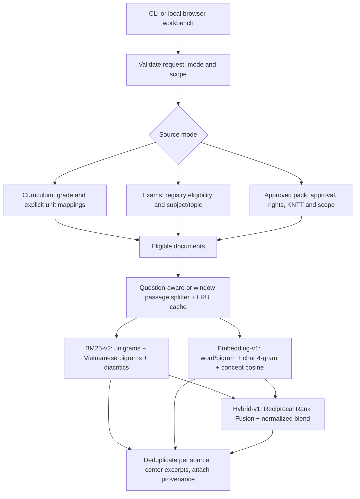

# RAG retrieval and evaluation workbench

For ASTRA teammates running, reviewing, benchmarking or integrating the retrieval stage.
Input: a knowledge/topic query plus an optional retrieval mode (`hybrid`, `bm25`, `embedding`).
Output: ranked passages, question labels (`passage_label`), score breakdowns (`relevance_score`, `bm25_score`, `embedding_score`), provenance and explicit gaps.
Runtime: Python 3.11 standard library; UI: plain HTML/CSS/JavaScript.
This feature does not settle overall team choices in [mvp-plan.md](mvp-plan.md).

## Quick start

From the repository root, with Python 3.11 (tested with 3.11.1):

```powershell
python -m rag_workflow.app
```

Open <http://127.0.0.1:8765>. Stop with Ctrl+C. No runtime packages, API keys or
frontend build are needed. The default source is the existing private corpus in
the local `origin/staging/rag` Git snapshot. Git and that local ref are required;
run `git fetch --all` once if needed. Startup makes no network/model calls.

| Mode | Command | Behavior |
| --- | --- | --- |
| Existing corpus | `python -m rag_workflow.app` | Unified search across curriculum and usable exam transcriptions; internal prototype |
| Original demo | `python -m rag_workflow.app --demo` | 12 original notes, optional session text imports |
| Approved pack | `python -m rag_workflow.app --corpus path/to/passages.jsonl` | Approval and rights permission checks followed by knowledge ranking |

Use `--port 8766` if the port is occupied; `--corpus-ref <commit-sha>` pins an
existing-corpus snapshot. The server binds to `127.0.0.1`, for local use.

## Using the demonstration & testing app

1. **Retrieve documents:** Choose **Search in** (`All sources (Curriculum + Exams)` by default, or filter to `Curriculum / lesson map` or `Exam transcriptions`), select a **Mode** (`Hybrid`, `BM25`, or `Embedding`), enter any knowledge or topic query, and click **Retrieve documents**. Result cards display the matched source's subject, grade, chapter, status, question boundary label (`Câu N` when present), excerpt, and score breakdown (`Hybrid · BM25 · Cosine`).
2. **Compare 3 modes side by side:** Click **Compare 3 modes** to run the query across `Hybrid (RRF + Blend)`, `BM25-v2 (Lexical)`, and `Embedding (Cosine)` simultaneously and inspect rank/score differences.
3. **Run benchmark suite:** Open **Benchmark & evaluation lab** and click **Run benchmark suite** to run automated gold verification (`auto-corpus-check-v1`) and compare `Hit@5`, `Recall@5`, `MRR`, `Passage Hit@5`, `Gap Acc.`, and `False Gap` across all three retrieval modes. Click any benchmark query row to load and test it live.

| View | Example | Meaning |
| --- | --- | --- |
| All sources (Default) | `dao động điều hòa biên độ pha ban đầu` | Searches across all curriculum units and exam questions simultaneously |
| Curriculum | `định luật 2 Newton gia tốc lực` | Pure knowledge query with numeric topic keyword |
| Exam transcriptions | `thí nghiệm tán xạ hạt alpha Rutherford` | Question-segmented passages (`Câu N`) across all usable exam papers |
| Demo | `con lắc lò xo biên độ` | Semantic/concept match in `embedding` and `hybrid` modes |

Queries are **knowledge-first**: users do not need to know or specify the subject,
grade, chapter, lesson, or semester of a document in the corpus. Optional structural
labels (such as `Vật lí lớp 11 chương 4`) are stripped automatically so their numbers
do not pollute topic keywords, while numbers inside scientific or historical topics
(`định luật 2 Newton`, `năm 1945`, `hàm bậc 3`) and compound words (`điều hòa`,
`thuật toán`, `bảo toàn`) are preserved as knowledge tokens. Queries containing only
stop words or bare subject/range labels without knowledge terms return `missing_keywords`.

## Workflow and architecture



| Module in `rag_workflow/` | Responsibility |
| --- | --- |
| `models.py` | Versioned request, mode, source, scope and response contracts |
| `query_parser.py` | Unicode normalization, compound disambiguation, accented tokens and range parsing |
| `document_loader.py` | UTF-8 JSONL validation, duplicate IDs and content checksums |
| `existing_corpus.py` | Git snapshot projection and internal corpus eligibility |
| `retriever.py` | Approved-pack approval, rights, edition and scope filters |
| `search_index.py` | Question-aware chunking, cached passage analysis, BM25-v2, Embedding-v1 and Hybrid RRF |
| `results.py` | Shared deduplication, excerpts, score breakdowns and collection hashing |
| `workflow.py` | File-backed and in-memory retrieval entry points |
| `profile_pack.py` | Cryptographically verified Toán THPT profile bundle & 71 full Topic Packs (`research-topic-pack-v1`), automatic cache invalidation on hash changes, and portable pack export |
| `matrix_retriever.py` | Exam-matrix and per-question (`P1`, `P2`, `P3`) Topic Pack retriever, `NB/TH/VD` vs `VDC`/`unknown` level resolution, and 22-question Toán THPT sample matrix |
| `mas_adapter.py` | Untrusted-evidence Markdown renderer (`reference_material_text`) for Composer and `mas-intake-v1` RAG passage adapter with full provenance |
| `eval.py` | Automated gold-label verification (`auto-corpus-check-v1`), multi-mode benchmark runner, and Toán THPT MAS-handoff acceptance suite (`--acceptance`) |
| `app.py`, `cli.py` | Local HTTP (`/api/search`, `/api/compare`, `/api/eval`, `/api/topic-packs`, `/api/matrix-retrieve`) and CLI entry points |
| `web/` | Browser workbench, 3-mode comparison view, benchmark lab and session import |
| `config.json` | Versioned aliases, concept synonyms, cognitive level schemes (`NB/TH/VD`), `VDC` policies, umbrella topic mappings and ranking parameters |

### Question-aware chunking and multi-mode ranking

- **Question-aware chunking (`split_passages`):** For exam transcriptions (`content_kind == "exam"` with ≥2 markers), text is split at line-start question/section boundaries (`Câu N`, `**Câu N.**`, `### Câu N`, `Question N`, `PHẦN I`). Short section headers (`< 120` chars) merge forward into the first question, and oversized questions (`> 900` chars) fall back to overlapping windows while keeping `passage_label` (e.g. `"Câu 12"`). Offsets always refer to the unchanged source text:
  ```python
  source.content[hit["excerpt_start"]:hit["excerpt_end"]] == hit["excerpt"]
  ```
- **BM25 (`bm25-passages-v2`):** Scores unigram rarity and length normalization (`k1=1.2`, `b=0.75`, `title_weight=3`, `content_weight=1`, `phrase_bonus=2`) plus adjacent Vietnamese bigram matches (`bigram_weight=1.5`) and exact accented token matches (`accent_weight=1.0`).
- **Embedding (`embedding-char-word-v1`):** Builds L2-normalized sparse/subword vectors over IDF-weighted words, adjacent bigrams, accented tokens, character 4-grams (tolerant to OCR noise and morphological variants), and domain concept clusters (`concept_synonyms` in `config.json`), scored by exact Cosine Similarity ($\cos(\vec{q}, \vec{p}) \in [0, 1]$). Runs 100% offline with no external network calls.
- **Hybrid (`hybrid-rrf-v1`, default):** Combines `bm25-passages-v2` and `embedding-char-word-v1` using Reciprocal Rank Fusion (`rrf_k=60`) and normalized score blending (`hybrid_alpha=0.55`).

## Measured benchmark evaluation

Evaluated on snapshot `8b8fb7b09182b3d9d1eee0b95818027f52ab004d` (`687` curriculum rows, `108` searchable exam papers) using `eval/gold_queries.jsonl` (`35` pure-knowledge queries across `all`, `curriculum`, and `exam` collections with `75` document targets, `15` question passage targets, and `4` expected-gap guardrails; split into `17` dev and `18` held-out queries). All `75` document targets and `15` passage labels were verified programmatically via `auto-corpus-check-v1`:

```powershell
python -m rag_workflow.eval --existing --mode all --out runs/eval-existing.json
```

| Mode | Method | Split | Queries | Hit@5 | Recall@5 | MRR | Exam Passage Hit@5 | Gap Accuracy | False Gap Rate |
| --- | --- | --- | --- | --- | --- | --- | --- | --- | --- |
| **Hybrid** | `hybrid-rrf-v1` | All (35) | 35 | **100.0%** | **91.7%** | **1.000** | **100.0%** | **100.0%** | **0.0%** |
| **BM25** | `bm25-passages-v2` | All (35) | 35 | 93.5% | 85.0% | 0.919 | 100.0% | 100.0% | 6.5% |
| **Embedding** | `embedding-char-word-v1` | All (35) | 35 | **100.0%** | 85.5% | 0.904 | 100.0% | 100.0% | **0.0%** |
| **Hybrid** | `hybrid-rrf-v1` | Held-out (18) | 18 | **100.0%** | **93.8%** | **1.000** | **100.0%** | **100.0%** | **0.0%** |
| **BM25** | `bm25-passages-v2` | Held-out (18) | 18 | 93.8% | 87.0% | 0.938 | 100.0% | 100.0% | 6.2% |
| **Embedding** | `embedding-char-word-v1` | Held-out (18) | 18 | **100.0%** | 91.7% | 0.896 | 100.0% | 100.0% | **0.0%** |

Why Hybrid wins: `BM25` has strong rank-1 precision on exact terms (`Exam MRR = 1.000`) but misses when queries use synonyms or cross-lingual terms (`Curriculum Hit@5 = 84.6%`, `False Gap = 15.4%`). `Embedding` achieves `100.0%` `Hit@5` and `0.0%` false gaps across synonyms, while `Hybrid` combines both signals to achieve `100.0%` `Hit@5`, `91.7%` `Recall@5`, and `1.000` `MRR`.

## MAS Exam-Matrix & Topic-Pack Handoff (Toán THPT)

In addition to free-text passage search, `rag_workflow` provides a deterministic **Exam-Matrix & Topic-Pack Retrieval API** for the MAS Orchestrator and Composer (`Toán THPT`: 12 câu `P1` MCQ, 4 câu `P2` True/False with per-statement levels `a..d`, and 6 câu `P3` Short Answer).

### Why this replaces the 150-character excerpt

Earlier corpus helpers (`rag/astra_rag/search.py`) truncated retrieved text to 150 characters, stripping out construction patterns, reasoning steps, and distractor logic. The Topic Pack API loads and verifies all **71 Toán THPT Topic Packs** (`corpus/profiles/toan/profile.bundle.json` + `topics/*.json`) and **133 Toán curriculum rows** (`rag/data/toan-10/11/12.jsonl`), returning **complete, untruncated Topic Packs** (`6,600–9,500+` characters of structured context per question) bound to each `question_id` and `group_id`.

### Windows Setup & Commands for MAS Teammates

Requires Python 3.11+ on Windows PowerShell (zero external runtime packages or API keys):

```powershell
# 1. Fetch the private corpus snapshot once (or use an exported release folder via --pack-dir)
git fetch --all

# 2. Fetch a full Topic Pack by ID, locator, or topic name (with optional P1/P2/P3 and NB/TH/VD filter)
python -m rag_workflow.cli --topic-pack 5fed66930d74 --part P1 --level TH
python -m rag_workflow.cli --topic-pack "Xác suất có điều kiện" --part P2

# 3. Run retrieval for the canonical 22-question Toán THPT sample matrix (12 P1, 4 P2, 6 P3)
python -m rag_workflow.cli --sample-matrix --out runs/sample-matrix-context.json

# 4. Run retrieval for a custom exam matrix JSON file
python -m rag_workflow.cli --matrix path/to/matrix_request.json --out runs/matrix-output.json

# 5. Export a self-contained portable release pack for offline Windows machines (with SHA-256 manifest)
python -m rag_workflow.cli --export-pack releases/toan-thpt-pack-v1
python -m rag_workflow.cli --pack-dir releases/toan-thpt-pack-v1 --sample-matrix

# 6. Run the Toán THPT MAS-handoff acceptance test suite (8 acceptance cases + 22-question matrix)
python -m rag_workflow.eval --acceptance --out runs/eval-toan-acceptance.json
```

### Python Integration for MAS Orchestrator & Composer

```python
from rag_workflow import (
    default_toan_thpt_matrix,
    get_topic_pack,
    load_profile_release,
    retrieve_exam_context,
)

# 1. Retrieve context for a full exam matrix (or per-question batch)
request_payload = {
    "matrix_id": "de-toan-thpt-01",
    "subject": "toan",
    "vdc_policy": "fallback_with_warning",  # or "strict_error"
    "questions": [
        {
            "question_id": "P1_Q01",
            "group_id": "G_NGUYEN_HAM",
            "part": "P1",
            "topic": "Nguyên hàm",
            "learning_objective": "Tìm họ nguyên hàm của hàm số thỏa mãn điều kiện ban đầu",
            "level": "TH",
        },
        {
            "question_id": "P2_Q04",
            "group_id": "G_XAC_SUAT",
            "part": "P2",
            "topic": "Xác suất có điều kiện",
            "learning_objective": "Công thức xác suất toàn phần và công thức Bayes",
            "statement_levels": {"a": "NB", "b": "TH", "c": "TH", "d": "VD"},
        },
        {
            "question_id": "P3_Q04",
            "group_id": "G_TOI_UU",
            "part": "P3",
            "topic": "Tối ưu",
            "learning_objective": "Giải bài toán tối ưu thực tiễn bằng đạo hàm",
            "level": "VD",
        },
    ],
}

response = retrieve_exam_context(request_payload)
for q_ctx in response.question_contexts:
    if q_ctx["status"] == "gap":
        # Stop or ask teacher/user for missing data: see q_ctx["gaps"]
        continue
    # Pass untruncated Markdown block directly to Composer prompt:
    composer_reference_str = q_ctx["reference_material_text"]
    # Or inspect structured fields:
    # q_ctx["curriculum_knowledge"], q_ctx["construction_patterns"],
    # q_ctx["construction_observations"], q_ctx["examples"], q_ctx["common_mistakes"],
    # q_ctx["provenance_summary"]

# 2. Or consume mas-intake-v1 compatible RAG entries directly:
mas_rag_entries = response.mas_intake_rag

# 3. Fetch a single full Topic Pack by ID or locator:
release = load_profile_release("toan")
pack = get_topic_pack(release, "5fed66930d74", part="P1", level="TH")
```

### Cognitive Level Mapping (`NB/TH/VD` vs `VDC` & `unknown`) and Evidence Rules

1. **GDPT 2018 3-Level Scheme (`NB`, `TH`, `VD`):**
   - The Toán THPT corpus profile uses the official 3-level cognitive scale (`NB`, `TH`, `VD`). `discrimination="high"` is an item-discrimination attribute and is **never** silently equated to `VDC`.
   - When MAS requests `level="VDC"`:
     - `vdc_policy="fallback_with_warning"` (default): maps `VDC` to `VD` (`VD.2` multi-step / integrated problem solving prioritized by `steps` and `combines`) and emits warning `vdc_mapped_to_vd`.
     - `vdc_policy="strict_error"`: blocks the question with `status="gap"` and gap code `level_vdc_not_in_scheme`.
   - Rows with `level=null` (`9` rows in the Toán profile) are tagged `level_status="unknown"` and excluded from strict level filters unless `include_unknown_level=True` is explicitly set (which emits warning `unknown_level_observations_included`).
2. **`P2` True/False Per-Statement Levels (`a, b, c, d`):**
   - Accepts `statement_levels: {"a": "NB", "b": "TH", "c": "TH", "d": "VD"}`.
   - Keeps sibling statements (`paper_id|P2|idx|a..d`) grouped together so Composer sees how a single stem progresses from `a` (`NB`) to `d` (`VD`), and reports per-statement coverage in `p2_statement_coverage`.
3. **Provenance & Separation of Evidence Classes:**
   - Every Topic Pack, observation, example, and curriculum unit carries `source_id`, `source_locator`, `source_version` (Git commit SHA), `content_sha256`, `approval_status`, and `teacher_approved: false`.
   - Evidence classes are strictly separated:
     - `official`: abstracted construction observations from official MOET sample/graduation papers (`2` Toán papers).
     - `provincial_third_party`: abstracted observations from provincial trial papers (`13` Toán papers).
     - `synthetic`: model-checked reference items (`origin: "synthetic_not_corpus_evidence"`, `139` ready examples) — never counted as corpus frequency evidence.
     - `curriculum`: GDPT 2018 / Kết nối tri thức lesson scopes (`133` Toán rows).
4. **Automatic Cache Invalidation (`release_fingerprint`):**
   - `load_profile_release()` verifies the SHA-256 checksum of `profile.bundle.json`, `completion.json`, `levels.json`, all 71 `topics/*.json` files, `rag/data/toan-*.jsonl`, and `config.json`. Any change to any file immediately produces a new `release_fingerprint` and invalidates the in-memory cache.

### Probability examples in a local Toán release

Build this supplement when the base release lacks examples for the probability
levels requested by an exam matrix:

```powershell
python scripts/build_probability_rag_pack.py runs/rag-probability-pack-v1
```

Set `EXAM_RAG_PACK_DIR=runs/rag-probability-pack-v1` in the local `.env` and
restart ASTRA. The builder maintains the base corpus snapshot and writes a new
fingerprint and file manifest for the supplemented release. The examples use
original wording, reference the corpus observations used to check their scope,
and remain pending teacher review. The checked answers and levels are recorded
in the [independent review receipt](../rag_workflow/probability_supplement_review.json).

### Toán THPT Acceptance Suite Results

Measured with `python -m rag_workflow.eval --acceptance` (`eval/toan_thpt_acceptance.json`):

| Case ID | Scenario | Part / Level | Expected Status | Result | Reference Size |
| --- | --- | --- | --- | --- | --- |
| `ACC_01_NGUYEN_HAM_P1_TH` | Nguyên hàm P1 mức TH | `P1` / `TH` | `ready` | **PASS** (`5fed66930d74`) | `8,382` chars |
| `ACC_02_XAC_SUAT_P2_ABCD` | Xác suất có điều kiện P2 (`a:NB, b:TH, c:TH, d:VD`) | `P2` / `a..d` | `ready` | **PASS** (`eddc9ebdeb25`) | `9,346` chars |
| `ACC_03_TOI_UU_P3_VD` | Bài toán tối ưu thực tế P3 | `P3` / `VD` | `ready` | **PASS** (`e8d75b9fb4ed`) | `9,527` chars |
| `ACC_04_TOI_UU_P3_VDC_FALLBACK` | Tối ưu P3 mức `VDC` (`fallback_with_warning`) | `P3` / `VDC -> VD` | `ready_with_warnings` | **PASS** (`vdc_mapped_to_vd`) | `9,779` chars |
| `ACC_05_TOI_UU_P3_VDC_STRICT` | Tối ưu P3 mức `VDC` (`strict_error`) | `P3` / `VDC` | `gap` | **PASS** (`level_vdc_not_in_scheme`) | Explicit gap |
| `ACC_06_MISSING_TOPIC_SO_PHUC` | Chủ đề ngoài chương trình (`Số phức`) | `P1` / `TH` | `gap` | **PASS** (`topic_not_found`) | Explicit gap |
| `ACC_07_GAP_PART_NOT_COVERED` | Chủ đề chỉ có P3 nhưng yêu cầu P2 (`Quy hoạch tuyến tính`) | `P2` / `a..d` | `gap` | **PASS** (`part_not_covered`) | Explicit gap |
| `ACC_08_GAP_LEVEL_NOT_COVERED` | Chủ đề không có câu ở mức yêu cầu (`Cấp số nhân` P1 mức `VD`) | `P1` / `VD` | `gap` | **PASS** (`level_not_covered`) | Explicit gap |
| **Sample Matrix (22Q)** | Đề mẫu Toán THPT chuẩn (12 P1, 4 P2, 6 P3) | `12 P1, 4 P2, 6 P3` | `success` (`22/22`) | **PASS** (`22/22 ready`) | Min `6,681` chars/câu |

## CLI and HTTP API

```powershell
python -m rag_workflow.cli --existing --mode hybrid --query "dao động điều hòa con lắc lò xo"
python -m rag_workflow.cli --existing --collection exam --mode hybrid --query "thí nghiệm tán xạ hạt alpha Rutherford"
python -m rag_workflow.cli --topic-pack 5fed66930d74 --part P1 --level TH
python -m rag_workflow.cli --sample-matrix --out runs/sample-matrix.json
python -m rag_workflow.eval --acceptance
python -m rag_workflow.eval --existing --mode all
python -m rag_workflow.eval --demo --mode all
```

| Method | Route | Behavior |
| --- | --- | --- |
| GET | `/api/collection` | Summaries, aliases, editions, modes (`hybrid`, `bm25`, `embedding`), limits and optional `corpus_info` |
| GET | `/api/topic-packs` | Lists all 71 Toán THPT Topic Packs with `release_info`, SHA-256 provenance, parts, and levels |
| GET | `/api/topic-packs/{id}` | Returns full, untruncated Topic Pack (`patterns`, `construction_observations`, `examples`, `common_mistakes`, `curriculum_units`) by ID or name |
| GET | `/api/matrix-sample` | Returns the canonical 22-question Toán THPT sample exam matrix (`12 P1`, `4 P2`, `6 P3`) |
| POST | `/api/matrix-retrieve` | Resolves an exam matrix into per-question Topic Pack contexts (`question_contexts` + `mas_intake_rag` + `gaps`/`warnings`) |
| POST | `/api/search` | Retrieval response (`mode`, `ranking_method`, `documents` with `bm25_score`, `embedding_score`, `passage_label`) |
| POST | `/api/compare` | Side-by-side response running the query across `hybrid`, `bm25`, and `embedding` |
| POST | `/api/eval` | Runs `verify_gold_queries` and `evaluate_all_modes` (`split`: `all`, `dev`, `heldout`) |
| GET | `/api/documents/{id}` | Full parent text, provenance and content checksum |
| POST | `/api/documents` | Session text import in demo/pack mode; disabled for existing corpus |

## Development and verification

```powershell
python -m venv .venv
./.venv/Scripts/python.exe -m pip install -r requirements-dev.txt
./.venv/Scripts/python.exe scripts/verify.py
```

Browser checks need separately pinned `requirements-browser.txt` and installed Chrome:

```powershell
python scripts/browser_smoke.py --screenshots docs/assets/rag-workflow
python scripts/browser_smoke.py --existing-corpus
```


## Limits and next integration

Shared stimuli (`Dựa vào thông tin sau để trả lời các câu 1–3`) are not yet grouped with all dependent questions, and figures are not rendered. Downstream consumers must treat retrieved passages as untrusted data, separate them from instructions and cite locators.
