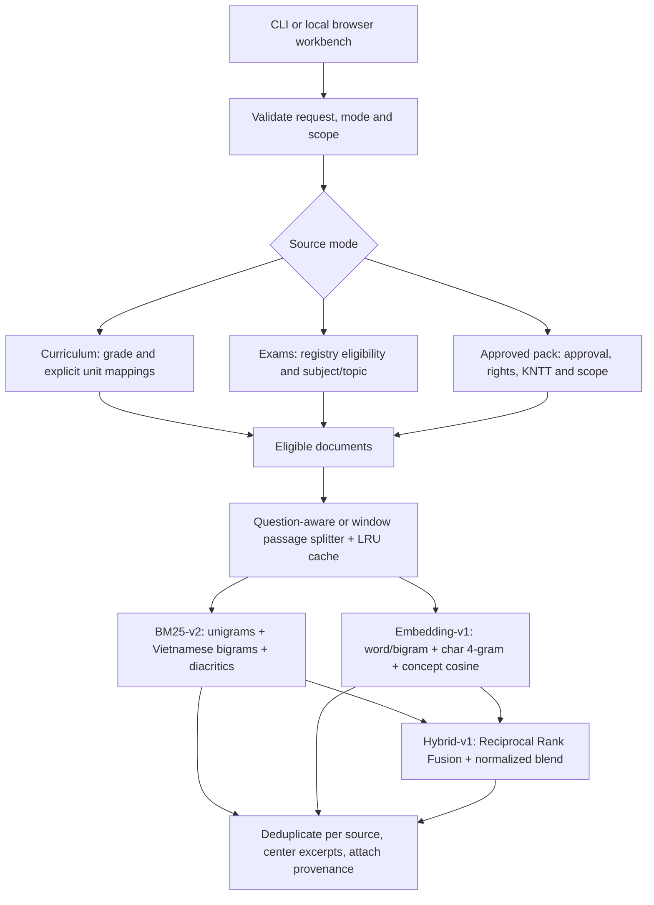

# RAG retrieval and evaluation workbench

For ASTRA teammates running, reviewing, benchmarking or integrating the retrieval stage.
Input: a subject and scope/topic query plus an optional retrieval mode (`hybrid`, `bm25`, `embedding`).
Output: ranked passages, question labels (`passage_label`), score breakdowns (`relevance_score`, `bm25_score`, `embedding_score`), provenance and explicit gaps.
Runtime: Python 3.11 standard library; UI: plain HTML/CSS/JavaScript.
This feature does not settle overall team choices in [mvp-plan.md](mvp-plan.md).

## Quick start

From the repository root, with Python 3.11 (tested with 3.11.1):

```powershell
python -m rag_workflow.app
```

Open <http://127.0.0.1:8765>. Stop with Ctrl+C. No runtime packages, API keys or
frontend build are needed. The default source is the existing private corpus in
the local `origin/staging/rag` Git snapshot. Git and that local ref are required;
run `git fetch --all` once if needed. Startup makes no network/model calls.

| Mode | Command | Behavior |
| --- | --- | --- |
| Existing corpus | `python -m rag_workflow.app` | Curriculum and usable exam transcriptions; internal prototype |
| Original demo | `python -m rag_workflow.app --demo` | 12 original notes, optional session text imports |
| Approved pack | `python -m rag_workflow.app --corpus path/to/passages.jsonl` | Strict approval, permissions, KNTT and scope filters |

Use `--port 8766` if the port is occupied; `--corpus-ref <commit-sha>` pins an
existing-corpus snapshot. The server binds to `127.0.0.1`, for local use.

## Using the demonstration & testing app

1. **Retrieve documents:** Choose **Search in** (`Curriculum` or `Exam transcriptions`), select a **Mode** (`Hybrid`, `BM25`, or `Embedding`), enter a query and click **Retrieve documents**. Result cards display status, question boundary label (`Câu N` when present), excerpt, and score breakdown (`Hybrid · BM25 · Cosine`).
2. **Compare 3 modes side by side:** Click **Compare 3 modes** to run the query across `Hybrid (RRF + Blend)`, `BM25-v2 (Lexical)`, and `Embedding (Cosine)` simultaneously and inspect rank/score differences.
3. **Run benchmark suite:** Open **Benchmark & evaluation lab** and click **Run benchmark suite** to run automated gold verification (`auto-corpus-check-v1`) and compare `Hit@5`, `Recall@5`, `MRR`, `Passage Hit@5`, `Gap Acc.`, and `False Gap` across all three retrieval modes. Click any benchmark query row to load and test it live.

| View | Example | Meaning |
| --- | --- | --- |
| Curriculum | `Vật lí lớp 11 chương 1 về dao động` | Grade 11, chapter 1 draft KNTT scope records |
| Curriculum | `Vật lí lớp 10 định luật 2 Newton` | Numeric topic keyword inside grade 10 scope |
| Exam transcriptions | `Vật lí dao động điều hòa con lắc` | Question-segmented passages from usable Physics papers |
| Demo | `Vật lí lớp 11 chương 1 con lắc lò xo` | Semantic/concept match in `embedding` and `hybrid` modes |

Curriculum, demo and approved-pack queries need one subject, grade 10–12 and a
chapter, lesson, semester or topic. Vietnamese accents, unaccented text, English
subject aliases and Roman range numerals I–X are supported. Numbers inside scientific
or historical topics (`định luật 2 Newton`, `năm 1945`, `hàm bậc 3`) are preserved as
keywords, while unresolved range numbers (`bài 6 7`, `chương 2, 4`) and partial
chapters (`nửa chương 1`) return `ambiguous_range`. Compound terms containing subject
substrings (`điều hòa`, `thuật toán`, `bài toán`) are disambiguated so they do not
false-trigger a second subject.

Exam passages lack verified grade/chapter mappings. Search by subject and topic,
without a grade. Grade/chapter/lesson/semester constraints return
`unmapped_exam_scope`. Exam scope reports `grade: null` and `series: null`.

## Workflow and architecture



| Module in `rag_workflow/` | Responsibility |
| --- | --- |
| `models.py` | Versioned request, mode, source, scope and response contracts |
| `query_parser.py` | Unicode normalization, compound disambiguation, accented tokens and range parsing |
| `document_loader.py` | UTF-8 JSONL validation, duplicate IDs and content checksums |
| `existing_corpus.py` | Git snapshot projection and internal corpus eligibility |
| `retriever.py` | Approved-pack approval, rights, edition and scope filters |
| `search_index.py` | Question-aware chunking, cached passage analysis, BM25-v2, Embedding-v1 and Hybrid RRF |
| `results.py` | Shared deduplication, excerpts, score breakdowns and collection hashing |
| `workflow.py` | File-backed and in-memory retrieval entry points |
| `eval.py` | Automated gold-label verification (`auto-corpus-check-v1`) and multi-mode benchmark runner |
| `app.py`, `cli.py` | Local HTTP (`/api/search`, `/api/compare`, `/api/eval`) and CLI entry points |
| `web/` | Browser workbench, 3-mode comparison view, benchmark lab and session import |
| `config.json` | Versioned aliases, concept synonyms, passage sizes and ranking parameters |

### Question-aware chunking and multi-mode ranking

- **Question-aware chunking (`split_passages`):** For exam transcriptions (`content_kind == "exam"` with ≥2 markers), text is split at line-start question/section boundaries (`Câu N`, `**Câu N.**`, `### Câu N`, `Question N`, `PHẦN I`). Short section headers (`< 120` chars) merge forward into the first question, and oversized questions (`> 900` chars) fall back to overlapping windows while keeping `passage_label` (e.g. `"Câu 12"`). Offsets always refer to the unchanged source text:
  ```python
  source.content[hit["excerpt_start"]:hit["excerpt_end"]] == hit["excerpt"]
  ```
- **BM25 (`bm25-passages-v2`):** Scores unigram rarity and length normalization (`k1=1.2`, `b=0.75`, `title_weight=3`, `content_weight=1`, `phrase_bonus=2`) plus adjacent Vietnamese bigram matches (`bigram_weight=1.5`) and exact accented token matches (`accent_weight=1.0`).
- **Embedding (`embedding-char-word-v1`):** Builds L2-normalized sparse/subword vectors over IDF-weighted words, adjacent bigrams, accented tokens, character 4-grams (tolerant to OCR noise and morphological variants), and domain concept clusters (`concept_synonyms` in `config.json`), scored by exact Cosine Similarity ($\cos(\vec{q}, \vec{p}) \in [0, 1]$). Runs 100% offline with no external network calls.
- **Hybrid (`hybrid-rrf-v1`, default):** Combines `bm25-passages-v2` and `embedding-char-word-v1` using Reciprocal Rank Fusion (`rrf_k=60`) and normalized score blending (`hybrid_alpha=0.55`).

## Measured benchmark evaluation

Evaluated on snapshot `8b8fb7b09182b3d9d1eee0b95818027f52ab004d` (`687` curriculum rows, `108` searchable exam papers) using `eval/gold_queries.jsonl` (`37` queries: `20` curriculum, `11` exam with `15` question passage targets, `6` expected-gap guardrails; split into `18` dev and `19` held-out queries). All `68` document targets and `15` passage labels were verified programmatically via `auto-corpus-check-v1`:

```powershell
python -m rag_workflow.eval --existing --mode all --out runs/eval-existing.json
```

| Mode | Method | Split | Queries | Hit@5 | Recall@5 | MRR | Exam Passage Hit@5 | Gap Accuracy | False Gap Rate |
| --- | --- | --- | --- | --- | --- | --- | --- | --- | --- |
| **Hybrid** | `hybrid-rrf-v1` | All (37) | 37 | **100.0%** | **92.5%** | **1.000** | **100.0%** | **100.0%** | **0.0%** |
| **BM25** | `bm25-passages-v2` | All (37) | 37 | 93.5% | 84.4% | 0.935 | 100.0% | 100.0% | 6.5% |
| **Embedding** | `embedding-char-word-v1` | All (37) | 37 | **100.0%** | **92.5%** | 0.935 | 100.0% | 100.0% | **0.0%** |
| **Hybrid** | `hybrid-rrf-v1` | Held-out (19) | 19 | **100.0%** | **96.9%** | **1.000** | **100.0%** | **100.0%** | **0.0%** |
| **BM25** | `bm25-passages-v2` | Held-out (19) | 19 | 93.8% | 87.5% | 0.938 | 100.0% | 100.0% | 6.2% |
| **Embedding** | `embedding-char-word-v1` | Held-out (19) | 19 | **100.0%** | **96.9%** | 0.969 | 100.0% | 100.0% | **0.0%** |

Why Hybrid wins: `BM25` has strong rank-1 precision on exact terms (`Exam MRR = 1.000`) but fails when queries use synonyms or cross-lingual terms (`Curriculum Hit@5 = 90.0%`, `False Gap = 10.0%`). `Embedding` achieves `100.0%` `Hit@5` and `0.0%` false gaps across synonyms, while `Hybrid` combines both signals to achieve `100.0%` `Hit@5`, `92.5%` `Recall@5`, and `1.000` `MRR`.

## CLI and HTTP API

```powershell
python -m rag_workflow.cli --existing --mode hybrid --query "Vật lí lớp 11 chương 1 dao động"
python -m rag_workflow.cli --existing --collection exam --mode hybrid --query "Vật lí dao động điều hòa"
python -m rag_workflow.eval --existing --mode all
python -m rag_workflow.eval --demo --mode all
```

| Method | Route | Behavior |
| --- | --- | --- |
| GET | `/api/collection` | Summaries, aliases, editions, modes (`hybrid`, `bm25`, `embedding`), limits and optional `corpus_info` |
| POST | `/api/search` | Retrieval response (`mode`, `ranking_method`, `documents` with `bm25_score`, `embedding_score`, `passage_label`) |
| POST | `/api/compare` | Side-by-side response running the query across `hybrid`, `bm25`, and `embedding` |
| POST | `/api/eval` | Runs `verify_gold_queries` and `evaluate_all_modes` (`split`: `all`, `dev`, `heldout`) |
| GET | `/api/documents/{id}` | Full parent text, provenance and content checksum |
| POST | `/api/documents` | Session text import in demo/pack mode; disabled for existing corpus |

## Development and verification

```powershell
python -m venv .venv
./.venv/Scripts/python.exe -m pip install -r requirements-dev.txt
./.venv/Scripts/python.exe scripts/verify.py
```

Browser checks need separately pinned `requirements-browser.txt` and installed Chrome:

```powershell
python scripts/browser_smoke.py --screenshots docs/assets/rag-workflow
python scripts/browser_smoke.py --existing-corpus
```


## Limits and next integration

Shared stimuli (`Dựa vào thông tin sau để trả lời các câu 1–3`) are not yet grouped with all dependent questions, and figures are not rendered. Downstream consumers must treat retrieved passages as untrusted data, separate them from instructions and cite locators.
