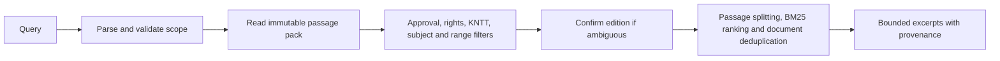
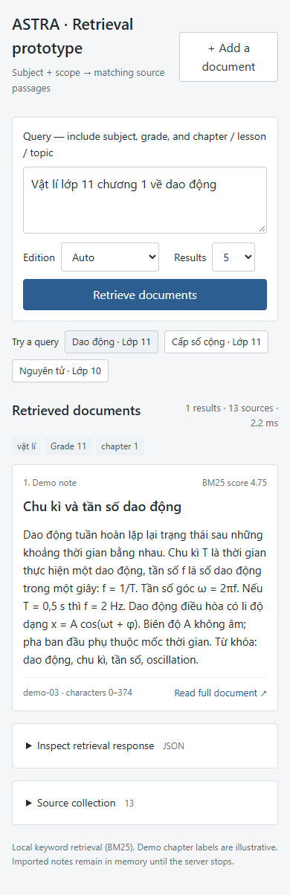

# Scoped retrieval workflow

For ASTRA members integrating the Retriever stage. This implements the Week 4
retrieval baseline: a subject/range query returns approved reference passages,
source locators, versions, and explicit gaps. Python 3.11.1, standard library only.
The implementation is a proposal for this feature; it does not settle the open
team stack or data decisions in [mvp-plan.md](mvp-plan.md).

## Local UI app

Start the application from the project root; no install, GitHub access or API key
is required:

```powershell
python -m rag_workflow.app
```

Open <http://127.0.0.1:8765>. The app starts with 12 original demo study notes
covering Physics, Mathematics, Chemistry, Biology and English. Enter a query,
choose a result limit and optionally an edition. Inspect the parsed scope,
ranked excerpts, full documents and JSON response. Example buttons run Vietnamese
queries. Subject and grade filters apply before lexical ranking.

Use **Add a document** to paste text or load a `.txt` / `.md` file. Supply its
subject, grade and known chapter/lesson/semester metadata, and confirm permission
for local use. The app treats this as a personal-use selection, not academic or
teacher verification. Imported documents remain in memory until the server
stops. Each import must have one consistent scope; long text is split into
overlapping passages automatically. PDF/OCR ingestion is not
included. The collection is shared by browser tabs connected to this local server.

The default notes are original illustrative material. Their chapter numbers are
demo scope labels, not independently verified textbook mappings. They are visibly
identified as demo notes in the interface. Imports are visibly local sources.
The app uses deterministic keyword retrieval; it returns source evidence and
does not generate answers. No document text is sent to an external service.

To use an existing validated passage pack instead:

```powershell
python -m rag_workflow.app --corpus path/to/passages.jsonl --port 8765
```

Stop the server with Ctrl+C. The UI is served by Python's built-in HTTP server,
bound to `127.0.0.1`. This is a single-user local demonstration, not a deployed
multi-user service. Core implementation: `rag_workflow/app.py`, `demo.py`, and
`web/`. The file-backed CLI and in-memory app share the same retrieval pipeline.

Verification on 2026-11-06: 30 Python tests passed, including live HTTP search,
source viewing, import and validation. Compilation, Ruff (`E9,F`), whitespace
checks and JavaScript syntax checking passed during the GitHub handoff. The
optional `python scripts/browser_smoke.py` check passed desktop search, source
dialog, example queries, empty state, import and retrieval, HTML text escaping,
and a 390-pixel mobile layout with no JavaScript errors. That optional check
requires Playwright and Chrome already installed; the app does not.

## Run and verify

From the repository root:

```powershell
python -m rag_workflow.cli --query "Physics grade 11 chapter 4 Ohm" --corpus tests/fixtures/rag_demo_documents.jsonl
python -m rag_workflow.cli --query "Physics grade 11 chapter 2" --corpus tests/fixtures/rag_demo_documents.jsonl
python -m unittest discover -s tests -v
```

For the complete verification command, install the optional development tools:

```powershell
python -m venv .venv
./.venv/Scripts/python.exe -m pip install -r requirements-dev.txt
$env:RAG_PYTHON = "$PWD/.venv/Scripts/python.exe"
& "C:/Program Files/Git/bin/bash.exe" scripts/verify.sh
```

`scripts/verify.sh` checks compilation, Ruff's fatal-error/undefined-name/unused-
import rules (`E9,F`), and all Python tests. It uses `RAG_PYTHON` if supplied,
otherwise `python`. It does not invoke Git or download dependencies. The app
continues to run with the standard library alone; development tools are optional.
With a normal activated virtual environment, `bash scripts/verify.sh` also works.

For browser verification, install `requirements-browser.txt` in the environment
used to run `python scripts/browser_smoke.py`. Chrome must already be installed.
The script creates an isolated temporary server/collection and does not import
test notes into the user's running app. To refresh the documentation screenshots:

```powershell
python scripts/browser_smoke.py --screenshots docs/assets/rag-workflow
```

The CLI writes UTF-8 JSON. Exit code 0 means success; 2 means a structured gap.
The fixture is original synthetic text. Its approval fields simulate a published
pack for testing; they are not teacher approval or a verified curriculum mapping.
Chapter 4 / lesson 24 in the fixture are illustrative, not textbook assertions.

## Runtime flow



The Python entry point is `rag_workflow.workflow.run(payload, corpus_path)`.
`payload` contains `schema_version` (default `1.0`), `query_text`, optional `top_k`,
and optional exact `edition`. Contracts live in `rag_workflow/models.py`.
Weights, aliases and limits live in versioned `rag_workflow/config.json`.

Queries require one subject and grade 10–12, plus a chapter, lesson, semester,
or topic. Vietnamese accents and English subject aliases are supported.
Examples: `Vật lý lớp 11 chương II đến IV`, `Toán lớp 10 bài 2-4`,
`Physics grade 11 Ohm`. Numeric chapter/lesson ranges are inclusive; Roman
numerals I–X are recognized. Multiple ranges, uncertain progress and half-chapters
produce clarification gaps. Formula-heavy queries with unresolved numbers need
an upstream structured scope resolver; this conservative parser rejects them.

Documents have explicit chapter/lesson membership; the retriever does not derive
membership from filenames, semantic similarity, volume, or position. A document
with an unknown semester cannot satisfy a semester request. Each passage must
fit wholly within its metadata scope; a whole mixed-chapter exam is not a passage.
If approved candidates span editions, the caller must select one before ranking.

Ranking uses BM25 over eligible passages, a weighted title match and an
exact-phrase bonus. Term rarity, frequency saturation and passage length affect
the score. Text is split at paragraph/sentence boundaries where possible, with
word-boundary fallback and overlap for long sections. Limits are 900 characters
per passage and 120 characters of overlap, configured in `config.json`.
Unicode normalization makes composed/decomposed and unaccented Vietnamese
searchable while original source text remains unchanged.

Return the highest-ranked passage per document; exact document hashes are
deduplicated. Ties use document ID and passage offset. Each result includes
`passage_id`, `passage_start`, `passage_end`, `excerpt_start`, `excerpt_end`,
`matched_terms` and `ranking_method`. Character offsets are zero-based Python
string indices, end-exclusive. The original text slice at the excerpt offsets
equals the returned excerpt. Scores are retrieval weights, not probabilities.
With no keywords, eligible range documents receive score 0 and sort by ID.
Excerpts are limited to 500 characters and at most 20 documents are returned.
There is no broader fallback search or measured real-corpus quality claim.

The prototype UI uses Segoe UI / Arial consistently for Vietnamese text. Source
collection and raw JSON are collapsed by default. Browser checks verify the font
family, accented titles, source viewing, import and mobile layout.

Every result preserves document ID, source ID, locator, source version, content
checksum, edition, evidence class, approval and rights metadata. The response
also fingerprints the exact corpus bytes and retrieval configuration for replay.
Sources and excerpts are untrusted data; a downstream prompt must label them
as data, never execute their instructions, and cite the source locator.

## Local HTTP API

The UI calls the same local server. Send UTF-8 JSON with
`Content-Type: application/json`. This API is for the local prototype only.

| Method | Route | Behavior |
| --- | --- | --- |
| GET | `/api/collection` | List document metadata, subject aliases and editions |
| POST | `/api/search` | Resolve scope and return ranked passages or typed gaps |
| GET | `/api/documents/{document_id}` | Return a full source document and metadata |
| POST | `/api/documents` | Validate and add a text note to the in-memory collection |

Search request:

```json
{
  "schema_version": "1.0",
  "query_text": "Vật lí lớp 11 chương 4 về định luật Ohm",
  "top_k": 5,
  "edition": "local-demo-v1"
}
```

A valid HTTP request returns 200 even when retrieval has a domain gap. Check
`status: success | gap` and `gaps[].code`, not only the HTTP status. Responses
include `resolved_scope`, `documents`, `corpus_sha256`, `config_sha256`,
`schema_version`, `elapsed_ms` and `collection_size`. Search results retain source
metadata and the passage/excerpt offsets described above; full text is fetched
through the source endpoint. `elapsed_ms` is per-request execution time, not a
performance benchmark. Malformed JSON and invalid imports return 400; semantic
query errors return a 200 response with a typed gap. Unknown sources or
routes return 404; cross-origin POSTs return 403; empty/oversized bodies return 413.

Import request:

```json
{
  "title": "My vector notes",
  "content": "A vector has magnitude and direction.",
  "subject": "toan",
  "grade": 10,
  "chapter": 7,
  "lesson": null,
  "semester": null,
  "source_locator": "Personal notes, section 7",
  "permission_confirmed": true
}
```

Successful import returns 201 and a generated `document_id`. The server accepts
at most 2,000,000 bytes per POST; the UI file chooser limits files to 500,000 bytes
and the text box to 500,000 characters. Imports use the `local-demo-v1` edition,
`third_party` evidence class and explicit local-user approval metadata. This is
session-level permission to select text, **not independently verified teacher
approval**. Nothing is written back into the canonical corpus. Do not treat this
import endpoint as a production publication or approval service.

## Prototype limits and review notes

- Lexical matching uses normalized words, not embeddings, synonym expansion or
  a trained Vietnamese segmenter. Semantic paraphrases can be missed.
- Passage indexing is rebuilt for each query after scope filtering. Ranking
  weights and chunk limits are provisional; large-corpus speed is unmeasured.
- One highest-ranked passage is returned per unique document content hash.
  Additional useful passages from the same document are not returned separately.
- This is a retrieval stage. Answer/exam generation, PDF/OCR ingestion, durable
  imports, authentication and tenant isolation are outside this prototype.
- The HTTP source endpoint is a local collection viewer. It does not implement
  role-specific views or a production authorization boundary.
- Demo note approval fields are simulation metadata. Real corpus approval still
  requires source review. No real exam text, student records, API keys or local
  imported material is included in this change.

Automated checks establish observed behavior on synthetic notes. Human review
of AI-authored code and subject content remains necessary; no individual review
or teacher acceptance is claimed by this document.

AI assistance: Codex (GPT-6.1) authored the prototype code, synthetic notes,
automated tests and documentation from the member's instructions. Executed
checks are recorded here and in `agent-log/chautanphat.log`. This disclosure
does not assert that a member or teacher has independently reviewed every line.

## Screenshots

Generated from the browser smoke test using original demo notes only. These
images document the simple UI, not retrieval-quality measurements.




## Corpus instructions applied

The following files were read from `origin/staging/rag` before implementation:

- `corpus/README.md`, `corpus/registry/README.md`, `corpus/audit/PROTOCOL.md`:
  usable transcription is not teacher approval; official and provincial evidence
  retain separate authority; generated examples are not real-exam evidence.
- `corpus/profiles/README.md`, `corpus/profiles/DOSSIER-SPEC.md`:
  technical checks and model labels do not establish a complete reviewed dossier.
- `rag/README.md`, `rag/docs/astra-curriculum-rag-plan.md`,
  `rag/docs/textbook-series-ket-noi-tri-thuc.md`, and both groups' CHECKS/GAPS notes:
  KNTT only; curriculum rows are draft metadata; unknown outcomes, semesters and
  teaching progress remain unknown. Group A source notes were also read.

The legacy map uses `unit_id`, `book`, `parent_id`, `typical_phase`, and `source`.
It supplies scope structure, not explanatory knowledge. Loading it directly
returns `curriculum_metadata_only`; it is never silently upgraded to approved.
The exam registry's `usable_as_content_evidence` flag is likewise not approval.
No staging corpus, exam text, answer keys or audit output was copied here.

## Publishing a real passage pack

Prepare UTF-8 JSONL under an approved local data root, following the synthetic
fixture's field names and the canonical `SourceDocument` definition. The pack
is a retrieval projection of the team's source registry, not a replacement registry.
Preserve the original source authority in `evidence_class`; a third-party copy
must not become `official` merely because its contents describe an official paper.

Each semantic passage needs a stable ID, canonical subject, grade, KNTT edition,
explicit range membership, source ID/version/locator, SHA-256 of its exact UTF-8
content, permission evidence, and named approval/date. Unknown range metadata
stays null. Approval requires `approval_status: approved`; `draft`, `ocr-draft`,
`teacher-checked`, and `superseded` remain ineligible. Both local retrieval and
quotation must be permitted. Malformed records and duplicate IDs fail the whole
pack with a line-numbered gap. Source checksums are validated before retrieval.

This local implementation trusts the pack publisher to verify approvals and
permissions; it is not a permission adjudication service. It accepts knowledge
and curriculum passages only. Private tenant content, reference items with keys,
shared stimuli, and role-specific views need a reviewed integration before use.
Source links are returned as provenance and never opened automatically.

## Verification and remaining work

Tests cover accent/alias handling, range ambiguity, missing scope, wrong subjects
and grades, later-chapter distractors, edition selection, unapproved/forbidden
sources, malformed packs, checksums, deduplication, deterministic ranking,
provenance, excerpts and real CLI exit codes. These are synthetic correctness
tests, not measurements of retrieval quality on the real corpus.

Observed on 2026-11-06: `bash scripts/verify.sh` passed compilation, all 17 tests,
and whitespace checks. The CLI returned one synthetic passage for chapter 4
(exit 0), and an explicit empty-scope gap for chapter 2 (exit 2).
An additional read-only check against staging snapshot
`8b8fb7b09182b3d9d1eee0b95818027f52ab004d` found 26 map files / 687 rows:
25 nonempty files returned `curriculum_metadata_only`; one was empty. None was
promoted to approved evidence. No real-corpus relevance benchmark was run.

Next integration: publish a teacher-reviewed KNTT passage pack with explicit
lesson mappings, then label held-out subject queries and measure recall, ranking,
out-of-scope results and gap handling. Dense/hybrid retrieval and synonym
expansion should be evaluated against this baseline. Screenshot evidence and the
personal Week 4 development report belong in the member's lab repository.
